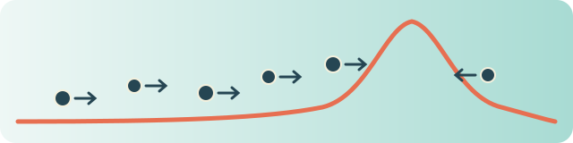

<p align="center">
  
</p>

# Chemotaxis III in Lean

A Lean 4 / Mathlib companion formalizing coefficient calculations, stationary estimates, compactness and conditional bifurcation deductions for Chemotaxis III.

  
[](https://github.com/chenle02/chemotaxis-paper-iii-lean/releases/tag/v0.1.0)
[](https://arxiv.org/abs/2610.20976v2)
[](https://chenle02.github.io/chemotaxis-paper-iii-lean/)

**Start here:** [documentation site](https://chenle02.github.io/chemotaxis-paper-iii-lean/) ·
[what is proved](docs/what-is-proved.md) ·
[exact Lean statements](docs/verification.md) ·
[scope ledger](docs/scope-ledger.md) ·
[reproduce](docs/reproducing.md) ·
[evidence](docs/evidence/README.md) ·
[paper](manuscript/) ·
for coding agents: [`llms.txt`](llms.txt)

## What is proved

The library supplies finite coefficient and modal identities, classical stationary mass and regularity estimates, weak limits and spike subsequences under stated inputs, bounded-sensitivity compactness, actual weak-H2 cosine coordinates and complement splitting, and conditional local/global branch deductions. The latest additions also derive the critical modal signal response from an actual elliptic solution family and a supplied population jet, and a quadratic coefficient from conserved mass.

The [scope ledger](data/public-scope-ledger.json) retains **47 verified scopes, 23 conditional scopes, and 3 exclusions** across **73 overlapping manuscript-facing scopes**. These counts are not a percentage of whole-paper correctness. The library has 1,525 indexed declarations, including definitions; compiler-generated auxiliaries are not counted as new mathematical theorems.

> [!IMPORTANT]
> **Not proved here:** whole-paper correctness, actual stationary operator/Fredholm identification, construction/exhaustion of the local PDE branch, a center manifold with dynamical invariance, global bifurcation alternatives and correspondence, or PDE stability. Supplied families, phase-norm jets, chart/exhaustion data, critical-parameter identifications and other named inputs remain explicit where used. A geometric Fourier complement is not identification with an operator's range or stable spectrum.

Read [what is proved](docs/what-is-proved.md), [scope ledger](docs/scope-ledger.md), and the generated [verification page](docs/verification.md).

## Paper and references

Le Chen, Ian Ruau and Wenxian Shen, *Chemotaxis models with signal-dependent sensitivity and a logistic-type source, III: Bifurcation and spike-like solutions*.

- [Manuscript source and PDF](manuscript/), the files of the arXiv v2 e-print, unchanged ([PDF](manuscript/arXiv-2610.20976v2.pdf)). The manuscript and figures remain copyright their authors; the Apache-2.0 license does not cover them.
- [arXiv:2610.20976v2](https://arxiv.org/abs/2610.20976v2), October 23, 2026: the version the coverage map and scope ledger target, source SHA-256 `0907a3b4dd79a158374d51caa3aebc9a8ddd3fd12bdcc09af0d53ab4b44d2948`.
- The scopes were first reviewed against the October 20, 2026 source. It has the same theorem and equation numbering as v1 and v2; [manuscript versions](docs/manuscript-versions.md) lists what v2 changed and the three scopes that carry an arXiv v2 note.

```bibtex
@misc{chen_ruau_shen_2026_chemotaxis_iii,
  author = {Chen, Le and Ruau, Ian and Shen, Wenxian},
  title = {Chemotaxis models with signal-dependent sensitivity and a logistic-type source, III: Bifurcation and spike-like solutions},
  eprint = {2610.20976},
  archivePrefix = {arXiv},
  primaryClass = {math.AP},
  year = {2026}
}
```

## Build and verify

Install Git and [elan](https://github.com/leanprover/elan), then:

```sh
git clone https://github.com/chenle02/chemotaxis-paper-iii-lean.git
cd chemotaxis-paper-iii-lean
./verify.sh
```

The exact Lean version is in `lean-toolchain`; `lake-manifest.json` pins Mathlib and its transitive dependencies. `./verify.sh` restores the Mathlib cache, builds all scientific modules, audits every owned declaration's axioms and checks that a deliberately admitted scratch theorem is rejected. See [the beginner guide](docs/reproducing.md) for the equivalent commands and troubleshooting.

To use the library from another Lake project:

```toml
[[require]]
name = "chemotaxis-bifurcation-lean"
git = "https://github.com/chenle02/chemotaxis-paper-iii-lean"
rev = "v0.1.0"
```

## Trust and axioms

Allowed foundational axioms: `propext`, `Quot.sound`, and `Classical.choice`. No `sorryAx`, custom axiom, `unsafe`, or `native_decide` is allowed in the scientific modules. Challenge files contain intentionally admitted comparison statements and are not scientific proof targets. The two comparator configurations cover 108 full-tier and 12 headline slots; they do not compare every library declaration. Exact source receipts and statement comparison are distinct from manuscript-fidelity review.

Source history and receipts: see [trust and axioms](docs/trust.md#source-history-and-receipts).

## Built with lean-pkg

Developed and verified with [lean-pkg](https://github.com/lean-pkg/lean-pkg) ([doi:10.5281/zenodo.23272098](https://doi.org/10.5281/zenodo.23272098)).

## Authors and AI disclosure

Paper authors: Le Chen, Ian Ruau and Wenxian Shen. Lean formalization and maintenance: Le Chen, with AI assistance in proofs, audit tooling and documentation. AI assistance is not an independent mathematical authority; the checked types, explicit inputs and stated review boundary determine the claims.

## Related reusable libraries

- [neumann-cosine-lean](https://github.com/chenle02/neumann-cosine-lean)
- [scalar-pitchfork-lean](https://github.com/chenle02/scalar-pitchfork-lean)

These standalone packages have their own APIs, receipts and releases. The companion currently retains its existing checked source rather than changing dependency identities during publication.

## Full verification record

The section below is generated by lean-pkg from `coverage.yaml`, `claims.yaml` and the committed receipts. It is easier to browse on the documentation site: [results by paper section](https://chenle02.github.io/chemotaxis-paper-iii-lean/results.html) and [all Lean statements](https://chenle02.github.io/chemotaxis-paper-iii-lean/verification.html).

<details>
<summary><strong>Show the generated verification page</strong> (73 results with Lean statements, hypotheses and checks)</summary>

<!-- lean-pkg:page:begin -->
<!-- Generated by `lean-pkg page chemotaxis-bifurcation-lean` from coverage.yaml, claims.yaml, the claims ledger and the receipts committed under .lean-receipts/. Do not edit between the markers: change the data and run `lean-pkg page chemotaxis-bifurcation-lean --write`. -->

## Verification at a glance

**How to read this page.** Lean has checked every step of the proofs listed here. It cannot check that a Lean statement says what the paper says: that comparison is yours. For each result below, read the paper's statement beside the Lean statement, and check that the hypotheses match.

47 verified scopes, 23 conditional scopes, and 3 exclusions across 73 overlapping scopes. This is partial formalization, not whole-paper certification. See data/public-scope-ledger.json for exact boundaries.

- Paper: *Chemotaxis models with signal-dependent sensitivity and a logistic-type source, III: Bifurcation and spike-like solutions*, [arXiv:2610.20976v2](https://arxiv.org/abs/2610.20976v2).
- Results listed: 73. In Lean with the paper's own hypotheses: 47; in Lean with extra hypotheses, named below: 23; not formalized: 3.
- Verified: 70 of the 70 result(s) in Lean (for 0 of them a second checker also compared the statement).

## The paper's results in Lean

### Proposition 1.1: Linear stability/instability

**Verified.** Lean accepts the proof, and lean-pkg's record shows every check that applies to this result passed (the build; its statement was not compared by a second checker).

**In the paper.**

```latex
\begin{proposition}[Linear stability/instability]\label{P:review-prop-2}
  Let $(u^*,v^*)$ be a positive constant solution of~\eqref{E:main-PE}. If
  $\chi_0 < \chi^*(u^*)$, then $(u^*, v^*)$ is linearly exponentially stable in
  the case $a, b > 0$, and is linearly exponentially stable with respect to
  perturbations with spatial average $u^*$ in the case $a = b = 0$. If $\chi_0 >
  \chi^*(u^*)$, then $(u^*,v^*)$ is linearly unstable.
\end{proposition}
```

**In Lean.** `ChemotaxisBifurcation.PhysicalLinearRegime.criticalSensitivity_eq_chiStar` in [ChemotaxisBifurcation/PhysicalLinearRegime.lean](https://github.com/chenle02/chemotaxis-paper-iii-lean/blob/c749b53b02211901063228f52af123419b0dbaf5/ChemotaxisBifurcation/PhysicalLinearRegime.lean).

```lean
theorem criticalSensitivity_eq_chiStar (p : PhysicalParams) (x beta : ℝ) :
    LinearRegime.criticalSensitivity (p.thresholdK beta) p.logisticSlope p.mu x =
      p.chiStar x beta
```

**In Lean.** `ChemotaxisBifurcation.PhysicalLinearRegime.minimizingMode_beta_iff` in [ChemotaxisBifurcation/PhysicalLinearRegime.lean](https://github.com/chenle02/chemotaxis-paper-iii-lean/blob/c749b53b02211901063228f52af123419b0dbaf5/ChemotaxisBifurcation/PhysicalLinearRegime.lean).

```lean
theorem minimizingMode_beta_iff (p : PhysicalParams) (d : ModeData) (beta1 beta2 : ℝ)
    (hp : PositiveModeParameters p) :
    MinimizingMode p d beta1 ↔ MinimizingMode p d beta2
```

**In Lean.** `ChemotaxisBifurcation.PhysicalLinearRegime.physicalGrowth_eq_coupled` in [ChemotaxisBifurcation/PhysicalLinearRegime.lean](https://github.com/chenle02/chemotaxis-paper-iii-lean/blob/c749b53b02211901063228f52af123419b0dbaf5/ChemotaxisBifurcation/PhysicalLinearRegime.lean).

```lean
theorem physicalGrowth_eq_coupled (p : PhysicalParams) (chi x beta : ℝ) :
    LinearRegime.modalGrowth chi (p.thresholdK beta) p.logisticSlope p.mu x =
      Eigenmodes.growthRate (chi * p.mobilityB0 beta) p.signalC1Physical p.mu p.logisticSlope x
```

**In Lean.** `ChemotaxisBifurcation.PhysicalLinearRegime.physicalGrowth_neg_iff` in [ChemotaxisBifurcation/PhysicalLinearRegime.lean](https://github.com/chenle02/chemotaxis-paper-iii-lean/blob/c749b53b02211901063228f52af123419b0dbaf5/ChemotaxisBifurcation/PhysicalLinearRegime.lean).

```lean
theorem physicalGrowth_neg_iff (p : PhysicalParams) (chi x beta : ℝ)
    (hp : PositiveModeParameters p) (hx : 0 < x) :
    LinearRegime.modalGrowth chi (p.thresholdK beta) p.logisticSlope p.mu x < 0 ↔
      chi < p.chiStar x beta
```

**In Lean.** `ChemotaxisBifurcation.PhysicalLinearRegime.physicalGrowth_pos_iff` in [ChemotaxisBifurcation/PhysicalLinearRegime.lean](https://github.com/chenle02/chemotaxis-paper-iii-lean/blob/c749b53b02211901063228f52af123419b0dbaf5/ChemotaxisBifurcation/PhysicalLinearRegime.lean).

```lean
theorem physicalGrowth_pos_iff (p : PhysicalParams) (chi x beta : ℝ)
    (hp : PositiveModeParameters p) (hx : 0 < x) :
    0 < LinearRegime.modalGrowth chi (p.thresholdK beta) p.logisticSlope p.mu x ↔
      p.chiStar x beta < chi
```

**In Lean.** `ChemotaxisBifurcation.PhysicalLinearRegime.physicalGrowth_zero_iff` in [ChemotaxisBifurcation/PhysicalLinearRegime.lean](https://github.com/chenle02/chemotaxis-paper-iii-lean/blob/c749b53b02211901063228f52af123419b0dbaf5/ChemotaxisBifurcation/PhysicalLinearRegime.lean).

```lean
theorem physicalGrowth_zero_iff (p : PhysicalParams) (chi x beta : ℝ)
    (hp : PositiveModeParameters p) (hx : 0 < x) :
    LinearRegime.modalGrowth chi (p.thresholdK beta) p.logisticSlope p.mu x = 0 ↔
      chi = p.chiStar x beta
```

**In Lean.** `ChemotaxisBifurcation.PhysicalLinearRegime.strictCriticalMode_other_growth_neg` in [ChemotaxisBifurcation/PhysicalLinearRegime.lean](https://github.com/chenle02/chemotaxis-paper-iii-lean/blob/c749b53b02211901063228f52af123419b0dbaf5/ChemotaxisBifurcation/PhysicalLinearRegime.lean).

```lean
theorem strictCriticalMode_other_growth_neg (p : PhysicalParams) (d : ModeData)
    (beta : ℝ) (k : ℕ) (hp : PositiveModeParameters p)
    (hs : StrictCriticalMode p d beta) (hk : 0 < k) (hne : k ≠ d.n0) :
    LinearRegime.modalGrowth (p.chiStar d.eigenvalue beta) (p.thresholdK beta)
      p.logisticSlope p.mu (Semidiscrete.continuumLam d.L k) < 0
```

**Hypotheses.** The paper's own: the Lean statement assumes nothing the paper does not.

**Axioms.** At most `Classical.choice`, `Quot.sound`, `propext` (what the build check records for the whole package).

**Note.** V2 scope: The semigroup and nonlinear PDE stability conclusions in the proposition are excluded; this row covers only modewise ordered-field algebra. Source locator: p. 5, TeX line 500.

### Theorem 1.1 (reduced scalar equation): Local pitchfork bifurcation: equilibria of the reduced scalar equation

**Verified.** Lean accepts the proof, and lean-pkg's record shows every check that applies to this result passed (the build; its statement was not compared by a second checker).

**In the paper.** The statement is not quoted here; read it in the paper.

**In Lean.** `ChemotaxisBifurcation.MixedRemainder.reducedField` in [ChemotaxisBifurcation/MixedRemainder.lean](https://github.com/chenle02/chemotaxis-paper-iii-lean/blob/c749b53b02211901063228f52af123419b0dbaf5/ChemotaxisBifurcation/MixedRemainder.lean). Its statement could not be read reliably from the source; open the file to read it.

**In Lean.** `ChemotaxisBifurcationAudit.ChemotaxisBifurcation.MixedRemainder.mixed_equilibrium_core` in [Challenge.lean](https://github.com/chenle02/chemotaxis-paper-iii-lean/blob/c749b53b02211901063228f52af123419b0dbaf5/Challenge.lean): the statement the proof was checked against (the proof is in a separate file, and a second checker confirmed it proves exactly this).

```lean
theorem mixed_equilibrium_core (alpha beta eta s R Rs ds C : ℝ)
    (halpha : 0 < alpha) (hbeta : beta ≠ 0) (hs : s ≠ 0) (hC : 0 ≤ C)
    (hs1 : |s| ≤ 1) (heta1 : |eta| ≤ 1) (hetaC : 2 * C * |eta| ≤ alpha)
    (hroot : alpha * eta * s - beta * s ^ 3 + R = 0)
    (hderiv : ds = alpha * eta - 3 * beta * s ^ 2 + Rs)
    (hR : |R| ≤ C * (|s| * eta ^ 2 + |s| ^ 3 * |eta| + s ^ 4))
    (hRs : |Rs| ≤ C * (eta ^ 2 + s ^ 2 * |eta| + |s| ^ 3))
    (hrectangle :
      C * (2 * (|beta| + 2 * C) / alpha + 1) * (|eta| + |s|) ≤ |beta| / 2) :
    0 < eta * beta ∧ ds * beta < 0 ∧
      abs (|s| - Real.sqrt (alpha * eta / beta)) ≤
        (2 * alpha * (C * (2 * (|beta| + 2 * C) / alpha + 1)) *
            (3 * |beta| / (2 * alpha) + 1) / |beta| ^ 2) * |eta|
```

**In Lean.** `ChemotaxisBifurcation.MixedRemainder.mixed_parameter_le_amp_sq` in [ChemotaxisBifurcation/MixedRemainder.lean](https://github.com/chenle02/chemotaxis-paper-iii-lean/blob/c749b53b02211901063228f52af123419b0dbaf5/ChemotaxisBifurcation/MixedRemainder.lean).

```lean
theorem mixed_parameter_le_amp_sq (alpha beta eta s e C : ℝ)
    (halpha : 0 < alpha) (hC : 0 ≤ C)
    (heta1 : |eta| ≤ 1) (hs1 : |s| ≤ 1) (hetaC : 2 * C * |eta| ≤ alpha)
    (hroot : alpha * eta - beta * s ^ 2 + e = 0)
    (he : |e| ≤ C * (eta ^ 2 + s ^ 2 * |eta| + |s| ^ 3)) :
    |eta| ≤ ampConst alpha beta C * s ^ 2
```

**In Lean.** `ChemotaxisBifurcation.MixedRemainder.mixed_value_bound_absorbed` in [ChemotaxisBifurcation/MixedRemainder.lean](https://github.com/chenle02/chemotaxis-paper-iii-lean/blob/c749b53b02211901063228f52af123419b0dbaf5/ChemotaxisBifurcation/MixedRemainder.lean).

```lean
theorem mixed_value_bound_absorbed (eta s R C D : ℝ) (hC : 0 ≤ C)
    (heta : |eta| ≤ D * s ^ 2)
    (hR : |R| ≤ C * (|s| * eta ^ 2 + |s| ^ 3 * |eta| + s ^ 4)) :
    |R| ≤ (C * (D + 1)) * (|eta| * |s| ^ 3 + |s| ^ 4)
```

**In Lean.** `ChemotaxisBifurcation.MixedRemainder.mixed_deriv_bound_absorbed` in [ChemotaxisBifurcation/MixedRemainder.lean](https://github.com/chenle02/chemotaxis-paper-iii-lean/blob/c749b53b02211901063228f52af123419b0dbaf5/ChemotaxisBifurcation/MixedRemainder.lean).

```lean
theorem mixed_deriv_bound_absorbed (eta s Rs C D : ℝ) (hC : 0 ≤ C)
    (heta : |eta| ≤ D * s ^ 2)
    (hRs : |Rs| ≤ C * (eta ^ 2 + s ^ 2 * |eta| + |s| ^ 3)) :
    |Rs| ≤ (C * (D + 1)) * (|eta| * s ^ 2 + |s| ^ 3)
```

**In Lean.** `ChemotaxisBifurcationAudit.ChemotaxisBifurcation.MixedRemainder.mixed_branch_eventually` in [Challenge.lean](https://github.com/chenle02/chemotaxis-paper-iii-lean/blob/c749b53b02211901063228f52af123419b0dbaf5/Challenge.lean): the statement the proof was checked against (the proof is in a separate file, and a second checker confirmed it proves exactly this).

```lean
theorem mixed_branch_eventually (alpha beta C r : ℝ) (R Rs : ℝ → ℝ → ℝ)
    (halpha : 0 < alpha) (hbeta : beta ≠ 0) (hC : 0 ≤ C)
    (hr : 0 < r) (hr1 : r ≤ 1)
    (hRval : ∀ e s, |e| ≤ r → |s| ≤ r →
      |R e s| ≤ C * (|s| * e ^ 2 + |s| ^ 3 * |e| + s ^ 4))
    (hRder : ∀ e s, |e| ≤ r → |s| ≤ r → HasDerivAt (R e) (Rs e s) s)
    (hRs : ∀ e s, |e| ≤ r → |s| ≤ r →
      |Rs e s| ≤ C * (e ^ 2 + s ^ 2 * |e| + |s| ^ 3)) :
    ∀ᶠ eta in 𝓝 (0 : ℝ), 0 < eta * beta →
      ∀ sgn : ℝ, (sgn = 1 ∨ sgn = -1) → ∃ s, 0 < sgn * s ∧
        alpha * eta * s - beta * s ^ 3 + R eta s = 0 ∧
        abs (|s| - Real.sqrt (alpha * eta / beta)) ≤
          (2 * alpha * (C * (2 * (|beta| + 2 * C) / alpha + 1)) *
              (3 * |beta| / (2 * alpha) + 1) / |beta| ^ 2) * |eta| ∧
        deriv (fun s => alpha * eta * s - beta * s ^ 3 + R eta s) s * beta < 0
```

**In Lean.** `ChemotaxisBifurcationAudit.ChemotaxisBifurcation.MixedRemainder.mixed_side_condition_eventually` in [Challenge.lean](https://github.com/chenle02/chemotaxis-paper-iii-lean/blob/c749b53b02211901063228f52af123419b0dbaf5/Challenge.lean): the statement the proof was checked against (the proof is in a separate file, and a second checker confirmed it proves exactly this).

```lean
theorem mixed_side_condition_eventually (alpha beta C r : ℝ) (R Rs : ℝ → ℝ → ℝ)
    (halpha : 0 < alpha) (hbeta : beta ≠ 0) (hC : 0 ≤ C)
    (hr : 0 < r) (hr1 : r ≤ 1)
    (hRval : ∀ e s, |e| ≤ r → |s| ≤ r →
      |R e s| ≤ C * (|s| * e ^ 2 + |s| ^ 3 * |e| + s ^ 4))
    (hRder : ∀ e s, |e| ≤ r → |s| ≤ r → HasDerivAt (R e) (Rs e s) s)
    (hRs : ∀ e s, |e| ≤ r → |s| ≤ r →
      |Rs e s| ≤ C * (e ^ 2 + s ^ 2 * |e| + |s| ^ 3)) :
    ∀ᶠ p in 𝓝 ((0 : ℝ), (0 : ℝ)), p.2 ≠ 0 →
      alpha * p.1 * p.2 - beta * p.2 ^ 3 + R p.1 p.2 = 0 →
        0 < p.1 * beta ∧
          deriv (fun s => alpha * p.1 * s - beta * s ^ 3 + R p.1 s) p.2 * beta < 0
```

**In Lean.** `ChemotaxisBifurcation.MixedRemainder.exists_pos_equilibrium` in [ChemotaxisBifurcation/MixedRemainder.lean](https://github.com/chenle02/chemotaxis-paper-iii-lean/blob/c749b53b02211901063228f52af123419b0dbaf5/ChemotaxisBifurcation/MixedRemainder.lean).

```lean
theorem exists_pos_equilibrium (alpha beta eta C : ℝ) (R : ℝ → ℝ)
    (halpha : 0 < alpha) (hside : 0 < eta * beta) (hC : 0 ≤ C)
    (hcont : ContinuousOn R
      (Set.Icc (Real.sqrt (alpha * eta / beta / 2)) (Real.sqrt (2 * (alpha * eta / beta)))))
    (hR : ∀ s, 0 < s → s ^ 2 ≤ 2 * (alpha * eta / beta) →
      |R s| ≤ C * (|s| * eta ^ 2 + |s| ^ 3 * |eta| + s ^ 4))
    (hsmall : C * (|eta| + 2 * (alpha * eta / beta) +
        2 * alpha * Real.sqrt (2 * (alpha * eta / beta)) / |beta|) < alpha / 2) :
    ∃ s, 0 < s ∧ alpha * eta / beta / 2 ≤ s ^ 2 ∧ s ^ 2 ≤ 2 * (alpha * eta / beta) ∧
      alpha * eta * s - beta * s ^ 3 + R s = 0
```

**In Lean.** `ChemotaxisBifurcation.MixedRemainder.branchSmall_eventually` in [ChemotaxisBifurcation/MixedRemainder.lean](https://github.com/chenle02/chemotaxis-paper-iii-lean/blob/c749b53b02211901063228f52af123419b0dbaf5/ChemotaxisBifurcation/MixedRemainder.lean).

```lean
theorem branchSmall_eventually (alpha beta C r : ℝ) (halpha : 0 < alpha) (hbeta : beta ≠ 0)
    (hr : 0 < r) :
    ∀ᶠ eta in 𝓝 (0 : ℝ), BranchSmall alpha beta C r eta
```

**In Lean.** `ChemotaxisBifurcation.MixedRemainder.BranchSmall` in [ChemotaxisBifurcation/MixedRemainder.lean](https://github.com/chenle02/chemotaxis-paper-iii-lean/blob/c749b53b02211901063228f52af123419b0dbaf5/ChemotaxisBifurcation/MixedRemainder.lean). Its statement could not be read reliably from the source; open the file to read it.

**In Lean.** `ChemotaxisBifurcation.MixedRemainder.ampConst` in [ChemotaxisBifurcation/MixedRemainder.lean](https://github.com/chenle02/chemotaxis-paper-iii-lean/blob/c749b53b02211901063228f52af123419b0dbaf5/ChemotaxisBifurcation/MixedRemainder.lean). Its statement could not be read reliably from the source; open the file to read it.

**In Lean.** `ChemotaxisBifurcation.MixedRemainder.absorbedConst` in [ChemotaxisBifurcation/MixedRemainder.lean](https://github.com/chenle02/chemotaxis-paper-iii-lean/blob/c749b53b02211901063228f52af123419b0dbaf5/ChemotaxisBifurcation/MixedRemainder.lean). Its statement could not be read reliably from the source; open the file to read it.

**In Lean.** `ChemotaxisBifurcationAudit.ChemotaxisBifurcation.MixedRemainder.center_ODE_final_value_bound_weak` in [Challenge.lean](https://github.com/chenle02/chemotaxis-paper-iii-lean/blob/c749b53b02211901063228f52af123419b0dbaf5/Challenge.lean): the statement the proof was checked against (the proof is in a separate file, and a second checker confirmed it proves exactly this).

```lean
theorem center_ODE_final_value_bound_weak (eta s R C : ℝ)
    (hC : 0 ≤ C) (hs1 : |s| ≤ 1)
    (hR : |R| ≤ C * (s ^ 2 * eta ^ 2 + |s| ^ 3 * |eta| + s ^ 4)) :
    |R| ≤ C * (|s| * eta ^ 2 + |s| ^ 3 * |eta| + s ^ 4)
```

**In Lean.** `ChemotaxisBifurcationAudit.ChemotaxisBifurcation.MixedRemainder.center_ODE_final_deriv_bound_weak` in [Challenge.lean](https://github.com/chenle02/chemotaxis-paper-iii-lean/blob/c749b53b02211901063228f52af123419b0dbaf5/Challenge.lean): the statement the proof was checked against (the proof is in a separate file, and a second checker confirmed it proves exactly this).

```lean
theorem center_ODE_final_deriv_bound_weak (eta s Rs C : ℝ)
    (hC : 0 ≤ C) (hs1 : |s| ≤ 1)
    (hRs : |Rs| ≤ C * (|s| * eta ^ 2 + s ^ 2 * |eta| + |s| ^ 3)) :
    |Rs| ≤ C * (eta ^ 2 + s ^ 2 * |eta| + |s| ^ 3)
```

**In Lean.** `ChemotaxisBifurcation.NormalForm.paper_equilibrium_core` in [ChemotaxisBifurcation/RemainderBounds.lean](https://github.com/chenle02/chemotaxis-paper-iii-lean/blob/c749b53b02211901063228f52af123419b0dbaf5/ChemotaxisBifurcation/RemainderBounds.lean).

```lean
theorem paper_equilibrium_core (alpha beta eta s R Rs ds C : ℝ)
    (halpha : 0 < alpha) (hbeta : beta ≠ 0) (hs : s ≠ 0)
    (hC : 0 ≤ C) (hs1 : |s| ≤ 1)
    (hroot : alpha * eta * s - beta * s ^ 3 + R = 0)
    (hderiv : ds = alpha * eta - 3 * beta * s ^ 2 + Rs)
    (hR : |R| ≤ C * (|eta| * |s| ^ 3 + |s| ^ 4))
    (hRs : |Rs| ≤ C * (|eta| * s ^ 2 + |s| ^ 3))
    (hrectangle : C * (|eta| + |s|) ≤ |beta| / 2) :
    0 < eta * beta ∧ ds * beta < 0 ∧
      abs (|s| - Real.sqrt (alpha * eta / beta)) ≤
        (2 * alpha * C * (3 * |beta| / (2 * alpha) + 1) / |beta| ^ 2) * |eta|
```

**Hypotheses.** The paper's, plus these, which the Lean statement assumes and the paper proves or assumes elsewhere: identification of η=χ₀−χ\* and s=u\_n₀ with the reduced scalar equation; α&gt;0 and β≠0; fixed C≥0 and 0&lt;r≤1; uniform bound \|R(η,s)\|≤C(\|s\|η²+\|s\|³\|η\|+s⁴) on \|η\|,\|s\|≤r, or its stronger Eq. 2.43 version; HasDerivAt (R η) (Rs η s) s throughout that box; uniform derivative bound \|Rs(η,s)\|≤C(η²+s²\|η\|+\|s\|³), or the stronger matching version.

**Axioms.** At most `Classical.choice`, `Quot.sound`, `propext` (what the build check records for the whole package).

**Note.** V2 scope: The finite scalar side, derivative-sign, and amplitude conclusions are proved from the explicit reduced equation and separate remainder interfaces. Center-manifold reduction, branch existence, and PDE stability lifting remain outside this row. Source locator: p. 6, TeX line 580. arXiv v2: Step 5 of the proof drops the derivative remainder estimate (ledger arxiv\_v2\_note).

### Theorem 1.2(1): beta\_n0 is a quadratic in beta with negative leading coefficient

**Verified.** Lean accepts the proof, and lean-pkg's record shows every check that applies to this result passed (the build; its statement was not compared by a second checker).

**In the paper.** The statement is not quoted here; read it in the paper.

**In Lean.** `ChemotaxisBifurcation.BetaAssemblyData.coeff_quadratic` in [ChemotaxisBifurcation/BetaQuadratic.lean](https://github.com/chenle02/chemotaxis-paper-iii-lean/blob/c749b53b02211901063228f52af123419b0dbaf5/ChemotaxisBifurcation/BetaQuadratic.lean).

```lean
theorem coeff_quadratic (d : BetaAssemblyData) (beta : ℝ) (hW : d.W ≠ 0) :
    d.coeff beta = d.leading * beta ^ 2 + d.linear * beta + d.constant
```

**In Lean.** `ChemotaxisBifurcation.betaAssemblyData_constant` in [ChemotaxisBifurcation/BetaQuadratic.lean](https://github.com/chenle02/chemotaxis-paper-iii-lean/blob/c749b53b02211901063228f52af123419b0dbaf5/ChemotaxisBifurcation/BetaQuadratic.lean).

```lean
theorem betaAssemblyData_constant
    (p : PhysicalParams) (x a0 : ℝ)
    (hU : p.uStar ≠ 0) (hW : p.signalOffset ≠ 0)
    (hsigma : sigma2 p x ≠ 0) :
    (betaAssemblyData p x a0).constant = betaConstantAtA0 p x a0
```

**In Lean.** `ChemotaxisBifurcation.betaAssemblyData_leading` in [ChemotaxisBifurcation/BetaQuadratic.lean](https://github.com/chenle02/chemotaxis-paper-iii-lean/blob/c749b53b02211901063228f52af123419b0dbaf5/ChemotaxisBifurcation/BetaQuadratic.lean).

```lean
theorem betaAssemblyData_leading
    (p : PhysicalParams) (x a0 : ℝ) :
    (betaAssemblyData p x a0).leading = betaLeading p x
```

**In Lean.** `ChemotaxisBifurcation.betaAssemblyData_linear` in [ChemotaxisBifurcation/BetaQuadratic.lean](https://github.com/chenle02/chemotaxis-paper-iii-lean/blob/c749b53b02211901063228f52af123419b0dbaf5/ChemotaxisBifurcation/BetaQuadratic.lean).

```lean
theorem betaAssemblyData_linear
    (p : PhysicalParams) (x a0 : ℝ)
    (hU : p.uStar ≠ 0) (hW : p.signalOffset ≠ 0)
    (hsigma : sigma2 p x ≠ 0) :
    (betaAssemblyData p x a0).linear = betaLinearAtA0 p x a0
```

**In Lean.** `ChemotaxisBifurcation.betaCoefficientAtA0_eq_assembly` in [ChemotaxisBifurcation/BetaQuadratic.lean](https://github.com/chenle02/chemotaxis-paper-iii-lean/blob/c749b53b02211901063228f52af123419b0dbaf5/ChemotaxisBifurcation/BetaQuadratic.lean).

```lean
theorem betaCoefficientAtA0_eq_assembly
    (p : PhysicalParams) (x a0 beta : ℝ)
    (hU : p.uStar ≠ 0) (hW : p.signalOffset ≠ 0)
    (hsigma : sigma2 p x ≠ 0) :
    betaCoefficientAtA0 p x a0 beta =
      (betaAssemblyData p x a0).coeff beta
```

**In Lean.** `ChemotaxisBifurcation.betaCoefficientAtA0_quadratic` in [ChemotaxisBifurcation/BetaQuadratic.lean](https://github.com/chenle02/chemotaxis-paper-iii-lean/blob/c749b53b02211901063228f52af123419b0dbaf5/ChemotaxisBifurcation/BetaQuadratic.lean).

```lean
theorem betaCoefficientAtA0_quadratic
    (p : PhysicalParams) (x a0 beta : ℝ)
    (hU : p.uStar ≠ 0) (hW : p.signalOffset ≠ 0)
    (hmu : p.mu ≠ 0) (hmux : p.mu + x ≠ 0)
    (hmu4 : p.mu + 4 * x ≠ 0)
    (hC : (mobilityScaledTaylor p 0).Cprime ≠ 0)
    (hx : x ≠ 0) (hsigma : sigma2 p x ≠ 0) :
    betaCoefficientAtA0 p x a0 beta =
      betaLeading p x * beta ^ 2 + betaLinearAtA0 p x a0 * beta +
        betaConstantAtA0 p x a0
```

**In Lean.** `ChemotaxisBifurcation.betaDouble_data` in [ChemotaxisBifurcation/BetaRegimes.lean](https://github.com/chenle02/chemotaxis-paper-iii-lean/blob/c749b53b02211901063228f52af123419b0dbaf5/ChemotaxisBifurcation/BetaRegimes.lean).

```lean
theorem betaDouble_data
    (A B C : ℝ) (hA : A < 0) (hB : 0 < B)
    (hD : betaDiscriminant A B C = 0) :
    0 < betaDouble A B ∧
      betaQuadratic A B C (betaDouble A B) = 0 ∧
      2 * A * betaDouble A B + B = 0
```

**In Lean.** `ChemotaxisBifurcation.betaLeading_eq_manuscript` in [ChemotaxisBifurcation/BetaQuadratic.lean](https://github.com/chenle02/chemotaxis-paper-iii-lean/blob/c749b53b02211901063228f52af123419b0dbaf5/ChemotaxisBifurcation/BetaQuadratic.lean).

```lean
theorem betaLeading_eq_manuscript
    (p : PhysicalParams) (x : ℝ)
    (hW : p.signalOffset ≠ 0) (hsigma : sigma2 p x ≠ 0) :
    betaLeading p x =
      cubicF p x ^ 3 * (x * chiStarTimesB0 p x) *
        (4 * signalMode1 p (4 * x) * (x * chiStarTimesB0 p x) -
          sigma2 p x) /
        (8 * sigma2 p x * p.signalOffset ^ 2)
```

**In Lean.** `ChemotaxisBifurcation.betaLeading_eq_manuscript_Pi` in [ChemotaxisBifurcation/BetaQuadratic.lean](https://github.com/chenle02/chemotaxis-paper-iii-lean/blob/c749b53b02211901063228f52af123419b0dbaf5/ChemotaxisBifurcation/BetaQuadratic.lean).

```lean
theorem betaLeading_eq_manuscript_Pi
    (p : PhysicalParams) (x : ℝ) (hu : 0 < p.uStar)
    (hW : p.signalOffset ≠ 0) (hsigma : sigma2 p x ≠ 0) :
    betaLeading p x =
      cubicF p x ^ 3 * (p.uStar ^ p.m * PiScaled p x) *
        (4 * signalMode1 p (4 * x) * (p.uStar ^ p.m * PiScaled p x) -
          sigma2 p x) /
        (8 * sigma2 p x * p.signalOffset ^ 2)
```

**In Lean.** `ChemotaxisBifurcation.betaLeading_neg` in [ChemotaxisBifurcation/BetaQuadratic.lean](https://github.com/chenle02/chemotaxis-paper-iii-lean/blob/c749b53b02211901063228f52af123419b0dbaf5/ChemotaxisBifurcation/BetaQuadratic.lean).

```lean
theorem betaLeading_neg
    (p : PhysicalParams) (x : ℝ)
    (hx : 0 < x) (hchi : 0 < chiStarTimesB0 p x)
    (hF : 0 < cubicF p x) (hW : 0 < p.signalOffset)
    (hG : cubicGSlope p x < 0) :
    betaLeading p x < 0
```

**In Lean.** `ChemotaxisBifurcation.betaMinus_is_root` in [ChemotaxisBifurcation/BetaRegimes.lean](https://github.com/chenle02/chemotaxis-paper-iii-lean/blob/c749b53b02211901063228f52af123419b0dbaf5/ChemotaxisBifurcation/BetaRegimes.lean).

```lean
theorem betaMinus_is_root
    (A B C : ℝ) (hA : A ≠ 0) (hD : 0 ≤ betaDiscriminant A B C) :
    betaQuadratic A B C (betaMinus A B C) = 0
```

**In Lean.** `ChemotaxisBifurcation.betaMinus_lt_betaPlus` in [ChemotaxisBifurcation/BetaRegimes.lean](https://github.com/chenle02/chemotaxis-paper-iii-lean/blob/c749b53b02211901063228f52af123419b0dbaf5/ChemotaxisBifurcation/BetaRegimes.lean).

```lean
theorem betaMinus_lt_betaPlus
    (A B C : ℝ) (hA : A < 0) (hD : 0 < betaDiscriminant A B C) :
    betaMinus A B C < betaPlus A B C
```

**In Lean.** `ChemotaxisBifurcation.betaPlus_is_root` in [ChemotaxisBifurcation/BetaRegimes.lean](https://github.com/chenle02/chemotaxis-paper-iii-lean/blob/c749b53b02211901063228f52af123419b0dbaf5/ChemotaxisBifurcation/BetaRegimes.lean).

```lean
theorem betaPlus_is_root
    (A B C : ℝ) (hA : A ≠ 0) (hD : 0 ≤ betaDiscriminant A B C) :
    betaQuadratic A B C (betaPlus A B C) = 0
```

**In Lean.** `ChemotaxisBifurcation.betaQuadratic_double_root_factor` in [ChemotaxisBifurcation/BetaRegimes.lean](https://github.com/chenle02/chemotaxis-paper-iii-lean/blob/c749b53b02211901063228f52af123419b0dbaf5/ChemotaxisBifurcation/BetaRegimes.lean).

```lean
theorem betaQuadratic_double_root_factor
    (A B C beta0 beta : ℝ)
    (hroot : betaQuadratic A B C beta0 = 0)
    (htangent : 2 * A * beta0 + B = 0) :
    betaQuadratic A B C beta = A * (beta - beta0) ^ 2
```

**In Lean.** `ChemotaxisBifurcation.betaQuadratic_factor_of_root` in [ChemotaxisBifurcation/BetaRegimes.lean](https://github.com/chenle02/chemotaxis-paper-iii-lean/blob/c749b53b02211901063228f52af123419b0dbaf5/ChemotaxisBifurcation/BetaRegimes.lean).

```lean
theorem betaQuadratic_factor_of_root
    (A B C beta0 beta : ℝ)
    (hroot : betaQuadratic A B C beta0 = 0) :
    betaQuadratic A B C beta =
      (beta - beta0) * (A * (beta + beta0) + B)
```

**In Lean.** `ChemotaxisBifurcation.betaQuadratic_factor_two_roots` in [ChemotaxisBifurcation/BetaRegimes.lean](https://github.com/chenle02/chemotaxis-paper-iii-lean/blob/c749b53b02211901063228f52af123419b0dbaf5/ChemotaxisBifurcation/BetaRegimes.lean).

```lean
theorem betaQuadratic_factor_two_roots
    (A B C betaMinus betaPlus beta : ℝ)
    (hA : A ≠ 0) (hlt : betaMinus < betaPlus)
    (hminus : betaQuadratic A B C betaMinus = 0)
    (hplus : betaQuadratic A B C betaPlus = 0) :
    betaQuadratic A B C beta =
      A * (beta - betaMinus) * (beta - betaPlus)
```

**In Lean.** `ChemotaxisBifurcation.betaRegime_conditions_exhaustive` in [ChemotaxisBifurcation/BetaRegimes.lean](https://github.com/chenle02/chemotaxis-paper-iii-lean/blob/c749b53b02211901063228f52af123419b0dbaf5/ChemotaxisBifurcation/BetaRegimes.lean).

```lean
theorem betaRegime_conditions_exhaustive (A B C : ℝ) :
    regimeConditionI A B C ∨ regimeConditionII A B C ∨
      regimeConditionIII A B C ∨ regimeConditionIV A B C
```

**In Lean.** `ChemotaxisBifurcation.betaRegime_conditions_pairwise_disjoint` in [ChemotaxisBifurcation/BetaRegimes.lean](https://github.com/chenle02/chemotaxis-paper-iii-lean/blob/c749b53b02211901063228f52af123419b0dbaf5/ChemotaxisBifurcation/BetaRegimes.lean).

```lean
theorem betaRegime_conditions_pairwise_disjoint (A B C : ℝ) :
    (regimeConditionI A B C →
      ¬regimeConditionII A B C ∧ ¬regimeConditionIII A B C ∧
        ¬regimeConditionIV A B C) ∧
    (regimeConditionII A B C →
      ¬regimeConditionIII A B C ∧ ¬regimeConditionIV A B C) ∧
    (regimeConditionIII A B C → ¬regimeConditionIV A B C)
```

**In Lean.** `ChemotaxisBifurcation.betaRoots_nonnegative_of_C_nonpos_B_pos` in [ChemotaxisBifurcation/BetaRegimes.lean](https://github.com/chenle02/chemotaxis-paper-iii-lean/blob/c749b53b02211901063228f52af123419b0dbaf5/ChemotaxisBifurcation/BetaRegimes.lean).

```lean
theorem betaRoots_nonnegative_of_C_nonpos_B_pos
    (A B C : ℝ) (hA : A < 0) (hB : 0 < B) (hC : C ≤ 0)
    (hD : 0 < betaDiscriminant A B C) :
    0 ≤ betaMinus A B C ∧ 0 < betaPlus A B C
```

**In Lean.** `ChemotaxisBifurcation.betaRoots_sign_of_C_pos` in [ChemotaxisBifurcation/BetaRegimes.lean](https://github.com/chenle02/chemotaxis-paper-iii-lean/blob/c749b53b02211901063228f52af123419b0dbaf5/ChemotaxisBifurcation/BetaRegimes.lean).

```lean
theorem betaRoots_sign_of_C_pos
    (A B C : ℝ) (hA : A < 0) (hC : 0 < C) :
    betaMinus A B C < 0 ∧ 0 < betaPlus A B C
```

**In Lean.** `ChemotaxisBifurcation.cofactor_neg_of_pos_constant` in [ChemotaxisBifurcation/BetaRegimes.lean](https://github.com/chenle02/chemotaxis-paper-iii-lean/blob/c749b53b02211901063228f52af123419b0dbaf5/ChemotaxisBifurcation/BetaRegimes.lean).

```lean
theorem cofactor_neg_of_pos_constant
    (A B C betaPlus beta : ℝ)
    (hA : A < 0) (hC : 0 < C) (hPlus : 0 < betaPlus)
    (hroot : betaQuadratic A B C betaPlus = 0) (hbeta : 0 ≤ beta) :
    A * (beta + betaPlus) + B < 0
```

**In Lean.** `ChemotaxisBifurcation.cubicE_eq_at_zero` in [ChemotaxisBifurcation/BetaQuadratic.lean](https://github.com/chenle02/chemotaxis-paper-iii-lean/blob/c749b53b02211901063228f52af123419b0dbaf5/ChemotaxisBifurcation/BetaQuadratic.lean).

```lean
theorem cubicE_eq_at_zero
    (p : PhysicalParams) (x a0 beta : ℝ) :
    cubicE p (quadraticJetData p x beta a0) =
      cubicE p (quadraticJetData p x 0 a0)
```

**In Lean.** `ChemotaxisBifurcation.cubicGSlope_neg` in [ChemotaxisBifurcation/BetaQuadratic.lean](https://github.com/chenle02/chemotaxis-paper-iii-lean/blob/c749b53b02211901063228f52af123419b0dbaf5/ChemotaxisBifurcation/BetaQuadratic.lean).

```lean
theorem cubicGSlope_neg
    (p : PhysicalParams) (x : ℝ)
    (hF4 : 0 < signalMode1 p (4 * x))
    (ha2 : secondModeA2Slope p x < 0) :
    cubicGSlope p x < 0
```

**In Lean.** `ChemotaxisBifurcation.cubicG_eq_affine` in [ChemotaxisBifurcation/BetaQuadratic.lean](https://github.com/chenle02/chemotaxis-paper-iii-lean/blob/c749b53b02211901063228f52af123419b0dbaf5/ChemotaxisBifurcation/BetaQuadratic.lean).

```lean
theorem cubicG_eq_affine
    (p : PhysicalParams) (x a0 beta : ℝ)
    (hW : p.signalOffset ≠ 0) (hsigma : sigma2 p x ≠ 0) :
    cubicG p x (quadraticJetData p x beta a0) =
      cubicG p x (quadraticJetData p x 0 a0) + cubicGSlope p x * beta
```

**In Lean.** `ChemotaxisBifurcation.cubicH_eq_affine` in [ChemotaxisBifurcation/BetaQuadratic.lean](https://github.com/chenle02/chemotaxis-paper-iii-lean/blob/c749b53b02211901063228f52af123419b0dbaf5/ChemotaxisBifurcation/BetaQuadratic.lean).

```lean
theorem cubicH_eq_affine
    (p : PhysicalParams) (x a0 beta : ℝ)
    (hW : p.signalOffset ≠ 0) (hsigma : sigma2 p x ≠ 0) :
    cubicH p x (quadraticJetData p x beta a0) =
      cubicH p x (quadraticJetData p x 0 a0) +
        2 * signalMode2 p x * secondModeA2Slope p x * beta
```

**In Lean.** `ChemotaxisBifurcation.fixedMassBetaCoefficient_physical_quadratic` in [ChemotaxisBifurcation/PhysicalBetaRegimes.lean](https://github.com/chenle02/chemotaxis-paper-iii-lean/blob/c749b53b02211901063228f52af123419b0dbaf5/ChemotaxisBifurcation/PhysicalBetaRegimes.lean).

```lean
theorem fixedMassBetaCoefficient_physical_quadratic
    (p : PhysicalParams) (d : ModeData) (betaRef beta : ℝ)
    (hp : p.FixedMassAdmissible) (hc : StrictCriticalMode p d betaRef) :
    fixedMassBetaCoefficient p d.eigenvalue beta =
      betaQuadratic (physicalBetaA p d)
        (physicalBetaB p d fixedMassA0)
        (physicalBetaC p d fixedMassA0) beta
```

**In Lean.** `ChemotaxisBifurcation.fixedMassBetaCoefficient_quadratic` in [ChemotaxisBifurcation/BetaQuadratic.lean](https://github.com/chenle02/chemotaxis-paper-iii-lean/blob/c749b53b02211901063228f52af123419b0dbaf5/ChemotaxisBifurcation/BetaQuadratic.lean).

```lean
theorem fixedMassBetaCoefficient_quadratic
    (p : PhysicalParams) (x beta : ℝ)
    (hU : p.uStar ≠ 0) (hW : p.signalOffset ≠ 0)
    (hmu : p.mu ≠ 0) (hmux : p.mu + x ≠ 0)
    (hmu4 : p.mu + 4 * x ≠ 0)
    (hC : (mobilityScaledTaylor p 0).Cprime ≠ 0)
    (hx : x ≠ 0) (hsigma : sigma2 p x ≠ 0) :
    fixedMassBetaCoefficient p x beta =
      betaLeading p x * beta ^ 2 +
        betaLinearAtA0 p x fixedMassA0 * beta +
        betaConstantAtA0 p x fixedMassA0
```

**In Lean.** `ChemotaxisBifurcation.logisticBetaCoefficient_physical_quadratic` in [ChemotaxisBifurcation/PhysicalBetaRegimes.lean](https://github.com/chenle02/chemotaxis-paper-iii-lean/blob/c749b53b02211901063228f52af123419b0dbaf5/ChemotaxisBifurcation/PhysicalBetaRegimes.lean).

```lean
theorem logisticBetaCoefficient_physical_quadratic
    (p : PhysicalParams) (d : ModeData) (betaRef beta : ℝ)
    (hp : p.LogisticAdmissible) (hc : StrictCriticalMode p d betaRef) :
    logisticBetaCoefficient p d.eigenvalue beta =
      betaQuadratic (physicalBetaA p d)
        (physicalBetaB p d (logisticA0 p))
        (physicalBetaC p d (logisticA0 p)) beta
```

**In Lean.** `ChemotaxisBifurcation.logisticBetaCoefficient_quadratic` in [ChemotaxisBifurcation/BetaQuadratic.lean](https://github.com/chenle02/chemotaxis-paper-iii-lean/blob/c749b53b02211901063228f52af123419b0dbaf5/ChemotaxisBifurcation/BetaQuadratic.lean).

```lean
theorem logisticBetaCoefficient_quadratic
    (p : PhysicalParams) (x beta : ℝ)
    (hU : p.uStar ≠ 0) (hW : p.signalOffset ≠ 0)
    (hmu : p.mu ≠ 0) (hmux : p.mu + x ≠ 0)
    (hmu4 : p.mu + 4 * x ≠ 0)
    (hC : (mobilityScaledTaylor p 0).Cprime ≠ 0)
    (hx : x ≠ 0) (hsigma : sigma2 p x ≠ 0) :
    logisticBetaCoefficient p x beta =
      betaLeading p x * beta ^ 2 +
        betaLinearAtA0 p x (logisticA0 p) * beta +
        betaConstantAtA0 p x (logisticA0 p)
```

**In Lean.** `ChemotaxisBifurcation.physicalBetaA_neg` in [ChemotaxisBifurcation/PhysicalBetaRegimes.lean](https://github.com/chenle02/chemotaxis-paper-iii-lean/blob/c749b53b02211901063228f52af123419b0dbaf5/ChemotaxisBifurcation/PhysicalBetaRegimes.lean).

```lean
theorem physicalBetaA_neg
    (p : PhysicalParams) (d : ModeData) (betaRef : ℝ)
    (hp : PositiveModeParameters p) (hc : StrictCriticalMode p d betaRef) :
    physicalBetaA p d < 0
```

**In Lean.** `ChemotaxisBifurcation.physicalBetaCoefficientAtA0_quadratic` in [ChemotaxisBifurcation/PhysicalBetaRegimes.lean](https://github.com/chenle02/chemotaxis-paper-iii-lean/blob/c749b53b02211901063228f52af123419b0dbaf5/ChemotaxisBifurcation/PhysicalBetaRegimes.lean).

```lean
theorem physicalBetaCoefficientAtA0_quadratic
    (p : PhysicalParams) (d : ModeData) (betaRef a0 beta : ℝ)
    (hp : PositiveModeParameters p) (hc : StrictCriticalMode p d betaRef) :
    betaCoefficientAtA0 p d.eigenvalue a0 beta =
      betaQuadratic (physicalBetaA p d) (physicalBetaB p d a0)
        (physicalBetaC p d a0) beta
```

**In Lean.** `ChemotaxisBifurcation.physical_regime_case_i` in [ChemotaxisBifurcation/PhysicalBetaRegimes.lean](https://github.com/chenle02/chemotaxis-paper-iii-lean/blob/c749b53b02211901063228f52af123419b0dbaf5/ChemotaxisBifurcation/PhysicalBetaRegimes.lean).

```lean
theorem physical_regime_case_i
    (p : PhysicalParams) (d : ModeData) (betaRef a0 : ℝ)
    (hp : PositiveModeParameters p) (hc : StrictCriticalMode p d betaRef)
    (hC : 0 < physicalBetaC p d a0) :
    (∀ beta, 0 ≤ beta →
      beta < betaPlus (physicalBetaA p d) (physicalBetaB p d a0)
        (physicalBetaC p d a0) →
      0 < betaCoefficientAtA0 p d.eigenvalue a0 beta) ∧
    (∀ beta,
      betaPlus (physicalBetaA p d) (physicalBetaB p d a0)
        (physicalBetaC p d a0) < beta →
      betaCoefficientAtA0 p d.eigenvalue a0 beta < 0)
```

**In Lean.** `ChemotaxisBifurcation.physical_regime_case_ii` in [ChemotaxisBifurcation/PhysicalBetaRegimes.lean](https://github.com/chenle02/chemotaxis-paper-iii-lean/blob/c749b53b02211901063228f52af123419b0dbaf5/ChemotaxisBifurcation/PhysicalBetaRegimes.lean).

```lean
theorem physical_regime_case_ii
    (p : PhysicalParams) (d : ModeData) (betaRef a0 : ℝ)
    (hp : PositiveModeParameters p) (hc : StrictCriticalMode p d betaRef)
    (hB : 0 < physicalBetaB p d a0) (hC : physicalBetaC p d a0 ≤ 0)
    (hD : 0 < betaDiscriminant (physicalBetaA p d)
      (physicalBetaB p d a0) (physicalBetaC p d a0)) :
    (∀ beta, 0 ≤ beta →
      beta < betaMinus (physicalBetaA p d) (physicalBetaB p d a0)
        (physicalBetaC p d a0) →
      betaCoefficientAtA0 p d.eigenvalue a0 beta < 0) ∧
    (∀ beta,
      betaMinus (physicalBetaA p d) (physicalBetaB p d a0)
          (physicalBetaC p d a0) < beta →
      beta < betaPlus (physicalBetaA p d) (physicalBetaB p d a0)
          (physicalBetaC p d a0) →
      0 < betaCoefficientAtA0 p d.eigenvalue a0 beta) ∧
    (∀ beta,
      betaPlus (physicalBetaA p d) (physicalBetaB p d a0)
          (physicalBetaC p d a0) < beta →
      betaCoefficientAtA0 p d.eigenvalue a0 beta < 0)
```

**In Lean.** `ChemotaxisBifurcation.physical_regime_case_iii_double` in [ChemotaxisBifurcation/PhysicalBetaRegimes.lean](https://github.com/chenle02/chemotaxis-paper-iii-lean/blob/c749b53b02211901063228f52af123419b0dbaf5/ChemotaxisBifurcation/PhysicalBetaRegimes.lean).

```lean
theorem physical_regime_case_iii_double
    (p : PhysicalParams) (d : ModeData) (betaRef a0 : ℝ)
    (hp : PositiveModeParameters p) (hc : StrictCriticalMode p d betaRef)
    (hB : 0 < physicalBetaB p d a0)
    (hD : betaDiscriminant (physicalBetaA p d)
      (physicalBetaB p d a0) (physicalBetaC p d a0) = 0) :
    ∀ beta, 0 ≤ beta →
      beta ≠ betaDouble (physicalBetaA p d) (physicalBetaB p d a0) →
      betaCoefficientAtA0 p d.eigenvalue a0 beta < 0
```

**In Lean.** `ChemotaxisBifurcation.physical_regime_case_iii_zero` in [ChemotaxisBifurcation/PhysicalBetaRegimes.lean](https://github.com/chenle02/chemotaxis-paper-iii-lean/blob/c749b53b02211901063228f52af123419b0dbaf5/ChemotaxisBifurcation/PhysicalBetaRegimes.lean).

```lean
theorem physical_regime_case_iii_zero
    (p : PhysicalParams) (d : ModeData) (betaRef a0 : ℝ)
    (hp : PositiveModeParameters p) (hc : StrictCriticalMode p d betaRef)
    (hB : physicalBetaB p d a0 ≤ 0) (hC : physicalBetaC p d a0 = 0) :
    ∀ beta, 0 < beta → betaCoefficientAtA0 p d.eigenvalue a0 beta < 0
```

**In Lean.** `ChemotaxisBifurcation.physical_regime_case_iv_B_nonpos` in [ChemotaxisBifurcation/PhysicalBetaRegimes.lean](https://github.com/chenle02/chemotaxis-paper-iii-lean/blob/c749b53b02211901063228f52af123419b0dbaf5/ChemotaxisBifurcation/PhysicalBetaRegimes.lean).

```lean
theorem physical_regime_case_iv_B_nonpos
    (p : PhysicalParams) (d : ModeData) (betaRef a0 : ℝ)
    (hp : PositiveModeParameters p) (hc : StrictCriticalMode p d betaRef)
    (hB : physicalBetaB p d a0 ≤ 0) (hC : physicalBetaC p d a0 < 0) :
    ∀ beta, 0 ≤ beta → betaCoefficientAtA0 p d.eigenvalue a0 beta < 0
```

**In Lean.** `ChemotaxisBifurcation.physical_regime_case_iv_discriminant_neg` in [ChemotaxisBifurcation/PhysicalBetaRegimes.lean](https://github.com/chenle02/chemotaxis-paper-iii-lean/blob/c749b53b02211901063228f52af123419b0dbaf5/ChemotaxisBifurcation/PhysicalBetaRegimes.lean).

```lean
theorem physical_regime_case_iv_discriminant_neg
    (p : PhysicalParams) (d : ModeData) (betaRef a0 : ℝ)
    (hp : PositiveModeParameters p) (hc : StrictCriticalMode p d betaRef)
    (hD : betaDiscriminant (physicalBetaA p d)
      (physicalBetaB p d a0) (physicalBetaC p d a0) < 0) :
    ∀ beta, betaCoefficientAtA0 p d.eigenvalue a0 beta < 0
```

**In Lean.** `ChemotaxisBifurcation.regime_case_i` in [ChemotaxisBifurcation/BetaRegimes.lean](https://github.com/chenle02/chemotaxis-paper-iii-lean/blob/c749b53b02211901063228f52af123419b0dbaf5/ChemotaxisBifurcation/BetaRegimes.lean).

```lean
theorem regime_case_i
    (A B C : ℝ) (hA : A < 0) (hC : 0 < C) :
    (∀ beta, 0 ≤ beta → beta < betaPlus A B C →
      0 < betaQuadratic A B C beta) ∧
    (∀ beta, betaPlus A B C < beta → betaQuadratic A B C beta < 0) ∧
    (∀ beta, 0 ≤ beta → betaQuadratic A B C beta = 0 →
      beta = betaPlus A B C)
```

**In Lean.** `ChemotaxisBifurcation.regime_case_ii` in [ChemotaxisBifurcation/BetaRegimes.lean](https://github.com/chenle02/chemotaxis-paper-iii-lean/blob/c749b53b02211901063228f52af123419b0dbaf5/ChemotaxisBifurcation/BetaRegimes.lean).

```lean
theorem regime_case_ii
    (A B C : ℝ) (hA : A < 0) (hB : 0 < B) (hC : C ≤ 0)
    (hD : 0 < betaDiscriminant A B C) :
    (∀ beta, 0 ≤ beta → beta < betaMinus A B C →
      betaQuadratic A B C beta < 0) ∧
    (∀ beta, betaMinus A B C < beta → beta < betaPlus A B C →
      0 < betaQuadratic A B C beta) ∧
    (∀ beta, betaPlus A B C < beta → betaQuadratic A B C beta < 0)
```

**In Lean.** `ChemotaxisBifurcation.regime_case_iii_double` in [ChemotaxisBifurcation/BetaRegimes.lean](https://github.com/chenle02/chemotaxis-paper-iii-lean/blob/c749b53b02211901063228f52af123419b0dbaf5/ChemotaxisBifurcation/BetaRegimes.lean).

```lean
theorem regime_case_iii_double
    (A B C : ℝ) (hA : A < 0) (hB : 0 < B)
    (hD : betaDiscriminant A B C = 0) :
    (∀ beta, 0 ≤ beta → beta ≠ betaDouble A B →
      betaQuadratic A B C beta < 0) ∧
    betaQuadratic A B C (betaDouble A B) = 0
```

**In Lean.** `ChemotaxisBifurcation.regime_double_nonnegative_root` in [ChemotaxisBifurcation/BetaRegimes.lean](https://github.com/chenle02/chemotaxis-paper-iii-lean/blob/c749b53b02211901063228f52af123419b0dbaf5/ChemotaxisBifurcation/BetaRegimes.lean).

```lean
theorem regime_double_nonnegative_root
    (A B C beta0 : ℝ)
    (hA : A < 0) (hbeta0 : 0 ≤ beta0)
    (hroot : betaQuadratic A B C beta0 = 0)
    (htangent : 2 * A * beta0 + B = 0) :
    (∀ beta, 0 ≤ beta → beta ≠ beta0 →
      betaQuadratic A B C beta < 0) ∧
    betaQuadratic A B C beta0 = 0
```

**In Lean.** `ChemotaxisBifurcation.regime_everywhere_neg_of_B_nonpos` in [ChemotaxisBifurcation/BetaRegimes.lean](https://github.com/chenle02/chemotaxis-paper-iii-lean/blob/c749b53b02211901063228f52af123419b0dbaf5/ChemotaxisBifurcation/BetaRegimes.lean).

```lean
theorem regime_everywhere_neg_of_B_nonpos
    (A B C : ℝ) (hA : A < 0) (hB : B ≤ 0) (hC : C < 0) :
    ∀ beta, 0 ≤ beta → betaQuadratic A B C beta < 0
```

**In Lean.** `ChemotaxisBifurcation.regime_everywhere_neg_of_discriminant_neg` in [ChemotaxisBifurcation/BetaRegimes.lean](https://github.com/chenle02/chemotaxis-paper-iii-lean/blob/c749b53b02211901063228f52af123419b0dbaf5/ChemotaxisBifurcation/BetaRegimes.lean).

```lean
theorem regime_everywhere_neg_of_discriminant_neg
    (A B C : ℝ) (hA : A < 0)
    (hD : B ^ 2 - 4 * A * C < 0) :
    ∀ beta, betaQuadratic A B C beta < 0
```

**In Lean.** `ChemotaxisBifurcation.regime_one_positive_root` in [ChemotaxisBifurcation/BetaRegimes.lean](https://github.com/chenle02/chemotaxis-paper-iii-lean/blob/c749b53b02211901063228f52af123419b0dbaf5/ChemotaxisBifurcation/BetaRegimes.lean).

```lean
theorem regime_one_positive_root
    (A B C betaPlus : ℝ)
    (hA : A < 0) (hC : 0 < C) (hPlus : 0 < betaPlus)
    (hroot : betaQuadratic A B C betaPlus = 0) :
    (∀ beta, 0 ≤ beta → beta < betaPlus →
      0 < betaQuadratic A B C beta) ∧
    (∀ beta, betaPlus < beta → betaQuadratic A B C beta < 0) ∧
    (∀ beta, 0 ≤ beta → betaQuadratic A B C beta = 0 →
      beta = betaPlus)
```

**In Lean.** `ChemotaxisBifurcation.regime_two_nonnegative_roots` in [ChemotaxisBifurcation/BetaRegimes.lean](https://github.com/chenle02/chemotaxis-paper-iii-lean/blob/c749b53b02211901063228f52af123419b0dbaf5/ChemotaxisBifurcation/BetaRegimes.lean).

```lean
theorem regime_two_nonnegative_roots
    (A B C betaMinus betaPlus : ℝ)
    (hA : A < 0) (hminus0 : 0 ≤ betaMinus)
    (hlt : betaMinus < betaPlus)
    (hminus : betaQuadratic A B C betaMinus = 0)
    (hplus : betaQuadratic A B C betaPlus = 0) :
    (∀ beta, 0 ≤ beta → beta < betaMinus →
      betaQuadratic A B C beta < 0) ∧
    (∀ beta, betaMinus < beta → beta < betaPlus →
      0 < betaQuadratic A B C beta) ∧
    (∀ beta, betaPlus < beta → betaQuadratic A B C beta < 0)
```

**In Lean.** `ChemotaxisBifurcation.regime_zero_root` in [ChemotaxisBifurcation/BetaRegimes.lean](https://github.com/chenle02/chemotaxis-paper-iii-lean/blob/c749b53b02211901063228f52af123419b0dbaf5/ChemotaxisBifurcation/BetaRegimes.lean).

```lean
theorem regime_zero_root
    (A B C : ℝ) (hA : A < 0) (hB : B ≤ 0) (hC : C = 0) :
    (∀ beta, 0 < beta → betaQuadratic A B C beta < 0) ∧
    betaQuadratic A B C 0 = 0 ∧
    (∀ beta, 0 ≤ beta → betaQuadratic A B C beta = 0 → beta = 0)
```

**In Lean.** `ChemotaxisBifurcation.secondModeA2Slope_neg` in [ChemotaxisBifurcation/BetaQuadratic.lean](https://github.com/chenle02/chemotaxis-paper-iii-lean/blob/c749b53b02211901063228f52af123419b0dbaf5/ChemotaxisBifurcation/BetaQuadratic.lean).

```lean
theorem secondModeA2Slope_neg
    (p : PhysicalParams) (x : ℝ)
    (hx : 0 < x) (hchi : 0 < chiStarTimesB0 p x)
    (hF : 0 < cubicF p x) (hW : 0 < p.signalOffset)
    (hsigma : sigma2 p x < 0) :
    secondModeA2Slope p x < 0
```

**In Lean.** `ChemotaxisBifurcation.secondModeA2_eq_affine` in [ChemotaxisBifurcation/BetaQuadratic.lean](https://github.com/chenle02/chemotaxis-paper-iii-lean/blob/c749b53b02211901063228f52af123419b0dbaf5/ChemotaxisBifurcation/BetaQuadratic.lean).

```lean
theorem secondModeA2_eq_affine
    (p : PhysicalParams) (x beta : ℝ)
    (hW : p.signalOffset ≠ 0) (hsigma : sigma2 p x ≠ 0) :
    secondModeA2 p x beta = secondModeA2 p x 0 +
      secondModeA2Slope p x * beta
```

**In Lean.** `ChemotaxisBifurcation.uPow_mul_PiScaled` in [ChemotaxisBifurcation/BetaQuadratic.lean](https://github.com/chenle02/chemotaxis-paper-iii-lean/blob/c749b53b02211901063228f52af123419b0dbaf5/ChemotaxisBifurcation/BetaQuadratic.lean).

```lean
theorem uPow_mul_PiScaled
    (p : PhysicalParams) (x : ℝ) (hu : 0 < p.uStar) :
    p.uStar ^ p.m * PiScaled p x = x * chiStarTimesB0 p x
```

**Hypotheses.** The paper's, plus these, which the Lean statement assumes and the paper proves or assumes elsewhere: identification of the reduced cubic coefficient with E:beta-n0; quadratic graph coefficients E:a\_0,i and E:a\_k,i&gt;0 and cubic assembly E:Gamma-n0-explicit; fixed-mass coefficient identification E:beta-n0-minimal with a=b=a₀=0.

**Axioms.** At most `Classical.choice`, `Quot.sound`, `propext` (what the build check records for the whole package).

**Note.** Case (iii) is covered for the corrected statement (negativity for beta &gt;= 0, beta != beta\_0); see finding v1-misprint-thm12-iii-beta-range. Source locator: p. 8, TeX line 699.

### Theorem 1.2(2): beta\_n0 as a rational function of lambda\_n0; sign changes and domain-size limits

**Verified.** Lean accepts the proof, and lean-pkg's record shows every check that applies to this result passed (the build; its statement was not compared by a second checker).

**In the paper.** The statement is not quoted here; read it in the paper.

**In Lean.** `ChemotaxisBifurcation.CoefficientLimits.denominator_ne_zero_at_balancing` in [ChemotaxisBifurcation/CoefficientLimits.lean](https://github.com/chenle02/chemotaxis-paper-iii-lean/blob/c749b53b02211901063228f52af123419b0dbaf5/ChemotaxisBifurcation/CoefficientLimits.lean).

```lean
theorem denominator_ne_zero_at_balancing (p : PhysicalParams) (beta : ℝ)
    (hp : p.LogisticAdmissible) :
    (physicalDenominatorPoly p beta).eval (balancingEigenvalue p) ≠ 0
```

**In Lean.** `ChemotaxisBifurcation.CoefficientLimits.eventually_neg_at_critical_small_domain` in [ChemotaxisBifurcation/CoefficientLimits.lean](https://github.com/chenle02/chemotaxis-paper-iii-lean/blob/c749b53b02211901063228f52af123419b0dbaf5/ChemotaxisBifurcation/CoefficientLimits.lean).

```lean
theorem eventually_neg_at_critical_small_domain
    (p : PhysicalParams) {d : ℝ → ModeData}
    (hp : p.LogisticAdmissible) (hD : 0 < D p) (hP : 0 ≤ scriptP p)
    (hLength : ∀ᶠ L in 𝓝[>] (0 : ℝ), (d L).L = L)
    (hstrict : ∀ᶠ L in 𝓝[>] (0 : ℝ),
      PhysicalModeGuards.StrictCriticalMode p (d L) (betaSD p))
    (hneg : dStar p < 0) :
    ∀ᶠ L in 𝓝[>] (0 : ℝ),
      logisticBetaCoefficient p (d L).eigenvalue (betaSD p) < 0
```

**In Lean.** `ChemotaxisBifurcation.CoefficientLimits.eventually_neg_of_large_domain_limit` in [ChemotaxisBifurcation/CoefficientLimits.lean](https://github.com/chenle02/chemotaxis-paper-iii-lean/blob/c749b53b02211901063228f52af123419b0dbaf5/ChemotaxisBifurcation/CoefficientLimits.lean).

```lean
theorem eventually_neg_of_large_domain_limit
    (p : PhysicalParams) (beta : ℝ)
    {ι : Type*} {l : Filter ι} {d : ι → ModeData}
    (hp : p.LogisticAdmissible)
    (hstrict : ∀ᶠ i in l,
      PhysicalModeGuards.StrictCriticalMode p (d i) beta)
    (hL : Tendsto (fun i => (d i).L) l atTop)
    (hneg : logisticBetaCoefficient p (balancingEigenvalue p) beta < 0) :
    ∀ᶠ i in l, logisticBetaCoefficient p (d i).eigenvalue beta < 0
```

**In Lean.** `ChemotaxisBifurcation.CoefficientLimits.eventually_pos_at_critical_small_domain` in [ChemotaxisBifurcation/CoefficientLimits.lean](https://github.com/chenle02/chemotaxis-paper-iii-lean/blob/c749b53b02211901063228f52af123419b0dbaf5/ChemotaxisBifurcation/CoefficientLimits.lean).

```lean
theorem eventually_pos_at_critical_small_domain
    (p : PhysicalParams) {d : ℝ → ModeData}
    (hp : p.LogisticAdmissible) (hD : 0 < D p) (hP : 0 ≤ scriptP p)
    (hLength : ∀ᶠ L in 𝓝[>] (0 : ℝ), (d L).L = L)
    (hstrict : ∀ᶠ L in 𝓝[>] (0 : ℝ),
      PhysicalModeGuards.StrictCriticalMode p (d L) (betaSD p))
    (hpos : 0 < dStar p) :
    ∀ᶠ L in 𝓝[>] (0 : ℝ),
      0 < logisticBetaCoefficient p (d L).eigenvalue (betaSD p)
```

**In Lean.** `ChemotaxisBifurcation.CoefficientLimits.eventually_pos_of_large_domain_limit` in [ChemotaxisBifurcation/CoefficientLimits.lean](https://github.com/chenle02/chemotaxis-paper-iii-lean/blob/c749b53b02211901063228f52af123419b0dbaf5/ChemotaxisBifurcation/CoefficientLimits.lean).

```lean
theorem eventually_pos_of_large_domain_limit
    (p : PhysicalParams) (beta : ℝ)
    {ι : Type*} {l : Filter ι} {d : ι → ModeData}
    (hp : p.LogisticAdmissible)
    (hstrict : ∀ᶠ i in l,
      PhysicalModeGuards.StrictCriticalMode p (d i) beta)
    (hL : Tendsto (fun i => (d i).L) l atTop)
    (hpos : 0 < logisticBetaCoefficient p (balancingEigenvalue p) beta) :
    ∀ᶠ i in l, 0 < logisticBetaCoefficient p (d i).eigenvalue beta
```

**In Lean.** `ChemotaxisBifurcation.CoefficientLimits.physical_critical_coefficient_sub_first_mode_tendsto_small_domain` in [ChemotaxisBifurcation/CoefficientLimits.lean](https://github.com/chenle02/chemotaxis-paper-iii-lean/blob/c749b53b02211901063228f52af123419b0dbaf5/ChemotaxisBifurcation/CoefficientLimits.lean).

```lean
theorem physical_critical_coefficient_sub_first_mode_tendsto_small_domain
    (p : PhysicalParams) (beta : ℝ)
    {ι : Type*} {l : Filter ι} {d : ι → ModeData}
    (hp : p.LogisticAdmissible)
    (hL : Tendsto (fun i => (d i).L) l (𝓝[>] (0 : ℝ)))
    (hstrict : ∀ᶠ i in l,
      PhysicalModeGuards.StrictCriticalMode p (d i) beta) :
    Tendsto
      (fun i => logisticBetaCoefficient p (d i).eigenvalue beta -
        cSD p beta * (Real.pi / (d i).L) ^ 2)
      l (𝓝 (dBeta p beta))
```

**In Lean.** `ChemotaxisBifurcation.CoefficientLimits.physical_critical_coefficient_tendsto_atBot_of_scriptP_neg` in [ChemotaxisBifurcation/CoefficientLimits.lean](https://github.com/chenle02/chemotaxis-paper-iii-lean/blob/c749b53b02211901063228f52af123419b0dbaf5/ChemotaxisBifurcation/CoefficientLimits.lean).

```lean
theorem physical_critical_coefficient_tendsto_atBot_of_scriptP_neg
    (p : PhysicalParams) (beta : ℝ)
    {ι : Type*} {l : Filter ι} {d : ι → ModeData}
    (hp : p.LogisticAdmissible)
    (hL : Tendsto (fun i => (d i).L) l (𝓝[>] (0 : ℝ)))
    (hstrict : ∀ᶠ i in l,
      PhysicalModeGuards.StrictCriticalMode p (d i) beta)
    (hD : 0 < D p) (hP : scriptP p < 0) (hbeta : 0 ≤ beta) :
    Tendsto (fun i => logisticBetaCoefficient p (d i).eigenvalue beta) l atBot
```

**In Lean.** `ChemotaxisBifurcation.CoefficientLimits.physical_critical_coefficient_tendsto_atBot_small_domain` in [ChemotaxisBifurcation/CoefficientLimits.lean](https://github.com/chenle02/chemotaxis-paper-iii-lean/blob/c749b53b02211901063228f52af123419b0dbaf5/ChemotaxisBifurcation/CoefficientLimits.lean).

```lean
theorem physical_critical_coefficient_tendsto_atBot_small_domain
    (p : PhysicalParams) (beta : ℝ)
    {ι : Type*} {l : Filter ι} {d : ι → ModeData}
    (hp : p.LogisticAdmissible)
    (hL : Tendsto (fun i => (d i).L) l (𝓝[>] (0 : ℝ)))
    (hstrict : ∀ᶠ i in l,
      PhysicalModeGuards.StrictCriticalMode p (d i) beta)
    (hc : cSD p beta < 0) :
    Tendsto (fun i => logisticBetaCoefficient p (d i).eigenvalue beta) l atBot
```

**In Lean.** `ChemotaxisBifurcation.CoefficientLimits.physical_critical_coefficient_tendsto_atTop_small_domain` in [ChemotaxisBifurcation/CoefficientLimits.lean](https://github.com/chenle02/chemotaxis-paper-iii-lean/blob/c749b53b02211901063228f52af123419b0dbaf5/ChemotaxisBifurcation/CoefficientLimits.lean).

```lean
theorem physical_critical_coefficient_tendsto_atTop_small_domain
    (p : PhysicalParams) (beta : ℝ)
    {ι : Type*} {l : Filter ι} {d : ι → ModeData}
    (hp : p.LogisticAdmissible)
    (hL : Tendsto (fun i => (d i).L) l (𝓝[>] (0 : ℝ)))
    (hstrict : ∀ᶠ i in l,
      PhysicalModeGuards.StrictCriticalMode p (d i) beta)
    (hc : 0 < cSD p beta) :
    Tendsto (fun i => logisticBetaCoefficient p (d i).eigenvalue beta) l atTop
```

**In Lean.** `ChemotaxisBifurcation.CoefficientLimits.physical_critical_coefficient_tendsto_large_domain` in [ChemotaxisBifurcation/CoefficientLimits.lean](https://github.com/chenle02/chemotaxis-paper-iii-lean/blob/c749b53b02211901063228f52af123419b0dbaf5/ChemotaxisBifurcation/CoefficientLimits.lean).

```lean
theorem physical_critical_coefficient_tendsto_large_domain
    (p : PhysicalParams) (beta : ℝ)
    {ι : Type*} {l : Filter ι} {d : ι → ModeData}
    (hp : p.LogisticAdmissible)
    (hstrict : ∀ᶠ i in l,
      PhysicalModeGuards.StrictCriticalMode p (d i) beta)
    (hL : Tendsto (fun i => (d i).L) l atTop) :
    Tendsto (fun i => logisticBetaCoefficient p (d i).eigenvalue beta) l
      (𝓝 (logisticBetaCoefficient p (balancingEigenvalue p) beta))
```

**In Lean.** `ChemotaxisBifurcation.CoefficientLimits.physical_critical_coefficient_tendsto_small_domain` in [ChemotaxisBifurcation/CoefficientLimits.lean](https://github.com/chenle02/chemotaxis-paper-iii-lean/blob/c749b53b02211901063228f52af123419b0dbaf5/ChemotaxisBifurcation/CoefficientLimits.lean).

```lean
theorem physical_critical_coefficient_tendsto_small_domain
    (p : PhysicalParams) {d : ℝ → ModeData}
    (hp : p.LogisticAdmissible)
    (hregion : CriticalExponentRegion p)
    (hLength : ∀ᶠ L in 𝓝[>] (0 : ℝ), (d L).L = L)
    (hstrict : ∀ᶠ L in 𝓝[>] (0 : ℝ),
      PhysicalModeGuards.StrictCriticalMode p (d L) (betaSD p)) :
    Tendsto
      (fun L => logisticBetaCoefficient p (d L).eigenvalue (betaSD p))
      (𝓝[>] 0) (𝓝 (dStar p))
```

**In Lean.** `ChemotaxisBifurcation.CoefficientLimits.physical_critical_coefficient_tendsto_small_domain_of_D_pos` in [ChemotaxisBifurcation/CoefficientLimits.lean](https://github.com/chenle02/chemotaxis-paper-iii-lean/blob/c749b53b02211901063228f52af123419b0dbaf5/ChemotaxisBifurcation/CoefficientLimits.lean).

```lean
theorem physical_critical_coefficient_tendsto_small_domain_of_D_pos
    (p : PhysicalParams) {d : ℝ → ModeData}
    (hp : p.LogisticAdmissible)
    (hDpos : 0 < D p) (_hP : 0 ≤ scriptP p)
    (hLength : ∀ᶠ L in 𝓝[>] (0 : ℝ), (d L).L = L)
    (hstrict : ∀ᶠ L in 𝓝[>] (0 : ℝ),
      PhysicalModeGuards.StrictCriticalMode p (d L) (betaSD p)) :
    Tendsto
      (fun L => logisticBetaCoefficient p (d L).eigenvalue (betaSD p))
      (𝓝[>] 0) (𝓝 (dStar p))
```

**In Lean.** `ChemotaxisBifurcation.DomainLimits.physical_critical_eigenvalue_tendsto_balancing` in [ChemotaxisBifurcation/DomainLimits.lean](https://github.com/chenle02/chemotaxis-paper-iii-lean/blob/c749b53b02211901063228f52af123419b0dbaf5/ChemotaxisBifurcation/DomainLimits.lean).

```lean
theorem physical_critical_eigenvalue_tendsto_balancing
    (p : PhysicalParams) (beta r : ℝ)
    {ι : Type*} {l : Filter ι} {d : ι → ModeData}
    (hp : PhysicalModeGuards.PositiveModeParameters p)
    (hstrict : ∀ᶠ i in l,
      PhysicalModeGuards.StrictCriticalMode p (d i) beta)
    (hL : Tendsto (fun i => (d i).L) l atTop)
    (hr : 0 < r) (hrsq : r ^ 2 = p.logisticSlope * p.mu) :
    Tendsto (fun i => (d i).eigenvalue) l (𝓝 r)
```

**In Lean.** `ChemotaxisBifurcation.ModeExamples.beta_nineteen_tenths_higher_modes_negative` in [ChemotaxisBifurcation/ModeExamples.lean](https://github.com/chenle02/chemotaxis-paper-iii-lean/blob/c749b53b02211901063228f52af123419b0dbaf5/ChemotaxisBifurcation/ModeExamples.lean).

```lean
theorem beta_nineteen_tenths_higher_modes_negative :
    ∀ n : ℕ, 2 ≤ n → ∀ x : ℝ, realizedMode (19 / 10) x n →
      logisticBetaCoefficient allOnesParams x (19 / 10) < 0
```

**In Lean.** `ChemotaxisBifurcation.ModeExamples.beta_three_halves_higher_modes_negative` in [ChemotaxisBifurcation/ModeExamples.lean](https://github.com/chenle02/chemotaxis-paper-iii-lean/blob/c749b53b02211901063228f52af123419b0dbaf5/ChemotaxisBifurcation/ModeExamples.lean).

```lean
theorem beta_three_halves_higher_modes_negative :
    ∀ n : ℕ, 4 ≤ n → ∀ x : ℝ, realizedMode (3 / 2) x n →
      logisticBetaCoefficient allOnesParams x (3 / 2) < 0
```

**In Lean.** `ChemotaxisBifurcation.ModeRootCounts.actual_balanced_zero_lengths_card_le_four` in [ChemotaxisBifurcation/ModeRootCounts.lean](https://github.com/chenle02/chemotaxis-paper-iii-lean/blob/c749b53b02211901063228f52af123419b0dbaf5/ChemotaxisBifurcation/ModeRootCounts.lean).

```lean
theorem actual_balanced_zero_lengths_card_le_four (p : PhysicalParams) (beta : ℝ)
    (hp : p.LogisticAdmissible) (hbalanced : p.logisticSlope = p.mu)
    (hP : paperNumeratorPoly p beta ≠ 0) (n : ℕ) (hn : 0 < n) (S : Finset ℝ)
    (hcritical : ∀ L ∈ S, PhysicalModeGuards.StrictCriticalMode p ⟨L, n⟩ beta)
    (hzero : ∀ L ∈ S, logisticBetaCoefficient p (Semidiscrete.continuumLam L n) beta = 0) :
    S.card ≤ 4
```

**In Lean.** `ChemotaxisBifurcation.ModeRootCounts.actual_zero_lengths_card_le_five` in [ChemotaxisBifurcation/ModeRootCounts.lean](https://github.com/chenle02/chemotaxis-paper-iii-lean/blob/c749b53b02211901063228f52af123419b0dbaf5/ChemotaxisBifurcation/ModeRootCounts.lean).

```lean
theorem actual_zero_lengths_card_le_five (p : PhysicalParams) (beta : ℝ)
    (hp : p.LogisticAdmissible) (hP : paperNumeratorPoly p beta ≠ 0)
    (n : ℕ) (hn : 0 < n) (S : Finset ℝ)
    (hcritical : ∀ L ∈ S, PhysicalModeGuards.StrictCriticalMode p ⟨L, n⟩ beta)
    (hzero : ∀ L ∈ S, logisticBetaCoefficient p (Semidiscrete.continuumLam L n) beta = 0) :
    S.card ≤ 5
```

**In Lean.** `ChemotaxisBifurcation.ModeRootCrossing.physical_coefficient_zero_of_zero_numerator` in [ChemotaxisBifurcation/ModeRootCrossing.lean](https://github.com/chenle02/chemotaxis-paper-iii-lean/blob/c749b53b02211901063228f52af123419b0dbaf5/ChemotaxisBifurcation/ModeRootCrossing.lean).

```lean
theorem physical_coefficient_zero_of_zero_numerator
    (p : PhysicalParams) (x beta : ℝ) (hp : p.LogisticAdmissible)
    (hx : Real.sqrt (p.logisticSlope * p.mu) / 2 < x)
    (hP : paperNumeratorPoly p beta = 0) :
    logisticBetaCoefficient p x beta = 0
```

**In Lean.** `ChemotaxisBifurcation.ModeRootCrossing.physical_mode_local_same_sign_of_even_rootMultiplicity` in [ChemotaxisBifurcation/ModeRootCrossing.lean](https://github.com/chenle02/chemotaxis-paper-iii-lean/blob/c749b53b02211901063228f52af123419b0dbaf5/ChemotaxisBifurcation/ModeRootCrossing.lean).

```lean
theorem physical_mode_local_same_sign_of_even_rootMultiplicity
    (p : PhysicalParams) (d : ModeData) (beta : ℝ)
    (hp : p.LogisticAdmissible) (hs : StrictCriticalMode p d beta)
    (hP : paperNumeratorPoly p beta ≠ 0)
    (heven : Even ((paperNumeratorPoly p beta).rootMultiplicity d.eigenvalue)) :
    ∃ U : Set ℝ, U ∈ 𝓝 d.L ∧
      (∀ L ∈ U, StrictCriticalMode p ⟨L, d.n0⟩ beta) ∧
      ∀ L ∈ U, ∀ M ∈ U, L ≠ d.L → M ≠ d.L →
        0 < logisticBetaCoefficient p (Semidiscrete.continuumLam L d.n0) beta *
          logisticBetaCoefficient p (Semidiscrete.continuumLam M d.n0) beta
```

**In Lean.** `ChemotaxisBifurcation.ModeRootCrossing.physical_mode_local_sign_change_of_odd_rootMultiplicity` in [ChemotaxisBifurcation/ModeRootCrossing.lean](https://github.com/chenle02/chemotaxis-paper-iii-lean/blob/c749b53b02211901063228f52af123419b0dbaf5/ChemotaxisBifurcation/ModeRootCrossing.lean).

```lean
theorem physical_mode_local_sign_change_of_odd_rootMultiplicity
    (p : PhysicalParams) (d : ModeData) (beta : ℝ)
    (hp : p.LogisticAdmissible) (hs : StrictCriticalMode p d beta)
    (hP : paperNumeratorPoly p beta ≠ 0)
    (hodd : Odd ((paperNumeratorPoly p beta).rootMultiplicity d.eigenvalue)) :
    ∃ U : Set ℝ, U ∈ 𝓝 d.L ∧
      (∀ L ∈ U, StrictCriticalMode p ⟨L, d.n0⟩ beta) ∧
      ∀ L ∈ U, ∀ M ∈ U, L < d.L → d.L < M →
        logisticBetaCoefficient p (Semidiscrete.continuumLam L d.n0) beta *
          logisticBetaCoefficient p (Semidiscrete.continuumLam M d.n0) beta < 0
```

**In Lean.** `ChemotaxisBifurcation.OddRootCrossing.physical_coefficient_local_same_sign_of_even_rootMultiplicity` in [ChemotaxisBifurcation/OddRootCrossing.lean](https://github.com/chenle02/chemotaxis-paper-iii-lean/blob/c749b53b02211901063228f52af123419b0dbaf5/ChemotaxisBifurcation/OddRootCrossing.lean).

```lean
theorem physical_coefficient_local_same_sign_of_even_rootMultiplicity
    (p : PhysicalParams) (beta a : ℝ) (hp : p.LogisticAdmissible)
    (hP : paperNumeratorPoly p beta ≠ 0)
    (heven : Even ((paperNumeratorPoly p beta).rootMultiplicity a)) :
    ∃ U : Set ℝ, U ∈ nhds a ∧
      ∀ x ∈ U, ∀ y ∈ U,
        Real.sqrt (p.logisticSlope * p.mu) / 2 < x →
        Real.sqrt (p.logisticSlope * p.mu) / 2 < y →
        x ≠ a → y ≠ a →
        0 < logisticBetaCoefficient p x beta * logisticBetaCoefficient p y beta
```

**In Lean.** `ChemotaxisBifurcation.OddRootCrossing.physical_coefficient_local_sign_change_of_odd_rootMultiplicity` in [ChemotaxisBifurcation/OddRootCrossing.lean](https://github.com/chenle02/chemotaxis-paper-iii-lean/blob/c749b53b02211901063228f52af123419b0dbaf5/ChemotaxisBifurcation/OddRootCrossing.lean).

```lean
theorem physical_coefficient_local_sign_change_of_odd_rootMultiplicity
    (p : PhysicalParams) (beta a : ℝ) (hp : p.LogisticAdmissible)
    (hP : paperNumeratorPoly p beta ≠ 0)
    (hodd : Odd ((paperNumeratorPoly p beta).rootMultiplicity a)) :
    ∃ U : Set ℝ, U ∈ nhds a ∧
      ∀ x ∈ U, ∀ y ∈ U,
        Real.sqrt (p.logisticSlope * p.mu) / 2 < x →
        Real.sqrt (p.logisticSlope * p.mu) / 2 < y →
        x < a → a < y →
        logisticBetaCoefficient p x beta * logisticBetaCoefficient p y beta < 0
```

**In Lean.** `ChemotaxisBifurcation.PhysicalPolynomial.logisticBetaCoefficient_eq_paperRatio` in [ChemotaxisBifurcation/PhysicalPolynomial.lean](https://github.com/chenle02/chemotaxis-paper-iii-lean/blob/c749b53b02211901063228f52af123419b0dbaf5/ChemotaxisBifurcation/PhysicalPolynomial.lean).

```lean
theorem logisticBetaCoefficient_eq_paperRatio
    (p : PhysicalParams) (x beta : ℝ)
    (hp : p.LogisticAdmissible)
    (hxRange : Real.sqrt (p.logisticSlope * p.mu) / 2 < x) :
    logisticBetaCoefficient p x beta =
      (paperNumeratorPoly p beta).eval x /
        (paperDenominatorPoly p beta).eval x
```

**In Lean.** `ChemotaxisBifurcation.PhysicalPolynomial.natDegree_paperBalancedNumeratorPoly_le` in [ChemotaxisBifurcation/PhysicalPolynomial.lean](https://github.com/chenle02/chemotaxis-paper-iii-lean/blob/c749b53b02211901063228f52af123419b0dbaf5/ChemotaxisBifurcation/PhysicalPolynomial.lean).

```lean
theorem natDegree_paperBalancedNumeratorPoly_le
    (p : PhysicalParams) (beta : ℝ) :
    (paperBalancedNumeratorPoly p beta).natDegree ≤ 4
```

**In Lean.** `ChemotaxisBifurcation.PhysicalPolynomial.natDegree_paperNumeratorPoly_le` in [ChemotaxisBifurcation/PhysicalPolynomial.lean](https://github.com/chenle02/chemotaxis-paper-iii-lean/blob/c749b53b02211901063228f52af123419b0dbaf5/ChemotaxisBifurcation/PhysicalPolynomial.lean).

```lean
theorem natDegree_paperNumeratorPoly_le (p : PhysicalParams) (beta : ℝ) :
    (paperNumeratorPoly p beta).natDegree ≤ 5
```

**In Lean.** `ChemotaxisBifurcation.PhysicalPolynomial.paperDenominatorPoly_eval_pos` in [ChemotaxisBifurcation/PhysicalPolynomial.lean](https://github.com/chenle02/chemotaxis-paper-iii-lean/blob/c749b53b02211901063228f52af123419b0dbaf5/ChemotaxisBifurcation/PhysicalPolynomial.lean).

```lean
theorem paperDenominatorPoly_eval_pos
    (p : PhysicalParams) (x beta : ℝ)
    (hp : p.LogisticAdmissible)
    (hxRange : Real.sqrt (p.logisticSlope * p.mu) / 2 < x) :
    0 < (paperDenominatorPoly p beta).eval x
```

**In Lean.** `ChemotaxisBifurcation.RationalCoefficient.logisticBetaCoefficient_eq_numerator_div_denominator` in [ChemotaxisBifurcation/RationalCoefficient.lean](https://github.com/chenle02/chemotaxis-paper-iii-lean/blob/c749b53b02211901063228f52af123419b0dbaf5/ChemotaxisBifurcation/RationalCoefficient.lean).

```lean
theorem logisticBetaCoefficient_eq_numerator_div_denominator
    (p : PhysicalParams) (x beta : ℝ)
    (hx : x ≠ 0)
    (hK : (mobilityScaledTaylor p 0).Cprime ≠ 0)
    (hmu : p.mu ≠ 0)
    (hp : p.mu + x ≠ 0)
    (hq : p.mu + 4 * x ≠ 0)
    (hdelta : p.logisticSlope * p.mu - 4 * x ^ 2 ≠ 0) :
    logisticBetaCoefficient p x beta =
      (physicalRationalData p beta).numerator x /
        (physicalRationalData p beta).denominator x
```

**Hypotheses.** The paper's, plus these, which the Lean statement assumes and the paper proves or assumes elsewhere: identification of the non-minimal reduced cubic coefficient with E:beta-n0; its quadratic graph and cubic assembly formulas E:a\_0,i, E:a\_k,i&gt;0, and E:Gamma-n0-explicit.

**Axioms.** At most `Classical.choice`, `Quot.sound`, `propext` (what the build check records for the whole package).

**Note.** V2 scope: The all-parameter physical rational formula, degree/cancellation bounds, admissible mode corridors, roots, limits, and finite sign consequences are proved. Excluded tie bifurcations and PDE branch/stability conclusions are not classified. Source locator: p. 8, TeX line 699.

### Remark 1.1(1): Reduction to the scalar ODE for u\_n0

**Verified.** Lean accepts the proof, and lean-pkg's record shows every check that applies to this result passed (the build; its statement was not compared by a second checker).

**In the paper.** The statement is not quoted here; read it in the paper.

**In Lean.** `ChemotaxisBifurcation.MixedRemainder.reducedField` in [ChemotaxisBifurcation/MixedRemainder.lean](https://github.com/chenle02/chemotaxis-paper-iii-lean/blob/c749b53b02211901063228f52af123419b0dbaf5/ChemotaxisBifurcation/MixedRemainder.lean). Its statement could not be read reliably from the source; open the file to read it.

**In Lean.** `ChemotaxisBifurcationAudit.ChemotaxisBifurcation.MixedRemainder.mixed_equilibrium_core` in [Challenge.lean](https://github.com/chenle02/chemotaxis-paper-iii-lean/blob/c749b53b02211901063228f52af123419b0dbaf5/Challenge.lean): the statement the proof was checked against (the proof is in a separate file, and a second checker confirmed it proves exactly this).

```lean
theorem mixed_equilibrium_core (alpha beta eta s R Rs ds C : ℝ)
    (halpha : 0 < alpha) (hbeta : beta ≠ 0) (hs : s ≠ 0) (hC : 0 ≤ C)
    (hs1 : |s| ≤ 1) (heta1 : |eta| ≤ 1) (hetaC : 2 * C * |eta| ≤ alpha)
    (hroot : alpha * eta * s - beta * s ^ 3 + R = 0)
    (hderiv : ds = alpha * eta - 3 * beta * s ^ 2 + Rs)
    (hR : |R| ≤ C * (|s| * eta ^ 2 + |s| ^ 3 * |eta| + s ^ 4))
    (hRs : |Rs| ≤ C * (eta ^ 2 + s ^ 2 * |eta| + |s| ^ 3))
    (hrectangle :
      C * (2 * (|beta| + 2 * C) / alpha + 1) * (|eta| + |s|) ≤ |beta| / 2) :
    0 < eta * beta ∧ ds * beta < 0 ∧
      abs (|s| - Real.sqrt (alpha * eta / beta)) ≤
        (2 * alpha * (C * (2 * (|beta| + 2 * C) / alpha + 1)) *
            (3 * |beta| / (2 * alpha) + 1) / |beta| ^ 2) * |eta|
```

**In Lean.** `ChemotaxisBifurcation.MixedRemainder.mixed_parameter_le_amp_sq` in [ChemotaxisBifurcation/MixedRemainder.lean](https://github.com/chenle02/chemotaxis-paper-iii-lean/blob/c749b53b02211901063228f52af123419b0dbaf5/ChemotaxisBifurcation/MixedRemainder.lean).

```lean
theorem mixed_parameter_le_amp_sq (alpha beta eta s e C : ℝ)
    (halpha : 0 < alpha) (hC : 0 ≤ C)
    (heta1 : |eta| ≤ 1) (hs1 : |s| ≤ 1) (hetaC : 2 * C * |eta| ≤ alpha)
    (hroot : alpha * eta - beta * s ^ 2 + e = 0)
    (he : |e| ≤ C * (eta ^ 2 + s ^ 2 * |eta| + |s| ^ 3)) :
    |eta| ≤ ampConst alpha beta C * s ^ 2
```

**In Lean.** `ChemotaxisBifurcation.MixedRemainder.mixed_value_bound_absorbed` in [ChemotaxisBifurcation/MixedRemainder.lean](https://github.com/chenle02/chemotaxis-paper-iii-lean/blob/c749b53b02211901063228f52af123419b0dbaf5/ChemotaxisBifurcation/MixedRemainder.lean).

```lean
theorem mixed_value_bound_absorbed (eta s R C D : ℝ) (hC : 0 ≤ C)
    (heta : |eta| ≤ D * s ^ 2)
    (hR : |R| ≤ C * (|s| * eta ^ 2 + |s| ^ 3 * |eta| + s ^ 4)) :
    |R| ≤ (C * (D + 1)) * (|eta| * |s| ^ 3 + |s| ^ 4)
```

**In Lean.** `ChemotaxisBifurcation.MixedRemainder.mixed_deriv_bound_absorbed` in [ChemotaxisBifurcation/MixedRemainder.lean](https://github.com/chenle02/chemotaxis-paper-iii-lean/blob/c749b53b02211901063228f52af123419b0dbaf5/ChemotaxisBifurcation/MixedRemainder.lean).

```lean
theorem mixed_deriv_bound_absorbed (eta s Rs C D : ℝ) (hC : 0 ≤ C)
    (heta : |eta| ≤ D * s ^ 2)
    (hRs : |Rs| ≤ C * (eta ^ 2 + s ^ 2 * |eta| + |s| ^ 3)) :
    |Rs| ≤ (C * (D + 1)) * (|eta| * s ^ 2 + |s| ^ 3)
```

**In Lean.** `ChemotaxisBifurcationAudit.ChemotaxisBifurcation.MixedRemainder.mixed_branch_eventually` in [Challenge.lean](https://github.com/chenle02/chemotaxis-paper-iii-lean/blob/c749b53b02211901063228f52af123419b0dbaf5/Challenge.lean): the statement the proof was checked against (the proof is in a separate file, and a second checker confirmed it proves exactly this).

```lean
theorem mixed_branch_eventually (alpha beta C r : ℝ) (R Rs : ℝ → ℝ → ℝ)
    (halpha : 0 < alpha) (hbeta : beta ≠ 0) (hC : 0 ≤ C)
    (hr : 0 < r) (hr1 : r ≤ 1)
    (hRval : ∀ e s, |e| ≤ r → |s| ≤ r →
      |R e s| ≤ C * (|s| * e ^ 2 + |s| ^ 3 * |e| + s ^ 4))
    (hRder : ∀ e s, |e| ≤ r → |s| ≤ r → HasDerivAt (R e) (Rs e s) s)
    (hRs : ∀ e s, |e| ≤ r → |s| ≤ r →
      |Rs e s| ≤ C * (e ^ 2 + s ^ 2 * |e| + |s| ^ 3)) :
    ∀ᶠ eta in 𝓝 (0 : ℝ), 0 < eta * beta →
      ∀ sgn : ℝ, (sgn = 1 ∨ sgn = -1) → ∃ s, 0 < sgn * s ∧
        alpha * eta * s - beta * s ^ 3 + R eta s = 0 ∧
        abs (|s| - Real.sqrt (alpha * eta / beta)) ≤
          (2 * alpha * (C * (2 * (|beta| + 2 * C) / alpha + 1)) *
              (3 * |beta| / (2 * alpha) + 1) / |beta| ^ 2) * |eta| ∧
        deriv (fun s => alpha * eta * s - beta * s ^ 3 + R eta s) s * beta < 0
```

**In Lean.** `ChemotaxisBifurcationAudit.ChemotaxisBifurcation.MixedRemainder.mixed_side_condition_eventually` in [Challenge.lean](https://github.com/chenle02/chemotaxis-paper-iii-lean/blob/c749b53b02211901063228f52af123419b0dbaf5/Challenge.lean): the statement the proof was checked against (the proof is in a separate file, and a second checker confirmed it proves exactly this).

```lean
theorem mixed_side_condition_eventually (alpha beta C r : ℝ) (R Rs : ℝ → ℝ → ℝ)
    (halpha : 0 < alpha) (hbeta : beta ≠ 0) (hC : 0 ≤ C)
    (hr : 0 < r) (hr1 : r ≤ 1)
    (hRval : ∀ e s, |e| ≤ r → |s| ≤ r →
      |R e s| ≤ C * (|s| * e ^ 2 + |s| ^ 3 * |e| + s ^ 4))
    (hRder : ∀ e s, |e| ≤ r → |s| ≤ r → HasDerivAt (R e) (Rs e s) s)
    (hRs : ∀ e s, |e| ≤ r → |s| ≤ r →
      |Rs e s| ≤ C * (e ^ 2 + s ^ 2 * |e| + |s| ^ 3)) :
    ∀ᶠ p in 𝓝 ((0 : ℝ), (0 : ℝ)), p.2 ≠ 0 →
      alpha * p.1 * p.2 - beta * p.2 ^ 3 + R p.1 p.2 = 0 →
        0 < p.1 * beta ∧
          deriv (fun s => alpha * p.1 * s - beta * s ^ 3 + R p.1 s) p.2 * beta < 0
```

**In Lean.** `ChemotaxisBifurcation.MixedRemainder.exists_pos_equilibrium` in [ChemotaxisBifurcation/MixedRemainder.lean](https://github.com/chenle02/chemotaxis-paper-iii-lean/blob/c749b53b02211901063228f52af123419b0dbaf5/ChemotaxisBifurcation/MixedRemainder.lean).

```lean
theorem exists_pos_equilibrium (alpha beta eta C : ℝ) (R : ℝ → ℝ)
    (halpha : 0 < alpha) (hside : 0 < eta * beta) (hC : 0 ≤ C)
    (hcont : ContinuousOn R
      (Set.Icc (Real.sqrt (alpha * eta / beta / 2)) (Real.sqrt (2 * (alpha * eta / beta)))))
    (hR : ∀ s, 0 < s → s ^ 2 ≤ 2 * (alpha * eta / beta) →
      |R s| ≤ C * (|s| * eta ^ 2 + |s| ^ 3 * |eta| + s ^ 4))
    (hsmall : C * (|eta| + 2 * (alpha * eta / beta) +
        2 * alpha * Real.sqrt (2 * (alpha * eta / beta)) / |beta|) < alpha / 2) :
    ∃ s, 0 < s ∧ alpha * eta / beta / 2 ≤ s ^ 2 ∧ s ^ 2 ≤ 2 * (alpha * eta / beta) ∧
      alpha * eta * s - beta * s ^ 3 + R s = 0
```

**In Lean.** `ChemotaxisBifurcation.MixedRemainder.branchSmall_eventually` in [ChemotaxisBifurcation/MixedRemainder.lean](https://github.com/chenle02/chemotaxis-paper-iii-lean/blob/c749b53b02211901063228f52af123419b0dbaf5/ChemotaxisBifurcation/MixedRemainder.lean).

```lean
theorem branchSmall_eventually (alpha beta C r : ℝ) (halpha : 0 < alpha) (hbeta : beta ≠ 0)
    (hr : 0 < r) :
    ∀ᶠ eta in 𝓝 (0 : ℝ), BranchSmall alpha beta C r eta
```

**In Lean.** `ChemotaxisBifurcation.MixedRemainder.BranchSmall` in [ChemotaxisBifurcation/MixedRemainder.lean](https://github.com/chenle02/chemotaxis-paper-iii-lean/blob/c749b53b02211901063228f52af123419b0dbaf5/ChemotaxisBifurcation/MixedRemainder.lean). Its statement could not be read reliably from the source; open the file to read it.

**In Lean.** `ChemotaxisBifurcation.MixedRemainder.ampConst` in [ChemotaxisBifurcation/MixedRemainder.lean](https://github.com/chenle02/chemotaxis-paper-iii-lean/blob/c749b53b02211901063228f52af123419b0dbaf5/ChemotaxisBifurcation/MixedRemainder.lean). Its statement could not be read reliably from the source; open the file to read it.

**In Lean.** `ChemotaxisBifurcation.MixedRemainder.absorbedConst` in [ChemotaxisBifurcation/MixedRemainder.lean](https://github.com/chenle02/chemotaxis-paper-iii-lean/blob/c749b53b02211901063228f52af123419b0dbaf5/ChemotaxisBifurcation/MixedRemainder.lean). Its statement could not be read reliably from the source; open the file to read it.

**In Lean.** `ChemotaxisBifurcationAudit.ChemotaxisBifurcation.MixedRemainder.center_ODE_final_value_bound_weak` in [Challenge.lean](https://github.com/chenle02/chemotaxis-paper-iii-lean/blob/c749b53b02211901063228f52af123419b0dbaf5/Challenge.lean): the statement the proof was checked against (the proof is in a separate file, and a second checker confirmed it proves exactly this).

```lean
theorem center_ODE_final_value_bound_weak (eta s R C : ℝ)
    (hC : 0 ≤ C) (hs1 : |s| ≤ 1)
    (hR : |R| ≤ C * (s ^ 2 * eta ^ 2 + |s| ^ 3 * |eta| + s ^ 4)) :
    |R| ≤ C * (|s| * eta ^ 2 + |s| ^ 3 * |eta| + s ^ 4)
```

**In Lean.** `ChemotaxisBifurcationAudit.ChemotaxisBifurcation.MixedRemainder.center_ODE_final_deriv_bound_weak` in [Challenge.lean](https://github.com/chenle02/chemotaxis-paper-iii-lean/blob/c749b53b02211901063228f52af123419b0dbaf5/Challenge.lean): the statement the proof was checked against (the proof is in a separate file, and a second checker confirmed it proves exactly this).

```lean
theorem center_ODE_final_deriv_bound_weak (eta s Rs C : ℝ)
    (hC : 0 ≤ C) (hs1 : |s| ≤ 1)
    (hRs : |Rs| ≤ C * (|s| * eta ^ 2 + s ^ 2 * |eta| + |s| ^ 3)) :
    |Rs| ≤ C * (eta ^ 2 + s ^ 2 * |eta| + |s| ^ 3)
```

**In Lean.** `ChemotaxisBifurcation.NormalForm.paper_equilibrium_core` in [ChemotaxisBifurcation/RemainderBounds.lean](https://github.com/chenle02/chemotaxis-paper-iii-lean/blob/c749b53b02211901063228f52af123419b0dbaf5/ChemotaxisBifurcation/RemainderBounds.lean).

```lean
theorem paper_equilibrium_core (alpha beta eta s R Rs ds C : ℝ)
    (halpha : 0 < alpha) (hbeta : beta ≠ 0) (hs : s ≠ 0)
    (hC : 0 ≤ C) (hs1 : |s| ≤ 1)
    (hroot : alpha * eta * s - beta * s ^ 3 + R = 0)
    (hderiv : ds = alpha * eta - 3 * beta * s ^ 2 + Rs)
    (hR : |R| ≤ C * (|eta| * |s| ^ 3 + |s| ^ 4))
    (hRs : |Rs| ≤ C * (|eta| * s ^ 2 + |s| ^ 3))
    (hrectangle : C * (|eta| + |s|) ≤ |beta| / 2) :
    0 < eta * beta ∧ ds * beta < 0 ∧
      abs (|s| - Real.sqrt (alpha * eta / beta)) ≤
        (2 * alpha * C * (3 * |beta| / (2 * alpha) + 1) / |beta| ^ 2) * |eta|
```

**In Lean.** `ChemotaxisBifurcation.RemainderAxis.model_final_interface` in [ChemotaxisBifurcation/RemainderAxis.lean](https://github.com/chenle02/chemotaxis-paper-iii-lean/blob/c749b53b02211901063228f52af123419b0dbaf5/ChemotaxisBifurcation/RemainderAxis.lean).

```lean
theorem model_final_interface (p : PhysicalParams) (x beta betaN0 : ℝ) (f : ℝ → ℝ → ℝ)
    (U : Set (ℝ × ℝ)) (r : ℝ) (hp : PhysicalModeGuards.PositiveModeParameters p)
    (hx : 0 < x) (h : JetHyp (Function.uncurry (remainderOf p x beta betaN0 f)) U r)
    (hred : TrivialBranchLinearization p x beta f r) :
    ∃ C, 0 ≤ C ∧
      (∀ e s, |e| ≤ r → |s| ≤ r → |remainderOf p x beta betaN0 f e s| ≤
        C * (s ^ 2 * e ^ 2 + |s| ^ 3 * |e| + s ^ 4)) ∧
      (∀ e s, |e| ≤ r → |s| ≤ r → |jetRs (remainderOf p x beta betaN0 f) e s| ≤
        C * (|s| * e ^ 2 + s ^ 2 * |e| + |s| ^ 3)) ∧
      (∀ e s, reducedField (p.alphaN0 x beta) betaN0 (remainderOf p x beta betaN0 f) e s =
        f e s)
```

**In Lean.** `ChemotaxisBifurcation.RemainderAxis.model_branch_curves` in [ChemotaxisBifurcation/RemainderAxis.lean](https://github.com/chenle02/chemotaxis-paper-iii-lean/blob/c749b53b02211901063228f52af123419b0dbaf5/ChemotaxisBifurcation/RemainderAxis.lean).

```lean
theorem model_branch_curves (p : PhysicalParams) (x beta betaN0 : ℝ) (f : ℝ → ℝ → ℝ)
    (U : Set (ℝ × ℝ)) (r : ℝ) (hp : PhysicalModeGuards.PositiveModeParameters p)
    (hx : 0 < x) (hbeta : betaN0 ≠ 0)
    (h : JetHyp (Function.uncurry (remainderOf p x beta betaN0 f)) U r)
    (hred : TrivialBranchLinearization p x beta f r) :
    let alpha := p.alphaN0 x beta
    let R := remainderOf p x beta betaN0 f
    ∃ C, 0 ≤ C ∧
      (∀ e s, |e| ≤ r → |s| ≤ r → |R e s| ≤ C * (s ^ 2 * e ^ 2 + |s| ^ 3 * |e| + s ^ 4)) ∧
      (∀ e s, |e| ≤ r → |s| ≤ r →
        |jetRs R e s| ≤ C * (|s| * e ^ 2 + s ^ 2 * |e| + |s| ^ 3)) ∧
      (∀ e s, reducedField alpha betaN0 R e s = f e s) ∧
      0 < branchRadius alpha betaN0 C r ∧ IsOpen {eta | CurveSmall alpha betaN0 C r eta} ∧
      {eta | CurveSmall alpha betaN0 C r eta} ∈ 𝓝 (0 : ℝ) ∧
      (∀ sgn : ℝ, (sgn = 1 ∨ sgn = -1) →
        ContinuousOn (branch alpha betaN0 (branchRadius alpha betaN0 C r) R sgn)
            {eta | CurveSmall alpha betaN0 C r eta} ∧
          branch alpha betaN0 (branchRadius alpha betaN0 C r) R sgn 0 = 0 ∧
          Tendsto (branch alpha betaN0 (branchRadius alpha betaN0 C r) R sgn) (𝓝 0) (𝓝 0) ∧
          (∀ eta, CurveSmall alpha betaN0 C r eta → eta * betaN0 ≤ 0 →
            branch alpha betaN0 (branchRadius alpha betaN0 C r) R sgn eta = 0) ∧
          (∀ eta, CurveSmall alpha betaN0 C r eta → 0 < eta * betaN0 →
            (∃! s, BranchRoot alpha betaN0 (branchRadius alpha betaN0 C r) R sgn eta s) ∧
            BranchRoot alpha betaN0 (branchRadius alpha betaN0 C r) R sgn eta
                (branch alpha betaN0 (branchRadius alpha betaN0 C r) R sgn eta) ∧
            abs (|branch alpha betaN0 (branchRadius alpha betaN0 C r) R sgn eta| -
                Real.sqrt (alpha * eta / betaN0)) ≤ ampErr alpha betaN0 C * |eta| ∧
            deriv (reducedField alpha betaN0 R eta)
                (branch alpha betaN0 (branchRadius alpha betaN0 C r) R sgn eta) * betaN0 < 0)) ∧
      (∀ eta s, CurveSmall alpha betaN0 C r eta → s ≠ 0 →
        |s| ≤ branchRadius alpha betaN0 C r → reducedField alpha betaN0 R eta s = 0 →
        0 < eta * betaN0 ∧
          (s = branch alpha betaN0 (branchRadius alpha betaN0 C r) R 1 eta ∨
            s = branch alpha betaN0 (branchRadius alpha betaN0 C r) R (-1) eta))
```

**Hypotheses.** The paper's, plus these, which the Lean statement assumes and the paper proves or assumes elsewhere: identification of the minimal-model scalar equation and its coefficients, including the fixed-mass reduction; α&gt;0 and β≠0; fixed C≥0 and 0&lt;r≤1; uniform weak mixed value bound on \|η\|,\|s\|≤r; differentiability in s and the uniform weak derivative bound for the full mapped scalar interface; For the stronger v2 value and derivative bounds: C4 reduced-field JetHyp and exact TrivialBranchLinearization in the physical Fourier amplitude and original time coordinate..

**Axioms.** At most `Classical.choice`, `Quot.sound`, `propext` (what the build check records for the whole package).

**Note.** V2 scope: scalar zero exclusion, sign, local branches and stronger value/derivative remainder estimates from the explicit reduced equation, C4 jets and exact trivial-branch linearization. The actual fixed-mass PDE reduction and PDE spectral stability remain inputs. Source locator: p. 7, TeX line 638. arXiv v2: Step 4' of the proof drops the derivative remainder sentence (ledger arxiv\_v2\_note).

### Theorem 1.4: Spike-like stationary solutions

**Verified.** Lean accepts the proof, and lean-pkg's record shows every check that applies to this result passed (the build; its statement was not compared by a second checker).

**In the paper.**

```latex
\begin{theorem}[Spike-like stationary solutions]\label{T:spiky-solu-thm}
  Let $(u^*,v^*)$ be a positive constant solution of~\eqref{E:main-PE} and
  $(u_n,v_n)$ be positive nonconstant classical stationary solutions
  of~\eqref{E:main-PE} with $\chi_0 = \chi_n \to \infty$ and $\int_0^L u_n\,dx =
  Lu^*$ for every $n$ in the case that $a = b = 0$. If
  \[
    \liminf_{n\to\infty}\max_{[0,L]}u_n>u^*,
  \]
  then there is a subsequence $\{u_{n_k}\}$ and a point $x^* \in [0, L]$ such
  that, for every $\delta > 0$,
  \begin{equation}\label{E:spiky-thm-eq2}
    \max_{[x^*-\delta,x^*+\delta]\cap[0,L]}|(u_{n_k})_x|
    \longrightarrow\infty\quad {\rm as}\quad n_k\to\infty.
  \end{equation}
  Moreover, in the non-minimal model, if $0 < \gamma < 1 + \alpha$, then
  \begin{equation}\label{E:spiky-thm-eq3}
    u_{n_k}^\gamma\rightharpoonup c\,\,\text{ in }\,\, L^q,
    \quad v_{n_k}\to\frac\nu\mu c\,\, \text{ in }\,\, C^1,
    \quad v_{n_k}\rightharpoonup\frac\nu\mu c\,\, \text{ in }\,\, W^{2,q}
  \end{equation}
  for $q = \frac{1+\alpha}{\gamma}$ and some constant $0 \le c \le
  (u^*)^\gamma$.
\end{theorem}
```

**In Lean.** `ChemotaxisBifurcation.ClassicalSpikeBlowup.minimal_gradient_blowup` in [ChemotaxisBifurcation/ClassicalSpikeBlowup.lean](https://github.com/chenle02/chemotaxis-paper-iii-lean/blob/c749b53b02211901063228f52af123419b0dbaf5/ChemotaxisBifurcation/ClassicalSpikeBlowup.lean).

```lean
theorem minimal_gradient_blowup
    {L alpha gamma mu nu m beta uStar : ℝ} {chi : ℕ → ℝ}
    (p : ∀ n, StationaryMassIdentity.ClassicalProfile L 0 0 alpha (chi n) m beta)
    (s : ∀ n, ClassicalLogisticEstimates.SignalData (p n) mu nu gamma)
    (hL : 0 < L) (halpha : 0 < alpha)
    (hg : 0 < gamma) (hmu : 0 < mu) (hnu : 0 < nu) (hm : 0 < m) (hbeta : 0 ≤ beta)
    (hchi : Tendsto chi atTop atTop) (huStar : 0 < uStar)
    (hpos : ∀ n z, z ∈ Icc 0 L → 0 < (p n).u z)
    (hvpos : ∀ n z, z ∈ Icc 0 L → 0 < (p n).v z)
    (hddv : ∀ n, ContinuousOn (s n).ddv (Icc 0 L))
    (hmass : ∀ n, ∫ z in (0 : ℝ)..L, (p n).u z = L*uStar)
    (hpeak : ∃ l₀, uStar < l₀ ∧ ∀ᶠ n in atTop, ∃ z ∈ Icc 0 L, l₀ ≤ (p n).u z) :
    ∃ phi : ℕ → ℕ, StrictMono phi ∧ ∃ xstar ∈ Icc 0 L,
      ∀ delta > 0, ∀ K : ℝ, ∀ᶠ k in atTop,
        ∃ y ∈ Ioo (max 0 (xstar-delta)) (min L (xstar+delta)), K < |(p (phi k)).du y|
```

**In Lean.** `ChemotaxisBifurcation.ClassicalSpikeBlowup.logistic_gradient_blowup_of_eventual_peak` in [ChemotaxisBifurcation/ClassicalSpikeBlowup.lean](https://github.com/chenle02/chemotaxis-paper-iii-lean/blob/c749b53b02211901063228f52af123419b0dbaf5/ChemotaxisBifurcation/ClassicalSpikeBlowup.lean).

```lean
theorem logistic_gradient_blowup_of_eventual_peak
    {L a b alpha gamma mu nu m beta : ℝ} {chi : ℕ → ℝ}
    (p : ∀ n, StationaryMassIdentity.ClassicalProfile L a b alpha (chi n) m beta)
    (s : ∀ n, ClassicalLogisticEstimates.SignalData (p n) mu nu gamma)
    (hL : 0 < L) (ha : 0 < a) (hb : 0 < b) (halpha : 0 < alpha)
    (hg : 0 < gamma) (hmu : 0 < mu) (hnu : 0 < nu) (hm : 0 < m) (hbeta : 0 ≤ beta)
    (hchi : Tendsto chi atTop atTop)
    (hpos : ∀ n z, z ∈ Icc 0 L → 0 < (p n).u z)
    (hvpos : ∀ n z, z ∈ Icc 0 L → 0 < (p n).v z)
    (hddv : ∀ n, ContinuousOn (s n).ddv (Icc 0 L))
    (hnonconst : ∀ n, ∃ z ∈ Icc 0 L, ∃ w ∈ Icc 0 L, (p n).u z ≠ (p n).u w)
    (hpeak : ∃ l₀, (a/b)^(1/alpha) < l₀ ∧ ∀ᶠ n in atTop, ∃ z ∈ Icc 0 L, l₀ ≤ (p n).u z) :
    ∃ phi : ℕ → ℕ, StrictMono phi ∧ ∃ xstar ∈ Icc 0 L,
      ∀ delta > 0, ∀ K : ℝ, ∀ᶠ k in atTop,
        ∃ y ∈ Ioo (max 0 (xstar-delta)) (min L (xstar+delta)), K < |(p (phi k)).du y|
```

**In Lean.** `ChemotaxisBifurcation.ClassicalSpikeBlowup.logistic_spike_all_tests_of_eventual_peak` in [ChemotaxisBifurcation/ClassicalSpikeBlowup.lean](https://github.com/chenle02/chemotaxis-paper-iii-lean/blob/c749b53b02211901063228f52af123419b0dbaf5/ChemotaxisBifurcation/ClassicalSpikeBlowup.lean).

```lean
theorem logistic_spike_all_tests_of_eventual_peak
    {L a b alpha gamma mu nu m beta : ℝ} {chi : ℕ → ℝ}
    (p : ∀ n, StationaryMassIdentity.ClassicalProfile L a b alpha (chi n) m beta)
    (s : ∀ n, ClassicalLogisticEstimates.SignalData (p n) mu nu gamma)
    (hL : 0 < L) (ha : 0 < a) (hb : 0 < b) (halpha : 0 < alpha)
    (hg : 0 < gamma) (hga : gamma < 1+alpha)
    (hmu : 0 < mu) (hnu : 0 < nu) (hm : 0 < m) (hbeta : 0 ≤ beta)
    (hchi : Tendsto chi atTop atTop)
    (hpos : ∀ n z, z ∈ Icc 0 L → 0 < (p n).u z)
    (hvpos : ∀ n z, z ∈ Icc 0 L → 0 < (p n).v z)
    (hddv : ∀ n, ContinuousOn (s n).ddv (Icc 0 L))
    (hnonconst : ∀ n, ∃ z ∈ Icc 0 L, ∃ w ∈ Icc 0 L, (p n).u z ≠ (p n).u w)
    (hpeak : ∃ l₀, (a/b)^(1/alpha) < l₀ ∧
      ∀ᶠ n in atTop, ∃ z ∈ Icc 0 L, l₀ ≤ (p n).u z) :
    ∃ phi : ℕ → ℕ, StrictMono phi ∧ ∃ xstar ∈ Icc 0 L, ∃ c : ℝ,
      0 ≤ c ∧ c ≤ ((a/b)^(1/alpha))^gamma ∧
      TendstoUniformlyOn (fun n => (p (phi n)).v) (fun _ => nu/mu*c) atTop (Icc 0 L) ∧
      TendstoUniformlyOn (fun n => (p (phi n)).dv) (fun _ => 0) atTop (Icc 0 L) ∧
      (∀ z w, 0 ≤ z → z ≤ w → w ≤ L →
        Tendsto (fun n => ∫ t in z..w, (p (phi n)).u t^gamma) atTop (𝓝 (c*(w-z)))) ∧
      (∀ g : Lp ℝ (ENNReal.ofReal (((1+alpha)/gamma)/((1+alpha)/gamma-1)))
          (SignalWeakSource.intervalVolume L),
        Tendsto (fun n => ∫ z : Icc (0 : ℝ) L, (p (phi n)).u z^gamma*g z
          ∂SignalWeakSource.intervalVolume L) atTop
          (𝓝 (∫ z : Icc (0 : ℝ) L, c*g z ∂SignalWeakSource.intervalVolume L)) ∧
        Tendsto (fun n => ∫ z : Icc (0 : ℝ) L, (p (phi n)).v z*g z
          ∂SignalWeakSource.intervalVolume L) atTop
          (𝓝 (∫ z : Icc (0 : ℝ) L, (nu/mu*c)*g z ∂SignalWeakSource.intervalVolume L)) ∧
        Tendsto (fun n => ∫ z : Icc (0 : ℝ) L, (p (phi n)).dv z*g z
          ∂SignalWeakSource.intervalVolume L) atTop (𝓝 0) ∧
        Tendsto (fun n => ∫ z : Icc (0 : ℝ) L, (s (phi n)).ddv z*g z
          ∂SignalWeakSource.intervalVolume L) atTop (𝓝 0)) ∧
      ∀ delta > 0, ∀ K : ℝ, ∀ᶠ k in atTop,
        ∃ y ∈ Ioo (max 0 (xstar-delta)) (min L (xstar+delta)), K < |(p (phi k)).du y|
```

**Hypotheses.** The paper's own: the Lean statement assumes nothing the paper does not.

**Axioms.** At most `Classical.choice`, `Quot.sound`, `propext` (what the build check records for the whole package).

**Note.** Exact public scope, hypotheses and exclusions: data/public-scope-ledger.json, row paper3/T:spiky-solu-thm. This display summary does not extend that scope. Source locator: p. 11, TeX line 991.

### Remark 1.3(2): No Dirac mass in the non-minimal model

**Verified.** Lean accepts the proof, and lean-pkg's record shows every check that applies to this result passed (the build; its statement was not compared by a second checker).

**In the paper.**

```latex
\begin{remark}\label{R:spike-solution-rk}

  \begin{itemize}
    \item[(1)] Theorem~\ref{T:spiky-solu-thm} applies to a branch from
      Theorem~\ref{T:global-extension}(1) if it extends to arbitrarily large
      $\chi_0$ and $\liminf_{\chi_0\to\infty}\max_{[0,L]}u(\cdot;\chi_0) > u^*$.
      In the non-minimal model, whether there are positive non-constant
      stationary solutions satisfying the conditions in
      Theorem~\ref{T:spiky-solu-thm} remains open. Our numerical experiments
      presented in Section~\ref{SS:bifurcation-numerics} provide numerical
      evidence consistent with such behavior.


    \item[(2)] For the non-minimal model, the spikes in
      Theorem~\ref{T:spiky-solu-thm} cannot carry a Dirac mass for any $\alpha,
      \gamma > 0$. Indeed, the stationary logistic identity $ a\int_0^L u_n\,dx
      = b\int_0^L u_n^{1+\alpha}\,dx$ gives $\int_0^L u_n^{1+\alpha}\,dx <
      L\left(u^*\right)^{1+\alpha}$ by Lemma~\ref{L:spiky-solu-lm1}(1).
      H\"older's inequality therefore yields
      \begin{equation*}%\label{E:no-delta-concentration}
        \int_{(x^*-\delta,x^*+\delta)\cap(0,L)}u_n\,dx
        \le(2\delta)^{\frac{\alpha}{1+\alpha}}\|u_n\|_{L^{1+\alpha}}
        <u^* L^{\frac{1}{1+\alpha}}(2\delta)^{\frac{\alpha}{1+\alpha}}.
      \end{equation*}
      Thus, the mass in shrinking neighborhoods tends to zero uniformly in $n$,
      even though the gradients diverge.

    \item[(3)]   For nonconstant solutions $(\chi_n,u_n) \in
      \mathcal{C}_1^{\pm}$ under the assumptions of
      Theorem~\ref{T:global-extension}(3), $\chi_n \to \infty$ implies $
      \max_{[0,L]}u_n \longrightarrow \infty$. Thus, the liminf condition in
      Theorem~\ref{T:spiky-solu-thm} is automatic for these sequences.
  \end{itemize}
\end{remark}
```

**In Lean.** `ChemotaxisBifurcation.StationaryMassIdentity.ClassicalProfile.window_mass_bounds` in [ChemotaxisBifurcation/StationaryMassIdentity.lean](https://github.com/chenle02/chemotaxis-paper-iii-lean/blob/c749b53b02211901063228f52af123419b0dbaf5/ChemotaxisBifurcation/StationaryMassIdentity.lean).

```lean
theorem window_mass_bounds (p : ClassicalProfile L a b alpha chi m beta)
    (ha : 0 < a) (hb : 0 < b) (halpha : 0 < alpha) (hL : 0 < L)
    (hpos : ∀ x ∈ Icc 0 L, 0 < p.u x)
    (hnonconst : ∃ x ∈ Icc 0 L, ∃ y ∈ Icc 0 L, p.u x ≠ p.u y)
    (xstar delta : ℝ) (hdelta : 0 < delta) :
    (∫ x in NoDiracMass.window L xstar delta, p.u x) ≤
        (2 * delta) ^ (alpha / (1 + alpha)) *
          (∫ x in (0 : ℝ)..L, p.u x ^ (1 + alpha)) ^ (1 / (1 + alpha)) ∧
      (∫ x in NoDiracMass.window L xstar delta, p.u x) <
        (a / b) ^ (1 / alpha) * L ^ (1 / (1 + alpha)) *
          (2 * delta) ^ (alpha / (1 + alpha))
```

**In Lean.** `ChemotaxisBifurcation.StationaryMassIdentity.window_mass_decay_of_classical_profiles` in [ChemotaxisBifurcation/StationaryMassIdentity.lean](https://github.com/chenle02/chemotaxis-paper-iii-lean/blob/c749b53b02211901063228f52af123419b0dbaf5/ChemotaxisBifurcation/StationaryMassIdentity.lean).

```lean
theorem window_mass_decay_of_classical_profiles {ι : Type*} {L a b alpha : ℝ}
    {chi m beta : ι → ℝ}
    (p : ∀ i, ClassicalProfile L a b alpha (chi i) (m i) (beta i))
    (ha : 0 < a) (hb : 0 < b) (halpha : 0 < alpha) (hL : 0 < L)
    (hpos : ∀ i, ∀ x ∈ Icc 0 L, 0 < (p i).u x)
    (hnonconst : ∀ i, ∃ x ∈ Icc 0 L, ∃ y ∈ Icc 0 L, (p i).u x ≠ (p i).u y) :
    TendstoUniformly (fun delta (ix : ι × ℝ) =>
      ∫ x in NoDiracMass.window L ix.2 delta, (p ix.1).u x) (fun _ => 0)
      (nhdsWithin 0 (Ioi 0))
```

**In Lean.** `ChemotaxisBifurcation.StationaryMassIdentity.no_atoms_of_classical_profiles` in [ChemotaxisBifurcation/StationaryMassIdentity.lean](https://github.com/chenle02/chemotaxis-paper-iii-lean/blob/c749b53b02211901063228f52af123419b0dbaf5/ChemotaxisBifurcation/StationaryMassIdentity.lean).

```lean
theorem no_atoms_of_classical_profiles {ι : Type*} {L a b alpha : ℝ}
    {chi m beta : ι → ℝ}
    (p : ∀ i, ClassicalProfile L a b alpha (chi i) (m i) (beta i))
    (ha : 0 < a) (hb : 0 < b) (halpha : 0 < alpha) (hL : 0 < L)
    (hpos : ∀ i, ∀ x ∈ Icc 0 L, 0 < (p i).u x)
    (hnonconst : ∀ i, ∃ x ∈ Icc 0 L, ∃ y ∈ Icc 0 L, (p i).u x ≠ (p i).u y)
    {l : Filter ι} [l.NeBot]
    {mu : FiniteMeasure (EndpointConcentration.ClosedInterval L)}
    (hlim : Filter.Tendsto (fun i => IntervalConcentration.densityFiniteMeasure L
      (p i).u hL.le (p i).continuous_u (fun x hx => (hpos i x hx).le)) l
      (nhds mu)) (x : EndpointConcentration.ClosedInterval L) :
    (mu : Measure (EndpointConcentration.ClosedInterval L)) {x} = 0
```

**In Lean.** `ChemotaxisBifurcation.StationaryMassIdentity.no_dirac_subsequence_of_classical_profiles` in [ChemotaxisBifurcation/StationaryMassIdentity.lean](https://github.com/chenle02/chemotaxis-paper-iii-lean/blob/c749b53b02211901063228f52af123419b0dbaf5/ChemotaxisBifurcation/StationaryMassIdentity.lean).

```lean
theorem no_dirac_subsequence_of_classical_profiles {L a b alpha : ℝ}
    {chi m beta : ℕ → ℝ}
    (p : ∀ i, ClassicalProfile L a b alpha (chi i) (m i) (beta i))
    (ha : 0 < a) (hb : 0 < b) (halpha : 0 < alpha) (hL : 0 < L)
    (hpos : ∀ i, ∀ x ∈ Icc 0 L, 0 < (p i).u x)
    (hnonconst : ∀ i, ∃ x ∈ Icc 0 L, ∃ y ∈ Icc 0 L, (p i).u x ≠ (p i).u y)
    (phi : ℕ → ℕ) (c : ℝ≥0) (hc : 0 < c) (xstar : EndpointConcentration.ClosedInterval L) :
    ¬ Filter.Tendsto (fun k => IntervalConcentration.densityFiniteMeasure L
      (p (phi k)).u hL.le (p (phi k)).continuous_u
      (fun x hx => (hpos (phi k) x hx).le)) Filter.atTop
      (nhds (c • (MeasureTheory.diracProba xstar).toFiniteMeasure))
```

**Hypotheses.** The paper's own: the Lean statement assumes nothing the paper does not.

**Axioms.** At most `Classical.choice`, `Quot.sound`, `propext` (what the build check records for the whole package).

**Note.** Exact public scope, hypotheses and exclusions: data/public-scope-ledger.json, row paper3/R:no-delta-concentration. This display summary does not extend that scope. Source locator: p. 11, TeX line 1019.

### Proposition 1.2: Consistency of thresholds

**Verified.** Lean accepts the proof, and lean-pkg's record shows every check that applies to this result passed (the build; its statement was not compared by a second checker).

**In the paper.**

```latex
\begin{proposition}[Consistency of thresholds]\label{P:semidiscrete-threshold} Fix $m, \alpha, \mu, \nu, \gamma > 0$ and
  $\beta \ge 0$, and assume either $a, b > 0$ or $a = b = 0$. Then
  \begin{equation}\label{E:disctere-limit-eq}
    \lim_{N\to\infty}
    \chi_N^{*,{\rm disc}}(u^*,\beta)
    =
    \chi_{a,b,\beta}^*(u^*).
  \end{equation}
\end{proposition}
```

**In Lean.** `ChemotaxisBifurcation.Semidiscrete.chiStar_eq_physical_modeThreshold` in [ChemotaxisBifurcation/PhysicalSemidiscrete.lean](https://github.com/chenle02/chemotaxis-paper-iii-lean/blob/c749b53b02211901063228f52af123419b0dbaf5/ChemotaxisBifurcation/PhysicalSemidiscrete.lean).

```lean
theorem chiStar_eq_physical_modeThreshold (p : PhysicalParams) (x beta : ℝ)
    (hnu : 0 < p.nu) (hgamma : 0 < p.gamma)
    (hu : 0 < p.uStar) (hv : 0 < p.vStar) :
    p.chiStar x beta = modeThreshold (physicalPrefactor p beta) p.logisticSlope p.mu x
```

**In Lean.** `ChemotaxisBifurcation.Semidiscrete.continuumCritical_eq_finite` in [ChemotaxisBifurcation/SemidiscreteLimit.lean](https://github.com/chenle02/chemotaxis-paper-iii-lean/blob/c749b53b02211901063228f52af123419b0dbaf5/ChemotaxisBifurcation/SemidiscreteLimit.lean).

```lean
theorem continuumCritical_eq_finite (K q mu L : ℝ) (k : ℕ) (hk : 1 ≤ k)
    (htail : ∀ n : ℕ, k < n →
      modeThreshold K q mu (continuumLam L 1) ≤
        modeThreshold K q mu (continuumLam L n)) :
    continuumCritical K q mu L =
      (positiveModes k).inf' (positiveModes_nonempty hk)
        (fun n => modeThreshold K q mu (continuumLam L n))
```

**In Lean.** `ChemotaxisBifurcation.Semidiscrete.critical_threshold_tendsto_of_finite_cutoff` in [ChemotaxisBifurcation/Semidiscrete.lean](https://github.com/chenle02/chemotaxis-paper-iii-lean/blob/c749b53b02211901063228f52af123419b0dbaf5/ChemotaxisBifurcation/Semidiscrete.lean).

```lean
theorem critical_threshold_tendsto_of_finite_cutoff
    (S : Finset ℕ) (hne : S.Nonempty) (hpos : ∀ n ∈ S, 0 < n)
    (K q mu L : ℝ) (hL : 0 < L) (critical : ℕ → ℝ) (limit : ℝ)
    (hcutoff : ∀ᶠ N in atTop,
      critical N = S.inf' hne (fun n => modeThreshold K q mu (discLam L n N)))
    (hlimit : limit = S.inf' hne (fun n => modeThreshold K q mu (continuumLam L n))) :
    Tendsto critical atTop (𝓝 limit)
```

**In Lean.** `ChemotaxisBifurcation.Semidiscrete.discArg_mem_Icc` in [ChemotaxisBifurcation/Semidiscrete.lean](https://github.com/chenle02/chemotaxis-paper-iii-lean/blob/c749b53b02211901063228f52af123419b0dbaf5/ChemotaxisBifurcation/Semidiscrete.lean).

```lean
theorem discArg_mem_Icc (n N : ℕ) (hN : 0 < N) (hnN : n ≤ N) :
    discArg n N ∈ Set.Icc (0 : ℝ) (Real.pi / 2)
```

**In Lean.** `ChemotaxisBifurcation.Semidiscrete.discArg_one_le` in [ChemotaxisBifurcation/Semidiscrete.lean](https://github.com/chenle02/chemotaxis-paper-iii-lean/blob/c749b53b02211901063228f52af123419b0dbaf5/ChemotaxisBifurcation/Semidiscrete.lean).

```lean
theorem discArg_one_le (n N : ℕ) (hN : 0 < N) (hn : 1 ≤ n) :
    discArg 1 N ≤ discArg n N
```

**In Lean.** `ChemotaxisBifurcation.Semidiscrete.discArg_tendsto_zero` in [ChemotaxisBifurcation/Semidiscrete.lean](https://github.com/chenle02/chemotaxis-paper-iii-lean/blob/c749b53b02211901063228f52af123419b0dbaf5/ChemotaxisBifurcation/Semidiscrete.lean).

```lean
theorem discArg_tendsto_zero (n : ℕ) :
    Tendsto (discArg n) atTop (𝓝 0)
```

**In Lean.** `ChemotaxisBifurcation.Semidiscrete.discLam_eq_continuum_mul_sinc_sq` in [ChemotaxisBifurcation/Semidiscrete.lean](https://github.com/chenle02/chemotaxis-paper-iii-lean/blob/c749b53b02211901063228f52af123419b0dbaf5/ChemotaxisBifurcation/Semidiscrete.lean).

```lean
theorem discLam_eq_continuum_mul_sinc_sq (L : ℝ) (n N : ℕ)
    (hL : L ≠ 0) (hn : 0 < n) (hN : 0 < N) :
    discLam L n N = continuumLam L n * Real.sinc (discArg n N) ^ 2
```

**In Lean.** `ChemotaxisBifurcation.Semidiscrete.discLam_lower_bound` in [ChemotaxisBifurcation/Semidiscrete.lean](https://github.com/chenle02/chemotaxis-paper-iii-lean/blob/c749b53b02211901063228f52af123419b0dbaf5/ChemotaxisBifurcation/Semidiscrete.lean).

```lean
theorem discLam_lower_bound (L : ℝ) (n N : ℕ)
    (hL : 0 < L) (hN : 0 < N) (hnN : n ≤ N) :
    4 * (n : ℝ) ^ 2 / L ^ 2 ≤ discLam L n N
```

**In Lean.** `ChemotaxisBifurcation.Semidiscrete.discLam_one_le` in [ChemotaxisBifurcation/Semidiscrete.lean](https://github.com/chenle02/chemotaxis-paper-iii-lean/blob/c749b53b02211901063228f52af123419b0dbaf5/ChemotaxisBifurcation/Semidiscrete.lean).

```lean
theorem discLam_one_le (L : ℝ) (n N : ℕ)
    (hL : 0 < L) (hN : 0 < N) (hn : 1 ≤ n) (hnN : n ≤ N) :
    discLam L 1 N ≤ discLam L n N
```

**In Lean.** `ChemotaxisBifurcation.Semidiscrete.discLam_tendsto_continuum` in [ChemotaxisBifurcation/Semidiscrete.lean](https://github.com/chenle02/chemotaxis-paper-iii-lean/blob/c749b53b02211901063228f52af123419b0dbaf5/ChemotaxisBifurcation/Semidiscrete.lean).

```lean
theorem discLam_tendsto_continuum (L : ℝ) (n : ℕ) (hL : 0 < L) (hn : 0 < n) :
    Tendsto (discLam L n) atTop (𝓝 (continuumLam L n))
```

**In Lean.** `ChemotaxisBifurcation.Semidiscrete.discreteCritical_tendsto_continuumCritical` in [ChemotaxisBifurcation/SemidiscreteLimit.lean](https://github.com/chenle02/chemotaxis-paper-iii-lean/blob/c749b53b02211901063228f52af123419b0dbaf5/ChemotaxisBifurcation/SemidiscreteLimit.lean).

```lean
theorem discreteCritical_tendsto_continuumCritical (K q mu L : ℝ)
    (hK : 0 < K) (hq : 0 ≤ q) (hmu : 0 ≤ mu) (hL : 0 < L) :
    Tendsto (discreteCritical K q mu L) atTop (𝓝 (continuumCritical K q mu L))
```

**In Lean.** `ChemotaxisBifurcation.Semidiscrete.exists_quadratic_tail` in [ChemotaxisBifurcation/ThresholdCutoff.lean](https://github.com/chenle02/chemotaxis-paper-iii-lean/blob/c749b53b02211901063228f52af123419b0dbaf5/ChemotaxisBifurcation/ThresholdCutoff.lean).

```lean
theorem exists_quadratic_tail (c M : ℝ) (hc : 0 < c) :
    ∃ k : ℕ, 1 ≤ k ∧ ∀ n : ℕ, k < n → M < c * (n : ℝ) ^ 2
```

**In Lean.** `ChemotaxisBifurcation.Semidiscrete.exists_uniform_continuum_tail` in [ChemotaxisBifurcation/SemidiscreteLimit.lean](https://github.com/chenle02/chemotaxis-paper-iii-lean/blob/c749b53b02211901063228f52af123419b0dbaf5/ChemotaxisBifurcation/SemidiscreteLimit.lean).

```lean
theorem exists_uniform_continuum_tail (K q mu L : ℝ)
    (hK : 0 < K) (hq : 0 ≤ q) (hmu : 0 ≤ mu) (hL : 0 < L) :
    ∃ k : ℕ, 1 ≤ k ∧ ∀ n : ℕ, k < n →
      modeThreshold K q mu (continuumLam L 1) <
        modeThreshold K q mu (continuumLam L n)
```

**In Lean.** `ChemotaxisBifurcation.Semidiscrete.exists_uniform_discrete_tail` in [ChemotaxisBifurcation/ThresholdCutoff.lean](https://github.com/chenle02/chemotaxis-paper-iii-lean/blob/c749b53b02211901063228f52af123419b0dbaf5/ChemotaxisBifurcation/ThresholdCutoff.lean).

```lean
theorem exists_uniform_discrete_tail (K q mu L : ℝ)
    (hK : 0 < K) (hq : 0 ≤ q) (hmu : 0 ≤ mu) (hL : 0 < L) :
    ∃ k : ℕ, 1 ≤ k ∧ ∀ᶠ N in atTop,
      ∀ n : ℕ, k < n → n ≤ N →
        modeThreshold K q mu (discLam L 1 N) <
          modeThreshold K q mu (discLam L n N)
```

**In Lean.** `ChemotaxisBifurcation.Semidiscrete.finite_infimum_eq_of_tail` in [ChemotaxisBifurcation/ThresholdCutoff.lean](https://github.com/chenle02/chemotaxis-paper-iii-lean/blob/c749b53b02211901063228f52af123419b0dbaf5/ChemotaxisBifurcation/ThresholdCutoff.lean).

```lean
theorem finite_infimum_eq_of_tail {S T : Finset ℕ}
    (hS : S.Nonempty) (hT : T.Nonempty) (hsub : S ⊆ T)
    (f : ℕ → ℝ) (j : ℕ) (hj : j ∈ S)
    (htail : ∀ n ∈ T, n ∉ S → f j ≤ f n) :
    T.inf' hT f = S.inf' hS f
```

**In Lean.** `ChemotaxisBifurcation.Semidiscrete.finite_mode_minimum_tendsto` in [ChemotaxisBifurcation/Semidiscrete.lean](https://github.com/chenle02/chemotaxis-paper-iii-lean/blob/c749b53b02211901063228f52af123419b0dbaf5/ChemotaxisBifurcation/Semidiscrete.lean).

```lean
theorem finite_mode_minimum_tendsto (S : Finset ℕ) (hne : S.Nonempty)
    (hpos : ∀ n ∈ S, 0 < n) (K q mu L : ℝ) (hL : 0 < L) :
    Tendsto (fun N => S.inf' hne (fun n => modeThreshold K q mu (discLam L n N)))
      atTop (𝓝 (S.inf' hne (fun n => modeThreshold K q mu (continuumLam L n))))
```

**In Lean.** `ChemotaxisBifurcation.Semidiscrete.fixedMass_discreteCritical_tendsto` in [ChemotaxisBifurcation/PhysicalSemidiscrete.lean](https://github.com/chenle02/chemotaxis-paper-iii-lean/blob/c749b53b02211901063228f52af123419b0dbaf5/ChemotaxisBifurcation/PhysicalSemidiscrete.lean).

```lean
theorem fixedMass_discreteCritical_tendsto (p : PhysicalParams) (beta L : ℝ)
    (hp : p.FixedMassAdmissible) (hL : 0 < L) :
    Tendsto (discreteCritical (physicalPrefactor p beta) p.logisticSlope p.mu L)
      atTop (𝓝 (continuumCritical (physicalPrefactor p beta) p.logisticSlope p.mu L))
```

**In Lean.** `ChemotaxisBifurcation.Semidiscrete.logistic_discreteCritical_tendsto` in [ChemotaxisBifurcation/PhysicalSemidiscrete.lean](https://github.com/chenle02/chemotaxis-paper-iii-lean/blob/c749b53b02211901063228f52af123419b0dbaf5/ChemotaxisBifurcation/PhysicalSemidiscrete.lean).

```lean
theorem logistic_discreteCritical_tendsto (p : PhysicalParams) (beta L : ℝ)
    (hp : p.LogisticAdmissible) (hL : 0 < L) :
    Tendsto (discreteCritical (physicalPrefactor p beta) p.logisticSlope p.mu L)
      atTop (𝓝 (continuumCritical (physicalPrefactor p beta) p.logisticSlope p.mu L))
```

**In Lean.** `ChemotaxisBifurcation.Semidiscrete.minimalDiscThreshold_isLeast` in [ChemotaxisBifurcation/Semidiscrete.lean](https://github.com/chenle02/chemotaxis-paper-iii-lean/blob/c749b53b02211901063228f52af123419b0dbaf5/ChemotaxisBifurcation/Semidiscrete.lean).

```lean
theorem minimalDiscThreshold_isLeast (K mu L : ℝ) (N : ℕ)
    (hK : 0 ≤ K) (hL : 0 < L) (hN : 0 < N) :
    IsLeast
      {x : ℝ | ∃ n : ℕ, 1 ≤ n ∧ n ≤ N ∧
        x = minimalDiscThreshold K mu L n N}
      (minimalDiscThreshold K mu L 1 N)
```

**In Lean.** `ChemotaxisBifurcation.Semidiscrete.minimalDiscThreshold_one_le` in [ChemotaxisBifurcation/Semidiscrete.lean](https://github.com/chenle02/chemotaxis-paper-iii-lean/blob/c749b53b02211901063228f52af123419b0dbaf5/ChemotaxisBifurcation/Semidiscrete.lean).

```lean
theorem minimalDiscThreshold_one_le (K mu L : ℝ) (n N : ℕ)
    (hK : 0 ≤ K) (hL : 0 < L) (hN : 0 < N)
    (hn : 1 ≤ n) (hnN : n ≤ N) :
    minimalDiscThreshold K mu L 1 N ≤
      minimalDiscThreshold K mu L n N
```

**In Lean.** `ChemotaxisBifurcation.Semidiscrete.minimalDiscThreshold_tendsto` in [ChemotaxisBifurcation/Semidiscrete.lean](https://github.com/chenle02/chemotaxis-paper-iii-lean/blob/c749b53b02211901063228f52af123419b0dbaf5/ChemotaxisBifurcation/Semidiscrete.lean).

```lean
theorem minimalDiscThreshold_tendsto (K mu L : ℝ) (hL : 0 < L) :
    Tendsto (minimalDiscThreshold K mu L 1) atTop
      (𝓝 (K * (mu + continuumLam L 1)))
```

**In Lean.** `ChemotaxisBifurcation.Semidiscrete.modeThreshold_disc_tendsto` in [ChemotaxisBifurcation/Semidiscrete.lean](https://github.com/chenle02/chemotaxis-paper-iii-lean/blob/c749b53b02211901063228f52af123419b0dbaf5/ChemotaxisBifurcation/Semidiscrete.lean).

```lean
theorem modeThreshold_disc_tendsto (L : ℝ) (n : ℕ) (K q mu : ℝ)
    (hL : 0 < L) (hn : 0 < n) :
    Tendsto (fun N : ℕ => modeThreshold K q mu (discLam L n N))
      atTop (𝓝 (modeThreshold K q mu (continuumLam L n)))
```

**In Lean.** `ChemotaxisBifurcation.Semidiscrete.physicalPrefactor_eq_inv_thresholdK` in [ChemotaxisBifurcation/PhysicalSemidiscrete.lean](https://github.com/chenle02/chemotaxis-paper-iii-lean/blob/c749b53b02211901063228f52af123419b0dbaf5/ChemotaxisBifurcation/PhysicalSemidiscrete.lean).

```lean
theorem physicalPrefactor_eq_inv_thresholdK (p : PhysicalParams) (beta : ℝ)
    (hnu : 0 < p.nu) (hgamma : 0 < p.gamma)
    (hu : 0 < p.uStar) (hv : 0 < p.vStar) :
    physicalPrefactor p beta = 1 / p.thresholdK beta
```

**In Lean.** `ChemotaxisBifurcation.Semidiscrete.physicalPrefactor_pos` in [ChemotaxisBifurcation/PhysicalSemidiscrete.lean](https://github.com/chenle02/chemotaxis-paper-iii-lean/blob/c749b53b02211901063228f52af123419b0dbaf5/ChemotaxisBifurcation/PhysicalSemidiscrete.lean).

```lean
theorem physicalPrefactor_pos (p : PhysicalParams) (beta : ℝ)
    (hnu : 0 < p.nu) (hgamma : 0 < p.gamma)
    (hu : 0 < p.uStar) (hv : 0 < p.vStar) :
    0 < physicalPrefactor p beta
```

**In Lean.** `ChemotaxisBifurcation.Semidiscrete.positiveModes_nonempty` in [ChemotaxisBifurcation/SemidiscreteLimit.lean](https://github.com/chenle02/chemotaxis-paper-iii-lean/blob/c749b53b02211901063228f52af123419b0dbaf5/ChemotaxisBifurcation/SemidiscreteLimit.lean).

```lean
theorem positiveModes_nonempty {N : ℕ} (hN : 0 < N) : (positiveModes N).Nonempty
```

**In Lean.** `ChemotaxisBifurcation.Semidiscrete.threshold_lower_bound` in [ChemotaxisBifurcation/Semidiscrete.lean](https://github.com/chenle02/chemotaxis-paper-iii-lean/blob/c749b53b02211901063228f52af123419b0dbaf5/ChemotaxisBifurcation/Semidiscrete.lean).

```lean
theorem threshold_lower_bound (K q mu lam : ℝ)
    (hK : 0 ≤ K) (hq : 0 ≤ q) (hmu : 0 ≤ mu) (hlam : 0 < lam) :
    K * lam ≤ modeThreshold K q mu lam
```

**Hypotheses.** The paper's own: the Lean statement assumes nothing the paper does not.

**Axioms.** At most `Classical.choice`, `Quot.sound`, `propext` (what the build check records for the whole package).

**Note.** V2 scope: The discrete eigenvalue/threshold functions, changing-mode minima, physical identification, and convergence are proved together with the concrete scheme-to-modal bridge. No semidiscrete trajectory existence or nonlinear stability theorem is asserted. Source locator: p. 12, TeX line 1110.

### Equation (1.24): Eigenvalues of the discrete Neumann Laplacian (corrected: of -Delta\_h)

**Verified.** Lean accepts the proof, and lean-pkg's record shows every check that applies to this result passed (the build; its statement was not compared by a second checker).

**In the paper.**

```latex
\begin{equation}\label{E:disc-eigenvalues}
  \lambda_{0,N}^{\rm disc}=0,
  \qquad
  \lambda_{n,N}^{\rm disc}
  =\frac{4}{h^2}\sin^2\left(\frac{n\pi}{2N}\right),
  \qquad 1\le n\le N.
\end{equation}
```

**In Lean.** `ChemotaxisBifurcation.DiscreteEigenmodes.cos_step_identity` in [ChemotaxisBifurcation/DiscreteEigenmodes.lean](https://github.com/chenle02/chemotaxis-paper-iii-lean/blob/c749b53b02211901063228f52af123419b0dbaf5/ChemotaxisBifurcation/DiscreteEigenmodes.lean).

```lean
theorem cos_step_identity (x theta : ℝ) :
    2 * Real.cos x - Real.cos (x - theta) - Real.cos (x + theta) =
      4 * Real.sin (theta / 2) ^ 2 * Real.cos x
```

**In Lean.** `ChemotaxisBifurcation.DiscreteEigenmodes.cos_reflected_right_identity` in [ChemotaxisBifurcation/DiscreteEigenmodes.lean](https://github.com/chenle02/chemotaxis-paper-iii-lean/blob/c749b53b02211901063228f52af123419b0dbaf5/ChemotaxisBifurcation/DiscreteEigenmodes.lean).

```lean
theorem cos_reflected_right_identity (n : ℕ) (theta : ℝ) :
    2 * Real.cos ((n : ℝ) * Real.pi) -
        2 * Real.cos ((n : ℝ) * Real.pi - theta) =
      4 * Real.sin (theta / 2) ^ 2 * Real.cos ((n : ℝ) * Real.pi)
```

**In Lean.** `ChemotaxisBifurcation.DiscreteEigenmodes.reflectedNegLaplacian_cosine_eigenpair` in [ChemotaxisBifurcation/DiscreteEigenmodes.lean](https://github.com/chenle02/chemotaxis-paper-iii-lean/blob/c749b53b02211901063228f52af123419b0dbaf5/ChemotaxisBifurcation/DiscreteEigenmodes.lean).

```lean
theorem reflectedNegLaplacian_cosine_eigenpair
    (L : ℝ) (N n : ℕ) (hL : L ≠ 0) (hN : 0 < N) (hnN : n ≤ N) :
    reflectedNegLaplacian L N hN (discreteCosineMode N n) =
      discLam L n N • discreteCosineMode N n
```

**In Lean.** `ChemotaxisBifurcation.DiscreteEigenmodes.discreteCosineMode_ne_zero` in [ChemotaxisBifurcation/DiscreteEigenmodes.lean](https://github.com/chenle02/chemotaxis-paper-iii-lean/blob/c749b53b02211901063228f52af123419b0dbaf5/ChemotaxisBifurcation/DiscreteEigenmodes.lean).

```lean
theorem discreteCosineMode_ne_zero (N n : ℕ) :
    discreteCosineMode N n ≠ 0
```

**In Lean.** `ChemotaxisBifurcation.DiscreteEigenmodes.discLam_strictMono_on_represented` in [ChemotaxisBifurcation/DiscreteEigenmodes.lean](https://github.com/chenle02/chemotaxis-paper-iii-lean/blob/c749b53b02211901063228f52af123419b0dbaf5/ChemotaxisBifurcation/DiscreteEigenmodes.lean).

```lean
theorem discLam_strictMono_on_represented
    (L : ℝ) (N n k : ℕ) (hL : L ≠ 0) (hN : 0 < N)
    (hnk : n < k) (hkN : k ≤ N) :
    discLam L n N < discLam L k N
```

**In Lean.** `ChemotaxisBifurcation.DiscreteEigenmodes.discLam_injective_on_grid` in [ChemotaxisBifurcation/DiscreteEigenmodes.lean](https://github.com/chenle02/chemotaxis-paper-iii-lean/blob/c749b53b02211901063228f52af123419b0dbaf5/ChemotaxisBifurcation/DiscreteEigenmodes.lean).

```lean
theorem discLam_injective_on_grid (L : ℝ) (N : ℕ) (hL : L ≠ 0) (hN : 0 < N) :
    Function.Injective (fun n : Grid N => discLam L n.val N)
```

**In Lean.** `ChemotaxisBifurcation.DiscreteEigenmodes.discreteCosineMode_hasEigenvector` in [ChemotaxisBifurcation/DiscreteEigenmodes.lean](https://github.com/chenle02/chemotaxis-paper-iii-lean/blob/c749b53b02211901063228f52af123419b0dbaf5/ChemotaxisBifurcation/DiscreteEigenmodes.lean).

```lean
theorem discreteCosineMode_hasEigenvector
    (L : ℝ) (N : ℕ) (hL : L ≠ 0) (hN : 0 < N) (n : Grid N) :
    Module.End.HasEigenvector (reflectedNegLaplacian L N hN)
      (discLam L n.val N) (discreteCosineMode N n.val)
```

**In Lean.** `ChemotaxisBifurcation.DiscreteEigenmodes.discreteCosineModes_linearIndependent` in [ChemotaxisBifurcation/DiscreteEigenmodes.lean](https://github.com/chenle02/chemotaxis-paper-iii-lean/blob/c749b53b02211901063228f52af123419b0dbaf5/ChemotaxisBifurcation/DiscreteEigenmodes.lean).

```lean
theorem discreteCosineModes_linearIndependent
    (L : ℝ) (N : ℕ) (hL : L ≠ 0) (hN : 0 < N) :
    LinearIndependent ℝ (fun n : Grid N => discreteCosineMode N n.val)
```

**In Lean.** `ChemotaxisBifurcation.DiscreteEigenmodes.discreteCosineMode_exhaustion` in [ChemotaxisBifurcation/DiscreteEigenmodes.lean](https://github.com/chenle02/chemotaxis-paper-iii-lean/blob/c749b53b02211901063228f52af123419b0dbaf5/ChemotaxisBifurcation/DiscreteEigenmodes.lean).

```lean
theorem discreteCosineMode_exhaustion
    (L : ℝ) (N : ℕ) (hL : L ≠ 0) (hN : 0 < N) (u : GridFunction N) :
    ∃ c : Grid N → ℝ,
      ∑ n : Grid N, c n • discreteCosineMode N n.val = u
```

**Hypotheses.** The paper's own: the Lean statement assumes nothing the paper does not.

**Axioms.** At most `Classical.choice`, `Quot.sound`, `propext` (what the build check records for the whole package).

**Note.** Verified for the corrected statement: Equation 1.24 read with -Delta\_h (eigenvalues 4 h^-2 sin^2(n pi/(2N)), n=0..N, of the reflected Neumann stencil). Source locator: p. 12, TeX line 1075.

### Equation (6.1): Semidiscrete scheme for the non-minimal model

**Verified.** Lean accepts the proof, and lean-pkg's record shows every check that applies to this result passed (the build; its statement was not compared by a second checker).

**In the paper.**

```latex
\begin{align}\label{E:main-DIS}
  \begin{dcases}
    u_i'
    = (\Delta_h u)_i
    + \beta\chi_0\,\dfrac{u_i^m}{(1+v_i)^{\beta+1}} (D_h v_i)^2
    - m\chi_0\,\dfrac{u_i^{m-1}}{(1+v_i)^\beta} (D_h u_i)(D_h v_i)\cr
    \hphantom{\dot{u}_i = {}}
    - \chi_0\,\dfrac{u_i^m}{(1+v_i)^\beta}
    \left(\mu v_i-\nu u_i^\gamma\right)
    + au_i - b u_i^{1+\alpha},
    \quad i=0,1,\ldots,N,\cr
    0 = (\Delta_h v)_i - \mu v_i + \nu u_i^\gamma,
    \quad i=0,1,\ldots,N,\cr
    u_{-1}=u_1,\ u_{N+1}=u_{N-1},\
    v_{-1}=v_1,\ v_{N+1}=v_{N-1}.
  \end{dcases}
\end{align}
```

**In Lean.** `ChemotaxisBifurcation.DiscreteLinearization.conservativeFaceFlux_directionalDerivative` in [ChemotaxisBifurcation/DiscreteLinearization.lean](https://github.com/chenle02/chemotaxis-paper-iii-lean/blob/c749b53b02211901063228f52af123419b0dbaf5/ChemotaxisBifurcation/DiscreteLinearization.lean).

```lean
theorem conservativeFaceFlux_directionalDerivative
    (p : PhysicalParams) (beta chi L : ℝ) (N : ℕ)
    (phi psi : GridFunction N) (j : Face N)
    (hu : 0 < p.uStar) (hw : 0 < p.signalOffset) :
    HasDerivAt
      (fun t => conservativeFaceFlux p beta chi L N
        (affineGrid N p.uStar phi t) (affineGrid N p.vStar psi t) j)
      ((phi (faceRight j) - phi (faceLeft j)) / meshWidth L N -
        chi * p.mobilityB0 beta *
          (psi (faceRight j) - psi (faceLeft j)) / meshWidth L N) 0
```

**In Lean.** `ChemotaxisBifurcation.DiscreteLinearization.conservativeNodeRate_directionalDerivative` in [ChemotaxisBifurcation/DiscreteLinearization.lean](https://github.com/chenle02/chemotaxis-paper-iii-lean/blob/c749b53b02211901063228f52af123419b0dbaf5/ChemotaxisBifurcation/DiscreteLinearization.lean).

```lean
theorem conservativeNodeRate_directionalDerivative
    (p : PhysicalParams) (beta chi L : ℝ) (N : ℕ) (hN : 0 < N)
    (phi psi : GridFunction N) (i : Grid N)
    (hu : 0 < p.uStar) (hw : 0 < p.signalOffset) :
    HasDerivAt
      (fun t => conservativeNodeRate p beta chi L N hN
        (affineGrid N p.uStar phi t) (affineGrid N p.vStar psi t) i)
      (linearizedConservativeNodeRate p beta chi L N hN phi psi i) 0
```

**In Lean.** `ChemotaxisBifurcation.DiscreteLinearization.conservativeNodeRate_directionalDerivative_eq_populationResidual_fixedMass` in [ChemotaxisBifurcation/DiscreteConservativeClosure.lean](https://github.com/chenle02/chemotaxis-paper-iii-lean/blob/c749b53b02211901063228f52af123419b0dbaf5/ChemotaxisBifurcation/DiscreteConservativeClosure.lean).

```lean
theorem conservativeNodeRate_directionalDerivative_eq_populationResidual_fixedMass
    (p : PhysicalParams) (beta chi L : ℝ) (N : ℕ) (hN : 0 < N)
    (phi psi : GridFunction N) (i : Grid N) (hL : L ≠ 0)
    (hp : p.FixedMassAdmissible) :
    HasDerivAt
      (fun t => conservativeNodeRate p beta chi L N hN
        (affineGrid N p.uStar phi t) (affineGrid N p.vStar psi t) i)
      (populationResidual p beta chi L N hN phi psi i) 0
```

**In Lean.** `ChemotaxisBifurcation.DiscreteLinearization.conservative_coupled_mode_directionalDerivative` in [ChemotaxisBifurcation/DiscreteConservativeClosure.lean](https://github.com/chenle02/chemotaxis-paper-iii-lean/blob/c749b53b02211901063228f52af123419b0dbaf5/ChemotaxisBifurcation/DiscreteConservativeClosure.lean).

```lean
theorem conservative_coupled_mode_directionalDerivative
    (p : PhysicalParams) (beta chi L : ℝ) (N n : ℕ)
    (hL : L ≠ 0) (hN : 0 < N) (hnN : n ≤ N)
    (hden : p.mu + discLam L n N ≠ 0)
    (hp : p.FixedMassAdmissible) :
    let lam := discLam L n N
    let phi := discreteCosineMode N n
    let psi := Eigenmodes.ellipticCoefficient p.signalC1Physical p.mu lam • phi
    ∀ i : Grid N,
      HasDerivAt
        (fun t => conservativeNodeRate p beta chi L N hN
          (affineGrid N p.uStar phi t) (affineGrid N p.vStar psi t) i)
        (((Eigenmodes.growthRate (chi * p.mobilityB0 beta)
          p.signalC1Physical p.mu p.logisticSlope lam) • phi) i) 0
```

**In Lean.** `ChemotaxisBifurcation.DiscreteLinearization.discreteCritical_eq_physical_threshold_min` in [ChemotaxisBifurcation/DiscreteLinearization.lean](https://github.com/chenle02/chemotaxis-paper-iii-lean/blob/c749b53b02211901063228f52af123419b0dbaf5/ChemotaxisBifurcation/DiscreteLinearization.lean).

```lean
theorem discreteCritical_eq_physical_threshold_min
    (p : PhysicalParams) (beta L : ℝ) (N : ℕ)
    (hp : PhysicalModeGuards.PositiveModeParameters p) (hN : 0 < N) :
    Semidiscrete.discreteCritical (Semidiscrete.physicalPrefactor p beta)
        p.logisticSlope p.mu L N =
      (Semidiscrete.positiveModes N).inf' (Semidiscrete.positiveModes_nonempty hN)
        (fun n => p.chiStar (discLam L n N) beta)
```

**In Lean.** `ChemotaxisBifurcation.DiscreteLinearization.discrete_coupled_mode_residuals` in [ChemotaxisBifurcation/DiscreteLinearization.lean](https://github.com/chenle02/chemotaxis-paper-iii-lean/blob/c749b53b02211901063228f52af123419b0dbaf5/ChemotaxisBifurcation/DiscreteLinearization.lean).

```lean
theorem discrete_coupled_mode_residuals
    (p : PhysicalParams) (beta chi L : ℝ) (N n : ℕ)
    (hL : L ≠ 0) (hN : 0 < N) (hnN : n ≤ N)
    (hden : p.mu + discLam L n N ≠ 0) :
    let lam := discLam L n N
    let phi := discreteCosineMode N n
    let psi := Eigenmodes.ellipticCoefficient p.signalC1Physical p.mu lam • phi
    ellipticResidual p L N hN phi psi = 0 ∧
      populationResidual p beta chi L N hN phi psi =
        Eigenmodes.growthRate (chi * p.mobilityB0 beta)
          p.signalC1Physical p.mu p.logisticSlope lam • phi
```

**In Lean.** `ChemotaxisBifurcation.DiscreteLinearization.discrete_growth_eq_physical_modalGrowth` in [ChemotaxisBifurcation/DiscreteLinearization.lean](https://github.com/chenle02/chemotaxis-paper-iii-lean/blob/c749b53b02211901063228f52af123419b0dbaf5/ChemotaxisBifurcation/DiscreteLinearization.lean).

```lean
theorem discrete_growth_eq_physical_modalGrowth
    (p : PhysicalParams) (chi x beta : ℝ) :
    Eigenmodes.growthRate (chi * p.mobilityB0 beta)
        p.signalC1Physical p.mu p.logisticSlope x =
      LinearRegime.modalGrowth chi (p.thresholdK beta)
        p.logisticSlope p.mu x
```

**In Lean.** `ChemotaxisBifurcation.DiscreteLinearization.discrete_growth_eq_zero_iff_threshold` in [ChemotaxisBifurcation/DiscreteLinearization.lean](https://github.com/chenle02/chemotaxis-paper-iii-lean/blob/c749b53b02211901063228f52af123419b0dbaf5/ChemotaxisBifurcation/DiscreteLinearization.lean).

```lean
theorem discrete_growth_eq_zero_iff_threshold
    (p : PhysicalParams) (beta chi L : ℝ) (N n : ℕ)
    (hp : PhysicalModeGuards.PositiveModeParameters p)
    (hL : 0 < L) (hN : 0 < N) (hn : 0 < n) (hnN : n ≤ N) :
    Eigenmodes.growthRate (chi * p.mobilityB0 beta)
        p.signalC1Physical p.mu p.logisticSlope (discLam L n N) = 0 ↔
      chi = p.chiStar (discLam L n N) beta
```

**In Lean.** `ChemotaxisBifurcation.DiscreteLinearization.expandedEllipticNode_directionalDerivative` in [ChemotaxisBifurcation/DiscreteLinearization.lean](https://github.com/chenle02/chemotaxis-paper-iii-lean/blob/c749b53b02211901063228f52af123419b0dbaf5/ChemotaxisBifurcation/DiscreteLinearization.lean).

```lean
theorem expandedEllipticNode_directionalDerivative
    (p : PhysicalParams) (L : ℝ) (N : ℕ) (hN : 0 < N)
    (phi psi : GridFunction N) (i : Grid N)
    (hu : 0 < p.uStar) :
    HasDerivAt
      (fun t => expandedEllipticNode p L N hN
        (affineGrid N p.uStar phi t) (affineGrid N p.vStar psi t) i)
      (ellipticResidual p L N hN phi psi i) 0
```

**In Lean.** `ChemotaxisBifurcation.DiscreteLinearization.expandedPopulationNode_directionalDerivative` in [ChemotaxisBifurcation/DiscreteLinearization.lean](https://github.com/chenle02/chemotaxis-paper-iii-lean/blob/c749b53b02211901063228f52af123419b0dbaf5/ChemotaxisBifurcation/DiscreteLinearization.lean).

```lean
theorem expandedPopulationNode_directionalDerivative
    (p : PhysicalParams) (beta chi L : ℝ) (N : ℕ) (hN : 0 < N)
    (phi psi : GridFunction N) (i : Grid N)
    (hu : 0 < p.uStar) (hw : 0 < p.signalOffset)
    (hsignal : p.SignalEquilibrium) (hlog : p.LogisticEquilibrium) :
    HasDerivAt
      (fun t => expandedPopulationNode p beta chi L N hN
        (affineGrid N p.uStar phi t) (affineGrid N p.vStar psi t) i)
      (reflectedLaplacian L N hN phi i -
        chi * p.mobilityB0 beta *
          (p.mu * psi i - p.signalC1Physical * phi i) -
        p.logisticSlope * phi i) 0
```

**In Lean.** `ChemotaxisBifurcation.DiscreteLinearization.expandedPopulationNode_directionalDerivative_eq_populationResidual` in [ChemotaxisBifurcation/DiscreteLinearization.lean](https://github.com/chenle02/chemotaxis-paper-iii-lean/blob/c749b53b02211901063228f52af123419b0dbaf5/ChemotaxisBifurcation/DiscreteLinearization.lean).

```lean
theorem expandedPopulationNode_directionalDerivative_eq_populationResidual
    (p : PhysicalParams) (beta chi L : ℝ) (N : ℕ) (hN : 0 < N)
    (phi psi : GridFunction N) (i : Grid N)
    (hp : p.LogisticAdmissible)
    (hell : ellipticResidual p L N hN phi psi = 0) :
    HasDerivAt
      (fun t => expandedPopulationNode p beta chi L N hN
        (affineGrid N p.uStar phi t) (affineGrid N p.vStar psi t) i)
      (populationResidual p beta chi L N hN phi psi i) 0
```

**In Lean.** `ChemotaxisBifurcation.DiscreteLinearization.fixedMass_logisticSlope_eq_zero` in [ChemotaxisBifurcation/DiscreteConservativeClosure.lean](https://github.com/chenle02/chemotaxis-paper-iii-lean/blob/c749b53b02211901063228f52af123419b0dbaf5/ChemotaxisBifurcation/DiscreteConservativeClosure.lean).

```lean
theorem fixedMass_logisticSlope_eq_zero
    (p : PhysicalParams) (hp : p.FixedMassAdmissible) :
    p.logisticSlope = 0
```

**In Lean.** `ChemotaxisBifurcation.DiscreteLinearization.linearizedConservativeNodeRate_eq_populationResidual_fixedMass` in [ChemotaxisBifurcation/DiscreteConservativeClosure.lean](https://github.com/chenle02/chemotaxis-paper-iii-lean/blob/c749b53b02211901063228f52af123419b0dbaf5/ChemotaxisBifurcation/DiscreteConservativeClosure.lean).

```lean
theorem linearizedConservativeNodeRate_eq_populationResidual_fixedMass
    (p : PhysicalParams) (beta chi L : ℝ) (N : ℕ) (hN : 0 < N)
    (phi psi : GridFunction N) (i : Grid N) (hL : L ≠ 0)
    (hp : p.FixedMassAdmissible) :
    linearizedConservativeNodeRate p beta chi L N hN phi psi i =
      populationResidual p beta chi L N hN phi psi i
```

**In Lean.** `ChemotaxisBifurcation.DiscreteLinearization.linearizedConservativeNodeRate_eq_populationResidual_of_slope_zero` in [ChemotaxisBifurcation/DiscreteConservativeClosure.lean](https://github.com/chenle02/chemotaxis-paper-iii-lean/blob/c749b53b02211901063228f52af123419b0dbaf5/ChemotaxisBifurcation/DiscreteConservativeClosure.lean).

```lean
theorem linearizedConservativeNodeRate_eq_populationResidual_of_slope_zero
    (p : PhysicalParams) (beta chi L : ℝ) (N : ℕ) (hN : 0 < N)
    (phi psi : GridFunction N) (i : Grid N) (hL : L ≠ 0)
    (hslope : p.logisticSlope = 0) :
    linearizedConservativeNodeRate p beta chi L N hN phi psi i =
      populationResidual p beta chi L N hN phi psi i
```

**In Lean.** `ChemotaxisBifurcation.DiscreteLinearization.linearizedConservativeNodeRate_eq_reflected` in [ChemotaxisBifurcation/DiscreteConservativeClosure.lean](https://github.com/chenle02/chemotaxis-paper-iii-lean/blob/c749b53b02211901063228f52af123419b0dbaf5/ChemotaxisBifurcation/DiscreteConservativeClosure.lean).

```lean
theorem linearizedConservativeNodeRate_eq_reflected
    (p : PhysicalParams) (beta chi L : ℝ) (N : ℕ) (hN : 0 < N)
    (phi psi : GridFunction N) (i : Grid N) (hL : L ≠ 0) :
    linearizedConservativeNodeRate p beta chi L N hN phi psi i =
      -(reflectedNegLaplacian L N hN phi i) +
        chi * p.mobilityB0 beta * reflectedNegLaplacian L N hN psi i
```

**In Lean.** `ChemotaxisBifurcation.DiscreteLinearization.represented_discLam_pos` in [ChemotaxisBifurcation/DiscreteLinearization.lean](https://github.com/chenle02/chemotaxis-paper-iii-lean/blob/c749b53b02211901063228f52af123419b0dbaf5/ChemotaxisBifurcation/DiscreteLinearization.lean).

```lean
theorem represented_discLam_pos
    (L : ℝ) (N n : ℕ) (hL : 0 < L) (hN : 0 < N)
    (hn : 0 < n) (hnN : n ≤ N) :
    0 < discLam L n N
```

**Hypotheses.** The paper's own: the Lean statement assumes nothing the paper does not.

**Axioms.** At most `Classical.choice`, `Quot.sound`, `propext` (what the build check records for the whole package).

**Note.** V2 scope: Directional derivatives of both literal schemes, the conservative all-node identity, fixed-mass composition, elliptic elimination, modal growth, and threshold minimum are proved. No ODE trajectory existence, nonlinear stability, or PDE semigroup conclusion is asserted. Source locator: p. 36, TeX line 3328.

### Lemma 2.1, Equations 2.1-2.4: Integrals of products of cosine series

**Verified.** Lean accepts the proof, and lean-pkg's record shows every check that applies to this result passed (the build; its statement was not compared by a second checker).

**In the paper.** The statement is not quoted here; read it in the paper.

**In Lean.** `ChemotaxisBifurcationAudit.ChemotaxisBifurcation.TrigIntegrals.cosine_sine_sine` in [Challenge.lean](https://github.com/chenle02/chemotaxis-paper-iii-lean/blob/c749b53b02211901063228f52af123419b0dbaf5/Challenge.lean): the statement the proof was checked against (the proof is in a separate file, and a second checker confirmed it proves exactly this).

```lean
theorem cosine_sine_sine (L : ℝ) (hL : 0 < L) (u : ℕ → ℝ)
    (hu : Summable fun i => ‖u i‖) (n k : ℕ) (hn : 1 ≤ n) (hk : 1 ≤ k) :
    ∫ x in (0 : ℝ)..L,
        (∑' i : ℕ, u i * Real.cos ((i : ℝ) * Real.pi * x / L)) *
          Real.sin ((n : ℝ) * Real.pi * x / L) *
          Real.sin ((k : ℝ) * Real.pi * x / L) =
      L / 4 * (u (Int.natAbs ((n : ℤ) - k)) - u (n + k) +
        (if n = k then u 0 else 0))
```

**In Lean.** `ChemotaxisBifurcationAudit.ChemotaxisBifurcation.TrigIntegrals.two_cosines_two_sines` in [Challenge.lean](https://github.com/chenle02/chemotaxis-paper-iii-lean/blob/c749b53b02211901063228f52af123419b0dbaf5/Challenge.lean): the statement the proof was checked against (the proof is in a separate file, and a second checker confirmed it proves exactly this).

```lean
theorem two_cosines_two_sines (L : ℝ) (hL : 0 < L) (u v : ℕ → ℝ)
    (hu : Summable fun i => ‖u i‖) (hv : Summable fun j => ‖v j‖) (n k : ℕ)
    (hn : 1 ≤ n) (hk : 1 ≤ k) :
    ∫ x in (0 : ℝ)..L,
        (∑' i : ℕ, u i * Real.cos ((i : ℝ) * Real.pi * x / L)) *
          (∑' j : ℕ, v j * Real.cos ((j : ℝ) * Real.pi * x / L)) *
          Real.sin ((n : ℝ) * Real.pi * x / L) *
          Real.sin ((k : ℝ) * Real.pi * x / L) =
      L / 8 *
        ((∑' p : {p : ℕ × ℕ // (p.1 : ℤ) - p.2 = (n : ℤ) - k},
            u p.1.1 * v p.1.2) +
          (∑' p : {p : ℕ × ℕ // (p.1 : ℤ) - p.2 = -((n : ℤ) - k)},
            u p.1.1 * v p.1.2) +
          (∑' p : {p : ℕ × ℕ // (p.1 : ℤ) + p.2 = (n : ℤ) - k},
            u p.1.1 * v p.1.2) +
          (∑' p : {p : ℕ × ℕ // (p.1 : ℤ) + p.2 = -((n : ℤ) - k)},
            u p.1.1 * v p.1.2) -
          (∑' p : {p : ℕ × ℕ // (p.1 : ℤ) - p.2 = (n : ℤ) + k},
            u p.1.1 * v p.1.2) -
          (∑' p : {p : ℕ × ℕ // (p.1 : ℤ) - p.2 = -((n : ℤ) + k)},
            u p.1.1 * v p.1.2) -
          (∑' p : {p : ℕ × ℕ // (p.1 : ℤ) + p.2 = (n : ℤ) + k},
            u p.1.1 * v p.1.2))
```

**In Lean.** `ChemotaxisBifurcationAudit.ChemotaxisBifurcation.TrigIntegrals.cos_cos_cos` in [Challenge.lean](https://github.com/chenle02/chemotaxis-paper-iii-lean/blob/c749b53b02211901063228f52af123419b0dbaf5/Challenge.lean): the statement the proof was checked against (the proof is in a separate file, and a second checker confirmed it proves exactly this).

```lean
theorem cos_cos_cos (L : ℝ) (hL : 0 < L) (u v : ℕ → ℝ)
    (hu : Summable fun i => ‖u i‖) (hv : Summable fun j => ‖v j‖) (k : ℕ) :
    ∫ x in (0 : ℝ)..L,
        (∑' i : ℕ, u i * Real.cos ((i : ℝ) * Real.pi * x / L)) *
          (∑' j : ℕ, v j * Real.cos ((j : ℝ) * Real.pi * x / L)) *
          Real.cos ((k : ℝ) * Real.pi * x / L) =
      L / 4 * ((∑' p : {p : ℕ × ℕ // (p.1 : ℤ) - p.2 = k}, u p.1.1 * v p.1.2) +
          (∑' p : {p : ℕ × ℕ // (p.1 : ℤ) - p.2 = -(k : ℤ)},
            u p.1.1 * v p.1.2) +
          (∑' p : {p : ℕ × ℕ // (p.1 : ℤ) + p.2 = k}, u p.1.1 * v p.1.2)) +
        L / 4 * (if k = 0 then u 0 * v 0 else 0)
```

**In Lean.** `ChemotaxisBifurcationAudit.ChemotaxisBifurcation.TrigIntegrals.cos_cos_cos_cos` in [Challenge.lean](https://github.com/chenle02/chemotaxis-paper-iii-lean/blob/c749b53b02211901063228f52af123419b0dbaf5/Challenge.lean): the statement the proof was checked against (the proof is in a separate file, and a second checker confirmed it proves exactly this).

```lean
theorem cos_cos_cos_cos (L : ℝ) (hL : 0 < L) (u v w : ℕ → ℝ)
    (hu : Summable fun i => ‖u i‖) (hv : Summable fun j => ‖v j‖)
    (hw : Summable fun l => ‖w l‖) (k : ℕ) :
    ∫ x in (0 : ℝ)..L,
        (∑' i : ℕ, u i * Real.cos ((i : ℝ) * Real.pi * x / L)) *
          (∑' j : ℕ, v j * Real.cos ((j : ℝ) * Real.pi * x / L)) *
          (∑' l : ℕ, w l * Real.cos ((l : ℝ) * Real.pi * x / L)) *
          Real.cos ((k : ℝ) * Real.pi * x / L) =
      L / 8 *
        ((∑' t : {t : ℕ × ℕ × ℕ // (t.1 : ℤ) + t.2.1 + t.2.2 = k},
            u t.1.1 * v t.1.2.1 * w t.1.2.2) +
          (∑' t : {t : ℕ × ℕ × ℕ // (t.1 : ℤ) + t.2.1 - t.2.2 = k},
            u t.1.1 * v t.1.2.1 * w t.1.2.2) +
          (∑' t : {t : ℕ × ℕ × ℕ // (t.1 : ℤ) + t.2.1 - t.2.2 = -(k : ℤ)},
            u t.1.1 * v t.1.2.1 * w t.1.2.2) +
          (∑' t : {t : ℕ × ℕ × ℕ // (t.1 : ℤ) - t.2.1 + t.2.2 = k},
            u t.1.1 * v t.1.2.1 * w t.1.2.2) +
          (∑' t : {t : ℕ × ℕ × ℕ // (t.1 : ℤ) - t.2.1 + t.2.2 = -(k : ℤ)},
            u t.1.1 * v t.1.2.1 * w t.1.2.2) +
          (∑' t : {t : ℕ × ℕ × ℕ // (t.1 : ℤ) - t.2.1 - t.2.2 = k},
            u t.1.1 * v t.1.2.1 * w t.1.2.2) +
          (∑' t : {t : ℕ × ℕ × ℕ // (t.1 : ℤ) - t.2.1 - t.2.2 = -(k : ℤ)},
            u t.1.1 * v t.1.2.1 * w t.1.2.2)) +
        L / 8 * (if k = 0 then u 0 * v 0 * w 0 else 0)
```

**In Lean.** `ChemotaxisBifurcationAudit.ChemotaxisBifurcation.TrigIntegrals.cosine_sine_sine_lp` in [Challenge.lean](https://github.com/chenle02/chemotaxis-paper-iii-lean/blob/c749b53b02211901063228f52af123419b0dbaf5/Challenge.lean): the statement the proof was checked against (the proof is in a separate file, and a second checker confirmed it proves exactly this).

```lean
theorem cosine_sine_sine_lp (L : ℝ) (hL : 0 < L)
    (u : lp (fun _ : ℕ => ℝ) 1) (n k : ℕ) (hn : 1 ≤ n) (hk : 1 ≤ k) :
    ∫ x in (0 : ℝ)..L,
        (∑' i : ℕ, u i * Real.cos ((i : ℝ) * Real.pi * x / L)) *
          Real.sin ((n : ℝ) * Real.pi * x / L) *
          Real.sin ((k : ℝ) * Real.pi * x / L) =
      L / 4 * (u (Int.natAbs ((n : ℤ) - k)) - u (n + k) +
        (if n = k then u 0 else 0))
```

**In Lean.** `ChemotaxisBifurcationAudit.ChemotaxisBifurcation.TrigIntegrals.two_cosines_two_sines_lp` in [Challenge.lean](https://github.com/chenle02/chemotaxis-paper-iii-lean/blob/c749b53b02211901063228f52af123419b0dbaf5/Challenge.lean): the statement the proof was checked against (the proof is in a separate file, and a second checker confirmed it proves exactly this).

```lean
theorem two_cosines_two_sines_lp (L : ℝ) (hL : 0 < L)
    (u v : lp (fun _ : ℕ => ℝ) 1) (n k : ℕ) (hn : 1 ≤ n) (hk : 1 ≤ k) :
    ∫ x in (0 : ℝ)..L,
        (∑' i : ℕ, u i * Real.cos ((i : ℝ) * Real.pi * x / L)) *
          (∑' j : ℕ, v j * Real.cos ((j : ℝ) * Real.pi * x / L)) *
          Real.sin ((n : ℝ) * Real.pi * x / L) *
          Real.sin ((k : ℝ) * Real.pi * x / L) =
      L / 8 *
        ((∑' p : {p : ℕ × ℕ // (p.1 : ℤ) - p.2 = (n : ℤ) - k},
            u p.1.1 * v p.1.2) +
          (∑' p : {p : ℕ × ℕ // (p.1 : ℤ) - p.2 = -((n : ℤ) - k)},
            u p.1.1 * v p.1.2) +
          (∑' p : {p : ℕ × ℕ // (p.1 : ℤ) + p.2 = (n : ℤ) - k},
            u p.1.1 * v p.1.2) +
          (∑' p : {p : ℕ × ℕ // (p.1 : ℤ) + p.2 = -((n : ℤ) - k)},
            u p.1.1 * v p.1.2) -
          (∑' p : {p : ℕ × ℕ // (p.1 : ℤ) - p.2 = (n : ℤ) + k},
            u p.1.1 * v p.1.2) -
          (∑' p : {p : ℕ × ℕ // (p.1 : ℤ) - p.2 = -((n : ℤ) + k)},
            u p.1.1 * v p.1.2) -
          (∑' p : {p : ℕ × ℕ // (p.1 : ℤ) + p.2 = (n : ℤ) + k},
            u p.1.1 * v p.1.2))
```

**In Lean.** `ChemotaxisBifurcationAudit.ChemotaxisBifurcation.TrigIntegrals.cos_cos_cos_lp` in [Challenge.lean](https://github.com/chenle02/chemotaxis-paper-iii-lean/blob/c749b53b02211901063228f52af123419b0dbaf5/Challenge.lean): the statement the proof was checked against (the proof is in a separate file, and a second checker confirmed it proves exactly this).

```lean
theorem cos_cos_cos_lp (L : ℝ) (hL : 0 < L) (u v : lp (fun _ : ℕ => ℝ) 1)
    (k : ℕ) :
    ∫ x in (0 : ℝ)..L,
        (∑' i : ℕ, u i * Real.cos ((i : ℝ) * Real.pi * x / L)) *
          (∑' j : ℕ, v j * Real.cos ((j : ℝ) * Real.pi * x / L)) *
          Real.cos ((k : ℝ) * Real.pi * x / L) =
      L / 4 * ((∑' p : {p : ℕ × ℕ // (p.1 : ℤ) - p.2 = k}, u p.1.1 * v p.1.2) +
          (∑' p : {p : ℕ × ℕ // (p.1 : ℤ) - p.2 = -(k : ℤ)},
            u p.1.1 * v p.1.2) +
          (∑' p : {p : ℕ × ℕ // (p.1 : ℤ) + p.2 = k}, u p.1.1 * v p.1.2)) +
        L / 4 * (if k = 0 then u 0 * v 0 else 0)
```

**In Lean.** `ChemotaxisBifurcationHeadline.ChemotaxisBifurcation.TrigIntegrals.cos_cos_cos_cos_lp` in [HeadlineChallenge.lean](https://github.com/chenle02/chemotaxis-paper-iii-lean/blob/c749b53b02211901063228f52af123419b0dbaf5/HeadlineChallenge.lean): the statement the proof was checked against (the proof is in a separate file, and a second checker confirmed it proves exactly this).

```lean
theorem cos_cos_cos_cos_lp (L : ℝ) (hL : 0 < L)
    (u v w : lp (fun _ : ℕ => ℝ) 1) (k : ℕ) :
    ∫ x in (0 : ℝ)..L,
        (∑' i : ℕ, u i * Real.cos ((i : ℝ) * Real.pi * x / L)) *
          (∑' j : ℕ, v j * Real.cos ((j : ℝ) * Real.pi * x / L)) *
          (∑' l : ℕ, w l * Real.cos ((l : ℝ) * Real.pi * x / L)) *
          Real.cos ((k : ℝ) * Real.pi * x / L) =
      L / 8 *
        ((∑' t : {t : ℕ × ℕ × ℕ // (t.1 : ℤ) + t.2.1 + t.2.2 = k},
            u t.1.1 * v t.1.2.1 * w t.1.2.2) +
          (∑' t : {t : ℕ × ℕ × ℕ // (t.1 : ℤ) + t.2.1 - t.2.2 = k},
            u t.1.1 * v t.1.2.1 * w t.1.2.2) +
          (∑' t : {t : ℕ × ℕ × ℕ // (t.1 : ℤ) + t.2.1 - t.2.2 = -(k : ℤ)},
            u t.1.1 * v t.1.2.1 * w t.1.2.2) +
          (∑' t : {t : ℕ × ℕ × ℕ // (t.1 : ℤ) - t.2.1 + t.2.2 = k},
            u t.1.1 * v t.1.2.1 * w t.1.2.2) +
          (∑' t : {t : ℕ × ℕ × ℕ // (t.1 : ℤ) - t.2.1 + t.2.2 = -(k : ℤ)},
            u t.1.1 * v t.1.2.1 * w t.1.2.2) +
          (∑' t : {t : ℕ × ℕ × ℕ // (t.1 : ℤ) - t.2.1 - t.2.2 = k},
            u t.1.1 * v t.1.2.1 * w t.1.2.2) +
          (∑' t : {t : ℕ × ℕ × ℕ // (t.1 : ℤ) - t.2.1 - t.2.2 = -(k : ℤ)},
            u t.1.1 * v t.1.2.1 * w t.1.2.2)) +
        L / 8 * (if k = 0 then u 0 * v 0 * w 0 else 0)
```

**In Lean.** `ChemotaxisBifurcation.TrigIntegrals.kernel_cos_sin_sin` in [ChemotaxisBifurcation/TrigIntegrals.lean](https://github.com/chenle02/chemotaxis-paper-iii-lean/blob/c749b53b02211901063228f52af123419b0dbaf5/ChemotaxisBifurcation/TrigIntegrals.lean).

```lean
theorem kernel_cos_sin_sin (L : ℝ) (hL : 0 < L) (n k i : ℕ) :
    ∫ x in (0 : ℝ)..L,
        Real.cos ((i : ℝ) * Real.pi * x / L) *
          Real.sin ((n : ℝ) * Real.pi * x / L) *
          Real.sin ((k : ℝ) * Real.pi * x / L) =
      L / 4 * ((if (i : ℤ) = (n : ℤ) - k then 1 else 0) +
        (if (i : ℤ) = -((n : ℤ) - k) then 1 else 0) -
        (if (i : ℤ) = (n : ℤ) + k then 1 else 0) -
        (if (i : ℤ) = -((n : ℤ) + k) then 1 else 0))
```

**In Lean.** `ChemotaxisBifurcation.TrigIntegrals.kernel_cos_cos_sin_sin` in [ChemotaxisBifurcation/TrigIntegrals.lean](https://github.com/chenle02/chemotaxis-paper-iii-lean/blob/c749b53b02211901063228f52af123419b0dbaf5/ChemotaxisBifurcation/TrigIntegrals.lean).

```lean
theorem kernel_cos_cos_sin_sin (L : ℝ) (hL : 0 < L) (n k i j : ℕ) :
    ∫ x in (0 : ℝ)..L,
        Real.cos ((i : ℝ) * Real.pi * x / L) *
          Real.cos ((j : ℝ) * Real.pi * x / L) *
          Real.sin ((n : ℝ) * Real.pi * x / L) *
          Real.sin ((k : ℝ) * Real.pi * x / L) =
      L / 8 * ((if (i : ℤ) - j = (n : ℤ) - k then 1 else 0) +
        (if (i : ℤ) - j = -((n : ℤ) - k) then 1 else 0) +
        (if (i : ℤ) + j = (n : ℤ) - k then 1 else 0) +
        (if (i : ℤ) + j = -((n : ℤ) - k) then 1 else 0) -
        (if (i : ℤ) - j = (n : ℤ) + k then 1 else 0) -
        (if (i : ℤ) - j = -((n : ℤ) + k) then 1 else 0) -
        (if (i : ℤ) + j = (n : ℤ) + k then 1 else 0) -
        (if (i : ℤ) + j = -((n : ℤ) + k) then 1 else 0))
```

**In Lean.** `ChemotaxisBifurcation.TrigIntegrals.kernel_cos_cos_cos` in [ChemotaxisBifurcation/TrigIntegrals.lean](https://github.com/chenle02/chemotaxis-paper-iii-lean/blob/c749b53b02211901063228f52af123419b0dbaf5/ChemotaxisBifurcation/TrigIntegrals.lean).

```lean
theorem kernel_cos_cos_cos (L : ℝ) (hL : 0 < L) (k i j : ℕ) :
    ∫ x in (0 : ℝ)..L,
        Real.cos ((i : ℝ) * Real.pi * x / L) *
          Real.cos ((j : ℝ) * Real.pi * x / L) *
          Real.cos ((k : ℝ) * Real.pi * x / L) =
      L / 4 * ((if (i : ℤ) + j = k then 1 else 0) +
        (if (i : ℤ) + j = -(k : ℤ) then 1 else 0) +
        (if (i : ℤ) - j = k then 1 else 0) +
        (if (i : ℤ) - j = -(k : ℤ) then 1 else 0))
```

**In Lean.** `ChemotaxisBifurcation.TrigIntegrals.kernel_cos_cos_cos_cos` in [ChemotaxisBifurcation/TrigIntegrals.lean](https://github.com/chenle02/chemotaxis-paper-iii-lean/blob/c749b53b02211901063228f52af123419b0dbaf5/ChemotaxisBifurcation/TrigIntegrals.lean).

```lean
theorem kernel_cos_cos_cos_cos (L : ℝ) (hL : 0 < L) (k i j l : ℕ) :
    ∫ x in (0 : ℝ)..L,
        Real.cos ((i : ℝ) * Real.pi * x / L) *
          Real.cos ((j : ℝ) * Real.pi * x / L) *
          Real.cos ((l : ℝ) * Real.pi * x / L) *
          Real.cos ((k : ℝ) * Real.pi * x / L) =
      L / 8 * ((if (i : ℤ) + j + l = k then 1 else 0) +
        (if (i : ℤ) + j + l = -(k : ℤ) then 1 else 0) +
        (if (i : ℤ) + j - l = k then 1 else 0) +
        (if (i : ℤ) + j - l = -(k : ℤ) then 1 else 0) +
        (if (i : ℤ) - j + l = k then 1 else 0) +
        (if (i : ℤ) - j + l = -(k : ℤ) then 1 else 0) +
        (if (i : ℤ) - j - l = k then 1 else 0) +
        (if (i : ℤ) - j - l = -(k : ℤ) then 1 else 0))
```

**In Lean.** `ChemotaxisBifurcationAudit.ChemotaxisBifurcation.FourierKernels.integral_cos_sin_sin` in [Challenge.lean](https://github.com/chenle02/chemotaxis-paper-iii-lean/blob/c749b53b02211901063228f52af123419b0dbaf5/Challenge.lean): the statement the proof was checked against (the proof is in a separate file, and a second checker confirmed it proves exactly this).

```lean
theorem integral_cos_sin_sin (L : ℝ) (hL : 0 < L) (i n k : ℕ)
    (hn : 1 ≤ n) (hk : 1 ≤ k) :
    (∫ x in (0 : ℝ)..L,
      Real.cos ((i : ℝ) * Real.pi * x / L) * Real.sin ((n : ℝ) * Real.pi * x / L) *
        Real.sin ((k : ℝ) * Real.pi * x / L)) =
      L / 4 * ((if i = Int.natAbs ((n : ℤ) - k) then 1 else 0) -
        (if i = n + k then 1 else 0) +
        (if n = k ∧ i = 0 then 1 else 0))
```

**In Lean.** `ChemotaxisBifurcationAudit.ChemotaxisBifurcation.FourierKernels.integral_cos_cos_cos` in [Challenge.lean](https://github.com/chenle02/chemotaxis-paper-iii-lean/blob/c749b53b02211901063228f52af123419b0dbaf5/Challenge.lean): the statement the proof was checked against (the proof is in a separate file, and a second checker confirmed it proves exactly this).

```lean
theorem integral_cos_cos_cos (L : ℝ) (hL : 0 < L) (i j k : ℕ) :
    (∫ x in (0 : ℝ)..L,
      Real.cos ((i : ℝ) * Real.pi * x / L) * Real.cos ((j : ℝ) * Real.pi * x / L) *
        Real.cos ((k : ℝ) * Real.pi * x / L)) =
      L / 4 * ((if (i : ℤ) - j = k then 1 else 0) + (if (i : ℤ) - j = -k then 1 else 0) +
        (if (i : ℤ) + j = k then 1 else 0)) +
        L / 4 * (if k = 0 ∧ i = 0 ∧ j = 0 then 1 else 0)
```

**In Lean.** `ChemotaxisBifurcationAudit.ChemotaxisBifurcation.FourierKernels.integral_cos_cos_sin_sin` in [Challenge.lean](https://github.com/chenle02/chemotaxis-paper-iii-lean/blob/c749b53b02211901063228f52af123419b0dbaf5/Challenge.lean): the statement the proof was checked against (the proof is in a separate file, and a second checker confirmed it proves exactly this).

```lean
theorem integral_cos_cos_sin_sin (L : ℝ) (hL : 0 < L) (i j n k : ℕ)
    (hn : 1 ≤ n) (hk : 1 ≤ k) :
    (∫ x in (0 : ℝ)..L,
      Real.cos ((i : ℝ) * Real.pi * x / L) * Real.cos ((j : ℝ) * Real.pi * x / L) *
        Real.sin ((n : ℝ) * Real.pi * x / L) * Real.sin ((k : ℝ) * Real.pi * x / L)) =
      L / 8 * ((if (i : ℤ) - j = (n : ℤ) - k then 1 else 0) +
        (if (i : ℤ) - j = -((n : ℤ) - k) then 1 else 0) +
        (if (i : ℤ) + j = (n : ℤ) - k then 1 else 0) +
        (if (i : ℤ) + j = -((n : ℤ) - k) then 1 else 0) -
        (if (i : ℤ) - j = (n : ℤ) + k then 1 else 0) -
        (if (i : ℤ) - j = -((n : ℤ) + k) then 1 else 0) -
        (if (i : ℤ) + j = (n : ℤ) + k then 1 else 0))
```

**In Lean.** `ChemotaxisBifurcationAudit.ChemotaxisBifurcation.FourierKernels.integral_cos_cos_cos_cos` in [Challenge.lean](https://github.com/chenle02/chemotaxis-paper-iii-lean/blob/c749b53b02211901063228f52af123419b0dbaf5/Challenge.lean): the statement the proof was checked against (the proof is in a separate file, and a second checker confirmed it proves exactly this).

```lean
theorem integral_cos_cos_cos_cos (L : ℝ) (hL : 0 < L) (i j l k : ℕ) :
    (∫ x in (0 : ℝ)..L,
      Real.cos ((i : ℝ) * Real.pi * x / L) * Real.cos ((j : ℝ) * Real.pi * x / L) *
        Real.cos ((l : ℝ) * Real.pi * x / L) * Real.cos ((k : ℝ) * Real.pi * x / L)) =
      L / 8 * ((if (i : ℤ) + j + l = k then 1 else 0) +
        (if (i : ℤ) + j - l = k then 1 else 0) +
        (if (i : ℤ) + j - l = -k then 1 else 0) +
        (if (i : ℤ) - j + l = k then 1 else 0) +
        (if (i : ℤ) - j + l = -k then 1 else 0) +
        (if (i : ℤ) - j - l = k then 1 else 0) +
        (if (i : ℤ) - j - l = -k then 1 else 0)) +
        L / 8 * (if k = 0 ∧ i = 0 ∧ j = 0 ∧ l = 0 then 1 else 0)
```

**In Lean.** `ChemotaxisBifurcation.FourierKernels.integral_cos_sin_sin_signed` in [ChemotaxisBifurcation/FourierKernels.lean](https://github.com/chenle02/chemotaxis-paper-iii-lean/blob/c749b53b02211901063228f52af123419b0dbaf5/ChemotaxisBifurcation/FourierKernels.lean).

```lean
theorem integral_cos_sin_sin_signed (L : ℝ) (hL : 0 < L) (i n k : ℕ) :
    (∫ x in (0 : ℝ)..L,
      cosinePhase L i x * sinePhase L n x * sinePhase L k x) =
      L / 4 * (ind ((i : ℤ) + n - k = 0) + ind ((i : ℤ) - n + k = 0) -
        ind ((i : ℤ) + n + k = 0) - ind ((i : ℤ) - n - k = 0))
```

**In Lean.** `ChemotaxisBifurcation.FourierKernels.integral_cos_cos_cos_signed` in [ChemotaxisBifurcation/FourierKernels.lean](https://github.com/chenle02/chemotaxis-paper-iii-lean/blob/c749b53b02211901063228f52af123419b0dbaf5/ChemotaxisBifurcation/FourierKernels.lean).

```lean
theorem integral_cos_cos_cos_signed (L : ℝ) (hL : 0 < L) (i j k : ℕ) :
    (∫ x in (0 : ℝ)..L,
      cosinePhase L i x * cosinePhase L j x * cosinePhase L k x) =
      L / 4 * (ind ((i : ℤ) + j + k = 0) + ind ((i : ℤ) + j - k = 0) +
        ind ((i : ℤ) - j + k = 0) + ind ((i : ℤ) - j - k = 0))
```

**In Lean.** `ChemotaxisBifurcation.FourierKernels.integral_cos_cos_sin_sin_signed` in [ChemotaxisBifurcation/FourierKernels.lean](https://github.com/chenle02/chemotaxis-paper-iii-lean/blob/c749b53b02211901063228f52af123419b0dbaf5/ChemotaxisBifurcation/FourierKernels.lean).

```lean
theorem integral_cos_cos_sin_sin_signed (L : ℝ) (hL : 0 < L) (i j n k : ℕ) :
    (∫ x in (0 : ℝ)..L,
      cosinePhase L i x * cosinePhase L j x * sinePhase L n x *
        sinePhase L k x) =
      L / 8 * (ind ((i : ℤ) + j + n - k = 0) + ind ((i : ℤ) + j - n + k = 0) +
        ind ((i : ℤ) - j + n - k = 0) + ind ((i : ℤ) - j - n + k = 0) -
        ind ((i : ℤ) + j + n + k = 0) - ind ((i : ℤ) + j - n - k = 0) -
        ind ((i : ℤ) - j + n + k = 0) - ind ((i : ℤ) - j - n - k = 0))
```

**In Lean.** `ChemotaxisBifurcation.FourierKernels.integral_cos_cos_cos_cos_signed` in [ChemotaxisBifurcation/FourierKernels.lean](https://github.com/chenle02/chemotaxis-paper-iii-lean/blob/c749b53b02211901063228f52af123419b0dbaf5/ChemotaxisBifurcation/FourierKernels.lean).

```lean
theorem integral_cos_cos_cos_cos_signed (L : ℝ) (hL : 0 < L) (i j l k : ℕ) :
    (∫ x in (0 : ℝ)..L,
      cosinePhase L i x * cosinePhase L j x * cosinePhase L l x *
        cosinePhase L k x) =
      L / 8 * (ind ((i : ℤ) + j + l + k = 0) + ind ((i : ℤ) + j + l - k = 0) +
        ind ((i : ℤ) + j - l + k = 0) + ind ((i : ℤ) + j - l - k = 0) +
        ind ((i : ℤ) - j + l + k = 0) + ind ((i : ℤ) - j + l - k = 0) +
        ind ((i : ℤ) - j - l + k = 0) + ind ((i : ℤ) - j - l - k = 0))
```

**In Lean.** `ChemotaxisBifurcation.FourierKernels.cos_sin_sin_zero_mode_control` in [ChemotaxisBifurcation/FourierKernels.lean](https://github.com/chenle02/chemotaxis-paper-iii-lean/blob/c749b53b02211901063228f52af123419b0dbaf5/ChemotaxisBifurcation/FourierKernels.lean).

```lean
theorem cos_sin_sin_zero_mode_control (L : ℝ) (hL : 0 < L) :
    (∫ x in (0 : ℝ)..L,
      cosinePhase L 0 x * sinePhase L 1 x * sinePhase L 1 x) = L / 2 ∧
    (∫ x in (0 : ℝ)..L,
      cosinePhase L 0 x * sinePhase L 1 x * sinePhase L 1 x) ≠ L / 4
```

**In Lean.** `ChemotaxisBifurcation.FourierKernels.cos_cos_cos_zero_mode_control` in [ChemotaxisBifurcation/FourierKernels.lean](https://github.com/chenle02/chemotaxis-paper-iii-lean/blob/c749b53b02211901063228f52af123419b0dbaf5/ChemotaxisBifurcation/FourierKernels.lean).

```lean
theorem cos_cos_cos_zero_mode_control (L : ℝ) (hL : 0 < L) :
    (∫ x in (0 : ℝ)..L,
      cosinePhase L 0 x * cosinePhase L 0 x * cosinePhase L 0 x) = L ∧
    (∫ x in (0 : ℝ)..L,
      cosinePhase L 0 x * cosinePhase L 0 x * cosinePhase L 0 x) ≠
      3 * L / 4
```

**In Lean.** `ChemotaxisBifurcation.FourierKernels.cos_cos_cos_cos_zero_mode_control` in [ChemotaxisBifurcation/FourierKernels.lean](https://github.com/chenle02/chemotaxis-paper-iii-lean/blob/c749b53b02211901063228f52af123419b0dbaf5/ChemotaxisBifurcation/FourierKernels.lean).

```lean
theorem cos_cos_cos_cos_zero_mode_control (L : ℝ) (hL : 0 < L) :
    (∫ x in (0 : ℝ)..L,
      cosinePhase L 0 x * cosinePhase L 0 x * cosinePhase L 0 x *
        cosinePhase L 0 x) = L ∧
    (∫ x in (0 : ℝ)..L,
      cosinePhase L 0 x * cosinePhase L 0 x * cosinePhase L 0 x *
        cosinePhase L 0 x) ≠ 7 * L / 8
```

**In Lean.** `ChemotaxisBifurcation.FourierKernels.sinePhase` in [ChemotaxisBifurcation/FourierKernels.lean](https://github.com/chenle02/chemotaxis-paper-iii-lean/blob/c749b53b02211901063228f52af123419b0dbaf5/ChemotaxisBifurcation/FourierKernels.lean). Its statement could not be read reliably from the source; open the file to read it.

**In Lean.** `ChemotaxisBifurcation.FourierKernels.intCosPhase` in [ChemotaxisBifurcation/FourierKernels.lean](https://github.com/chenle02/chemotaxis-paper-iii-lean/blob/c749b53b02211901063228f52af123419b0dbaf5/ChemotaxisBifurcation/FourierKernels.lean). Its statement could not be read reliably from the source; open the file to read it.

**In Lean.** `ChemotaxisBifurcation.FourierKernels.ind` in [ChemotaxisBifurcation/FourierKernels.lean](https://github.com/chenle02/chemotaxis-paper-iii-lean/blob/c749b53b02211901063228f52af123419b0dbaf5/ChemotaxisBifurcation/FourierKernels.lean). Its statement could not be read reliably from the source; open the file to read it.

**In Lean.** `ChemotaxisBifurcation.FourierKernels.integral_intCosPhase` in [ChemotaxisBifurcation/FourierKernels.lean](https://github.com/chenle02/chemotaxis-paper-iii-lean/blob/c749b53b02211901063228f52af123419b0dbaf5/ChemotaxisBifurcation/FourierKernels.lean).

```lean
theorem integral_intCosPhase (L : ℝ) (hL : 0 < L) (m : ℤ) :
    (∫ x in (0 : ℝ)..L, intCosPhase L m x) = L * ind (m = 0)
```

**In Lean.** `ChemotaxisBifurcation.FourierSeriesProducts.tsum_mul_tsum_bounded` in [ChemotaxisBifurcation/FourierSeriesProducts.lean](https://github.com/chenle02/chemotaxis-paper-iii-lean/blob/c749b53b02211901063228f52af123419b0dbaf5/ChemotaxisBifurcation/FourierSeriesProducts.lean).

```lean
theorem tsum_mul_tsum_bounded {ι ι' : Type*} (u : ι → ℝ) (v : ι' → ℝ)
    (f : ι → ℝ) (g : ι' → ℝ)
    (hu : Summable fun i => ‖u i‖) (hv : Summable fun j => ‖v j‖)
    (hf : ∀ i, ‖f i‖ ≤ 1) (hg : ∀ j, ‖g j‖ ≤ 1) :
    (∑' i, u i * f i) * (∑' j, v j * g j) =
      ∑' p : ι × ι', (u p.1 * v p.2) * (f p.1 * g p.2)
```

**In Lean.** `ChemotaxisBifurcation.FourierSeriesProducts.summable_norm_mul_bounded` in [ChemotaxisBifurcation/FourierSeriesProducts.lean](https://github.com/chenle02/chemotaxis-paper-iii-lean/blob/c749b53b02211901063228f52af123419b0dbaf5/ChemotaxisBifurcation/FourierSeriesProducts.lean).

```lean
theorem summable_norm_mul_bounded {ι : Type*} (c f : ι → ℝ)
    (hc : Summable fun i => ‖c i‖) (hf : ∀ i, ‖f i‖ ≤ 1) :
    Summable fun i => ‖c i * f i‖
```

**In Lean.** `ChemotaxisBifurcation.FourierSeriesProducts.cosineSeries_mul_cosineSeries` in [ChemotaxisBifurcation/FourierSeriesProducts.lean](https://github.com/chenle02/chemotaxis-paper-iii-lean/blob/c749b53b02211901063228f52af123419b0dbaf5/ChemotaxisBifurcation/FourierSeriesProducts.lean).

```lean
theorem cosineSeries_mul_cosineSeries (L : ℝ) (u v : ℕ → ℝ)
    (hu : Summable fun i => ‖u i‖) (hv : Summable fun j => ‖v j‖) (x : ℝ) :
    (∑' i : ℕ, u i * Real.cos ((i : ℝ) * Real.pi * x / L)) *
        (∑' j : ℕ, v j * Real.cos ((j : ℝ) * Real.pi * x / L)) =
      ∑' p : ℕ × ℕ, (u p.1 * v p.2) *
        (Real.cos ((p.1 : ℝ) * Real.pi * x / L) *
          Real.cos ((p.2 : ℝ) * Real.pi * x / L))
```

**In Lean.** `ChemotaxisBifurcation.FourierSeriesProducts.cosineSeries_mul_cosineSeries_mul_cosineSeries` in [ChemotaxisBifurcation/FourierSeriesProducts.lean](https://github.com/chenle02/chemotaxis-paper-iii-lean/blob/c749b53b02211901063228f52af123419b0dbaf5/ChemotaxisBifurcation/FourierSeriesProducts.lean).

```lean
theorem cosineSeries_mul_cosineSeries_mul_cosineSeries (L : ℝ)
    (u v w : ℕ → ℝ) (hu : Summable fun i => ‖u i‖)
    (hv : Summable fun j => ‖v j‖) (hw : Summable fun l => ‖w l‖) (x : ℝ) :
    (∑' i : ℕ, u i * Real.cos ((i : ℝ) * Real.pi * x / L)) *
        (∑' j : ℕ, v j * Real.cos ((j : ℝ) * Real.pi * x / L)) *
        (∑' l : ℕ, w l * Real.cos ((l : ℝ) * Real.pi * x / L)) =
      ∑' t : ℕ × ℕ × ℕ, (u t.1 * (v t.2.1 * w t.2.2)) *
        (Real.cos ((t.1 : ℝ) * Real.pi * x / L) *
          (Real.cos ((t.2.1 : ℝ) * Real.pi * x / L) *
            Real.cos ((t.2.2 : ℝ) * Real.pi * x / L)))
```

**In Lean.** `ChemotaxisBifurcation.FourierSeriesProducts.hasSum_integral_tsum_mul` in [ChemotaxisBifurcation/FourierSeriesProducts.lean](https://github.com/chenle02/chemotaxis-paper-iii-lean/blob/c749b53b02211901063228f52af123419b0dbaf5/ChemotaxisBifurcation/FourierSeriesProducts.lean).

```lean
theorem hasSum_integral_tsum_mul {ι : Type*} [Countable ι] (a b : ℝ)
    (u : ι → ℝ) (f : ι → ℝ → ℝ) (kernel : ℝ → ℝ) (C : ℝ)
    (hu : Summable fun i => ‖u i‖)
    (hf_cont : ∀ i, Continuous (f i)) (hf : ∀ i x, ‖f i x‖ ≤ 1)
    (hk_cont : Continuous kernel) (hk : ∀ x, ‖kernel x‖ ≤ C) (hC : 0 ≤ C) :
    HasSum (fun i => u i * ∫ x in a..b, f i x * kernel x)
      (∫ x in a..b, (∑' i, u i * f i x) * kernel x)
```

**In Lean.** `ChemotaxisBifurcation.FourierSeriesProducts.hasSum_integral_tsum_mul_tsum` in [ChemotaxisBifurcation/FourierSeriesProducts.lean](https://github.com/chenle02/chemotaxis-paper-iii-lean/blob/c749b53b02211901063228f52af123419b0dbaf5/ChemotaxisBifurcation/FourierSeriesProducts.lean).

```lean
theorem hasSum_integral_tsum_mul_tsum {ι ι' : Type*} [Countable ι]
    [Countable ι'] (a b : ℝ) (u : ι → ℝ) (v : ι' → ℝ)
    (f : ι → ℝ → ℝ) (g : ι' → ℝ → ℝ) (kernel : ℝ → ℝ) (C : ℝ)
    (hu : Summable fun i => ‖u i‖) (hv : Summable fun j => ‖v j‖)
    (hf_cont : ∀ i, Continuous (f i)) (hf : ∀ i x, ‖f i x‖ ≤ 1)
    (hg_cont : ∀ j, Continuous (g j)) (hg : ∀ j x, ‖g j x‖ ≤ 1)
    (hk_cont : Continuous kernel) (hk : ∀ x, ‖kernel x‖ ≤ C) (hC : 0 ≤ C) :
    HasSum (fun p : ι × ι' => u p.1 * v p.2 * ∫ x in a..b, f p.1 x * g p.2 x * kernel x)
      (∫ x in a..b, (∑' i, u i * f i x) * (∑' j, v j * g j x) * kernel x)
```

**In Lean.** `ChemotaxisBifurcation.FourierSeriesProducts.hasSum_mul_ite` in [ChemotaxisBifurcation/FourierSeriesProducts.lean](https://github.com/chenle02/chemotaxis-paper-iii-lean/blob/c749b53b02211901063228f52af123419b0dbaf5/ChemotaxisBifurcation/FourierSeriesProducts.lean).

```lean
theorem hasSum_mul_ite {β : Type*} (c : β → ℝ) (hc : Summable fun b => ‖c b‖)
    (P : β → Prop) [DecidablePred P] :
    HasSum (fun b => c b * (if P b then 1 else 0)) (∑' b : {b // P b}, c b)
```

**In Lean.** `ChemotaxisBifurcation.FourierSeriesProducts.hasSum_mul_ite_int_eq` in [ChemotaxisBifurcation/FourierSeriesProducts.lean](https://github.com/chenle02/chemotaxis-paper-iii-lean/blob/c749b53b02211901063228f52af123419b0dbaf5/ChemotaxisBifurcation/FourierSeriesProducts.lean).

```lean
theorem hasSum_mul_ite_int_eq (u : ℕ → ℝ) (r : ℤ) :
    HasSum (fun i : ℕ => u i * (if (i : ℤ) = r then 1 else 0))
      (if 0 ≤ r then u r.toNat else 0)
```

**In Lean.** `ChemotaxisBifurcation.FourierSeriesProducts.hasSum_pair_ite_add_eq_neg` in [ChemotaxisBifurcation/FourierSeriesProducts.lean](https://github.com/chenle02/chemotaxis-paper-iii-lean/blob/c749b53b02211901063228f52af123419b0dbaf5/ChemotaxisBifurcation/FourierSeriesProducts.lean).

```lean
theorem hasSum_pair_ite_add_eq_neg (u v : ℕ → ℝ) (k : ℕ) :
    HasSum (fun p : ℕ × ℕ => u p.1 * v p.2 *
        (if (p.1 : ℤ) + p.2 = -(k : ℤ) then 1 else 0))
      (if k = 0 then u 0 * v 0 else 0)
```

**In Lean.** `ChemotaxisBifurcation.FourierSeriesProducts.hasSum_pair_ite_add_eq_of_neg` in [ChemotaxisBifurcation/FourierSeriesProducts.lean](https://github.com/chenle02/chemotaxis-paper-iii-lean/blob/c749b53b02211901063228f52af123419b0dbaf5/ChemotaxisBifurcation/FourierSeriesProducts.lean).

```lean
theorem hasSum_pair_ite_add_eq_of_neg (u v : ℕ → ℝ) (r : ℤ) (hr : r < 0) :
    HasSum (fun p : ℕ × ℕ => u p.1 * v p.2 *
        (if (p.1 : ℤ) + p.2 = r then 1 else 0)) 0
```

**In Lean.** `ChemotaxisBifurcation.FourierSeriesProducts.hasSum_triple_ite_add_add_eq_neg` in [ChemotaxisBifurcation/FourierSeriesProducts.lean](https://github.com/chenle02/chemotaxis-paper-iii-lean/blob/c749b53b02211901063228f52af123419b0dbaf5/ChemotaxisBifurcation/FourierSeriesProducts.lean).

```lean
theorem hasSum_triple_ite_add_add_eq_neg (u v w : ℕ → ℝ) (k : ℕ) :
    HasSum (fun t : ℕ × ℕ × ℕ => u t.1 * v t.2.1 * w t.2.2 *
        (if (t.1 : ℤ) + t.2.1 + t.2.2 = -(k : ℤ) then 1 else 0))
      (if k = 0 then u 0 * v 0 * w 0 else 0)
```

**In Lean.** `ChemotaxisBifurcation.FourierSeriesProducts.cosine_sine_sine_of_kernel` in [ChemotaxisBifurcation/FourierSeriesProducts.lean](https://github.com/chenle02/chemotaxis-paper-iii-lean/blob/c749b53b02211901063228f52af123419b0dbaf5/ChemotaxisBifurcation/FourierSeriesProducts.lean).

```lean
theorem cosine_sine_sine_of_kernel (L : ℝ) (u : ℕ → ℝ)
    (hu : Summable fun i => ‖u i‖) (n k : ℕ) (hn : 1 ≤ n) (hk : 1 ≤ k)
    (hK : ∀ i : ℕ, ∫ x in (0 : ℝ)..L,
        Real.cos ((i : ℝ) * Real.pi * x / L) *
          Real.sin ((n : ℝ) * Real.pi * x / L) *
          Real.sin ((k : ℝ) * Real.pi * x / L) =
        L / 4 * ((if (i : ℤ) = (n : ℤ) - k then 1 else 0) +
          (if (i : ℤ) = -((n : ℤ) - k) then 1 else 0) -
          (if (i : ℤ) = (n : ℤ) + k then 1 else 0) -
          (if (i : ℤ) = -((n : ℤ) + k) then 1 else 0))) :
    ∫ x in (0 : ℝ)..L,
        (∑' i : ℕ, u i * Real.cos ((i : ℝ) * Real.pi * x / L)) *
          Real.sin ((n : ℝ) * Real.pi * x / L) *
          Real.sin ((k : ℝ) * Real.pi * x / L) =
      L / 4 * (u (Int.natAbs ((n : ℤ) - k)) - u (n + k) +
        (if n = k then u 0 else 0))
```

**In Lean.** `ChemotaxisBifurcation.FourierSeriesProducts.two_cosines_two_sines_of_kernel` in [ChemotaxisBifurcation/FourierSeriesProducts.lean](https://github.com/chenle02/chemotaxis-paper-iii-lean/blob/c749b53b02211901063228f52af123419b0dbaf5/ChemotaxisBifurcation/FourierSeriesProducts.lean).

```lean
theorem two_cosines_two_sines_of_kernel (L : ℝ) (u v : ℕ → ℝ)
    (hu : Summable fun i => ‖u i‖) (hv : Summable fun j => ‖v j‖) (n k : ℕ)
    (hn : 1 ≤ n) (hk : 1 ≤ k)
    (hK : ∀ i j : ℕ, ∫ x in (0 : ℝ)..L,
        Real.cos ((i : ℝ) * Real.pi * x / L) *
          Real.cos ((j : ℝ) * Real.pi * x / L) *
          Real.sin ((n : ℝ) * Real.pi * x / L) *
          Real.sin ((k : ℝ) * Real.pi * x / L) =
        L / 8 * ((if (i : ℤ) - j = (n : ℤ) - k then 1 else 0) +
          (if (i : ℤ) - j = -((n : ℤ) - k) then 1 else 0) +
          (if (i : ℤ) + j = (n : ℤ) - k then 1 else 0) +
          (if (i : ℤ) + j = -((n : ℤ) - k) then 1 else 0) -
          (if (i : ℤ) - j = (n : ℤ) + k then 1 else 0) -
          (if (i : ℤ) - j = -((n : ℤ) + k) then 1 else 0) -
          (if (i : ℤ) + j = (n : ℤ) + k then 1 else 0) -
          (if (i : ℤ) + j = -((n : ℤ) + k) then 1 else 0))) :
    ∫ x in (0 : ℝ)..L,
        (∑' i : ℕ, u i * Real.cos ((i : ℝ) * Real.pi * x / L)) *
          (∑' j : ℕ, v j * Real.cos ((j : ℝ) * Real.pi * x / L)) *
          Real.sin ((n : ℝ) * Real.pi * x / L) *
          Real.sin ((k : ℝ) * Real.pi * x / L) =
      L / 8 *
        ((∑' p : {p : ℕ × ℕ // (p.1 : ℤ) - p.2 = (n : ℤ) - k},
            u p.1.1 * v p.1.2) +
          (∑' p : {p : ℕ × ℕ // (p.1 : ℤ) - p.2 = -((n : ℤ) - k)},
            u p.1.1 * v p.1.2) +
          (∑' p : {p : ℕ × ℕ // (p.1 : ℤ) + p.2 = (n : ℤ) - k},
            u p.1.1 * v p.1.2) +
          (∑' p : {p : ℕ × ℕ // (p.1 : ℤ) + p.2 = -((n : ℤ) - k)},
            u p.1.1 * v p.1.2) -
          (∑' p : {p : ℕ × ℕ // (p.1 : ℤ) - p.2 = (n : ℤ) + k},
            u p.1.1 * v p.1.2) -
          (∑' p : {p : ℕ × ℕ // (p.1 : ℤ) - p.2 = -((n : ℤ) + k)},
            u p.1.1 * v p.1.2) -
          (∑' p : {p : ℕ × ℕ // (p.1 : ℤ) + p.2 = (n : ℤ) + k},
            u p.1.1 * v p.1.2))
```

**In Lean.** `ChemotaxisBifurcation.FourierSeriesProducts.cos_cos_cos_of_kernel` in [ChemotaxisBifurcation/FourierSeriesProducts.lean](https://github.com/chenle02/chemotaxis-paper-iii-lean/blob/c749b53b02211901063228f52af123419b0dbaf5/ChemotaxisBifurcation/FourierSeriesProducts.lean).

```lean
theorem cos_cos_cos_of_kernel (L : ℝ) (u v : ℕ → ℝ)
    (hu : Summable fun i => ‖u i‖) (hv : Summable fun j => ‖v j‖) (k : ℕ)
    (hK : ∀ i j : ℕ, ∫ x in (0 : ℝ)..L,
        Real.cos ((i : ℝ) * Real.pi * x / L) *
          Real.cos ((j : ℝ) * Real.pi * x / L) *
          Real.cos ((k : ℝ) * Real.pi * x / L) =
        L / 4 * ((if (i : ℤ) + j = k then 1 else 0) +
          (if (i : ℤ) + j = -(k : ℤ) then 1 else 0) +
          (if (i : ℤ) - j = k then 1 else 0) +
          (if (i : ℤ) - j = -(k : ℤ) then 1 else 0))) :
    ∫ x in (0 : ℝ)..L,
        (∑' i : ℕ, u i * Real.cos ((i : ℝ) * Real.pi * x / L)) *
          (∑' j : ℕ, v j * Real.cos ((j : ℝ) * Real.pi * x / L)) *
          Real.cos ((k : ℝ) * Real.pi * x / L) =
      L / 4 * ((∑' p : {p : ℕ × ℕ // (p.1 : ℤ) - p.2 = k}, u p.1.1 * v p.1.2) +
          (∑' p : {p : ℕ × ℕ // (p.1 : ℤ) - p.2 = -(k : ℤ)},
            u p.1.1 * v p.1.2) +
          (∑' p : {p : ℕ × ℕ // (p.1 : ℤ) + p.2 = k}, u p.1.1 * v p.1.2)) +
        L / 4 * (if k = 0 then u 0 * v 0 else 0)
```

**In Lean.** `ChemotaxisBifurcation.FourierSeriesProducts.cos_cos_cos_cos_of_kernel` in [ChemotaxisBifurcation/FourierSeriesProducts.lean](https://github.com/chenle02/chemotaxis-paper-iii-lean/blob/c749b53b02211901063228f52af123419b0dbaf5/ChemotaxisBifurcation/FourierSeriesProducts.lean).

```lean
theorem cos_cos_cos_cos_of_kernel (L : ℝ) (u v w : ℕ → ℝ)
    (hu : Summable fun i => ‖u i‖) (hv : Summable fun j => ‖v j‖)
    (hw : Summable fun l => ‖w l‖) (k : ℕ)
    (hK : ∀ i j l : ℕ, ∫ x in (0 : ℝ)..L,
        Real.cos ((i : ℝ) * Real.pi * x / L) *
          Real.cos ((j : ℝ) * Real.pi * x / L) *
          Real.cos ((l : ℝ) * Real.pi * x / L) *
          Real.cos ((k : ℝ) * Real.pi * x / L) =
        L / 8 * ((if (i : ℤ) + j + l = k then 1 else 0) +
          (if (i : ℤ) + j + l = -(k : ℤ) then 1 else 0) +
          (if (i : ℤ) + j - l = k then 1 else 0) +
          (if (i : ℤ) + j - l = -(k : ℤ) then 1 else 0) +
          (if (i : ℤ) - j + l = k then 1 else 0) +
          (if (i : ℤ) - j + l = -(k : ℤ) then 1 else 0) +
          (if (i : ℤ) - j - l = k then 1 else 0) +
          (if (i : ℤ) - j - l = -(k : ℤ) then 1 else 0))) :
    ∫ x in (0 : ℝ)..L,
        (∑' i : ℕ, u i * Real.cos ((i : ℝ) * Real.pi * x / L)) *
          (∑' j : ℕ, v j * Real.cos ((j : ℝ) * Real.pi * x / L)) *
          (∑' l : ℕ, w l * Real.cos ((l : ℝ) * Real.pi * x / L)) *
          Real.cos ((k : ℝ) * Real.pi * x / L) =
      L / 8 *
        ((∑' t : {t : ℕ × ℕ × ℕ // (t.1 : ℤ) + t.2.1 + t.2.2 = k},
            u t.1.1 * v t.1.2.1 * w t.1.2.2) +
          (∑' t : {t : ℕ × ℕ × ℕ // (t.1 : ℤ) + t.2.1 - t.2.2 = k},
            u t.1.1 * v t.1.2.1 * w t.1.2.2) +
          (∑' t : {t : ℕ × ℕ × ℕ // (t.1 : ℤ) + t.2.1 - t.2.2 = -(k : ℤ)},
            u t.1.1 * v t.1.2.1 * w t.1.2.2) +
          (∑' t : {t : ℕ × ℕ × ℕ // (t.1 : ℤ) - t.2.1 + t.2.2 = k},
            u t.1.1 * v t.1.2.1 * w t.1.2.2) +
          (∑' t : {t : ℕ × ℕ × ℕ // (t.1 : ℤ) - t.2.1 + t.2.2 = -(k : ℤ)},
            u t.1.1 * v t.1.2.1 * w t.1.2.2) +
          (∑' t : {t : ℕ × ℕ × ℕ // (t.1 : ℤ) - t.2.1 - t.2.2 = k},
            u t.1.1 * v t.1.2.1 * w t.1.2.2) +
          (∑' t : {t : ℕ × ℕ × ℕ // (t.1 : ℤ) - t.2.1 - t.2.2 = -(k : ℤ)},
            u t.1.1 * v t.1.2.1 * w t.1.2.2)) +
        L / 8 * (if k = 0 then u 0 * v 0 * w 0 else 0)
```

**In Lean.** `ChemotaxisBifurcation.FourierSeriesProducts.summable_norm_of_lp_one` in [ChemotaxisBifurcation/FourierSeriesProducts.lean](https://github.com/chenle02/chemotaxis-paper-iii-lean/blob/c749b53b02211901063228f52af123419b0dbaf5/ChemotaxisBifurcation/FourierSeriesProducts.lean).

```lean
theorem summable_norm_of_lp_one (u : lp (fun _ : ℕ => ℝ) 1) :
    Summable fun i => ‖u i‖
```

**In Lean.** `ChemotaxisBifurcation.InfiniteCosineProjection.hasSum_intervalIntegral_boundedPhase` in [ChemotaxisBifurcation/InfiniteCosineProjection.lean](https://github.com/chenle02/chemotaxis-paper-iii-lean/blob/c749b53b02211901063228f52af123419b0dbaf5/ChemotaxisBifurcation/InfiniteCosineProjection.lean).

```lean
theorem hasSum_intervalIntegral_boundedPhase {ι : Type*} [Countable ι]
    (a b : ℝ) (c : ι → ℝ) (phase : ι → ℝ → ℝ)
    (kernel : ℝ → ℝ) (C : ℝ)
    (hc : Summable fun i => ‖c i‖)
    (hphase_cont : ∀ i, Continuous (phase i))
    (hphase : ∀ i x, ‖phase i x‖ ≤ 1)
    (hkernel_cont : Continuous kernel)
    (hkernel : ∀ x, ‖kernel x‖ ≤ C) (hC : 0 ≤ C) :
    HasSum
      (fun i => ∫ x in a..b, boundedPhaseTerm c phase kernel i x)
      (∫ x in a..b, ∑' i, boundedPhaseTerm c phase kernel i x)
```

**In Lean.** `ChemotaxisBifurcation.InfiniteCosineProjection.cosinePhase` in [ChemotaxisBifurcation/InfiniteCosineProjection.lean](https://github.com/chenle02/chemotaxis-paper-iii-lean/blob/c749b53b02211901063228f52af123419b0dbaf5/ChemotaxisBifurcation/InfiniteCosineProjection.lean). Its statement could not be read reliably from the source; open the file to read it.

**Hypotheses.** The paper's own: the Lean statement assumes nothing the paper does not.

**Axioms.** At most `Classical.choice`, `Quot.sound`, `propext` (what the build check records for the whole package).

**Note.** V2 scope: Current scope is finite identities only; the former ell-one infinite-series lemma is a different statement. Source locator: p. 13, TeX line 1153.

### Equation (2.8): Mobility coefficients B\_0, B\_u, B\_v

**Verified.** Lean accepts the proof, and lean-pkg's record shows every check that applies to this result passed (the build; its statement was not compared by a second checker).

**In the paper.**

```latex
\begin{alignat}{3}
    B_0 & \coloneqq \frac{(u^*)^m}{(1+v^*)^\beta}, & \qquad B_u & \coloneqq
    \frac{m(u^*)^{m-1}}{(1+v^*)^\beta}, & \qquad B_v & \coloneqq
    -\frac{\beta(u^*)^m}{(1+v^*)^{\beta+1}}, \label{E:B0-Bu-Bv-eq} \\[6pt]
    B_{uu} & \coloneqq \frac{m(m-1)(u^*)^{m-2}}{2(1+v^*)^\beta}, & \qquad
    B_{uv} & \coloneqq -\frac{m\beta(u^*)^{m-1}}{(1+v^*)^{\beta+1}}, & \qquad
    B_{vv} & \coloneqq \frac{\beta(\beta+1)(u^*)^m}{2(1+v^*)^{\beta+2}},
    \label{E:Buu-Buv-Bvv-eq}
  \end{alignat}
```

**In Lean.** `ChemotaxisBifurcation.mobilityInU_derivative_value` in [ChemotaxisBifurcation/MobilityDerivatives.lean](https://github.com/chenle02/chemotaxis-paper-iii-lean/blob/c749b53b02211901063228f52af123419b0dbaf5/ChemotaxisBifurcation/MobilityDerivatives.lean).

```lean
theorem mobilityInU_derivative_value (m beta w u : ℝ) :
    m * u ^ (m - 1) * w ^ (-beta) + u ^ m * 0 =
      m * u ^ (m - 1) * w ^ (-beta)
```

**In Lean.** `ChemotaxisBifurcation.mobilityInU_hasDerivAt` in [ChemotaxisBifurcation/MobilityDerivatives.lean](https://github.com/chenle02/chemotaxis-paper-iii-lean/blob/c749b53b02211901063228f52af123419b0dbaf5/ChemotaxisBifurcation/MobilityDerivatives.lean). Its statement could not be read reliably from the source; open the file to read it.

**In Lean.** `ChemotaxisBifurcation.mobilityInU_hasDerivAt_normalized` in [ChemotaxisBifurcation/MobilityDerivatives.lean](https://github.com/chenle02/chemotaxis-paper-iii-lean/blob/c749b53b02211901063228f52af123419b0dbaf5/ChemotaxisBifurcation/MobilityDerivatives.lean).

```lean
theorem mobilityInU_hasDerivAt_normalized
    (m beta w u : ℝ) (hu : 0 < u) :
    HasDerivAt (mobilityInU m beta w)
      (m * u ^ (m - 1) * w ^ (-beta)) u
```

**In Lean.** `ChemotaxisBifurcation.mobilityInV_hasDerivAt` in [ChemotaxisBifurcation/MobilityDerivatives.lean](https://github.com/chenle02/chemotaxis-paper-iii-lean/blob/c749b53b02211901063228f52af123419b0dbaf5/ChemotaxisBifurcation/MobilityDerivatives.lean).

```lean
theorem mobilityInV_hasDerivAt
    (m beta u v : ℝ) (hw : 0 < 1 + v) :
    HasDerivAt (fun z : ℝ => mobilityInW m beta u (1 + z))
      (-beta * u ^ m * (1 + v) ^ (-beta - 1)) v
```

**In Lean.** `ChemotaxisBifurcation.mobilityInW_derivative_value` in [ChemotaxisBifurcation/MobilityDerivatives.lean](https://github.com/chenle02/chemotaxis-paper-iii-lean/blob/c749b53b02211901063228f52af123419b0dbaf5/ChemotaxisBifurcation/MobilityDerivatives.lean).

```lean
theorem mobilityInW_derivative_value (m beta u w : ℝ) :
    (-beta * w ^ (-beta - 1)) * u ^ m + w ^ (-beta) * 0 =
      -beta * u ^ m * w ^ (-beta - 1)
```

**In Lean.** `ChemotaxisBifurcation.mobilityInW_hasDerivAt` in [ChemotaxisBifurcation/MobilityDerivatives.lean](https://github.com/chenle02/chemotaxis-paper-iii-lean/blob/c749b53b02211901063228f52af123419b0dbaf5/ChemotaxisBifurcation/MobilityDerivatives.lean). Its statement could not be read reliably from the source; open the file to read it.

**In Lean.** `ChemotaxisBifurcation.mobilityInW_hasDerivAt_normalized` in [ChemotaxisBifurcation/MobilityDerivatives.lean](https://github.com/chenle02/chemotaxis-paper-iii-lean/blob/c749b53b02211901063228f52af123419b0dbaf5/ChemotaxisBifurcation/MobilityDerivatives.lean).

```lean
theorem mobilityInW_hasDerivAt_normalized
    (m beta u w : ℝ) (hw : 0 < w) :
    HasDerivAt (mobilityInW m beta u)
      (-beta * u ^ m * w ^ (-beta - 1)) w
```

**In Lean.** `ChemotaxisBifurcation.rawCubicProjectionData_taylor_fields` in [ChemotaxisBifurcation/CubicJetExtraction.lean](https://github.com/chenle02/chemotaxis-paper-iii-lean/blob/c749b53b02211901063228f52af123419b0dbaf5/ChemotaxisBifurcation/CubicJetExtraction.lean).

```lean
theorem rawCubicProjectionData_taylor_fields
    (p : PhysicalParams) (x beta : ℝ) (jet : QuadraticJetData)
    (hu : 0 < p.uStar) (hw : 0 < p.signalOffset) :
    let d := rawCubicProjectionData p x beta jet
    let t := rawTaylorData p beta
    d.B0 = t.B0 ∧ d.Bu = t.Bu ∧ d.Bv = t.Bv ∧
      d.Buu = t.Buu ∧ d.Buv = t.Buv ∧ d.Bvv = t.Bvv
```

**In Lean.** `ChemotaxisBifurcation.CoefficientDictionary.B0_Bu_Bv_eq` in [ChemotaxisBifurcation/CoefficientDictionary.lean](https://github.com/chenle02/chemotaxis-paper-iii-lean/blob/c749b53b02211901063228f52af123419b0dbaf5/ChemotaxisBifurcation/CoefficientDictionary.lean).

```lean
theorem B0_Bu_Bv_eq (m beta uStar vStar : ℝ) (hu : 0 < uStar) (hv : 0 < 1 + vStar) :
    mobilityInU m beta (1 + vStar) uStar = uStar ^ m / (1 + vStar) ^ beta ∧
    deriv (mobilityInU m beta (1 + vStar)) uStar =
      m * uStar ^ (m - 1) / (1 + vStar) ^ beta ∧
    deriv (fun z : ℝ => mobilityInW m beta uStar (1 + z)) vStar =
      -beta * uStar ^ m / (1 + vStar) ^ (beta + 1)
```

**Hypotheses.** The paper's own: the Lean statement assumes nothing the paper does not.

**Axioms.** At most `Classical.choice`, `Quot.sound`, `propext` (what the build check records for the whole package).

**Note.** V2 scope: The retained declarations are the derivative formulas of the mobility from which B0, Bu and Bv follow at (u\*, 1+v\*); the formulas are identical with the same positive-base domain. Their later infinite-mode use does not change the primitive derivative types. Source locator: p. 14, TeX line 1285.

### Equation (2.9): Mobility coefficients B\_uu, B\_uv, B\_vv

**Verified.** Lean accepts the proof, and lean-pkg's record shows every check that applies to this result passed (the build; its statement was not compared by a second checker).

**In the paper.**

```latex
\begin{alignat}{3}
    B_0 & \coloneqq \frac{(u^*)^m}{(1+v^*)^\beta}, & \qquad B_u & \coloneqq
    \frac{m(u^*)^{m-1}}{(1+v^*)^\beta}, & \qquad B_v & \coloneqq
    -\frac{\beta(u^*)^m}{(1+v^*)^{\beta+1}}, \label{E:B0-Bu-Bv-eq} \\[6pt]
    B_{uu} & \coloneqq \frac{m(m-1)(u^*)^{m-2}}{2(1+v^*)^\beta}, & \qquad
    B_{uv} & \coloneqq -\frac{m\beta(u^*)^{m-1}}{(1+v^*)^{\beta+1}}, & \qquad
    B_{vv} & \coloneqq \frac{\beta(\beta+1)(u^*)^m}{2(1+v^*)^{\beta+2}},
    \label{E:Buu-Buv-Bvv-eq}
  \end{alignat}
```

**In Lean.** `ChemotaxisBifurcation.mobilityInU_deriv_hasDerivAt` in [ChemotaxisBifurcation/MobilityDerivatives.lean](https://github.com/chenle02/chemotaxis-paper-iii-lean/blob/c749b53b02211901063228f52af123419b0dbaf5/ChemotaxisBifurcation/MobilityDerivatives.lean).

```lean
theorem mobilityInU_deriv_hasDerivAt
    (m beta w u : ℝ) (hu : 0 < u) :
    HasDerivAt (deriv (mobilityInU m beta w))
      (m * (m - 1) * u ^ (m - 2) * w ^ (-beta)) u
```

**In Lean.** `ChemotaxisBifurcation.mobilityInU_second_derivative_value` in [ChemotaxisBifurcation/MobilityDerivatives.lean](https://github.com/chenle02/chemotaxis-paper-iii-lean/blob/c749b53b02211901063228f52af123419b0dbaf5/ChemotaxisBifurcation/MobilityDerivatives.lean).

```lean
theorem mobilityInU_second_derivative_value (m beta w u : ℝ) :
    0 * u ^ (m - 1) +
        (m * w ^ (-beta)) * ((m - 1) * u ^ (m - 1 - 1)) =
      m * (m - 1) * u ^ (m - 2) * w ^ (-beta)
```

**In Lean.** `ChemotaxisBifurcation.mobilityInU_second_hasDerivAt` in [ChemotaxisBifurcation/MobilityDerivatives.lean](https://github.com/chenle02/chemotaxis-paper-iii-lean/blob/c749b53b02211901063228f52af123419b0dbaf5/ChemotaxisBifurcation/MobilityDerivatives.lean). Its statement could not be read reliably from the source; open the file to read it.

**In Lean.** `ChemotaxisBifurcation.mobilityInW_deriv_hasDerivAt` in [ChemotaxisBifurcation/MobilityDerivatives.lean](https://github.com/chenle02/chemotaxis-paper-iii-lean/blob/c749b53b02211901063228f52af123419b0dbaf5/ChemotaxisBifurcation/MobilityDerivatives.lean).

```lean
theorem mobilityInW_deriv_hasDerivAt
    (m beta u w : ℝ) (hw : 0 < w) :
    HasDerivAt (deriv (mobilityInW m beta u))
      (beta * (beta + 1) * u ^ m * w ^ (-beta - 2)) w
```

**In Lean.** `ChemotaxisBifurcation.mobilityInW_second_derivative_value` in [ChemotaxisBifurcation/MobilityDerivatives.lean](https://github.com/chenle02/chemotaxis-paper-iii-lean/blob/c749b53b02211901063228f52af123419b0dbaf5/ChemotaxisBifurcation/MobilityDerivatives.lean).

```lean
theorem mobilityInW_second_derivative_value (m beta u w : ℝ) :
    ((-beta - 1) * w ^ (-beta - 1 - 1)) * (-beta * u ^ m) +
        w ^ (-beta - 1) * 0 =
      beta * (beta + 1) * u ^ m * w ^ (-beta - 2)
```

**In Lean.** `ChemotaxisBifurcation.mobilityInW_second_hasDerivAt` in [ChemotaxisBifurcation/MobilityDerivatives.lean](https://github.com/chenle02/chemotaxis-paper-iii-lean/blob/c749b53b02211901063228f52af123419b0dbaf5/ChemotaxisBifurcation/MobilityDerivatives.lean). Its statement could not be read reliably from the source; open the file to read it.

**In Lean.** `ChemotaxisBifurcation.mobility_mixed_deriv_hasDerivAt` in [ChemotaxisBifurcation/MobilityDerivatives.lean](https://github.com/chenle02/chemotaxis-paper-iii-lean/blob/c749b53b02211901063228f52af123419b0dbaf5/ChemotaxisBifurcation/MobilityDerivatives.lean).

```lean
theorem mobility_mixed_deriv_hasDerivAt
    (m beta u w : ℝ) (hu : 0 < u) (hw : 0 < w) :
    HasDerivAt (fun z : ℝ => deriv (mobilityInU m beta z) u)
      (-m * beta * u ^ (m - 1) * w ^ (-beta - 1)) w
```

**In Lean.** `ChemotaxisBifurcation.mobility_mixed_derivative_value` in [ChemotaxisBifurcation/MobilityDerivatives.lean](https://github.com/chenle02/chemotaxis-paper-iii-lean/blob/c749b53b02211901063228f52af123419b0dbaf5/ChemotaxisBifurcation/MobilityDerivatives.lean).

```lean
theorem mobility_mixed_derivative_value (m beta u w : ℝ) :
    (-beta * w ^ (-beta - 1)) * (m * u ^ (m - 1)) +
        w ^ (-beta) * 0 =
      -m * beta * u ^ (m - 1) * w ^ (-beta - 1)
```

**In Lean.** `ChemotaxisBifurcation.mobility_mixed_hasDerivAt` in [ChemotaxisBifurcation/MobilityDerivatives.lean](https://github.com/chenle02/chemotaxis-paper-iii-lean/blob/c749b53b02211901063228f52af123419b0dbaf5/ChemotaxisBifurcation/MobilityDerivatives.lean). Its statement could not be read reliably from the source; open the file to read it.

**In Lean.** `ChemotaxisBifurcation.rawCubicProjectionData_taylor_fields` in [ChemotaxisBifurcation/CubicJetExtraction.lean](https://github.com/chenle02/chemotaxis-paper-iii-lean/blob/c749b53b02211901063228f52af123419b0dbaf5/ChemotaxisBifurcation/CubicJetExtraction.lean).

```lean
theorem rawCubicProjectionData_taylor_fields
    (p : PhysicalParams) (x beta : ℝ) (jet : QuadraticJetData)
    (hu : 0 < p.uStar) (hw : 0 < p.signalOffset) :
    let d := rawCubicProjectionData p x beta jet
    let t := rawTaylorData p beta
    d.B0 = t.B0 ∧ d.Bu = t.Bu ∧ d.Bv = t.Bv ∧
      d.Buu = t.Buu ∧ d.Buv = t.Buv ∧ d.Bvv = t.Bvv
```

**Hypotheses.** The paper's own: the Lean statement assumes nothing the paper does not.

**Axioms.** At most `Classical.choice`, `Quot.sound`, `propext` (what the build check records for the whole package).

**Note.** V2 scope: The factorial-normalized Buu, Buv and Bvv formulas and positive-base hypotheses are unchanged. Source locator: p. 14, TeX line 1289.

### Equation (2.10): Logistic coefficients A', A'', A'''

**Verified.** Lean accepts the proof, and lean-pkg's record shows every check that applies to this result passed (the build; its statement was not compared by a second checker).

**In the paper.**

```latex
\begin{align}\label{E:L1-L2-eq}
    A' & \coloneqq \alpha(u^*)^\alpha,
    & A''  & \coloneqq \tfrac{1}{2}(1+\alpha)\alpha(u^*)^{\alpha-1},
    & A''' & \coloneqq
    \tfrac{1}{6}(1+\alpha)\alpha(\alpha-1)(u^*)^{\alpha-2},
  \end{align}
```

**In Lean.** `ChemotaxisBifurcation.bAprime_eq_logisticSlope` in [ChemotaxisBifurcation/LogisticDerivatives.lean](https://github.com/chenle02/chemotaxis-paper-iii-lean/blob/c749b53b02211901063228f52af123419b0dbaf5/ChemotaxisBifurcation/LogisticDerivatives.lean).

```lean
theorem bAprime_eq_logisticSlope
    (p : PhysicalParams) (hlog : p.LogisticEquilibrium) :
    p.b * (rawTaylorData p 0).Aprime = p.logisticSlope
```

**In Lean.** `ChemotaxisBifurcation.normalizedLogisticFirst_hasDerivAt` in [ChemotaxisBifurcation/LogisticDerivatives.lean](https://github.com/chenle02/chemotaxis-paper-iii-lean/blob/c749b53b02211901063228f52af123419b0dbaf5/ChemotaxisBifurcation/LogisticDerivatives.lean).

```lean
theorem normalizedLogisticFirst_hasDerivAt
    (alpha uStar : ℝ) (hu : 0 < uStar) :
    HasDerivAt (normalizedLogisticFirst alpha uStar)
      ((1 + alpha) * alpha * uStar ^ (alpha - 1)) uStar
```

**In Lean.** `ChemotaxisBifurcation.normalizedLogisticSecond_hasDerivAt` in [ChemotaxisBifurcation/LogisticDerivatives.lean](https://github.com/chenle02/chemotaxis-paper-iii-lean/blob/c749b53b02211901063228f52af123419b0dbaf5/ChemotaxisBifurcation/LogisticDerivatives.lean).

```lean
theorem normalizedLogisticSecond_hasDerivAt
    (alpha uStar : ℝ) (hu : 0 < uStar) :
    HasDerivAt (normalizedLogisticSecond alpha)
      ((1 + alpha) * alpha * (alpha - 1) *
        uStar ^ (alpha - 2)) uStar
```

**In Lean.** `ChemotaxisBifurcation.normalizedLogistic_deriv_eq_first` in [ChemotaxisBifurcation/LogisticDerivatives.lean](https://github.com/chenle02/chemotaxis-paper-iii-lean/blob/c749b53b02211901063228f52af123419b0dbaf5/ChemotaxisBifurcation/LogisticDerivatives.lean).

```lean
theorem normalizedLogistic_deriv_eq_first
    (alpha uStar x : ℝ) (hx : 0 < x) :
    deriv (normalizedLogistic alpha uStar) x =
      normalizedLogisticFirst alpha uStar x
```

**In Lean.** `ChemotaxisBifurcation.normalizedLogistic_hasDerivAt` in [ChemotaxisBifurcation/LogisticDerivatives.lean](https://github.com/chenle02/chemotaxis-paper-iii-lean/blob/c749b53b02211901063228f52af123419b0dbaf5/ChemotaxisBifurcation/LogisticDerivatives.lean).

```lean
theorem normalizedLogistic_hasDerivAt
    (alpha uStar : ℝ) (hu : 0 < uStar) :
    HasDerivAt (normalizedLogistic alpha uStar)
      (alpha * uStar ^ alpha) uStar
```

**In Lean.** `ChemotaxisBifurcation.rawTaylor_logistic_coefficients` in [ChemotaxisBifurcation/LogisticDerivatives.lean](https://github.com/chenle02/chemotaxis-paper-iii-lean/blob/c749b53b02211901063228f52af123419b0dbaf5/ChemotaxisBifurcation/LogisticDerivatives.lean).

```lean
theorem rawTaylor_logistic_coefficients
    (p : PhysicalParams) (hu : 0 < p.uStar) :
    (rawTaylorData p 0).Aprime = p.alpha * p.uStar ^ p.alpha ∧
    2 * (rawTaylorData p 0).Asecond =
      (1 + p.alpha) * p.alpha * p.uStar ^ (p.alpha - 1) ∧
    6 * (rawTaylorData p 0).Athird =
      (1 + p.alpha) * p.alpha * (p.alpha - 1) *
        p.uStar ^ (p.alpha - 2)
```

**Hypotheses.** The paper's own: the Lean statement assumes nothing the paper does not.

**Axioms.** At most `Classical.choice`, `Quot.sound`, `propext` (what the build check records for the whole package).

**Note.** V2 scope: A-prime, A-second and A-third retain the same factorial convention (Taylor coefficients of the logistic source at u\*). Source locator: p. 14, TeX line 1291.

### Equation (2.11): Signal-source coefficients C', C'', C'''

**Verified.** Lean accepts the proof, and lean-pkg's record shows every check that applies to this result passed (the build; its statement was not compared by a second checker).

**In the paper.**

```latex
\begin{equation}\label{E:C-const}
    C' \coloneqq \nu\gamma(u^*)^{\gamma-1}, \qquad
    C'' \coloneqq \frac{\nu\gamma(\gamma-1)(u^*)^{\gamma-2}}{2}, \qquad
    C''' \coloneqq \frac{\nu\gamma(\gamma-1)(\gamma-2)(u^*)^{\gamma-3}}{6}.
  \end{equation}
```

**In Lean.** `ChemotaxisBifurcation.rawTaylor_signal_coefficients` in [ChemotaxisBifurcation/SignalDerivatives.lean](https://github.com/chenle02/chemotaxis-paper-iii-lean/blob/c749b53b02211901063228f52af123419b0dbaf5/ChemotaxisBifurcation/SignalDerivatives.lean).

```lean
theorem rawTaylor_signal_coefficients
    (p : PhysicalParams) (hu : 0 < p.uStar) :
    (rawTaylorData p 0).Cprime = signalSourceFirst p.nu p.gamma p.uStar ∧
    2 * (rawTaylorData p 0).Csecond =
      signalSourceSecond p.nu p.gamma p.uStar ∧
    6 * (rawTaylorData p 0).Cthird =
      p.nu * p.gamma * (p.gamma - 1) * (p.gamma - 2) *
        p.uStar ^ (p.gamma - 3)
```

**In Lean.** `ChemotaxisBifurcation.signalSourceFirst_hasDerivAt` in [ChemotaxisBifurcation/SignalDerivatives.lean](https://github.com/chenle02/chemotaxis-paper-iii-lean/blob/c749b53b02211901063228f52af123419b0dbaf5/ChemotaxisBifurcation/SignalDerivatives.lean).

```lean
theorem signalSourceFirst_hasDerivAt
    (nu gamma u : ℝ) (hu : 0 < u) :
    HasDerivAt (signalSourceFirst nu gamma)
      (nu * gamma * (gamma - 1) * u ^ (gamma - 2)) u
```

**In Lean.** `ChemotaxisBifurcation.signalSourceSecond_hasDerivAt` in [ChemotaxisBifurcation/SignalDerivatives.lean](https://github.com/chenle02/chemotaxis-paper-iii-lean/blob/c749b53b02211901063228f52af123419b0dbaf5/ChemotaxisBifurcation/SignalDerivatives.lean).

```lean
theorem signalSourceSecond_hasDerivAt
    (nu gamma u : ℝ) (hu : 0 < u) :
    HasDerivAt (signalSourceSecond nu gamma)
      (nu * gamma * (gamma - 1) * (gamma - 2) *
        u ^ (gamma - 3)) u
```

**In Lean.** `ChemotaxisBifurcation.signalSource_deriv_eq_first` in [ChemotaxisBifurcation/SignalDerivatives.lean](https://github.com/chenle02/chemotaxis-paper-iii-lean/blob/c749b53b02211901063228f52af123419b0dbaf5/ChemotaxisBifurcation/SignalDerivatives.lean).

```lean
theorem signalSource_deriv_eq_first
    (nu gamma x : ℝ) (hx : 0 < x) :
    deriv (fun y : ℝ => nu * y ^ gamma) x = signalSourceFirst nu gamma x
```

**Hypotheses.** The paper's own: the Lean statement assumes nothing the paper does not.

**Axioms.** At most `Classical.choice`, `Quot.sound`, `propext` (what the build check records for the whole package).

**Note.** V2 scope: The three signal-source Taylor coefficients are formula-identical and retain the same factorial normalization. Source locator: p. 14, TeX line 1298.

### Equation (2.20): Signal coefficients C\_k^(1), C\_k^(2), C\_k^(3)

**Verified.** Lean accepts the proof, and lean-pkg's record shows every check that applies to this result passed (the build; its statement was not compared by a second checker).

**In the paper.**

```latex
\begin{equation}\label{E:Ck-restated}
    C_k^{(1)} \coloneqq \frac{C'}{\mu+\lambda_k}, \qquad
    C_k^{(2)} \coloneqq \frac{C''}{2\bigl(\mu+\lambda_k\bigr)}, \qquad
    C_k^{(3)} \coloneqq \frac{C'''}{4\bigl(\mu+\lambda_k\bigr)},\quad
    k\ge0,
  \end{equation}
```

**In Lean.** `ChemotaxisBifurcation.signalMode1_residual` in [ChemotaxisBifurcation/SignalDerivatives.lean](https://github.com/chenle02/chemotaxis-paper-iii-lean/blob/c749b53b02211901063228f52af123419b0dbaf5/ChemotaxisBifurcation/SignalDerivatives.lean).

```lean
theorem signalMode1_residual
    (p : PhysicalParams) (x : ℝ) (hden : p.mu + x ≠ 0) :
    (p.mu + x) * signalMode1 p x =
      (mobilityScaledTaylor p 0).Cprime
```

**In Lean.** `ChemotaxisBifurcation.signalMode2_residual` in [ChemotaxisBifurcation/SignalDerivatives.lean](https://github.com/chenle02/chemotaxis-paper-iii-lean/blob/c749b53b02211901063228f52af123419b0dbaf5/ChemotaxisBifurcation/SignalDerivatives.lean).

```lean
theorem signalMode2_residual
    (p : PhysicalParams) (x : ℝ) (hden : p.mu + x ≠ 0) :
    2 * (p.mu + x) * signalMode2 p x =
      (mobilityScaledTaylor p 0).Csecond
```

**In Lean.** `ChemotaxisBifurcation.signalMode3_residual` in [ChemotaxisBifurcation/SignalDerivatives.lean](https://github.com/chenle02/chemotaxis-paper-iii-lean/blob/c749b53b02211901063228f52af123419b0dbaf5/ChemotaxisBifurcation/SignalDerivatives.lean).

```lean
theorem signalMode3_residual
    (p : PhysicalParams) (x : ℝ) (hden : p.mu + x ≠ 0) :
    4 * (p.mu + x) * signalMode3 p x =
      (mobilityScaledTaylor p 0).Cthird
```

**In Lean.** `ChemotaxisBifurcation.SignalResponseJet.actual_response_quartic` in [ChemotaxisBifurcation/SignalResponseJet.lean](https://github.com/chenle02/chemotaxis-paper-iii-lean/blob/c749b53b02211901063228f52af123419b0dbaf5/ChemotaxisBifurcation/SignalResponseJet.lean).

```lean
theorem actual_response_quartic (p : PhysicalParams) {L : ℝ}
    (hL : 0 < L) (hu : 0 < p.uStar) (hmu : 0 < p.mu) (hsig : p.SignalEquilibrium)
    (w : ℝ → ℝ) (hw : ContinuousOn w (Icc 0 L)) (k : ℕ) :
    ∃ radius : ℝ, 0 < radius ∧ ∃ C : ℝ, 0 ≤ C ∧
      ∀ (t : ℝ) (V dV : ℝ → ℝ), |t| ≤ radius → NeumannW21 L V dV →
      (∀ x ∈ Ioo 0 L, deriv dV x-p.mu*(p.vStar+V x)+p.nu*(p.uStar+t*w x)^p.gamma=0) →
      |cosineCoeff L V k-responsePolynomial p L w k t| ≤ C*|t|^4
```

**In Lean.** `ChemotaxisBifurcation.SignalResponseJet.actual_response_hasDerivAt` in [ChemotaxisBifurcation/SignalResponseJet.lean](https://github.com/chenle02/chemotaxis-paper-iii-lean/blob/c749b53b02211901063228f52af123419b0dbaf5/ChemotaxisBifurcation/SignalResponseJet.lean).

```lean
theorem actual_response_hasDerivAt (p : PhysicalParams) {L : ℝ}
    (hL : 0 < L) (hu : 0 < p.uStar) (hmu : 0 < p.mu) (hsig : p.SignalEquilibrium)
    (w : ℝ → ℝ) (hw : ContinuousOn w (Icc 0 L)) (k : ℕ)
    (V dV : ℝ → ℝ → ℝ)
    (hsol : ∀ᶠ t in 𝓝 (0 : ℝ), NeumannW21 L (V t) (dV t) ∧
      ∀ x ∈ Ioo 0 L, deriv (dV t) x-p.mu*(p.vStar+V t x)+p.nu*(p.uStar+t*w x)^p.gamma=0) :
    HasDerivAt (fun t => cosineCoeff L (V t) k)
      (signalMode1 p ((k*Real.pi/L)^2)*cosineCoeff L w k) 0
```

**In Lean.** `ChemotaxisBifurcation.SignalResponseJet.actual_response_cubic_jet` in [ChemotaxisBifurcation/SignalResponseJet.lean](https://github.com/chenle02/chemotaxis-paper-iii-lean/blob/c749b53b02211901063228f52af123419b0dbaf5/ChemotaxisBifurcation/SignalResponseJet.lean).

```lean
theorem actual_response_cubic_jet (p : PhysicalParams) {L : ℝ}
    (hL : 0 < L) (hu : 0 < p.uStar) (hmu : 0 < p.mu) (hsig : p.SignalEquilibrium)
    (w : ℝ → ℝ) (hw : ContinuousOn w (Icc 0 L)) (k : ℕ)
    (V dV : ℝ → ℝ → ℝ)
    (hsol : ∀ᶠ t in 𝓝 (0 : ℝ), NeumannW21 L (V t) (dV t) ∧
      ∀ x ∈ Ioo 0 L, deriv (dV t) x-p.mu*(p.vStar+V t x)+p.nu*(p.uStar+t*w x)^p.gamma=0) :
    (fun t => cosineCoeff L (V t) k-responsePolynomial p L w k t)
      =o[𝓝 (0 : ℝ)] (fun t : ℝ => t^3)
```

**In Lean.** `ChemotaxisBifurcationAudit.ChemotaxisBifurcation.ResponseJetCampaign20261021.actual_modal_derivative` in [Challenge.lean](https://github.com/chenle02/chemotaxis-paper-iii-lean/blob/c749b53b02211901063228f52af123419b0dbaf5/Challenge.lean): the statement the proof was checked against (the proof is in a separate file, and a second checker confirmed it proves exactly this).

```lean
theorem actual_modal_derivative (L mu nu gamma uStar vStar : ℝ)
    (hL : 0 < L) (hu : 0 < uStar) (hmu : 0 < mu)
    (hsig : mu*vStar=nu*uStar^gamma)
    (w : ℝ → ℝ) (hw : ContinuousOn w (Icc 0 L)) (k : ℕ)
    (V dV : ℝ → ℝ → ℝ)
    (hsol : ∀ᶠ t in 𝓝 (0 : ℝ),
      AbsolutelyContinuousOnInterval (V t) 0 L ∧
      (∀ x ∈ Ioo 0 L, HasDerivAt (V t) (dV t x) x) ∧
      AbsolutelyContinuousOnInterval (dV t) 0 L ∧ dV t 0=0 ∧ dV t L=0 ∧
      ∀ x ∈ Ioo 0 L, deriv (dV t) x-mu*(vStar+V t x)+nu*(uStar+t*w x)^gamma=0) :
    let coeff := fun f : ℝ → ℝ =>
      (if k=0 then 1/L else 2/L)*(∫ x in (0 : ℝ)..L, f x*cos ((k:ℝ)*Real.pi*x/L))
    HasDerivAt (fun t => coeff (V t))
      ((mu*gamma*vStar/uStar)/(mu+(k*Real.pi/L)^2)*coeff w) 0
```

**Hypotheses.** The paper's own: the Lean statement assumes nothing the paper does not.

**Axioms.** At most `Classical.choice`, `Quot.sound`, `propext` (what the build check records for the whole package).

**Note.** Exact public scope, hypotheses and exclusions: data/public-scope-ledger.json, row paper3/E:Ck-restated. This display summary does not extend that scope. Source locator: p. 16, TeX line 1482.

### Equation (2.32): Quadratic coefficient Gamma\_{2 n0}

**Verified.** Lean accepts the proof, and lean-pkg's record shows every check that applies to this result passed (the build; its statement was not compared by a second checker).

**In the paper.**

```latex
\begin{equation}\label{E:Gamma2n0-explicit}
    \Gamma_{2n_0}
    = \Big(\frac{n_0\pi}{L}\Big)^2
    \Big[
    4B_0\,C_{2n_0}^{(2)}
    + B_u\,C_{n_0}^{(1)}
    + B_v\,\bigl(C_{n_0}^{(1)}\bigr)^2
    \Big].
  \end{equation}
```

**In Lean.** `ChemotaxisBifurcation.QuadraticProjectionData.flux_decomposition` in [ChemotaxisBifurcation/FiniteProjection.lean](https://github.com/chenle02/chemotaxis-paper-iii-lean/blob/c749b53b02211901063228f52af123419b0dbaf5/ChemotaxisBifurcation/FiniteProjection.lean).

```lean
theorem flux_decomposition (d : QuadraticProjectionData) (k y : ℝ) :
    d.flux k y =
      -k * (2 * d.B0 * d.C2second + d.linearMobility * d.F / 2) *
        Real.sin (2 * (k * y))
```

**In Lean.** `ChemotaxisBifurcation.QuadraticProjectionData.neg_deriv_flux` in [ChemotaxisBifurcation/FiniteProjection.lean](https://github.com/chenle02/chemotaxis-paper-iii-lean/blob/c749b53b02211901063228f52af123419b0dbaf5/ChemotaxisBifurcation/FiniteProjection.lean).

```lean
theorem neg_deriv_flux (d : QuadraticProjectionData) (k y : ℝ) :
    -deriv (d.flux k) y = d.density k y
```

**In Lean.** `ChemotaxisBifurcation.chiGamma2_eq_projected` in [ChemotaxisBifurcation/CubicAssembly.lean](https://github.com/chenle02/chemotaxis-paper-iii-lean/blob/c749b53b02211901063228f52af123419b0dbaf5/ChemotaxisBifurcation/CubicAssembly.lean).

```lean
theorem chiGamma2_eq_projected
    (p : PhysicalParams) (x beta : ℝ)
    (hu : 0 < p.uStar) (hw : 0 < p.signalOffset)
    (hnu : 0 < p.nu) (hgamma : 0 < p.gamma)
    (hx : x ≠ 0) (hsig : p.SignalEquilibrium) :
    p.chiStar x beta * x * (quadraticProjectionData p x beta).bracket =
      chiGamma2 p x beta
```

**In Lean.** `ChemotaxisBifurcation.normalized_quadratic_density_projection` in [ChemotaxisBifurcation/NeumannProjection.lean](https://github.com/chenle02/chemotaxis-paper-iii-lean/blob/c749b53b02211901063228f52af123419b0dbaf5/ChemotaxisBifurcation/NeumannProjection.lean).

```lean
theorem normalized_quadratic_density_projection
    (d : QuadraticProjectionData) (L : ℝ) (n : ℕ)
    (hL : 0 < L) (hn : 0 < n) :
    let k := waveNumber L n
    2 / L * (∫ y in (0 : ℝ)..L,
      d.density k y * neumannMode L (2 * n) y) = k ^ 2 * d.bracket
```

**In Lean.** `ChemotaxisBifurcation.quadraticProjection_bracket_eq_scaled` in [ChemotaxisBifurcation/CubicAssembly.lean](https://github.com/chenle02/chemotaxis-paper-iii-lean/blob/c749b53b02211901063228f52af123419b0dbaf5/ChemotaxisBifurcation/CubicAssembly.lean).

```lean
theorem quadraticProjection_bracket_eq_scaled
    (p : PhysicalParams) (x beta : ℝ) :
    (quadraticProjectionData p x beta).bracket =
      p.mobilityB0 beta *
        (4 * signalMode2 p (4 * x) +
          (mobilityScaledTaylor p beta).BuOverB0 * signalMode1 p x +
          (mobilityScaledTaylor p beta).BvOverB0 * signalMode1 p x ^ 2)
```

**Hypotheses.** The paper's, plus these, which the Lean statement assumes and the paper proves or assumes elsewhere: audited primitive Taylor coefficients and quadratic elliptic signal jet; positive equilibrium with signal equilibrium relation and nu,gamma&gt;0; L&gt;0 and n0&gt;0 with x=lambda\_n0.

**Axioms.** At most `Classical.choice`, `Quot.sound`, `propext` (what the build check records for the whole package).

**Note.** V2 scope: The displayed second-harmonic coefficient is identical. Current infinite convolution formulas reduce at quadratic center order to the same constant/second-mode support; no infinite-series theorem is claimed by this row. Source locator: p. 19, TeX line 1828.

### Equation (2.33): Constant-mode coefficients a\_{0,1}, a\_{0,2}

**Verified.** Lean accepts the proof, and lean-pkg's record shows every check that applies to this result passed (the build; its statement was not compared by a second checker).

**In the paper.**

```latex
\begin{equation}\label{E:a_0,i}
    {a_{0,1} = -\frac{bA''}{2a\alpha}=-\frac{1+\alpha}{4u^*}},
    \qquad
    a_{0,2}  = 0.
  \end{equation}
```

**In Lean.** `ChemotaxisBifurcation.ConstantModeJet.a_0_display` in [ChemotaxisBifurcation/ConstantModeJet.lean](https://github.com/chenle02/chemotaxis-paper-iii-lean/blob/c749b53b02211901063228f52af123419b0dbaf5/ChemotaxisBifurcation/ConstantModeJet.lean).

```lean
theorem a_0_display (p : PhysicalParams) (hp : p.LogisticAdmissible)
    (a01 a02 a03 : ℝ)
    (hres : ∀ amplitude eta : ℝ,
      quadraticJetResidual (-(p.a * p.alpha)) (p.b * (rawTaylorData p 0).Asecond / 2)
        a01 a02 a03 amplitude eta = 0) :
    a01 = -(p.b * (rawTaylorData p 0).Asecond) / (2 * (p.a * p.alpha)) ∧
      a01 = -(1 + p.alpha) / (4 * p.uStar) ∧ a02 = 0
```

**In Lean.** `ChemotaxisBifurcation.ConstantModeJet.constantMode_coefficients` in [ChemotaxisBifurcation/ConstantModeJet.lean](https://github.com/chenle02/chemotaxis-paper-iii-lean/blob/c749b53b02211901063228f52af123419b0dbaf5/ChemotaxisBifurcation/ConstantModeJet.lean).

```lean
theorem constantMode_coefficients (p : PhysicalParams) (hd : p.logisticSlope ≠ 0)
    (a01 a02 a03 : ℝ)
    (hres : ∀ amplitude eta : ℝ,
      quadraticJetResidual (-p.logisticSlope) ((mobilityScaledTaylor p 0).bAsecond / 2)
        a01 a02 a03 amplitude eta = 0) :
    a01 = logisticA0 p ∧ a02 = 0 ∧ a03 = 0
```

**In Lean.** `ChemotaxisBifurcation.ConstantModeJet.logisticA0_eq_explicit` in [ChemotaxisBifurcation/ConstantModeJet.lean](https://github.com/chenle02/chemotaxis-paper-iii-lean/blob/c749b53b02211901063228f52af123419b0dbaf5/ChemotaxisBifurcation/ConstantModeJet.lean).

```lean
theorem logisticA0_eq_explicit (p : PhysicalParams)
    (ha : 0 < p.a) (halpha : 0 < p.alpha) (hu : 0 < p.uStar) :
    logisticA0 p = -(1 + p.alpha) / (4 * p.uStar)
```

**In Lean.** `ChemotaxisBifurcation.a0_eq_zero_of_mean_zero` in [ChemotaxisBifurcation/NeumannProjection.lean](https://github.com/chenle02/chemotaxis-paper-iii-lean/blob/c749b53b02211901063228f52af123419b0dbaf5/ChemotaxisBifurcation/NeumannProjection.lean).

```lean
theorem a0_eq_zero_of_mean_zero
    (a0 a2 L : ℝ) (n : ℕ) (hL : 0 < L) (hn : 0 < n)
    (hmean : 1 / L *
      (∫ y in (0 : ℝ)..L, quadraticJetProfile a0 a2 L n y) = 0) :
    a0 = 0
```

**In Lean.** `ChemotaxisBifurcation.average_quadraticJetProfile` in [ChemotaxisBifurcation/NeumannProjection.lean](https://github.com/chenle02/chemotaxis-paper-iii-lean/blob/c749b53b02211901063228f52af123419b0dbaf5/ChemotaxisBifurcation/NeumannProjection.lean).

```lean
theorem average_quadraticJetProfile
    (a0 a2 L : ℝ) (n : ℕ) (hL : 0 < L) (hn : 0 < n) :
    1 / L * (∫ y in (0 : ℝ)..L, quadraticJetProfile a0 a2 L n y) = a0
```

**In Lean.** `ChemotaxisBifurcation.coefficients_of_quadratic_jet_residual` in [ChemotaxisBifurcation/QuadraticJet.lean](https://github.com/chenle02/chemotaxis-paper-iii-lean/blob/c749b53b02211901063228f52af123419b0dbaf5/ChemotaxisBifurcation/QuadraticJet.lean).

```lean
theorem coefficients_of_quadratic_jet_residual
    (delta source a1 a2 a3 : ℝ) (hdelta : delta ≠ 0)
    (hres : ∀ amplitude eta : ℝ,
      quadraticJetResidual delta source a1 a2 a3 amplitude eta = 0) :
    a1 = source / delta ∧ a2 = 0 ∧ a3 = 0
```

**In Lean.** `ChemotaxisBifurcation.fixedMassA0_eq_zero` in [ChemotaxisBifurcation/QuadraticJet.lean](https://github.com/chenle02/chemotaxis-paper-iii-lean/blob/c749b53b02211901063228f52af123419b0dbaf5/ChemotaxisBifurcation/QuadraticJet.lean).

```lean
theorem fixedMassA0_eq_zero : fixedMassA0 = 0
```

**In Lean.** `ChemotaxisBifurcation.logisticA0` in [ChemotaxisBifurcation/QuadraticJet.lean](https://github.com/chenle02/chemotaxis-paper-iii-lean/blob/c749b53b02211901063228f52af123419b0dbaf5/ChemotaxisBifurcation/QuadraticJet.lean). Its statement could not be read reliably from the source; open the file to read it.

**In Lean.** `ChemotaxisBifurcation.logisticA0_physical_residual` in [ChemotaxisBifurcation/QuadraticJet.lean](https://github.com/chenle02/chemotaxis-paper-iii-lean/blob/c749b53b02211901063228f52af123419b0dbaf5/ChemotaxisBifurcation/QuadraticJet.lean).

```lean
theorem logisticA0_physical_residual
    (p : PhysicalParams) (hu : 0 < p.uStar)
    (hlog : p.LogisticEquilibrium) (hd : p.logisticSlope ≠ 0) :
    -p.logisticSlope * logisticA0 p -
      p.b * (rawTaylorData p 0).Asecond / 2 = 0
```

**In Lean.** `ChemotaxisBifurcation.logisticA0_residual` in [ChemotaxisBifurcation/QuadraticJet.lean](https://github.com/chenle02/chemotaxis-paper-iii-lean/blob/c749b53b02211901063228f52af123419b0dbaf5/ChemotaxisBifurcation/QuadraticJet.lean).

```lean
theorem logisticA0_residual
    (p : PhysicalParams) (hd : p.logisticSlope ≠ 0) :
    -p.logisticSlope * logisticA0 p -
      (mobilityScaledTaylor p 0).bAsecond / 2 = 0
```

**In Lean.** `ChemotaxisBifurcation.quadraticJetResidual` in [ChemotaxisBifurcation/QuadraticJet.lean](https://github.com/chenle02/chemotaxis-paper-iii-lean/blob/c749b53b02211901063228f52af123419b0dbaf5/ChemotaxisBifurcation/QuadraticJet.lean). Its statement could not be read reliably from the source; open the file to read it.

**In Lean.** `ChemotaxisBifurcation.WeakH2MeanJet.quadratic_constant_zero` in [ChemotaxisBifurcation/WeakH2MeanJet.lean](https://github.com/chenle02/chemotaxis-paper-iii-lean/blob/c749b53b02211901063228f52af123419b0dbaf5/ChemotaxisBifurcation/WeakH2MeanJet.lean).

```lean
theorem quadratic_constant_zero {L : ℝ} (hL : 0 < L) (n : ℕ) (hn : 0 < n)
    (jet : QuadraticJetData) (H3 : Space L hL) (J : ℝ → Space L hL)
    (hm : ∀ᶠ t in 𝓝 (0 : ℝ), populationMass hL (J t) = 0)
    (he : (fun t => J t - (t • mode hL n +
      t^2 • (jet.a0 • const hL 1 + jet.a2 • mode hL (2*n)) + t^3 • H3))
      =o[𝓝 (0 : ℝ)] (fun t : ℝ => t^3)) : jet.a0 = 0
```

**Hypotheses.** The paper's, plus these, which the Lean statement assumes and the paper proves or assumes elsewhere: degree-two constant-mode invariance residual obtained from the center-graph equations; zero mean of the quadratic graph profile for the separate fixed-mass consumer; positive domain length and positive mode index when applying that consumer.

**Axioms.** At most `Classical.choice`, `Quot.sound`, `propext` (what the build check records for the whole package).

**Note.** Conditional scope retained. Actual cosine complement, curved elliptic cubic response and conserved-mean coefficient extraction supply the scoped ingredients. Family/jet construction, operator identity and global foundations remain explicit. Public scope and supplied inputs: data/public-scope-ledger.json, paper3/E:a\_0,i

### Equation (2.36b): Higher-mode coefficients a\_{k,1}

**Verified.** Lean accepts the proof, and lean-pkg's record shows every check that applies to this result passed (the build; its statement was not compared by a second checker).

**In the paper.**

```latex
\begin{equation}\label{E:a_k,i>0}
      a_{k,1}
      = \begin{cases}
        \displaystyle
        \frac{\frac{bA''}{2} - \chi^*\Gamma_{2n_0}}
        {\sigma_{2n_0}(\chi^*)},
        & k = 2 n_0, \\
        0, & k \ne n_0,\, 2 n_0 \text{ with } k \ge 1.
      \end{cases}
    \end{equation}
```

**In Lean.** `ChemotaxisBifurcation.coefficients_of_quadratic_jet_residual` in [ChemotaxisBifurcation/QuadraticJet.lean](https://github.com/chenle02/chemotaxis-paper-iii-lean/blob/c749b53b02211901063228f52af123419b0dbaf5/ChemotaxisBifurcation/QuadraticJet.lean).

```lean
theorem coefficients_of_quadratic_jet_residual
    (delta source a1 a2 a3 : ℝ) (hdelta : delta ≠ 0)
    (hres : ∀ amplitude eta : ℝ,
      quadraticJetResidual delta source a1 a2 a3 amplitude eta = 0) :
    a1 = source / delta ∧ a2 = 0 ∧ a3 = 0
```

**In Lean.** `ChemotaxisBifurcation.integral_neumannMode_positive_zero` in [ChemotaxisBifurcation/QuadraticModeSupport.lean](https://github.com/chenle02/chemotaxis-paper-iii-lean/blob/c749b53b02211901063228f52af123419b0dbaf5/ChemotaxisBifurcation/QuadraticModeSupport.lean).

```lean
theorem integral_neumannMode_positive_zero
    (L : ℝ) (k : ℕ) (hL : 0 < L) (hk : 0 < k) :
    (∫ y in (0 : ℝ)..L, neumannMode L k y) = 0
```

**In Lean.** `ChemotaxisBifurcation.other_mode_quadratic_coefficient_zero` in [ChemotaxisBifurcation/QuadraticModeSupport.lean](https://github.com/chenle02/chemotaxis-paper-iii-lean/blob/c749b53b02211901063228f52af123419b0dbaf5/ChemotaxisBifurcation/QuadraticModeSupport.lean).

```lean
theorem other_mode_quadratic_coefficient_zero
    (sigma ak : ℝ) (hsigma : sigma ≠ 0)
    (hresidual : sigma * ak + 0 = 0) :
    ak = 0
```

**In Lean.** `ChemotaxisBifurcation.physical_other_quadratic_mode_zero` in [ChemotaxisBifurcation/PhysicalQuadraticModeSupport.lean](https://github.com/chenle02/chemotaxis-paper-iii-lean/blob/c749b53b02211901063228f52af123419b0dbaf5/ChemotaxisBifurcation/PhysicalQuadraticModeSupport.lean).

```lean
theorem physical_other_quadratic_mode_zero
    (p : PhysicalParams) (d : ModeData) (beta c0 c2 ak : ℝ) (k : ℕ)
    (hp : PositiveModeParameters p) (hs : StrictCriticalMode p d beta)
    (hk : 0 < k) (hkcrit : k ≠ d.n0) (hk2 : k ≠ 2 * d.n0)
    (hbalance :
      LinearRegime.modalGrowth (p.chiStar d.eigenvalue beta) (p.thresholdK beta)
          p.logisticSlope p.mu (Semidiscrete.continuumLam d.L k) * ak +
        2 / d.L * (∫ y in (0 : ℝ)..d.L,
          quadraticForcingProfile c0 c2 d.L d.n0 y * neumannMode d.L k y) = 0) :
    ak = 0
```

**In Lean.** `ChemotaxisBifurcation.quadraticForcing_other_mode_projection_zero` in [ChemotaxisBifurcation/QuadraticModeSupport.lean](https://github.com/chenle02/chemotaxis-paper-iii-lean/blob/c749b53b02211901063228f52af123419b0dbaf5/ChemotaxisBifurcation/QuadraticModeSupport.lean).

```lean
theorem quadraticForcing_other_mode_projection_zero
    (c0 c2 L : ℝ) (n k : ℕ)
    (hL : 0 < L) (hk : 0 < k) (hne : k ≠ 2 * n) :
    2 / L * (∫ y in (0 : ℝ)..L,
      quadraticForcingProfile c0 c2 L n y * neumannMode L k y) = 0
```

**In Lean.** `ChemotaxisBifurcation.secondModeA2_physical_residual` in [ChemotaxisBifurcation/QuadraticJet.lean](https://github.com/chenle02/chemotaxis-paper-iii-lean/blob/c749b53b02211901063228f52af123419b0dbaf5/ChemotaxisBifurcation/QuadraticJet.lean).

```lean
theorem secondModeA2_physical_residual
    (p : PhysicalParams) (x beta : ℝ)
    (hu : 0 < p.uStar) (hlog : p.LogisticEquilibrium)
    (hsigma : sigma2 p x ≠ 0) :
    sigma2 p x * secondModeA2 p x beta -
      p.b * (rawTaylorData p 0).Asecond / 2 +
      chiGamma2 p x beta = 0
```

**In Lean.** `ChemotaxisBifurcation.secondModeA2_residual` in [ChemotaxisBifurcation/QuadraticJet.lean](https://github.com/chenle02/chemotaxis-paper-iii-lean/blob/c749b53b02211901063228f52af123419b0dbaf5/ChemotaxisBifurcation/QuadraticJet.lean).

```lean
theorem secondModeA2_residual
    (p : PhysicalParams) (x beta : ℝ) (hsigma : sigma2 p x ≠ 0) :
    sigma2 p x * secondModeA2 p x beta -
      (mobilityScaledTaylor p beta).bAsecond / 2 +
      chiGamma2 p x beta = 0
```

**Hypotheses.** The paper's, plus these, which the Lean statement assumes and the paper proves or assumes elsewhere: vanishing degree-two center-graph invariance polynomial and projected stable-mode balances; audited quadratic forcing and physical coefficient identification; positive physical parameters and equilibrium relations; unique strict critical mode, supplying nonzero stable growth rates, particularly sigma\_(2n0).

**Axioms.** At most `Classical.choice`, `Quot.sound`, `propext` (what the build check records for the whole package).

**Note.** V2 scope: The bA''/2 term is mandatory. Any legacy wrapper omitting it is rejected. Source locator: p. 20, TeX line 1893.

### Equation (2.42): Auxiliary quantities F, G, H

**Verified.** Lean accepts the proof, and lean-pkg's record shows every check that applies to this result passed (the build; its statement was not compared by a second checker).

**In the paper.**

```latex
\begin{alignat}{2}\label{E:E-F-G-H}
    {  F\coloneqq C_{n_0}^{(1)}, } \quad
    G  \coloneqq C_{2n_0}^{(1)}a_{2n_0,1}+C_{2n_0}^{(2)},   \quad
    & H \coloneqq 2C_{n_0}^{(2)}\Big(2a_{0,1}+a_{2n_0,1}\Big) +3C_{n_0}^{(3)},
  \end{alignat}
```

**In Lean.** `ChemotaxisBifurcation.H_eq_of_projected_signal_balance` in [ChemotaxisBifurcation/CubicJetExtraction.lean](https://github.com/chenle02/chemotaxis-paper-iii-lean/blob/c749b53b02211901063228f52af123419b0dbaf5/ChemotaxisBifurcation/CubicJetExtraction.lean).

```lean
theorem H_eq_of_projected_signal_balance
    (mu x C2 C3 a0 a2 H : ℝ) (hden : mu + x ≠ 0)
    (hbalance : (mu + x) * H = C2 * (2 * a0 + a2) + 3 * C3 / 4) :
    H = C2 / (mu + x) * (2 * a0 + a2) +
      3 * C3 / (4 * (mu + x))
```

**In Lean.** `ChemotaxisBifurcation.RationalCoefficient.physical_E` in [ChemotaxisBifurcation/RationalCoefficient.lean](https://github.com/chenle02/chemotaxis-paper-iii-lean/blob/c749b53b02211901063228f52af123419b0dbaf5/ChemotaxisBifurcation/RationalCoefficient.lean).

```lean
theorem physical_E (p : PhysicalParams) (x beta : ℝ)
    (hmu : p.mu ≠ 0) :
    (physicalRationalData p beta).E =
      cubicE p (logisticQuadraticJet p x beta)
```

**In Lean.** `ChemotaxisBifurcation.RationalCoefficient.physical_F` in [ChemotaxisBifurcation/RationalCoefficient.lean](https://github.com/chenle02/chemotaxis-paper-iii-lean/blob/c749b53b02211901063228f52af123419b0dbaf5/ChemotaxisBifurcation/RationalCoefficient.lean).

```lean
theorem physical_F (p : PhysicalParams) (x beta : ℝ) :
    (physicalRationalData p beta).F x = cubicF p x
```

**In Lean.** `ChemotaxisBifurcation.RationalCoefficient.physical_G` in [ChemotaxisBifurcation/RationalCoefficient.lean](https://github.com/chenle02/chemotaxis-paper-iii-lean/blob/c749b53b02211901063228f52af123419b0dbaf5/ChemotaxisBifurcation/RationalCoefficient.lean).

```lean
theorem physical_G (p : PhysicalParams) (x beta : ℝ)
    (hq : p.mu + 4 * x ≠ 0) :
    (physicalRationalData p beta).G x =
      cubicG p x (logisticQuadraticJet p x beta)
```

**In Lean.** `ChemotaxisBifurcation.RationalCoefficient.physical_H` in [ChemotaxisBifurcation/RationalCoefficient.lean](https://github.com/chenle02/chemotaxis-paper-iii-lean/blob/c749b53b02211901063228f52af123419b0dbaf5/ChemotaxisBifurcation/RationalCoefficient.lean).

```lean
theorem physical_H (p : PhysicalParams) (x beta : ℝ)
    (hp : p.mu + x ≠ 0) (hq : p.mu + 4 * x ≠ 0) :
    (physicalRationalData p beta).H x =
      cubicH p x (logisticQuadraticJet p x beta)
```

**In Lean.** `ChemotaxisBifurcation.RationalCoefficient.physical_Q` in [ChemotaxisBifurcation/RationalCoefficient.lean](https://github.com/chenle02/chemotaxis-paper-iii-lean/blob/c749b53b02211901063228f52af123419b0dbaf5/ChemotaxisBifurcation/RationalCoefficient.lean).

```lean
theorem physical_Q (p : PhysicalParams) (x beta : ℝ) :
    (physicalRationalData p beta).Q x = cubicQOverB0 p x beta
```

**In Lean.** `ChemotaxisBifurcation.RationalCoefficient.physical_R` in [ChemotaxisBifurcation/RationalCoefficient.lean](https://github.com/chenle02/chemotaxis-paper-iii-lean/blob/c749b53b02211901063228f52af123419b0dbaf5/ChemotaxisBifurcation/RationalCoefficient.lean).

```lean
theorem physical_R (p : PhysicalParams) (x beta : ℝ)
    (hmu : p.mu ≠ 0) :
    (physicalRationalData p beta).R x =
      cubicROverB0 p x beta (logisticQuadraticJet p x beta)
```

**In Lean.** `ChemotaxisBifurcation.RationalCoefficient.physical_S` in [ChemotaxisBifurcation/RationalCoefficient.lean](https://github.com/chenle02/chemotaxis-paper-iii-lean/blob/c749b53b02211901063228f52af123419b0dbaf5/ChemotaxisBifurcation/RationalCoefficient.lean).

```lean
theorem physical_S (p : PhysicalParams) (x beta : ℝ)
    (hq : p.mu + 4 * x ≠ 0) :
    (physicalRationalData p beta).S x =
      cubicSOverB0 p x beta (logisticQuadraticJet p x beta)
```

**In Lean.** `ChemotaxisBifurcation.cubicData` in [ChemotaxisBifurcation/CubicAssembly.lean](https://github.com/chenle02/chemotaxis-paper-iii-lean/blob/c749b53b02211901063228f52af123419b0dbaf5/ChemotaxisBifurcation/CubicAssembly.lean). Its statement could not be read reliably from the source; open the file to read it.

**In Lean.** `ChemotaxisBifurcation.cubicE` in [ChemotaxisBifurcation/CubicAssembly.lean](https://github.com/chenle02/chemotaxis-paper-iii-lean/blob/c749b53b02211901063228f52af123419b0dbaf5/ChemotaxisBifurcation/CubicAssembly.lean). Its statement could not be read reliably from the source; open the file to read it.

**In Lean.** `ChemotaxisBifurcation.cubicF` in [ChemotaxisBifurcation/CubicAssembly.lean](https://github.com/chenle02/chemotaxis-paper-iii-lean/blob/c749b53b02211901063228f52af123419b0dbaf5/ChemotaxisBifurcation/CubicAssembly.lean). Its statement could not be read reliably from the source; open the file to read it.

**In Lean.** `ChemotaxisBifurcation.cubicG` in [ChemotaxisBifurcation/CubicAssembly.lean](https://github.com/chenle02/chemotaxis-paper-iii-lean/blob/c749b53b02211901063228f52af123419b0dbaf5/ChemotaxisBifurcation/CubicAssembly.lean). Its statement could not be read reliably from the source; open the file to read it.

**In Lean.** `ChemotaxisBifurcation.cubicH` in [ChemotaxisBifurcation/CubicAssembly.lean](https://github.com/chenle02/chemotaxis-paper-iii-lean/blob/c749b53b02211901063228f52af123419b0dbaf5/ChemotaxisBifurcation/CubicAssembly.lean). Its statement could not be read reliably from the source; open the file to read it.

**In Lean.** `ChemotaxisBifurcation.cubicH_eq_of_projected_signal_balance` in [ChemotaxisBifurcation/CubicJetExtraction.lean](https://github.com/chenle02/chemotaxis-paper-iii-lean/blob/c749b53b02211901063228f52af123419b0dbaf5/ChemotaxisBifurcation/CubicJetExtraction.lean).

```lean
theorem cubicH_eq_of_projected_signal_balance
    (p : PhysicalParams) (x H : ℝ) (jet : QuadraticJetData)
    (hden : p.mu + x ≠ 0)
    (hbalance :
      (p.mu + x) * H =
        (mobilityScaledTaylor p 0).Csecond * (2 * jet.a0 + jet.a2) +
          3 * (mobilityScaledTaylor p 0).Cthird / 4) :
    H = cubicH p x jet
```

**In Lean.** `ChemotaxisBifurcation.cubicQOverB0` in [ChemotaxisBifurcation/CubicAssembly.lean](https://github.com/chenle02/chemotaxis-paper-iii-lean/blob/c749b53b02211901063228f52af123419b0dbaf5/ChemotaxisBifurcation/CubicAssembly.lean). Its statement could not be read reliably from the source; open the file to read it.

**In Lean.** `ChemotaxisBifurcation.cubicROverB0` in [ChemotaxisBifurcation/CubicAssembly.lean](https://github.com/chenle02/chemotaxis-paper-iii-lean/blob/c749b53b02211901063228f52af123419b0dbaf5/ChemotaxisBifurcation/CubicAssembly.lean). Its statement could not be read reliably from the source; open the file to read it.

**In Lean.** `ChemotaxisBifurcation.cubicSOverB0` in [ChemotaxisBifurcation/CubicAssembly.lean](https://github.com/chenle02/chemotaxis-paper-iii-lean/blob/c749b53b02211901063228f52af123419b0dbaf5/ChemotaxisBifurcation/CubicAssembly.lean). Its statement could not be read reliably from the source; open the file to read it.

**In Lean.** `ChemotaxisBifurcation.CurvedSignalResponse.actual_residual_cubic_negligible` in [ChemotaxisBifurcation/CurvedSignalResponse.lean](https://github.com/chenle02/chemotaxis-paper-iii-lean/blob/c749b53b02211901063228f52af123419b0dbaf5/ChemotaxisBifurcation/CurvedSignalResponse.lean).

```lean
theorem actual_residual_cubic_negligible (p : PhysicalParams) {L : ℝ}
    (hL : 0 < L) (hu : 0 < p.uStar) (hmu : 0 < p.mu) (hsig : p.SignalEquilibrium)
    (U V dV : ℝ → ℝ → ℝ) (B : ℝ) (hB : 0 < B) (k : ℕ)
    (hbound : ∀ᶠ t in 𝓝 (0 : ℝ), ∀ x ∈ Icc 0 L, |U t x| ≤ B*|t|)
    (hsol : ∀ᶠ t in 𝓝 (0 : ℝ), ContinuousOn (U t) (Icc 0 L) ∧
      NeumannW21 L (V t) (dV t) ∧ ∀ x ∈ Ioo 0 L,
      deriv (dV t) x-p.mu*(p.vStar+V t x)+p.nu*(p.uStar+U t x)^p.gamma=0) :
    (fun t => SignalModalResidual.modalResidual p L (U t) (V t) k)
      =o[𝓝 (0 : ℝ)] (fun t : ℝ => t^3)
```

**In Lean.** `ChemotaxisBifurcation.CurvedSignalResponse.profile_power_jets` in [ChemotaxisBifurcation/CurvedSignalResponse.lean](https://github.com/chenle02/chemotaxis-paper-iii-lean/blob/c749b53b02211901063228f52af123419b0dbaf5/ChemotaxisBifurcation/CurvedSignalResponse.lean).

```lean
theorem profile_power_jets {K : Type*} [TopologicalSpace K] [CompactSpace K]
    (a b c : C(K,ℝ)) (f : ℝ → C(K,ℝ))
    (he : (fun t => f t - (t • a + t^2 • b + t^3 • c))
      =o[𝓝 (0 : ℝ)] (fun t : ℝ => t^3)) :
    ((fun t => (f t)^2 - (t^2 • a^2 + t^3 • (2 • (a*b))))
      =o[𝓝 (0 : ℝ)] (fun t : ℝ => t^3)) ∧
    ((fun t => (f t)^3 - t^3 • a^3)
      =o[𝓝 (0 : ℝ)] (fun t : ℝ => t^3))
```

**In Lean.** `ChemotaxisBifurcation.CurvedSignalResponse.profileProjection` in [ChemotaxisBifurcation/CurvedSignalResponse.lean](https://github.com/chenle02/chemotaxis-paper-iii-lean/blob/c749b53b02211901063228f52af123419b0dbaf5/ChemotaxisBifurcation/CurvedSignalResponse.lean). Its statement could not be read reliably from the source; open the file to read it.

**In Lean.** `ChemotaxisBifurcation.CurvedSignalResponse.projected_source_jet` in [ChemotaxisBifurcation/CurvedSignalResponse.lean](https://github.com/chenle02/chemotaxis-paper-iii-lean/blob/c749b53b02211901063228f52af123419b0dbaf5/ChemotaxisBifurcation/CurvedSignalResponse.lean).

```lean
theorem projected_source_jet {K : Type*} [TopologicalSpace K] [CompactSpace K]
    (P : C(K,ℝ) →L[ℝ] ℝ) (a b c : C(K,ℝ)) (f : ℝ → C(K,ℝ)) (C1 C2 C3 : ℝ)
    (he : (fun t => f t - (t • a + t^2 • b + t^3 • c))
      =o[𝓝 (0 : ℝ)] (fun t : ℝ => t^3)) :
    (fun t => C1*P (f t)+C2*P ((f t)^2)+C3*P ((f t)^3) -
      (t*(C1*P a)+t^2*(C1*P b+C2*P (a^2))+
        t^3*(C1*P c+2*C2*P (a*b)+C3*P (a^3))))
      =o[𝓝 (0 : ℝ)] (fun t : ℝ => t^3)
```

**In Lean.** `ChemotaxisBifurcation.CurvedSignalResponse.profileProjection_eq` in [ChemotaxisBifurcation/CurvedSignalResponse.lean](https://github.com/chenle02/chemotaxis-paper-iii-lean/blob/c749b53b02211901063228f52af123419b0dbaf5/ChemotaxisBifurcation/CurvedSignalResponse.lean).

```lean
theorem profileProjection_eq {L : ℝ} (hL : 0 < L) (n : ℕ)
    (f : C(Icc (0 : ℝ) L,ℝ)) (u : ℝ → ℝ)
    (hrep : ∀ x : Icc (0 : ℝ) L, u x = f x) :
    profileProjection hL n f = actualCriticalProjection L n u
```

**In Lean.** `ChemotaxisBifurcation.CurvedSignalResponse.family_isBigO_linear` in [ChemotaxisBifurcation/CurvedSignalResponse.lean](https://github.com/chenle02/chemotaxis-paper-iii-lean/blob/c749b53b02211901063228f52af123419b0dbaf5/ChemotaxisBifurcation/CurvedSignalResponse.lean).

```lean
theorem family_isBigO_linear {E : Type*} [NormedAddCommGroup E] [NormedSpace ℝ E]
    (a b c : E) (f : ℝ → E)
    (he : (fun t => f t - (t • a+t^2 • b+t^3 • c))
      =o[𝓝 (0 : ℝ)] (fun t : ℝ => t^3)) :
    f =O[𝓝 (0 : ℝ)] (fun t : ℝ => t)
```

**In Lean.** `ChemotaxisBifurcation.CurvedSignalResponse.profileProjection_eq_cosineCoeff` in [ChemotaxisBifurcation/CurvedSignalResponse.lean](https://github.com/chenle02/chemotaxis-paper-iii-lean/blob/c749b53b02211901063228f52af123419b0dbaf5/ChemotaxisBifurcation/CurvedSignalResponse.lean).

```lean
theorem profileProjection_eq_cosineCoeff {L : ℝ} (hL : 0 < L) (n : ℕ) (hn : 0 < n)
    (f : C(Icc (0 : ℝ) L,ℝ)) (u : ℝ → ℝ)
    (hrep : ∀ x : Icc (0 : ℝ) L, u x = f x) :
    profileProjection hL n f = cosineCoeff L u n
```

**In Lean.** `ChemotaxisBifurcation.CurvedSignalResponse.actual_profile_response_jet` in [ChemotaxisBifurcation/CurvedSignalResponse.lean](https://github.com/chenle02/chemotaxis-paper-iii-lean/blob/c749b53b02211901063228f52af123419b0dbaf5/ChemotaxisBifurcation/CurvedSignalResponse.lean).

```lean
theorem actual_profile_response_jet (p : PhysicalParams) {L : ℝ}
    (hL : 0 < L) (hu : 0 < p.uStar) (hmu : 0 < p.mu) (hsig : p.SignalEquilibrium)
    (n : ℕ) (hn : 0 < n) (a b c : C(Icc (0 : ℝ) L,ℝ))
    (f : ℝ → C(Icc (0 : ℝ) L,ℝ)) (U V dV : ℝ → ℝ → ℝ)
    (hrep : ∀ t (x : Icc (0 : ℝ) L), U t x = f t x)
    (he : (fun t => f t - (t • a+t^2 • b+t^3 • c))
      =o[𝓝 (0 : ℝ)] (fun t : ℝ => t^3))
    (hsol : ∀ᶠ t in 𝓝 (0 : ℝ), ContinuousOn (U t) (Icc 0 L) ∧
      NeumannW21 L (V t) (dV t) ∧ ∀ x ∈ Ioo 0 L,
      deriv (dV t) x-p.mu*(p.vStar+V t x)+p.nu*(p.uStar+U t x)^p.gamma=0) :
    let P := profileProjection hL n
    let C1 := (rawTaylorData p 0).Cprime
    let C2 := (rawTaylorData p 0).Csecond
    let C3 := (rawTaylorData p 0).Cthird
    (fun t => cosineCoeff L (V t) n -
      (t*(C1*P a)+t^2*(C1*P b+C2*P (a^2))+
        t^3*(C1*P c+2*C2*P (a*b)+C3*P (a^3))) / (p.mu+(n*Real.pi/L)^2))
      =o[𝓝 (0 : ℝ)] (fun t : ℝ => t^3)
```

**In Lean.** `ChemotaxisBifurcation.CurvedSignalResponse.profile_cosine_square_zero` in [ChemotaxisBifurcation/CurvedSignalResponse.lean](https://github.com/chenle02/chemotaxis-paper-iii-lean/blob/c749b53b02211901063228f52af123419b0dbaf5/ChemotaxisBifurcation/CurvedSignalResponse.lean).

```lean
theorem profile_cosine_square_zero {L : ℝ} (hL : 0 < L) (n : ℕ) (hn : 0 < n) :
    profileProjection hL n ((profileCLM hL (WeakH2CosineMode.mode hL n))^2) = 0
```

**In Lean.** `ChemotaxisBifurcation.CurvedSignalResponse.actual_phase_cubic_response` in [ChemotaxisBifurcation/CurvedSignalResponse.lean](https://github.com/chenle02/chemotaxis-paper-iii-lean/blob/c749b53b02211901063228f52af123419b0dbaf5/ChemotaxisBifurcation/CurvedSignalResponse.lean).

```lean
theorem actual_phase_cubic_response (p : PhysicalParams) {L : ℝ}
    (hL : 0 < L) (hu : 0 < p.uStar) (hmu : 0 < p.mu) (hsig : p.SignalEquilibrium)
    (n : ℕ) (hn : 0 < n) (jet : QuadraticJetData)
    (H3 : Space L hL) (hH3 : FourierAmplitude.coefficient hL n H3 = 0)
    (J : ℝ → Space L hL) (U V dV : ℝ → ℝ → ℝ)
    (hrep : ∀ t (x : Icc (0 : ℝ) L), U t x = profileCLM hL (J t) x)
    (he : (fun t => J t - (t • WeakH2CosineMode.mode hL n +
        t^2 • (jet.a0 • WeakH2PhaseSpace.const hL 1 + jet.a2 • WeakH2CosineMode.mode hL (2*n)) +
        t^3 • H3)) =o[𝓝 (0 : ℝ)] (fun t : ℝ => t^3))
    (hsol : ∀ᶠ t in 𝓝 (0 : ℝ), ContinuousOn (U t) (Icc 0 L) ∧
      NeumannW21 L (V t) (dV t) ∧ ∀ x ∈ Ioo 0 L,
      deriv (dV t) x-p.mu*(p.vStar+V t x)+p.nu*(p.uStar+U t x)^p.gamma=0) :
    (fun t => cosineCoeff L (V t) n -
      (t*signalMode1 p ((n*Real.pi/L)^2) + t^3*cubicH p ((n*Real.pi/L)^2) jet))
      =o[𝓝 (0 : ℝ)] (fun t : ℝ => t^3)
```

**Hypotheses.** The paper's, plus these, which the Lean statement assumes and the paper proves or assumes elsewhere: projected cubic elliptic signal balance; weighted interval integrability of h3φₙ, (φh2)φₙ, and φ³φₙ; zero critical projection of h3; identification of φ and h2 with the critical cosine and quadratic graph profile giving Π(φh2)=a0+a2/2 and Π(φ³)=3/4; physical signal-equilibrium relation and positive parameters for the scaled-to-physical identification.

**Axioms.** At most `Classical.choice`, `Quot.sound`, `propext` (what the build check records for the whole package).

**Note.** Conditional scope retained. Actual cosine complement, curved elliptic cubic response and conserved-mean coefficient extraction supply the scoped ingredients. Family/jet construction, operator identity and global foundations remain explicit. Public scope and supplied inputs: data/public-scope-ledger.json, paper3/E:E-F-G-H

### Equation (2.41): Cubic coefficient Gamma\_{n0}^(3)

**Verified.** Lean accepts the proof, and lean-pkg's record shows every check that applies to this result passed (the build; its statement was not compared by a second checker).

**In the paper.**

```latex
\begin{equation}\label{E:Gamma-n0-explicit}
    \Gamma_{n_0}^{(3)} =\Big(\frac{n_0\pi}{L}\Big)^2\Big[
    B_0H+\Big(B_u+B_vF\Big)G +F\Big(R-\frac{S}{2}\Big) \Big],
  \end{equation}
```

**In Lean.** `ChemotaxisBifurcation.RawCubicProjectionData.flux_decomposition` in [ChemotaxisBifurcation/FiniteProjection.lean](https://github.com/chenle02/chemotaxis-paper-iii-lean/blob/c749b53b02211901063228f52af123419b0dbaf5/ChemotaxisBifurcation/FiniteProjection.lean).

```lean
theorem flux_decomposition (d : RawCubicProjectionData) (k y : ℝ) :
    d.flux k y =
      -k * d.criticalBracket * Real.sin (k * y) -
        k * d.thirdBracket * Real.sin (3 * (k * y))
```

**In Lean.** `ChemotaxisBifurcation.RawCubicProjectionData.neg_deriv_flux` in [ChemotaxisBifurcation/FiniteProjection.lean](https://github.com/chenle02/chemotaxis-paper-iii-lean/blob/c749b53b02211901063228f52af123419b0dbaf5/ChemotaxisBifurcation/FiniteProjection.lean).

```lean
theorem neg_deriv_flux (d : RawCubicProjectionData) (k y : ℝ) :
    -deriv (d.flux k) y = d.density k y
```

**In Lean.** `ChemotaxisBifurcation.actualCriticalProjection_add_of_intervalIntegrable` in [ChemotaxisBifurcation/CubicJetExtraction.lean](https://github.com/chenle02/chemotaxis-paper-iii-lean/blob/c749b53b02211901063228f52af123419b0dbaf5/ChemotaxisBifurcation/CubicJetExtraction.lean).

```lean
theorem actualCriticalProjection_add_of_intervalIntegrable
    (L : ℝ) (n : ℕ) (f g : ℝ → ℝ)
    (hf : IntervalIntegrable (fun y => f y * neumannMode L n y)
      MeasureTheory.volume 0 L)
    (hg : IntervalIntegrable (fun y => g y * neumannMode L n y)
      MeasureTheory.volume 0 L) :
    actualCriticalProjection L n (fun y => f y + g y) =
      actualCriticalProjection L n f + actualCriticalProjection L n g
```

**In Lean.** `ChemotaxisBifurcation.actual_phi_cube_projection` in [ChemotaxisBifurcation/CubicJetExtraction.lean](https://github.com/chenle02/chemotaxis-paper-iii-lean/blob/c749b53b02211901063228f52af123419b0dbaf5/ChemotaxisBifurcation/CubicJetExtraction.lean).

```lean
theorem actual_phi_cube_projection
    (L : ℝ) (n : ℕ) (hL : 0 < L) (hn : 0 < n) :
    actualCriticalProjection L n (fun y => neumannMode L n y ^ 3) = 3 / 4
```

**In Lean.** `ChemotaxisBifurcation.actual_phi_quadraticJet_projection` in [ChemotaxisBifurcation/CubicJetExtraction.lean](https://github.com/chenle02/chemotaxis-paper-iii-lean/blob/c749b53b02211901063228f52af123419b0dbaf5/ChemotaxisBifurcation/CubicJetExtraction.lean).

```lean
theorem actual_phi_quadraticJet_projection
    (L : ℝ) (n : ℕ) (a0 a2 : ℝ) (hL : 0 < L) (hn : 0 < n) :
    actualCriticalProjection L n
      (fun y => neumannMode L n y * quadraticJetProfile a0 a2 L n y) =
        a0 + a2 / 2
```

**In Lean.** `ChemotaxisBifurcation.chiGamma3_eq_projected` in [ChemotaxisBifurcation/CubicAssembly.lean](https://github.com/chenle02/chemotaxis-paper-iii-lean/blob/c749b53b02211901063228f52af123419b0dbaf5/ChemotaxisBifurcation/CubicAssembly.lean).

```lean
theorem chiGamma3_eq_projected
    (p : PhysicalParams) (x beta : ℝ) (jet : QuadraticJetData)
    (hu : 0 < p.uStar) (hw : 0 < p.signalOffset)
    (hnu : 0 < p.nu) (hgamma : 0 < p.gamma)
    (hx : x ≠ 0) (hsig : p.SignalEquilibrium) :
    p.chiStar x beta * x *
        (rawCubicProjectionData p x beta jet).criticalBracket =
      chiGamma3 p x beta jet
```

**In Lean.** `ChemotaxisBifurcation.cubicFluxCoefficient_eq_rawFlux` in [ChemotaxisBifurcation/CubicJetExtraction.lean](https://github.com/chenle02/chemotaxis-paper-iii-lean/blob/c749b53b02211901063228f52af123419b0dbaf5/ChemotaxisBifurcation/CubicJetExtraction.lean).

```lean
theorem cubicFluxCoefficient_eq_rawFlux
    (d : RawCubicProjectionData) (k y : ℝ) :
    (amplitudeJetOfRawCubic d k (k * y)).cubicFluxCoefficient = d.flux k y
```

**In Lean.** `ChemotaxisBifurcation.normalized_cubic_density_projection` in [ChemotaxisBifurcation/NeumannProjection.lean](https://github.com/chenle02/chemotaxis-paper-iii-lean/blob/c749b53b02211901063228f52af123419b0dbaf5/ChemotaxisBifurcation/NeumannProjection.lean).

```lean
theorem normalized_cubic_density_projection
    (d : RawCubicProjectionData) (L : ℝ) (n : ℕ)
    (hL : 0 < L) (hn : 0 < n) :
    let k := waveNumber L n
    2 / L * (∫ y in (0 : ℝ)..L,
      d.density k y * neumannMode L n y) = k ^ 2 * d.criticalBracket
```

**In Lean.** `ChemotaxisBifurcation.rawCubic_criticalBracket_eq_scaled` in [ChemotaxisBifurcation/CubicAssembly.lean](https://github.com/chenle02/chemotaxis-paper-iii-lean/blob/c749b53b02211901063228f52af123419b0dbaf5/ChemotaxisBifurcation/CubicAssembly.lean).

```lean
theorem rawCubic_criticalBracket_eq_scaled
    (p : PhysicalParams) (x beta : ℝ) (jet : QuadraticJetData) :
    (rawCubicProjectionData p x beta jet).criticalBracket =
      p.mobilityB0 beta *
        (cubicH p x jet +
          ((mobilityScaledTaylor p beta).BuOverB0 +
            (mobilityScaledTaylor p beta).BvOverB0 * cubicF p x) *
              cubicG p x jet +
          cubicF p x *
            (cubicROverB0 p x beta jet -
              cubicSOverB0 p x beta jet / 2))
```

**In Lean.** `ChemotaxisBifurcation.signalCubicSource_actual_projection_of_intervalIntegrable` in [ChemotaxisBifurcation/CubicJetExtraction.lean](https://github.com/chenle02/chemotaxis-paper-iii-lean/blob/c749b53b02211901063228f52af123419b0dbaf5/ChemotaxisBifurcation/CubicJetExtraction.lean).

```lean
theorem signalCubicSource_actual_projection_of_intervalIntegrable
    (L : ℝ) (n : ℕ) (C1 C2 C3 a0 a2 : ℝ)
    (phi h2 h3 : ℝ → ℝ)
    (hIh3 : IntervalIntegrable (fun y => h3 y * neumannMode L n y)
      MeasureTheory.volume 0 L)
    (hIprod : IntervalIntegrable
      (fun y => (phi y * h2 y) * neumannMode L n y)
      MeasureTheory.volume 0 L)
    (hIcube : IntervalIntegrable
      (fun y => phi y ^ 3 * neumannMode L n y)
      MeasureTheory.volume 0 L)
    (hh3 : actualCriticalProjection L n h3 = 0)
    (hphi_h2 : actualCriticalProjection L n (fun y => phi y * h2 y) =
      a0 + a2 / 2)
    (hphi3 : actualCriticalProjection L n (fun y => phi y ^ 3) = 3 / 4) :
    actualCriticalProjection L n (signalCubicSource C1 C2 C3 phi h2 h3) =
      C2 * (2 * a0 + a2) + 3 * C3 / 4
```

**Hypotheses.** The paper's, plus these, which the Lean statement assumes and the paper proves or assumes elsewhere: audited primitive and quadratic-jet coefficients and elliptic signal aggregates; projected cubic elliptic balance with nonzero denominator; weighted interval integrability of h3, phi\*h2 and phi^3 against the critical mode; zero critical projection of h3; identification phi=cos(n0\*pi\*x/L) and h2=a0+a2\*cos(2\*n0\*pi\*x/L); positive physical equilibrium and L&gt;0,n0&gt;0.

**Axioms.** At most `Classical.choice`, `Quot.sound`, `propext` (what the build check records for the whole package).

**Note.** V2 scope: Conditional on weighted interval integrability and the analytic center-graph condition that the critical projection of h3 is zero; all remaining cubic extraction/projection algebra is proved. Source locator: p. 20, TeX line 1938.

### Equation (2.44): Crossing coefficient alpha\_n0

**Verified.** Lean accepts the proof, and lean-pkg's record shows every check that applies to this result passed (the build; its statement was not compared by a second checker).

**In the paper.**

```latex
\begin{align}\label{E:alpha_n0}
    \alpha_{n_0}  & = \partial_{\chi_0}\sigma_{n_0}(\chi^*)
    = \nu\gamma\,\frac{(u^*)^{m+\gamma-1}}{(1+v^*)^\beta}\,
    \frac{\lambda_{n_0}}{\mu+\lambda_{n_0}}
    > 0, \\
    \beta_{n_0}
    & = \frac{(1+\alpha)\alpha\,b\,(u^*)^{\alpha-1}}{4}
    \bigl(4a_{0,1} + 2a_{2n_0,1}\bigr)
    - \chi^*\,\Gamma_{n_0}^{(3)}
    + \frac{(1+\alpha)\alpha(\alpha-1)b\,(u^*)^{\alpha-2}}{8}.
    \label{E:beta-n0}
  \end{align}
```

**In Lean.** `ChemotaxisBifurcation.CrossingCoefficient.alphaN0_eq_explicit` in [ChemotaxisBifurcation/CrossingCoefficient.lean](https://github.com/chenle02/chemotaxis-paper-iii-lean/blob/c749b53b02211901063228f52af123419b0dbaf5/ChemotaxisBifurcation/CrossingCoefficient.lean).

```lean
theorem alphaN0_eq_explicit (p : PhysicalParams) (x beta : ℝ) (hu : 0 < p.uStar) :
    p.alphaN0 x beta =
      p.nu * p.gamma * p.uStar ^ (p.m + p.gamma - 1) / p.signalOffset ^ beta *
        (x / (p.mu + x))
```

**In Lean.** `ChemotaxisBifurcation.CrossingCoefficient.alpha_n0_display` in [ChemotaxisBifurcation/CrossingCoefficient.lean](https://github.com/chenle02/chemotaxis-paper-iii-lean/blob/c749b53b02211901063228f52af123419b0dbaf5/ChemotaxisBifurcation/CrossingCoefficient.lean).

```lean
theorem alpha_n0_display (p : PhysicalParams) (x beta : ℝ)
    (hp : PositiveModeParameters p) (hx : 0 < x) :
    deriv (fun c => LinearRegime.modalGrowth c (p.thresholdK beta) p.logisticSlope p.mu x)
        (p.chiStar x beta) =
      p.nu * p.gamma * p.uStar ^ (p.m + p.gamma - 1) / p.signalOffset ^ beta *
        (x / (p.mu + x)) ∧
      0 < p.alphaN0 x beta
```

**In Lean.** `ChemotaxisBifurcation.CrossingCoefficient.deriv_modalGrowth_at_chiStar` in [ChemotaxisBifurcation/CrossingCoefficient.lean](https://github.com/chenle02/chemotaxis-paper-iii-lean/blob/c749b53b02211901063228f52af123419b0dbaf5/ChemotaxisBifurcation/CrossingCoefficient.lean).

```lean
theorem deriv_modalGrowth_at_chiStar (p : PhysicalParams) (x beta : ℝ) :
    deriv (fun c => LinearRegime.modalGrowth c (p.thresholdK beta) p.logisticSlope p.mu x)
      (p.chiStar x beta) = p.alphaN0 x beta
```

**In Lean.** `ChemotaxisBifurcation.CrossingCoefficient.hasDerivAt_modalGrowth_chi` in [ChemotaxisBifurcation/CrossingCoefficient.lean](https://github.com/chenle02/chemotaxis-paper-iii-lean/blob/c749b53b02211901063228f52af123419b0dbaf5/ChemotaxisBifurcation/CrossingCoefficient.lean).

```lean
theorem hasDerivAt_modalGrowth_chi (p : PhysicalParams) (x beta chi : ℝ) :
    HasDerivAt (fun c => LinearRegime.modalGrowth c (p.thresholdK beta) p.logisticSlope p.mu x)
      (p.alphaN0 x beta) chi
```

**In Lean.** `ChemotaxisBifurcation.CrossingCoefficient.modalGrowth_eq_affine` in [ChemotaxisBifurcation/CrossingCoefficient.lean](https://github.com/chenle02/chemotaxis-paper-iii-lean/blob/c749b53b02211901063228f52af123419b0dbaf5/ChemotaxisBifurcation/CrossingCoefficient.lean).

```lean
theorem modalGrowth_eq_affine (p : PhysicalParams) (chi x beta : ℝ) :
    LinearRegime.modalGrowth chi (p.thresholdK beta) p.logisticSlope p.mu x =
      p.alphaN0 x beta * chi + (-x - p.logisticSlope)
```

**In Lean.** `ChemotaxisBifurcation.PhysicalModeGuards.alphaN0_pos` in [ChemotaxisBifurcation/PhysicalModeGuards.lean](https://github.com/chenle02/chemotaxis-paper-iii-lean/blob/c749b53b02211901063228f52af123419b0dbaf5/ChemotaxisBifurcation/PhysicalModeGuards.lean).

```lean
theorem alphaN0_pos (p : PhysicalParams) (x beta : ℝ)
    (hp : PositiveModeParameters p) (hx : 0 < x) : 0 < p.alphaN0 x beta
```

**In Lean.** `ChemotaxisBifurcation.PhysicalModeGuards.chiStarTimesB0_pos` in [ChemotaxisBifurcation/PhysicalModeGuards.lean](https://github.com/chenle02/chemotaxis-paper-iii-lean/blob/c749b53b02211901063228f52af123419b0dbaf5/ChemotaxisBifurcation/PhysicalModeGuards.lean).

```lean
theorem chiStarTimesB0_pos (p : PhysicalParams) (x : ℝ)
    (hp : PositiveModeParameters p) (hx : 0 < x) : 0 < chiStarTimesB0 p x
```

**In Lean.** `ChemotaxisBifurcation.PhysicalModeGuards.signalMode1_pos` in [ChemotaxisBifurcation/PhysicalModeGuards.lean](https://github.com/chenle02/chemotaxis-paper-iii-lean/blob/c749b53b02211901063228f52af123419b0dbaf5/ChemotaxisBifurcation/PhysicalModeGuards.lean).

```lean
theorem signalMode1_pos (p : PhysicalParams) (x : ℝ)
    (hp : PositiveModeParameters p) (hx : 0 < x) : 0 < signalMode1 p x
```

**Hypotheses.** The paper's own: the Lean statement assumes nothing the paper does not.

**Axioms.** At most `Classical.choice`, `Quot.sound`, `propext` (what the build check records for the whole package).

**Note.** V2 scope: The linear crossing coefficient and positivity hypotheses are unchanged. Source locator: p. 21, TeX line 1969.

### Equation (2.45): Cubic coefficient beta\_n0

**Verified.** Lean accepts the proof, and lean-pkg's record shows every check that applies to this result passed (the build; its statement was not compared by a second checker).

**In the paper.**

```latex
\begin{align}\label{E:alpha_n0}
    \alpha_{n_0}  & = \partial_{\chi_0}\sigma_{n_0}(\chi^*)
    = \nu\gamma\,\frac{(u^*)^{m+\gamma-1}}{(1+v^*)^\beta}\,
    \frac{\lambda_{n_0}}{\mu+\lambda_{n_0}}
    > 0, \\
    \beta_{n_0}
    & = \frac{(1+\alpha)\alpha\,b\,(u^*)^{\alpha-1}}{4}
    \bigl(4a_{0,1} + 2a_{2n_0,1}\bigr)
    - \chi^*\,\Gamma_{n_0}^{(3)}
    + \frac{(1+\alpha)\alpha(\alpha-1)b\,(u^*)^{\alpha-2}}{8}.
    \label{E:beta-n0}
  \end{align}
```

**In Lean.** `ChemotaxisBifurcation.betaCoefficient_eq_physical_projected` in [ChemotaxisBifurcation/CubicAssembly.lean](https://github.com/chenle02/chemotaxis-paper-iii-lean/blob/c749b53b02211901063228f52af123419b0dbaf5/ChemotaxisBifurcation/CubicAssembly.lean).

```lean
theorem betaCoefficient_eq_physical_projected
    (p : PhysicalParams) (x beta : ℝ) (jet : QuadraticJetData)
    (hu : 0 < p.uStar) (hw : 0 < p.signalOffset)
    (hnu : 0 < p.nu) (hgamma : 0 < p.gamma)
    (hx : x ≠ 0) (hlog : p.LogisticEquilibrium)
    (hsig : p.SignalEquilibrium) :
    p.b * (rawTaylorData p 0).Asecond / 2 *
        (4 * jet.a0 + 2 * jet.a2) -
      p.chiStar x beta * x *
        (rawCubicProjectionData p x beta jet).criticalBracket +
      3 * (p.b * (rawTaylorData p 0).Athird) / 4 =
        betaCoefficient p x beta jet
```

**In Lean.** `ChemotaxisBifurcation.betaCoefficient_eq_projected` in [ChemotaxisBifurcation/CubicAssembly.lean](https://github.com/chenle02/chemotaxis-paper-iii-lean/blob/c749b53b02211901063228f52af123419b0dbaf5/ChemotaxisBifurcation/CubicAssembly.lean).

```lean
theorem betaCoefficient_eq_projected
    (p : PhysicalParams) (x beta : ℝ) (jet : QuadraticJetData)
    (hu : 0 < p.uStar) (hw : 0 < p.signalOffset)
    (hnu : 0 < p.nu) (hgamma : 0 < p.gamma)
    (hx : x ≠ 0) (hsig : p.SignalEquilibrium) :
    (mobilityScaledTaylor p beta).bAsecond / 2 *
        (4 * jet.a0 + 2 * jet.a2) -
      p.chiStar x beta * x *
        (rawCubicProjectionData p x beta jet).criticalBracket +
      3 * (mobilityScaledTaylor p beta).bAthird / 4 =
        betaCoefficient p x beta jet
```

**In Lean.** `ChemotaxisBifurcation.logisticBetaCoefficient_eq_physical_projected` in [ChemotaxisBifurcation/CubicAssembly.lean](https://github.com/chenle02/chemotaxis-paper-iii-lean/blob/c749b53b02211901063228f52af123419b0dbaf5/ChemotaxisBifurcation/CubicAssembly.lean).

```lean
theorem logisticBetaCoefficient_eq_physical_projected
    (p : PhysicalParams) (x beta : ℝ)
    (hu : 0 < p.uStar) (hw : 0 < p.signalOffset)
    (hnu : 0 < p.nu) (hgamma : 0 < p.gamma)
    (hx : x ≠ 0) (hlog : p.LogisticEquilibrium)
    (hsig : p.SignalEquilibrium) :
    p.b * (rawTaylorData p 0).Asecond / 2 *
        (4 * (logisticQuadraticJet p x beta).a0 +
          2 * (logisticQuadraticJet p x beta).a2) -
      p.chiStar x beta * x *
        (rawCubicProjectionData p x beta
          (logisticQuadraticJet p x beta)).criticalBracket +
      3 * (p.b * (rawTaylorData p 0).Athird) / 4 =
        logisticBetaCoefficient p x beta
```

**Hypotheses.** The paper's, plus these, which the Lean statement assumes and the paper proves or assumes elsewhere: accepted quadratic center jet and cubic critical projection, including their analytic application inputs; positive physical equilibrium satisfying logistic and signal equilibrium relations; nonzero critical eigenvalue and valid stable-mode denominators when identifying the jet with the center graph.

**Axioms.** At most `Classical.choice`, `Quot.sound`, `propext` (what the build check records for the whole package).

**Note.** V2 scope: The corrected finite cubic assembly is derived from the accepted quadratic and cubic projection components. It proves the coefficient identity, not center-manifold or PDE branch existence. Source locator: p. 21, TeX line 1979.

### Equation (2.43): Reduced equation on the centre manifold

**Verified.** Lean accepts the proof, and lean-pkg's record shows every check that applies to this result passed (the build; its statement was not compared by a second checker).

**In the paper.**

```latex
\begin{equation}\label{E:center-ODE-final}
    \frac{d u_{n_0}}{dt}
    = \alpha_{n_0}\,\tilde{\chi}\,u_{n_0}
    - \beta_{n_0}\,u_{n_0}^3
    + { \mathcal{O}\Big( |u_{n_0}|^{{2}} |\tilde{\chi}|^2+ {|u_{n_0}|^3}
    |\tilde{\chi}|+ |u_{n_0}|^4\Big),}
  \end{equation}
```

**In Lean.** `ChemotaxisBifurcationAudit.ChemotaxisBifurcation.MixedRemainder.center_ODE_final_value_bound_weak` in [Challenge.lean](https://github.com/chenle02/chemotaxis-paper-iii-lean/blob/c749b53b02211901063228f52af123419b0dbaf5/Challenge.lean): the statement the proof was checked against (the proof is in a separate file, and a second checker confirmed it proves exactly this).

```lean
theorem center_ODE_final_value_bound_weak (eta s R C : ℝ)
    (hC : 0 ≤ C) (hs1 : |s| ≤ 1)
    (hR : |R| ≤ C * (s ^ 2 * eta ^ 2 + |s| ^ 3 * |eta| + s ^ 4)) :
    |R| ≤ C * (|s| * eta ^ 2 + |s| ^ 3 * |eta| + s ^ 4)
```

**In Lean.** `ChemotaxisBifurcationAudit.ChemotaxisBifurcation.MixedRemainder.center_ODE_final_deriv_bound_weak` in [Challenge.lean](https://github.com/chenle02/chemotaxis-paper-iii-lean/blob/c749b53b02211901063228f52af123419b0dbaf5/Challenge.lean): the statement the proof was checked against (the proof is in a separate file, and a second checker confirmed it proves exactly this).

```lean
theorem center_ODE_final_deriv_bound_weak (eta s Rs C : ℝ)
    (hC : 0 ≤ C) (hs1 : |s| ≤ 1)
    (hRs : |Rs| ≤ C * (|s| * eta ^ 2 + s ^ 2 * |eta| + |s| ^ 3)) :
    |Rs| ≤ C * (eta ^ 2 + s ^ 2 * |eta| + |s| ^ 3)
```

**In Lean.** `ChemotaxisBifurcationAudit.ChemotaxisBifurcation.MixedRemainder.center_ODE_final_equilibrium_core` in [Challenge.lean](https://github.com/chenle02/chemotaxis-paper-iii-lean/blob/c749b53b02211901063228f52af123419b0dbaf5/Challenge.lean): the statement the proof was checked against (the proof is in a separate file, and a second checker confirmed it proves exactly this).

```lean
theorem center_ODE_final_equilibrium_core (alpha beta eta s R Rs ds C : ℝ)
    (halpha : 0 < alpha) (hbeta : beta ≠ 0) (hs : s ≠ 0) (hC : 0 ≤ C)
    (hs1 : |s| ≤ 1) (heta1 : |eta| ≤ 1) (hetaC : 2 * C * |eta| ≤ alpha)
    (hroot : alpha * eta * s - beta * s ^ 3 + R = 0)
    (hderiv : ds = alpha * eta - 3 * beta * s ^ 2 + Rs)
    (hR : |R| ≤ C * (s ^ 2 * eta ^ 2 + |s| ^ 3 * |eta| + s ^ 4))
    (hRs : |Rs| ≤ C * (|s| * eta ^ 2 + s ^ 2 * |eta| + |s| ^ 3))
    (hrectangle :
      C * (2 * (|beta| + 2 * C) / alpha + 1) * (|eta| + |s|) ≤ |beta| / 2) :
    0 < eta * beta ∧ ds * beta < 0 ∧
      abs (|s| - Real.sqrt (alpha * eta / beta)) ≤
        (2 * alpha * (C * (2 * (|beta| + 2 * C) / alpha + 1)) *
            (3 * |beta| / (2 * alpha) + 1) / |beta| ^ 2) * |eta|
```

**In Lean.** `ChemotaxisBifurcationHeadline.ChemotaxisBifurcation.MixedRemainder.center_ODE_final_branch_eventually` in [HeadlineChallenge.lean](https://github.com/chenle02/chemotaxis-paper-iii-lean/blob/c749b53b02211901063228f52af123419b0dbaf5/HeadlineChallenge.lean): the statement the proof was checked against (the proof is in a separate file, and a second checker confirmed it proves exactly this).

```lean
theorem center_ODE_final_branch_eventually (alpha beta C r : ℝ) (R Rs : ℝ → ℝ → ℝ)
    (halpha : 0 < alpha) (hbeta : beta ≠ 0) (hC : 0 ≤ C)
    (hr : 0 < r) (hr1 : r ≤ 1)
    (hRval : ∀ e s, |e| ≤ r → |s| ≤ r →
      |R e s| ≤ C * (s ^ 2 * e ^ 2 + |s| ^ 3 * |e| + s ^ 4))
    (hRder : ∀ e s, |e| ≤ r → |s| ≤ r → HasDerivAt (R e) (Rs e s) s)
    (hRs : ∀ e s, |e| ≤ r → |s| ≤ r →
      |Rs e s| ≤ C * (|s| * e ^ 2 + s ^ 2 * |e| + |s| ^ 3)) :
    ∀ᶠ eta in 𝓝 (0 : ℝ), 0 < eta * beta →
      ∀ sgn : ℝ, (sgn = 1 ∨ sgn = -1) → ∃ s, 0 < sgn * s ∧
        alpha * eta * s - beta * s ^ 3 + R eta s = 0 ∧
        abs (|s| - Real.sqrt (alpha * eta / beta)) ≤
          (2 * alpha * (C * (2 * (|beta| + 2 * C) / alpha + 1)) *
              (3 * |beta| / (2 * alpha) + 1) / |beta| ^ 2) * |eta| ∧
        deriv (fun s => alpha * eta * s - beta * s ^ 3 + R eta s) s * beta < 0
```

**In Lean.** `ChemotaxisBifurcation.MixedRemainder.reducedField` in [ChemotaxisBifurcation/MixedRemainder.lean](https://github.com/chenle02/chemotaxis-paper-iii-lean/blob/c749b53b02211901063228f52af123419b0dbaf5/ChemotaxisBifurcation/MixedRemainder.lean). Its statement could not be read reliably from the source; open the file to read it.

**In Lean.** `ChemotaxisBifurcationAudit.ChemotaxisBifurcation.MixedRemainder.mixed_equilibrium_core` in [Challenge.lean](https://github.com/chenle02/chemotaxis-paper-iii-lean/blob/c749b53b02211901063228f52af123419b0dbaf5/Challenge.lean): the statement the proof was checked against (the proof is in a separate file, and a second checker confirmed it proves exactly this).

```lean
theorem mixed_equilibrium_core (alpha beta eta s R Rs ds C : ℝ)
    (halpha : 0 < alpha) (hbeta : beta ≠ 0) (hs : s ≠ 0) (hC : 0 ≤ C)
    (hs1 : |s| ≤ 1) (heta1 : |eta| ≤ 1) (hetaC : 2 * C * |eta| ≤ alpha)
    (hroot : alpha * eta * s - beta * s ^ 3 + R = 0)
    (hderiv : ds = alpha * eta - 3 * beta * s ^ 2 + Rs)
    (hR : |R| ≤ C * (|s| * eta ^ 2 + |s| ^ 3 * |eta| + s ^ 4))
    (hRs : |Rs| ≤ C * (eta ^ 2 + s ^ 2 * |eta| + |s| ^ 3))
    (hrectangle :
      C * (2 * (|beta| + 2 * C) / alpha + 1) * (|eta| + |s|) ≤ |beta| / 2) :
    0 < eta * beta ∧ ds * beta < 0 ∧
      abs (|s| - Real.sqrt (alpha * eta / beta)) ≤
        (2 * alpha * (C * (2 * (|beta| + 2 * C) / alpha + 1)) *
            (3 * |beta| / (2 * alpha) + 1) / |beta| ^ 2) * |eta|
```

**In Lean.** `ChemotaxisBifurcation.MixedRemainder.mixed_parameter_le_amp_sq` in [ChemotaxisBifurcation/MixedRemainder.lean](https://github.com/chenle02/chemotaxis-paper-iii-lean/blob/c749b53b02211901063228f52af123419b0dbaf5/ChemotaxisBifurcation/MixedRemainder.lean).

```lean
theorem mixed_parameter_le_amp_sq (alpha beta eta s e C : ℝ)
    (halpha : 0 < alpha) (hC : 0 ≤ C)
    (heta1 : |eta| ≤ 1) (hs1 : |s| ≤ 1) (hetaC : 2 * C * |eta| ≤ alpha)
    (hroot : alpha * eta - beta * s ^ 2 + e = 0)
    (he : |e| ≤ C * (eta ^ 2 + s ^ 2 * |eta| + |s| ^ 3)) :
    |eta| ≤ ampConst alpha beta C * s ^ 2
```

**In Lean.** `ChemotaxisBifurcation.MixedRemainder.mixed_value_bound_absorbed` in [ChemotaxisBifurcation/MixedRemainder.lean](https://github.com/chenle02/chemotaxis-paper-iii-lean/blob/c749b53b02211901063228f52af123419b0dbaf5/ChemotaxisBifurcation/MixedRemainder.lean).

```lean
theorem mixed_value_bound_absorbed (eta s R C D : ℝ) (hC : 0 ≤ C)
    (heta : |eta| ≤ D * s ^ 2)
    (hR : |R| ≤ C * (|s| * eta ^ 2 + |s| ^ 3 * |eta| + s ^ 4)) :
    |R| ≤ (C * (D + 1)) * (|eta| * |s| ^ 3 + |s| ^ 4)
```

**In Lean.** `ChemotaxisBifurcation.MixedRemainder.mixed_deriv_bound_absorbed` in [ChemotaxisBifurcation/MixedRemainder.lean](https://github.com/chenle02/chemotaxis-paper-iii-lean/blob/c749b53b02211901063228f52af123419b0dbaf5/ChemotaxisBifurcation/MixedRemainder.lean).

```lean
theorem mixed_deriv_bound_absorbed (eta s Rs C D : ℝ) (hC : 0 ≤ C)
    (heta : |eta| ≤ D * s ^ 2)
    (hRs : |Rs| ≤ C * (eta ^ 2 + s ^ 2 * |eta| + |s| ^ 3)) :
    |Rs| ≤ (C * (D + 1)) * (|eta| * s ^ 2 + |s| ^ 3)
```

**In Lean.** `ChemotaxisBifurcationAudit.ChemotaxisBifurcation.MixedRemainder.mixed_branch_eventually` in [Challenge.lean](https://github.com/chenle02/chemotaxis-paper-iii-lean/blob/c749b53b02211901063228f52af123419b0dbaf5/Challenge.lean): the statement the proof was checked against (the proof is in a separate file, and a second checker confirmed it proves exactly this).

```lean
theorem mixed_branch_eventually (alpha beta C r : ℝ) (R Rs : ℝ → ℝ → ℝ)
    (halpha : 0 < alpha) (hbeta : beta ≠ 0) (hC : 0 ≤ C)
    (hr : 0 < r) (hr1 : r ≤ 1)
    (hRval : ∀ e s, |e| ≤ r → |s| ≤ r →
      |R e s| ≤ C * (|s| * e ^ 2 + |s| ^ 3 * |e| + s ^ 4))
    (hRder : ∀ e s, |e| ≤ r → |s| ≤ r → HasDerivAt (R e) (Rs e s) s)
    (hRs : ∀ e s, |e| ≤ r → |s| ≤ r →
      |Rs e s| ≤ C * (e ^ 2 + s ^ 2 * |e| + |s| ^ 3)) :
    ∀ᶠ eta in 𝓝 (0 : ℝ), 0 < eta * beta →
      ∀ sgn : ℝ, (sgn = 1 ∨ sgn = -1) → ∃ s, 0 < sgn * s ∧
        alpha * eta * s - beta * s ^ 3 + R eta s = 0 ∧
        abs (|s| - Real.sqrt (alpha * eta / beta)) ≤
          (2 * alpha * (C * (2 * (|beta| + 2 * C) / alpha + 1)) *
              (3 * |beta| / (2 * alpha) + 1) / |beta| ^ 2) * |eta| ∧
        deriv (fun s => alpha * eta * s - beta * s ^ 3 + R eta s) s * beta < 0
```

**In Lean.** `ChemotaxisBifurcationAudit.ChemotaxisBifurcation.MixedRemainder.mixed_side_condition_eventually` in [Challenge.lean](https://github.com/chenle02/chemotaxis-paper-iii-lean/blob/c749b53b02211901063228f52af123419b0dbaf5/Challenge.lean): the statement the proof was checked against (the proof is in a separate file, and a second checker confirmed it proves exactly this).

```lean
theorem mixed_side_condition_eventually (alpha beta C r : ℝ) (R Rs : ℝ → ℝ → ℝ)
    (halpha : 0 < alpha) (hbeta : beta ≠ 0) (hC : 0 ≤ C)
    (hr : 0 < r) (hr1 : r ≤ 1)
    (hRval : ∀ e s, |e| ≤ r → |s| ≤ r →
      |R e s| ≤ C * (|s| * e ^ 2 + |s| ^ 3 * |e| + s ^ 4))
    (hRder : ∀ e s, |e| ≤ r → |s| ≤ r → HasDerivAt (R e) (Rs e s) s)
    (hRs : ∀ e s, |e| ≤ r → |s| ≤ r →
      |Rs e s| ≤ C * (e ^ 2 + s ^ 2 * |e| + |s| ^ 3)) :
    ∀ᶠ p in 𝓝 ((0 : ℝ), (0 : ℝ)), p.2 ≠ 0 →
      alpha * p.1 * p.2 - beta * p.2 ^ 3 + R p.1 p.2 = 0 →
        0 < p.1 * beta ∧
          deriv (fun s => alpha * p.1 * s - beta * s ^ 3 + R p.1 s) p.2 * beta < 0
```

**In Lean.** `ChemotaxisBifurcation.MixedRemainder.exists_pos_equilibrium` in [ChemotaxisBifurcation/MixedRemainder.lean](https://github.com/chenle02/chemotaxis-paper-iii-lean/blob/c749b53b02211901063228f52af123419b0dbaf5/ChemotaxisBifurcation/MixedRemainder.lean).

```lean
theorem exists_pos_equilibrium (alpha beta eta C : ℝ) (R : ℝ → ℝ)
    (halpha : 0 < alpha) (hside : 0 < eta * beta) (hC : 0 ≤ C)
    (hcont : ContinuousOn R
      (Set.Icc (Real.sqrt (alpha * eta / beta / 2)) (Real.sqrt (2 * (alpha * eta / beta)))))
    (hR : ∀ s, 0 < s → s ^ 2 ≤ 2 * (alpha * eta / beta) →
      |R s| ≤ C * (|s| * eta ^ 2 + |s| ^ 3 * |eta| + s ^ 4))
    (hsmall : C * (|eta| + 2 * (alpha * eta / beta) +
        2 * alpha * Real.sqrt (2 * (alpha * eta / beta)) / |beta|) < alpha / 2) :
    ∃ s, 0 < s ∧ alpha * eta / beta / 2 ≤ s ^ 2 ∧ s ^ 2 ≤ 2 * (alpha * eta / beta) ∧
      alpha * eta * s - beta * s ^ 3 + R s = 0
```

**In Lean.** `ChemotaxisBifurcation.MixedRemainder.branchSmall_eventually` in [ChemotaxisBifurcation/MixedRemainder.lean](https://github.com/chenle02/chemotaxis-paper-iii-lean/blob/c749b53b02211901063228f52af123419b0dbaf5/ChemotaxisBifurcation/MixedRemainder.lean).

```lean
theorem branchSmall_eventually (alpha beta C r : ℝ) (halpha : 0 < alpha) (hbeta : beta ≠ 0)
    (hr : 0 < r) :
    ∀ᶠ eta in 𝓝 (0 : ℝ), BranchSmall alpha beta C r eta
```

**In Lean.** `ChemotaxisBifurcation.MixedRemainder.BranchSmall` in [ChemotaxisBifurcation/MixedRemainder.lean](https://github.com/chenle02/chemotaxis-paper-iii-lean/blob/c749b53b02211901063228f52af123419b0dbaf5/ChemotaxisBifurcation/MixedRemainder.lean). Its statement could not be read reliably from the source; open the file to read it.

**In Lean.** `ChemotaxisBifurcation.MixedRemainder.ampConst` in [ChemotaxisBifurcation/MixedRemainder.lean](https://github.com/chenle02/chemotaxis-paper-iii-lean/blob/c749b53b02211901063228f52af123419b0dbaf5/ChemotaxisBifurcation/MixedRemainder.lean). Its statement could not be read reliably from the source; open the file to read it.

**In Lean.** `ChemotaxisBifurcation.MixedRemainder.absorbedConst` in [ChemotaxisBifurcation/MixedRemainder.lean](https://github.com/chenle02/chemotaxis-paper-iii-lean/blob/c749b53b02211901063228f52af123419b0dbaf5/ChemotaxisBifurcation/MixedRemainder.lean). Its statement could not be read reliably from the source; open the file to read it.

**In Lean.** `ChemotaxisBifurcation.NormalForm.paper_equilibrium_core` in [ChemotaxisBifurcation/RemainderBounds.lean](https://github.com/chenle02/chemotaxis-paper-iii-lean/blob/c749b53b02211901063228f52af123419b0dbaf5/ChemotaxisBifurcation/RemainderBounds.lean).

```lean
theorem paper_equilibrium_core (alpha beta eta s R Rs ds C : ℝ)
    (halpha : 0 < alpha) (hbeta : beta ≠ 0) (hs : s ≠ 0)
    (hC : 0 ≤ C) (hs1 : |s| ≤ 1)
    (hroot : alpha * eta * s - beta * s ^ 3 + R = 0)
    (hderiv : ds = alpha * eta - 3 * beta * s ^ 2 + Rs)
    (hR : |R| ≤ C * (|eta| * |s| ^ 3 + |s| ^ 4))
    (hRs : |Rs| ≤ C * (|eta| * s ^ 2 + |s| ^ 3))
    (hrectangle : C * (|eta| + |s|) ≤ |beta| / 2) :
    0 < eta * beta ∧ ds * beta < 0 ∧
      abs (|s| - Real.sqrt (alpha * eta / beta)) ≤
        (2 * alpha * C * (3 * |beta| / (2 * alpha) + 1) / |beta| ^ 2) * |eta|
```

**In Lean.** `ChemotaxisBifurcation.BranchDerivativeAsymptotic.branch_derivative_error_bound` in [ChemotaxisBifurcation/BranchDerivativeAsymptotic.lean](https://github.com/chenle02/chemotaxis-paper-iii-lean/blob/c749b53b02211901063228f52af123419b0dbaf5/ChemotaxisBifurcation/BranchDerivativeAsymptotic.lean).

```lean
theorem branch_derivative_error_bound (eta : ℝ)
    (hsmall : CurveSmall alpha beta C r eta) (hside : 0 < eta * beta)
    (sgn : ℝ) (hsgn : sgn = 1 ∨ sgn = -1) :
    |deriv (reducedField alpha beta R eta)
        (branch alpha beta (branchRadius alpha beta C r) R sgn eta) + 2 * alpha * eta| ≤
      errorFactor alpha beta C eta * |eta|
```

**In Lean.** `ChemotaxisBifurcation.BranchDerivativeAsymptotic.branch_derivative_isLittleO` in [ChemotaxisBifurcation/BranchDerivativeAsymptotic.lean](https://github.com/chenle02/chemotaxis-paper-iii-lean/blob/c749b53b02211901063228f52af123419b0dbaf5/ChemotaxisBifurcation/BranchDerivativeAsymptotic.lean).

```lean
theorem branch_derivative_isLittleO (sgn : ℝ) (hsgn : sgn = 1 ∨ sgn = -1) :
    (fun eta => deriv (reducedField alpha beta R eta)
        (branch alpha beta (branchRadius alpha beta C r) R sgn eta) + 2 * alpha * eta)
      =o[𝓝[{eta : ℝ | 0 < eta * beta}] 0] (fun eta => |eta|)
```

**Hypotheses.** The paper's, plus these, which the Lean statement assumes and the paper proves or assumes elsewhere: identification of the reduced field with Eq. 2.43; α&gt;0 and β≠0; fixed C≥0 and 0&lt;r≤1; uniform bound \|R(η,s)\|≤C(s²η²+\|s\|³\|η\|+s⁴) on the local box; HasDerivAt (R η) (Rs η s) s there; separate uniform bound \|Rs(η,s)\|≤C(\|s\|η²+s²\|η\|+\|s\|³).

**Axioms.** At most `Classical.choice`, `Quot.sound`, `propext` (what the build check records for the whole package).

**Note.** V2 scope: Only the exact cubic polynomial and deductions from an explicit remainder interface are formalized. The actual scalar BranchCurves branches also satisfy derivative = -2 alpha eta + o(\|eta\|) along the correct branch-side filter, derived from the remainder estimates and amplitude localization. Source locator: p. 20, TeX line 1961.

### Equation (2.49): beta\_n0 in the minimal model

**Verified.** Lean accepts the proof, and lean-pkg's record shows every check that applies to this result passed (the build; its statement was not compared by a second checker).

**In the paper.**

```latex
\begin{equation}\label{E:beta-n0-minimal}
    \beta_{n_0}=-\chi^*\Gamma_{n_0}^{(3)},
  \end{equation}
```

**In Lean.** `ChemotaxisBifurcation.fixedMassA0_eq_zero` in [ChemotaxisBifurcation/QuadraticJet.lean](https://github.com/chenle02/chemotaxis-paper-iii-lean/blob/c749b53b02211901063228f52af123419b0dbaf5/ChemotaxisBifurcation/QuadraticJet.lean).

```lean
theorem fixedMassA0_eq_zero : fixedMassA0 = 0
```

**In Lean.** `ChemotaxisBifurcation.fixedMassBetaCoefficient_eq_neg_chiGamma3` in [ChemotaxisBifurcation/CubicAssembly.lean](https://github.com/chenle02/chemotaxis-paper-iii-lean/blob/c749b53b02211901063228f52af123419b0dbaf5/ChemotaxisBifurcation/CubicAssembly.lean).

```lean
theorem fixedMassBetaCoefficient_eq_neg_chiGamma3
    (p : PhysicalParams) (x beta : ℝ)
    (hfix : p.FixedMassAdmissible) :
    fixedMassBetaCoefficient p x beta =
      -chiGamma3 p x beta (fixedMassQuadraticJet p x beta)
```

**Hypotheses.** The paper's, plus these, which the Lean statement assumes and the paper proves or assumes elsewhere: fixed-mass phase-space identification of the population constant correction with zero; a=b=0 and positive signal equilibrium; audited fixed-mass quadratic jet and cubic projection, including their analytic application inputs and nonzero modal denominators.

**Axioms.** At most `Classical.choice`, `Quot.sound`, `propext` (what the build check records for the whole package).

**Note.** V2 scope: The fixed-mass coefficient remains -chi-star Gamma3 with a0=0 and no logistic channels. The constant signal correction is still retained. Source locator: p. 22, TeX line 2148.

### Equation (3.1): beta\_n0 in terms of p(beta) and q(beta)

**Verified.** Lean accepts the proof, and lean-pkg's record shows every check that applies to this result passed (the build; its statement was not compared by a second checker).

**In the paper.**

```latex
\begin{equation}\label{E:beta-n0-pq}
    \beta_{n_0}(\beta)
    =
    \frac{bA''}{2}
    \left(
    4a_{0,1}+2p(\beta)
    \right)
    -q(\beta)
    +\frac{3bA'''}{4}.
  \end{equation}
```

**In Lean.** `ChemotaxisBifurcation.BetaDecomposition.betaCoefficientAtA0_eq_pq` in [ChemotaxisBifurcation/BetaDecomposition.lean](https://github.com/chenle02/chemotaxis-paper-iii-lean/blob/c749b53b02211901063228f52af123419b0dbaf5/ChemotaxisBifurcation/BetaDecomposition.lean).

```lean
theorem betaCoefficientAtA0_eq_pq
    (p : PhysicalParams) (x a0 beta : ℝ) :
    betaCoefficientAtA0 p x a0 beta =
      (mobilityScaledTaylor p beta).bAsecond / 2 *
          (4 * a0 + 2 * pTerm p x beta) -
        qTerm p x a0 beta +
        3 * (mobilityScaledTaylor p beta).bAthird / 4
```

**In Lean.** `ChemotaxisBifurcation.BetaDecomposition.pTerm_eq_affine` in [ChemotaxisBifurcation/BetaDecomposition.lean](https://github.com/chenle02/chemotaxis-paper-iii-lean/blob/c749b53b02211901063228f52af123419b0dbaf5/ChemotaxisBifurcation/BetaDecomposition.lean).

```lean
theorem pTerm_eq_affine
    (p : PhysicalParams) (x beta : ℝ)
    (hW : p.signalOffset ≠ 0) (hsigma : sigma2 p x ≠ 0) :
    pTerm p x beta = pTerm p x 0 + secondModeA2Slope p x * beta
```

**In Lean.** `ChemotaxisBifurcation.BetaDecomposition.qTerm_eq_quadratic` in [ChemotaxisBifurcation/BetaDecomposition.lean](https://github.com/chenle02/chemotaxis-paper-iii-lean/blob/c749b53b02211901063228f52af123419b0dbaf5/ChemotaxisBifurcation/BetaDecomposition.lean).

```lean
theorem qTerm_eq_quadratic
    (p : PhysicalParams) (x a0 beta : ℝ)
    (hU : p.uStar ≠ 0) (hW : p.signalOffset ≠ 0)
    (hmu : p.mu ≠ 0) (hmux : p.mu + x ≠ 0)
    (hmu4 : p.mu + 4 * x ≠ 0)
    (hC : (mobilityScaledTaylor p 0).Cprime ≠ 0)
    (hx : x ≠ 0) (hsigma : sigma2 p x ≠ 0) :
    qTerm p x a0 beta =
      qQuadraticA p x * beta ^ 2 + qQuadraticB p x a0 * beta +
        qQuadraticC p x a0
```

**In Lean.** `ChemotaxisBifurcation.PhysicalModeGuards.physical_Pi_eq_scaled` in [ChemotaxisBifurcation/PhysicalModeGuards.lean](https://github.com/chenle02/chemotaxis-paper-iii-lean/blob/c749b53b02211901063228f52af123419b0dbaf5/ChemotaxisBifurcation/PhysicalModeGuards.lean).

```lean
theorem physical_Pi_eq_scaled (p : PhysicalParams) (x beta : ℝ)
    (hp : PositiveModeParameters p) (hx : 0 < x) (hsig : p.SignalEquilibrium) :
    p.chiStar x beta * x / p.signalOffset ^ beta = PiScaled p x
```

**In Lean.** `ChemotaxisBifurcation.betaLeading_eq_manuscript_Pi` in [ChemotaxisBifurcation/BetaQuadratic.lean](https://github.com/chenle02/chemotaxis-paper-iii-lean/blob/c749b53b02211901063228f52af123419b0dbaf5/ChemotaxisBifurcation/BetaQuadratic.lean).

```lean
theorem betaLeading_eq_manuscript_Pi
    (p : PhysicalParams) (x : ℝ) (hu : 0 < p.uStar)
    (hW : p.signalOffset ≠ 0) (hsigma : sigma2 p x ≠ 0) :
    betaLeading p x =
      cubicF p x ^ 3 * (p.uStar ^ p.m * PiScaled p x) *
        (4 * signalMode1 p (4 * x) * (p.uStar ^ p.m * PiScaled p x) -
          sigma2 p x) /
        (8 * sigma2 p x * p.signalOffset ^ 2)
```

**In Lean.** `ChemotaxisBifurcation.uPow_mul_PiScaled` in [ChemotaxisBifurcation/BetaQuadratic.lean](https://github.com/chenle02/chemotaxis-paper-iii-lean/blob/c749b53b02211901063228f52af123419b0dbaf5/ChemotaxisBifurcation/BetaQuadratic.lean).

```lean
theorem uPow_mul_PiScaled
    (p : PhysicalParams) (x : ℝ) (hu : 0 < p.uStar) :
    p.uStar ^ p.m * PiScaled p x = x * chiStarTimesB0 p x
```

**In Lean.** `ChemotaxisBifurcation.CoefficientDictionary.beta_n0_pq_logistic` in [ChemotaxisBifurcation/CoefficientDictionary.lean](https://github.com/chenle02/chemotaxis-paper-iii-lean/blob/c749b53b02211901063228f52af123419b0dbaf5/ChemotaxisBifurcation/CoefficientDictionary.lean).

```lean
theorem beta_n0_pq_logistic (p : PhysicalParams) (x beta : ℝ)
    (hu : 0 < p.uStar) (hlog : p.LogisticEquilibrium) :
    (mobilityScaledTaylor p beta).bAsecond = p.b * (rawTaylorData p 0).Asecond ∧
    (mobilityScaledTaylor p beta).bAthird = p.b * (rawTaylorData p 0).Athird ∧
    (rawTaylorData p 0).Asecond = (1 + p.alpha) * p.alpha * p.uStar ^ (p.alpha - 1) / 2 ∧
    (rawTaylorData p 0).Athird =
      (1 + p.alpha) * p.alpha * (p.alpha - 1) * p.uStar ^ (p.alpha - 2) / 6 ∧
    (logisticQuadraticJet p x beta).a0 = logisticA0 p ∧
    logisticA0 p = -(p.b * (rawTaylorData p 0).Asecond) / (2 * (p.a * p.alpha)) ∧
    logisticBetaCoefficient p x beta =
      p.b * (rawTaylorData p 0).Asecond / 2 * (4 * logisticA0 p + 2 * pTerm p x beta) -
        qTerm p x (logisticA0 p) beta + 3 * (p.b * (rawTaylorData p 0).Athird) / 4
```

**In Lean.** `ChemotaxisBifurcation.CoefficientDictionary.logisticA0_eq_233` in [ChemotaxisBifurcation/CoefficientDictionary.lean](https://github.com/chenle02/chemotaxis-paper-iii-lean/blob/c749b53b02211901063228f52af123419b0dbaf5/ChemotaxisBifurcation/CoefficientDictionary.lean).

```lean
theorem logisticA0_eq_233 (p : PhysicalParams) (ha : 0 < p.a) (halpha : 0 < p.alpha)
    (hu : 0 < p.uStar) : logisticA0 p = -(1 + p.alpha) / (4 * p.uStar)
```

**In Lean.** `ChemotaxisBifurcation.CoefficientDictionary.beta_n0_pq_fixedMass` in [ChemotaxisBifurcation/CoefficientDictionary.lean](https://github.com/chenle02/chemotaxis-paper-iii-lean/blob/c749b53b02211901063228f52af123419b0dbaf5/ChemotaxisBifurcation/CoefficientDictionary.lean).

```lean
theorem beta_n0_pq_fixedMass (p : PhysicalParams) (x beta : ℝ) (ha : p.a = 0) :
    (mobilityScaledTaylor p beta).bAsecond = 0 ∧
    (mobilityScaledTaylor p beta).bAthird = 0 ∧
    (fixedMassQuadraticJet p x beta).a0 = 0 ∧
    fixedMassBetaCoefficient p x beta = -qTerm p x fixedMassA0 beta
```

**Hypotheses.** The paper's, plus these, which the Lean statement assumes and the paper proves or assumes elsewhere: audited identification of the assembled cubic coefficient with the reduced-equation coefficient; quadratic graph coefficient formulas and the model-appropriate constant mode; positive equilibrium relations and strict critical-mode guards supplied in the surrounding manuscript.

**Axioms.** At most `Classical.choice`, `Quot.sound`, `propext` (what the build check records for the whole package).

**Note.** V2 scope: The p(beta), q(beta), beta-independent Pi and coefficient decomposition are unchanged after movement to Section 3. Source locator: p. 23, TeX line 2200.

### Equation (3.3): Coefficients A, B, C of the quadratic in beta

**Verified.** Lean accepts the proof, and lean-pkg's record shows every check that applies to this result passed (the build; its statement was not compared by a second checker).

**In the paper.**

```latex
\begin{align}\label{E:A-B-C-simple}
    A
    =-\frac12q''(0),
    \quad
    B
    =bA''p'(0)-q'(0),
    \quad
    C
    =
    \frac{bA''}{2}
    \left(
    4a_{0,1}+2p(0)
    \right)
    -q(0)
    +\frac{3bA'''}{4}.
  \end{align}
```

**In Lean.** `ChemotaxisBifurcation.BetaDecomposition.betaConstant_eq_pq_at_zero` in [ChemotaxisBifurcation/BetaDecomposition.lean](https://github.com/chenle02/chemotaxis-paper-iii-lean/blob/c749b53b02211901063228f52af123419b0dbaf5/ChemotaxisBifurcation/BetaDecomposition.lean).

```lean
theorem betaConstant_eq_pq_at_zero (p : PhysicalParams) (x a0 : ℝ) :
    betaConstantAtA0 p x a0 =
      (mobilityScaledTaylor p 0).bAsecond / 2 *
          (4 * a0 + 2 * pTerm p x 0) -
        qTerm p x a0 0 + 3 * (mobilityScaledTaylor p 0).bAthird / 4
```

**In Lean.** `ChemotaxisBifurcation.BetaDecomposition.betaLeading_eq_neg_half_q_second` in [ChemotaxisBifurcation/BetaDecomposition.lean](https://github.com/chenle02/chemotaxis-paper-iii-lean/blob/c749b53b02211901063228f52af123419b0dbaf5/ChemotaxisBifurcation/BetaDecomposition.lean).

```lean
theorem betaLeading_eq_neg_half_q_second
    (p : PhysicalParams) (x a0 : ℝ)
    (hU : p.uStar ≠ 0) (hW : p.signalOffset ≠ 0)
    (hmu : p.mu ≠ 0) (hmux : p.mu + x ≠ 0)
    (hmu4 : p.mu + 4 * x ≠ 0)
    (hC : (mobilityScaledTaylor p 0).Cprime ≠ 0)
    (hx : x ≠ 0) (hsigma : sigma2 p x ≠ 0) :
    betaLeading p x = -(deriv^[2] (qTerm p x a0)) 0 / 2
```

**In Lean.** `ChemotaxisBifurcation.BetaDecomposition.betaLinear_eq_bA2_mul_p_deriv_sub_q_deriv` in [ChemotaxisBifurcation/BetaDecomposition.lean](https://github.com/chenle02/chemotaxis-paper-iii-lean/blob/c749b53b02211901063228f52af123419b0dbaf5/ChemotaxisBifurcation/BetaDecomposition.lean).

```lean
theorem betaLinear_eq_bA2_mul_p_deriv_sub_q_deriv
    (p : PhysicalParams) (x a0 : ℝ)
    (hU : p.uStar ≠ 0) (hW : p.signalOffset ≠ 0)
    (hmu : p.mu ≠ 0) (hmux : p.mu + x ≠ 0)
    (hmu4 : p.mu + 4 * x ≠ 0)
    (hC : (mobilityScaledTaylor p 0).Cprime ≠ 0)
    (hx : x ≠ 0) (hsigma : sigma2 p x ≠ 0) :
    betaLinearAtA0 p x a0 =
      (mobilityScaledTaylor p 0).bAsecond * deriv (pTerm p x) 0 -
        deriv (qTerm p x a0) 0
```

**In Lean.** `ChemotaxisBifurcation.BetaDecomposition.deriv_pTerm_zero` in [ChemotaxisBifurcation/BetaDecomposition.lean](https://github.com/chenle02/chemotaxis-paper-iii-lean/blob/c749b53b02211901063228f52af123419b0dbaf5/ChemotaxisBifurcation/BetaDecomposition.lean).

```lean
theorem deriv_pTerm_zero
    (p : PhysicalParams) (x : ℝ)
    (hW : p.signalOffset ≠ 0) (hsigma : sigma2 p x ≠ 0) :
    deriv (pTerm p x) 0 = secondModeA2Slope p x
```

**In Lean.** `ChemotaxisBifurcation.BetaDecomposition.deriv_qTerm_zero` in [ChemotaxisBifurcation/BetaDecomposition.lean](https://github.com/chenle02/chemotaxis-paper-iii-lean/blob/c749b53b02211901063228f52af123419b0dbaf5/ChemotaxisBifurcation/BetaDecomposition.lean).

```lean
theorem deriv_qTerm_zero
    (p : PhysicalParams) (x a0 : ℝ)
    (hU : p.uStar ≠ 0) (hW : p.signalOffset ≠ 0)
    (hmu : p.mu ≠ 0) (hmux : p.mu + x ≠ 0)
    (hmu4 : p.mu + 4 * x ≠ 0)
    (hC : (mobilityScaledTaylor p 0).Cprime ≠ 0)
    (hx : x ≠ 0) (hsigma : sigma2 p x ≠ 0) :
    deriv (qTerm p x a0) 0 = qQuadraticB p x a0
```

**In Lean.** `ChemotaxisBifurcation.BetaDecomposition.iterDeriv_two_qTerm_zero` in [ChemotaxisBifurcation/BetaDecomposition.lean](https://github.com/chenle02/chemotaxis-paper-iii-lean/blob/c749b53b02211901063228f52af123419b0dbaf5/ChemotaxisBifurcation/BetaDecomposition.lean).

```lean
theorem iterDeriv_two_qTerm_zero
    (p : PhysicalParams) (x a0 : ℝ)
    (hU : p.uStar ≠ 0) (hW : p.signalOffset ≠ 0)
    (hmu : p.mu ≠ 0) (hmux : p.mu + x ≠ 0)
    (hmu4 : p.mu + 4 * x ≠ 0)
    (hC : (mobilityScaledTaylor p 0).Cprime ≠ 0)
    (hx : x ≠ 0) (hsigma : sigma2 p x ≠ 0) :
    (deriv^[2] (qTerm p x a0)) 0 = 2 * qQuadraticA p x
```

**Hypotheses.** The paper's own: the Lean statement assumes nothing the paper does not.

**Axioms.** At most `Classical.choice`, `Quot.sound`, `propext` (what the build check records for the whole package).

**Note.** V2 scope: The exact derivative formulas A=-q''(0)/2, B=bA''p'(0)-q'(0), and C at beta=0 are unchanged. Source locator: p. 23, TeX line 2248.

### Equation (3.4): Closed form of the leading coefficient A

**Verified.** Lean accepts the proof, and lean-pkg's record shows every check that applies to this result passed (the build; its statement was not compared by a second checker).

**In the paper.**

```latex
\begin{equation}\label{E:A-closed-form}
    A
    =
    \frac{
    \bigl(C_{n_0}^{(1)}\bigr)^3
    (u^*)^m\Pi
    \left(
    4C_{2n_0}^{(1)}(u^*)^m\Pi
    -\sigma_{2n_0}(\chi^*)
    \right)
    }{
    8\sigma_{2n_0}(\chi^*)(1+v^*)^2
    }.
  \end{equation}
```

**In Lean.** `ChemotaxisBifurcation.betaLeading_eq_manuscript` in [ChemotaxisBifurcation/BetaQuadratic.lean](https://github.com/chenle02/chemotaxis-paper-iii-lean/blob/c749b53b02211901063228f52af123419b0dbaf5/ChemotaxisBifurcation/BetaQuadratic.lean).

```lean
theorem betaLeading_eq_manuscript
    (p : PhysicalParams) (x : ℝ)
    (hW : p.signalOffset ≠ 0) (hsigma : sigma2 p x ≠ 0) :
    betaLeading p x =
      cubicF p x ^ 3 * (x * chiStarTimesB0 p x) *
        (4 * signalMode1 p (4 * x) * (x * chiStarTimesB0 p x) -
          sigma2 p x) /
        (8 * sigma2 p x * p.signalOffset ^ 2)
```

**In Lean.** `ChemotaxisBifurcation.betaLeading_eq_manuscript_Pi` in [ChemotaxisBifurcation/BetaQuadratic.lean](https://github.com/chenle02/chemotaxis-paper-iii-lean/blob/c749b53b02211901063228f52af123419b0dbaf5/ChemotaxisBifurcation/BetaQuadratic.lean).

```lean
theorem betaLeading_eq_manuscript_Pi
    (p : PhysicalParams) (x : ℝ) (hu : 0 < p.uStar)
    (hW : p.signalOffset ≠ 0) (hsigma : sigma2 p x ≠ 0) :
    betaLeading p x =
      cubicF p x ^ 3 * (p.uStar ^ p.m * PiScaled p x) *
        (4 * signalMode1 p (4 * x) * (p.uStar ^ p.m * PiScaled p x) -
          sigma2 p x) /
        (8 * sigma2 p x * p.signalOffset ^ 2)
```

**In Lean.** `ChemotaxisBifurcation.betaLeading_neg` in [ChemotaxisBifurcation/BetaQuadratic.lean](https://github.com/chenle02/chemotaxis-paper-iii-lean/blob/c749b53b02211901063228f52af123419b0dbaf5/ChemotaxisBifurcation/BetaQuadratic.lean).

```lean
theorem betaLeading_neg
    (p : PhysicalParams) (x : ℝ)
    (hx : 0 < x) (hchi : 0 < chiStarTimesB0 p x)
    (hF : 0 < cubicF p x) (hW : 0 < p.signalOffset)
    (hG : cubicGSlope p x < 0) :
    betaLeading p x < 0
```

**In Lean.** `ChemotaxisBifurcation.physicalBetaA_neg` in [ChemotaxisBifurcation/PhysicalBetaRegimes.lean](https://github.com/chenle02/chemotaxis-paper-iii-lean/blob/c749b53b02211901063228f52af123419b0dbaf5/ChemotaxisBifurcation/PhysicalBetaRegimes.lean).

```lean
theorem physicalBetaA_neg
    (p : PhysicalParams) (d : ModeData) (betaRef : ℝ)
    (hp : PositiveModeParameters p) (hc : StrictCriticalMode p d betaRef) :
    physicalBetaA p d < 0
```

**In Lean.** `ChemotaxisBifurcation.uPow_mul_PiScaled` in [ChemotaxisBifurcation/BetaQuadratic.lean](https://github.com/chenle02/chemotaxis-paper-iii-lean/blob/c749b53b02211901063228f52af123419b0dbaf5/ChemotaxisBifurcation/BetaQuadratic.lean).

```lean
theorem uPow_mul_PiScaled
    (p : PhysicalParams) (x : ℝ) (hu : 0 < p.uStar) :
    p.uStar ^ p.m * PiScaled p x = x * chiStarTimesB0 p x
```

**In Lean.** `ChemotaxisBifurcation.CoefficientDictionary.physicalBetaA_neg_fixedMass` in [ChemotaxisBifurcation/CoefficientDictionary.lean](https://github.com/chenle02/chemotaxis-paper-iii-lean/blob/c749b53b02211901063228f52af123419b0dbaf5/ChemotaxisBifurcation/CoefficientDictionary.lean).

```lean
theorem physicalBetaA_neg_fixedMass (p : PhysicalParams) (d : ModeData) (betaRef : ℝ)
    (hp : p.FixedMassAdmissible) (hc : StrictCriticalMode p d betaRef) :
    physicalBetaA p d < 0 ∧
    ∀ beta : ℝ, fixedMassBetaCoefficient p d.eigenvalue beta =
      betaQuadratic (physicalBetaA p d) (physicalBetaB p d fixedMassA0)
        (physicalBetaC p d fixedMassA0) beta
```

**Hypotheses.** The paper's own: the Lean statement assumes nothing the paper does not.

**Axioms.** At most `Classical.choice`, `Quot.sound`, `propext` (what the build check records for the whole package).

**Note.** V2 scope: The closed form and strict negative sign under a strict critical mode are unchanged for both model classes. Source locator: p. 23, TeX line 2267.

### Equation (1.15): beta\_n0 = P(lambda\_n0)/Q(lambda\_n0)

**Verified.** Lean accepts the proof, and lean-pkg's record shows every check that applies to this result passed (the build; its statement was not compared by a second checker).

**In the paper.**

```latex
\begin{equation}\label{E:beta-n0-eq1}
        \beta_{n_0}
        =\frac{P(\lambda_{n_0})}{Q(\lambda_{n_0})},\quad
        \lambda_{n_0}=\frac{\pi^2 n_0^2}{L^2}.
      \end{equation}
```

**In Lean.** `ChemotaxisBifurcation.MinimalRational.fixedMassBetaCoefficient_eq_cubic_ratio` in [ChemotaxisBifurcation/MinimalRational.lean](https://github.com/chenle02/chemotaxis-paper-iii-lean/blob/c749b53b02211901063228f52af123419b0dbaf5/ChemotaxisBifurcation/MinimalRational.lean).

```lean
theorem fixedMassBetaCoefficient_eq_cubic_ratio
    (p : PhysicalParams) (hp : p.FixedMassAdmissible) (x beta : ℝ) (hx : 0 < x) :
    fixedMassBetaCoefficient p x beta =
        (minimalNumeratorPoly p beta).eval x / (24 * p.uStar ^ 2 * (p.mu + x) ^ 2) ∧
      (minimalNumeratorPoly p beta).natDegree ≤ 3 ∧
      0 < 24 * p.uStar ^ 2 * (p.mu + x) ^ 2
```

**In Lean.** `ChemotaxisBifurcation.MinimalRational.fixedMass_eq_logistic` in [ChemotaxisBifurcation/MinimalRational.lean](https://github.com/chenle02/chemotaxis-paper-iii-lean/blob/c749b53b02211901063228f52af123419b0dbaf5/ChemotaxisBifurcation/MinimalRational.lean).

```lean
theorem fixedMass_eq_logistic (p : PhysicalParams) (x beta : ℝ) (ha : p.a = 0) :
    fixedMassBetaCoefficient p x beta = logisticBetaCoefficient p x beta
```

**In Lean.** `ChemotaxisBifurcation.MinimalRational.minimalNumeratorPoly` in [ChemotaxisBifurcation/MinimalRational.lean](https://github.com/chenle02/chemotaxis-paper-iii-lean/blob/c749b53b02211901063228f52af123419b0dbaf5/ChemotaxisBifurcation/MinimalRational.lean). Its statement could not be read reliably from the source; open the file to read it.

**In Lean.** `ChemotaxisBifurcation.MinimalRational.natDegree_minimalNumeratorPoly_le` in [ChemotaxisBifurcation/MinimalRational.lean](https://github.com/chenle02/chemotaxis-paper-iii-lean/blob/c749b53b02211901063228f52af123419b0dbaf5/ChemotaxisBifurcation/MinimalRational.lean).

```lean
theorem natDegree_minimalNumeratorPoly_le (p : PhysicalParams) (beta : ℝ) :
    (minimalNumeratorPoly p beta).natDegree ≤ 3
```

**In Lean.** `ChemotaxisBifurcation.PhysicalPolynomial.logisticBetaCoefficient_eq_paperRatio` in [ChemotaxisBifurcation/PhysicalPolynomial.lean](https://github.com/chenle02/chemotaxis-paper-iii-lean/blob/c749b53b02211901063228f52af123419b0dbaf5/ChemotaxisBifurcation/PhysicalPolynomial.lean).

```lean
theorem logisticBetaCoefficient_eq_paperRatio
    (p : PhysicalParams) (x beta : ℝ)
    (hp : p.LogisticAdmissible)
    (hxRange : Real.sqrt (p.logisticSlope * p.mu) / 2 < x) :
    logisticBetaCoefficient p x beta =
      (paperNumeratorPoly p beta).eval x /
        (paperDenominatorPoly p beta).eval x
```

**In Lean.** `ChemotaxisBifurcation.PhysicalPolynomial.natDegree_paperBalancedNumeratorPoly_le` in [ChemotaxisBifurcation/PhysicalPolynomial.lean](https://github.com/chenle02/chemotaxis-paper-iii-lean/blob/c749b53b02211901063228f52af123419b0dbaf5/ChemotaxisBifurcation/PhysicalPolynomial.lean).

```lean
theorem natDegree_paperBalancedNumeratorPoly_le
    (p : PhysicalParams) (beta : ℝ) :
    (paperBalancedNumeratorPoly p beta).natDegree ≤ 4
```

**In Lean.** `ChemotaxisBifurcation.PhysicalPolynomial.natDegree_paperNumeratorPoly_le` in [ChemotaxisBifurcation/PhysicalPolynomial.lean](https://github.com/chenle02/chemotaxis-paper-iii-lean/blob/c749b53b02211901063228f52af123419b0dbaf5/ChemotaxisBifurcation/PhysicalPolynomial.lean).

```lean
theorem natDegree_paperNumeratorPoly_le (p : PhysicalParams) (beta : ℝ) :
    (paperNumeratorPoly p beta).natDegree ≤ 5
```

**In Lean.** `ChemotaxisBifurcation.PhysicalPolynomial.paperDenominatorPoly_eval_pos` in [ChemotaxisBifurcation/PhysicalPolynomial.lean](https://github.com/chenle02/chemotaxis-paper-iii-lean/blob/c749b53b02211901063228f52af123419b0dbaf5/ChemotaxisBifurcation/PhysicalPolynomial.lean).

```lean
theorem paperDenominatorPoly_eval_pos
    (p : PhysicalParams) (x beta : ℝ)
    (hp : p.LogisticAdmissible)
    (hxRange : Real.sqrt (p.logisticSlope * p.mu) / 2 < x) :
    0 < (paperDenominatorPoly p beta).eval x
```

**In Lean.** `ChemotaxisBifurcation.PolynomialDegree.RationalData.balanced_ratio_eq` in [ChemotaxisBifurcation/PolynomialDegree.lean](https://github.com/chenle02/chemotaxis-paper-iii-lean/blob/c749b53b02211901063228f52af123419b0dbaf5/ChemotaxisBifurcation/PolynomialDegree.lean).

```lean
theorem balanced_ratio_eq (r : RationalData) {x : ℝ}
    (hbalanced : r.d = r.mu) (hp : r.p1 x ≠ 0) :
    (numeratorPoly r).eval x / (denominatorPoly r).eval x =
      (balancedNumeratorPoly r).eval x /
        (balancedDenominatorPoly r).eval x
```

**In Lean.** `ChemotaxisBifurcation.PolynomialDegree.RationalData.denominatorPoly_eq_pPoly_mul_balanced` in [ChemotaxisBifurcation/PolynomialDegree.lean](https://github.com/chenle02/chemotaxis-paper-iii-lean/blob/c749b53b02211901063228f52af123419b0dbaf5/ChemotaxisBifurcation/PolynomialDegree.lean).

```lean
theorem denominatorPoly_eq_pPoly_mul_balanced
    (r : RationalData) (hbalanced : r.d = r.mu) :
    denominatorPoly r = pPoly r * balancedDenominatorPoly r
```

**In Lean.** `ChemotaxisBifurcation.PolynomialDegree.RationalData.eval_denominatorPoly` in [ChemotaxisBifurcation/PolynomialDegree.lean](https://github.com/chenle02/chemotaxis-paper-iii-lean/blob/c749b53b02211901063228f52af123419b0dbaf5/ChemotaxisBifurcation/PolynomialDegree.lean).

```lean
theorem eval_denominatorPoly (r : RationalData) (x : ℝ) :
    (denominatorPoly r).eval x = r.denominator x
```

**In Lean.** `ChemotaxisBifurcation.PolynomialDegree.RationalData.eval_numeratorPoly` in [ChemotaxisBifurcation/PolynomialDegree.lean](https://github.com/chenle02/chemotaxis-paper-iii-lean/blob/c749b53b02211901063228f52af123419b0dbaf5/ChemotaxisBifurcation/PolynomialDegree.lean).

```lean
theorem eval_numeratorPoly (r : RationalData) (x : ℝ) :
    (numeratorPoly r).eval x = r.numerator x
```

**In Lean.** `ChemotaxisBifurcation.PolynomialDegree.RationalData.natDegree_balancedDenominatorPoly_le` in [ChemotaxisBifurcation/PolynomialDegree.lean](https://github.com/chenle02/chemotaxis-paper-iii-lean/blob/c749b53b02211901063228f52af123419b0dbaf5/ChemotaxisBifurcation/PolynomialDegree.lean).

```lean
theorem natDegree_balancedDenominatorPoly_le (r : RationalData) :
    (balancedDenominatorPoly r).natDegree ≤ 3
```

**In Lean.** `ChemotaxisBifurcation.PolynomialDegree.RationalData.natDegree_balancedNumeratorPoly_le` in [ChemotaxisBifurcation/PolynomialDegree.lean](https://github.com/chenle02/chemotaxis-paper-iii-lean/blob/c749b53b02211901063228f52af123419b0dbaf5/ChemotaxisBifurcation/PolynomialDegree.lean).

```lean
theorem natDegree_balancedNumeratorPoly_le (r : RationalData) :
    (balancedNumeratorPoly r).natDegree ≤ 4
```

**In Lean.** `ChemotaxisBifurcation.PolynomialDegree.RationalData.natDegree_denominatorPoly_le` in [ChemotaxisBifurcation/PolynomialDegree.lean](https://github.com/chenle02/chemotaxis-paper-iii-lean/blob/c749b53b02211901063228f52af123419b0dbaf5/ChemotaxisBifurcation/PolynomialDegree.lean).

```lean
theorem natDegree_denominatorPoly_le (r : RationalData) :
    (denominatorPoly r).natDegree ≤ 4
```

**In Lean.** `ChemotaxisBifurcation.PolynomialDegree.RationalData.natDegree_numeratorPoly_le` in [ChemotaxisBifurcation/PolynomialDegree.lean](https://github.com/chenle02/chemotaxis-paper-iii-lean/blob/c749b53b02211901063228f52af123419b0dbaf5/ChemotaxisBifurcation/PolynomialDegree.lean).

```lean
theorem natDegree_numeratorPoly_le (r : RationalData) :
    (numeratorPoly r).natDegree ≤ 5
```

**In Lean.** `ChemotaxisBifurcation.PolynomialDegree.RationalData.numeratorPoly_eq_pPoly_mul_balanced` in [ChemotaxisBifurcation/PolynomialDegree.lean](https://github.com/chenle02/chemotaxis-paper-iii-lean/blob/c749b53b02211901063228f52af123419b0dbaf5/ChemotaxisBifurcation/PolynomialDegree.lean).

```lean
theorem numeratorPoly_eq_pPoly_mul_balanced
    (r : RationalData) (hbalanced : r.d = r.mu) :
    numeratorPoly r = pPoly r * balancedNumeratorPoly r
```

**In Lean.** `ChemotaxisBifurcation.RationalCoefficient.RationalData.coefficient_eq_numerator_div_denominator` in [ChemotaxisBifurcation/RationalCoefficient.lean](https://github.com/chenle02/chemotaxis-paper-iii-lean/blob/c749b53b02211901063228f52af123419b0dbaf5/ChemotaxisBifurcation/RationalCoefficient.lean).

```lean
theorem coefficient_eq_numerator_div_denominator (r : RationalData) {x : ℝ}
    (hx : x ≠ 0) (hK : r.K ≠ 0) (hp : p1 r x ≠ 0)
    (hq : q r x ≠ 0) (hdelta : delta r x ≠ 0) :
    coefficient r x = numerator r x / denominator r x
```

**In Lean.** `ChemotaxisBifurcation.RationalCoefficient.RationalData.denominator_pos` in [ChemotaxisBifurcation/RationalCoefficient.lean](https://github.com/chenle02/chemotaxis-paper-iii-lean/blob/c749b53b02211901063228f52af123419b0dbaf5/ChemotaxisBifurcation/RationalCoefficient.lean).

```lean
theorem denominator_pos (r : RationalData) {x : ℝ}
    (hK : r.K ≠ 0) (hp : p1 r x ≠ 0)
    (hdmu : 0 ≤ r.d * r.mu)
    (hx : Real.sqrt (r.d * r.mu) / 2 < x) :
    0 < denominator r x
```

**In Lean.** `ChemotaxisBifurcation.RationalCoefficient.logisticBetaCoefficient_eq_numerator_div_denominator` in [ChemotaxisBifurcation/RationalCoefficient.lean](https://github.com/chenle02/chemotaxis-paper-iii-lean/blob/c749b53b02211901063228f52af123419b0dbaf5/ChemotaxisBifurcation/RationalCoefficient.lean).

```lean
theorem logisticBetaCoefficient_eq_numerator_div_denominator
    (p : PhysicalParams) (x beta : ℝ)
    (hx : x ≠ 0)
    (hK : (mobilityScaledTaylor p 0).Cprime ≠ 0)
    (hmu : p.mu ≠ 0)
    (hp : p.mu + x ≠ 0)
    (hq : p.mu + 4 * x ≠ 0)
    (hdelta : p.logisticSlope * p.mu - 4 * x ^ 2 ≠ 0) :
    logisticBetaCoefficient p x beta =
      (physicalRationalData p beta).numerator x /
        (physicalRationalData p beta).denominator x
```

**In Lean.** `ChemotaxisBifurcation.RationalCoefficient.logisticBetaCoefficient_eq_symbolic` in [ChemotaxisBifurcation/RationalCoefficient.lean](https://github.com/chenle02/chemotaxis-paper-iii-lean/blob/c749b53b02211901063228f52af123419b0dbaf5/ChemotaxisBifurcation/RationalCoefficient.lean).

```lean
theorem logisticBetaCoefficient_eq_symbolic
    (p : PhysicalParams) (x beta : ℝ)
    (hmu : p.mu ≠ 0) (hp : p.mu + x ≠ 0)
    (hq : p.mu + 4 * x ≠ 0) :
    logisticBetaCoefficient p x beta =
      (physicalRationalData p beta).coefficient x
```

**In Lean.** `ChemotaxisBifurcation.RationalCoefficient.physical_G` in [ChemotaxisBifurcation/RationalCoefficient.lean](https://github.com/chenle02/chemotaxis-paper-iii-lean/blob/c749b53b02211901063228f52af123419b0dbaf5/ChemotaxisBifurcation/RationalCoefficient.lean).

```lean
theorem physical_G (p : PhysicalParams) (x beta : ℝ)
    (hq : p.mu + 4 * x ≠ 0) :
    (physicalRationalData p beta).G x =
      cubicG p x (logisticQuadraticJet p x beta)
```

**In Lean.** `ChemotaxisBifurcation.RationalCoefficient.physical_H` in [ChemotaxisBifurcation/RationalCoefficient.lean](https://github.com/chenle02/chemotaxis-paper-iii-lean/blob/c749b53b02211901063228f52af123419b0dbaf5/ChemotaxisBifurcation/RationalCoefficient.lean).

```lean
theorem physical_H (p : PhysicalParams) (x beta : ℝ)
    (hp : p.mu + x ≠ 0) (hq : p.mu + 4 * x ≠ 0) :
    (physicalRationalData p beta).H x =
      cubicH p x (logisticQuadraticJet p x beta)
```

**In Lean.** `ChemotaxisBifurcation.RationalCoefficient.physical_Q` in [ChemotaxisBifurcation/RationalCoefficient.lean](https://github.com/chenle02/chemotaxis-paper-iii-lean/blob/c749b53b02211901063228f52af123419b0dbaf5/ChemotaxisBifurcation/RationalCoefficient.lean).

```lean
theorem physical_Q (p : PhysicalParams) (x beta : ℝ) :
    (physicalRationalData p beta).Q x = cubicQOverB0 p x beta
```

**In Lean.** `ChemotaxisBifurcation.RationalCoefficient.physical_R` in [ChemotaxisBifurcation/RationalCoefficient.lean](https://github.com/chenle02/chemotaxis-paper-iii-lean/blob/c749b53b02211901063228f52af123419b0dbaf5/ChemotaxisBifurcation/RationalCoefficient.lean).

```lean
theorem physical_R (p : PhysicalParams) (x beta : ℝ)
    (hmu : p.mu ≠ 0) :
    (physicalRationalData p beta).R x =
      cubicROverB0 p x beta (logisticQuadraticJet p x beta)
```

**In Lean.** `ChemotaxisBifurcation.RationalCoefficient.physical_S` in [ChemotaxisBifurcation/RationalCoefficient.lean](https://github.com/chenle02/chemotaxis-paper-iii-lean/blob/c749b53b02211901063228f52af123419b0dbaf5/ChemotaxisBifurcation/RationalCoefficient.lean).

```lean
theorem physical_S (p : PhysicalParams) (x beta : ℝ)
    (hq : p.mu + 4 * x ≠ 0) :
    (physicalRationalData p beta).S x =
      cubicSOverB0 p x beta (logisticQuadraticJet p x beta)
```

**In Lean.** `ChemotaxisBifurcation.RationalCoefficient.physical_a2` in [ChemotaxisBifurcation/RationalCoefficient.lean](https://github.com/chenle02/chemotaxis-paper-iii-lean/blob/c749b53b02211901063228f52af123419b0dbaf5/ChemotaxisBifurcation/RationalCoefficient.lean).

```lean
theorem physical_a2 (p : PhysicalParams) (x beta : ℝ)
    (hq : p.mu + 4 * x ≠ 0) :
    (physicalRationalData p beta).a2 x = secondModeA2 p x beta
```

**In Lean.** `ChemotaxisBifurcation.RationalCoefficient.physical_chiGamma2` in [ChemotaxisBifurcation/RationalCoefficient.lean](https://github.com/chenle02/chemotaxis-paper-iii-lean/blob/c749b53b02211901063228f52af123419b0dbaf5/ChemotaxisBifurcation/RationalCoefficient.lean).

```lean
theorem physical_chiGamma2 (p : PhysicalParams) (x beta : ℝ)
    (hq : p.mu + 4 * x ≠ 0) :
    (physicalRationalData p beta).chiGamma2 x =
      ChemotaxisBifurcation.chiGamma2 p x beta
```

**In Lean.** `ChemotaxisBifurcation.RationalCoefficient.physical_chiGamma3` in [ChemotaxisBifurcation/RationalCoefficient.lean](https://github.com/chenle02/chemotaxis-paper-iii-lean/blob/c749b53b02211901063228f52af123419b0dbaf5/ChemotaxisBifurcation/RationalCoefficient.lean).

```lean
theorem physical_chiGamma3 (p : PhysicalParams) (x beta : ℝ)
    (hmu : p.mu ≠ 0) (hp : p.mu + x ≠ 0)
    (hq : p.mu + 4 * x ≠ 0) :
    (physicalRationalData p beta).chiGamma3 x =
      ChemotaxisBifurcation.chiGamma3 p x beta
        (logisticQuadraticJet p x beta)
```

**Hypotheses.** The paper's own: the Lean statement assumes nothing the paper does not.

**Axioms.** At most `Classical.choice`, `Quot.sound`, `propext` (what the build check records for the whole package).

**Note.** V2 scope: The general physical numerator/denominator construction, positive denominator, degree-five bound, and balanced degree-four cancellation are proved; the normalized example is only a downstream specialization. Source locator: p. 8, TeX line 731.

### Equation (3.6): Unique minimizing mode on each admissible interval

**Verified.** Lean accepts the proof, and lean-pkg's record shows every check that applies to this result passed (the build; its statement was not compared by a second checker).

**In the paper.**

```latex
\begin{equation}\label{E:n0-branch}
    n_0= k\ \text{is the unique minimizing mode exactly for}\quad
    L\in\left(L_{k-1},L_k\right),
  \end{equation}
```

**In Lean.** `ChemotaxisBifurcation.ModeIntervals.criticalLength_tie_identity` in [ChemotaxisBifurcation/ModeTies.lean](https://github.com/chenle02/chemotaxis-paper-iii-lean/blob/c749b53b02211901063228f52af123419b0dbaf5/ChemotaxisBifurcation/ModeTies.lean).

```lean
theorem criticalLength_tie_identity (r : ℝ) (n : ℕ) (hr : 0 < r) (hn : 0 < n) :
    r = (Real.pi / criticalLength r n) ^ 2 * (n : ℝ) * ((n : ℝ) + 1)
```

**In Lean.** `ChemotaxisBifurcation.ModeIntervals.modeCell_iff_length_interval` in [ChemotaxisBifurcation/ModeLengths.lean](https://github.com/chenle02/chemotaxis-paper-iii-lean/blob/c749b53b02211901063228f52af123419b0dbaf5/ChemotaxisBifurcation/ModeLengths.lean).

```lean
theorem modeCell_iff_length_interval (r L : ℝ) (n : ℕ)
    (hr : 0 < r) (hL : 0 < L) (hn : 0 < n) :
    modeCell ((Real.pi / L) ^ 2) r n ↔
      criticalLength r (n - 1) < L ∧ L < criticalLength r n
```

**In Lean.** `ChemotaxisBifurcation.ModeIntervals.physical_critical_length_iff` in [ChemotaxisBifurcation/ModeLengths.lean](https://github.com/chenle02/chemotaxis-paper-iii-lean/blob/c749b53b02211901063228f52af123419b0dbaf5/ChemotaxisBifurcation/ModeLengths.lean).

```lean
theorem physical_critical_length_iff (p : PhysicalParams) (d : ModeData) (beta r : ℝ)
    (hp : PositiveModeParameters p) (hL : 0 < d.L) (hn : 0 < d.n0)
    (hr : 0 < r) (hrsq : r ^ 2 = p.logisticSlope * p.mu) :
    StrictCriticalMode p d beta ↔
      criticalLength r (d.n0 - 1) < d.L ∧ d.L < criticalLength r d.n0
```

**In Lean.** `ChemotaxisBifurcation.ModeIntervals.tie_at_criticalLength` in [ChemotaxisBifurcation/ModeTies.lean](https://github.com/chenle02/chemotaxis-paper-iii-lean/blob/c749b53b02211901063228f52af123419b0dbaf5/ChemotaxisBifurcation/ModeTies.lean).

```lean
theorem tie_at_criticalLength (q mu r : ℝ) (n : ℕ)
    (hr : 0 < r) (hn : 0 < n) (hrsq : r ^ 2 = q * mu) :
    (∀ m : ℕ, 0 < m →
      modeFactor q mu (Semidiscrete.continuumLam (criticalLength r n) n) ≤
        modeFactor q mu (Semidiscrete.continuumLam (criticalLength r n) m)) ∧
      (∀ m : ℕ, 0 < m →
        (modeFactor q mu (Semidiscrete.continuumLam (criticalLength r n) m) =
          modeFactor q mu (Semidiscrete.continuumLam (criticalLength r n) n) ↔
          m = n ∨ m = n + 1))
```

**In Lean.** `ChemotaxisBifurcation.ModeIntervals.tied_adjacent_values` in [ChemotaxisBifurcation/ModeTies.lean](https://github.com/chenle02/chemotaxis-paper-iii-lean/blob/c749b53b02211901063228f52af123419b0dbaf5/ChemotaxisBifurcation/ModeTies.lean).

```lean
theorem tied_adjacent_values (q mu c r : ℝ) (n : ℕ)
    (hc : 0 < c) (hn : 0 < n) (hrsq : r ^ 2 = q * mu)
    (htie : r = c * (n : ℝ) * ((n : ℝ) + 1)) :
    modeFactor q mu (modeAt c n) = modeFactor q mu (modeAt c (n + 1))
```

**In Lean.** `ChemotaxisBifurcation.ModeIntervals.tied_minimizers_exact` in [ChemotaxisBifurcation/ModeTies.lean](https://github.com/chenle02/chemotaxis-paper-iii-lean/blob/c749b53b02211901063228f52af123419b0dbaf5/ChemotaxisBifurcation/ModeTies.lean).

```lean
theorem tied_minimizers_exact (q mu c r : ℝ) (n : ℕ)
    (hc : 0 < c) (hr : 0 < r) (hn : 0 < n)
    (hrsq : r ^ 2 = q * mu) (htie : r = c * (n : ℝ) * ((n : ℝ) + 1)) :
    (∀ m : ℕ, 0 < m → modeFactor q mu (modeAt c n) ≤ modeFactor q mu (modeAt c m)) ∧
      (∀ m : ℕ, 0 < m →
        (modeFactor q mu (modeAt c m) = modeFactor q mu (modeAt c n) ↔
          m = n ∨ m = n + 1))
```

**In Lean.** `ChemotaxisBifurcation.ModeIntervals.tied_modes_strictly_below_others` in [ChemotaxisBifurcation/ModeTies.lean](https://github.com/chenle02/chemotaxis-paper-iii-lean/blob/c749b53b02211901063228f52af123419b0dbaf5/ChemotaxisBifurcation/ModeTies.lean).

```lean
theorem tied_modes_strictly_below_others (q mu c r : ℝ) (n : ℕ)
    (hc : 0 < c) (hr : 0 < r) (hn : 0 < n)
    (hrsq : r ^ 2 = q * mu) (htie : r = c * (n : ℝ) * ((n : ℝ) + 1)) :
    ∀ m : ℕ, 0 < m → m ≠ n → m ≠ n + 1 →
      modeFactor q mu (modeAt c n) < modeFactor q mu (modeAt c m)
```

**Hypotheses.** The paper's own: the Lean statement assumes nothing the paper does not.

**Axioms.** At most `Classical.choice`, `Quot.sound`, `propext` (what the build check records for the whole package).

**Note.** V2 scope: The unique minimizing mode cells and exactly two adjacent modes at tie lengths are unchanged. Source locator: p. 26, TeX line 2472.

### Theorem 1.2(2), eigenvalue intervals: Interval of lambda\_n0 for an admissible length

**Verified.** Lean accepts the proof, and lean-pkg's record shows every check that applies to this result passed (the build; its statement was not compared by a second checker).

**In the paper.** The statement is not quoted here; read it in the paper.

**In Lean.** `ChemotaxisBifurcation.DomainLimits.eigenvalue_tendsto_of_domain_corridor` in [ChemotaxisBifurcation/DomainLimits.lean](https://github.com/chenle02/chemotaxis-paper-iii-lean/blob/c749b53b02211901063228f52af123419b0dbaf5/ChemotaxisBifurcation/DomainLimits.lean).

```lean
theorem eigenvalue_tendsto_of_domain_corridor
    {ι : Type*} {l : Filter ι}
    {L lambda : ι → ℝ} {n : ι → ℕ} {r : ℝ}
    (hr : 0 < r)
    (hL : Tendsto L l atTop)
    (hformula : ∀ᶠ k in l, lambda k = modeEigenvalue (L k) (n k))
    (hfixedLower : ∀ᶠ k in l, r / 2 ≤ lambda k)
    (hlower : ∀ᶠ k in l,
      r * (n k : ℝ) / ((n k : ℝ) + 1) ≤ lambda k)
    (hupper : ∀ᶠ k in l,
      lambda k ≤ r * (n k : ℝ) / ((n k : ℝ) - 1)) :
    Tendsto lambda l (𝓝 r)
```

**In Lean.** `ChemotaxisBifurcation.DomainLimits.physical_critical_eigenvalue_tendsto_balancing` in [ChemotaxisBifurcation/DomainLimits.lean](https://github.com/chenle02/chemotaxis-paper-iii-lean/blob/c749b53b02211901063228f52af123419b0dbaf5/ChemotaxisBifurcation/DomainLimits.lean).

```lean
theorem physical_critical_eigenvalue_tendsto_balancing
    (p : PhysicalParams) (beta r : ℝ)
    {ι : Type*} {l : Filter ι} {d : ι → ModeData}
    (hp : PhysicalModeGuards.PositiveModeParameters p)
    (hstrict : ∀ᶠ i in l,
      PhysicalModeGuards.StrictCriticalMode p (d i) beta)
    (hL : Tendsto (fun i => (d i).L) l atTop)
    (hr : 0 < r) (hrsq : r ^ 2 = p.logisticSlope * p.mu) :
    Tendsto (fun i => (d i).eigenvalue) l (𝓝 r)
```

**In Lean.** `ChemotaxisBifurcation.ModeIntervals.modeCell_iff_corridor` in [ChemotaxisBifurcation/ModeRealization.lean](https://github.com/chenle02/chemotaxis-paper-iii-lean/blob/c749b53b02211901063228f52af123419b0dbaf5/ChemotaxisBifurcation/ModeRealization.lean).

```lean
theorem modeCell_iff_corridor (c r : ℝ) (n : ℕ)
    (hr : 0 < r) (hn : 0 < n) :
    modeCell c r n ↔
      r * (n : ℝ) / ((n : ℝ) + 1) < modeAt c n ∧
        (n = 1 ∨ modeAt c n < r * (n : ℝ) / ((n : ℝ) - 1))
```

**In Lean.** `ChemotaxisBifurcation.ModeIntervals.physical_critical_eigenvalue_corridor_iff` in [ChemotaxisBifurcation/ModeRealization.lean](https://github.com/chenle02/chemotaxis-paper-iii-lean/blob/c749b53b02211901063228f52af123419b0dbaf5/ChemotaxisBifurcation/ModeRealization.lean).

```lean
theorem physical_critical_eigenvalue_corridor_iff
    (p : PhysicalParams) (d : ModeData) (beta r : ℝ)
    (hp : PositiveModeParameters p) (hL : 0 < d.L) (hn : 0 < d.n0)
    (hr : 0 < r) (hrsq : r ^ 2 = p.logisticSlope * p.mu) :
    StrictCriticalMode p d beta ↔
      r * (d.n0 : ℝ) / ((d.n0 : ℝ) + 1) < d.eigenvalue ∧
        (d.n0 = 1 ∨ d.eigenvalue < r * (d.n0 : ℝ) / ((d.n0 : ℝ) - 1))
```

**In Lean.** `ChemotaxisBifurcation.ModeIntervals.physical_critical_lower_corridor` in [ChemotaxisBifurcation/ModeIntervals.lean](https://github.com/chenle02/chemotaxis-paper-iii-lean/blob/c749b53b02211901063228f52af123419b0dbaf5/ChemotaxisBifurcation/ModeIntervals.lean).

```lean
theorem physical_critical_lower_corridor (p : PhysicalParams) (d : ModeData) (beta r : ℝ)
    (hp : PositiveModeParameters p) (hs : StrictCriticalMode p d beta)
    (hr : 0 < r) (hrsq : r ^ 2 = p.logisticSlope * p.mu) :
    r * (d.n0 : ℝ) / ((d.n0 : ℝ) + 1) < d.eigenvalue
```

**In Lean.** `ChemotaxisBifurcation.ModeIntervals.physical_critical_upper_corridor` in [ChemotaxisBifurcation/ModeIntervals.lean](https://github.com/chenle02/chemotaxis-paper-iii-lean/blob/c749b53b02211901063228f52af123419b0dbaf5/ChemotaxisBifurcation/ModeIntervals.lean).

```lean
theorem physical_critical_upper_corridor (p : PhysicalParams) (d : ModeData) (beta r : ℝ)
    (hp : PositiveModeParameters p) (hs : StrictCriticalMode p d beta) (hn : 1 < d.n0)
    (hr : 0 < r) (hrsq : r ^ 2 = p.logisticSlope * p.mu) :
    d.eigenvalue < r * (d.n0 : ℝ) / ((d.n0 : ℝ) - 1)
```

**In Lean.** `ChemotaxisBifurcation.ModeIntervals.physical_realization_iff` in [ChemotaxisBifurcation/ModeRealization.lean](https://github.com/chenle02/chemotaxis-paper-iii-lean/blob/c749b53b02211901063228f52af123419b0dbaf5/ChemotaxisBifurcation/ModeRealization.lean).

```lean
theorem physical_realization_iff (p : PhysicalParams) (beta r x : ℝ) (n : ℕ)
    (hp : PositiveModeParameters p) (hn : 0 < n) (hx : 0 < x)
    (hr : 0 < r) (hrsq : r ^ 2 = p.logisticSlope * p.mu) :
    StrictCriticalMode p ⟨lengthForEigenvalue n x, n⟩ beta ↔
      r * (n : ℝ) / ((n : ℝ) + 1) < x ∧
        (n = 1 ∨ x < r * (n : ℝ) / ((n : ℝ) - 1))
```

**Hypotheses.** The paper's own: the Lean statement assumes nothing the paper does not.

**Axioms.** At most `Classical.choice`, `Quot.sound`, `propext` (what the build check records for the whole package).

**Note.** V2 scope: The exact lambda corridor is unchanged but no longer has its own label; it appears in Theorem 1.2(2) and again in the proof near line 2564. Large-length convergence to sqrt(a alpha mu) is unchanged along admissible lengths. Source locator: p. 8, TeX line 699.

### Equation (3.7): Large-lambda asymptotics of beta\_n0 in Example 3.1

**Verified.** Lean accepts the proof, and lean-pkg's record shows every check that applies to this result passed (the build; its statement was not compared by a second checker).

**In the paper.**

```latex
\begin{equation}\label{E:new-beta-eq1}
  \beta_{n_0} =\Big(\frac{7}{12}-\frac{\beta}{4}\Big)\lambda +\mathcal{O}(1)
  \qquad(\lambda\to\infty).
\end{equation}
```

**In Lean.** `ChemotaxisBifurcationAudit.ChemotaxisBifurcation.NormalizedAsymptotic.abs_coefficient_sub_linear_le` in [Challenge.lean](https://github.com/chenle02/chemotaxis-paper-iii-lean/blob/c749b53b02211901063228f52af123419b0dbaf5/Challenge.lean): the statement the proof was checked against (the proof is in a separate file, and a second checker confirmed it proves exactly this).

```lean
theorem abs_coefficient_sub_linear_le {lambda beta : ℝ} (hlambda : 1 ≤ lambda) :
    |((224 - 96 * beta) * lambda ^ 4
        + (192 - 152 * beta) * lambda ^ 3
        + (8 - 104 * beta - 16 * beta ^ 2) * lambda ^ 2
        + (96 - 28 * beta - 8 * beta ^ 2) * lambda
        + 56 + 11 * beta - beta ^ 2) /
        (96 * (1 + lambda) * (4 * lambda ^ 2 - 1)) - (7 / 12 - beta / 4) * lambda| ≤
      (|-32 - 56 * beta| + |64 - 128 * beta - 16 * beta ^ 2|
        + |152 - 52 * beta - 8 * beta ^ 2| + |56 + 11 * beta - beta ^ 2|) / 288
```

**In Lean.** `ChemotaxisBifurcation.NormalizedAsymptotic.coefficient_sub_linear` in [ChemotaxisBifurcation/NormalizedAsymptotic.lean](https://github.com/chenle02/chemotaxis-paper-iii-lean/blob/c749b53b02211901063228f52af123419b0dbaf5/ChemotaxisBifurcation/NormalizedAsymptotic.lean).

```lean
theorem coefficient_sub_linear {lambda beta : ℝ} (hlambda : 1 / 2 < lambda) :
    coefficient lambda beta - slope beta * lambda =
      remainderNumerator lambda beta / denominator lambda
```

**In Lean.** `ChemotaxisBifurcationHeadline.ChemotaxisBifurcation.NormalizedAsymptotic.coefficient_sub_linear_isBigO` in [HeadlineChallenge.lean](https://github.com/chenle02/chemotaxis-paper-iii-lean/blob/c749b53b02211901063228f52af123419b0dbaf5/HeadlineChallenge.lean): the statement the proof was checked against (the proof is in a separate file, and a second checker confirmed it proves exactly this).

```lean
theorem coefficient_sub_linear_isBigO (beta : ℝ) :
    (fun lambda : ℝ =>
        ((224 - 96 * beta) * lambda ^ 4
          + (192 - 152 * beta) * lambda ^ 3
          + (8 - 104 * beta - 16 * beta ^ 2) * lambda ^ 2
          + (96 - 28 * beta - 8 * beta ^ 2) * lambda
          + 56 + 11 * beta - beta ^ 2) /
          (96 * (1 + lambda) * (4 * lambda ^ 2 - 1)) - (7 / 12 - beta / 4) * lambda)
      =O[atTop] (fun _ => (1 : ℝ))
```

**In Lean.** `ChemotaxisBifurcation.NormalizedAsymptotic.logisticBetaCoefficient_allOnes_isBigO` in [ChemotaxisBifurcation/NormalizedAsymptotic.lean](https://github.com/chenle02/chemotaxis-paper-iii-lean/blob/c749b53b02211901063228f52af123419b0dbaf5/ChemotaxisBifurcation/NormalizedAsymptotic.lean).

```lean
theorem logisticBetaCoefficient_allOnes_isBigO (beta : ℝ) :
    (fun lambda => logisticBetaCoefficient NormalizedSpecialization.allOnesParams lambda beta
        - (7 / 12 - beta / 4) * lambda) =O[atTop] (fun _ => (1 : ℝ))
```

**In Lean.** `ChemotaxisBifurcation.NormalizedAsymptotic.numerator_eq_slope_mul_add` in [ChemotaxisBifurcation/NormalizedAsymptotic.lean](https://github.com/chenle02/chemotaxis-paper-iii-lean/blob/c749b53b02211901063228f52af123419b0dbaf5/ChemotaxisBifurcation/NormalizedAsymptotic.lean).

```lean
theorem numerator_eq_slope_mul_add (lambda beta : ℝ) :
    numerator lambda beta =
      slope beta * lambda * denominator lambda + remainderNumerator lambda beta
```

**In Lean.** `ChemotaxisBifurcation.NormalizedAsymptotic.remainderNumerator` in [ChemotaxisBifurcation/NormalizedAsymptotic.lean](https://github.com/chenle02/chemotaxis-paper-iii-lean/blob/c749b53b02211901063228f52af123419b0dbaf5/ChemotaxisBifurcation/NormalizedAsymptotic.lean). Its statement could not be read reliably from the source; open the file to read it.

**In Lean.** `ChemotaxisBifurcation.NormalizedAsymptotic.slope` in [ChemotaxisBifurcation/NormalizedAsymptotic.lean](https://github.com/chenle02/chemotaxis-paper-iii-lean/blob/c749b53b02211901063228f52af123419b0dbaf5/ChemotaxisBifurcation/NormalizedAsymptotic.lean). Its statement could not be read reliably from the source; open the file to read it.

**In Lean.** `ChemotaxisBifurcation.NormalizedSpecialization.allOnes_critical_small_domain_limit` in [ChemotaxisBifurcation/NormalizedLimits.lean](https://github.com/chenle02/chemotaxis-paper-iii-lean/blob/c749b53b02211901063228f52af123419b0dbaf5/ChemotaxisBifurcation/NormalizedLimits.lean).

```lean
theorem allOnes_critical_small_domain_limit {d : ℝ → ModeData}
    (hLength : ∀ᶠ L in 𝓝[>] (0 : ℝ), (d L).L = L)
    (hs : ∀ᶠ L in 𝓝[>] (0 : ℝ), StrictCriticalMode allOnesParams (d L) (7 / 3)) :
    Tendsto (fun L => logisticBetaCoefficient allOnesParams (d L).eigenvalue (7 / 3))
      (𝓝[>] 0) (𝓝 (-61 / 144 : ℝ))
```

**In Lean.** `ChemotaxisBifurcation.NormalizedSpecialization.allOnes_critical_small_domain_rate` in [ChemotaxisBifurcation/NormalizedLimits.lean](https://github.com/chenle02/chemotaxis-paper-iii-lean/blob/c749b53b02211901063228f52af123419b0dbaf5/ChemotaxisBifurcation/NormalizedLimits.lean).

```lean
theorem allOnes_critical_small_domain_rate
    {ι : Type*} {l : Filter ι} {d : ι → ModeData}
    (hL : Tendsto (fun i => (d i).L) l (𝓝[>] (0 : ℝ)))
    (hs : ∀ᶠ i in l, StrictCriticalMode allOnesParams (d i) (7 / 3)) :
    (fun i => logisticBetaCoefficient allOnesParams (d i).eigenvalue (7 / 3) + 61 / 144)
      =O[l] (fun i => (d i).L ^ 2)
```

**In Lean.** `ChemotaxisBifurcation.NormalizedSpecialization.betaSD_allOnes` in [ChemotaxisBifurcation/NormalizedLimits.lean](https://github.com/chenle02/chemotaxis-paper-iii-lean/blob/c749b53b02211901063228f52af123419b0dbaf5/ChemotaxisBifurcation/NormalizedLimits.lean).

```lean
theorem betaSD_allOnes : betaSD allOnesParams = (7 / 3 : ℝ)
```

**In Lean.** `ChemotaxisBifurcation.NormalizedSpecialization.cSD_allOnes` in [ChemotaxisBifurcation/NormalizedLimits.lean](https://github.com/chenle02/chemotaxis-paper-iii-lean/blob/c749b53b02211901063228f52af123419b0dbaf5/ChemotaxisBifurcation/NormalizedLimits.lean).

```lean
theorem cSD_allOnes (beta : ℝ) :
    cSD allOnesParams beta = (7 - 3 * beta) / 12
```

**In Lean.** `ChemotaxisBifurcation.NormalizedSpecialization.dBeta_allOnes` in [ChemotaxisBifurcation/NormalizedLimits.lean](https://github.com/chenle02/chemotaxis-paper-iii-lean/blob/c749b53b02211901063228f52af123419b0dbaf5/ChemotaxisBifurcation/NormalizedLimits.lean).

```lean
theorem dBeta_allOnes (beta : ℝ) :
    dBeta allOnesParams beta = -(4 + 7 * beta) / 48
```

**In Lean.** `ChemotaxisBifurcation.NormalizedSpecialization.dStar_allOnes` in [ChemotaxisBifurcation/NormalizedLimits.lean](https://github.com/chenle02/chemotaxis-paper-iii-lean/blob/c749b53b02211901063228f52af123419b0dbaf5/ChemotaxisBifurcation/NormalizedLimits.lean).

```lean
theorem dStar_allOnes : dStar allOnesParams = (-61 / 144 : ℝ)
```

**In Lean.** `ChemotaxisBifurcation.NormalizedSpecialization.logisticBetaCoefficient_allOnes` in [ChemotaxisBifurcation/NormalizedSpecialization.lean](https://github.com/chenle02/chemotaxis-paper-iii-lean/blob/c749b53b02211901063228f52af123419b0dbaf5/ChemotaxisBifurcation/NormalizedSpecialization.lean).

```lean
theorem logisticBetaCoefficient_allOnes {x beta : ℝ} (hx : 1 / 2 < x) :
    logisticBetaCoefficient allOnesParams x beta =
      SpecializedPolynomial.coefficient x beta
```

**In Lean.** `ChemotaxisBifurcation.NormalizedSpecialization.physical_ratio_allOnes_of_half_lt` in [ChemotaxisBifurcation/NormalizedSpecialization.lean](https://github.com/chenle02/chemotaxis-paper-iii-lean/blob/c749b53b02211901063228f52af123419b0dbaf5/ChemotaxisBifurcation/NormalizedSpecialization.lean).

```lean
theorem physical_ratio_allOnes_of_half_lt {x beta : ℝ} (hx : 1 / 2 < x) :
    (physicalRationalData allOnesParams beta).numerator x /
        (physicalRationalData allOnesParams beta).denominator x =
      SpecializedPolynomial.coefficient x beta
```

**In Lean.** `ChemotaxisBifurcation.NormalizedSpecialization.ratio_allOnes_of_half_lt` in [ChemotaxisBifurcation/NormalizedSpecialization.lean](https://github.com/chenle02/chemotaxis-paper-iii-lean/blob/c749b53b02211901063228f52af123419b0dbaf5/ChemotaxisBifurcation/NormalizedSpecialization.lean).

```lean
theorem ratio_allOnes_of_half_lt {x beta : ℝ} (hx : 1 / 2 < x) :
    (allOnesRationalData beta).numerator x /
        (allOnesRationalData beta).denominator x =
      SpecializedPolynomial.coefficient x beta
```

**In Lean.** `ChemotaxisBifurcation.SpecializedPolynomial.coefficient` in [ChemotaxisBifurcation/SpecializedPolynomial.lean](https://github.com/chenle02/chemotaxis-paper-iii-lean/blob/c749b53b02211901063228f52af123419b0dbaf5/ChemotaxisBifurcation/SpecializedPolynomial.lean). Its statement could not be read reliably from the source; open the file to read it.

**In Lean.** `ChemotaxisBifurcation.SpecializedPolynomial.coefficient_neg_of_beta_ge_seven_thirds` in [ChemotaxisBifurcation/SpecializedPolynomial.lean](https://github.com/chenle02/chemotaxis-paper-iii-lean/blob/c749b53b02211901063228f52af123419b0dbaf5/ChemotaxisBifurcation/SpecializedPolynomial.lean).

```lean
theorem coefficient_neg_of_beta_ge_seven_thirds {lambda beta : ℝ}
    (hlambda : 1 / 2 < lambda) (hbeta : 7 / 3 ≤ beta) :
    coefficient lambda beta < 0
```

**In Lean.** `ChemotaxisBifurcation.SpecializedPolynomial.coefficient_pos_of_beta_mem_Icc` in [ChemotaxisBifurcation/SpecializedPolynomial.lean](https://github.com/chenle02/chemotaxis-paper-iii-lean/blob/c749b53b02211901063228f52af123419b0dbaf5/ChemotaxisBifurcation/SpecializedPolynomial.lean).

```lean
theorem coefficient_pos_of_beta_mem_Icc {lambda beta : ℝ}
    (hlambda : 1 / 2 < lambda) (hbeta0 : 0 ≤ beta) (hbeta1 : beta ≤ 1) :
    0 < coefficient lambda beta
```

**In Lean.** `ChemotaxisBifurcation.SpecializedPolynomial.denominator` in [ChemotaxisBifurcation/SpecializedPolynomial.lean](https://github.com/chenle02/chemotaxis-paper-iii-lean/blob/c749b53b02211901063228f52af123419b0dbaf5/ChemotaxisBifurcation/SpecializedPolynomial.lean). Its statement could not be read reliably from the source; open the file to read it.

**In Lean.** `ChemotaxisBifurcation.SpecializedPolynomial.denominator_pos` in [ChemotaxisBifurcation/SpecializedPolynomial.lean](https://github.com/chenle02/chemotaxis-paper-iii-lean/blob/c749b53b02211901063228f52af123419b0dbaf5/ChemotaxisBifurcation/SpecializedPolynomial.lean).

```lean
theorem denominator_pos {lambda : ℝ} (hlambda : 1 / 2 < lambda) :
    0 < denominator lambda
```

**In Lean.** `ChemotaxisBifurcation.SpecializedPolynomial.numerator` in [ChemotaxisBifurcation/SpecializedPolynomial.lean](https://github.com/chenle02/chemotaxis-paper-iii-lean/blob/c749b53b02211901063228f52af123419b0dbaf5/ChemotaxisBifurcation/SpecializedPolynomial.lean). Its statement could not be read reliably from the source; open the file to read it.

**In Lean.** `ChemotaxisBifurcation.SpecializedPolynomial.numerator_neg_of_beta_ge_seven_thirds` in [ChemotaxisBifurcation/SpecializedPolynomial.lean](https://github.com/chenle02/chemotaxis-paper-iii-lean/blob/c749b53b02211901063228f52af123419b0dbaf5/ChemotaxisBifurcation/SpecializedPolynomial.lean).

```lean
theorem numerator_neg_of_beta_ge_seven_thirds {lambda beta : ℝ}
    (hlambda : 1 / 2 < lambda) (hbeta : 7 / 3 ≤ beta) :
    numerator lambda beta < 0
```

**In Lean.** `ChemotaxisBifurcation.SpecializedPolynomial.numerator_pos_of_beta_mem_Icc` in [ChemotaxisBifurcation/SpecializedPolynomial.lean](https://github.com/chenle02/chemotaxis-paper-iii-lean/blob/c749b53b02211901063228f52af123419b0dbaf5/ChemotaxisBifurcation/SpecializedPolynomial.lean).

```lean
theorem numerator_pos_of_beta_mem_Icc {lambda beta : ℝ}
    (hlambda : 1 / 2 < lambda) (hbeta0 : 0 ≤ beta) (hbeta1 : beta ≤ 1) :
    0 < numerator lambda beta
```

**In Lean.** `ChemotaxisBifurcation.SpecializedPolynomial.numerator_shift` in [ChemotaxisBifurcation/SpecializedPolynomial.lean](https://github.com/chenle02/chemotaxis-paper-iii-lean/blob/c749b53b02211901063228f52af123419b0dbaf5/ChemotaxisBifurcation/SpecializedPolynomial.lean).

```lean
theorem numerator_shift (t beta : ℝ) :
    numerator (t + 1 / 2) beta =
      32 * (7 - 3 * beta) * t ^ 4
        + 8 * (80 - 43 * beta) * t ^ 3
        + 4 * (158 - 119 * beta - 4 * beta ^ 2) * t ^ 2
        + 6 * (60 - 49 * beta - 4 * beta ^ 2) * t
        + 9 * (2 - beta) * (beta + 8)
```

**Hypotheses.** The paper's own: the Lean statement assumes nothing the paper does not.

**Axioms.** At most `Classical.choice`, `Quot.sound`, `propext` (what the build check records for the whole package).

**Note.** V2 scope: This is a downstream specialization and regression test, never a replacement for the all-parameter M4 theorem. Source locator: p. 26, TeX line 2543.

### Equation (3.8): Large-domain limit beta\_infinity in Example 3.1

**Verified.** Lean accepts the proof, and lean-pkg's record shows every check that applies to this result passed (the build; its statement was not compared by a second checker).

**In the paper.**

```latex
\begin{equation}\label{E:new-beta-eq2}
  \beta_\infty
  =1-\frac{41}{64}\beta-\frac{25}{576}\beta^2.
\end{equation}
```

**In Lean.** `ChemotaxisBifurcation.NormalizedSpecialization.allOnes_large_domain_limit` in [ChemotaxisBifurcation/NormalizedLimits.lean](https://github.com/chenle02/chemotaxis-paper-iii-lean/blob/c749b53b02211901063228f52af123419b0dbaf5/ChemotaxisBifurcation/NormalizedLimits.lean).

```lean
theorem allOnes_large_domain_limit (beta : ℝ)
    {ι : Type*} {l : Filter ι} {d : ι → ModeData}
    (hL : Tendsto (fun i => (d i).L) l atTop)
    (hs : ∀ᶠ i in l, StrictCriticalMode allOnesParams (d i) beta) :
    Tendsto (fun i => logisticBetaCoefficient allOnesParams (d i).eigenvalue beta)
      l (𝓝 (SpecializedPolynomial.betaInfinity beta))
```

**In Lean.** `ChemotaxisBifurcation.NormalizedSpecialization.betaLargeDomain_rounding_cell` in [ChemotaxisBifurcation/NormalizedLimits.lean](https://github.com/chenle02/chemotaxis-paper-iii-lean/blob/c749b53b02211901063228f52af123419b0dbaf5/ChemotaxisBifurcation/NormalizedLimits.lean).

```lean
theorem betaLargeDomain_rounding_cell :
    SpecializedPolynomial.betaLargeDomain ∈
      Set.Ioo (14236575 / 10000000 : ℝ) (14236585 / 10000000 : ℝ)
```

**In Lean.** `ChemotaxisBifurcation.SpecializedPolynomial.betaInfinity_eq_zero` in [ChemotaxisBifurcation/SpecializedPolynomial.lean](https://github.com/chenle02/chemotaxis-paper-iii-lean/blob/c749b53b02211901063228f52af123419b0dbaf5/ChemotaxisBifurcation/SpecializedPolynomial.lean).

```lean
theorem betaInfinity_eq_zero : betaInfinity betaLargeDomain = 0
```

**In Lean.** `ChemotaxisBifurcation.SpecializedPolynomial.betaInfinity_factor` in [ChemotaxisBifurcation/SpecializedPolynomial.lean](https://github.com/chenle02/chemotaxis-paper-iii-lean/blob/c749b53b02211901063228f52af123419b0dbaf5/ChemotaxisBifurcation/SpecializedPolynomial.lean).

```lean
theorem betaInfinity_factor (beta : ℝ) :
    betaInfinity beta =
      -(25 / 576) * (beta - betaLargeDomain) * (beta - betaLargeDomainNeg)
```

**In Lean.** `ChemotaxisBifurcation.SpecializedPolynomial.betaInfinity_neg_of_gt` in [ChemotaxisBifurcation/SpecializedPolynomial.lean](https://github.com/chenle02/chemotaxis-paper-iii-lean/blob/c749b53b02211901063228f52af123419b0dbaf5/ChemotaxisBifurcation/SpecializedPolynomial.lean).

```lean
theorem betaInfinity_neg_of_gt {beta : ℝ} (hbeta : betaLargeDomain < beta) :
    betaInfinity beta < 0
```

**In Lean.** `ChemotaxisBifurcation.SpecializedPolynomial.betaInfinity_pos_of_nonneg_of_lt` in [ChemotaxisBifurcation/SpecializedPolynomial.lean](https://github.com/chenle02/chemotaxis-paper-iii-lean/blob/c749b53b02211901063228f52af123419b0dbaf5/ChemotaxisBifurcation/SpecializedPolynomial.lean).

```lean
theorem betaInfinity_pos_of_nonneg_of_lt {beta : ℝ}
    (hbeta0 : 0 ≤ beta) (hbeta : beta < betaLargeDomain) :
    0 < betaInfinity beta
```

**In Lean.** `ChemotaxisBifurcation.SpecializedPolynomial.betaLargeDomainNeg_neg` in [ChemotaxisBifurcation/SpecializedPolynomial.lean](https://github.com/chenle02/chemotaxis-paper-iii-lean/blob/c749b53b02211901063228f52af123419b0dbaf5/ChemotaxisBifurcation/SpecializedPolynomial.lean).

```lean
theorem betaLargeDomainNeg_neg : betaLargeDomainNeg < 0
```

**In Lean.** `ChemotaxisBifurcation.SpecializedPolynomial.betaLargeDomain_mem_Ioo` in [ChemotaxisBifurcation/SpecializedPolynomial.lean](https://github.com/chenle02/chemotaxis-paper-iii-lean/blob/c749b53b02211901063228f52af123419b0dbaf5/ChemotaxisBifurcation/SpecializedPolynomial.lean).

```lean
theorem betaLargeDomain_mem_Ioo : betaLargeDomain ∈ Set.Ioo (1 : ℝ) 2
```

**In Lean.** `ChemotaxisBifurcation.SpecializedPolynomial.sqrt_21529_sq` in [ChemotaxisBifurcation/SpecializedPolynomial.lean](https://github.com/chenle02/chemotaxis-paper-iii-lean/blob/c749b53b02211901063228f52af123419b0dbaf5/ChemotaxisBifurcation/SpecializedPolynomial.lean).

```lean
theorem sqrt_21529_sq : (Real.sqrt 21529) ^ 2 = 21529
```

**Hypotheses.** The paper's, plus these, which the Lean statement assumes and the paper proves or assumes elsewhere: the all-ones physical coefficient identification; mode data with lengths tending to infinity and eventually strict critical modes; β≥0 for the stated nonnegative-parameter sign classification; the local bifurcation theorem converting a nonzero cubic-coefficient sign into bifurcation direction.

**Axioms.** At most `Classical.choice`, `Quot.sound`, `propext` (what the build check records for the whole package).

**Note.** V2 scope: The normalized large-domain quadratic, positive root beta\_ld and sign split are unchanged. Source locator: p. 27, TeX line 2550.

### Table 3.2: Real roots of P(lambda, beta) for selected beta

**Verified.** Lean accepts the proof, and lean-pkg's record shows every check that applies to this result passed (the build; its statement was not compared by a second checker).

**In the paper.**

```latex
\begin{table}[htbp]
  \centering
  \small
  \renewcommand{\arraystretch}{1.12}
  \setlength{\tabcolsep}{8pt}
  \begin{tabular}{@{}cl@{\hspace{2em}}cl@{}}
    \hline
    $\beta$ & Roots & $\beta$ & Roots \\ \hline
    $1$   & None                   & $2.1$      & $7.370444$ \\
    $1.5$ & $0.773411,\;1.518665$ & $7/3$      & None       \\
    $1.9$ & $0.530181,\;3.826548$ & $2.4$      & None       \\
    $2$   & $5.092791$            & $3$        & None       \\ \hline
  \end{tabular}
  \caption{Roots of $P(\lambda,\beta)$ with $\lambda>1/2$ for selected values of $\beta$, rounded to six decimal places.}
  \label{Tb:polynomial-roots}
\end{table}
```

**In Lean.** `ChemotaxisBifurcation.CertifiedRoots.beta_nineteen_tenths_first_root` in [ChemotaxisBifurcation/CertifiedRoots.lean](https://github.com/chenle02/chemotaxis-paper-iii-lean/blob/c749b53b02211901063228f52af123419b0dbaf5/ChemotaxisBifurcation/CertifiedRoots.lean).

```lean
theorem beta_nineteen_tenths_first_root :
    ∃! x : ℝ, x ∈ Set.Icc (530 / 1000 : ℝ) (531 / 1000 : ℝ) ∧
      numerator x (19 / 10 : ℝ) = 0
```

**In Lean.** `ChemotaxisBifurcation.CertifiedRoots.beta_nineteen_tenths_second_root` in [ChemotaxisBifurcation/CertifiedRoots.lean](https://github.com/chenle02/chemotaxis-paper-iii-lean/blob/c749b53b02211901063228f52af123419b0dbaf5/ChemotaxisBifurcation/CertifiedRoots.lean).

```lean
theorem beta_nineteen_tenths_second_root :
    ∃! x : ℝ, x ∈ Set.Icc (3826 / 1000 : ℝ) (3827 / 1000 : ℝ) ∧
      numerator x (19 / 10 : ℝ) = 0
```

**In Lean.** `ChemotaxisBifurcation.CertifiedRoots.beta_three_halves_first_root` in [ChemotaxisBifurcation/CertifiedRoots.lean](https://github.com/chenle02/chemotaxis-paper-iii-lean/blob/c749b53b02211901063228f52af123419b0dbaf5/ChemotaxisBifurcation/CertifiedRoots.lean).

```lean
theorem beta_three_halves_first_root :
    ∃! x : ℝ, x ∈ Set.Icc (773 / 1000 : ℝ) (774 / 1000 : ℝ) ∧
      numerator x (3 / 2 : ℝ) = 0
```

**In Lean.** `ChemotaxisBifurcation.CertifiedRoots.beta_three_halves_second_root` in [ChemotaxisBifurcation/CertifiedRoots.lean](https://github.com/chenle02/chemotaxis-paper-iii-lean/blob/c749b53b02211901063228f52af123419b0dbaf5/ChemotaxisBifurcation/CertifiedRoots.lean).

```lean
theorem beta_three_halves_second_root :
    ∃! x : ℝ, x ∈ Set.Icc (1518 / 1000 : ℝ) (1519 / 1000 : ℝ) ∧
      numerator x (3 / 2 : ℝ) = 0
```

**In Lean.** `ChemotaxisBifurcation.ModeExamples.beta_nineteen_tenths_higher_modes_negative` in [ChemotaxisBifurcation/ModeExamples.lean](https://github.com/chenle02/chemotaxis-paper-iii-lean/blob/c749b53b02211901063228f52af123419b0dbaf5/ChemotaxisBifurcation/ModeExamples.lean).

```lean
theorem beta_nineteen_tenths_higher_modes_negative :
    ∀ n : ℕ, 2 ≤ n → ∀ x : ℝ, realizedMode (19 / 10) x n →
      logisticBetaCoefficient allOnesParams x (19 / 10) < 0
```

**In Lean.** `ChemotaxisBifurcation.ModeExamples.beta_nineteen_tenths_lower_root_modes` in [ChemotaxisBifurcation/ModeExamples.lean](https://github.com/chenle02/chemotaxis-paper-iii-lean/blob/c749b53b02211901063228f52af123419b0dbaf5/ChemotaxisBifurcation/ModeExamples.lean).

```lean
theorem beta_nineteen_tenths_lower_root_modes :
    ∃ x : ℝ,
      x ∈ Set.Ioo (5301805 / 10000000 : ℝ) (5301815 / 10000000 : ℝ) ∧
      numerator x (19 / 10) = 0 ∧ realizedMode (19 / 10) x 1 ∧
      ∀ n : ℕ, 2 ≤ n → ¬ realizedMode (19 / 10) x n
```

**In Lean.** `ChemotaxisBifurcation.ModeExamples.beta_nineteen_tenths_mode_one_signs` in [ChemotaxisBifurcation/ModeExamples.lean](https://github.com/chenle02/chemotaxis-paper-iii-lean/blob/c749b53b02211901063228f52af123419b0dbaf5/ChemotaxisBifurcation/ModeExamples.lean).

```lean
theorem beta_nineteen_tenths_mode_one_signs :
    ∃ r3 r4 : ℝ,
      r3 ∈ Set.Icc (530 / 1000 : ℝ) (531 / 1000 : ℝ) ∧
      r4 ∈ Set.Icc (3826 / 1000 : ℝ) (3827 / 1000 : ℝ) ∧
      ∀ x : ℝ, realizedMode (19 / 10) x 1 →
        (x < r3 → 0 < logisticBetaCoefficient allOnesParams x (19 / 10)) ∧
        (r3 < x → x < r4 → logisticBetaCoefficient allOnesParams x (19 / 10) < 0) ∧
        (r4 < x → 0 < logisticBetaCoefficient allOnesParams x (19 / 10))
```

**In Lean.** `ChemotaxisBifurcation.ModeExamples.beta_nineteen_tenths_upper_root_modes` in [ChemotaxisBifurcation/ModeExamples.lean](https://github.com/chenle02/chemotaxis-paper-iii-lean/blob/c749b53b02211901063228f52af123419b0dbaf5/ChemotaxisBifurcation/ModeExamples.lean).

```lean
theorem beta_nineteen_tenths_upper_root_modes :
    ∃ x : ℝ,
      x ∈ Set.Ioo (38265475 / 10000000 : ℝ) (38265485 / 10000000 : ℝ) ∧
      numerator x (19 / 10) = 0 ∧ realizedMode (19 / 10) x 1 ∧
      ∀ n : ℕ, 2 ≤ n → ¬ realizedMode (19 / 10) x n
```

**In Lean.** `ChemotaxisBifurcation.ModeExamples.beta_three_halves_higher_modes_negative` in [ChemotaxisBifurcation/ModeExamples.lean](https://github.com/chenle02/chemotaxis-paper-iii-lean/blob/c749b53b02211901063228f52af123419b0dbaf5/ChemotaxisBifurcation/ModeExamples.lean).

```lean
theorem beta_three_halves_higher_modes_negative :
    ∀ n : ℕ, 4 ≤ n → ∀ x : ℝ, realizedMode (3 / 2) x n →
      logisticBetaCoefficient allOnesParams x (3 / 2) < 0
```

**In Lean.** `ChemotaxisBifurcation.ModeExamples.beta_three_halves_lower_root_modes` in [ChemotaxisBifurcation/ModeExamples.lean](https://github.com/chenle02/chemotaxis-paper-iii-lean/blob/c749b53b02211901063228f52af123419b0dbaf5/ChemotaxisBifurcation/ModeExamples.lean).

```lean
theorem beta_three_halves_lower_root_modes :
    ∃ x : ℝ,
      x ∈ Set.Ioo (7734105 / 10000000 : ℝ) (7734115 / 10000000 : ℝ) ∧
      numerator x (3 / 2) = 0 ∧
      realizedMode (3 / 2) x 1 ∧ realizedMode (3 / 2) x 2 ∧
      realizedMode (3 / 2) x 3 ∧
      ∀ n : ℕ, 4 ≤ n → ¬ realizedMode (3 / 2) x n
```

**In Lean.** `ChemotaxisBifurcation.ModeExamples.beta_three_halves_mode_three_signs` in [ChemotaxisBifurcation/ModeExamples.lean](https://github.com/chenle02/chemotaxis-paper-iii-lean/blob/c749b53b02211901063228f52af123419b0dbaf5/ChemotaxisBifurcation/ModeExamples.lean).

```lean
theorem beta_three_halves_mode_three_signs :
    ∃ r3 : ℝ,
      r3 ∈ Set.Icc (773 / 1000 : ℝ) (774 / 1000 : ℝ) ∧
      ∀ x : ℝ, realizedMode (3 / 2) x 3 →
        (x < r3 → 0 < logisticBetaCoefficient allOnesParams x (3 / 2)) ∧
        (r3 < x → logisticBetaCoefficient allOnesParams x (3 / 2) < 0)
```

**In Lean.** `ChemotaxisBifurcation.ModeExamples.beta_three_halves_modes_one_two_signs` in [ChemotaxisBifurcation/ModeExamples.lean](https://github.com/chenle02/chemotaxis-paper-iii-lean/blob/c749b53b02211901063228f52af123419b0dbaf5/ChemotaxisBifurcation/ModeExamples.lean).

```lean
theorem beta_three_halves_modes_one_two_signs :
    ∃ r3 r4 : ℝ,
      r3 ∈ Set.Icc (773 / 1000 : ℝ) (774 / 1000 : ℝ) ∧
      r4 ∈ Set.Icc (1518 / 1000 : ℝ) (1519 / 1000 : ℝ) ∧
      ∀ n : ℕ, (n = 1 ∨ n = 2) → ∀ x : ℝ, realizedMode (3 / 2) x n →
        (x < r3 → 0 < logisticBetaCoefficient allOnesParams x (3 / 2)) ∧
        (r3 < x → x < r4 → logisticBetaCoefficient allOnesParams x (3 / 2) < 0) ∧
        (r4 < x → 0 < logisticBetaCoefficient allOnesParams x (3 / 2))
```

**In Lean.** `ChemotaxisBifurcation.ModeExamples.beta_three_halves_upper_root_modes` in [ChemotaxisBifurcation/ModeExamples.lean](https://github.com/chenle02/chemotaxis-paper-iii-lean/blob/c749b53b02211901063228f52af123419b0dbaf5/ChemotaxisBifurcation/ModeExamples.lean).

```lean
theorem beta_three_halves_upper_root_modes :
    ∃ x : ℝ,
      x ∈ Set.Ioo (15186645 / 10000000 : ℝ) (15186655 / 10000000 : ℝ) ∧
      numerator x (3 / 2) = 0 ∧
      realizedMode (3 / 2) x 1 ∧ realizedMode (3 / 2) x 2 ∧
      ∀ n : ℕ, 3 ≤ n → ¬ realizedMode (3 / 2) x n
```

**In Lean.** `ChemotaxisBifurcation.RootTable.beta_nineteen_tenths_physical_signs` in [ChemotaxisBifurcation/RootTable.lean](https://github.com/chenle02/chemotaxis-paper-iii-lean/blob/c749b53b02211901063228f52af123419b0dbaf5/ChemotaxisBifurcation/RootTable.lean).

```lean
theorem beta_nineteen_tenths_physical_signs :
    ∃ r3 r4 : ℝ,
      r3 ∈ Set.Icc (530 / 1000 : ℝ) (531 / 1000 : ℝ) ∧
      r4 ∈ Set.Icc (3826 / 1000 : ℝ) (3827 / 1000 : ℝ) ∧
      (∀ x, 1 / 2 < x → x < r3 →
        0 < logisticBetaCoefficient allOnesParams x (19 / 10 : ℝ)) ∧
      (∀ x, r3 < x → x < r4 →
        logisticBetaCoefficient allOnesParams x (19 / 10 : ℝ) < 0) ∧
      (∀ x, r4 < x →
        0 < logisticBetaCoefficient allOnesParams x (19 / 10 : ℝ))
```

**In Lean.** `ChemotaxisBifurcation.RootTable.beta_nineteen_tenths_rounding_cells` in [ChemotaxisBifurcation/RootTable.lean](https://github.com/chenle02/chemotaxis-paper-iii-lean/blob/c749b53b02211901063228f52af123419b0dbaf5/ChemotaxisBifurcation/RootTable.lean).

```lean
theorem beta_nineteen_tenths_rounding_cells :
    (∃! x : ℝ, x ∈ Set.Ioo (-14169345 / 10000000 : ℝ)
      (-14169335 / 10000000 : ℝ) ∧ numerator x (19 / 10 : ℝ) = 0) ∧
    (∃! x : ℝ, x ∈ Set.Ioo (-6128735 / 10000000 : ℝ)
      (-6128725 / 10000000 : ℝ) ∧ numerator x (19 / 10 : ℝ) = 0) ∧
    (∃! x : ℝ, x ∈ Set.Ioo (5301805 / 10000000 : ℝ)
      (5301815 / 10000000 : ℝ) ∧ numerator x (19 / 10 : ℝ) = 0) ∧
    (∃! x : ℝ, x ∈ Set.Ioo (38265475 / 10000000 : ℝ)
      (38265485 / 10000000 : ℝ) ∧ numerator x (19 / 10 : ℝ) = 0)
```

**In Lean.** `ChemotaxisBifurcation.RootTable.beta_three_halves_physical_signs` in [ChemotaxisBifurcation/RootTable.lean](https://github.com/chenle02/chemotaxis-paper-iii-lean/blob/c749b53b02211901063228f52af123419b0dbaf5/ChemotaxisBifurcation/RootTable.lean).

```lean
theorem beta_three_halves_physical_signs :
    ∃ r3 r4 : ℝ,
      r3 ∈ Set.Icc (773 / 1000 : ℝ) (774 / 1000 : ℝ) ∧
      r4 ∈ Set.Icc (1518 / 1000 : ℝ) (1519 / 1000 : ℝ) ∧
      (∀ x, 1 / 2 < x → x < r3 →
        0 < logisticBetaCoefficient allOnesParams x (3 / 2 : ℝ)) ∧
      (∀ x, r3 < x → x < r4 →
        logisticBetaCoefficient allOnesParams x (3 / 2 : ℝ) < 0) ∧
      (∀ x, r4 < x →
        0 < logisticBetaCoefficient allOnesParams x (3 / 2 : ℝ))
```

**In Lean.** `ChemotaxisBifurcation.RootTable.beta_three_halves_rounding_cells` in [ChemotaxisBifurcation/RootTable.lean](https://github.com/chenle02/chemotaxis-paper-iii-lean/blob/c749b53b02211901063228f52af123419b0dbaf5/ChemotaxisBifurcation/RootTable.lean).

```lean
theorem beta_three_halves_rounding_cells :
    (∃! x : ℝ, x ∈ Set.Ioo (-12383485 / 10000000 : ℝ)
      (-12383475 / 10000000 : ℝ) ∧ numerator x (3 / 2 : ℝ) = 0) ∧
    (∃! x : ℝ, x ∈ Set.Ioo (-6037285 / 10000000 : ℝ)
      (-6037275 / 10000000 : ℝ) ∧ numerator x (3 / 2 : ℝ) = 0) ∧
    (∃! x : ℝ, x ∈ Set.Ioo (7734105 / 10000000 : ℝ)
      (7734115 / 10000000 : ℝ) ∧ numerator x (3 / 2 : ℝ) = 0) ∧
    (∃! x : ℝ, x ∈ Set.Ioo (15186645 / 10000000 : ℝ)
      (15186655 / 10000000 : ℝ) ∧ numerator x (3 / 2 : ℝ) = 0)
```

**In Lean.** `ChemotaxisBifurcation.RootTableAdmissible.beta_one_no_admissible_root` in [ChemotaxisBifurcation/RootTableAdmissible.lean](https://github.com/chenle02/chemotaxis-paper-iii-lean/blob/c749b53b02211901063228f52af123419b0dbaf5/ChemotaxisBifurcation/RootTableAdmissible.lean).

```lean
theorem beta_one_no_admissible_root (x : ℝ)
    (hx : numerator x 1 = 0) : ¬(1 / 2 : ℝ) < x
```

**In Lean.** `ChemotaxisBifurcation.RootTableAdmissible.beta_seven_thirds_no_admissible_root` in [ChemotaxisBifurcation/RootTableAdmissible.lean](https://github.com/chenle02/chemotaxis-paper-iii-lean/blob/c749b53b02211901063228f52af123419b0dbaf5/ChemotaxisBifurcation/RootTableAdmissible.lean).

```lean
theorem beta_seven_thirds_no_admissible_root (x : ℝ)
    (hx : numerator x (7 / 3) = 0) : ¬(1 / 2 : ℝ) < x
```

**In Lean.** `ChemotaxisBifurcation.RootTableAdmissible.beta_three_no_admissible_root` in [ChemotaxisBifurcation/RootTableAdmissible.lean](https://github.com/chenle02/chemotaxis-paper-iii-lean/blob/c749b53b02211901063228f52af123419b0dbaf5/ChemotaxisBifurcation/RootTableAdmissible.lean).

```lean
theorem beta_three_no_admissible_root (x : ℝ)
    (hx : numerator x 3 = 0) : ¬(1 / 2 : ℝ) < x
```

**In Lean.** `ChemotaxisBifurcation.RootTableAdmissible.beta_twelve_fifths_no_admissible_root` in [ChemotaxisBifurcation/RootTableAdmissible.lean](https://github.com/chenle02/chemotaxis-paper-iii-lean/blob/c749b53b02211901063228f52af123419b0dbaf5/ChemotaxisBifurcation/RootTableAdmissible.lean).

```lean
theorem beta_twelve_fifths_no_admissible_root (x : ℝ)
    (hx : numerator x (12 / 5) = 0) : ¬(1 / 2 : ℝ) < x
```

**In Lean.** `ChemotaxisBifurcation.RootTableAdmissible.beta_twenty_one_tenths_unique_admissible_root` in [ChemotaxisBifurcation/RootTableAdmissible.lean](https://github.com/chenle02/chemotaxis-paper-iii-lean/blob/c749b53b02211901063228f52af123419b0dbaf5/ChemotaxisBifurcation/RootTableAdmissible.lean).

```lean
theorem beta_twenty_one_tenths_unique_admissible_root :
    ∃ r : ℝ,
      r ∈ Set.Ioo (73704435 / 10000000 : ℝ) (73704445 / 10000000 : ℝ) ∧
      numerator r (21 / 10) = 0 ∧
      ∀ x : ℝ, numerator x (21 / 10) = 0 → ((1 / 2 : ℝ) < x ↔ x = r)
```

**In Lean.** `ChemotaxisBifurcation.RootTableAdmissible.beta_two_unique_admissible_root` in [ChemotaxisBifurcation/RootTableAdmissible.lean](https://github.com/chenle02/chemotaxis-paper-iii-lean/blob/c749b53b02211901063228f52af123419b0dbaf5/ChemotaxisBifurcation/RootTableAdmissible.lean).

```lean
theorem beta_two_unique_admissible_root :
    ∃ r : ℝ,
      r ∈ Set.Ioo (50927905 / 10000000 : ℝ) (50927915 / 10000000 : ℝ) ∧
      numerator r 2 = 0 ∧
      ∀ x : ℝ, numerator x 2 = 0 → ((1 / 2 : ℝ) < x ↔ x = r)
```

**In Lean.** `ChemotaxisBifurcation.RootTableRemaining.beta_seven_thirds_roots_exhaust` in [ChemotaxisBifurcation/RootTableRemaining.lean](https://github.com/chenle02/chemotaxis-paper-iii-lean/blob/c749b53b02211901063228f52af123419b0dbaf5/ChemotaxisBifurcation/RootTableRemaining.lean).

```lean
theorem beta_seven_thirds_roots_exhaust :
    ∃ r1 r2 r3 : ℝ,
      r1 ∈ Set.Ioo (-17870835 / 10000000 : ℝ) (-17870825 / 10000000 : ℝ) ∧
      r2 ∈ Set.Ioo (-6164225 / 10000000 : ℝ) (-6164215 / 10000000 : ℝ) ∧
      r3 ∈ Set.Ioo (4253625 / 10000000 : ℝ) (4253635 / 10000000 : ℝ) ∧
      ∀ x : ℝ, numerator x (7 / 3) = 0 ↔
        x = r1 ∨ x = r2 ∨ x = r3
```

**In Lean.** `ChemotaxisBifurcation.RootTableRemaining.beta_twelve_fifths_roots_exhaust` in [ChemotaxisBifurcation/RootTableRemaining.lean](https://github.com/chenle02/chemotaxis-paper-iii-lean/blob/c749b53b02211901063228f52af123419b0dbaf5/ChemotaxisBifurcation/RootTableRemaining.lean).

```lean
theorem beta_twelve_fifths_roots_exhaust :
    ∃ r1 r2 r3 r4 : ℝ,
      r1 ∈ Set.Ioo (-249117345 / 10000000 : ℝ) (-249117335 / 10000000 : ℝ) ∧
      r2 ∈ Set.Ioo (-18853015 / 10000000 : ℝ) (-18853005 / 10000000 : ℝ) ∧
      r3 ∈ Set.Ioo (-6165265 / 10000000 : ℝ) (-6165255 / 10000000 : ℝ) ∧
      r4 ∈ Set.Ioo (4135605 / 10000000 : ℝ) (4135615 / 10000000 : ℝ) ∧
      ∀ x : ℝ, numerator x (12 / 5) = 0 ↔
        x = r1 ∨ x = r2 ∨ x = r3 ∨ x = r4
```

**In Lean.** `ChemotaxisBifurcation.RootTableRemaining.beta_twenty_one_tenths_roots_exhaust` in [ChemotaxisBifurcation/RootTableRemaining.lean](https://github.com/chenle02/chemotaxis-paper-iii-lean/blob/c749b53b02211901063228f52af123419b0dbaf5/ChemotaxisBifurcation/RootTableRemaining.lean).

```lean
theorem beta_twenty_one_tenths_roots_exhaust :
    ∃ r1 r2 r3 r4 : ℝ,
      r1 ∈ Set.Ioo (-15508535 / 10000000 : ℝ) (-15508525 / 10000000 : ℝ) ∧
      r2 ∈ Set.Ioo (-6151945 / 10000000 : ℝ) (-6151935 / 10000000 : ℝ) ∧
      r3 ∈ Set.Ioo (4741745 / 10000000 : ℝ) (4741755 / 10000000 : ℝ) ∧
      r4 ∈ Set.Ioo (73704435 / 10000000 : ℝ) (73704445 / 10000000 : ℝ) ∧
      ∀ x : ℝ, numerator x (21 / 10) = 0 ↔
        x = r1 ∨ x = r2 ∨ x = r3 ∨ x = r4
```

**In Lean.** `ChemotaxisBifurcation.RootTableRemaining.beta_two_roots_exhaust` in [ChemotaxisBifurcation/RootTableRemaining.lean](https://github.com/chenle02/chemotaxis-paper-iii-lean/blob/c749b53b02211901063228f52af123419b0dbaf5/ChemotaxisBifurcation/RootTableRemaining.lean).

```lean
theorem beta_two_roots_exhaust :
    ∃ r1 r2 r4 : ℝ,
      r1 ∈ Set.Ioo (-14785965 / 10000000 : ℝ) (-14785955 / 10000000 : ℝ) ∧
      r2 ∈ Set.Ioo (-6141955 / 10000000 : ℝ) (-6141945 / 10000000 : ℝ) ∧
      r4 ∈ Set.Ioo (50927905 / 10000000 : ℝ) (50927915 / 10000000 : ℝ) ∧
      ∀ x : ℝ, numerator x 2 = 0 ↔
        x = r1 ∨ x = r2 ∨ x = 1 / 2 ∨ x = r4
```

**In Lean.** `ChemotaxisBifurcation.TwoRootExhaustion.f1_zero_eq_certified_roots` in [ChemotaxisBifurcation/TwoRootExhaustion.lean](https://github.com/chenle02/chemotaxis-paper-iii-lean/blob/c749b53b02211901063228f52af123419b0dbaf5/ChemotaxisBifurcation/TwoRootExhaustion.lean).

```lean
theorem f1_zero_eq_certified_roots :
    ∃ r1 r2 : ℝ,
      r1 ∈ Ioo (-11057955 / 10000000 : ℝ) (-11057945 / 10000000 : ℝ) ∧
      r2 ∈ Ioo (-5815655 / 10000000 : ℝ) (-5815645 / 10000000 : ℝ) ∧
      ∀ x : ℝ, f1 x = 0 ↔ x = r1 ∨ x = r2
```

**In Lean.** `ChemotaxisBifurcation.TwoRootExhaustion.f3_zero_eq_certified_roots` in [ChemotaxisBifurcation/TwoRootExhaustion.lean](https://github.com/chenle02/chemotaxis-paper-iii-lean/blob/c749b53b02211901063228f52af123419b0dbaf5/ChemotaxisBifurcation/TwoRootExhaustion.lean).

```lean
theorem f3_zero_eq_certified_roots :
    ∃ r1 r2 : ℝ,
      r1 ∈ Ioo (-6138385 / 10000000 : ℝ) (-6138375 / 10000000 : ℝ) ∧
      r2 ∈ Ioo (3325745 / 10000000 : ℝ) (3325755 / 10000000 : ℝ) ∧
      ∀ x : ℝ, f3 x = 0 ↔ x = r1 ∨ x = r2
```

**In Lean.** `ChemotaxisBifurcation.CoefficientDictionary.example_3_1_display` in [ChemotaxisBifurcation/CoefficientDictionary.lean](https://github.com/chenle02/chemotaxis-paper-iii-lean/blob/c749b53b02211901063228f52af123419b0dbaf5/ChemotaxisBifurcation/CoefficientDictionary.lean).

```lean
theorem example_3_1_display {x beta : ℝ} (hx : 1 / 2 < x) :
    logisticBetaCoefficient NormalizedSpecialization.allOnesParams x beta =
      ((224 - 96 * beta) * x ^ 4 + (192 - 152 * beta) * x ^ 3 +
          (8 - 104 * beta - 16 * beta ^ 2) * x ^ 2 + (96 - 28 * beta - 8 * beta ^ 2) * x +
          56 + 11 * beta - beta ^ 2) /
        (96 * (1 + x) * (4 * x ^ 2 - 1))
```

**In Lean.** `ChemotaxisBifurcation.RootTableAggregate.table_3_2_real_roots` in [ChemotaxisBifurcation/RootTableAggregate.lean](https://github.com/chenle02/chemotaxis-paper-iii-lean/blob/c749b53b02211901063228f52af123419b0dbaf5/ChemotaxisBifurcation/RootTableAggregate.lean). Its statement could not be read reliably from the source; open the file to read it.

**In Lean.** `ChemotaxisBifurcation.RootTableAggregate.table_3_2_admissible_roots` in [ChemotaxisBifurcation/RootTableAggregate.lean](https://github.com/chenle02/chemotaxis-paper-iii-lean/blob/c749b53b02211901063228f52af123419b0dbaf5/ChemotaxisBifurcation/RootTableAggregate.lean).

```lean
theorem table_3_2_admissible_roots :
    (∀ x : ℝ, numerator x 1 = 0 → ¬(1 / 2 : ℝ) < x) ∧
    (∃ r3 r4 : ℝ,
      r3 ∈ Ioo (7734105 / 10000000 : ℝ) (7734115 / 10000000) ∧
      r4 ∈ Ioo (15186645 / 10000000 : ℝ) (15186655 / 10000000) ∧
      ∀ x : ℝ, numerator x (3 / 2) = 0 → ((1 / 2 : ℝ) < x ↔ x = r3 ∨ x = r4)) ∧
    (∃ r3 r4 : ℝ,
      r3 ∈ Ioo (5301805 / 10000000 : ℝ) (5301815 / 10000000) ∧
      r4 ∈ Ioo (38265475 / 10000000 : ℝ) (38265485 / 10000000) ∧
      ∀ x : ℝ, numerator x (19 / 10) = 0 → ((1 / 2 : ℝ) < x ↔ x = r3 ∨ x = r4)) ∧
    (∃ r : ℝ, r ∈ Ioo (50927905 / 10000000 : ℝ) (50927915 / 10000000) ∧
      numerator r 2 = 0 ∧ ∀ x : ℝ, numerator x 2 = 0 → ((1 / 2 : ℝ) < x ↔ x = r)) ∧
    (∃ r : ℝ, r ∈ Ioo (73704435 / 10000000 : ℝ) (73704445 / 10000000) ∧
      numerator r (21 / 10) = 0 ∧
      ∀ x : ℝ, numerator x (21 / 10) = 0 → ((1 / 2 : ℝ) < x ↔ x = r)) ∧
    (∀ x : ℝ, numerator x (7 / 3) = 0 → ¬(1 / 2 : ℝ) < x) ∧
    (∀ x : ℝ, numerator x (12 / 5) = 0 → ¬(1 / 2 : ℝ) < x) ∧
    (∀ x : ℝ, numerator x 3 = 0 → ¬(1 / 2 : ℝ) < x)
```

**Hypotheses.** The paper's, plus these, which the Lean statement assumes and the paper proves or assumes elsewhere: identification of the normalized rational expression with the reduced cubic coefficient on λ&gt;1/2; interpretation through untied critical-mode intervals; the local bifurcation theorem converting coefficient signs into super-critical or sub-critical bifurcation.

**Axioms.** At most `Classical.choice`, `Quot.sound`, `propext` (what the build check records for the whole package).

**Note.** V2 scope: Exact rational isolating intervals, exhaustive admissible-root counts, rounding cells, physical signs, and finite mode comparisons are proved. Decimal displays are presentation corollaries. Source locator: p. 27, TeX line 2573.

### Lemma 4.1: Bounds for stationary solutions of the non-minimal model

**Verified.** Lean accepts the proof, and lean-pkg's record shows every check that applies to this result passed (the build; its statement was not compared by a second checker).

**In the paper.**

```latex
\begin{lemma}\label{L:spiky-solu-lm1}
  Assume $a, b > 0$. Let $u^* = \big(\frac{a}{b}\big)^{\frac{1}{\alpha}}$. Then
  the following hold.
  \begin{enumerate}[(1)]
    \item For every $\alpha, \gamma, m > 0$, and every nonconstant positive
      stationary solution $(u,v)$ of~\eqref{E:main-PE},
      \begin{equation}\label{E:bound-u-eq1-2}
        0<\min_{[0,L]}u<u^*<\max_{[0,L]}u,
        \quad {\rm and}\quad
        \int_0^L u\,dx<Lu^*,\quad
        \int_0^L u^{1+\alpha}\,dx<L\left(u^*\right)^{1+\alpha}.
      \end{equation}

    \item Assume $0 < \gamma \le 1 + \alpha$ and ${1\le m\le \alpha+2}$. For
      every $\overline{X} > 0$, there exist $\theta \in (0, 1)$ and $ C =
      C(\overline{X}, a, b, \alpha, \gamma, \mu, \nu, L, m, \beta) > 0 $ such
      that every positive nonconstant stationary solution with $0 \le \chi_0 \le
      \overline{X}$ satisfies
      \begin{equation}\label{E:bound-u-eq3}
        \|u\|_{C^{2+\theta}([0,L])},\,\, \|v\|_{C^{2+\theta}([0,L])}\le C.
      \end{equation}
  \end{enumerate}
\end{lemma}
```

**In Lean.** `ChemotaxisBifurcation.ClassicalHolderNorm.logistic_uniform_norm_bound` in [ChemotaxisBifurcation/ClassicalHolderNorm.lean](https://github.com/chenle02/chemotaxis-paper-iii-lean/blob/c749b53b02211901063228f52af123419b0dbaf5/ChemotaxisBifurcation/ClassicalHolderNorm.lean).

```lean
theorem logistic_uniform_norm_bound {L a b alpha m beta mu nu gamma X : ℝ}
    (hL : 0 < L) (ha : 0 < a) (hb : 0 < b) (halpha : 0 < alpha)
    (hm : 1 ≤ m) (hm1 : m ≤ alpha+2) (hbeta : 0 ≤ beta)
    (hmu : 0 < mu) (hnu : 0 ≤ nu) (hgamma : 0 < gamma) (hgamma1 : gamma ≤ 1+alpha) :
    ∃ theta ∈ Ioo (0 : ℝ) 1, ∃ C : ℝ, 0 < C ∧
      ∀ (chi : ℝ) (q : PhysicalStrongPositivity.StationaryProfile L a b alpha chi m beta),
      (∀ x ∈ Icc 0 L, 0 ≤ q.v x) → q.dv 0 = 0 → q.dv L = 0 →
      (∀ x ∈ Ioo 0 L, q.ddv x-mu*q.v x+nu*q.u x^gamma = 0) →
      |chi| ≤ X → (∀ x ∈ Icc 0 L, 0 < q.u x) →
      (∃ x ∈ Icc 0 L, ∃ y ∈ Icc 0 L, q.u x ≠ q.u y) →
      c2HolderNorm L theta q.u q.du q.ddu ≤ C ∧ c2HolderNorm L theta q.v q.dv q.ddv ≤ C
```

**In Lean.** `ChemotaxisBifurcationAudit.ChemotaxisBifurcation.HolderCampaign20261021.logistic_uniform_norm_bound` in [Challenge.lean](https://github.com/chenle02/chemotaxis-paper-iii-lean/blob/c749b53b02211901063228f52af123419b0dbaf5/Challenge.lean): the statement the proof was checked against (the proof is in a separate file, and a second checker confirmed it proves exactly this).

```lean
theorem logistic_uniform_norm_bound (L a b alpha m beta mu nu gamma X : ℝ)
    (hL : 0 < L) (ha : 0 < a) (hb : 0 < b) (halpha : 0 < alpha)
    (hm : 1 ≤ m) (hm1 : m ≤ alpha+2) (hbeta : 0 ≤ beta)
    (hmu : 0 < mu) (hnu : 0 ≤ nu) (hg : 0 < gamma) (hg1 : gamma ≤ 1+alpha) :
    ∃ theta ∈ Ioo (0 : ℝ) 1, ∃ C : ℝ, 0 < C ∧
      ∀ (chi : ℝ) (u du ddu v dv ddv : ℝ → ℝ),
      (∀ x ∈ Icc 0 L, HasDerivWithinAt u (du x) (Icc 0 L) x) →
      (∀ x ∈ Icc 0 L, HasDerivWithinAt du (ddu x) (Icc 0 L) x) →
      (∀ x ∈ Icc 0 L, HasDerivWithinAt v (dv x) (Icc 0 L) x) →
      (∀ x ∈ Icc 0 L, HasDerivWithinAt dv (ddv x) (Icc 0 L) x) →
      ContinuousOn ddu (Icc 0 L) → ContinuousOn ddv (Icc 0 L) →
      (∀ x ∈ Ioo 0 L,
        ddu x-deriv (fun y => chi*(u y^m/(1+v y)^beta)*dv y) x+a*u x-b*u x^(1+alpha)=0) →
      du 0=0 → du L=0 → (∀ x ∈ Icc 0 L, 0 ≤ v x) → dv 0=0 → dv L=0 →
      (∀ x ∈ Ioo 0 L, ddv x-mu*v x+nu*u x^gamma=0) →
      |chi| ≤ X → (∀ x ∈ Icc 0 L, 0 < u x) → (∃ x ∈ Icc 0 L, ∃ y ∈ Icc 0 L, u x ≠ u y) →
      let norm := fun f df ddf : ℝ → ℝ =>
        sSup ((fun x => |f x|) '' Icc 0 L)+
        sSup ((fun x => |df x|) '' Icc 0 L)+
        sSup ((fun x => |ddf x|) '' Icc 0 L)+
        sSup {q : ℝ | ∃ x ∈ Icc 0 L, ∃ y ∈ Icc 0 L,
          x ≠ y ∧ q=|ddf y-ddf x|/|y-x|^theta}
      norm u du ddu ≤ C ∧ norm v dv ddv ≤ C
```

**In Lean.** `ChemotaxisBifurcation.StationaryMassIdentity.ClassicalProfile.interval_bounds` in [ChemotaxisBifurcation/StationaryMassIdentity.lean](https://github.com/chenle02/chemotaxis-paper-iii-lean/blob/c749b53b02211901063228f52af123419b0dbaf5/ChemotaxisBifurcation/StationaryMassIdentity.lean).

```lean
theorem interval_bounds (p : ClassicalProfile L a b alpha chi m beta)
    (ha : 0 < a) (hb : 0 < b) (halpha : 0 < alpha) (hL : 0 < L)
    (hpos : ∀ x ∈ Icc 0 L, 0 < p.u x)
    (hnonconst : ∃ x ∈ Icc 0 L, ∃ y ∈ Icc 0 L, p.u x ≠ p.u y) :
    (∃ x₀ ∈ Icc 0 L, IsMinOn p.u (Icc 0 L) x₀ ∧ 0 < p.u x₀ ∧
        p.u x₀ < (a / b) ^ (1 / alpha)) ∧
      (∃ x₁ ∈ Icc 0 L, IsMaxOn p.u (Icc 0 L) x₁ ∧ (a / b) ^ (1 / alpha) < p.u x₁) ∧
      ∫ x in (0 : ℝ)..L, p.u x < L * (a / b) ^ (1 / alpha) ∧
      ∫ x in (0 : ℝ)..L, p.u x ^ (1 + alpha) <
        L * ((a / b) ^ (1 / alpha)) ^ (1 + alpha)
```

**Hypotheses.** The paper's own: the Lean statement assumes nothing the paper does not.

**Axioms.** At most `Classical.choice`, `Quot.sound`, `propext` (what the build check records for the whole package).

**Note.** Exact public scope, hypotheses and exclusions: data/public-scope-ledger.json, row paper3/L:spiky-solu-lm1. This display summary does not extend that scope. Source locator: p. 28, TeX line 2633.

### Lemma 4.2: Bounds for stationary solutions of the minimal model

**Verified.** Lean accepts the proof, and lean-pkg's record shows every check that applies to this result passed (the build; its statement was not compared by a second checker).

**In the paper.**

```latex
\begin{lemma}\label{L:minimal-spike-bounds}
  Assume that $a = b = 0$,  and $1 \le m \le 2$, $0 < \gamma \le 1$. Let
  $(u^*,v^*)$ be a positive constant stationary solution of~\eqref{E:main-PE}.
  Then the following hold.
  \begin{enumerate}[label=(\arabic*)]
    \item    Let $(u,v)$ be a positive nonconstant  stationary  solution
      of~\eqref{E:main-PE} with $\int_0^L u(x)dx = L u^*$. It holds that $0 <
      \min_{[0,L]}u < u^* < \max_{[0,L]}u$ and $\int_0^L u^2\,dx > L(u^*)^2$.

    \item For every $\bar{X} > 0$, there are $\theta \in (0, 1)$ and $C =
      C(\overline{X}, u^*, \mu, \nu, \beta, \gamma, L, m) > 0$ such that every
      positive nonconstant stationary solution with $\int_0^L u(x)\,dx = Lu^*$
      and $0 \le \chi_0 \le
      \overline{X}$ satisfies
      \begin{equation}\label{E:bound-u-eq4}
        \|u\|_{C^{2+\theta}([0,L])},\,\, \|v\|_{C^{2+\theta}([0,L])}\le C.
      \end{equation}
  \end{enumerate}
\end{lemma}
```

**In Lean.** `ChemotaxisBifurcation.ClassicalHolderNorm.minimal_uniform_norm_bound` in [ChemotaxisBifurcation/ClassicalHolderNorm.lean](https://github.com/chenle02/chemotaxis-paper-iii-lean/blob/c749b53b02211901063228f52af123419b0dbaf5/ChemotaxisBifurcation/ClassicalHolderNorm.lean).

```lean
theorem minimal_uniform_norm_bound {L m beta mu nu gamma X uStar : ℝ}
    (hL : 0 < L) (hm : 1 ≤ m) (hm1 : m ≤ 2) (hbeta : 0 ≤ beta)
    (hmu : 0 < mu) (hnu : 0 ≤ nu) (hgamma : 0 ≤ gamma) (hgamma1 : gamma ≤ 1) :
    ∃ theta ∈ Ioo (0 : ℝ) 1, ∃ C : ℝ, 0 < C ∧
      ∀ (chi : ℝ) (q : PhysicalStrongPositivity.StationaryProfile L 0 0 0 chi m beta),
      (∀ x ∈ Icc 0 L, 0 ≤ q.v x) → q.dv 0 = 0 → q.dv L = 0 →
      (∀ x ∈ Ioo 0 L, q.ddv x-mu*q.v x+nu*q.u x^gamma = 0) →
      |chi| ≤ X → (∀ x ∈ Icc 0 L, 0 < q.u x) →
      (∫ x in (0 : ℝ)..L, q.u x) = L*uStar →
      c2HolderNorm L theta q.u q.du q.ddu ≤ C ∧ c2HolderNorm L theta q.v q.dv q.ddv ≤ C
```

**In Lean.** `ChemotaxisBifurcationAudit.ChemotaxisBifurcation.HolderCampaign20261021.minimal_uniform_norm_bound` in [Challenge.lean](https://github.com/chenle02/chemotaxis-paper-iii-lean/blob/c749b53b02211901063228f52af123419b0dbaf5/Challenge.lean): the statement the proof was checked against (the proof is in a separate file, and a second checker confirmed it proves exactly this).

```lean
theorem minimal_uniform_norm_bound (L m beta mu nu gamma X uStar : ℝ)
    (hL : 0 < L) (hm : 1 ≤ m) (hm1 : m ≤ 2) (hbeta : 0 ≤ beta)
    (hmu : 0 < mu) (hnu : 0 ≤ nu) (hg : 0 ≤ gamma) (hg1 : gamma ≤ 1) :
    ∃ theta ∈ Ioo (0 : ℝ) 1, ∃ C : ℝ, 0 < C ∧
      ∀ (chi : ℝ) (u du ddu v dv ddv : ℝ → ℝ),
      (∀ x ∈ Icc 0 L, HasDerivWithinAt u (du x) (Icc 0 L) x) →
      (∀ x ∈ Icc 0 L, HasDerivWithinAt du (ddu x) (Icc 0 L) x) →
      (∀ x ∈ Icc 0 L, HasDerivWithinAt v (dv x) (Icc 0 L) x) →
      (∀ x ∈ Icc 0 L, HasDerivWithinAt dv (ddv x) (Icc 0 L) x) →
      ContinuousOn ddu (Icc 0 L) → ContinuousOn ddv (Icc 0 L) →
      (∀ x ∈ Ioo 0 L,
        ddu x-deriv (fun y => chi*(u y^m/(1+v y)^beta)*dv y) x=0) →
      du 0=0 → du L=0 → (∀ x ∈ Icc 0 L, 0 ≤ v x) → dv 0=0 → dv L=0 →
      (∀ x ∈ Ioo 0 L, ddv x-mu*v x+nu*u x^gamma=0) →
      |chi| ≤ X → (∀ x ∈ Icc 0 L, 0 < u x) → (∫ x in (0 : ℝ)..L, u x) = L*uStar →
      let norm := fun f df ddf : ℝ → ℝ =>
        sSup ((fun x => |f x|) '' Icc 0 L)+
        sSup ((fun x => |df x|) '' Icc 0 L)+
        sSup ((fun x => |ddf x|) '' Icc 0 L)+
        sSup {q : ℝ | ∃ x ∈ Icc 0 L, ∃ y ∈ Icc 0 L,
          x ≠ y ∧ q=|ddf y-ddf x|/|y-x|^theta}
      norm u du ddu ≤ C ∧ norm v dv ddv ≤ C
```

**In Lean.** `ChemotaxisBifurcation.ClassicalMinimalEstimates.interval_bounds` in [ChemotaxisBifurcation/ClassicalMinimalEstimates.lean](https://github.com/chenle02/chemotaxis-paper-iii-lean/blob/c749b53b02211901063228f52af123419b0dbaf5/ChemotaxisBifurcation/ClassicalMinimalEstimates.lean).

```lean
theorem interval_bounds {L alpha chi m beta uStar : ℝ}
    (p : ClassicalProfile L 0 0 alpha chi m beta) (hL : 0 < L)
    (hpos : ∀ x ∈ Icc 0 L, 0 < p.u x)
    (hnonconst : ∃ x ∈ Icc 0 L, ∃ y ∈ Icc 0 L, p.u x ≠ p.u y)
    (hmass : ∫ x in (0 : ℝ)..L, p.u x = L*uStar) :
    (∃ x₀ ∈ Icc 0 L, IsMinOn p.u (Icc 0 L) x₀ ∧ 0 < p.u x₀ ∧ p.u x₀ < uStar) ∧
      (∃ x₁ ∈ Icc 0 L, IsMaxOn p.u (Icc 0 L) x₁ ∧ uStar < p.u x₁) ∧
      L*uStar^2 < ∫ x in (0 : ℝ)..L, p.u x^2
```

**Hypotheses.** The paper's own: the Lean statement assumes nothing the paper does not.

**Axioms.** At most `Classical.choice`, `Quot.sound`, `propext` (what the build check records for the whole package).

**Note.** Exact public scope, hypotheses and exclusions: data/public-scope-ledger.json, row paper3/L:minimal-spike-bounds. This display summary does not extend that scope. Source locator: p. 29, TeX line 2765.

### Lemma 4.1 and Lemma 4.2, bounded-sensitivity proof context: Compactness at bounded sensitivity (dissolved into Lemmas 4.1-4.2 in v1)

**Verified.** Lean accepts the proof, and lean-pkg's record shows every check that applies to this result passed (the build; its statement was not compared by a second checker).

**In the paper.**

```latex
\begin{lemma}\label{L:spiky-solu-lm1}
  Assume $a, b > 0$. Let $u^* = \big(\frac{a}{b}\big)^{\frac{1}{\alpha}}$. Then
  the following hold.
  \begin{enumerate}[(1)]
    \item For every $\alpha, \gamma, m > 0$, and every nonconstant positive
      stationary solution $(u,v)$ of~\eqref{E:main-PE},
      \begin{equation}\label{E:bound-u-eq1-2}
        0<\min_{[0,L]}u<u^*<\max_{[0,L]}u,
        \quad {\rm and}\quad
        \int_0^L u\,dx<Lu^*,\quad
        \int_0^L u^{1+\alpha}\,dx<L\left(u^*\right)^{1+\alpha}.
      \end{equation}

    \item Assume $0 < \gamma \le 1 + \alpha$ and ${1\le m\le \alpha+2}$. For
      every $\overline{X} > 0$, there exist $\theta \in (0, 1)$ and $ C =
      C(\overline{X}, a, b, \alpha, \gamma, \mu, \nu, L, m, \beta) > 0 $ such
      that every positive nonconstant stationary solution with $0 \le \chi_0 \le
      \overline{X}$ satisfies
      \begin{equation}\label{E:bound-u-eq3}
        \|u\|_{C^{2+\theta}([0,L])},\,\, \|v\|_{C^{2+\theta}([0,L])}\le C.
      \end{equation}
  \end{enumerate}
\end{lemma}
```

**In Lean.** `ChemotaxisBifurcation.ClassicalBoundedCompactness.logistic_stationary_limit` in [ChemotaxisBifurcation/ClassicalBoundedCompactness.lean](https://github.com/chenle02/chemotaxis-paper-iii-lean/blob/c749b53b02211901063228f52af123419b0dbaf5/ChemotaxisBifurcation/ClassicalBoundedCompactness.lean).

```lean
theorem logistic_stationary_limit {L a b alpha m beta mu nu gamma X : ℝ}
    (chi : ℕ → ℝ) (p : ∀ n, StationaryMassIdentity.ClassicalProfile L a b alpha (chi n) m beta)
    (s : ∀ n, ClassicalLogisticEstimates.SignalData (p n) mu nu gamma)
    (hL : 0 < L) (ha : 0 < a) (hb : 0 < b) (halpha : 0 < alpha)
    (hm : 1 ≤ m) (hm1 : m ≤ alpha+2) (hbeta : 0 ≤ beta)
    (hmu : 0 < mu) (hnu : 0 ≤ nu) (hgamma : 0 < gamma) (hgamma1 : gamma ≤ 1+alpha)
    (hDDU : ∀ n, ContinuousOn (p n).ddu (Icc 0 L))
    (hDDV : ∀ n, ContinuousOn (s n).ddv (Icc 0 L))
    (hchi : ∀ n, |chi n| ≤ X)
    (hpos : ∀ n x, x ∈ Icc 0 L → 0 < (p n).u x)
    (hnonconst : ∀ n, ∃ x ∈ Icc 0 L, ∃ y ∈ Icc 0 L, (p n).u x ≠ (p n).u y) :
    ∃ chiBar : ℝ,
    ∃ q : PhysicalStrongPositivity.StationaryProfile L a b alpha chiBar m beta,
    ∃ phi : ℕ → ℕ,
      StrictMono phi ∧ Tendsto (fun n => chi (phi n)) atTop (nhds chiBar) ∧
      TendstoUniformlyOn (fun n => (p (phi n)).u) q.u atTop (Icc 0 L) ∧
      TendstoUniformlyOn (fun n => (p (phi n)).du) q.du atTop (Icc 0 L) ∧
      TendstoUniformlyOn (fun n => (p (phi n)).v) q.v atTop (Icc 0 L) ∧
      TendstoUniformlyOn (fun n => (p (phi n)).dv) q.dv atTop (Icc 0 L) ∧
      TendstoUniformlyOn (fun n => (p (phi n)).ddu) q.ddu atTop (Icc 0 L) ∧
      TendstoUniformlyOn (fun n => (s (phi n)).ddv) q.ddv atTop (Icc 0 L) ∧
      Tendsto (fun n => componentH2Distance L (p (phi n)).u (p (phi n)).du (p (phi n)).ddu
        q.u q.du q.ddu) atTop (nhds 0) ∧
      Tendsto (fun n => componentH2Distance L (p (phi n)).v (p (phi n)).dv (s (phi n)).ddv
        q.v q.dv q.ddv) atTop (nhds 0) ∧
      (∀ x ∈ Icc 0 L, 0 ≤ q.u x ∧ 0 ≤ q.v x) ∧
      q.dv 0 = 0 ∧ q.dv L = 0 ∧
      (∀ x ∈ Ioo 0 L, q.ddv x-mu*q.v x+nu*q.u x^gamma = 0) ∧
    (WeakDerivative1D.H2 L q.u q.du q.ddu ∧ WeakDerivative1D.H2 L q.v q.dv q.ddv) ∧
      WeakDerivative1D.NeumannTrace L q.du ∧ WeakDerivative1D.NeumannTrace L q.dv ∧
      Tendsto (fun n => c2Distance L (p (phi n)).u (p (phi n)).du (p (phi n)).ddu q.u q.du q.ddu) atTop (𝓝 0) ∧
      Tendsto (fun n => c2Distance L (p (phi n)).v (p (phi n)).dv (s (phi n)).ddv q.v q.dv q.ddv) atTop (𝓝 0)
```

**In Lean.** `ChemotaxisBifurcation.ClassicalBoundedCompactness.minimal_stationary_limit` in [ChemotaxisBifurcation/ClassicalBoundedCompactness.lean](https://github.com/chenle02/chemotaxis-paper-iii-lean/blob/c749b53b02211901063228f52af123419b0dbaf5/ChemotaxisBifurcation/ClassicalBoundedCompactness.lean).

```lean
theorem minimal_stationary_limit {L alpha m beta mu nu gamma X uStar : ℝ}
    (chi : ℕ → ℝ) (p : ∀ n, StationaryMassIdentity.ClassicalProfile L 0 0 alpha (chi n) m beta)
    (s : ∀ n, ClassicalLogisticEstimates.SignalData (p n) mu nu gamma)
    (hL : 0 < L) (halpha : 0 ≤ alpha)
    (hm : 1 ≤ m) (hm1 : m ≤ 2) (hbeta : 0 ≤ beta)
    (hmu : 0 < mu) (hnu : 0 ≤ nu) (hgamma : 0 ≤ gamma) (hgamma1 : gamma ≤ 1)
    (hDDU : ∀ n, ContinuousOn (p n).ddu (Icc 0 L))
    (hDDV : ∀ n, ContinuousOn (s n).ddv (Icc 0 L))
    (hchi : ∀ n, |chi n| ≤ X)
    (hpos : ∀ n x, x ∈ Icc 0 L → 0 < (p n).u x)
    (hmass : ∀ n, ∫ x in (0 : ℝ)..L, (p n).u x = L*uStar) :
    ∃ chiBar : ℝ,
    ∃ q : PhysicalStrongPositivity.StationaryProfile L 0 0 alpha chiBar m beta,
    ∃ phi : ℕ → ℕ,
      StrictMono phi ∧ Tendsto (fun n => chi (phi n)) atTop (nhds chiBar) ∧
      TendstoUniformlyOn (fun n => (p (phi n)).u) q.u atTop (Icc 0 L) ∧
      TendstoUniformlyOn (fun n => (p (phi n)).du) q.du atTop (Icc 0 L) ∧
      TendstoUniformlyOn (fun n => (p (phi n)).v) q.v atTop (Icc 0 L) ∧
      TendstoUniformlyOn (fun n => (p (phi n)).dv) q.dv atTop (Icc 0 L) ∧
      TendstoUniformlyOn (fun n => (p (phi n)).ddu) q.ddu atTop (Icc 0 L) ∧
      TendstoUniformlyOn (fun n => (s (phi n)).ddv) q.ddv atTop (Icc 0 L) ∧
      Tendsto (fun n => UniformComponentH2.componentH2Distance L (p (phi n)).u (p (phi n)).du (p (phi n)).ddu
        q.u q.du q.ddu) atTop (nhds 0) ∧
      Tendsto (fun n => UniformComponentH2.componentH2Distance L (p (phi n)).v (p (phi n)).dv (s (phi n)).ddv
        q.v q.dv q.ddv) atTop (nhds 0) ∧
      (∀ x ∈ Icc 0 L, 0 ≤ q.u x ∧ 0 ≤ q.v x) ∧
      q.dv 0 = 0 ∧ q.dv L = 0 ∧
      (∫ x in (0 : ℝ)..L, q.u x) = L*uStar ∧
      (∀ x ∈ Ioo 0 L, q.ddv x-mu*q.v x+nu*q.u x^gamma = 0) ∧
    (WeakDerivative1D.H2 L q.u q.du q.ddu ∧ WeakDerivative1D.H2 L q.v q.dv q.ddv) ∧
      WeakDerivative1D.NeumannTrace L q.du ∧ WeakDerivative1D.NeumannTrace L q.dv ∧
      Tendsto (fun n => c2Distance L (p (phi n)).u (p (phi n)).du (p (phi n)).ddu q.u q.du q.ddu) atTop (𝓝 0) ∧
      Tendsto (fun n => c2Distance L (p (phi n)).v (p (phi n)).dv (s (phi n)).ddv q.v q.dv q.ddv) atTop (𝓝 0)
```

**In Lean.** `ChemotaxisBifurcation.AllPositiveLogisticCompactness.logistic_all_positive_norm_subsequence` in [ChemotaxisBifurcation/AllPositiveLogisticCompactness.lean](https://github.com/chenle02/chemotaxis-paper-iii-lean/blob/c749b53b02211901063228f52af123419b0dbaf5/ChemotaxisBifurcation/AllPositiveLogisticCompactness.lean).

```lean
theorem logistic_all_positive_norm_subsequence {L beta X : ℝ}
    (p : PhysicalParams) (hp : p.LogisticAdmissible)
    (hL : 0 < L) (hm : 1 ≤ p.m) (hm1 : p.m ≤ p.alpha+2)
    (hgamma1 : p.gamma ≤ 1+p.alpha) (hbeta : 0 ≤ beta)
    (chi : ℕ → ℝ)
    (Q : ∀ n, PhysicalStrongPositivity.StationaryProfile L p.a p.b p.alpha (chi n) p.m beta)
    (hv : ∀ n x, x ∈ Icc 0 L → 0 ≤ (Q n).v x)
    (hN0 : ∀ n, (Q n).dv 0 = 0) (hNL : ∀ n, (Q n).dv L = 0)
    (heq : ∀ n x, x ∈ Ioo 0 L → (Q n).ddv x-p.mu*(Q n).v x+p.nu*(Q n).u x^p.gamma = 0)
    (hchi : ∀ n, |chi n| ≤ X)
    (hu : ∀ n x, x ∈ Icc 0 L → 0 < (Q n).u x) :
    ∃ chiBar : ℝ,
    ∃ q : PhysicalStrongPositivity.StationaryProfile L p.a p.b p.alpha chiBar p.m beta,
    ∃ phi : ℕ → ℕ, StrictMono phi ∧
      Tendsto (fun n => (chi (phi n),phaseOfPhysical hL (Q (phi n))))
        atTop (𝓝 (chiBar,phaseOfPhysical hL q)) ∧
      (∀ x ∈ Icc 0 L, 0 ≤ q.u x ∧ 0 ≤ q.v x) ∧
      q.dv 0 = 0 ∧ q.dv L = 0 ∧
      ∀ x ∈ Ioo 0 L, q.ddv x-p.mu*q.v x+p.nu*q.u x^p.gamma = 0
```

**In Lean.** `ChemotaxisBifurcation.WeakH2Compactness.minimal_physical_norm_subsequence` in [ChemotaxisBifurcation/WeakH2Compactness.lean](https://github.com/chenle02/chemotaxis-paper-iii-lean/blob/c749b53b02211901063228f52af123419b0dbaf5/ChemotaxisBifurcation/WeakH2Compactness.lean).

```lean
theorem minimal_physical_norm_subsequence {L alpha m beta mu nu gamma X uStar : ℝ}
    (chi : ℕ → ℝ)
    (Q : ∀ n, PhysicalStrongPositivity.StationaryProfile L 0 0 alpha (chi n) m beta)
    (hL : 0 < L) (halpha : 0 ≤ alpha)
    (hm : 1 ≤ m) (hm1 : m ≤ 2) (hbeta : 0 ≤ beta)
    (hmu : 0 < mu) (hnu : 0 ≤ nu) (hgamma : 0 ≤ gamma) (hgamma1 : gamma ≤ 1)
    (hv : ∀ n x, x ∈ Icc 0 L → 0 ≤ (Q n).v x)
    (hN0 : ∀ n, (Q n).dv 0 = 0) (hNL : ∀ n, (Q n).dv L = 0)
    (heq : ∀ n x, x ∈ Ioo 0 L → (Q n).ddv x-mu*(Q n).v x+nu*(Q n).u x^gamma = 0)
    (hchi : ∀ n, |chi n| ≤ X)
    (hpos : ∀ n x, x ∈ Icc 0 L → 0 < (Q n).u x)
    (hmass : ∀ n, ∫ x in (0 : ℝ)..L, (Q n).u x = L*uStar) :
    ∃ chiBar : ℝ,
    ∃ q : PhysicalStrongPositivity.StationaryProfile L 0 0 alpha chiBar m beta,
    ∃ phi : ℕ → ℕ, StrictMono phi ∧
      Tendsto (fun n => (chi (phi n),phaseOfPhysical hL (Q (phi n))))
        atTop (𝓝 (chiBar,phaseOfPhysical hL q)) ∧
      (∀ x ∈ Icc 0 L, 0 ≤ q.u x ∧ 0 ≤ q.v x) ∧
      q.dv 0 = 0 ∧ q.dv L = 0 ∧
      (∫ x in (0 : ℝ)..L, q.u x) = L*uStar ∧
      ∀ x ∈ Ioo 0 L, q.ddv x-mu*q.v x+nu*q.u x^gamma = 0
```

**Hypotheses.** The paper's own: the Lean statement assumes nothing the paper does not.

**Axioms.** At most `Classical.choice`, `Quot.sound`, `propext` (what the build check records for the whole package).

**Note.** Exact public scope, hypotheses and exclusions: data/public-scope-ledger.json, row paper3/L:bounded-sensitivity-compactness. This display summary does not extend that scope. Source locator: p. 28, TeX line 2633.

### Lemma 5.1: Constant limits at large sensitivity

**Verified.** Lean accepts the proof, and lean-pkg's record shows every check that applies to this result passed (the build; its statement was not compared by a second checker).

**In the paper.**

```latex
\begin{lemma}\label{L:minimal-spike-limit}
  Fix all model parameters except $\chi_0$. Let $(u_n,v_n)$ be positive
  stationary solutions of~\eqref{E:main-PE} with $\chi_0 = \chi_n \to \infty$.
  Assume either $a, b > 0$, with $u^* = (a/b)^{1/\alpha}$, or $a = b = 0$ and
  $\int_0^L u_n\,dx = Lu^* > 0$. Suppose $\sup_n\|u_n\|_{L^r(0,L)} < \infty$ for
  some finite $r > \max\{1, \gamma\}$, and put $q = r/\gamma > 1$. There exist a
  subsequence $\{n_k\}$ and a constant $c \ge 0$ such that
  \begin{equation}\label{E:minimal-spike-limit-1}
    u_{n_k}^\gamma\rightharpoonup c\,\,\text{ in }\,\, L^q,
    \quad v_{n_k}\to\frac\nu\mu c\,\, \text{ in }\,\, C^1,
    \quad v_{n_k}\rightharpoonup\frac\nu\mu c\,\, \text{ in }\,\, W^{2,q}.
  \end{equation}
\end{lemma}
```

**In Lean.** `ChemotaxisBifurcation.ClassicalSpikeSubsequence.exists_constant_signal_and_weak_tests` in [ChemotaxisBifurcation/ClassicalSpikeSubsequence.lean](https://github.com/chenle02/chemotaxis-paper-iii-lean/blob/c749b53b02211901063228f52af123419b0dbaf5/ChemotaxisBifurcation/ClassicalSpikeSubsequence.lean).

```lean
theorem exists_constant_signal_and_weak_tests
    {L a b alpha gamma mu nu m beta r R : ℝ} {chi : ℕ → ℝ}
    (p : ∀ n, ClassicalProfile L a b alpha (chi n) m beta)
    (s : ∀ n, ClassicalLogisticEstimates.SignalData (p n) mu nu gamma)
    (hL : 0 < L) (ha : 0 ≤ a) (hb : 0 ≤ b) (halpha : 0 < alpha)
    (hgamma : 0 < gamma) (hmu : 0 < mu) (hnu : 0 < nu)
    (hm : 0 < m) (hbeta : 0 ≤ beta) (hr : 1 < r) (hgr : gamma < r) (hR : 0 ≤ R)
    (hchi : Tendsto chi atTop atTop)
    (hpos : ∀ n x, x ∈ Icc 0 L → 0 < (p n).u x)
    (hvpos : ∀ n x, x ∈ Icc 0 L → 0 < (p n).v x)
    (hddv : ∀ n, ContinuousOn (s n).ddv (Icc 0 L))
    (hbound : ∀ n, ∫ x in (0 : ℝ)..L, (p n).u x^r ≤ R) :
    ∃ phi : ℕ → ℕ, StrictMono phi ∧ ∃ c : ℝ, 0 ≤ c ∧
      TendstoUniformlyOn (fun n => (p (phi n)).v) (fun _ => nu/mu*c) atTop (Icc 0 L) ∧
      TendstoUniformlyOn (fun n => (p (phi n)).dv) (fun _ => 0) atTop (Icc 0 L) ∧
      (∀ x y, 0 ≤ x → x ≤ y → y ≤ L →
        Tendsto (fun n => ∫ z in x..y, (p (phi n)).u z^gamma) atTop (𝓝 (c*(y-x)))) ∧
      ∀ g : Lp ℝ (ENNReal.ofReal ((r/gamma)/(r/gamma-1))) (SignalWeakSource.intervalVolume L),
        Tendsto (fun n => ∫ x : Icc (0 : ℝ) L, (p (phi n)).u x^gamma*g x
          ∂SignalWeakSource.intervalVolume L) atTop
          (𝓝 (∫ x : Icc (0 : ℝ) L, c*g x ∂SignalWeakSource.intervalVolume L)) ∧
        Tendsto (fun n => ∫ x : Icc (0 : ℝ) L, (p (phi n)).v x*g x
          ∂SignalWeakSource.intervalVolume L) atTop
          (𝓝 (∫ x : Icc (0 : ℝ) L, (nu/mu*c)*g x ∂SignalWeakSource.intervalVolume L)) ∧
        Tendsto (fun n => ∫ x : Icc (0 : ℝ) L, (p (phi n)).dv x*g x
          ∂SignalWeakSource.intervalVolume L) atTop (𝓝 0) ∧
        Tendsto (fun n => ∫ x : Icc (0 : ℝ) L, (s (phi n)).ddv x*g x
          ∂SignalWeakSource.intervalVolume L) atTop (𝓝 0)
```

**In Lean.** `ChemotaxisBifurcationAudit.ChemotaxisBifurcation.Campaign20261021.classical_all_test_subsequence` in [Challenge.lean](https://github.com/chenle02/chemotaxis-paper-iii-lean/blob/c749b53b02211901063228f52af123419b0dbaf5/Challenge.lean): the statement the proof was checked against (the proof is in a separate file, and a second checker confirmed it proves exactly this). Its statement could not be read reliably from the source; open the file to read it.

**Hypotheses.** The paper's own: the Lean statement assumes nothing the paper does not.

**Axioms.** At most `Classical.choice`, `Quot.sound`, `propext` (what the build check records for the whole package).

**Note.** Exact public scope, hypotheses and exclusions: data/public-scope-ledger.json, row paper3/L:minimal-spike-limit. This display summary does not extend that scope. Source locator: p. 34, TeX line 3155.

### Equation (6.2): Conservative semidiscrete scheme for the minimal model

**Verified.** Lean accepts the proof, and lean-pkg's record shows every check that applies to this result passed (the build; its statement was not compared by a second checker).

**In the paper.**

```latex
\begin{equation}\label{E:main-DIS-conservative}
  u_i'=
  \begin{cases}
    2\mathcal{F}_{\frac12}/h,                                       & i=0,           \\
    \left(\mathcal{F}_{i+\frac12}-\mathcal{F}_{i-\frac12}\right)/h, & 1\le i\le N-1, \\
    -2\mathcal{F}_{N-\frac12}/h,                                    & i=N.
  \end{cases}
\end{equation}
```

**In Lean.** `ChemotaxisBifurcation.ConservativeMass.conservative_flux_mass_rate_zero` in [ChemotaxisBifurcation/ConservativeMass.lean](https://github.com/chenle02/chemotaxis-paper-iii-lean/blob/c749b53b02211901063228f52af123419b0dbaf5/ChemotaxisBifurcation/ConservativeMass.lean).

```lean
theorem conservative_flux_mass_rate_zero
    (h : ℝ) (flux : ℕ → ℝ) (N : ℕ) (hh : h ≠ 0) (_hN : 0 < N) :
    h * ((2 * flux 0 / h) / 2
      + ∑ i ∈ Finset.range (N - 1),
          (flux (i + 1) - flux i) / h
      + (-2 * flux (N - 1) / h) / 2) = 0
```

**In Lean.** `ChemotaxisBifurcation.ConservativeMass.conservative_scheme_preserves_trapezoidal_mass` in [ChemotaxisBifurcation/ConservativeMass.lean](https://github.com/chenle02/chemotaxis-paper-iii-lean/blob/c749b53b02211901063228f52af123419b0dbaf5/ChemotaxisBifurcation/ConservativeMass.lean).

```lean
theorem conservative_scheme_preserves_trapezoidal_mass
    (h : ℝ) (flux nodeRate : ℕ → ℝ) (N : ℕ)
    (hh : h ≠ 0) (hN : 0 < N)
    (hleft : nodeRate 0 = 2 * flux 0 / h)
    (hinterior : ∀ i < N - 1,
      nodeRate (i + 1) = (flux (i + 1) - flux i) / h)
    (hright : nodeRate N = -2 * flux (N - 1) / h) :
    trapezoidalMassRate h N nodeRate = 0
```

**In Lean.** `ChemotaxisBifurcation.ConservativeMass.flux_difference_telescope` in [ChemotaxisBifurcation/ConservativeMass.lean](https://github.com/chenle02/chemotaxis-paper-iii-lean/blob/c749b53b02211901063228f52af123419b0dbaf5/ChemotaxisBifurcation/ConservativeMass.lean).

```lean
theorem flux_difference_telescope (flux : ℕ → ℝ) (N : ℕ) :
    (∑ i ∈ Finset.range N, (flux (i + 1) - flux i)) =
      flux N - flux 0
```

**In Lean.** `ChemotaxisBifurcation.DiscreteLinearization.conservativeFaceFlux_directionalDerivative` in [ChemotaxisBifurcation/DiscreteLinearization.lean](https://github.com/chenle02/chemotaxis-paper-iii-lean/blob/c749b53b02211901063228f52af123419b0dbaf5/ChemotaxisBifurcation/DiscreteLinearization.lean).

```lean
theorem conservativeFaceFlux_directionalDerivative
    (p : PhysicalParams) (beta chi L : ℝ) (N : ℕ)
    (phi psi : GridFunction N) (j : Face N)
    (hu : 0 < p.uStar) (hw : 0 < p.signalOffset) :
    HasDerivAt
      (fun t => conservativeFaceFlux p beta chi L N
        (affineGrid N p.uStar phi t) (affineGrid N p.vStar psi t) j)
      ((phi (faceRight j) - phi (faceLeft j)) / meshWidth L N -
        chi * p.mobilityB0 beta *
          (psi (faceRight j) - psi (faceLeft j)) / meshWidth L N) 0
```

**In Lean.** `ChemotaxisBifurcation.DiscreteLinearization.conservativeNodeRate_directionalDerivative` in [ChemotaxisBifurcation/DiscreteLinearization.lean](https://github.com/chenle02/chemotaxis-paper-iii-lean/blob/c749b53b02211901063228f52af123419b0dbaf5/ChemotaxisBifurcation/DiscreteLinearization.lean).

```lean
theorem conservativeNodeRate_directionalDerivative
    (p : PhysicalParams) (beta chi L : ℝ) (N : ℕ) (hN : 0 < N)
    (phi psi : GridFunction N) (i : Grid N)
    (hu : 0 < p.uStar) (hw : 0 < p.signalOffset) :
    HasDerivAt
      (fun t => conservativeNodeRate p beta chi L N hN
        (affineGrid N p.uStar phi t) (affineGrid N p.vStar psi t) i)
      (linearizedConservativeNodeRate p beta chi L N hN phi psi i) 0
```

**Hypotheses.** The paper's own: the Lean statement assumes nothing the paper does not.

**Axioms.** At most `Classical.choice`, `Quot.sound`, `propext` (what the build check records for the whole package).

**Note.** V2 scope: The literal finite face-flux divergence telescopes under trapezoidal weights, and its directional derivative is connected to the reflected fixed-mass modal system. Numerical trajectory existence and differentiability are not asserted. Source locator: p. 36, TeX line 3382.

### Theorem 1.2: Degree-three numerator and denominator of beta\_n0 in the minimal model

**Verified.** Lean accepts the proof, and lean-pkg's record shows every check that applies to this result passed (the build; its statement was not compared by a second checker).

**In the paper.** The statement is not quoted here; read it in the paper.

**In Lean.** `ChemotaxisBifurcation.MinimalRational.X_mul_m3Poly` in [ChemotaxisBifurcation/MinimalRational.lean](https://github.com/chenle02/chemotaxis-paper-iii-lean/blob/c749b53b02211901063228f52af123419b0dbaf5/ChemotaxisBifurcation/MinimalRational.lean).

```lean
theorem X_mul_m3Poly (r : RationalData) (hd : r.d = 0) (ha0 : r.a0 = 0) (hb : r.bA2 = 0) :
    (X - C 0) * m3Poly r = n4Poly r
```

**In Lean.** `ChemotaxisBifurcation.MinimalRational.coefficient_eq_m3` in [ChemotaxisBifurcation/MinimalRational.lean](https://github.com/chenle02/chemotaxis-paper-iii-lean/blob/c749b53b02211901063228f52af123419b0dbaf5/ChemotaxisBifurcation/MinimalRational.lean).

```lean
theorem coefficient_eq_m3 (r : RationalData) {x : ℝ}
    (hd : r.d = 0) (ha0 : r.a0 = 0) (hb2 : r.bA2 = 0) (hb3 : r.bA3 = 0)
    (hx : x ≠ 0) (hK : r.K ≠ 0) (hp : r.p1 x ≠ 0) (hq : r.q x ≠ 0) :
    r.coefficient x = (m3Poly r).eval x / (48 * r.K ^ 2 * (r.mu + x) ^ 2)
```

**In Lean.** `ChemotaxisBifurcation.MinimalRational.fixedMassBetaCoefficient_eq_cubic_ratio` in [ChemotaxisBifurcation/MinimalRational.lean](https://github.com/chenle02/chemotaxis-paper-iii-lean/blob/c749b53b02211901063228f52af123419b0dbaf5/ChemotaxisBifurcation/MinimalRational.lean).

```lean
theorem fixedMassBetaCoefficient_eq_cubic_ratio
    (p : PhysicalParams) (hp : p.FixedMassAdmissible) (x beta : ℝ) (hx : 0 < x) :
    fixedMassBetaCoefficient p x beta =
        (minimalNumeratorPoly p beta).eval x / (24 * p.uStar ^ 2 * (p.mu + x) ^ 2) ∧
      (minimalNumeratorPoly p beta).natDegree ≤ 3 ∧
      0 < 24 * p.uStar ^ 2 * (p.mu + x) ^ 2
```

**In Lean.** `ChemotaxisBifurcation.MinimalRational.fixedMass_eq_logistic` in [ChemotaxisBifurcation/MinimalRational.lean](https://github.com/chenle02/chemotaxis-paper-iii-lean/blob/c749b53b02211901063228f52af123419b0dbaf5/ChemotaxisBifurcation/MinimalRational.lean).

```lean
theorem fixedMass_eq_logistic (p : PhysicalParams) (x beta : ℝ) (ha : p.a = 0) :
    fixedMassBetaCoefficient p x beta = logisticBetaCoefficient p x beta
```

**In Lean.** `ChemotaxisBifurcation.MinimalRational.m3Poly` in [ChemotaxisBifurcation/MinimalRational.lean](https://github.com/chenle02/chemotaxis-paper-iii-lean/blob/c749b53b02211901063228f52af123419b0dbaf5/ChemotaxisBifurcation/MinimalRational.lean). Its statement could not be read reliably from the source; open the file to read it.

**In Lean.** `ChemotaxisBifurcation.MinimalRational.minimalNumeratorPoly` in [ChemotaxisBifurcation/MinimalRational.lean](https://github.com/chenle02/chemotaxis-paper-iii-lean/blob/c749b53b02211901063228f52af123419b0dbaf5/ChemotaxisBifurcation/MinimalRational.lean). Its statement could not be read reliably from the source; open the file to read it.

**In Lean.** `ChemotaxisBifurcation.MinimalRational.n4_eval_zero` in [ChemotaxisBifurcation/MinimalRational.lean](https://github.com/chenle02/chemotaxis-paper-iii-lean/blob/c749b53b02211901063228f52af123419b0dbaf5/ChemotaxisBifurcation/MinimalRational.lean).

```lean
theorem n4_eval_zero (r : RationalData) (hd : r.d = 0) (ha0 : r.a0 = 0) (hb : r.bA2 = 0) :
    (n4Poly r).eval 0 = 0
```

**In Lean.** `ChemotaxisBifurcation.MinimalRational.natDegree_m3Poly_le` in [ChemotaxisBifurcation/MinimalRational.lean](https://github.com/chenle02/chemotaxis-paper-iii-lean/blob/c749b53b02211901063228f52af123419b0dbaf5/ChemotaxisBifurcation/MinimalRational.lean).

```lean
theorem natDegree_m3Poly_le (r : RationalData) : (m3Poly r).natDegree ≤ 3
```

**In Lean.** `ChemotaxisBifurcation.MinimalRational.natDegree_minimalNumeratorPoly_le` in [ChemotaxisBifurcation/MinimalRational.lean](https://github.com/chenle02/chemotaxis-paper-iii-lean/blob/c749b53b02211901063228f52af123419b0dbaf5/ChemotaxisBifurcation/MinimalRational.lean).

```lean
theorem natDegree_minimalNumeratorPoly_le (p : PhysicalParams) (beta : ℝ) :
    (minimalNumeratorPoly p beta).natDegree ≤ 3
```

**Hypotheses.** The paper's own: the Lean statement assumes nothing the paper does not.

**Axioms.** At most `Classical.choice`, `Quot.sound`, `propext` (what the build check records for the whole package).

**Note.** Minimal-model degree-three numerator/denominator clause; existing non-minimal bindings do not certify it. Source locator: p. 8, TeX line 699.

### Lemma 2.1, Equations 2.1-2.4 (infinite-fourier-convolution): Infinite Fourier series: summability, exchange of sums and integrals, convolution

**Verified.** Lean accepts the proof, and lean-pkg's record shows every check that applies to this result passed (the build; its statement was not compared by a second checker).

**In the paper.** The statement is not quoted here; read it in the paper.

**In Lean.** `ChemotaxisBifurcation.FourierSeriesProducts.tsum_mul_tsum_bounded` in [ChemotaxisBifurcation/FourierSeriesProducts.lean](https://github.com/chenle02/chemotaxis-paper-iii-lean/blob/c749b53b02211901063228f52af123419b0dbaf5/ChemotaxisBifurcation/FourierSeriesProducts.lean).

```lean
theorem tsum_mul_tsum_bounded {ι ι' : Type*} (u : ι → ℝ) (v : ι' → ℝ)
    (f : ι → ℝ) (g : ι' → ℝ)
    (hu : Summable fun i => ‖u i‖) (hv : Summable fun j => ‖v j‖)
    (hf : ∀ i, ‖f i‖ ≤ 1) (hg : ∀ j, ‖g j‖ ≤ 1) :
    (∑' i, u i * f i) * (∑' j, v j * g j) =
      ∑' p : ι × ι', (u p.1 * v p.2) * (f p.1 * g p.2)
```

**In Lean.** `ChemotaxisBifurcation.FourierSeriesProducts.summable_norm_mul_bounded` in [ChemotaxisBifurcation/FourierSeriesProducts.lean](https://github.com/chenle02/chemotaxis-paper-iii-lean/blob/c749b53b02211901063228f52af123419b0dbaf5/ChemotaxisBifurcation/FourierSeriesProducts.lean).

```lean
theorem summable_norm_mul_bounded {ι : Type*} (c f : ι → ℝ)
    (hc : Summable fun i => ‖c i‖) (hf : ∀ i, ‖f i‖ ≤ 1) :
    Summable fun i => ‖c i * f i‖
```

**In Lean.** `ChemotaxisBifurcation.FourierSeriesProducts.cosineSeries_mul_cosineSeries` in [ChemotaxisBifurcation/FourierSeriesProducts.lean](https://github.com/chenle02/chemotaxis-paper-iii-lean/blob/c749b53b02211901063228f52af123419b0dbaf5/ChemotaxisBifurcation/FourierSeriesProducts.lean).

```lean
theorem cosineSeries_mul_cosineSeries (L : ℝ) (u v : ℕ → ℝ)
    (hu : Summable fun i => ‖u i‖) (hv : Summable fun j => ‖v j‖) (x : ℝ) :
    (∑' i : ℕ, u i * Real.cos ((i : ℝ) * Real.pi * x / L)) *
        (∑' j : ℕ, v j * Real.cos ((j : ℝ) * Real.pi * x / L)) =
      ∑' p : ℕ × ℕ, (u p.1 * v p.2) *
        (Real.cos ((p.1 : ℝ) * Real.pi * x / L) *
          Real.cos ((p.2 : ℝ) * Real.pi * x / L))
```

**In Lean.** `ChemotaxisBifurcation.FourierSeriesProducts.cosineSeries_mul_cosineSeries_mul_cosineSeries` in [ChemotaxisBifurcation/FourierSeriesProducts.lean](https://github.com/chenle02/chemotaxis-paper-iii-lean/blob/c749b53b02211901063228f52af123419b0dbaf5/ChemotaxisBifurcation/FourierSeriesProducts.lean).

```lean
theorem cosineSeries_mul_cosineSeries_mul_cosineSeries (L : ℝ)
    (u v w : ℕ → ℝ) (hu : Summable fun i => ‖u i‖)
    (hv : Summable fun j => ‖v j‖) (hw : Summable fun l => ‖w l‖) (x : ℝ) :
    (∑' i : ℕ, u i * Real.cos ((i : ℝ) * Real.pi * x / L)) *
        (∑' j : ℕ, v j * Real.cos ((j : ℝ) * Real.pi * x / L)) *
        (∑' l : ℕ, w l * Real.cos ((l : ℝ) * Real.pi * x / L)) =
      ∑' t : ℕ × ℕ × ℕ, (u t.1 * (v t.2.1 * w t.2.2)) *
        (Real.cos ((t.1 : ℝ) * Real.pi * x / L) *
          (Real.cos ((t.2.1 : ℝ) * Real.pi * x / L) *
            Real.cos ((t.2.2 : ℝ) * Real.pi * x / L)))
```

**In Lean.** `ChemotaxisBifurcation.FourierSeriesProducts.hasSum_integral_tsum_mul` in [ChemotaxisBifurcation/FourierSeriesProducts.lean](https://github.com/chenle02/chemotaxis-paper-iii-lean/blob/c749b53b02211901063228f52af123419b0dbaf5/ChemotaxisBifurcation/FourierSeriesProducts.lean).

```lean
theorem hasSum_integral_tsum_mul {ι : Type*} [Countable ι] (a b : ℝ)
    (u : ι → ℝ) (f : ι → ℝ → ℝ) (kernel : ℝ → ℝ) (C : ℝ)
    (hu : Summable fun i => ‖u i‖)
    (hf_cont : ∀ i, Continuous (f i)) (hf : ∀ i x, ‖f i x‖ ≤ 1)
    (hk_cont : Continuous kernel) (hk : ∀ x, ‖kernel x‖ ≤ C) (hC : 0 ≤ C) :
    HasSum (fun i => u i * ∫ x in a..b, f i x * kernel x)
      (∫ x in a..b, (∑' i, u i * f i x) * kernel x)
```

**In Lean.** `ChemotaxisBifurcation.FourierSeriesProducts.hasSum_integral_tsum_mul_tsum` in [ChemotaxisBifurcation/FourierSeriesProducts.lean](https://github.com/chenle02/chemotaxis-paper-iii-lean/blob/c749b53b02211901063228f52af123419b0dbaf5/ChemotaxisBifurcation/FourierSeriesProducts.lean).

```lean
theorem hasSum_integral_tsum_mul_tsum {ι ι' : Type*} [Countable ι]
    [Countable ι'] (a b : ℝ) (u : ι → ℝ) (v : ι' → ℝ)
    (f : ι → ℝ → ℝ) (g : ι' → ℝ → ℝ) (kernel : ℝ → ℝ) (C : ℝ)
    (hu : Summable fun i => ‖u i‖) (hv : Summable fun j => ‖v j‖)
    (hf_cont : ∀ i, Continuous (f i)) (hf : ∀ i x, ‖f i x‖ ≤ 1)
    (hg_cont : ∀ j, Continuous (g j)) (hg : ∀ j x, ‖g j x‖ ≤ 1)
    (hk_cont : Continuous kernel) (hk : ∀ x, ‖kernel x‖ ≤ C) (hC : 0 ≤ C) :
    HasSum (fun p : ι × ι' => u p.1 * v p.2 * ∫ x in a..b, f p.1 x * g p.2 x * kernel x)
      (∫ x in a..b, (∑' i, u i * f i x) * (∑' j, v j * g j x) * kernel x)
```

**In Lean.** `ChemotaxisBifurcation.FourierSeriesProducts.hasSum_mul_ite` in [ChemotaxisBifurcation/FourierSeriesProducts.lean](https://github.com/chenle02/chemotaxis-paper-iii-lean/blob/c749b53b02211901063228f52af123419b0dbaf5/ChemotaxisBifurcation/FourierSeriesProducts.lean).

```lean
theorem hasSum_mul_ite {β : Type*} (c : β → ℝ) (hc : Summable fun b => ‖c b‖)
    (P : β → Prop) [DecidablePred P] :
    HasSum (fun b => c b * (if P b then 1 else 0)) (∑' b : {b // P b}, c b)
```

**In Lean.** `ChemotaxisBifurcation.FourierSeriesProducts.hasSum_mul_ite_int_eq` in [ChemotaxisBifurcation/FourierSeriesProducts.lean](https://github.com/chenle02/chemotaxis-paper-iii-lean/blob/c749b53b02211901063228f52af123419b0dbaf5/ChemotaxisBifurcation/FourierSeriesProducts.lean).

```lean
theorem hasSum_mul_ite_int_eq (u : ℕ → ℝ) (r : ℤ) :
    HasSum (fun i : ℕ => u i * (if (i : ℤ) = r then 1 else 0))
      (if 0 ≤ r then u r.toNat else 0)
```

**In Lean.** `ChemotaxisBifurcation.FourierSeriesProducts.hasSum_pair_ite_add_eq_neg` in [ChemotaxisBifurcation/FourierSeriesProducts.lean](https://github.com/chenle02/chemotaxis-paper-iii-lean/blob/c749b53b02211901063228f52af123419b0dbaf5/ChemotaxisBifurcation/FourierSeriesProducts.lean).

```lean
theorem hasSum_pair_ite_add_eq_neg (u v : ℕ → ℝ) (k : ℕ) :
    HasSum (fun p : ℕ × ℕ => u p.1 * v p.2 *
        (if (p.1 : ℤ) + p.2 = -(k : ℤ) then 1 else 0))
      (if k = 0 then u 0 * v 0 else 0)
```

**In Lean.** `ChemotaxisBifurcation.FourierSeriesProducts.hasSum_pair_ite_add_eq_of_neg` in [ChemotaxisBifurcation/FourierSeriesProducts.lean](https://github.com/chenle02/chemotaxis-paper-iii-lean/blob/c749b53b02211901063228f52af123419b0dbaf5/ChemotaxisBifurcation/FourierSeriesProducts.lean).

```lean
theorem hasSum_pair_ite_add_eq_of_neg (u v : ℕ → ℝ) (r : ℤ) (hr : r < 0) :
    HasSum (fun p : ℕ × ℕ => u p.1 * v p.2 *
        (if (p.1 : ℤ) + p.2 = r then 1 else 0)) 0
```

**In Lean.** `ChemotaxisBifurcation.FourierSeriesProducts.hasSum_triple_ite_add_add_eq_neg` in [ChemotaxisBifurcation/FourierSeriesProducts.lean](https://github.com/chenle02/chemotaxis-paper-iii-lean/blob/c749b53b02211901063228f52af123419b0dbaf5/ChemotaxisBifurcation/FourierSeriesProducts.lean).

```lean
theorem hasSum_triple_ite_add_add_eq_neg (u v w : ℕ → ℝ) (k : ℕ) :
    HasSum (fun t : ℕ × ℕ × ℕ => u t.1 * v t.2.1 * w t.2.2 *
        (if (t.1 : ℤ) + t.2.1 + t.2.2 = -(k : ℤ) then 1 else 0))
      (if k = 0 then u 0 * v 0 * w 0 else 0)
```

**In Lean.** `ChemotaxisBifurcation.FourierSeriesProducts.cosine_sine_sine_of_kernel` in [ChemotaxisBifurcation/FourierSeriesProducts.lean](https://github.com/chenle02/chemotaxis-paper-iii-lean/blob/c749b53b02211901063228f52af123419b0dbaf5/ChemotaxisBifurcation/FourierSeriesProducts.lean).

```lean
theorem cosine_sine_sine_of_kernel (L : ℝ) (u : ℕ → ℝ)
    (hu : Summable fun i => ‖u i‖) (n k : ℕ) (hn : 1 ≤ n) (hk : 1 ≤ k)
    (hK : ∀ i : ℕ, ∫ x in (0 : ℝ)..L,
        Real.cos ((i : ℝ) * Real.pi * x / L) *
          Real.sin ((n : ℝ) * Real.pi * x / L) *
          Real.sin ((k : ℝ) * Real.pi * x / L) =
        L / 4 * ((if (i : ℤ) = (n : ℤ) - k then 1 else 0) +
          (if (i : ℤ) = -((n : ℤ) - k) then 1 else 0) -
          (if (i : ℤ) = (n : ℤ) + k then 1 else 0) -
          (if (i : ℤ) = -((n : ℤ) + k) then 1 else 0))) :
    ∫ x in (0 : ℝ)..L,
        (∑' i : ℕ, u i * Real.cos ((i : ℝ) * Real.pi * x / L)) *
          Real.sin ((n : ℝ) * Real.pi * x / L) *
          Real.sin ((k : ℝ) * Real.pi * x / L) =
      L / 4 * (u (Int.natAbs ((n : ℤ) - k)) - u (n + k) +
        (if n = k then u 0 else 0))
```

**In Lean.** `ChemotaxisBifurcation.FourierSeriesProducts.two_cosines_two_sines_of_kernel` in [ChemotaxisBifurcation/FourierSeriesProducts.lean](https://github.com/chenle02/chemotaxis-paper-iii-lean/blob/c749b53b02211901063228f52af123419b0dbaf5/ChemotaxisBifurcation/FourierSeriesProducts.lean).

```lean
theorem two_cosines_two_sines_of_kernel (L : ℝ) (u v : ℕ → ℝ)
    (hu : Summable fun i => ‖u i‖) (hv : Summable fun j => ‖v j‖) (n k : ℕ)
    (hn : 1 ≤ n) (hk : 1 ≤ k)
    (hK : ∀ i j : ℕ, ∫ x in (0 : ℝ)..L,
        Real.cos ((i : ℝ) * Real.pi * x / L) *
          Real.cos ((j : ℝ) * Real.pi * x / L) *
          Real.sin ((n : ℝ) * Real.pi * x / L) *
          Real.sin ((k : ℝ) * Real.pi * x / L) =
        L / 8 * ((if (i : ℤ) - j = (n : ℤ) - k then 1 else 0) +
          (if (i : ℤ) - j = -((n : ℤ) - k) then 1 else 0) +
          (if (i : ℤ) + j = (n : ℤ) - k then 1 else 0) +
          (if (i : ℤ) + j = -((n : ℤ) - k) then 1 else 0) -
          (if (i : ℤ) - j = (n : ℤ) + k then 1 else 0) -
          (if (i : ℤ) - j = -((n : ℤ) + k) then 1 else 0) -
          (if (i : ℤ) + j = (n : ℤ) + k then 1 else 0) -
          (if (i : ℤ) + j = -((n : ℤ) + k) then 1 else 0))) :
    ∫ x in (0 : ℝ)..L,
        (∑' i : ℕ, u i * Real.cos ((i : ℝ) * Real.pi * x / L)) *
          (∑' j : ℕ, v j * Real.cos ((j : ℝ) * Real.pi * x / L)) *
          Real.sin ((n : ℝ) * Real.pi * x / L) *
          Real.sin ((k : ℝ) * Real.pi * x / L) =
      L / 8 *
        ((∑' p : {p : ℕ × ℕ // (p.1 : ℤ) - p.2 = (n : ℤ) - k},
            u p.1.1 * v p.1.2) +
          (∑' p : {p : ℕ × ℕ // (p.1 : ℤ) - p.2 = -((n : ℤ) - k)},
            u p.1.1 * v p.1.2) +
          (∑' p : {p : ℕ × ℕ // (p.1 : ℤ) + p.2 = (n : ℤ) - k},
            u p.1.1 * v p.1.2) +
          (∑' p : {p : ℕ × ℕ // (p.1 : ℤ) + p.2 = -((n : ℤ) - k)},
            u p.1.1 * v p.1.2) -
          (∑' p : {p : ℕ × ℕ // (p.1 : ℤ) - p.2 = (n : ℤ) + k},
            u p.1.1 * v p.1.2) -
          (∑' p : {p : ℕ × ℕ // (p.1 : ℤ) - p.2 = -((n : ℤ) + k)},
            u p.1.1 * v p.1.2) -
          (∑' p : {p : ℕ × ℕ // (p.1 : ℤ) + p.2 = (n : ℤ) + k},
            u p.1.1 * v p.1.2))
```

**In Lean.** `ChemotaxisBifurcation.FourierSeriesProducts.cos_cos_cos_of_kernel` in [ChemotaxisBifurcation/FourierSeriesProducts.lean](https://github.com/chenle02/chemotaxis-paper-iii-lean/blob/c749b53b02211901063228f52af123419b0dbaf5/ChemotaxisBifurcation/FourierSeriesProducts.lean).

```lean
theorem cos_cos_cos_of_kernel (L : ℝ) (u v : ℕ → ℝ)
    (hu : Summable fun i => ‖u i‖) (hv : Summable fun j => ‖v j‖) (k : ℕ)
    (hK : ∀ i j : ℕ, ∫ x in (0 : ℝ)..L,
        Real.cos ((i : ℝ) * Real.pi * x / L) *
          Real.cos ((j : ℝ) * Real.pi * x / L) *
          Real.cos ((k : ℝ) * Real.pi * x / L) =
        L / 4 * ((if (i : ℤ) + j = k then 1 else 0) +
          (if (i : ℤ) + j = -(k : ℤ) then 1 else 0) +
          (if (i : ℤ) - j = k then 1 else 0) +
          (if (i : ℤ) - j = -(k : ℤ) then 1 else 0))) :
    ∫ x in (0 : ℝ)..L,
        (∑' i : ℕ, u i * Real.cos ((i : ℝ) * Real.pi * x / L)) *
          (∑' j : ℕ, v j * Real.cos ((j : ℝ) * Real.pi * x / L)) *
          Real.cos ((k : ℝ) * Real.pi * x / L) =
      L / 4 * ((∑' p : {p : ℕ × ℕ // (p.1 : ℤ) - p.2 = k}, u p.1.1 * v p.1.2) +
          (∑' p : {p : ℕ × ℕ // (p.1 : ℤ) - p.2 = -(k : ℤ)},
            u p.1.1 * v p.1.2) +
          (∑' p : {p : ℕ × ℕ // (p.1 : ℤ) + p.2 = k}, u p.1.1 * v p.1.2)) +
        L / 4 * (if k = 0 then u 0 * v 0 else 0)
```

**In Lean.** `ChemotaxisBifurcation.FourierSeriesProducts.cos_cos_cos_cos_of_kernel` in [ChemotaxisBifurcation/FourierSeriesProducts.lean](https://github.com/chenle02/chemotaxis-paper-iii-lean/blob/c749b53b02211901063228f52af123419b0dbaf5/ChemotaxisBifurcation/FourierSeriesProducts.lean).

```lean
theorem cos_cos_cos_cos_of_kernel (L : ℝ) (u v w : ℕ → ℝ)
    (hu : Summable fun i => ‖u i‖) (hv : Summable fun j => ‖v j‖)
    (hw : Summable fun l => ‖w l‖) (k : ℕ)
    (hK : ∀ i j l : ℕ, ∫ x in (0 : ℝ)..L,
        Real.cos ((i : ℝ) * Real.pi * x / L) *
          Real.cos ((j : ℝ) * Real.pi * x / L) *
          Real.cos ((l : ℝ) * Real.pi * x / L) *
          Real.cos ((k : ℝ) * Real.pi * x / L) =
        L / 8 * ((if (i : ℤ) + j + l = k then 1 else 0) +
          (if (i : ℤ) + j + l = -(k : ℤ) then 1 else 0) +
          (if (i : ℤ) + j - l = k then 1 else 0) +
          (if (i : ℤ) + j - l = -(k : ℤ) then 1 else 0) +
          (if (i : ℤ) - j + l = k then 1 else 0) +
          (if (i : ℤ) - j + l = -(k : ℤ) then 1 else 0) +
          (if (i : ℤ) - j - l = k then 1 else 0) +
          (if (i : ℤ) - j - l = -(k : ℤ) then 1 else 0))) :
    ∫ x in (0 : ℝ)..L,
        (∑' i : ℕ, u i * Real.cos ((i : ℝ) * Real.pi * x / L)) *
          (∑' j : ℕ, v j * Real.cos ((j : ℝ) * Real.pi * x / L)) *
          (∑' l : ℕ, w l * Real.cos ((l : ℝ) * Real.pi * x / L)) *
          Real.cos ((k : ℝ) * Real.pi * x / L) =
      L / 8 *
        ((∑' t : {t : ℕ × ℕ × ℕ // (t.1 : ℤ) + t.2.1 + t.2.2 = k},
            u t.1.1 * v t.1.2.1 * w t.1.2.2) +
          (∑' t : {t : ℕ × ℕ × ℕ // (t.1 : ℤ) + t.2.1 - t.2.2 = k},
            u t.1.1 * v t.1.2.1 * w t.1.2.2) +
          (∑' t : {t : ℕ × ℕ × ℕ // (t.1 : ℤ) + t.2.1 - t.2.2 = -(k : ℤ)},
            u t.1.1 * v t.1.2.1 * w t.1.2.2) +
          (∑' t : {t : ℕ × ℕ × ℕ // (t.1 : ℤ) - t.2.1 + t.2.2 = k},
            u t.1.1 * v t.1.2.1 * w t.1.2.2) +
          (∑' t : {t : ℕ × ℕ × ℕ // (t.1 : ℤ) - t.2.1 + t.2.2 = -(k : ℤ)},
            u t.1.1 * v t.1.2.1 * w t.1.2.2) +
          (∑' t : {t : ℕ × ℕ × ℕ // (t.1 : ℤ) - t.2.1 - t.2.2 = k},
            u t.1.1 * v t.1.2.1 * w t.1.2.2) +
          (∑' t : {t : ℕ × ℕ × ℕ // (t.1 : ℤ) - t.2.1 - t.2.2 = -(k : ℤ)},
            u t.1.1 * v t.1.2.1 * w t.1.2.2)) +
        L / 8 * (if k = 0 then u 0 * v 0 * w 0 else 0)
```

**In Lean.** `ChemotaxisBifurcation.FourierSeriesProducts.summable_norm_of_lp_one` in [ChemotaxisBifurcation/FourierSeriesProducts.lean](https://github.com/chenle02/chemotaxis-paper-iii-lean/blob/c749b53b02211901063228f52af123419b0dbaf5/ChemotaxisBifurcation/FourierSeriesProducts.lean).

```lean
theorem summable_norm_of_lp_one (u : lp (fun _ : ℕ => ℝ) 1) :
    Summable fun i => ‖u i‖
```

**In Lean.** `ChemotaxisBifurcation.InfiniteCosineProjection.hasSum_intervalIntegral_boundedPhase` in [ChemotaxisBifurcation/InfiniteCosineProjection.lean](https://github.com/chenle02/chemotaxis-paper-iii-lean/blob/c749b53b02211901063228f52af123419b0dbaf5/ChemotaxisBifurcation/InfiniteCosineProjection.lean).

```lean
theorem hasSum_intervalIntegral_boundedPhase {ι : Type*} [Countable ι]
    (a b : ℝ) (c : ι → ℝ) (phase : ι → ℝ → ℝ)
    (kernel : ℝ → ℝ) (C : ℝ)
    (hc : Summable fun i => ‖c i‖)
    (hphase_cont : ∀ i, Continuous (phase i))
    (hphase : ∀ i x, ‖phase i x‖ ≤ 1)
    (hkernel_cont : Continuous kernel)
    (hkernel : ∀ x, ‖kernel x‖ ≤ C) (hC : 0 ≤ C) :
    HasSum
      (fun i => ∫ x in a..b, boundedPhaseTerm c phase kernel i x)
      (∫ x in a..b, ∑' i, boundedPhaseTerm c phase kernel i x)
```

**In Lean.** `ChemotaxisBifurcation.InfiniteCosineProjection.cosinePhase` in [ChemotaxisBifurcation/InfiniteCosineProjection.lean](https://github.com/chenle02/chemotaxis-paper-iii-lean/blob/c749b53b02211901063228f52af123419b0dbaf5/ChemotaxisBifurcation/InfiniteCosineProjection.lean). Its statement could not be read reliably from the source; open the file to read it.

**In Lean.** `ChemotaxisBifurcationAudit.ChemotaxisBifurcation.TrigIntegrals.cosine_sine_sine` in [Challenge.lean](https://github.com/chenle02/chemotaxis-paper-iii-lean/blob/c749b53b02211901063228f52af123419b0dbaf5/Challenge.lean): the statement the proof was checked against (the proof is in a separate file, and a second checker confirmed it proves exactly this).

```lean
theorem cosine_sine_sine (L : ℝ) (hL : 0 < L) (u : ℕ → ℝ)
    (hu : Summable fun i => ‖u i‖) (n k : ℕ) (hn : 1 ≤ n) (hk : 1 ≤ k) :
    ∫ x in (0 : ℝ)..L,
        (∑' i : ℕ, u i * Real.cos ((i : ℝ) * Real.pi * x / L)) *
          Real.sin ((n : ℝ) * Real.pi * x / L) *
          Real.sin ((k : ℝ) * Real.pi * x / L) =
      L / 4 * (u (Int.natAbs ((n : ℤ) - k)) - u (n + k) +
        (if n = k then u 0 else 0))
```

**In Lean.** `ChemotaxisBifurcationAudit.ChemotaxisBifurcation.TrigIntegrals.two_cosines_two_sines` in [Challenge.lean](https://github.com/chenle02/chemotaxis-paper-iii-lean/blob/c749b53b02211901063228f52af123419b0dbaf5/Challenge.lean): the statement the proof was checked against (the proof is in a separate file, and a second checker confirmed it proves exactly this).

```lean
theorem two_cosines_two_sines (L : ℝ) (hL : 0 < L) (u v : ℕ → ℝ)
    (hu : Summable fun i => ‖u i‖) (hv : Summable fun j => ‖v j‖) (n k : ℕ)
    (hn : 1 ≤ n) (hk : 1 ≤ k) :
    ∫ x in (0 : ℝ)..L,
        (∑' i : ℕ, u i * Real.cos ((i : ℝ) * Real.pi * x / L)) *
          (∑' j : ℕ, v j * Real.cos ((j : ℝ) * Real.pi * x / L)) *
          Real.sin ((n : ℝ) * Real.pi * x / L) *
          Real.sin ((k : ℝ) * Real.pi * x / L) =
      L / 8 *
        ((∑' p : {p : ℕ × ℕ // (p.1 : ℤ) - p.2 = (n : ℤ) - k},
            u p.1.1 * v p.1.2) +
          (∑' p : {p : ℕ × ℕ // (p.1 : ℤ) - p.2 = -((n : ℤ) - k)},
            u p.1.1 * v p.1.2) +
          (∑' p : {p : ℕ × ℕ // (p.1 : ℤ) + p.2 = (n : ℤ) - k},
            u p.1.1 * v p.1.2) +
          (∑' p : {p : ℕ × ℕ // (p.1 : ℤ) + p.2 = -((n : ℤ) - k)},
            u p.1.1 * v p.1.2) -
          (∑' p : {p : ℕ × ℕ // (p.1 : ℤ) - p.2 = (n : ℤ) + k},
            u p.1.1 * v p.1.2) -
          (∑' p : {p : ℕ × ℕ // (p.1 : ℤ) - p.2 = -((n : ℤ) + k)},
            u p.1.1 * v p.1.2) -
          (∑' p : {p : ℕ × ℕ // (p.1 : ℤ) + p.2 = (n : ℤ) + k},
            u p.1.1 * v p.1.2))
```

**In Lean.** `ChemotaxisBifurcationAudit.ChemotaxisBifurcation.TrigIntegrals.cos_cos_cos` in [Challenge.lean](https://github.com/chenle02/chemotaxis-paper-iii-lean/blob/c749b53b02211901063228f52af123419b0dbaf5/Challenge.lean): the statement the proof was checked against (the proof is in a separate file, and a second checker confirmed it proves exactly this).

```lean
theorem cos_cos_cos (L : ℝ) (hL : 0 < L) (u v : ℕ → ℝ)
    (hu : Summable fun i => ‖u i‖) (hv : Summable fun j => ‖v j‖) (k : ℕ) :
    ∫ x in (0 : ℝ)..L,
        (∑' i : ℕ, u i * Real.cos ((i : ℝ) * Real.pi * x / L)) *
          (∑' j : ℕ, v j * Real.cos ((j : ℝ) * Real.pi * x / L)) *
          Real.cos ((k : ℝ) * Real.pi * x / L) =
      L / 4 * ((∑' p : {p : ℕ × ℕ // (p.1 : ℤ) - p.2 = k}, u p.1.1 * v p.1.2) +
          (∑' p : {p : ℕ × ℕ // (p.1 : ℤ) - p.2 = -(k : ℤ)},
            u p.1.1 * v p.1.2) +
          (∑' p : {p : ℕ × ℕ // (p.1 : ℤ) + p.2 = k}, u p.1.1 * v p.1.2)) +
        L / 4 * (if k = 0 then u 0 * v 0 else 0)
```

**In Lean.** `ChemotaxisBifurcationAudit.ChemotaxisBifurcation.TrigIntegrals.cos_cos_cos_cos` in [Challenge.lean](https://github.com/chenle02/chemotaxis-paper-iii-lean/blob/c749b53b02211901063228f52af123419b0dbaf5/Challenge.lean): the statement the proof was checked against (the proof is in a separate file, and a second checker confirmed it proves exactly this).

```lean
theorem cos_cos_cos_cos (L : ℝ) (hL : 0 < L) (u v w : ℕ → ℝ)
    (hu : Summable fun i => ‖u i‖) (hv : Summable fun j => ‖v j‖)
    (hw : Summable fun l => ‖w l‖) (k : ℕ) :
    ∫ x in (0 : ℝ)..L,
        (∑' i : ℕ, u i * Real.cos ((i : ℝ) * Real.pi * x / L)) *
          (∑' j : ℕ, v j * Real.cos ((j : ℝ) * Real.pi * x / L)) *
          (∑' l : ℕ, w l * Real.cos ((l : ℝ) * Real.pi * x / L)) *
          Real.cos ((k : ℝ) * Real.pi * x / L) =
      L / 8 *
        ((∑' t : {t : ℕ × ℕ × ℕ // (t.1 : ℤ) + t.2.1 + t.2.2 = k},
            u t.1.1 * v t.1.2.1 * w t.1.2.2) +
          (∑' t : {t : ℕ × ℕ × ℕ // (t.1 : ℤ) + t.2.1 - t.2.2 = k},
            u t.1.1 * v t.1.2.1 * w t.1.2.2) +
          (∑' t : {t : ℕ × ℕ × ℕ // (t.1 : ℤ) + t.2.1 - t.2.2 = -(k : ℤ)},
            u t.1.1 * v t.1.2.1 * w t.1.2.2) +
          (∑' t : {t : ℕ × ℕ × ℕ // (t.1 : ℤ) - t.2.1 + t.2.2 = k},
            u t.1.1 * v t.1.2.1 * w t.1.2.2) +
          (∑' t : {t : ℕ × ℕ × ℕ // (t.1 : ℤ) - t.2.1 + t.2.2 = -(k : ℤ)},
            u t.1.1 * v t.1.2.1 * w t.1.2.2) +
          (∑' t : {t : ℕ × ℕ × ℕ // (t.1 : ℤ) - t.2.1 - t.2.2 = k},
            u t.1.1 * v t.1.2.1 * w t.1.2.2) +
          (∑' t : {t : ℕ × ℕ × ℕ // (t.1 : ℤ) - t.2.1 - t.2.2 = -(k : ℤ)},
            u t.1.1 * v t.1.2.1 * w t.1.2.2)) +
        L / 8 * (if k = 0 then u 0 * v 0 * w 0 else 0)
```

**Hypotheses.** The paper's own: the Lean statement assumes nothing the paper does not.

**Axioms.** At most `Classical.choice`, `Quot.sound`, `propext` (what the build check records for the whole package).

**Note.** ell1 summability, exchange of sums/integrals, and convolution multiplicities; finite identities are ingredients only. Source locator: p. 13, TeX line 1153.

### Equation (2.43) (current-remainder-consumer): Mixed remainder and derivative interface of the reduced equation

**Verified.** Lean accepts the proof, and lean-pkg's record shows every check that applies to this result passed (the build; its statement was not compared by a second checker).

**In the paper.**

```latex
\begin{equation}\label{E:center-ODE-final}
    \frac{d u_{n_0}}{dt}
    = \alpha_{n_0}\,\tilde{\chi}\,u_{n_0}
    - \beta_{n_0}\,u_{n_0}^3
    + { \mathcal{O}\Big( |u_{n_0}|^{{2}} |\tilde{\chi}|^2+ {|u_{n_0}|^3}
    |\tilde{\chi}|+ |u_{n_0}|^4\Big),}
  \end{equation}
```

**In Lean.** `ChemotaxisBifurcationAudit.ChemotaxisBifurcation.MixedRemainder.center_ODE_final_value_bound_weak` in [Challenge.lean](https://github.com/chenle02/chemotaxis-paper-iii-lean/blob/c749b53b02211901063228f52af123419b0dbaf5/Challenge.lean): the statement the proof was checked against (the proof is in a separate file, and a second checker confirmed it proves exactly this).

```lean
theorem center_ODE_final_value_bound_weak (eta s R C : ℝ)
    (hC : 0 ≤ C) (hs1 : |s| ≤ 1)
    (hR : |R| ≤ C * (s ^ 2 * eta ^ 2 + |s| ^ 3 * |eta| + s ^ 4)) :
    |R| ≤ C * (|s| * eta ^ 2 + |s| ^ 3 * |eta| + s ^ 4)
```

**In Lean.** `ChemotaxisBifurcationAudit.ChemotaxisBifurcation.MixedRemainder.center_ODE_final_deriv_bound_weak` in [Challenge.lean](https://github.com/chenle02/chemotaxis-paper-iii-lean/blob/c749b53b02211901063228f52af123419b0dbaf5/Challenge.lean): the statement the proof was checked against (the proof is in a separate file, and a second checker confirmed it proves exactly this).

```lean
theorem center_ODE_final_deriv_bound_weak (eta s Rs C : ℝ)
    (hC : 0 ≤ C) (hs1 : |s| ≤ 1)
    (hRs : |Rs| ≤ C * (|s| * eta ^ 2 + s ^ 2 * |eta| + |s| ^ 3)) :
    |Rs| ≤ C * (eta ^ 2 + s ^ 2 * |eta| + |s| ^ 3)
```

**In Lean.** `ChemotaxisBifurcationHeadline.ChemotaxisBifurcation.MixedRemainder.center_ODE_final_branch_eventually` in [HeadlineChallenge.lean](https://github.com/chenle02/chemotaxis-paper-iii-lean/blob/c749b53b02211901063228f52af123419b0dbaf5/HeadlineChallenge.lean): the statement the proof was checked against (the proof is in a separate file, and a second checker confirmed it proves exactly this).

```lean
theorem center_ODE_final_branch_eventually (alpha beta C r : ℝ) (R Rs : ℝ → ℝ → ℝ)
    (halpha : 0 < alpha) (hbeta : beta ≠ 0) (hC : 0 ≤ C)
    (hr : 0 < r) (hr1 : r ≤ 1)
    (hRval : ∀ e s, |e| ≤ r → |s| ≤ r →
      |R e s| ≤ C * (s ^ 2 * e ^ 2 + |s| ^ 3 * |e| + s ^ 4))
    (hRder : ∀ e s, |e| ≤ r → |s| ≤ r → HasDerivAt (R e) (Rs e s) s)
    (hRs : ∀ e s, |e| ≤ r → |s| ≤ r →
      |Rs e s| ≤ C * (|s| * e ^ 2 + s ^ 2 * |e| + |s| ^ 3)) :
    ∀ᶠ eta in 𝓝 (0 : ℝ), 0 < eta * beta →
      ∀ sgn : ℝ, (sgn = 1 ∨ sgn = -1) → ∃ s, 0 < sgn * s ∧
        alpha * eta * s - beta * s ^ 3 + R eta s = 0 ∧
        abs (|s| - Real.sqrt (alpha * eta / beta)) ≤
          (2 * alpha * (C * (2 * (|beta| + 2 * C) / alpha + 1)) *
              (3 * |beta| / (2 * alpha) + 1) / |beta| ^ 2) * |eta| ∧
        deriv (fun s => alpha * eta * s - beta * s ^ 3 + R eta s) s * beta < 0
```

**In Lean.** `ChemotaxisBifurcation.MixedRemainder.reducedField` in [ChemotaxisBifurcation/MixedRemainder.lean](https://github.com/chenle02/chemotaxis-paper-iii-lean/blob/c749b53b02211901063228f52af123419b0dbaf5/ChemotaxisBifurcation/MixedRemainder.lean). Its statement could not be read reliably from the source; open the file to read it.

**In Lean.** `ChemotaxisBifurcationAudit.ChemotaxisBifurcation.MixedRemainder.mixed_equilibrium_core` in [Challenge.lean](https://github.com/chenle02/chemotaxis-paper-iii-lean/blob/c749b53b02211901063228f52af123419b0dbaf5/Challenge.lean): the statement the proof was checked against (the proof is in a separate file, and a second checker confirmed it proves exactly this).

```lean
theorem mixed_equilibrium_core (alpha beta eta s R Rs ds C : ℝ)
    (halpha : 0 < alpha) (hbeta : beta ≠ 0) (hs : s ≠ 0) (hC : 0 ≤ C)
    (hs1 : |s| ≤ 1) (heta1 : |eta| ≤ 1) (hetaC : 2 * C * |eta| ≤ alpha)
    (hroot : alpha * eta * s - beta * s ^ 3 + R = 0)
    (hderiv : ds = alpha * eta - 3 * beta * s ^ 2 + Rs)
    (hR : |R| ≤ C * (|s| * eta ^ 2 + |s| ^ 3 * |eta| + s ^ 4))
    (hRs : |Rs| ≤ C * (eta ^ 2 + s ^ 2 * |eta| + |s| ^ 3))
    (hrectangle :
      C * (2 * (|beta| + 2 * C) / alpha + 1) * (|eta| + |s|) ≤ |beta| / 2) :
    0 < eta * beta ∧ ds * beta < 0 ∧
      abs (|s| - Real.sqrt (alpha * eta / beta)) ≤
        (2 * alpha * (C * (2 * (|beta| + 2 * C) / alpha + 1)) *
            (3 * |beta| / (2 * alpha) + 1) / |beta| ^ 2) * |eta|
```

**In Lean.** `ChemotaxisBifurcation.MixedRemainder.mixed_parameter_le_amp_sq` in [ChemotaxisBifurcation/MixedRemainder.lean](https://github.com/chenle02/chemotaxis-paper-iii-lean/blob/c749b53b02211901063228f52af123419b0dbaf5/ChemotaxisBifurcation/MixedRemainder.lean).

```lean
theorem mixed_parameter_le_amp_sq (alpha beta eta s e C : ℝ)
    (halpha : 0 < alpha) (hC : 0 ≤ C)
    (heta1 : |eta| ≤ 1) (hs1 : |s| ≤ 1) (hetaC : 2 * C * |eta| ≤ alpha)
    (hroot : alpha * eta - beta * s ^ 2 + e = 0)
    (he : |e| ≤ C * (eta ^ 2 + s ^ 2 * |eta| + |s| ^ 3)) :
    |eta| ≤ ampConst alpha beta C * s ^ 2
```

**In Lean.** `ChemotaxisBifurcation.MixedRemainder.mixed_value_bound_absorbed` in [ChemotaxisBifurcation/MixedRemainder.lean](https://github.com/chenle02/chemotaxis-paper-iii-lean/blob/c749b53b02211901063228f52af123419b0dbaf5/ChemotaxisBifurcation/MixedRemainder.lean).

```lean
theorem mixed_value_bound_absorbed (eta s R C D : ℝ) (hC : 0 ≤ C)
    (heta : |eta| ≤ D * s ^ 2)
    (hR : |R| ≤ C * (|s| * eta ^ 2 + |s| ^ 3 * |eta| + s ^ 4)) :
    |R| ≤ (C * (D + 1)) * (|eta| * |s| ^ 3 + |s| ^ 4)
```

**In Lean.** `ChemotaxisBifurcation.MixedRemainder.mixed_deriv_bound_absorbed` in [ChemotaxisBifurcation/MixedRemainder.lean](https://github.com/chenle02/chemotaxis-paper-iii-lean/blob/c749b53b02211901063228f52af123419b0dbaf5/ChemotaxisBifurcation/MixedRemainder.lean).

```lean
theorem mixed_deriv_bound_absorbed (eta s Rs C D : ℝ) (hC : 0 ≤ C)
    (heta : |eta| ≤ D * s ^ 2)
    (hRs : |Rs| ≤ C * (eta ^ 2 + s ^ 2 * |eta| + |s| ^ 3)) :
    |Rs| ≤ (C * (D + 1)) * (|eta| * s ^ 2 + |s| ^ 3)
```

**In Lean.** `ChemotaxisBifurcationAudit.ChemotaxisBifurcation.MixedRemainder.mixed_branch_eventually` in [Challenge.lean](https://github.com/chenle02/chemotaxis-paper-iii-lean/blob/c749b53b02211901063228f52af123419b0dbaf5/Challenge.lean): the statement the proof was checked against (the proof is in a separate file, and a second checker confirmed it proves exactly this).

```lean
theorem mixed_branch_eventually (alpha beta C r : ℝ) (R Rs : ℝ → ℝ → ℝ)
    (halpha : 0 < alpha) (hbeta : beta ≠ 0) (hC : 0 ≤ C)
    (hr : 0 < r) (hr1 : r ≤ 1)
    (hRval : ∀ e s, |e| ≤ r → |s| ≤ r →
      |R e s| ≤ C * (|s| * e ^ 2 + |s| ^ 3 * |e| + s ^ 4))
    (hRder : ∀ e s, |e| ≤ r → |s| ≤ r → HasDerivAt (R e) (Rs e s) s)
    (hRs : ∀ e s, |e| ≤ r → |s| ≤ r →
      |Rs e s| ≤ C * (e ^ 2 + s ^ 2 * |e| + |s| ^ 3)) :
    ∀ᶠ eta in 𝓝 (0 : ℝ), 0 < eta * beta →
      ∀ sgn : ℝ, (sgn = 1 ∨ sgn = -1) → ∃ s, 0 < sgn * s ∧
        alpha * eta * s - beta * s ^ 3 + R eta s = 0 ∧
        abs (|s| - Real.sqrt (alpha * eta / beta)) ≤
          (2 * alpha * (C * (2 * (|beta| + 2 * C) / alpha + 1)) *
              (3 * |beta| / (2 * alpha) + 1) / |beta| ^ 2) * |eta| ∧
        deriv (fun s => alpha * eta * s - beta * s ^ 3 + R eta s) s * beta < 0
```

**In Lean.** `ChemotaxisBifurcationAudit.ChemotaxisBifurcation.MixedRemainder.mixed_side_condition_eventually` in [Challenge.lean](https://github.com/chenle02/chemotaxis-paper-iii-lean/blob/c749b53b02211901063228f52af123419b0dbaf5/Challenge.lean): the statement the proof was checked against (the proof is in a separate file, and a second checker confirmed it proves exactly this).

```lean
theorem mixed_side_condition_eventually (alpha beta C r : ℝ) (R Rs : ℝ → ℝ → ℝ)
    (halpha : 0 < alpha) (hbeta : beta ≠ 0) (hC : 0 ≤ C)
    (hr : 0 < r) (hr1 : r ≤ 1)
    (hRval : ∀ e s, |e| ≤ r → |s| ≤ r →
      |R e s| ≤ C * (|s| * e ^ 2 + |s| ^ 3 * |e| + s ^ 4))
    (hRder : ∀ e s, |e| ≤ r → |s| ≤ r → HasDerivAt (R e) (Rs e s) s)
    (hRs : ∀ e s, |e| ≤ r → |s| ≤ r →
      |Rs e s| ≤ C * (e ^ 2 + s ^ 2 * |e| + |s| ^ 3)) :
    ∀ᶠ p in 𝓝 ((0 : ℝ), (0 : ℝ)), p.2 ≠ 0 →
      alpha * p.1 * p.2 - beta * p.2 ^ 3 + R p.1 p.2 = 0 →
        0 < p.1 * beta ∧
          deriv (fun s => alpha * p.1 * s - beta * s ^ 3 + R p.1 s) p.2 * beta < 0
```

**In Lean.** `ChemotaxisBifurcation.MixedRemainder.exists_pos_equilibrium` in [ChemotaxisBifurcation/MixedRemainder.lean](https://github.com/chenle02/chemotaxis-paper-iii-lean/blob/c749b53b02211901063228f52af123419b0dbaf5/ChemotaxisBifurcation/MixedRemainder.lean).

```lean
theorem exists_pos_equilibrium (alpha beta eta C : ℝ) (R : ℝ → ℝ)
    (halpha : 0 < alpha) (hside : 0 < eta * beta) (hC : 0 ≤ C)
    (hcont : ContinuousOn R
      (Set.Icc (Real.sqrt (alpha * eta / beta / 2)) (Real.sqrt (2 * (alpha * eta / beta)))))
    (hR : ∀ s, 0 < s → s ^ 2 ≤ 2 * (alpha * eta / beta) →
      |R s| ≤ C * (|s| * eta ^ 2 + |s| ^ 3 * |eta| + s ^ 4))
    (hsmall : C * (|eta| + 2 * (alpha * eta / beta) +
        2 * alpha * Real.sqrt (2 * (alpha * eta / beta)) / |beta|) < alpha / 2) :
    ∃ s, 0 < s ∧ alpha * eta / beta / 2 ≤ s ^ 2 ∧ s ^ 2 ≤ 2 * (alpha * eta / beta) ∧
      alpha * eta * s - beta * s ^ 3 + R s = 0
```

**In Lean.** `ChemotaxisBifurcation.MixedRemainder.branchSmall_eventually` in [ChemotaxisBifurcation/MixedRemainder.lean](https://github.com/chenle02/chemotaxis-paper-iii-lean/blob/c749b53b02211901063228f52af123419b0dbaf5/ChemotaxisBifurcation/MixedRemainder.lean).

```lean
theorem branchSmall_eventually (alpha beta C r : ℝ) (halpha : 0 < alpha) (hbeta : beta ≠ 0)
    (hr : 0 < r) :
    ∀ᶠ eta in 𝓝 (0 : ℝ), BranchSmall alpha beta C r eta
```

**In Lean.** `ChemotaxisBifurcation.MixedRemainder.BranchSmall` in [ChemotaxisBifurcation/MixedRemainder.lean](https://github.com/chenle02/chemotaxis-paper-iii-lean/blob/c749b53b02211901063228f52af123419b0dbaf5/ChemotaxisBifurcation/MixedRemainder.lean). Its statement could not be read reliably from the source; open the file to read it.

**In Lean.** `ChemotaxisBifurcation.MixedRemainder.ampConst` in [ChemotaxisBifurcation/MixedRemainder.lean](https://github.com/chenle02/chemotaxis-paper-iii-lean/blob/c749b53b02211901063228f52af123419b0dbaf5/ChemotaxisBifurcation/MixedRemainder.lean). Its statement could not be read reliably from the source; open the file to read it.

**In Lean.** `ChemotaxisBifurcation.MixedRemainder.absorbedConst` in [ChemotaxisBifurcation/MixedRemainder.lean](https://github.com/chenle02/chemotaxis-paper-iii-lean/blob/c749b53b02211901063228f52af123419b0dbaf5/ChemotaxisBifurcation/MixedRemainder.lean). Its statement could not be read reliably from the source; open the file to read it.

**In Lean.** `ChemotaxisBifurcation.NormalForm.paper_equilibrium_core` in [ChemotaxisBifurcation/RemainderBounds.lean](https://github.com/chenle02/chemotaxis-paper-iii-lean/blob/c749b53b02211901063228f52af123419b0dbaf5/ChemotaxisBifurcation/RemainderBounds.lean).

```lean
theorem paper_equilibrium_core (alpha beta eta s R Rs ds C : ℝ)
    (halpha : 0 < alpha) (hbeta : beta ≠ 0) (hs : s ≠ 0)
    (hC : 0 ≤ C) (hs1 : |s| ≤ 1)
    (hroot : alpha * eta * s - beta * s ^ 3 + R = 0)
    (hderiv : ds = alpha * eta - 3 * beta * s ^ 2 + Rs)
    (hR : |R| ≤ C * (|eta| * |s| ^ 3 + |s| ^ 4))
    (hRs : |Rs| ≤ C * (|eta| * s ^ 2 + |s| ^ 3))
    (hrectangle : C * (|eta| + |s|) ≤ |beta| / 2) :
    0 < eta * beta ∧ ds * beta < 0 ∧
      abs (|s| - Real.sqrt (alpha * eta / beta)) ≤
        (2 * alpha * C * (3 * |beta| / (2 * alpha) + 1) / |beta| ^ 2) * |eta|
```

**In Lean.** `ChemotaxisBifurcation.BranchDerivativeAsymptotic.branch_derivative_error_bound` in [ChemotaxisBifurcation/BranchDerivativeAsymptotic.lean](https://github.com/chenle02/chemotaxis-paper-iii-lean/blob/c749b53b02211901063228f52af123419b0dbaf5/ChemotaxisBifurcation/BranchDerivativeAsymptotic.lean).

```lean
theorem branch_derivative_error_bound (eta : ℝ)
    (hsmall : CurveSmall alpha beta C r eta) (hside : 0 < eta * beta)
    (sgn : ℝ) (hsgn : sgn = 1 ∨ sgn = -1) :
    |deriv (reducedField alpha beta R eta)
        (branch alpha beta (branchRadius alpha beta C r) R sgn eta) + 2 * alpha * eta| ≤
      errorFactor alpha beta C eta * |eta|
```

**In Lean.** `ChemotaxisBifurcation.BranchDerivativeAsymptotic.branch_derivative_isLittleO` in [ChemotaxisBifurcation/BranchDerivativeAsymptotic.lean](https://github.com/chenle02/chemotaxis-paper-iii-lean/blob/c749b53b02211901063228f52af123419b0dbaf5/ChemotaxisBifurcation/BranchDerivativeAsymptotic.lean).

```lean
theorem branch_derivative_isLittleO (sgn : ℝ) (hsgn : sgn = 1 ∨ sgn = -1) :
    (fun eta => deriv (reducedField alpha beta R eta)
        (branch alpha beta (branchRadius alpha beta C r) R sgn eta) + 2 * alpha * eta)
      =o[𝓝[{eta : ℝ | 0 < eta * beta}] 0] (fun eta => |eta|)
```

**Hypotheses.** The paper's, plus these, which the Lean statement assumes and the paper proves or assumes elsewhere: identification of the application remainder and scalar coefficients; α&gt;0 and β≠0; fixed C≥0 and 0&lt;r≤1; either stated uniform value-bound interface on the local box; actual differentiability in s; the corresponding independently supplied uniform derivative bound.

**Axioms.** At most `Classical.choice`, `Quot.sound`, `propext` (what the build check records for the whole package).

**Note.** Current mixed remainder and derivative interface; retain analytic hypotheses. The actual scalar BranchCurves branches also satisfy derivative = -2 alpha eta + o(\|eta\|) along the correct branch-side filter, derived from the remainder estimates and amplitude localization. Source locator: p. 20, TeX line 1961.

### Theorem 1.3(1): Relative component construction of the global branch

**Verified.** Lean accepts the proof, and lean-pkg's record shows every check that applies to this result passed (the build; its statement was not compared by a second checker).

**In the paper.** The statement is not quoted here; read it in the paper.

**In Lean.** `ChemotaxisBifurcation.parentComponent` in [ChemotaxisBifurcation/RelativeComponentClosure.lean](https://github.com/chenle02/chemotaxis-paper-iii-lean/blob/c749b53b02211901063228f52af123419b0dbaf5/ChemotaxisBifurcation/RelativeComponentClosure.lean). Its statement could not be read reliably from the source; open the file to read it.

**In Lean.** `ChemotaxisBifurcation.unilateralRemainder` in [ChemotaxisBifurcation/RelativeComponentClosure.lean](https://github.com/chenle02/chemotaxis-paper-iii-lean/blob/c749b53b02211901063228f52af123419b0dbaf5/ChemotaxisBifurcation/RelativeComponentClosure.lean). Its statement could not be read reliably from the source; open the file to read it.

**In Lean.** `ChemotaxisBifurcation.selectedComponent` in [ChemotaxisBifurcation/RelativeComponentClosure.lean](https://github.com/chenle02/chemotaxis-paper-iii-lean/blob/c749b53b02211901063228f52af123419b0dbaf5/ChemotaxisBifurcation/RelativeComponentClosure.lean). Its statement could not be read reliably from the source; open the file to read it.

**In Lean.** `ChemotaxisBifurcation.isClosed_connectedComponentIn_of_isClosed` in [ChemotaxisBifurcation/RelativeComponentClosure.lean](https://github.com/chenle02/chemotaxis-paper-iii-lean/blob/c749b53b02211901063228f52af123419b0dbaf5/ChemotaxisBifurcation/RelativeComponentClosure.lean).

```lean
theorem isClosed_connectedComponentIn_of_isClosed
    {F : Set X} {x : X} (hF : IsClosed F) (hx : x ∈ F) :
    IsClosed (connectedComponentIn F x)
```

**In Lean.** `ChemotaxisBifurcation.isClosed_sdiff_of_isOpen_preimage` in [ChemotaxisBifurcation/RelativeComponentClosure.lean](https://github.com/chenle02/chemotaxis-paper-iii-lean/blob/c749b53b02211901063228f52af123419b0dbaf5/ChemotaxisBifurcation/RelativeComponentClosure.lean).

```lean
theorem isClosed_sdiff_of_isOpen_preimage
    {parent removed : Set X} (hParent : IsClosed parent)
    (hRemoved : IsOpen (((↑) : parent → X) ⁻¹' removed)) :
    IsClosed (parent \ removed)
```

**In Lean.** `ChemotaxisBifurcation.parentComponent_isClosed` in [ChemotaxisBifurcation/RelativeComponentClosure.lean](https://github.com/chenle02/chemotaxis-paper-iii-lean/blob/c749b53b02211901063228f52af123419b0dbaf5/ChemotaxisBifurcation/RelativeComponentClosure.lean).

```lean
theorem parentComponent_isClosed
    {solutionClosure : Set X} {base : X}
    (hSolutionClosed : IsClosed solutionClosure) (hBase : base ∈ solutionClosure) :
    IsClosed (parentComponent solutionClosure base)
```

**In Lean.** `ChemotaxisBifurcation.unilateralRemainder_isClosed` in [ChemotaxisBifurcation/RelativeComponentClosure.lean](https://github.com/chenle02/chemotaxis-paper-iii-lean/blob/c749b53b02211901063228f52af123419b0dbaf5/ChemotaxisBifurcation/RelativeComponentClosure.lean).

```lean
theorem unilateralRemainder_isClosed
    {solutionClosure removedArc : Set X} {base : X}
    (hSolutionClosed : IsClosed solutionClosure) (hBase : base ∈ solutionClosure)
    (hRemovedRelOpen :
      IsOpen
        (((↑) : parentComponent solutionClosure base → X) ⁻¹' removedArc)) :
    IsClosed (unilateralRemainder solutionClosure removedArc base)
```

**In Lean.** `ChemotaxisBifurcation.retainedWithBase_subset_parentComponent` in [ChemotaxisBifurcation/RelativeComponentClosure.lean](https://github.com/chenle02/chemotaxis-paper-iii-lean/blob/c749b53b02211901063228f52af123419b0dbaf5/ChemotaxisBifurcation/RelativeComponentClosure.lean).

```lean
theorem retainedWithBase_subset_parentComponent
    {solutionClosure retainedArc : Set X} {base : X}
    (hRetainedConnected : IsConnected (insert base retainedArc))
    (hRetainedInSolution : insert base retainedArc ⊆ solutionClosure) :
    insert base retainedArc ⊆ parentComponent solutionClosure base
```

**In Lean.** `ChemotaxisBifurcation.retainedWithBase_subset_unilateralRemainder` in [ChemotaxisBifurcation/RelativeComponentClosure.lean](https://github.com/chenle02/chemotaxis-paper-iii-lean/blob/c749b53b02211901063228f52af123419b0dbaf5/ChemotaxisBifurcation/RelativeComponentClosure.lean).

```lean
theorem retainedWithBase_subset_unilateralRemainder
    {solutionClosure removedArc retainedArc : Set X} {base : X}
    (hRetainedConnected : IsConnected (insert base retainedArc))
    (hRetainedInSolution : insert base retainedArc ⊆ solutionClosure)
    (hAvoidRemoved : Disjoint (insert base retainedArc) removedArc) :
    insert base retainedArc ⊆
      unilateralRemainder solutionClosure removedArc base
```

**In Lean.** `ChemotaxisBifurcation.retainedWithBase_subset_selectedComponent` in [ChemotaxisBifurcation/RelativeComponentClosure.lean](https://github.com/chenle02/chemotaxis-paper-iii-lean/blob/c749b53b02211901063228f52af123419b0dbaf5/ChemotaxisBifurcation/RelativeComponentClosure.lean).

```lean
theorem retainedWithBase_subset_selectedComponent
    {solutionClosure removedArc retainedArc : Set X} {base selector : X}
    (hSelector : selector ∈ retainedArc)
    (hRetainedConnected : IsConnected (insert base retainedArc))
    (hRetainedInSolution : insert base retainedArc ⊆ solutionClosure)
    (hAvoidRemoved : Disjoint (insert base retainedArc) removedArc) :
    insert base retainedArc ⊆
      selectedComponent solutionClosure removedArc base selector
```

**In Lean.** `ChemotaxisBifurcation.base_mem_selectedComponent` in [ChemotaxisBifurcation/RelativeComponentClosure.lean](https://github.com/chenle02/chemotaxis-paper-iii-lean/blob/c749b53b02211901063228f52af123419b0dbaf5/ChemotaxisBifurcation/RelativeComponentClosure.lean).

```lean
theorem base_mem_selectedComponent
    {solutionClosure removedArc retainedArc : Set X} {base selector : X}
    (hSelector : selector ∈ retainedArc)
    (hRetainedConnected : IsConnected (insert base retainedArc))
    (hRetainedInSolution : insert base retainedArc ⊆ solutionClosure)
    (hAvoidRemoved : Disjoint (insert base retainedArc) removedArc) :
    base ∈ selectedComponent solutionClosure removedArc base selector
```

**In Lean.** `ChemotaxisBifurcation.selectedComponent_isClosed` in [ChemotaxisBifurcation/RelativeComponentClosure.lean](https://github.com/chenle02/chemotaxis-paper-iii-lean/blob/c749b53b02211901063228f52af123419b0dbaf5/ChemotaxisBifurcation/RelativeComponentClosure.lean).

```lean
theorem selectedComponent_isClosed
    {solutionClosure removedArc : Set X} {base selector : X}
    (hSolutionClosed : IsClosed solutionClosure) (hBase : base ∈ solutionClosure)
    (hRemovedRelOpen :
      IsOpen
        (((↑) : parentComponent solutionClosure base → X) ⁻¹' removedArc))
    (hSelectorInRemainder :
      selector ∈ unilateralRemainder solutionClosure removedArc base) :
    IsClosed (selectedComponent solutionClosure removedArc base selector)
```

**In Lean.** `ChemotaxisBifurcation.selectedComponent_subset_solutionClosure` in [ChemotaxisBifurcation/RelativeComponentClosure.lean](https://github.com/chenle02/chemotaxis-paper-iii-lean/blob/c749b53b02211901063228f52af123419b0dbaf5/ChemotaxisBifurcation/RelativeComponentClosure.lean).

```lean
theorem selectedComponent_subset_solutionClosure
    {solutionClosure removedArc : Set X} {base selector : X} :
    selectedComponent solutionClosure removedArc base selector ⊆ solutionClosure
```

**In Lean.** `ChemotaxisBifurcation.SelectedSolutionComponents.selected_properties` in [ChemotaxisBifurcation/SelectedSolutionComponents.lean](https://github.com/chenle02/chemotaxis-paper-iii-lean/blob/c749b53b02211901063228f52af123419b0dbaf5/ChemotaxisBifurcation/SelectedSolutionComponents.lean).

```lean
theorem selected_properties {E : Type*} [TopologicalSpace E]
    {S V : Set (ℝ × E)} {removedArc : Set V} {base selector : V}
    (hBase : base ∈ closure (((↑) : V → ℝ × E) ⁻¹' S))
    (hOpen : IsOpen (((↑) : parentComponent (closure (((↑) : V → ℝ × E) ⁻¹' S)) base → V) ⁻¹' removedArc))
    (hSelector : selector ∈ unilateralRemainder (closure (((↑) : V → ℝ × E) ⁻¹' S)) removedArc base)
    (hAdmissible : closure S ⊆ V)
    (hCompact : ∀ X : ℝ, IsCompact (closure (S ∩ {z | z.1 ≤ X}))) :
    IsClosed (GlobalBranch.selectedImage S V removedArc base selector) ∧
    GlobalBranch.selectedImage S V removedArc base selector ⊆ V ∧
    GlobalBranch.selectedImage S V removedArc base selector ⊆ closure S ∧
    IsPreconnected (GlobalBranch.selectedImage S V removedArc base selector) ∧
    ∀ X : ℝ, IsCompact (GlobalBranch.selectedImage S V removedArc base selector ∩ {z | z.1 ≤ X})
```

**In Lean.** `ChemotaxisBifurcation.SelectedSolutionComponents.logistic_selected_properties` in [ChemotaxisBifurcation/SelectedSolutionComponents.lean](https://github.com/chenle02/chemotaxis-paper-iii-lean/blob/c749b53b02211901063228f52af123419b0dbaf5/ChemotaxisBifurcation/SelectedSolutionComponents.lean).

```lean
theorem logistic_selected_properties (p : PhysicalParams) {L beta : ℝ} (hL : 0 < L) (hp : p.LogisticAdmissible)
    (hm : 1 ≤ p.m) (hm1 : p.m ≤ p.alpha+2) (hgamma1 : p.gamma ≤ 1+p.alpha)
    (hbeta : 0 ≤ beta)
    {S : Set (ℝ × Space L hL)} (hS : S ⊆ logisticSolutionSet p hL beta)
    {removedArc : Set (AmbientClosure.admissibleSet (profileCLM hL) univ)}
    {base selector : AmbientClosure.admissibleSet (profileCLM hL) univ}
    (hBase : base ∈ closure (((↑) : (AmbientClosure.admissibleSet (profileCLM hL) univ) → ℝ × Space L hL) ⁻¹' S))
    (hOpen : IsOpen (((↑) : parentComponent
      (closure (((↑) : (AmbientClosure.admissibleSet (profileCLM hL) univ) → ℝ × Space L hL) ⁻¹' S)) base → (AmbientClosure.admissibleSet (profileCLM hL) univ)) ⁻¹' removedArc))
    (hSelector : selector ∈ unilateralRemainder
      (closure (((↑) : (AmbientClosure.admissibleSet (profileCLM hL) univ) → ℝ × Space L hL) ⁻¹' S)) removedArc base) :
    IsClosed (GlobalBranch.selectedImage S (AmbientClosure.admissibleSet (profileCLM hL) univ) removedArc base selector) ∧
    GlobalBranch.selectedImage S (AmbientClosure.admissibleSet (profileCLM hL) univ) removedArc base selector ⊆ (AmbientClosure.admissibleSet (profileCLM hL) univ) ∧
    GlobalBranch.selectedImage S (AmbientClosure.admissibleSet (profileCLM hL) univ) removedArc base selector ⊆ closure S ∧
    IsPreconnected (GlobalBranch.selectedImage S (AmbientClosure.admissibleSet (profileCLM hL) univ) removedArc base selector) ∧
    ∀ X : ℝ, IsCompact (GlobalBranch.selectedImage S (AmbientClosure.admissibleSet (profileCLM hL) univ) removedArc base selector ∩ {z | z.1 ≤ X})
```

**In Lean.** `ChemotaxisBifurcation.SelectedSolutionComponents.minimal_selected_properties` in [ChemotaxisBifurcation/SelectedSolutionComponents.lean](https://github.com/chenle02/chemotaxis-paper-iii-lean/blob/c749b53b02211901063228f52af123419b0dbaf5/ChemotaxisBifurcation/SelectedSolutionComponents.lean).

```lean
theorem minimal_selected_properties (p : PhysicalParams) {L beta : ℝ} (hL : 0 < L) (halpha : 0 ≤ p.alpha)
    (hm : 1 ≤ p.m) (hm1 : p.m ≤ 2) (hbeta : 0 ≤ beta)
    (hu : 0 < p.uStar) (hmu : 0 < p.mu) (hnu : 0 ≤ p.nu)
    (hgamma : 0 ≤ p.gamma) (hgamma1 : p.gamma ≤ 1) (hsigequil : p.SignalEquilibrium)
    {S : Set (ℝ × Space L hL)} (hS : S ⊆ minimalSolutionSet p hL beta)
    {removedArc : Set (AmbientClosure.admissibleSet (profileCLM hL) (fixedMeanSet hL p.uStar))}
    {base selector : AmbientClosure.admissibleSet (profileCLM hL) (fixedMeanSet hL p.uStar)}
    (hBase : base ∈ closure (((↑) : (AmbientClosure.admissibleSet (profileCLM hL) (fixedMeanSet hL p.uStar)) → ℝ × Space L hL) ⁻¹' S))
    (hOpen : IsOpen (((↑) : parentComponent
      (closure (((↑) : (AmbientClosure.admissibleSet (profileCLM hL) (fixedMeanSet hL p.uStar)) → ℝ × Space L hL) ⁻¹' S)) base → (AmbientClosure.admissibleSet (profileCLM hL) (fixedMeanSet hL p.uStar))) ⁻¹' removedArc))
    (hSelector : selector ∈ unilateralRemainder
      (closure (((↑) : (AmbientClosure.admissibleSet (profileCLM hL) (fixedMeanSet hL p.uStar)) → ℝ × Space L hL) ⁻¹' S)) removedArc base) :
    IsClosed (GlobalBranch.selectedImage S (AmbientClosure.admissibleSet (profileCLM hL) (fixedMeanSet hL p.uStar)) removedArc base selector) ∧
    GlobalBranch.selectedImage S (AmbientClosure.admissibleSet (profileCLM hL) (fixedMeanSet hL p.uStar)) removedArc base selector ⊆ (AmbientClosure.admissibleSet (profileCLM hL) (fixedMeanSet hL p.uStar)) ∧
    GlobalBranch.selectedImage S (AmbientClosure.admissibleSet (profileCLM hL) (fixedMeanSet hL p.uStar)) removedArc base selector ⊆ closure S ∧
    IsPreconnected (GlobalBranch.selectedImage S (AmbientClosure.admissibleSet (profileCLM hL) (fixedMeanSet hL p.uStar)) removedArc base selector) ∧
    ∀ X : ℝ, IsCompact (GlobalBranch.selectedImage S (AmbientClosure.admissibleSet (profileCLM hL) (fixedMeanSet hL p.uStar)) removedArc base selector ∩ {z | z.1 ≤ X})
```

**In Lean.** `ChemotaxisBifurcation.LocalBranchGeometry.insert_image_Ioo` in [ChemotaxisBifurcation/LocalBranchGeometry.lean](https://github.com/chenle02/chemotaxis-paper-iii-lean/blob/c749b53b02211901063228f52af123419b0dbaf5/ChemotaxisBifurcation/LocalBranchGeometry.lean).

```lean
theorem insert_image_Ioo {X : Type*} (c : ℝ → X) {eps : ℝ} (heps : 0 < eps) :
    insert (c 0) (c '' Ioo 0 eps) = c '' Ico 0 eps
```

**In Lean.** `ChemotaxisBifurcation.LocalBranchGeometry.halfcurve_selected` in [ChemotaxisBifurcation/LocalBranchGeometry.lean](https://github.com/chenle02/chemotaxis-paper-iii-lean/blob/c749b53b02211901063228f52af123419b0dbaf5/ChemotaxisBifurcation/LocalBranchGeometry.lean).

```lean
theorem halfcurve_selected {X : Type*} [TopologicalSpace X]
    {F removed : Set X} (c : ℝ → X) (A : X → ℝ) {eps delta : ℝ}
    (heps : 0 < eps) (hdelta : delta ∈ Ioo 0 eps)
    (hc : ContinuousOn c (Ico 0 eps))
    (hF : ∀ t ∈ Ioo 0 eps, c t ∈ F)
    (hA : ∀ t ∈ Ico 0 eps, A (c t) = t)
    (hremoved : ∀ x ∈ removed, A x < 0) :
    c 0 ∈ closure F ∧
    IsConnected (c '' Ico 0 eps) ∧
    Disjoint (c '' Ico 0 eps) removed ∧
    c delta ∈ unilateralRemainder (closure F) removed (c 0) ∧
    c '' Ico 0 eps ⊆ selectedComponent (closure F) removed (c 0) (c delta) ∧
    c 0 ∈ selectedComponent (closure F) removed (c 0) (c delta)
```

**In Lean.** `ChemotaxisBifurcation.LocalBranchGeometry.halfcurve_selector_independent` in [ChemotaxisBifurcation/LocalBranchGeometry.lean](https://github.com/chenle02/chemotaxis-paper-iii-lean/blob/c749b53b02211901063228f52af123419b0dbaf5/ChemotaxisBifurcation/LocalBranchGeometry.lean).

```lean
theorem halfcurve_selector_independent {X : Type*} [TopologicalSpace X]
    {F removed : Set X} (c : ℝ → X) (A : X → ℝ) {eps delta eta : ℝ}
    (heps : 0 < eps) (hdelta : delta ∈ Ioo 0 eps) (heta : eta ∈ Ioo 0 eps)
    (hc : ContinuousOn c (Ico 0 eps))
    (hF : ∀ t ∈ Ioo 0 eps, c t ∈ F)
    (hA : ∀ t ∈ Ico 0 eps, A (c t) = t)
    (hremoved : ∀ x ∈ removed, A x < 0) :
    selectedComponent (closure F) removed (c 0) (c delta) =
      selectedComponent (closure F) removed (c 0) (c eta)
```

**In Lean.** `ChemotaxisBifurcation.LocalBranchGeometry.negative_arc_relatively_open` in [ChemotaxisBifurcation/LocalBranchGeometry.lean](https://github.com/chenle02/chemotaxis-paper-iii-lean/blob/c749b53b02211901063228f52af123419b0dbaf5/ChemotaxisBifurcation/LocalBranchGeometry.lean).

```lean
theorem negative_arc_relatively_open {X : Type*} [TopologicalSpace X]
    {parent U : Set X} (c : ℝ → X) (A : X → ℝ) {eps : ℝ}
    (heps : 0 < eps) (hU : IsOpen U) (hAcont : Continuous A)
    (hnegative : ∀ t ∈ Ioo (-eps) 0, c t ∈ U)
    (hexhaust : ∀ x ∈ parent, x ∈ U → ∃ t ∈ Ioo (-eps) eps, c t = x)
    (hA : ∀ t ∈ Ioo (-eps) eps, A (c t) = t) :
    IsOpen (((↑) : parent → X) ⁻¹' (c '' Ioo (-eps) 0))
```

**In Lean.** `ChemotaxisBifurcation.ParametrizedSolutionComponents.selectedImage_of_local_curve` in [ChemotaxisBifurcation/ParametrizedSolutionComponents.lean](https://github.com/chenle02/chemotaxis-paper-iii-lean/blob/c749b53b02211901063228f52af123419b0dbaf5/ChemotaxisBifurcation/ParametrizedSolutionComponents.lean).

```lean
theorem selectedImage_of_local_curve {E : Type*} [TopologicalSpace E]
    {S V : Set (ℝ × E)} (c : ℝ → V) (A : V → ℝ) {eps delta : ℝ}
    (heps : 0 < eps) (hdelta : delta ∈ Ioo 0 eps)
    (hc : ContinuousOn c (Ico 0 eps)) (hAc : Continuous A)
    (hsol : ∀ t ∈ Ioo (-eps) eps, t ≠ 0 → (c t : ℝ × E) ∈ S)
    (hA : ∀ t ∈ Ioo (-eps) eps, A (c t) = t)
    (U : Set V) (hU : IsOpen U)
    (hnegative : ∀ t ∈ Ioo (-eps) 0, c t ∈ U)
    (hexhaust : ∀ x ∈ parentComponent (closure (((↑) : V → ℝ × E) ⁻¹' S)) (c 0),
      x ∈ U → ∃ t ∈ Ioo (-eps) eps, c t = x)
    (hAdmissible : closure S ⊆ V)
    (hCompact : ∀ X : ℝ, IsCompact (closure (S ∩ {z | z.1 ≤ X}))) :
    IsClosed (selectedImage S V (c '' Ioo (-eps) 0) (c 0) (c delta)) ∧
    IsConnected (selectedImage S V (c '' Ioo (-eps) 0) (c 0) (c delta)) ∧
    (c 0 : ℝ × E) ∈ selectedImage S V (c '' Ioo (-eps) 0) (c 0) (c delta) ∧
    (((↑) : V → ℝ × E) '' (c '' Ico 0 eps)) ⊆ selectedImage S V (c '' Ioo (-eps) 0) (c 0) (c delta) ∧
    selectedImage S V (c '' Ioo (-eps) 0) (c 0) (c delta) ⊆ V ∧
    selectedImage S V (c '' Ioo (-eps) 0) (c 0) (c delta) ⊆ closure S ∧
    ∀ X : ℝ, IsCompact (selectedImage S V (c '' Ioo (-eps) 0) (c 0) (c delta) ∩ {z | z.1 ≤ X})
```

**In Lean.** `ChemotaxisBifurcation.ParametrizedSolutionComponents.selectedImage_selector_independent` in [ChemotaxisBifurcation/ParametrizedSolutionComponents.lean](https://github.com/chenle02/chemotaxis-paper-iii-lean/blob/c749b53b02211901063228f52af123419b0dbaf5/ChemotaxisBifurcation/ParametrizedSolutionComponents.lean).

```lean
theorem selectedImage_selector_independent {E : Type*} [TopologicalSpace E]
    {S V : Set (ℝ × E)} (c : ℝ → V) (A : V → ℝ) {eps delta eta : ℝ}
    (heps : 0 < eps) (hdelta : delta ∈ Ioo 0 eps) (heta : eta ∈ Ioo 0 eps)
    (hc : ContinuousOn c (Ico 0 eps))
    (hsol : ∀ t ∈ Ioo (-eps) eps, t ≠ 0 → (c t : ℝ × E) ∈ S)
    (hA : ∀ t ∈ Ioo (-eps) eps, A (c t) = t) :
    selectedImage S V (c '' Ioo (-eps) 0) (c 0) (c delta) =
      selectedImage S V (c '' Ioo (-eps) 0) (c 0) (c eta)
```

**In Lean.** `ChemotaxisBifurcation.FourierAmplitude.coefficient` in [ChemotaxisBifurcation/FourierAmplitude.lean](https://github.com/chenle02/chemotaxis-paper-iii-lean/blob/c749b53b02211901063228f52af123419b0dbaf5/ChemotaxisBifurcation/FourierAmplitude.lean). Its statement could not be read reliably from the source; open the file to read it.

**In Lean.** `ChemotaxisBifurcation.FourierAmplitude.continuous_coefficient` in [ChemotaxisBifurcation/FourierAmplitude.lean](https://github.com/chenle02/chemotaxis-paper-iii-lean/blob/c749b53b02211901063228f52af123419b0dbaf5/ChemotaxisBifurcation/FourierAmplitude.lean).

```lean
theorem continuous_coefficient {L : ℝ} (hL : 0 < L) (n : ℕ) :
    Continuous (coefficient hL n)
```

**In Lean.** `ChemotaxisBifurcation.FourierAmplitude.coefficient_add` in [ChemotaxisBifurcation/FourierAmplitude.lean](https://github.com/chenle02/chemotaxis-paper-iii-lean/blob/c749b53b02211901063228f52af123419b0dbaf5/ChemotaxisBifurcation/FourierAmplitude.lean).

```lean
theorem coefficient_add {L : ℝ} (hL : 0 < L) (n : ℕ) (J K : Space L hL) :
    coefficient hL n (J+K) = coefficient hL n J + coefficient hL n K
```

**In Lean.** `ChemotaxisBifurcation.FourierAmplitude.coefficient_smul` in [ChemotaxisBifurcation/FourierAmplitude.lean](https://github.com/chenle02/chemotaxis-paper-iii-lean/blob/c749b53b02211901063228f52af123419b0dbaf5/ChemotaxisBifurcation/FourierAmplitude.lean).

```lean
theorem coefficient_smul {L : ℝ} (hL : 0 < L) (n : ℕ) (a : ℝ) (J : Space L hL) :
    coefficient hL n (a • J) = a * coefficient hL n J
```

**In Lean.** `ChemotaxisBifurcation.FourierAmplitude.coefficientCLM` in [ChemotaxisBifurcation/FourierAmplitude.lean](https://github.com/chenle02/chemotaxis-paper-iii-lean/blob/c749b53b02211901063228f52af123419b0dbaf5/ChemotaxisBifurcation/FourierAmplitude.lean). Its statement could not be read reliably from the source; open the file to read it.

**In Lean.** `ChemotaxisBifurcation.FourierAmplitude.coefficient_eq_projection` in [ChemotaxisBifurcation/FourierAmplitude.lean](https://github.com/chenle02/chemotaxis-paper-iii-lean/blob/c749b53b02211901063228f52af123419b0dbaf5/ChemotaxisBifurcation/FourierAmplitude.lean).

```lean
theorem coefficient_eq_projection {L : ℝ} (hL : 0 < L) (n : ℕ) (J : Space L hL)
    (u : ℝ → ℝ) (hRep : ∀ x : Icc (0 : ℝ) L, u x = profileCLM hL J x) :
    coefficient hL n J = actualCriticalProjection L n u
```

**In Lean.** `ChemotaxisBifurcation.FourierAmplitude.coefficient_const` in [ChemotaxisBifurcation/FourierAmplitude.lean](https://github.com/chenle02/chemotaxis-paper-iii-lean/blob/c749b53b02211901063228f52af123419b0dbaf5/ChemotaxisBifurcation/FourierAmplitude.lean).

```lean
theorem coefficient_const {L : ℝ} (hL : 0 < L) (n : ℕ) (hn : 0 < n) (U : ℝ) :
    coefficient hL n (WeakH2PhaseSpace.const hL U) = 0
```

**In Lean.** `ChemotaxisBifurcation.FourierAmplitude.isClosed_zero_coordinate` in [ChemotaxisBifurcation/FourierAmplitude.lean](https://github.com/chenle02/chemotaxis-paper-iii-lean/blob/c749b53b02211901063228f52af123419b0dbaf5/ChemotaxisBifurcation/FourierAmplitude.lean).

```lean
theorem isClosed_zero_coordinate {L : ℝ} (hL : 0 < L) (n : ℕ) :
    IsClosed {J : Space L hL | coefficient hL n J = 0}
```

**In Lean.** `ChemotaxisBifurcation.FourierAmplitude.coefficient_eq_cosineCoeff` in [ChemotaxisBifurcation/FourierAmplitude.lean](https://github.com/chenle02/chemotaxis-paper-iii-lean/blob/c749b53b02211901063228f52af123419b0dbaf5/ChemotaxisBifurcation/FourierAmplitude.lean).

```lean
theorem coefficient_eq_cosineCoeff {L : ℝ} (hL : 0 < L) (n : ℕ) (hn : 0 < n)
    (J : Space L hL) (u : ℝ → ℝ)
    (hRep : ∀ x : Icc (0 : ℝ) L, u x = profileCLM hL J x) :
    coefficient hL n J = CosineCoefficients.cosineCoeff L u n
```

**In Lean.** `ChemotaxisBifurcation.FourierAmplitude.coefficient_sub_const` in [ChemotaxisBifurcation/FourierAmplitude.lean](https://github.com/chenle02/chemotaxis-paper-iii-lean/blob/c749b53b02211901063228f52af123419b0dbaf5/ChemotaxisBifurcation/FourierAmplitude.lean).

```lean
theorem coefficient_sub_const {L : ℝ} (hL : 0 < L) (n : ℕ) (hn : 0 < n)
    (J : Space L hL) (U : ℝ) :
    coefficient hL n (J - WeakH2PhaseSpace.const hL U) = coefficient hL n J
```

**In Lean.** `ChemotaxisBifurcation.FourierAmplitude.coefficient_eq_zero_iff` in [ChemotaxisBifurcation/FourierAmplitude.lean](https://github.com/chenle02/chemotaxis-paper-iii-lean/blob/c749b53b02211901063228f52af123419b0dbaf5/ChemotaxisBifurcation/FourierAmplitude.lean).

```lean
theorem coefficient_eq_zero_iff {L : ℝ} (hL : 0 < L) (n : ℕ) (J : Space L hL) :
    coefficient hL n J = 0 ↔
      (∫ x : Icc (0 : ℝ) L, profileCLM hL J x * neumannMode L n x ∂SignalWeakSource.intervalVolume L) = 0
```

**In Lean.** `ChemotaxisBifurcation.FourierAmplitude.isClosed_orthogonal` in [ChemotaxisBifurcation/FourierAmplitude.lean](https://github.com/chenle02/chemotaxis-paper-iii-lean/blob/c749b53b02211901063228f52af123419b0dbaf5/ChemotaxisBifurcation/FourierAmplitude.lean).

```lean
theorem isClosed_orthogonal {L : ℝ} (hL : 0 < L) (n : ℕ) :
    IsClosed {J : Space L hL | (∫ x : Icc (0 : ℝ) L,
      profileCLM hL J x * neumannMode L n x ∂SignalWeakSource.intervalVolume L) = 0}
```

**In Lean.** `ChemotaxisBifurcation.FourierAmplitude.isClosed_minimal_orthogonal` in [ChemotaxisBifurcation/FourierAmplitude.lean](https://github.com/chenle02/chemotaxis-paper-iii-lean/blob/c749b53b02211901063228f52af123419b0dbaf5/ChemotaxisBifurcation/FourierAmplitude.lean).

```lean
theorem isClosed_minimal_orthogonal {L : ℝ} (hL : 0 < L) (n : ℕ) :
    IsClosed (fixedMeanSet hL 0 ∩ {J : Space L hL | (∫ x : Icc (0 : ℝ) L,
      profileCLM hL J x * neumannMode L n x ∂SignalWeakSource.intervalVolume L) = 0})
```

**In Lean.** `ChemotaxisBifurcation.FourierAmplitude.coefficient_of_decomposition` in [ChemotaxisBifurcation/FourierAmplitude.lean](https://github.com/chenle02/chemotaxis-paper-iii-lean/blob/c749b53b02211901063228f52af123419b0dbaf5/ChemotaxisBifurcation/FourierAmplitude.lean).

```lean
theorem coefficient_of_decomposition {L : ℝ} (hL : 0 < L) (n : ℕ) (hn : 0 < n)
    (J K : Space L hL) (U a : ℝ)
    (hRep : ∀ x : Icc (0 : ℝ) L, profileCLM hL J x =
      U + a * neumannMode L n x + profileCLM hL K x)
    (hK : coefficient hL n K = 0) : coefficient hL n J = a
```

**In Lean.** `ChemotaxisBifurcation.FourierAmplitude.amplitude` in [ChemotaxisBifurcation/FourierAmplitude.lean](https://github.com/chenle02/chemotaxis-paper-iii-lean/blob/c749b53b02211901063228f52af123419b0dbaf5/ChemotaxisBifurcation/FourierAmplitude.lean). Its statement could not be read reliably from the source; open the file to read it.

**In Lean.** `ChemotaxisBifurcation.FourierAmplitude.continuous_amplitude` in [ChemotaxisBifurcation/FourierAmplitude.lean](https://github.com/chenle02/chemotaxis-paper-iii-lean/blob/c749b53b02211901063228f52af123419b0dbaf5/ChemotaxisBifurcation/FourierAmplitude.lean).

```lean
theorem continuous_amplitude {L : ℝ} (hL : 0 < L) (n : ℕ) :
    Continuous (amplitude hL n)
```

**In Lean.** `ChemotaxisBifurcation.FourierAmplitude.curve_amplitude` in [ChemotaxisBifurcation/FourierAmplitude.lean](https://github.com/chenle02/chemotaxis-paper-iii-lean/blob/c749b53b02211901063228f52af123419b0dbaf5/ChemotaxisBifurcation/FourierAmplitude.lean).

```lean
theorem curve_amplitude {L : ℝ} (hL : 0 < L) (n : ℕ) (hn : 0 < n)
    {V : Set (ℝ × Space L hL)} (c : ℝ → V) (r : ℝ → Space L hL) (U : ℝ)
    {eps : ℝ}
    (hRep : ∀ t ∈ Ioo (-eps) eps, ∀ x : Icc (0 : ℝ) L,
      profileCLM hL (c t).val.2 x = U + t * neumannMode L n x + profileCLM hL (r t) x)
    (hOrth : ∀ t ∈ Ioo (-eps) eps,
      (∫ x : Icc (0 : ℝ) L, profileCLM hL (r t) x * neumannMode L n x ∂SignalWeakSource.intervalVolume L) = 0) :
    ∀ t ∈ Ioo (-eps) eps, amplitude hL n (c t) = t
```

**In Lean.** `ChemotaxisBifurcation.FourierAmplitude.curve_base_population` in [ChemotaxisBifurcation/FourierAmplitude.lean](https://github.com/chenle02/chemotaxis-paper-iii-lean/blob/c749b53b02211901063228f52af123419b0dbaf5/ChemotaxisBifurcation/FourierAmplitude.lean).

```lean
theorem curve_base_population {L : ℝ} (hL : 0 < L) (n : ℕ)
    {V : Set (ℝ × Space L hL)} (c : ℝ → V) (r : ℝ → Space L hL) (U : ℝ)
    {eps : ℝ} (heps : 0 < eps)
    (hRep : ∀ t ∈ Ioo (-eps) eps, ∀ x : Icc (0 : ℝ) L,
      profileCLM hL (c t).val.2 x = U + t * neumannMode L n x + profileCLM hL (r t) x)
    (hZero : r 0 = 0) : (c 0).val.2 = WeakH2PhaseSpace.const hL U
```

**In Lean.** `ChemotaxisBifurcation.WeakH2CosineMode.mode_H2` in [ChemotaxisBifurcation/WeakH2CosineMode.lean](https://github.com/chenle02/chemotaxis-paper-iii-lean/blob/c749b53b02211901063228f52af123419b0dbaf5/ChemotaxisBifurcation/WeakH2CosineMode.lean).

```lean
theorem mode_H2 {L : ℝ} (hL : 0 < L) (n : ℕ) :
    WeakDerivative1D.H2 L (neumannMode L n)
      (fun x => -waveNumber L n * Real.sin (waveNumber L n * x))
      (fun x => -(waveNumber L n)^2 * Real.cos (waveNumber L n * x))
```

**In Lean.** `ChemotaxisBifurcation.WeakH2CosineMode.mode_neumann` in [ChemotaxisBifurcation/WeakH2CosineMode.lean](https://github.com/chenle02/chemotaxis-paper-iii-lean/blob/c749b53b02211901063228f52af123419b0dbaf5/ChemotaxisBifurcation/WeakH2CosineMode.lean).

```lean
theorem mode_neumann {L : ℝ} (hL : 0 < L) (n : ℕ) :
    WeakDerivative1D.NeumannTrace L
      (fun x => -waveNumber L n * Real.sin (waveNumber L n * x))
```

**In Lean.** `ChemotaxisBifurcation.WeakH2CosineMode.mode` in [ChemotaxisBifurcation/WeakH2CosineMode.lean](https://github.com/chenle02/chemotaxis-paper-iii-lean/blob/c749b53b02211901063228f52af123419b0dbaf5/ChemotaxisBifurcation/WeakH2CosineMode.lean). Its statement could not be read reliably from the source; open the file to read it.

**In Lean.** `ChemotaxisBifurcation.WeakH2CosineMode.profile_mode` in [ChemotaxisBifurcation/WeakH2CosineMode.lean](https://github.com/chenle02/chemotaxis-paper-iii-lean/blob/c749b53b02211901063228f52af123419b0dbaf5/ChemotaxisBifurcation/WeakH2CosineMode.lean).

```lean
theorem profile_mode {L : ℝ} (hL : 0 < L) (n : ℕ) (x : Icc (0 : ℝ) L) :
    profileCLM hL (mode hL n) x = neumannMode L n x
```

**In Lean.** `ChemotaxisBifurcation.WeakH2CosineMode.mass_mode` in [ChemotaxisBifurcation/WeakH2CosineMode.lean](https://github.com/chenle02/chemotaxis-paper-iii-lean/blob/c749b53b02211901063228f52af123419b0dbaf5/ChemotaxisBifurcation/WeakH2CosineMode.lean).

```lean
theorem mass_mode {L : ℝ} (hL : 0 < L) (n : ℕ) (hn : 0 < n) :
    populationMass hL (mode hL n) = 0
```

**In Lean.** `ChemotaxisBifurcation.WeakH2CosineMode.mode_mem_fixedMeanSet` in [ChemotaxisBifurcation/WeakH2CosineMode.lean](https://github.com/chenle02/chemotaxis-paper-iii-lean/blob/c749b53b02211901063228f52af123419b0dbaf5/ChemotaxisBifurcation/WeakH2CosineMode.lean).

```lean
theorem mode_mem_fixedMeanSet {L : ℝ} (hL : 0 < L) (n : ℕ) (hn : 0 < n) :
    mode hL n ∈ fixedMeanSet hL 0
```

**In Lean.** `ChemotaxisBifurcation.WeakH2CosineMode.coefficient_mode_kronecker` in [ChemotaxisBifurcation/WeakH2CosineMode.lean](https://github.com/chenle02/chemotaxis-paper-iii-lean/blob/c749b53b02211901063228f52af123419b0dbaf5/ChemotaxisBifurcation/WeakH2CosineMode.lean).

```lean
theorem coefficient_mode_kronecker {L : ℝ} (hL : 0 < L) (k n : ℕ)
    (hk : 0 < k) (hn : 0 < n) :
    FourierAmplitude.coefficient hL k (mode hL n) = if k = n then 1 else 0
```

**In Lean.** `ChemotaxisBifurcation.WeakH2CosineMode.coefficient_mode` in [ChemotaxisBifurcation/WeakH2CosineMode.lean](https://github.com/chenle02/chemotaxis-paper-iii-lean/blob/c749b53b02211901063228f52af123419b0dbaf5/ChemotaxisBifurcation/WeakH2CosineMode.lean).

```lean
theorem coefficient_mode {L : ℝ} (hL : 0 < L) (n : ℕ) (hn : 0 < n) :
    FourierAmplitude.coefficient hL n (mode hL n) = 1
```

**In Lean.** `ChemotaxisBifurcation.FourierComplement.complement` in [ChemotaxisBifurcation/FourierComplement.lean](https://github.com/chenle02/chemotaxis-paper-iii-lean/blob/c749b53b02211901063228f52af123419b0dbaf5/ChemotaxisBifurcation/FourierComplement.lean). Its statement could not be read reliably from the source; open the file to read it.

**In Lean.** `ChemotaxisBifurcation.FourierComplement.mem_complement_iff` in [ChemotaxisBifurcation/FourierComplement.lean](https://github.com/chenle02/chemotaxis-paper-iii-lean/blob/c749b53b02211901063228f52af123419b0dbaf5/ChemotaxisBifurcation/FourierComplement.lean).

```lean
theorem mem_complement_iff {L : ℝ} (hL : 0 < L) (n : ℕ) (J : Space L hL) :
    J ∈ complement hL n ↔
      (∫ x : Icc (0 : ℝ) L, profileCLM hL J x * neumannMode L n x
        ∂SignalWeakSource.intervalVolume L) = 0
```

**In Lean.** `ChemotaxisBifurcation.FourierComplement.isClosed_complement` in [ChemotaxisBifurcation/FourierComplement.lean](https://github.com/chenle02/chemotaxis-paper-iii-lean/blob/c749b53b02211901063228f52af123419b0dbaf5/ChemotaxisBifurcation/FourierComplement.lean).

```lean
theorem isClosed_complement {L : ℝ} (hL : 0 < L) (n : ℕ) :
    IsClosed (complement hL n : Set (Space L hL))
```

**In Lean.** `ChemotaxisBifurcation.FourierComplement.modeLine` in [ChemotaxisBifurcation/FourierComplement.lean](https://github.com/chenle02/chemotaxis-paper-iii-lean/blob/c749b53b02211901063228f52af123419b0dbaf5/ChemotaxisBifurcation/FourierComplement.lean). Its statement could not be read reliably from the source; open the file to read it.

**In Lean.** `ChemotaxisBifurcation.FourierComplement.coefficient_modeLine` in [ChemotaxisBifurcation/FourierComplement.lean](https://github.com/chenle02/chemotaxis-paper-iii-lean/blob/c749b53b02211901063228f52af123419b0dbaf5/ChemotaxisBifurcation/FourierComplement.lean).

```lean
theorem coefficient_modeLine {L : ℝ} (hL : 0 < L) (n : ℕ) (hn : 0 < n) :
    Function.RightInverse (modeLine hL n) (coefficientCLM hL n)
```

**In Lean.** `ChemotaxisBifurcation.FourierComplement.splitting` in [ChemotaxisBifurcation/FourierComplement.lean](https://github.com/chenle02/chemotaxis-paper-iii-lean/blob/c749b53b02211901063228f52af123419b0dbaf5/ChemotaxisBifurcation/FourierComplement.lean). Its statement could not be read reliably from the source; open the file to read it.

**In Lean.** `ChemotaxisBifurcation.FourierComplement.splitting_amplitude` in [ChemotaxisBifurcation/FourierComplement.lean](https://github.com/chenle02/chemotaxis-paper-iii-lean/blob/c749b53b02211901063228f52af123419b0dbaf5/ChemotaxisBifurcation/FourierComplement.lean).

```lean
theorem splitting_amplitude {L : ℝ} (hL : 0 < L) (n : ℕ) (hn : 0 < n)
    (J : Space L hL) : (splitting hL n hn J).1 = coefficient hL n J
```

**In Lean.** `ChemotaxisBifurcation.FourierComplement.splitting_remainder` in [ChemotaxisBifurcation/FourierComplement.lean](https://github.com/chenle02/chemotaxis-paper-iii-lean/blob/c749b53b02211901063228f52af123419b0dbaf5/ChemotaxisBifurcation/FourierComplement.lean).

```lean
theorem splitting_remainder {L : ℝ} (hL : 0 < L) (n : ℕ) (hn : 0 < n)
    (J : Space L hL) :
    ((splitting hL n hn J).2 : Space L hL) = J - coefficient hL n J • mode hL n
```

**In Lean.** `ChemotaxisBifurcation.FourierComplement.splitting_reconstruct` in [ChemotaxisBifurcation/FourierComplement.lean](https://github.com/chenle02/chemotaxis-paper-iii-lean/blob/c749b53b02211901063228f52af123419b0dbaf5/ChemotaxisBifurcation/FourierComplement.lean).

```lean
theorem splitting_reconstruct {L : ℝ} (hL : 0 < L) (n : ℕ) (hn : 0 < n)
    (a : ℝ) (K : complement hL n) :
    (splitting hL n hn).symm (a,K) = a • mode hL n + K
```

**In Lean.** `ChemotaxisBifurcation.FourierComplement.decomposition_unique` in [ChemotaxisBifurcation/FourierComplement.lean](https://github.com/chenle02/chemotaxis-paper-iii-lean/blob/c749b53b02211901063228f52af123419b0dbaf5/ChemotaxisBifurcation/FourierComplement.lean).

```lean
theorem decomposition_unique {L : ℝ} (hL : 0 < L) (n : ℕ) (hn : 0 < n)
    (J K : Space L hL) (a : ℝ) (hK : K ∈ complement hL n)
    (he : J = a • mode hL n + K) :
    a = coefficient hL n J ∧ K = J - coefficient hL n J • mode hL n
```

**In Lean.** `ChemotaxisBifurcation.FourierComplement.isCompl_span_complement` in [ChemotaxisBifurcation/FourierComplement.lean](https://github.com/chenle02/chemotaxis-paper-iii-lean/blob/c749b53b02211901063228f52af123419b0dbaf5/ChemotaxisBifurcation/FourierComplement.lean).

```lean
theorem isCompl_span_complement {L : ℝ} (hL : 0 < L) (n : ℕ) (hn : 0 < n) :
    IsCompl (Submodule.span ℝ {mode hL n}) (complement hL n)
```

**Hypotheses.** The paper's, plus these, which the Lean statement assumes and the paper proves or assumes elsewhere: the actual admissible subtype V and its topology; the solution closure; base membership from the local branch; relative openness of the removed punctured arc from local uniqueness; connectedness and solution-closure containment of the retained arc with its base; disjointness from the removed arc; a selector on the retained arc; not proved here: the unilateral alternatives and their bifurcation foundations.

**Axioms.** At most `Classical.choice`, `Quot.sound`, `propext` (what the build check records for the whole package).

**Note.** Conditional scope retained. Actual cosine complement, curved elliptic cubic response and conserved-mean coefficient extraction supply the scoped ingredients. Family/jet construction, operator identity and global foundations remain explicit. Public scope and supplied inputs: data/public-scope-ledger.json, paper3/relative-component-topology

### Theorem 1.3(3): Fixed mass and vanishing tails give a Dirac limit

**Verified.** Lean accepts the proof, and lean-pkg's record shows every check that applies to this result passed (the build; its statement was not compared by a second checker).

**In the paper.** The statement is not quoted here; read it in the paper.

**In Lean.** `ChemotaxisBifurcation.EndpointConcentration.ClosedInterval` in [ChemotaxisBifurcation/EndpointConcentration.lean](https://github.com/chenle02/chemotaxis-paper-iii-lean/blob/c749b53b02211901063228f52af123419b0dbaf5/ChemotaxisBifurcation/EndpointConcentration.lean). Its statement could not be read reliably from the source; open the file to read it.

**In Lean.** `ChemotaxisBifurcation.EndpointConcentration.leftEndpoint` in [ChemotaxisBifurcation/EndpointConcentration.lean](https://github.com/chenle02/chemotaxis-paper-iii-lean/blob/c749b53b02211901063228f52af123419b0dbaf5/ChemotaxisBifurcation/EndpointConcentration.lean). Its statement could not be read reliably from the source; open the file to read it.

**In Lean.** `ChemotaxisBifurcation.EndpointConcentration.rightEndpoint` in [ChemotaxisBifurcation/EndpointConcentration.lean](https://github.com/chenle02/chemotaxis-paper-iii-lean/blob/c749b53b02211901063228f52af123419b0dbaf5/ChemotaxisBifurcation/EndpointConcentration.lean). Its statement could not be read reliably from the source; open the file to read it.

**In Lean.** `ChemotaxisBifurcationHeadline.ChemotaxisBifurcation.EndpointConcentration.tendsto_mass_smul_dirac_of_vanishing_tails` in [HeadlineChallenge.lean](https://github.com/chenle02/chemotaxis-paper-iii-lean/blob/c749b53b02211901063228f52af123419b0dbaf5/HeadlineChallenge.lean): the statement the proof was checked against (the proof is in a separate file, and a second checker confirmed it proves exactly this).

```lean
theorem tendsto_mass_smul_dirac_of_vanishing_tails
    {X : Type*} [MeasurableSpace X] [TopologicalSpace X]
    [OpensMeasurableSpace X] [MeasurableSingletonClass X]
    (endpoint : X) (mass : ℝ≥0) (hmass_pos : 0 < mass)
    (μ : ℕ → FiniteMeasure X)
    (hmass : ∀ n, (μ n).mass = mass)
    (htail : ∀ U : Set X, IsOpen U → endpoint ∈ U →
      Tendsto (fun n ↦ μ n Uᶜ) atTop (𝓝 0)) :
    Tendsto μ atTop
      (𝓝 (mass • (diracProba endpoint).toFiniteMeasure))
```

**In Lean.** `ChemotaxisBifurcationAudit.ChemotaxisBifurcation.EndpointConcentration.tendsto_integral_test_of_vanishing_tails` in [Challenge.lean](https://github.com/chenle02/chemotaxis-paper-iii-lean/blob/c749b53b02211901063228f52af123419b0dbaf5/Challenge.lean): the statement the proof was checked against (the proof is in a separate file, and a second checker confirmed it proves exactly this).

```lean
theorem tendsto_integral_test_of_vanishing_tails
    {X : Type*} [MeasurableSpace X] [TopologicalSpace X]
    [OpensMeasurableSpace X] [MeasurableSingletonClass X]
    (endpoint : X) (mass : ℝ≥0) (hmass_pos : 0 < mass)
    (μ : ℕ → FiniteMeasure X)
    (hmass : ∀ n, (μ n).mass = mass)
    (htail : ∀ U : Set X, IsOpen U → endpoint ∈ U →
      Tendsto (fun n ↦ μ n Uᶜ) atTop (𝓝 0))
    (f : X →ᵇ ℝ) :
    Tendsto (fun n ↦ ∫ x, f x ∂(μ n : Measure X)) atTop
      (𝓝 ((mass : ℝ) * f endpoint))
```

**In Lean.** `ChemotaxisBifurcation.EndpointConcentration.tendsto_left_endpoint_on_Icc` in [ChemotaxisBifurcation/EndpointConcentration.lean](https://github.com/chenle02/chemotaxis-paper-iii-lean/blob/c749b53b02211901063228f52af123419b0dbaf5/ChemotaxisBifurcation/EndpointConcentration.lean).

```lean
theorem tendsto_left_endpoint_on_Icc
    (L : ℝ) (hL : 0 ≤ L) (mass : ℝ≥0) (hmass_pos : 0 < mass)
    (μ : ℕ → FiniteMeasure (ClosedInterval L))
    (hmass : ∀ n, (μ n).mass = mass)
    (htail : ∀ U : Set (ClosedInterval L), IsOpen U →
      leftEndpoint L hL ∈ U → Tendsto (fun n ↦ μ n Uᶜ) atTop (𝓝 0)) :
    Tendsto μ atTop
      (𝓝 (mass • (diracProba (leftEndpoint L hL)).toFiniteMeasure))
```

**In Lean.** `ChemotaxisBifurcation.EndpointConcentration.tendsto_right_endpoint_on_Icc` in [ChemotaxisBifurcation/EndpointConcentration.lean](https://github.com/chenle02/chemotaxis-paper-iii-lean/blob/c749b53b02211901063228f52af123419b0dbaf5/ChemotaxisBifurcation/EndpointConcentration.lean).

```lean
theorem tendsto_right_endpoint_on_Icc
    (L : ℝ) (hL : 0 ≤ L) (mass : ℝ≥0) (hmass_pos : 0 < mass)
    (μ : ℕ → FiniteMeasure (ClosedInterval L))
    (hmass : ∀ n, (μ n).mass = mass)
    (htail : ∀ U : Set (ClosedInterval L), IsOpen U →
      rightEndpoint L hL ∈ U → Tendsto (fun n ↦ μ n Uᶜ) atTop (𝓝 0)) :
    Tendsto μ atTop
      (𝓝 (mass • (diracProba (rightEndpoint L hL)).toFiniteMeasure))
```

**In Lean.** `ChemotaxisBifurcation.EndpointConcentration.peak_tendsto_atTop_of_mass_tail_window_bounds` in [ChemotaxisBifurcation/EndpointConcentration.lean](https://github.com/chenle02/chemotaxis-paper-iii-lean/blob/c749b53b02211901063228f52af123419b0dbaf5/ChemotaxisBifurcation/EndpointConcentration.lean).

```lean
theorem peak_tendsto_atTop_of_mass_tail_window_bounds
    {I : Type*} (mass : ℝ) (hmass_pos : 0 < mass)
    (peak : ℕ → ℝ) (_hpeak_nonneg : ∀ n, 0 ≤ peak n)
    (windowSize : I → ℝ)
    (hwindow_small : ∀ ε, 0 < ε →
      ∃ i, 0 ≤ windowSize i ∧ windowSize i < ε)
    (tail : ℕ → I → ℝ)
    (htail : ∀ i, Tendsto (fun n ↦ tail n i) atTop (𝓝 0))
    (hmass_bound : ∀ n i,
      mass ≤ peak n * windowSize i + tail n i) :
    Tendsto peak atTop atTop
```

**In Lean.** `ChemotaxisBifurcation.PhysicalEndpointConcentration.decreasing_actual_concentration` in [ChemotaxisBifurcation/PhysicalEndpointConcentration.lean](https://github.com/chenle02/chemotaxis-paper-iii-lean/blob/c749b53b02211901063228f52af123419b0dbaf5/ChemotaxisBifurcation/PhysicalEndpointConcentration.lean).

```lean
theorem decreasing_actual_concentration {L m beta mu nu gamma uStar : ℝ}
    (chi : ℕ → ℝ)
    (q : ∀ n, PhysicalStrongPositivity.StationaryProfile L 0 0 0 (chi n) m beta)
    (hL : 0 < L) (huStar : 0 < uStar) (hm : 1 ≤ m) (hbeta : 0 ≤ beta) (hmu : 0 < mu) (hnu : 0 < nu)
    (hgamma : 0 < gamma) (hgamma1 : gamma ≤ 1)
    (hu : ∀ n x, x ∈ Icc 0 L → 0 < (q n).u x)
    (hv : ∀ n x, x ∈ Icc 0 L → 0 ≤ (q n).v x)
    (hN0 : ∀ n, (q n).dv 0 = 0) (hNL : ∀ n, (q n).dv L = 0)
    (heq : ∀ n x, x ∈ Ioo 0 L → (q n).ddv x-mu*(q n).v x+nu*(q n).u x^gamma = 0)
    (hmass : ∀ n, ∫ x in (0 : ℝ)..L, (q n).u x = L*uStar)
    (hanti : ∀ n, StrictAntiOn (q n).u (Icc 0 L))
    (hchi : Tendsto chi atTop atTop) :
    (∀ f : ℝ → ℝ, ContinuousOn f (Icc 0 L) →
      Tendsto (fun n => ∫ x in (0 : ℝ)..L, f x*(q n).u x) atTop (nhds (L*uStar*f 0))) ∧
    Tendsto (fun n => (q n).u 0) atTop atTop ∧
    Tendsto (fun n => physicalDensity (q n) hL.le (fun x hx => (hu n x hx).le)) atTop
      (nhds ((L*uStar).toNNReal • (diracProba (leftEndpoint L hL.le)).toFiniteMeasure))
```

**In Lean.** `ChemotaxisBifurcation.PhysicalEndpointConcentration.increasing_actual_concentration` in [ChemotaxisBifurcation/PhysicalEndpointConcentration.lean](https://github.com/chenle02/chemotaxis-paper-iii-lean/blob/c749b53b02211901063228f52af123419b0dbaf5/ChemotaxisBifurcation/PhysicalEndpointConcentration.lean).

```lean
theorem increasing_actual_concentration {L m beta mu nu gamma uStar : ℝ}
    (chi : ℕ → ℝ)
    (q : ∀ n, PhysicalStrongPositivity.StationaryProfile L 0 0 0 (chi n) m beta)
    (hL : 0 < L) (huStar : 0 < uStar) (hm : 1 ≤ m) (hbeta : 0 ≤ beta) (hmu : 0 < mu) (hnu : 0 < nu)
    (hgamma : 0 < gamma) (hgamma1 : gamma ≤ 1)
    (hu : ∀ n x, x ∈ Icc 0 L → 0 < (q n).u x)
    (hv : ∀ n x, x ∈ Icc 0 L → 0 ≤ (q n).v x)
    (hN0 : ∀ n, (q n).dv 0 = 0) (hNL : ∀ n, (q n).dv L = 0)
    (heq : ∀ n x, x ∈ Ioo 0 L → (q n).ddv x-mu*(q n).v x+nu*(q n).u x^gamma = 0)
    (hmass : ∀ n, ∫ x in (0 : ℝ)..L, (q n).u x = L*uStar)
    (hmono : ∀ n, StrictMonoOn (q n).u (Icc 0 L))
    (hchi : Tendsto chi atTop atTop) :
    (∀ f : ℝ → ℝ, ContinuousOn f (Icc 0 L) →
      Tendsto (fun n => ∫ x in (0 : ℝ)..L, f x*(q n).u x) atTop (nhds (L*uStar*f L))) ∧
    Tendsto (fun n => (q n).u L) atTop atTop ∧
    Tendsto (fun n => physicalDensity (q n) hL.le (fun x hx => (hu n x hx).le)) atTop
      (nhds ((L*uStar).toNNReal • (diracProba (rightEndpoint L hL.le)).toFiniteMeasure))
```

**Hypotheses.** The paper's own: the Lean statement assumes nothing the paper does not.

**Axioms.** At most `Classical.choice`, `Quot.sound`, `propext` (what the build check records for the whole package).

**Note.** Exact public scope, hypotheses and exclusions: data/public-scope-ledger.json, row paper3/tail-mass-dirac-consumer. This display summary does not extend that scope. Source locator: p. 10, TeX line 933.

### Lemma 4.1(1), Equation 4.1: Mass and moment bounds for stationary solutions of the non-minimal model

**Verified.** Lean accepts the proof, and lean-pkg's record shows every check that applies to this result passed (the build; its statement was not compared by a second checker).

**In the paper.**

```latex
\begin{equation}\label{E:bound-u-eq1-2}
        0<\min_{[0,L]}u<u^*<\max_{[0,L]}u,
        \quad {\rm and}\quad
        \int_0^L u\,dx<Lu^*,\quad
        \int_0^L u^{1+\alpha}\,dx<L\left(u^*\right)^{1+\alpha}.
      \end{equation}
```

**In Lean.** `ChemotaxisBifurcationHeadline.ChemotaxisBifurcation.IntervalMoments.logistic_interval_bounds` in [HeadlineChallenge.lean](https://github.com/chenle02/chemotaxis-paper-iii-lean/blob/c749b53b02211901063228f52af123419b0dbaf5/HeadlineChallenge.lean): the statement the proof was checked against (the proof is in a separate file, and a second checker confirmed it proves exactly this).

```lean
theorem logistic_interval_bounds
    (a b alpha L : ℝ) (u : ℝ → ℝ)
    (ha : 0 < a) (hb : 0 < b) (halpha : 0 < alpha) (hL : 0 < L)
    (hcont : ContinuousOn u (Icc 0 L)) (hpos : ∀ x ∈ Icc 0 L, 0 < u x)
    (hnonconst : ∃ x ∈ Icc 0 L, ∃ y ∈ Icc 0 L, u x ≠ u y)
    (hmass : a * ∫ x in (0 : ℝ)..L, u x = b * ∫ x in (0 : ℝ)..L, u x ^ (1 + alpha)) :
    (∃ x₀ ∈ Icc 0 L, IsMinOn u (Icc 0 L) x₀ ∧ 0 < u x₀ ∧
        u x₀ < (a / b) ^ (1 / alpha)) ∧
      (∃ x₁ ∈ Icc 0 L, IsMaxOn u (Icc 0 L) x₁ ∧ (a / b) ^ (1 / alpha) < u x₁) ∧
      ∫ x in (0 : ℝ)..L, u x < L * (a / b) ^ (1 / alpha) ∧
      ∫ x in (0 : ℝ)..L, u x ^ (1 + alpha) < L * ((a / b) ^ (1 / alpha)) ^ (1 + alpha)
```

**In Lean.** `ChemotaxisBifurcationAudit.ChemotaxisBifurcation.IntervalMoments.strict_power_integral` in [Challenge.lean](https://github.com/chenle02/chemotaxis-paper-iii-lean/blob/c749b53b02211901063228f52af123419b0dbaf5/Challenge.lean): the statement the proof was checked against (the proof is in a separate file, and a second checker confirmed it proves exactly this).

```lean
theorem strict_power_integral {L p : ℝ} (hL : 0 < L) (hp : 1 < p) {u : ℝ → ℝ}
    (hcont : ContinuousOn u (Icc 0 L)) (hnonneg : ∀ x ∈ Icc 0 L, 0 ≤ u x)
    (hnonconst : ∃ x ∈ Icc 0 L, ∃ y ∈ Icc 0 L, u x ≠ u y) :
    (∫ x in (0 : ℝ)..L, u x) ^ p < L ^ (p - 1) * ∫ x in (0 : ℝ)..L, u x ^ p
```

**In Lean.** `ChemotaxisBifurcation.IntervalMoments.not_ae_eq_const` in [ChemotaxisBifurcation/IntervalMoments.lean](https://github.com/chenle02/chemotaxis-paper-iii-lean/blob/c749b53b02211901063228f52af123419b0dbaf5/ChemotaxisBifurcation/IntervalMoments.lean).

```lean
theorem not_ae_eq_const {L : ℝ} (hL : 0 < L) {f : ℝ → ℝ} (hf : ContinuousOn f (Icc 0 L))
    (hnonconst : ∃ x ∈ Icc 0 L, ∃ y ∈ Icc 0 L, f x ≠ f y) (c : ℝ) :
    ¬ f =ᵐ[intervalMeasure L] Function.const ℝ c
```

**In Lean.** `ChemotaxisBifurcation.IntervalMoments.eq_zero_of_integral_eq_zero` in [ChemotaxisBifurcation/IntervalMoments.lean](https://github.com/chenle02/chemotaxis-paper-iii-lean/blob/c749b53b02211901063228f52af123419b0dbaf5/ChemotaxisBifurcation/IntervalMoments.lean).

```lean
theorem eq_zero_of_integral_eq_zero {L : ℝ} (hL : 0 < L) {g : ℝ → ℝ}
    (hg : ContinuousOn g (Icc 0 L)) (hnonneg : ∀ x ∈ Icc 0 L, 0 ≤ g x)
    (hint : ∫ x in (0 : ℝ)..L, g x = 0) :
    ∀ x ∈ Icc 0 L, g x = 0
```

**In Lean.** `ChemotaxisBifurcation.IntervalMoments.eqOn_of_ae_eq_const` in [ChemotaxisBifurcation/IntervalMoments.lean](https://github.com/chenle02/chemotaxis-paper-iii-lean/blob/c749b53b02211901063228f52af123419b0dbaf5/ChemotaxisBifurcation/IntervalMoments.lean).

```lean
theorem eqOn_of_ae_eq_const {L : ℝ} (hL : 0 < L) {f : ℝ → ℝ} (c : ℝ)
    (hf : ContinuousOn f (Icc 0 L)) (h : f =ᵐ[intervalMeasure L] Function.const ℝ c) :
    ∀ x ∈ Icc 0 L, f x = c
```

**In Lean.** `ChemotaxisBifurcation.IntervalMoments.intervalMeasure` in [ChemotaxisBifurcation/IntervalMoments.lean](https://github.com/chenle02/chemotaxis-paper-iii-lean/blob/c749b53b02211901063228f52af123419b0dbaf5/ChemotaxisBifurcation/IntervalMoments.lean). Its statement could not be read reliably from the source; open the file to read it.

**In Lean.** `ChemotaxisBifurcation.IntervalMoments.intervalMeasure_real_univ` in [ChemotaxisBifurcation/IntervalMoments.lean](https://github.com/chenle02/chemotaxis-paper-iii-lean/blob/c749b53b02211901063228f52af123419b0dbaf5/ChemotaxisBifurcation/IntervalMoments.lean).

```lean
theorem intervalMeasure_real_univ {L : ℝ} (hL : 0 ≤ L) :
    (intervalMeasure L).real univ = L
```

**In Lean.** `ChemotaxisBifurcation.IntervalMoments.integral_eq_intervalIntegral` in [ChemotaxisBifurcation/IntervalMoments.lean](https://github.com/chenle02/chemotaxis-paper-iii-lean/blob/c749b53b02211901063228f52af123419b0dbaf5/ChemotaxisBifurcation/IntervalMoments.lean).

```lean
theorem integral_eq_intervalIntegral {L : ℝ} (hL : 0 ≤ L) (f : ℝ → ℝ) :
    ∫ x, f x ∂intervalMeasure L = ∫ x in (0 : ℝ)..L, f x
```

**In Lean.** `ChemotaxisBifurcationAudit.ChemotaxisBifurcation.StationaryMassBounds.logistic_moment_bounds` in [Challenge.lean](https://github.com/chenle02/chemotaxis-paper-iii-lean/blob/c749b53b02211901063228f52af123419b0dbaf5/Challenge.lean): the statement the proof was checked against (the proof is in a separate file, and a second checker confirmed it proves exactly this).

```lean
theorem logistic_moment_bounds
    (a b L alpha uStar I J : ℝ)
    (hb : 0 < b) (hL : 0 < L) (halpha : 0 < alpha)
    (hu : 0 < uStar) (hI : 0 < I)
    (hequilibrium : uStar ^ alpha = a / b)
    (hmass : a * I = b * J)
    (hstrict : I ^ (1 + alpha) < L ^ alpha * J) :
    I < L * uStar ∧ J < L * uStar ^ (1 + alpha)
```

**In Lean.** `ChemotaxisBifurcationAudit.ChemotaxisBifurcation.StationaryMassBounds.strict_power_average` in [Challenge.lean](https://github.com/chenle02/chemotaxis-paper-iii-lean/blob/c749b53b02211901063228f52af123419b0dbaf5/Challenge.lean): the statement the proof was checked against (the proof is in a separate file, and a second checker confirmed it proves exactly this).

```lean
theorem strict_power_average
    (u : X → ℝ) (p : ℝ) (hp : 1 < p)
    (hnonneg : ∀ᵐ x ∂mu, 0 ≤ u x)
    (hu : MeasureTheory.Integrable u mu)
    (hpow : MeasureTheory.Integrable (fun x => u x ^ p) mu)
    (hnonconstant : ¬ u =ᵐ[mu] Function.const X (MeasureTheory.average mu u)) :
    (MeasureTheory.average mu u) ^ p <
      MeasureTheory.average mu (fun x => u x ^ p)
```

**In Lean.** `ChemotaxisBifurcation.StationaryMassIdentity.ClassicalProfile.interval_bounds` in [ChemotaxisBifurcation/StationaryMassIdentity.lean](https://github.com/chenle02/chemotaxis-paper-iii-lean/blob/c749b53b02211901063228f52af123419b0dbaf5/ChemotaxisBifurcation/StationaryMassIdentity.lean).

```lean
theorem interval_bounds (p : ClassicalProfile L a b alpha chi m beta)
    (ha : 0 < a) (hb : 0 < b) (halpha : 0 < alpha) (hL : 0 < L)
    (hpos : ∀ x ∈ Icc 0 L, 0 < p.u x)
    (hnonconst : ∃ x ∈ Icc 0 L, ∃ y ∈ Icc 0 L, p.u x ≠ p.u y) :
    (∃ x₀ ∈ Icc 0 L, IsMinOn p.u (Icc 0 L) x₀ ∧ 0 < p.u x₀ ∧
        p.u x₀ < (a / b) ^ (1 / alpha)) ∧
      (∃ x₁ ∈ Icc 0 L, IsMaxOn p.u (Icc 0 L) x₁ ∧ (a / b) ^ (1 / alpha) < p.u x₁) ∧
      ∫ x in (0 : ℝ)..L, p.u x < L * (a / b) ^ (1 / alpha) ∧
      ∫ x in (0 : ℝ)..L, p.u x ^ (1 + alpha) <
        L * ((a / b) ^ (1 / alpha)) ^ (1 + alpha)
```

**In Lean.** `ChemotaxisBifurcationAudit.ChemotaxisBifurcation.Campaign20261021.mass_identity` in [Challenge.lean](https://github.com/chenle02/chemotaxis-paper-iii-lean/blob/c749b53b02211901063228f52af123419b0dbaf5/Challenge.lean): the statement the proof was checked against (the proof is in a separate file, and a second checker confirmed it proves exactly this).

```lean
theorem mass_identity {L a b alpha : ℝ}
    (hL : 0 ≤ L) (halpha : 0 ≤ alpha) {u du ddu J dJ : ℝ → ℝ}
    (hu : ContinuousOn u (Icc 0 L)) (hdu : ContinuousOn du (Icc 0 L))
    (hJ : ContinuousOn J (Icc 0 L))
    (hddu : ∀ x ∈ Ioo 0 L, HasDerivAt du (ddu x) x)
    (hdJ : ∀ x ∈ Ioo 0 L, HasDerivAt J (dJ x) x)
    (heq : ∀ x ∈ Ioo 0 L, ddu x - dJ x + a * u x - b * u x ^ (1 + alpha) = 0)
    (hdu0 : du 0 = 0) (hduL : du L = 0) (hJ0 : J 0 = 0) (hJL : J L = 0) :
    a * (∫ x in (0 : ℝ)..L, u x) =
      b * (∫ x in (0 : ℝ)..L, u x ^ (1 + alpha))
```

**Hypotheses.** The paper's own: the Lean statement assumes nothing the paper does not.

**Axioms.** At most `Classical.choice`, `Quot.sound`, `propext` (what the build check records for the whole package).

**Note.** ClassicalProfile.interval\_bounds proves all four strict extremum/moment conclusions for every given positive nonconstant classical stationary profile. The literal flux, equation and both u/v Neumann data derive mass balance; no independent mass identity remains. Verified within this entire classical-solution statement, without asserting existence. Source locator: p. 28, TeX line 2639.

### Lemma 4.1(2), Equation 4.6: Moment step for 0 &lt; gamma &lt;= 1 + alpha

**Verified.** Lean accepts the proof, and lean-pkg's record shows every check that applies to this result passed (the build; its statement was not compared by a second checker).

**In the paper.**

```latex
\begin{equation}\label{E:M-eta}
    M_\eta:=\int_0^L u^\eta\,dx\le L\left(u^*\right)^\eta.
  \end{equation}
```

**In Lean.** `ChemotaxisBifurcationAudit.ChemotaxisBifurcation.IntervalMoments.logistic_power_integral_le` in [Challenge.lean](https://github.com/chenle02/chemotaxis-paper-iii-lean/blob/c749b53b02211901063228f52af123419b0dbaf5/Challenge.lean): the statement the proof was checked against (the proof is in a separate file, and a second checker confirmed it proves exactly this).

```lean
theorem logistic_power_integral_le
    (L uStar alpha gamma : ℝ) (u : ℝ → ℝ) (hL : 0 < L) (halpha : 0 < alpha)
    (huStar : 0 ≤ uStar) (hgamma0 : 0 < gamma) (hgamma1 : gamma ≤ 1 + alpha)
    (hcont : ContinuousOn u (Icc 0 L)) (hnonneg : ∀ x ∈ Icc 0 L, 0 ≤ u x)
    (hmoment : ∫ x in (0 : ℝ)..L, u x ^ (1 + alpha) ≤ L * uStar ^ (1 + alpha)) :
    ∫ x in (0 : ℝ)..L, u x ^ gamma ≤ L * uStar ^ gamma
```

**In Lean.** `ChemotaxisBifurcation.StationaryMassIdentity.ClassicalProfile.power_moment` in [ChemotaxisBifurcation/StationaryMassIdentity.lean](https://github.com/chenle02/chemotaxis-paper-iii-lean/blob/c749b53b02211901063228f52af123419b0dbaf5/ChemotaxisBifurcation/StationaryMassIdentity.lean).

```lean
theorem power_moment (p : ClassicalProfile L a b alpha chi m beta)
    (ha : 0 < a) (hb : 0 < b) (halpha : 0 < alpha) (hL : 0 < L)
    (hpos : ∀ x ∈ Icc 0 L, 0 < p.u x)
    (hnonconst : ∃ x ∈ Icc 0 L, ∃ y ∈ Icc 0 L, p.u x ≠ p.u y)
    (gamma : ℝ) (hg0 : 0 < gamma) (hg1 : gamma ≤ 1+alpha) :
    ∫ x in (0 : ℝ)..L, p.u x^gamma ≤ L*((a/b)^(1/alpha))^gamma
```

**Hypotheses.** The paper's own: the Lean statement assumes nothing the paper does not.

**Axioms.** At most `Classical.choice`, `Quot.sound`, `propext` (what the build check records for the whole package).

**Note.** The new direct ClassicalProfile.power\_moment supplies the exact gamma-moment bound for0&lt;gamma&lt;=1+alpha from the actual stationary equation through interval\_bounds; the higher moment is no longer independently assumed. Its current kernel type was printed and read. Source locator: p. 28, TeX line 2699.

### Equation 4.14 (proof of Lemma 4.2(2)): Flux identity of the minimal model

**Verified.** Lean accepts the proof, and lean-pkg's record shows every check that applies to this result passed (the build; its statement was not compared by a second checker).

**In the paper.**

```latex
\begin{equation}\label{E:minimal-spike-flux}
    u_x=\chi_0\frac{u^m}{(1+v)^\beta}v_x.
  \end{equation}
```

**In Lean.** `ChemotaxisBifurcationHeadline.ChemotaxisBifurcation.MinimalFlux.minimal_flux_identity` in [HeadlineChallenge.lean](https://github.com/chenle02/chemotaxis-paper-iii-lean/blob/c749b53b02211901063228f52af123419b0dbaf5/HeadlineChallenge.lean): the statement the proof was checked against (the proof is in a separate file, and a second checker confirmed it proves exactly this).

```lean
theorem minimal_flux_identity (L chi0 m beta : ℝ) (u v du ddu dv dJ : ℝ → ℝ)
    (hdu_cont : ContinuousOn du (Icc 0 L))
    (hddu : ∀ x ∈ Ioo 0 L, HasDerivAt du (ddu x) x)
    (hJ_cont : ContinuousOn (fun x => chi0 * (u x ^ m / (1 + v x) ^ beta) * dv x)
      (Icc 0 L))
    (hJ : ∀ x ∈ Ioo 0 L,
      HasDerivAt (fun x => chi0 * (u x ^ m / (1 + v x) ^ beta) * dv x) (dJ x) x)
    (hstationary : ∀ x ∈ Ioo 0 L, ddu x - dJ x = 0)
    (hbc_u : du 0 = 0) (hbc_v : dv 0 = 0) :
    ∀ x ∈ Icc 0 L, du x = chi0 * (u x ^ m / (1 + v x) ^ beta) * dv x
```

**In Lean.** `ChemotaxisBifurcation.MinimalFlux.flux` in [ChemotaxisBifurcation/MinimalFlux.lean](https://github.com/chenle02/chemotaxis-paper-iii-lean/blob/c749b53b02211901063228f52af123419b0dbaf5/ChemotaxisBifurcation/MinimalFlux.lean). Its statement could not be read reliably from the source; open the file to read it.

**In Lean.** `ChemotaxisBifurcationAudit.ChemotaxisBifurcation.MinimalFlux.eq_left_of_hasDerivAt_zero` in [Challenge.lean](https://github.com/chenle02/chemotaxis-paper-iii-lean/blob/c749b53b02211901063228f52af123419b0dbaf5/Challenge.lean): the statement the proof was checked against (the proof is in a separate file, and a second checker confirmed it proves exactly this).

```lean
theorem eq_left_of_hasDerivAt_zero {L : ℝ} {F : ℝ → ℝ} (hF : ContinuousOn F (Icc 0 L))
    (hderiv : ∀ x ∈ Ioo 0 L, HasDerivAt F 0 x) :
    ∀ x ∈ Icc 0 L, F x = F 0
```

**In Lean.** `ChemotaxisBifurcation.ClassicalMinimalEstimates.flux_identity` in [ChemotaxisBifurcation/ClassicalMinimalEstimates.lean](https://github.com/chenle02/chemotaxis-paper-iii-lean/blob/c749b53b02211901063228f52af123419b0dbaf5/ChemotaxisBifurcation/ClassicalMinimalEstimates.lean).

```lean
theorem flux_identity {L alpha chi m beta : ℝ}
    (p : ClassicalProfile L 0 0 alpha chi m beta) :
    ∀ x ∈ Icc 0 L, p.du x = chi * (p.u x ^ m / (1+p.v x)^beta) * p.dv x
```

**Hypotheses.** The paper's own: the Lean statement assumes nothing the paper does not.

**Axioms.** At most `Classical.choice`, `Quot.sound`, `propext` (what the build check records for the whole package).

**Note.** ClassicalMinimalEstimates.flux\_identity derives the literal flux identity from the actual a=b=0 stationary population equation and Neumann data. No first-integral assumption remains; classical derivatives and the original equation are standing solution data. Source locator: p. 30, TeX line 2793.

### Lemma 4.2(1): Mass and moment bounds for stationary solutions of the minimal model

**Verified.** Lean accepts the proof, and lean-pkg's record shows every check that applies to this result passed (the build; its statement was not compared by a second checker).

**In the paper.**

```latex
\begin{lemma}\label{L:minimal-spike-bounds}
  Assume that $a = b = 0$,  and $1 \le m \le 2$, $0 < \gamma \le 1$. Let
  $(u^*,v^*)$ be a positive constant stationary solution of~\eqref{E:main-PE}.
  Then the following hold.
  \begin{enumerate}[label=(\arabic*)]
    \item    Let $(u,v)$ be a positive nonconstant  stationary  solution
      of~\eqref{E:main-PE} with $\int_0^L u(x)dx = L u^*$. It holds that $0 <
      \min_{[0,L]}u < u^* < \max_{[0,L]}u$ and $\int_0^L u^2\,dx > L(u^*)^2$.

    \item For every $\bar{X} > 0$, there are $\theta \in (0, 1)$ and $C =
      C(\overline{X}, u^*, \mu, \nu, \beta, \gamma, L, m) > 0$ such that every
      positive nonconstant stationary solution with $\int_0^L u(x)\,dx = Lu^*$
      and $0 \le \chi_0 \le
      \overline{X}$ satisfies
      \begin{equation}\label{E:bound-u-eq4}
        \|u\|_{C^{2+\theta}([0,L])},\,\, \|v\|_{C^{2+\theta}([0,L])}\le C.
      \end{equation}
  \end{enumerate}
\end{lemma}
```

**In Lean.** `ChemotaxisBifurcationAudit.ChemotaxisBifurcation.IntervalMoments.minimal_interval_bounds` in [Challenge.lean](https://github.com/chenle02/chemotaxis-paper-iii-lean/blob/c749b53b02211901063228f52af123419b0dbaf5/Challenge.lean): the statement the proof was checked against (the proof is in a separate file, and a second checker confirmed it proves exactly this).

```lean
theorem minimal_interval_bounds
    (L uStar : ℝ) (u : ℝ → ℝ) (hL : 0 < L)
    (hcont : ContinuousOn u (Icc 0 L)) (hpos : ∀ x ∈ Icc 0 L, 0 < u x)
    (hnonconst : ∃ x ∈ Icc 0 L, ∃ y ∈ Icc 0 L, u x ≠ u y)
    (hmass : ∫ x in (0 : ℝ)..L, u x = L * uStar) :
    (∃ x₀ ∈ Icc 0 L, IsMinOn u (Icc 0 L) x₀ ∧ 0 < u x₀ ∧ u x₀ < uStar) ∧
      (∃ x₁ ∈ Icc 0 L, IsMaxOn u (Icc 0 L) x₁ ∧ uStar < u x₁) ∧
      L * uStar ^ 2 < ∫ x in (0 : ℝ)..L, u x ^ 2
```

**In Lean.** `ChemotaxisBifurcation.IntervalMoments.eqOn_const_of_le_of_integral_eq` in [ChemotaxisBifurcation/IntervalMoments.lean](https://github.com/chenle02/chemotaxis-paper-iii-lean/blob/c749b53b02211901063228f52af123419b0dbaf5/ChemotaxisBifurcation/IntervalMoments.lean).

```lean
theorem eqOn_const_of_le_of_integral_eq {L c : ℝ} (hL : 0 < L) {u : ℝ → ℝ}
    (hcont : ContinuousOn u (Icc 0 L)) (hle : ∀ x ∈ Icc 0 L, c ≤ u x)
    (hint : ∫ x in (0 : ℝ)..L, u x = L * c) :
    ∀ x ∈ Icc 0 L, u x = c
```

**In Lean.** `ChemotaxisBifurcation.IntervalMoments.eqOn_const_of_ge_of_integral_eq` in [ChemotaxisBifurcation/IntervalMoments.lean](https://github.com/chenle02/chemotaxis-paper-iii-lean/blob/c749b53b02211901063228f52af123419b0dbaf5/ChemotaxisBifurcation/IntervalMoments.lean).

```lean
theorem eqOn_const_of_ge_of_integral_eq {L c : ℝ} (hL : 0 < L) {u : ℝ → ℝ}
    (hcont : ContinuousOn u (Icc 0 L)) (hge : ∀ x ∈ Icc 0 L, u x ≤ c)
    (hint : ∫ x in (0 : ℝ)..L, u x = L * c) :
    ∀ x ∈ Icc 0 L, u x = c
```

**In Lean.** `ChemotaxisBifurcationAudit.ChemotaxisBifurcation.IntervalMoments.strict_power_integral` in [Challenge.lean](https://github.com/chenle02/chemotaxis-paper-iii-lean/blob/c749b53b02211901063228f52af123419b0dbaf5/Challenge.lean): the statement the proof was checked against (the proof is in a separate file, and a second checker confirmed it proves exactly this).

```lean
theorem strict_power_integral {L p : ℝ} (hL : 0 < L) (hp : 1 < p) {u : ℝ → ℝ}
    (hcont : ContinuousOn u (Icc 0 L)) (hnonneg : ∀ x ∈ Icc 0 L, 0 ≤ u x)
    (hnonconst : ∃ x ∈ Icc 0 L, ∃ y ∈ Icc 0 L, u x ≠ u y) :
    (∫ x in (0 : ℝ)..L, u x) ^ p < L ^ (p - 1) * ∫ x in (0 : ℝ)..L, u x ^ p
```

**In Lean.** `ChemotaxisBifurcation.ClassicalMinimalEstimates.interval_bounds` in [ChemotaxisBifurcation/ClassicalMinimalEstimates.lean](https://github.com/chenle02/chemotaxis-paper-iii-lean/blob/c749b53b02211901063228f52af123419b0dbaf5/ChemotaxisBifurcation/ClassicalMinimalEstimates.lean).

```lean
theorem interval_bounds {L alpha chi m beta uStar : ℝ}
    (p : ClassicalProfile L 0 0 alpha chi m beta) (hL : 0 < L)
    (hpos : ∀ x ∈ Icc 0 L, 0 < p.u x)
    (hnonconst : ∃ x ∈ Icc 0 L, ∃ y ∈ Icc 0 L, p.u x ≠ p.u y)
    (hmass : ∫ x in (0 : ℝ)..L, p.u x = L*uStar) :
    (∃ x₀ ∈ Icc 0 L, IsMinOn p.u (Icc 0 L) x₀ ∧ 0 < p.u x₀ ∧ p.u x₀ < uStar) ∧
      (∃ x₁ ∈ Icc 0 L, IsMaxOn p.u (Icc 0 L) x₁ ∧ uStar < p.u x₁) ∧
      L*uStar^2 < ∫ x in (0 : ℝ)..L, p.u x^2
```

**Hypotheses.** The paper's own: the Lean statement assumes nothing the paper does not.

**Axioms.** At most `Classical.choice`, `Quot.sound`, `propext` (what the build check records for the whole package).

**Note.** Actual prescribed-mass positive nonconstant classical solution supplies both strict extrema and strict second moment; prescribed mass is the ordinary model hypothesis. Source locator: p. 29, TeX line 2765.

### Proof of Lemma 4.2(2) (applies Equation 4.6, p. 28, TeX line 2687): Fixed-mass Jensen step

**Verified.** Lean accepts the proof, and lean-pkg's record shows every check that applies to this result passed (the build; its statement was not compared by a second checker).

**In the paper.**

```latex
\begin{lemma}\label{L:minimal-spike-bounds}
  Assume that $a = b = 0$,  and $1 \le m \le 2$, $0 < \gamma \le 1$. Let
  $(u^*,v^*)$ be a positive constant stationary solution of~\eqref{E:main-PE}.
  Then the following hold.
  \begin{enumerate}[label=(\arabic*)]
    \item    Let $(u,v)$ be a positive nonconstant  stationary  solution
      of~\eqref{E:main-PE} with $\int_0^L u(x)dx = L u^*$. It holds that $0 <
      \min_{[0,L]}u < u^* < \max_{[0,L]}u$ and $\int_0^L u^2\,dx > L(u^*)^2$.

    \item For every $\bar{X} > 0$, there are $\theta \in (0, 1)$ and $C =
      C(\overline{X}, u^*, \mu, \nu, \beta, \gamma, L, m) > 0$ such that every
      positive nonconstant stationary solution with $\int_0^L u(x)\,dx = Lu^*$
      and $0 \le \chi_0 \le
      \overline{X}$ satisfies
      \begin{equation}\label{E:bound-u-eq4}
        \|u\|_{C^{2+\theta}([0,L])},\,\, \|v\|_{C^{2+\theta}([0,L])}\le C.
      \end{equation}
  \end{enumerate}
\end{lemma}
```

**In Lean.** `ChemotaxisBifurcationAudit.ChemotaxisBifurcation.IntervalMoments.minimal_power_integral_le` in [Challenge.lean](https://github.com/chenle02/chemotaxis-paper-iii-lean/blob/c749b53b02211901063228f52af123419b0dbaf5/Challenge.lean): the statement the proof was checked against (the proof is in a separate file, and a second checker confirmed it proves exactly this).

```lean
theorem minimal_power_integral_le
    (L uStar gamma : ℝ) (u : ℝ → ℝ) (hL : 0 < L)
    (hgamma0 : 0 ≤ gamma) (hgamma1 : gamma ≤ 1)
    (hcont : ContinuousOn u (Icc 0 L)) (hnonneg : ∀ x ∈ Icc 0 L, 0 ≤ u x)
    (hmass : ∫ x in (0 : ℝ)..L, u x = L * uStar) :
    ∫ x in (0 : ℝ)..L, u x ^ gamma ≤ L * uStar ^ gamma
```

**In Lean.** `ChemotaxisBifurcationAudit.ChemotaxisBifurcation.StationaryMassBounds.fixed_mass_power_integral` in [Challenge.lean](https://github.com/chenle02/chemotaxis-paper-iii-lean/blob/c749b53b02211901063228f52af123419b0dbaf5/Challenge.lean): the statement the proof was checked against (the proof is in a separate file, and a second checker confirmed it proves exactly this).

```lean
theorem fixed_mass_power_integral
    (u : X → ℝ) (L gamma uStar : ℝ)
    (hL : 0 < L) (hvolume : mu.real Set.univ = L)
    (hgamma0 : 0 ≤ gamma) (hgamma1 : gamma ≤ 1)
    (hnonneg : ∀ᵐ x ∂mu, 0 ≤ u x)
    (hu : MeasureTheory.Integrable u mu)
    (hpow : MeasureTheory.Integrable (fun x => u x ^ gamma) mu)
    (hmass : (∫ x, u x ∂mu) = L * uStar) :
    (∫ x, u x ^ gamma ∂mu) ≤ L * uStar ^ gamma
```

**In Lean.** `ChemotaxisBifurcationAudit.ChemotaxisBifurcation.StationaryMassBounds.fixed_mean_power_average` in [Challenge.lean](https://github.com/chenle02/chemotaxis-paper-iii-lean/blob/c749b53b02211901063228f52af123419b0dbaf5/Challenge.lean): the statement the proof was checked against (the proof is in a separate file, and a second checker confirmed it proves exactly this).

```lean
theorem fixed_mean_power_average
    (u : X → ℝ) (gamma uStar : ℝ)
    (hgamma0 : 0 ≤ gamma) (hgamma1 : gamma ≤ 1)
    (hnonneg : ∀ᵐ x ∂mu, 0 ≤ u x)
    (hu : MeasureTheory.Integrable u mu)
    (hpow : MeasureTheory.Integrable (fun x => u x ^ gamma) mu)
    (hmean : MeasureTheory.average mu u = uStar) :
    MeasureTheory.average mu (fun x => u x ^ gamma) ≤ uStar ^ gamma
```

**In Lean.** `ChemotaxisBifurcation.ClassicalMinimalEstimates.power_moment` in [ChemotaxisBifurcation/ClassicalMinimalEstimates.lean](https://github.com/chenle02/chemotaxis-paper-iii-lean/blob/c749b53b02211901063228f52af123419b0dbaf5/ChemotaxisBifurcation/ClassicalMinimalEstimates.lean).

```lean
theorem power_moment {L alpha chi m beta uStar r : ℝ}
    (p : ClassicalProfile L 0 0 alpha chi m beta) (hL : 0 < L)
    (hr0 : 0 ≤ r) (hr1 : r ≤ 1) (hpos : ∀ x ∈ Icc 0 L, 0 < p.u x)
    (hmass : ∫ x in (0 : ℝ)..L, p.u x = L*uStar) :
    ∫ x in (0 : ℝ)..L, p.u x^r ≤ L*uStar^r
```

**Hypotheses.** The paper's own: the Lean statement assumes nothing the paper does not.

**Axioms.** At most `Classical.choice`, `Quot.sound`, `propext` (what the build check records for the whole package).

**Note.** ClassicalMinimalEstimates.power\_moment proves the exact prescribed-mass concave moment estimate for all0&lt;=r&lt;=1. Prescribed mass is an explicit model hypothesis of the manuscript, not an unresolved analytic inference. In particular r=m-1 covers both endpoints m=1 and m=2. Source locator: p. 29, TeX line 2765.

### Proof of Lemma 4.2(2), m=1 case of the variation-of-constants display: Exponential representation for m = 1

**Verified.** Lean accepts the proof, and lean-pkg's record shows every check that applies to this result passed (the build; its statement was not compared by a second checker).

**In the paper.**

```latex
\begin{lemma}\label{L:minimal-spike-bounds}
  Assume that $a = b = 0$,  and $1 \le m \le 2$, $0 < \gamma \le 1$. Let
  $(u^*,v^*)$ be a positive constant stationary solution of~\eqref{E:main-PE}.
  Then the following hold.
  \begin{enumerate}[label=(\arabic*)]
    \item    Let $(u,v)$ be a positive nonconstant  stationary  solution
      of~\eqref{E:main-PE} with $\int_0^L u(x)dx = L u^*$. It holds that $0 <
      \min_{[0,L]}u < u^* < \max_{[0,L]}u$ and $\int_0^L u^2\,dx > L(u^*)^2$.

    \item For every $\bar{X} > 0$, there are $\theta \in (0, 1)$ and $C =
      C(\overline{X}, u^*, \mu, \nu, \beta, \gamma, L, m) > 0$ such that every
      positive nonconstant stationary solution with $\int_0^L u(x)\,dx = Lu^*$
      and $0 \le \chi_0 \le
      \overline{X}$ satisfies
      \begin{equation}\label{E:bound-u-eq4}
        \|u\|_{C^{2+\theta}([0,L])},\,\, \|v\|_{C^{2+\theta}([0,L])}\le C.
      \end{equation}
  \end{enumerate}
\end{lemma}
```

**In Lean.** `ChemotaxisBifurcationHeadline.ChemotaxisBifurcation.MinimalFlux.minimal_exp_representation` in [HeadlineChallenge.lean](https://github.com/chenle02/chemotaxis-paper-iii-lean/blob/c749b53b02211901063228f52af123419b0dbaf5/HeadlineChallenge.lean): the statement the proof was checked against (the proof is in a separate file, and a second checker confirmed it proves exactly this).

```lean
theorem minimal_exp_representation (L chi0 beta : ℝ) (u v du dv : ℝ → ℝ)
    (hu_cont : ContinuousOn u (Icc 0 L)) (hu_pos : ∀ x ∈ Icc 0 L, 0 < u x)
    (hdu : ∀ x ∈ Ioo 0 L, HasDerivAt u (du x) x)
    (hflux : ∀ x ∈ Ioo 0 L, du x = chi0 * (u x / (1 + v x) ^ beta) * dv x)
    (hg_cont : ContinuousOn (fun y => chi0 * dv y / (1 + v y) ^ beta) (Icc 0 L)) :
    ∀ x₀ ∈ Icc 0 L, ∀ x ∈ Icc 0 L,
      u x = u x₀ * Real.exp (∫ y in x₀..x, chi0 * dv y / (1 + v y) ^ beta)
```

**In Lean.** `ChemotaxisBifurcationAudit.ChemotaxisBifurcation.MinimalFlux.eq_left_of_hasDerivAt_zero` in [Challenge.lean](https://github.com/chenle02/chemotaxis-paper-iii-lean/blob/c749b53b02211901063228f52af123419b0dbaf5/Challenge.lean): the statement the proof was checked against (the proof is in a separate file, and a second checker confirmed it proves exactly this).

```lean
theorem eq_left_of_hasDerivAt_zero {L : ℝ} {F : ℝ → ℝ} (hF : ContinuousOn F (Icc 0 L))
    (hderiv : ∀ x ∈ Ioo 0 L, HasDerivAt F 0 x) :
    ∀ x ∈ Icc 0 L, F x = F 0
```

**In Lean.** `ChemotaxisBifurcation.ClassicalMinimalEstimates.exp_representation` in [ChemotaxisBifurcation/ClassicalMinimalEstimates.lean](https://github.com/chenle02/chemotaxis-paper-iii-lean/blob/c749b53b02211901063228f52af123419b0dbaf5/ChemotaxisBifurcation/ClassicalMinimalEstimates.lean).

```lean
theorem exp_representation {L alpha chi beta gamma mu nu : ℝ}
    (p : ClassicalProfile L 0 0 alpha chi 1 beta)
    (s : ClassicalLogisticEstimates.SignalData p mu nu gamma)
    (hpos : ∀ x ∈ Icc 0 L, 0 < p.u x) :
    ∀ x₀ ∈ Icc 0 L, ∀ x ∈ Icc 0 L,
      p.u x = p.u x₀*exp (∫ y in x₀..x, chi*p.dv y/(1+p.v y)^beta)
```

**Hypotheses.** The paper's own: the Lean statement assumes nothing the paper does not.

**Axioms.** At most `Classical.choice`, `Quot.sound`, `propext` (what the build check records for the whole package).

**Note.** Literal minimal PDE derives flux at m=1; integrating-factor continuity follows from actual signal regularity and1+v&gt;0. The exact exponential representation is concluded. Source locator: p. 29, TeX line 2765.

### Remark 1.3(2) (local-mass): Uniformly small local mass

**Verified.** Lean accepts the proof, and lean-pkg's record shows every check that applies to this result passed (the build; its statement was not compared by a second checker).

**In the paper.**

```latex
\begin{remark}\label{R:spike-solution-rk}

  \begin{itemize}
    \item[(1)] Theorem~\ref{T:spiky-solu-thm} applies to a branch from
      Theorem~\ref{T:global-extension}(1) if it extends to arbitrarily large
      $\chi_0$ and $\liminf_{\chi_0\to\infty}\max_{[0,L]}u(\cdot;\chi_0) > u^*$.
      In the non-minimal model, whether there are positive non-constant
      stationary solutions satisfying the conditions in
      Theorem~\ref{T:spiky-solu-thm} remains open. Our numerical experiments
      presented in Section~\ref{SS:bifurcation-numerics} provide numerical
      evidence consistent with such behavior.


    \item[(2)] For the non-minimal model, the spikes in
      Theorem~\ref{T:spiky-solu-thm} cannot carry a Dirac mass for any $\alpha,
      \gamma > 0$. Indeed, the stationary logistic identity $ a\int_0^L u_n\,dx
      = b\int_0^L u_n^{1+\alpha}\,dx$ gives $\int_0^L u_n^{1+\alpha}\,dx <
      L\left(u^*\right)^{1+\alpha}$ by Lemma~\ref{L:spiky-solu-lm1}(1).
      H\"older's inequality therefore yields
      \begin{equation*}%\label{E:no-delta-concentration}
        \int_{(x^*-\delta,x^*+\delta)\cap(0,L)}u_n\,dx
        \le(2\delta)^{\frac{\alpha}{1+\alpha}}\|u_n\|_{L^{1+\alpha}}
        <u^* L^{\frac{1}{1+\alpha}}(2\delta)^{\frac{\alpha}{1+\alpha}}.
      \end{equation*}
      Thus, the mass in shrinking neighborhoods tends to zero uniformly in $n$,
      even though the gradients diverge.

    \item[(3)]   For nonconstant solutions $(\chi_n,u_n) \in
      \mathcal{C}_1^{\pm}$ under the assumptions of
      Theorem~\ref{T:global-extension}(3), $\chi_n \to \infty$ implies $
      \max_{[0,L]}u_n \longrightarrow \infty$. Thus, the liminf condition in
      Theorem~\ref{T:spiky-solu-thm} is automatic for these sequences.
  \end{itemize}
\end{remark}
```

**In Lean.** `ChemotaxisBifurcationAudit.ChemotaxisBifurcation.NoDiracMass.window_mass_bounds` in [Challenge.lean](https://github.com/chenle02/chemotaxis-paper-iii-lean/blob/c749b53b02211901063228f52af123419b0dbaf5/Challenge.lean): the statement the proof was checked against (the proof is in a separate file, and a second checker confirmed it proves exactly this).

```lean
theorem window_mass_bounds
    (a b alpha L : ℝ) (u : ℝ → ℝ)
    (ha : 0 < a) (hb : 0 < b) (halpha : 0 < alpha) (hL : 0 < L)
    (hcont : ContinuousOn u (Icc 0 L)) (hpos : ∀ x ∈ Icc 0 L, 0 < u x)
    (hnonconst : ∃ x ∈ Icc 0 L, ∃ y ∈ Icc 0 L, u x ≠ u y)
    (hmass : a * ∫ x in (0 : ℝ)..L, u x = b * ∫ x in (0 : ℝ)..L, u x ^ (1 + alpha))
    (xstar δ : ℝ) (hδ : 0 < δ) :
    ∫ x in Ioo (xstar - δ) (xstar + δ) ∩ Ioo 0 L, u x ≤
        (2 * δ) ^ (alpha / (1 + alpha)) *
          (∫ x in (0 : ℝ)..L, u x ^ (1 + alpha)) ^ (1 / (1 + alpha)) ∧
      ∫ x in Ioo (xstar - δ) (xstar + δ) ∩ Ioo 0 L, u x <
        (a / b) ^ (1 / alpha) * L ^ (1 / (1 + alpha)) * (2 * δ) ^ (alpha / (1 + alpha))
```

**In Lean.** `ChemotaxisBifurcationHeadline.ChemotaxisBifurcation.NoDiracMass.window_mass_tendstoUniformly` in [HeadlineChallenge.lean](https://github.com/chenle02/chemotaxis-paper-iii-lean/blob/c749b53b02211901063228f52af123419b0dbaf5/HeadlineChallenge.lean): the statement the proof was checked against (the proof is in a separate file, and a second checker confirmed it proves exactly this).

```lean
theorem window_mass_tendstoUniformly
    (a b alpha L : ℝ) {ι : Type*} (u : ι → ℝ → ℝ)
    (ha : 0 < a) (hb : 0 < b) (halpha : 0 < alpha) (hL : 0 < L)
    (hcont : ∀ n, ContinuousOn (u n) (Icc 0 L)) (hpos : ∀ n, ∀ x ∈ Icc 0 L, 0 < u n x)
    (hnonconst : ∀ n, ∃ x ∈ Icc 0 L, ∃ y ∈ Icc 0 L, u n x ≠ u n y)
    (hmass : ∀ n,
      a * ∫ x in (0 : ℝ)..L, u n x = b * ∫ x in (0 : ℝ)..L, u n x ^ (1 + alpha)) :
    TendstoUniformly
      (fun δ (nx : ι × ℝ) => ∫ x in Ioo (nx.2 - δ) (nx.2 + δ) ∩ Ioo 0 L, u nx.1 x)
      (fun _ => 0) (𝓝[>] 0)
```

**In Lean.** `ChemotaxisBifurcation.NoDiracMass.window` in [ChemotaxisBifurcation/NoDiracMass.lean](https://github.com/chenle02/chemotaxis-paper-iii-lean/blob/c749b53b02211901063228f52af123419b0dbaf5/ChemotaxisBifurcation/NoDiracMass.lean). Its statement could not be read reliably from the source; open the file to read it.

**In Lean.** `ChemotaxisBifurcation.NoDiracMass.window_integral_eq` in [ChemotaxisBifurcation/NoDiracMass.lean](https://github.com/chenle02/chemotaxis-paper-iii-lean/blob/c749b53b02211901063228f52af123419b0dbaf5/ChemotaxisBifurcation/NoDiracMass.lean).

```lean
theorem window_integral_eq (L xstar δ : ℝ) (u : ℝ → ℝ) :
    ∫ x in window L xstar δ, u x = ∫ x in Ioo (xstar - δ) (xstar + δ), u x ∂intervalMeasure L
```

**In Lean.** `ChemotaxisBifurcationAudit.ChemotaxisBifurcation.NoDiracMass.tendstoUniformly_zero_of_nonneg` in [Challenge.lean](https://github.com/chenle02/chemotaxis-paper-iii-lean/blob/c749b53b02211901063228f52af123419b0dbaf5/Challenge.lean): the statement the proof was checked against (the proof is in a separate file, and a second checker confirmed it proves exactly this).

```lean
theorem tendstoUniformly_zero_of_nonneg {I T : Type*} {l : Filter T} (mass : I → T → ℝ)
    (hnonneg : ∀ i t, 0 ≤ mass i t)
    (hsmall : ∀ ε : ℝ, 0 < ε → ∀ᶠ t in l, ∀ i, mass i t < ε) :
    TendstoUniformly (fun t i => mass i t) (fun _ => 0) l
```

**In Lean.** `ChemotaxisBifurcationAudit.ChemotaxisBifurcation.NoDiracMass.uniform_mass_tendsto_zero` in [Challenge.lean](https://github.com/chenle02/chemotaxis-paper-iii-lean/blob/c749b53b02211901063228f52af123419b0dbaf5/Challenge.lean): the statement the proof was checked against (the proof is in a separate file, and a second checker confirmed it proves exactly this).

```lean
theorem uniform_mass_tendsto_zero {I T : Type*} (l : Filter T) (r : T → ℝ) (K c p q : ℝ)
    (hpq : p.HolderConjugate q) (hr : Tendsto r l (𝓝 0)) (mass : I → T → ℝ)
    (hnonneg : ∀ i t, 0 ≤ mass i t)
    (hbound : ∀ i t, mass i t ≤ K ^ (1 / p) * (c * r t) ^ (1 / q)) :
    TendstoUniformly (fun t i => mass i t) (fun _ => 0) l
```

**In Lean.** `ChemotaxisBifurcationAudit.ChemotaxisBifurcation.LocalizedMassBounds.local_mass_le_power_moment` in [Challenge.lean](https://github.com/chenle02/chemotaxis-paper-iii-lean/blob/c749b53b02211901063228f52af123419b0dbaf5/Challenge.lean): the statement the proof was checked against (the proof is in a separate file, and a second checker confirmed it proves exactly this).

```lean
theorem local_mass_le_power_moment
    (mu : Measure X) [IsFiniteMeasure mu] (s : Set X)
    (u : X → ℝ) (p q : ℝ) (hpq : p.HolderConjugate q)
    (hnonneg : ∀ᵐ x ∂mu, 0 ≤ u x)
    (hu : MemLp u (ENNReal.ofReal p) mu) :
    (∫ x in s, u x ∂mu) ≤
      (∫ x in s, u x ^ p ∂mu) ^ (1 / p) * (mu.real s) ^ (1 / q)
```

**In Lean.** `ChemotaxisBifurcationAudit.ChemotaxisBifurcation.LocalizedMassBounds.uniform_small_mass` in [Challenge.lean](https://github.com/chenle02/chemotaxis-paper-iii-lean/blob/c749b53b02211901063228f52af123419b0dbaf5/Challenge.lean): the statement the proof was checked against (the proof is in a separate file, and a second checker confirmed it proves exactly this).

```lean
theorem uniform_small_mass
    {I T : Type*} (l : Filter T) (r : T → ℝ) (K c p q : ℝ)
    (hpq : p.HolderConjugate q) (hr : Tendsto r l (𝓝 0))
    (mass : I → T → ℝ)
    (hbound : ∀ i t, mass i t ≤ K ^ (1 / p) * (c * r t) ^ (1 / q)) :
    ∀ epsilon : ℝ, 0 < epsilon → ∀ᶠ t in l, ∀ i, mass i t < epsilon
```

**In Lean.** `ChemotaxisBifurcationHeadline.ChemotaxisBifurcation.IntervalMoments.logistic_interval_bounds` in [HeadlineChallenge.lean](https://github.com/chenle02/chemotaxis-paper-iii-lean/blob/c749b53b02211901063228f52af123419b0dbaf5/HeadlineChallenge.lean): the statement the proof was checked against (the proof is in a separate file, and a second checker confirmed it proves exactly this).

```lean
theorem logistic_interval_bounds
    (a b alpha L : ℝ) (u : ℝ → ℝ)
    (ha : 0 < a) (hb : 0 < b) (halpha : 0 < alpha) (hL : 0 < L)
    (hcont : ContinuousOn u (Icc 0 L)) (hpos : ∀ x ∈ Icc 0 L, 0 < u x)
    (hnonconst : ∃ x ∈ Icc 0 L, ∃ y ∈ Icc 0 L, u x ≠ u y)
    (hmass : a * ∫ x in (0 : ℝ)..L, u x = b * ∫ x in (0 : ℝ)..L, u x ^ (1 + alpha)) :
    (∃ x₀ ∈ Icc 0 L, IsMinOn u (Icc 0 L) x₀ ∧ 0 < u x₀ ∧
        u x₀ < (a / b) ^ (1 / alpha)) ∧
      (∃ x₁ ∈ Icc 0 L, IsMaxOn u (Icc 0 L) x₁ ∧ (a / b) ^ (1 / alpha) < u x₁) ∧
      ∫ x in (0 : ℝ)..L, u x < L * (a / b) ^ (1 / alpha) ∧
      ∫ x in (0 : ℝ)..L, u x ^ (1 + alpha) < L * ((a / b) ^ (1 / alpha)) ^ (1 + alpha)
```

**In Lean.** `ChemotaxisBifurcationAudit.ChemotaxisBifurcation.LocalizedMassBounds.local_mass_le_uniform_bound` in [Challenge.lean](https://github.com/chenle02/chemotaxis-paper-iii-lean/blob/c749b53b02211901063228f52af123419b0dbaf5/Challenge.lean): the statement the proof was checked against (the proof is in a separate file, and a second checker confirmed it proves exactly this).

```lean
theorem local_mass_le_uniform_bound
    (mu : Measure X) [IsFiniteMeasure mu] (s : Set X)
    (u : X → ℝ) (p q K c r : ℝ) (hpq : p.HolderConjugate q)
    (hnonneg : ∀ᵐ x ∂mu, 0 ≤ u x)
    (hu : MemLp u (ENNReal.ofReal p) mu)
    (hK : (∫ x in s, u x ^ p ∂mu) ≤ K)
    (hlen : mu.real s ≤ c * r) :
    (∫ x in s, u x ∂mu) ≤ K ^ (1 / p) * (c * r) ^ (1 / q)
```

**In Lean.** `ChemotaxisBifurcation.StationaryMassIdentity.ClassicalProfile.window_mass_bounds` in [ChemotaxisBifurcation/StationaryMassIdentity.lean](https://github.com/chenle02/chemotaxis-paper-iii-lean/blob/c749b53b02211901063228f52af123419b0dbaf5/ChemotaxisBifurcation/StationaryMassIdentity.lean).

```lean
theorem window_mass_bounds (p : ClassicalProfile L a b alpha chi m beta)
    (ha : 0 < a) (hb : 0 < b) (halpha : 0 < alpha) (hL : 0 < L)
    (hpos : ∀ x ∈ Icc 0 L, 0 < p.u x)
    (hnonconst : ∃ x ∈ Icc 0 L, ∃ y ∈ Icc 0 L, p.u x ≠ p.u y)
    (xstar delta : ℝ) (hdelta : 0 < delta) :
    (∫ x in NoDiracMass.window L xstar delta, p.u x) ≤
        (2 * delta) ^ (alpha / (1 + alpha)) *
          (∫ x in (0 : ℝ)..L, p.u x ^ (1 + alpha)) ^ (1 / (1 + alpha)) ∧
      (∫ x in NoDiracMass.window L xstar delta, p.u x) <
        (a / b) ^ (1 / alpha) * L ^ (1 / (1 + alpha)) *
          (2 * delta) ^ (alpha / (1 + alpha))
```

**In Lean.** `ChemotaxisBifurcation.StationaryMassIdentity.window_mass_decay_of_classical_profiles` in [ChemotaxisBifurcation/StationaryMassIdentity.lean](https://github.com/chenle02/chemotaxis-paper-iii-lean/blob/c749b53b02211901063228f52af123419b0dbaf5/ChemotaxisBifurcation/StationaryMassIdentity.lean).

```lean
theorem window_mass_decay_of_classical_profiles {ι : Type*} {L a b alpha : ℝ}
    {chi m beta : ι → ℝ}
    (p : ∀ i, ClassicalProfile L a b alpha (chi i) (m i) (beta i))
    (ha : 0 < a) (hb : 0 < b) (halpha : 0 < alpha) (hL : 0 < L)
    (hpos : ∀ i, ∀ x ∈ Icc 0 L, 0 < (p i).u x)
    (hnonconst : ∀ i, ∃ x ∈ Icc 0 L, ∃ y ∈ Icc 0 L, (p i).u x ≠ (p i).u y) :
    TendstoUniformly (fun delta (ix : ι × ℝ) =>
      ∫ x in NoDiracMass.window L ix.2 delta, (p ix.1).u x) (fun _ => 0)
      (nhdsWithin 0 (Ioi 0))
```

**Hypotheses.** The paper's own: the Lean statement assumes nothing the paper does not.

**Axioms.** At most `Classical.choice`, `Quot.sound`, `propext` (what the build check records for the whole package).

**Note.** ClassicalProfile.window\_mass\_bounds states both the exact Holder-type displayed inequality and its strict equilibrium envelope; mass balance is derived. window\_mass\_decay\_of\_classical\_profiles proves uniform decay in the family index and center. This covers the quantitative local-mass row end to end for given profiles. Source locator: p. 11, TeX line 1019.

### Theorem 1.3(3) (part-3-concentration): Concentration at an endpoint along the global branch

**Verified.** Lean accepts the proof, and lean-pkg's record shows every check that applies to this result passed (the build; its statement was not compared by a second checker).

**In the paper.** The statement is not quoted here; read it in the paper.

**In Lean.** `ChemotaxisBifurcationAudit.ChemotaxisBifurcation.IntervalConcentration.tendsto_integral_left_of_antitoneOn` in [Challenge.lean](https://github.com/chenle02/chemotaxis-paper-iii-lean/blob/c749b53b02211901063228f52af123419b0dbaf5/Challenge.lean): the statement the proof was checked against (the proof is in a separate file, and a second checker confirmed it proves exactly this).

```lean
theorem tendsto_integral_left_of_antitoneOn (hL : 0 < L) (uStar : ℝ) (huStar : 0 < uStar)
    (u : ℕ → ℝ → ℝ) (hcont : ∀ n, ContinuousOn (u n) (Icc 0 L))
    (hnonneg : ∀ n, ∀ x ∈ Icc 0 L, 0 ≤ u n x) (hanti : ∀ n, AntitoneOn (u n) (Icc 0 L))
    (hmass : ∀ n, ∫ x in (0 : ℝ)..L, u n x = L * uStar)
    (hpoint : ∀ δ ∈ Ioo 0 L, Tendsto (fun n => u n δ) atTop (𝓝 0))
    (f : ℝ → ℝ) (hf : ContinuousOn f (Icc 0 L)) :
    Tendsto (fun n => ∫ x in (0 : ℝ)..L, f x * u n x) atTop (𝓝 (L * uStar * f 0))
```

**In Lean.** `ChemotaxisBifurcationAudit.ChemotaxisBifurcation.IntervalConcentration.tendsto_integral_right_of_monotoneOn` in [Challenge.lean](https://github.com/chenle02/chemotaxis-paper-iii-lean/blob/c749b53b02211901063228f52af123419b0dbaf5/Challenge.lean): the statement the proof was checked against (the proof is in a separate file, and a second checker confirmed it proves exactly this).

```lean
theorem tendsto_integral_right_of_monotoneOn (hL : 0 < L) (uStar : ℝ) (huStar : 0 < uStar)
    (u : ℕ → ℝ → ℝ) (hcont : ∀ n, ContinuousOn (u n) (Icc 0 L))
    (hnonneg : ∀ n, ∀ x ∈ Icc 0 L, 0 ≤ u n x) (hmono : ∀ n, MonotoneOn (u n) (Icc 0 L))
    (hmass : ∀ n, ∫ x in (0 : ℝ)..L, u n x = L * uStar)
    (hpoint : ∀ δ ∈ Ioo 0 L, Tendsto (fun n => u n δ) atTop (𝓝 0))
    (f : ℝ → ℝ) (hf : ContinuousOn f (Icc 0 L)) :
    Tendsto (fun n => ∫ x in (0 : ℝ)..L, f x * u n x) atTop (𝓝 (L * uStar * f L))
```

**In Lean.** `ChemotaxisBifurcationAudit.ChemotaxisBifurcation.IntervalConcentration.tendsto_integral_left` in [Challenge.lean](https://github.com/chenle02/chemotaxis-paper-iii-lean/blob/c749b53b02211901063228f52af123419b0dbaf5/Challenge.lean): the statement the proof was checked against (the proof is in a separate file, and a second checker confirmed it proves exactly this).

```lean
theorem tendsto_integral_left (hL : 0 < L) (uStar : ℝ) (huStar : 0 < uStar)
    (u : ℕ → ℝ → ℝ) (hcont : ∀ n, ContinuousOn (u n) (Icc 0 L))
    (hnonneg : ∀ n, ∀ x ∈ Icc 0 L, 0 ≤ u n x)
    (hmass : ∀ n, ∫ x in (0 : ℝ)..L, u n x = L * uStar)
    (htail : ∀ δ ∈ Ioo 0 L, Tendsto (fun n => ∫ x in δ..L, u n x) atTop (𝓝 0))
    (f : ℝ → ℝ) (hf : ContinuousOn f (Icc 0 L)) :
    Tendsto (fun n => ∫ x in (0 : ℝ)..L, f x * u n x) atTop (𝓝 (L * uStar * f 0))
```

**In Lean.** `ChemotaxisBifurcationAudit.ChemotaxisBifurcation.IntervalConcentration.tendsto_integral_right` in [Challenge.lean](https://github.com/chenle02/chemotaxis-paper-iii-lean/blob/c749b53b02211901063228f52af123419b0dbaf5/Challenge.lean): the statement the proof was checked against (the proof is in a separate file, and a second checker confirmed it proves exactly this).

```lean
theorem tendsto_integral_right (hL : 0 < L) (uStar : ℝ) (huStar : 0 < uStar)
    (u : ℕ → ℝ → ℝ) (hcont : ∀ n, ContinuousOn (u n) (Icc 0 L))
    (hnonneg : ∀ n, ∀ x ∈ Icc 0 L, 0 ≤ u n x)
    (hmass : ∀ n, ∫ x in (0 : ℝ)..L, u n x = L * uStar)
    (htail : ∀ δ ∈ Ioo 0 L, Tendsto (fun n => ∫ x in (0 : ℝ)..δ, u n x) atTop (𝓝 0))
    (f : ℝ → ℝ) (hf : ContinuousOn f (Icc 0 L)) :
    Tendsto (fun n => ∫ x in (0 : ℝ)..L, f x * u n x) atTop (𝓝 (L * uStar * f L))
```

**In Lean.** `ChemotaxisBifurcation.IntervalConcentration.tendsto_dirac_left` in [ChemotaxisBifurcation/IntervalConcentration.lean](https://github.com/chenle02/chemotaxis-paper-iii-lean/blob/c749b53b02211901063228f52af123419b0dbaf5/ChemotaxisBifurcation/IntervalConcentration.lean).

```lean
theorem tendsto_dirac_left (hL : 0 < L) (uStar : ℝ) (huStar : 0 < uStar)
    (u : ℕ → ℝ → ℝ) (hcont : ∀ n, ContinuousOn (u n) (Icc 0 L))
    (hnonneg : ∀ n, ∀ x ∈ Icc 0 L, 0 ≤ u n x)
    (hmass : ∀ n, ∫ x in (0 : ℝ)..L, u n x = L * uStar)
    (htail : ∀ δ ∈ Ioo 0 L, Tendsto (fun n => ∫ x in δ..L, u n x) atTop (𝓝 0)) :
    Tendsto (fun n => densityFiniteMeasure L (u n) hL.le (hcont n) (hnonneg n)) atTop
      (𝓝 ((L * uStar).toNNReal • (diracProba (leftEndpoint L hL.le)).toFiniteMeasure))
```

**In Lean.** `ChemotaxisBifurcation.IntervalConcentration.tendsto_dirac_right` in [ChemotaxisBifurcation/IntervalConcentration.lean](https://github.com/chenle02/chemotaxis-paper-iii-lean/blob/c749b53b02211901063228f52af123419b0dbaf5/ChemotaxisBifurcation/IntervalConcentration.lean).

```lean
theorem tendsto_dirac_right (hL : 0 < L) (uStar : ℝ) (huStar : 0 < uStar)
    (u : ℕ → ℝ → ℝ) (hcont : ∀ n, ContinuousOn (u n) (Icc 0 L))
    (hnonneg : ∀ n, ∀ x ∈ Icc 0 L, 0 ≤ u n x)
    (hmass : ∀ n, ∫ x in (0 : ℝ)..L, u n x = L * uStar)
    (htail : ∀ δ ∈ Ioo 0 L, Tendsto (fun n => ∫ x in (0 : ℝ)..δ, u n x) atTop (𝓝 0)) :
    Tendsto (fun n => densityFiniteMeasure L (u n) hL.le (hcont n) (hnonneg n)) atTop
      (𝓝 ((L * uStar).toNNReal • (diracProba (rightEndpoint L hL.le)).toFiniteMeasure))
```

**In Lean.** `ChemotaxisBifurcationAudit.ChemotaxisBifurcation.IntervalConcentration.peak_tendsto_atTop_left` in [Challenge.lean](https://github.com/chenle02/chemotaxis-paper-iii-lean/blob/c749b53b02211901063228f52af123419b0dbaf5/Challenge.lean): the statement the proof was checked against (the proof is in a separate file, and a second checker confirmed it proves exactly this).

```lean
theorem peak_tendsto_atTop_left (hL : 0 < L) (uStar : ℝ) (huStar : 0 < uStar)
    (u : ℕ → ℝ → ℝ) (hcont : ∀ n, ContinuousOn (u n) (Icc 0 L))
    (hnonneg : ∀ n, ∀ x ∈ Icc 0 L, 0 ≤ u n x)
    (hmass : ∀ n, ∫ x in (0 : ℝ)..L, u n x = L * uStar)
    (htail : ∀ δ ∈ Ioo 0 L, Tendsto (fun n => ∫ x in δ..L, u n x) atTop (𝓝 0))
    (peak : ℕ → ℝ) (hpeak : ∀ n, ∀ x ∈ Icc 0 L, u n x ≤ peak n) :
    Tendsto peak atTop atTop
```

**In Lean.** `ChemotaxisBifurcationAudit.ChemotaxisBifurcation.IntervalConcentration.peak_tendsto_atTop_right` in [Challenge.lean](https://github.com/chenle02/chemotaxis-paper-iii-lean/blob/c749b53b02211901063228f52af123419b0dbaf5/Challenge.lean): the statement the proof was checked against (the proof is in a separate file, and a second checker confirmed it proves exactly this).

```lean
theorem peak_tendsto_atTop_right (hL : 0 < L) (uStar : ℝ) (huStar : 0 < uStar)
    (u : ℕ → ℝ → ℝ) (hcont : ∀ n, ContinuousOn (u n) (Icc 0 L))
    (hnonneg : ∀ n, ∀ x ∈ Icc 0 L, 0 ≤ u n x)
    (hmass : ∀ n, ∫ x in (0 : ℝ)..L, u n x = L * uStar)
    (htail : ∀ δ ∈ Ioo 0 L, Tendsto (fun n => ∫ x in (0 : ℝ)..δ, u n x) atTop (𝓝 0))
    (peak : ℕ → ℝ) (hpeak : ∀ n, ∀ x ∈ Icc 0 L, u n x ≤ peak n) :
    Tendsto peak atTop atTop
```

**In Lean.** `ChemotaxisBifurcationAudit.ChemotaxisBifurcation.IntervalConcentration.max_tendsto_atTop_left` in [Challenge.lean](https://github.com/chenle02/chemotaxis-paper-iii-lean/blob/c749b53b02211901063228f52af123419b0dbaf5/Challenge.lean): the statement the proof was checked against (the proof is in a separate file, and a second checker confirmed it proves exactly this).

```lean
theorem max_tendsto_atTop_left (hL : 0 < L) (uStar : ℝ) (huStar : 0 < uStar)
    (u : ℕ → ℝ → ℝ) (hcont : ∀ n, ContinuousOn (u n) (Icc 0 L))
    (hnonneg : ∀ n, ∀ x ∈ Icc 0 L, 0 ≤ u n x)
    (hmass : ∀ n, ∫ x in (0 : ℝ)..L, u n x = L * uStar)
    (htail : ∀ δ ∈ Ioo 0 L, Tendsto (fun n => ∫ x in δ..L, u n x) atTop (𝓝 0))
    (xmax : ℕ → ℝ) (hmax : ∀ n, IsMaxOn (u n) (Icc 0 L) (xmax n)) :
    Tendsto (fun n => u n (xmax n)) atTop atTop
```

**In Lean.** `ChemotaxisBifurcation.IntervalConcentration.densityFiniteMeasure` in [ChemotaxisBifurcation/IntervalConcentration.lean](https://github.com/chenle02/chemotaxis-paper-iii-lean/blob/c749b53b02211901063228f52af123419b0dbaf5/ChemotaxisBifurcation/IntervalConcentration.lean). Its statement could not be read reliably from the source; open the file to read it.

**In Lean.** `ChemotaxisBifurcation.IntervalConcentration.densityMeasure` in [ChemotaxisBifurcation/IntervalConcentration.lean](https://github.com/chenle02/chemotaxis-paper-iii-lean/blob/c749b53b02211901063228f52af123419b0dbaf5/ChemotaxisBifurcation/IntervalConcentration.lean). Its statement could not be read reliably from the source; open the file to read it.

**In Lean.** `ChemotaxisBifurcation.IntervalConcentration.densityOnReal` in [ChemotaxisBifurcation/IntervalConcentration.lean](https://github.com/chenle02/chemotaxis-paper-iii-lean/blob/c749b53b02211901063228f52af123419b0dbaf5/ChemotaxisBifurcation/IntervalConcentration.lean). Its statement could not be read reliably from the source; open the file to read it.

**In Lean.** `ChemotaxisBifurcation.IntervalConcentration.densityFiniteMeasure_mass` in [ChemotaxisBifurcation/IntervalConcentration.lean](https://github.com/chenle02/chemotaxis-paper-iii-lean/blob/c749b53b02211901063228f52af123419b0dbaf5/ChemotaxisBifurcation/IntervalConcentration.lean).

```lean
theorem densityFiniteMeasure_mass (hL : 0 ≤ L) (hcont : ContinuousOn u (Icc 0 L))
    (hnonneg : ∀ x ∈ Icc 0 L, 0 ≤ u x) :
    (densityFiniteMeasure L u hL hcont hnonneg).mass =
      (∫ x in (0 : ℝ)..L, u x).toNNReal
```

**In Lean.** `ChemotaxisBifurcation.IntervalConcentration.integral_densityMeasure` in [ChemotaxisBifurcation/IntervalConcentration.lean](https://github.com/chenle02/chemotaxis-paper-iii-lean/blob/c749b53b02211901063228f52af123419b0dbaf5/ChemotaxisBifurcation/IntervalConcentration.lean).

```lean
theorem integral_densityMeasure (hL : 0 ≤ L) (hcont : ContinuousOn u (Icc 0 L))
    (hnonneg : ∀ x ∈ Icc 0 L, 0 ≤ u x) (f : ℝ → ℝ) :
    ∫ x, f x.val ∂densityMeasure L u = ∫ x in (0 : ℝ)..L, f x * u x
```

**In Lean.** `ChemotaxisBifurcation.IntervalConcentration.compl_subset_of_left` in [ChemotaxisBifurcation/IntervalConcentration.lean](https://github.com/chenle02/chemotaxis-paper-iii-lean/blob/c749b53b02211901063228f52af123419b0dbaf5/ChemotaxisBifurcation/IntervalConcentration.lean).

```lean
theorem compl_subset_of_left (hL : 0 < L) {U : Set (ClosedInterval L)} (hU : IsOpen U)
    (h0 : leftEndpoint L hL.le ∈ U) :
    ∃ δ ∈ Ioo 0 L, Uᶜ ⊆ Subtype.val ⁻¹' Ici δ
```

**In Lean.** `ChemotaxisBifurcation.IntervalConcentration.compl_subset_of_right` in [ChemotaxisBifurcation/IntervalConcentration.lean](https://github.com/chenle02/chemotaxis-paper-iii-lean/blob/c749b53b02211901063228f52af123419b0dbaf5/ChemotaxisBifurcation/IntervalConcentration.lean).

```lean
theorem compl_subset_of_right (hL : 0 < L) {U : Set (ClosedInterval L)} (hU : IsOpen U)
    (hLmem : rightEndpoint L hL.le ∈ U) :
    ∃ δ ∈ Ioo 0 L, Uᶜ ⊆ Subtype.val ⁻¹' Iic δ
```

**In Lean.** `ChemotaxisBifurcation.IntervalConcentration.tail_le_of_antitoneOn` in [ChemotaxisBifurcation/IntervalConcentration.lean](https://github.com/chenle02/chemotaxis-paper-iii-lean/blob/c749b53b02211901063228f52af123419b0dbaf5/ChemotaxisBifurcation/IntervalConcentration.lean).

```lean
theorem tail_le_of_antitoneOn {u : ℝ → ℝ} (hcont : ContinuousOn u (Icc 0 L))
    (hanti : AntitoneOn u (Icc 0 L)) {δ : ℝ} (hδ : δ ∈ Ioo 0 L) :
    ∫ x in δ..L, u x ≤ (L - δ) * u δ
```

**In Lean.** `ChemotaxisBifurcation.IntervalConcentration.head_le_of_monotoneOn` in [ChemotaxisBifurcation/IntervalConcentration.lean](https://github.com/chenle02/chemotaxis-paper-iii-lean/blob/c749b53b02211901063228f52af123419b0dbaf5/ChemotaxisBifurcation/IntervalConcentration.lean).

```lean
theorem head_le_of_monotoneOn {u : ℝ → ℝ} (hcont : ContinuousOn u (Icc 0 L))
    (hmono : MonotoneOn u (Icc 0 L)) {δ : ℝ} (hδ : δ ∈ Ioo 0 L) :
    ∫ x in (0 : ℝ)..δ, u x ≤ δ * u δ
```

**In Lean.** `ChemotaxisBifurcation.IntervalConcentration.tendsto_tail_of_antitoneOn` in [ChemotaxisBifurcation/IntervalConcentration.lean](https://github.com/chenle02/chemotaxis-paper-iii-lean/blob/c749b53b02211901063228f52af123419b0dbaf5/ChemotaxisBifurcation/IntervalConcentration.lean).

```lean
theorem tendsto_tail_of_antitoneOn (u : ℕ → ℝ → ℝ) (hcont : ∀ n, ContinuousOn (u n) (Icc 0 L))
    (hnonneg : ∀ n, ∀ x ∈ Icc 0 L, 0 ≤ u n x) (hanti : ∀ n, AntitoneOn (u n) (Icc 0 L))
    {δ : ℝ} (hδ : δ ∈ Ioo 0 L) (hpoint : Tendsto (fun n => u n δ) atTop (𝓝 0)) :
    Tendsto (fun n => ∫ x in δ..L, u n x) atTop (𝓝 0)
```

**In Lean.** `ChemotaxisBifurcation.IntervalConcentration.tendsto_head_of_monotoneOn` in [ChemotaxisBifurcation/IntervalConcentration.lean](https://github.com/chenle02/chemotaxis-paper-iii-lean/blob/c749b53b02211901063228f52af123419b0dbaf5/ChemotaxisBifurcation/IntervalConcentration.lean).

```lean
theorem tendsto_head_of_monotoneOn (u : ℕ → ℝ → ℝ) (hcont : ∀ n, ContinuousOn (u n) (Icc 0 L))
    (hnonneg : ∀ n, ∀ x ∈ Icc 0 L, 0 ≤ u n x) (hmono : ∀ n, MonotoneOn (u n) (Icc 0 L))
    {δ : ℝ} (hδ : δ ∈ Ioo 0 L) (hpoint : Tendsto (fun n => u n δ) atTop (𝓝 0)) :
    Tendsto (fun n => ∫ x in (0 : ℝ)..δ, u n x) atTop (𝓝 0)
```

**In Lean.** `ChemotaxisBifurcation.IntervalConcentration.testFunction` in [ChemotaxisBifurcation/IntervalConcentration.lean](https://github.com/chenle02/chemotaxis-paper-iii-lean/blob/c749b53b02211901063228f52af123419b0dbaf5/ChemotaxisBifurcation/IntervalConcentration.lean). Its statement could not be read reliably from the source; open the file to read it.

**In Lean.** `ChemotaxisBifurcationHeadline.ChemotaxisBifurcation.EndpointConcentration.tendsto_mass_smul_dirac_of_vanishing_tails` in [HeadlineChallenge.lean](https://github.com/chenle02/chemotaxis-paper-iii-lean/blob/c749b53b02211901063228f52af123419b0dbaf5/HeadlineChallenge.lean): the statement the proof was checked against (the proof is in a separate file, and a second checker confirmed it proves exactly this).

```lean
theorem tendsto_mass_smul_dirac_of_vanishing_tails
    {X : Type*} [MeasurableSpace X] [TopologicalSpace X]
    [OpensMeasurableSpace X] [MeasurableSingletonClass X]
    (endpoint : X) (mass : ℝ≥0) (hmass_pos : 0 < mass)
    (μ : ℕ → FiniteMeasure X)
    (hmass : ∀ n, (μ n).mass = mass)
    (htail : ∀ U : Set X, IsOpen U → endpoint ∈ U →
      Tendsto (fun n ↦ μ n Uᶜ) atTop (𝓝 0)) :
    Tendsto μ atTop
      (𝓝 (mass • (diracProba endpoint).toFiniteMeasure))
```

**In Lean.** `ChemotaxisBifurcationAudit.ChemotaxisBifurcation.EndpointConcentration.tendsto_integral_test_of_vanishing_tails` in [Challenge.lean](https://github.com/chenle02/chemotaxis-paper-iii-lean/blob/c749b53b02211901063228f52af123419b0dbaf5/Challenge.lean): the statement the proof was checked against (the proof is in a separate file, and a second checker confirmed it proves exactly this).

```lean
theorem tendsto_integral_test_of_vanishing_tails
    {X : Type*} [MeasurableSpace X] [TopologicalSpace X]
    [OpensMeasurableSpace X] [MeasurableSingletonClass X]
    (endpoint : X) (mass : ℝ≥0) (hmass_pos : 0 < mass)
    (μ : ℕ → FiniteMeasure X)
    (hmass : ∀ n, (μ n).mass = mass)
    (htail : ∀ U : Set X, IsOpen U → endpoint ∈ U →
      Tendsto (fun n ↦ μ n Uᶜ) atTop (𝓝 0))
    (f : X →ᵇ ℝ) :
    Tendsto (fun n ↦ ∫ x, f x ∂(μ n : Measure X)) atTop
      (𝓝 ((mass : ℝ) * f endpoint))
```

**In Lean.** `ChemotaxisBifurcation.EndpointConcentration.peak_tendsto_atTop_of_mass_tail_window_bounds` in [ChemotaxisBifurcation/EndpointConcentration.lean](https://github.com/chenle02/chemotaxis-paper-iii-lean/blob/c749b53b02211901063228f52af123419b0dbaf5/ChemotaxisBifurcation/EndpointConcentration.lean).

```lean
theorem peak_tendsto_atTop_of_mass_tail_window_bounds
    {I : Type*} (mass : ℝ) (hmass_pos : 0 < mass)
    (peak : ℕ → ℝ) (_hpeak_nonneg : ∀ n, 0 ≤ peak n)
    (windowSize : I → ℝ)
    (hwindow_small : ∀ ε, 0 < ε →
      ∃ i, 0 ≤ windowSize i ∧ windowSize i < ε)
    (tail : ℕ → I → ℝ)
    (htail : ∀ i, Tendsto (fun n ↦ tail n i) atTop (𝓝 0))
    (hmass_bound : ∀ n i,
      mass ≤ peak n * windowSize i + tail n i) :
    Tendsto peak atTop atTop
```

**In Lean.** `ChemotaxisBifurcation.PhysicalEndpointConcentration.decreasing_actual_concentration` in [ChemotaxisBifurcation/PhysicalEndpointConcentration.lean](https://github.com/chenle02/chemotaxis-paper-iii-lean/blob/c749b53b02211901063228f52af123419b0dbaf5/ChemotaxisBifurcation/PhysicalEndpointConcentration.lean).

```lean
theorem decreasing_actual_concentration {L m beta mu nu gamma uStar : ℝ}
    (chi : ℕ → ℝ)
    (q : ∀ n, PhysicalStrongPositivity.StationaryProfile L 0 0 0 (chi n) m beta)
    (hL : 0 < L) (huStar : 0 < uStar) (hm : 1 ≤ m) (hbeta : 0 ≤ beta) (hmu : 0 < mu) (hnu : 0 < nu)
    (hgamma : 0 < gamma) (hgamma1 : gamma ≤ 1)
    (hu : ∀ n x, x ∈ Icc 0 L → 0 < (q n).u x)
    (hv : ∀ n x, x ∈ Icc 0 L → 0 ≤ (q n).v x)
    (hN0 : ∀ n, (q n).dv 0 = 0) (hNL : ∀ n, (q n).dv L = 0)
    (heq : ∀ n x, x ∈ Ioo 0 L → (q n).ddv x-mu*(q n).v x+nu*(q n).u x^gamma = 0)
    (hmass : ∀ n, ∫ x in (0 : ℝ)..L, (q n).u x = L*uStar)
    (hanti : ∀ n, StrictAntiOn (q n).u (Icc 0 L))
    (hchi : Tendsto chi atTop atTop) :
    (∀ f : ℝ → ℝ, ContinuousOn f (Icc 0 L) →
      Tendsto (fun n => ∫ x in (0 : ℝ)..L, f x*(q n).u x) atTop (nhds (L*uStar*f 0))) ∧
    Tendsto (fun n => (q n).u 0) atTop atTop ∧
    Tendsto (fun n => physicalDensity (q n) hL.le (fun x hx => (hu n x hx).le)) atTop
      (nhds ((L*uStar).toNNReal • (diracProba (leftEndpoint L hL.le)).toFiniteMeasure))
```

**In Lean.** `ChemotaxisBifurcation.PhysicalEndpointConcentration.increasing_actual_concentration` in [ChemotaxisBifurcation/PhysicalEndpointConcentration.lean](https://github.com/chenle02/chemotaxis-paper-iii-lean/blob/c749b53b02211901063228f52af123419b0dbaf5/ChemotaxisBifurcation/PhysicalEndpointConcentration.lean).

```lean
theorem increasing_actual_concentration {L m beta mu nu gamma uStar : ℝ}
    (chi : ℕ → ℝ)
    (q : ∀ n, PhysicalStrongPositivity.StationaryProfile L 0 0 0 (chi n) m beta)
    (hL : 0 < L) (huStar : 0 < uStar) (hm : 1 ≤ m) (hbeta : 0 ≤ beta) (hmu : 0 < mu) (hnu : 0 < nu)
    (hgamma : 0 < gamma) (hgamma1 : gamma ≤ 1)
    (hu : ∀ n x, x ∈ Icc 0 L → 0 < (q n).u x)
    (hv : ∀ n x, x ∈ Icc 0 L → 0 ≤ (q n).v x)
    (hN0 : ∀ n, (q n).dv 0 = 0) (hNL : ∀ n, (q n).dv L = 0)
    (heq : ∀ n x, x ∈ Ioo 0 L → (q n).ddv x-mu*(q n).v x+nu*(q n).u x^gamma = 0)
    (hmass : ∀ n, ∫ x in (0 : ℝ)..L, (q n).u x = L*uStar)
    (hmono : ∀ n, StrictMonoOn (q n).u (Icc 0 L))
    (hchi : Tendsto chi atTop atTop) :
    (∀ f : ℝ → ℝ, ContinuousOn f (Icc 0 L) →
      Tendsto (fun n => ∫ x in (0 : ℝ)..L, f x*(q n).u x) atTop (nhds (L*uStar*f L))) ∧
    Tendsto (fun n => (q n).u L) atTop atTop ∧
    Tendsto (fun n => physicalDensity (q n) hL.le (fun x hx => (hu n x hx).le)) atTop
      (nhds ((L*uStar).toNNReal • (diracProba (rightEndpoint L hL.le)).toFiniteMeasure))
```

**Hypotheses.** The paper's own: the Lean statement assumes nothing the paper does not.

**Axioms.** At most `Classical.choice`, `Quot.sound`, `propext` (what the build check records for the whole package).

**Note.** Exact public scope, hypotheses and exclusions: data/public-scope-ledger.json, row paper3/T:global-extension/part-3-concentration. This display summary does not extend that scope. Source locator: p. 10, TeX line 933.

### Theorem 1.1: Two continuous branch curves of the reduced equation

**Verified.** Lean accepts the proof, and lean-pkg's record shows every check that applies to this result passed (the build; its statement was not compared by a second checker).

**In the paper.** The statement is not quoted here; read it in the paper.

**In Lean.** `ChemotaxisBifurcation.BranchCurves.branch_curves` in [ChemotaxisBifurcation/BranchCurves.lean](https://github.com/chenle02/chemotaxis-paper-iii-lean/blob/c749b53b02211901063228f52af123419b0dbaf5/ChemotaxisBifurcation/BranchCurves.lean).

```lean
theorem branch_curves (alpha beta C r : ℝ) (R Rs : ℝ → ℝ → ℝ)
    (halpha : 0 < alpha) (hbeta : beta ≠ 0) (hC : 0 ≤ C)
    (hr : 0 < r) (hr1 : r ≤ 1)
    (hRval : ∀ e s, |e| ≤ r → |s| ≤ r →
      |R e s| ≤ C * (|s| * e ^ 2 + |s| ^ 3 * |e| + s ^ 4))
    (hRder : ∀ e s, |e| ≤ r → |s| ≤ r → HasDerivAt (R e) (Rs e s) s)
    (hRs : ∀ e s, |e| ≤ r → |s| ≤ r →
      |Rs e s| ≤ C * (e ^ 2 + s ^ 2 * |e| + |s| ^ 3))
    (hRcont : ∀ e s, |e| < r → |s| ≤ r → ContinuousAt (fun e' => R e' s) e) :
    0 < branchRadius alpha beta C r ∧ IsOpen {eta | CurveSmall alpha beta C r eta} ∧
      {eta | CurveSmall alpha beta C r eta} ∈ 𝓝 (0 : ℝ) ∧
      (∀ sgn : ℝ, (sgn = 1 ∨ sgn = -1) →
        ContinuousOn (branch alpha beta (branchRadius alpha beta C r) R sgn)
            {eta | CurveSmall alpha beta C r eta} ∧
          branch alpha beta (branchRadius alpha beta C r) R sgn 0 = 0 ∧
          Tendsto (branch alpha beta (branchRadius alpha beta C r) R sgn) (𝓝 0) (𝓝 0) ∧
          (∀ eta, CurveSmall alpha beta C r eta → eta * beta ≤ 0 →
            branch alpha beta (branchRadius alpha beta C r) R sgn eta = 0) ∧
          (∀ eta, CurveSmall alpha beta C r eta → 0 < eta * beta →
            (∃! s, BranchRoot alpha beta (branchRadius alpha beta C r) R sgn eta s) ∧
            BranchRoot alpha beta (branchRadius alpha beta C r) R sgn eta
                (branch alpha beta (branchRadius alpha beta C r) R sgn eta) ∧
            abs (|branch alpha beta (branchRadius alpha beta C r) R sgn eta| -
                Real.sqrt (alpha * eta / beta)) ≤ ampErr alpha beta C * |eta| ∧
            deriv (reducedField alpha beta R eta)
                (branch alpha beta (branchRadius alpha beta C r) R sgn eta) * beta < 0)) ∧
      (∀ eta s, CurveSmall alpha beta C r eta → s ≠ 0 →
        |s| ≤ branchRadius alpha beta C r → reducedField alpha beta R eta s = 0 →
        0 < eta * beta ∧
          (s = branch alpha beta (branchRadius alpha beta C r) R 1 eta ∨
            s = branch alpha beta (branchRadius alpha beta C r) R (-1) eta))
```

**In Lean.** `ChemotaxisBifurcation.BranchCurves.center_ODE_final_branch_curves` in [ChemotaxisBifurcation/BranchCurves.lean](https://github.com/chenle02/chemotaxis-paper-iii-lean/blob/c749b53b02211901063228f52af123419b0dbaf5/ChemotaxisBifurcation/BranchCurves.lean).

```lean
theorem center_ODE_final_branch_curves (alpha beta C r : ℝ) (R Rs : ℝ → ℝ → ℝ)
    (halpha : 0 < alpha) (hbeta : beta ≠ 0) (hC : 0 ≤ C)
    (hr : 0 < r) (hr1 : r ≤ 1)
    (hRval : ∀ e s, |e| ≤ r → |s| ≤ r →
      |R e s| ≤ C * (s ^ 2 * e ^ 2 + |s| ^ 3 * |e| + s ^ 4))
    (hRder : ∀ e s, |e| ≤ r → |s| ≤ r → HasDerivAt (R e) (Rs e s) s)
    (hRs : ∀ e s, |e| ≤ r → |s| ≤ r →
      |Rs e s| ≤ C * (|s| * e ^ 2 + s ^ 2 * |e| + |s| ^ 3))
    (hRcont : ∀ e s, |e| < r → |s| ≤ r → ContinuousAt (fun e' => R e' s) e) (sgn : ℝ)
    (hsgn : sgn = 1 ∨ sgn = -1) :
    ContinuousOn (branch alpha beta (branchRadius alpha beta C r) R sgn)
        {eta | CurveSmall alpha beta C r eta} ∧
      Tendsto (branch alpha beta (branchRadius alpha beta C r) R sgn) (𝓝 0) (𝓝 0) ∧
      ∀ eta, CurveSmall alpha beta C r eta → 0 < eta * beta →
        ∃! s, BranchRoot alpha beta (branchRadius alpha beta C r) R sgn eta s
```

**In Lean.** `ChemotaxisBifurcation.BranchCurves.branchRoot_existsUnique` in [ChemotaxisBifurcation/BranchCurves.lean](https://github.com/chenle02/chemotaxis-paper-iii-lean/blob/c749b53b02211901063228f52af123419b0dbaf5/ChemotaxisBifurcation/BranchCurves.lean).

```lean
theorem branchRoot_existsUnique (alpha beta C r eta : ℝ) (R Rs : ℝ → ℝ → ℝ)
    (halpha : 0 < alpha) (hbeta : beta ≠ 0) (hC : 0 ≤ C)
    (hr : 0 < r) (hr1 : r ≤ 1)
    (hRval : ∀ e s, |e| ≤ r → |s| ≤ r →
      |R e s| ≤ C * (|s| * e ^ 2 + |s| ^ 3 * |e| + s ^ 4))
    (hRder : ∀ e s, |e| ≤ r → |s| ≤ r → HasDerivAt (R e) (Rs e s) s)
    (hRs : ∀ e s, |e| ≤ r → |s| ≤ r →
      |Rs e s| ≤ C * (e ^ 2 + s ^ 2 * |e| + |s| ^ 3))
    (hsmall : CurveSmall alpha beta C r eta) (hside : 0 < eta * beta)
    (sgn : ℝ) (hsgn : sgn = 1 ∨ sgn = -1) :
    ∃! s, BranchRoot alpha beta (branchRadius alpha beta C r) R sgn eta s
```

**In Lean.** `ChemotaxisBifurcation.BranchCurves.small_roots_classification` in [ChemotaxisBifurcation/BranchCurves.lean](https://github.com/chenle02/chemotaxis-paper-iii-lean/blob/c749b53b02211901063228f52af123419b0dbaf5/ChemotaxisBifurcation/BranchCurves.lean).

```lean
theorem small_roots_classification (alpha beta C r eta s : ℝ) (R Rs : ℝ → ℝ → ℝ)
    (halpha : 0 < alpha) (hbeta : beta ≠ 0) (hC : 0 ≤ C)
    (hr : 0 < r) (hr1 : r ≤ 1)
    (hRval : ∀ e s, |e| ≤ r → |s| ≤ r →
      |R e s| ≤ C * (|s| * e ^ 2 + |s| ^ 3 * |e| + s ^ 4))
    (hRder : ∀ e s, |e| ≤ r → |s| ≤ r → HasDerivAt (R e) (Rs e s) s)
    (hRs : ∀ e s, |e| ≤ r → |s| ≤ r →
      |Rs e s| ≤ C * (e ^ 2 + s ^ 2 * |e| + |s| ^ 3))
    (hsmall : CurveSmall alpha beta C r eta) (hs : s ≠ 0)
    (hsρ : |s| ≤ branchRadius alpha beta C r)
    (hroot : reducedField alpha beta R eta s = 0) :
    0 < eta * beta ∧
      (s = branch alpha beta (branchRadius alpha beta C r) R 1 eta ∨
        s = branch alpha beta (branchRadius alpha beta C r) R (-1) eta)
```

**In Lean.** `ChemotaxisBifurcation.BranchCurves.branch_continuousOn` in [ChemotaxisBifurcation/BranchCurves.lean](https://github.com/chenle02/chemotaxis-paper-iii-lean/blob/c749b53b02211901063228f52af123419b0dbaf5/ChemotaxisBifurcation/BranchCurves.lean).

```lean
theorem branch_continuousOn (alpha beta C r : ℝ) (R Rs : ℝ → ℝ → ℝ)
    (halpha : 0 < alpha) (hbeta : beta ≠ 0) (hC : 0 ≤ C)
    (hr : 0 < r) (hr1 : r ≤ 1)
    (hRval : ∀ e s, |e| ≤ r → |s| ≤ r →
      |R e s| ≤ C * (|s| * e ^ 2 + |s| ^ 3 * |e| + s ^ 4))
    (hRder : ∀ e s, |e| ≤ r → |s| ≤ r → HasDerivAt (R e) (Rs e s) s)
    (hRs : ∀ e s, |e| ≤ r → |s| ≤ r →
      |Rs e s| ≤ C * (e ^ 2 + s ^ 2 * |e| + |s| ^ 3))
    (hRcont : ∀ e s, |e| < r → |s| ≤ r → ContinuousAt (fun e' => R e' s) e)
    (sgn : ℝ) (hsgn : sgn = 1 ∨ sgn = -1) :
    ContinuousOn (branch alpha beta (branchRadius alpha beta C r) R sgn)
      {eta | CurveSmall alpha beta C r eta}
```

**In Lean.** `ChemotaxisBifurcation.BranchCurves.branch_tendsto_zero` in [ChemotaxisBifurcation/BranchCurves.lean](https://github.com/chenle02/chemotaxis-paper-iii-lean/blob/c749b53b02211901063228f52af123419b0dbaf5/ChemotaxisBifurcation/BranchCurves.lean).

```lean
theorem branch_tendsto_zero (alpha beta C r : ℝ) (R Rs : ℝ → ℝ → ℝ)
    (halpha : 0 < alpha) (hbeta : beta ≠ 0) (hC : 0 ≤ C)
    (hr : 0 < r) (hr1 : r ≤ 1)
    (hRval : ∀ e s, |e| ≤ r → |s| ≤ r →
      |R e s| ≤ C * (|s| * e ^ 2 + |s| ^ 3 * |e| + s ^ 4))
    (hRder : ∀ e s, |e| ≤ r → |s| ≤ r → HasDerivAt (R e) (Rs e s) s)
    (hRs : ∀ e s, |e| ≤ r → |s| ≤ r →
      |Rs e s| ≤ C * (e ^ 2 + s ^ 2 * |e| + |s| ^ 3))
    (sgn : ℝ) (hsgn : sgn = 1 ∨ sgn = -1) :
    Tendsto (branch alpha beta (branchRadius alpha beta C r) R sgn) (𝓝 0) (𝓝 0)
```

**In Lean.** `ChemotaxisBifurcation.BranchCurves.branch_zero` in [ChemotaxisBifurcation/BranchCurves.lean](https://github.com/chenle02/chemotaxis-paper-iii-lean/blob/c749b53b02211901063228f52af123419b0dbaf5/ChemotaxisBifurcation/BranchCurves.lean).

```lean
theorem branch_zero (alpha beta C r : ℝ) (R Rs : ℝ → ℝ → ℝ)
    (halpha : 0 < alpha) (hbeta : beta ≠ 0) (hC : 0 ≤ C)
    (hr : 0 < r) (hr1 : r ≤ 1)
    (hRval : ∀ e s, |e| ≤ r → |s| ≤ r →
      |R e s| ≤ C * (|s| * e ^ 2 + |s| ^ 3 * |e| + s ^ 4))
    (hRs : ∀ e s, |e| ≤ r → |s| ≤ r →
      |Rs e s| ≤ C * (e ^ 2 + s ^ 2 * |e| + |s| ^ 3)) (sgn : ℝ) :
    branch alpha beta (branchRadius alpha beta C r) R sgn 0 = 0
```

**In Lean.** `ChemotaxisBifurcation.BranchCurves.branch_spec` in [ChemotaxisBifurcation/BranchCurves.lean](https://github.com/chenle02/chemotaxis-paper-iii-lean/blob/c749b53b02211901063228f52af123419b0dbaf5/ChemotaxisBifurcation/BranchCurves.lean).

```lean
theorem branch_spec (alpha beta C r eta : ℝ) (R Rs : ℝ → ℝ → ℝ)
    (halpha : 0 < alpha) (hbeta : beta ≠ 0) (hC : 0 ≤ C)
    (hr : 0 < r) (hr1 : r ≤ 1)
    (hRval : ∀ e s, |e| ≤ r → |s| ≤ r →
      |R e s| ≤ C * (|s| * e ^ 2 + |s| ^ 3 * |e| + s ^ 4))
    (hRder : ∀ e s, |e| ≤ r → |s| ≤ r → HasDerivAt (R e) (Rs e s) s)
    (hRs : ∀ e s, |e| ≤ r → |s| ≤ r →
      |Rs e s| ≤ C * (e ^ 2 + s ^ 2 * |e| + |s| ^ 3))
    (hsmall : CurveSmall alpha beta C r eta) (hside : 0 < eta * beta)
    (sgn : ℝ) (hsgn : sgn = 1 ∨ sgn = -1) :
    BranchRoot alpha beta (branchRadius alpha beta C r) R sgn eta
        (branch alpha beta (branchRadius alpha beta C r) R sgn eta) ∧
      abs (|branch alpha beta (branchRadius alpha beta C r) R sgn eta| -
          Real.sqrt (alpha * eta / beta)) ≤ ampErr alpha beta C * |eta| ∧
      deriv (reducedField alpha beta R eta)
          (branch alpha beta (branchRadius alpha beta C r) R sgn eta) * beta < 0
```

**In Lean.** `ChemotaxisBifurcation.BranchCurves.branch_eq_zero_of_not_side` in [ChemotaxisBifurcation/BranchCurves.lean](https://github.com/chenle02/chemotaxis-paper-iii-lean/blob/c749b53b02211901063228f52af123419b0dbaf5/ChemotaxisBifurcation/BranchCurves.lean).

```lean
theorem branch_eq_zero_of_not_side (alpha beta C r eta : ℝ) (R Rs : ℝ → ℝ → ℝ)
    (halpha : 0 < alpha) (hbeta : beta ≠ 0) (hC : 0 ≤ C) (hr1 : r ≤ 1)
    (hRval : ∀ e s, |e| ≤ r → |s| ≤ r →
      |R e s| ≤ C * (|s| * e ^ 2 + |s| ^ 3 * |e| + s ^ 4))
    (hRs : ∀ e s, |e| ≤ r → |s| ≤ r →
      |Rs e s| ≤ C * (e ^ 2 + s ^ 2 * |e| + |s| ^ 3))
    (hsmall : CurveSmall alpha beta C r eta) (hside : eta * beta ≤ 0) (sgn : ℝ) :
    branch alpha beta (branchRadius alpha beta C r) R sgn eta = 0
```

**In Lean.** `ChemotaxisBifurcation.BranchCurves.root_localize` in [ChemotaxisBifurcation/BranchCurves.lean](https://github.com/chenle02/chemotaxis-paper-iii-lean/blob/c749b53b02211901063228f52af123419b0dbaf5/ChemotaxisBifurcation/BranchCurves.lean).

```lean
theorem root_localize (alpha beta C r eta s : ℝ) (R Rs : ℝ → ℝ → ℝ)
    (halpha : 0 < alpha) (hbeta : beta ≠ 0) (hC : 0 ≤ C) (hr1 : r ≤ 1)
    (hRval : ∀ e s, |e| ≤ r → |s| ≤ r →
      |R e s| ≤ C * (|s| * e ^ 2 + |s| ^ 3 * |e| + s ^ 4))
    (hRs : ∀ e s, |e| ≤ r → |s| ≤ r →
      |Rs e s| ≤ C * (e ^ 2 + s ^ 2 * |e| + |s| ^ 3))
    (hsmall : CurveSmall alpha beta C r eta) (hs : s ≠ 0)
    (hsρ : |s| ≤ branchRadius alpha beta C r)
    (hroot : reducedField alpha beta R eta s = 0) :
    0 < eta * beta ∧ 7 / 8 * Real.sqrt (alpha * eta / beta) ≤ |s| ∧
      |s| ≤ 9 / 8 * Real.sqrt (alpha * eta / beta)
```

**In Lean.** `ChemotaxisBifurcation.BranchCurves.scaled_field_strictAntiOn` in [ChemotaxisBifurcation/BranchCurves.lean](https://github.com/chenle02/chemotaxis-paper-iii-lean/blob/c749b53b02211901063228f52af123419b0dbaf5/ChemotaxisBifurcation/BranchCurves.lean).

```lean
theorem scaled_field_strictAntiOn (alpha beta C r eta sgn : ℝ) (R Rs : ℝ → ℝ → ℝ)
    (halpha : 0 < alpha) (hC : 0 ≤ C)
    (hRder : ∀ e s, |e| ≤ r → |s| ≤ r → HasDerivAt (R e) (Rs e s) s)
    (hRs : ∀ e s, |e| ≤ r → |s| ≤ r →
      |Rs e s| ≤ C * (e ^ 2 + s ^ 2 * |e| + |s| ^ 3))
    (hsmall : BranchSmall alpha beta C r eta) (hside : 0 < eta * beta)
    (hsgn : sgn = 1 ∨ sgn = -1) :
    StrictAntiOn (scaledField alpha beta R sgn eta)
      (Set.Icc (Real.sqrt (alpha * eta / beta / 2)) (Real.sqrt (2 * (alpha * eta / beta))))
```

**In Lean.** `ChemotaxisBifurcation.BranchCurves.branch` in [ChemotaxisBifurcation/BranchCurves.lean](https://github.com/chenle02/chemotaxis-paper-iii-lean/blob/c749b53b02211901063228f52af123419b0dbaf5/ChemotaxisBifurcation/BranchCurves.lean). Its statement could not be read reliably from the source; open the file to read it.

**In Lean.** `ChemotaxisBifurcation.BranchCurves.BranchRoot` in [ChemotaxisBifurcation/BranchCurves.lean](https://github.com/chenle02/chemotaxis-paper-iii-lean/blob/c749b53b02211901063228f52af123419b0dbaf5/ChemotaxisBifurcation/BranchCurves.lean). Its statement could not be read reliably from the source; open the file to read it.

**In Lean.** `ChemotaxisBifurcation.BranchCurves.CurveSmall` in [ChemotaxisBifurcation/BranchCurves.lean](https://github.com/chenle02/chemotaxis-paper-iii-lean/blob/c749b53b02211901063228f52af123419b0dbaf5/ChemotaxisBifurcation/BranchCurves.lean). Its statement could not be read reliably from the source; open the file to read it.

**In Lean.** `ChemotaxisBifurcation.BranchCurves.branchRadius` in [ChemotaxisBifurcation/BranchCurves.lean](https://github.com/chenle02/chemotaxis-paper-iii-lean/blob/c749b53b02211901063228f52af123419b0dbaf5/ChemotaxisBifurcation/BranchCurves.lean). Its statement could not be read reliably from the source; open the file to read it.

**In Lean.** `ChemotaxisBifurcation.BranchCurves.ampErr` in [ChemotaxisBifurcation/BranchCurves.lean](https://github.com/chenle02/chemotaxis-paper-iii-lean/blob/c749b53b02211901063228f52af123419b0dbaf5/ChemotaxisBifurcation/BranchCurves.lean). Its statement could not be read reliably from the source; open the file to read it.

**In Lean.** `ChemotaxisBifurcation.BranchCurves.curveSmall_mem_nhds` in [ChemotaxisBifurcation/BranchCurves.lean](https://github.com/chenle02/chemotaxis-paper-iii-lean/blob/c749b53b02211901063228f52af123419b0dbaf5/ChemotaxisBifurcation/BranchCurves.lean).

```lean
theorem curveSmall_mem_nhds (alpha beta C r : ℝ) (halpha : 0 < alpha) (hbeta : beta ≠ 0)
    (hC : 0 ≤ C) (hr : 0 < r) : {eta | CurveSmall alpha beta C r eta} ∈ 𝓝 (0 : ℝ)
```

**In Lean.** `ChemotaxisBifurcation.BranchDerivativeAsymptotic.branch_derivative_error_bound` in [ChemotaxisBifurcation/BranchDerivativeAsymptotic.lean](https://github.com/chenle02/chemotaxis-paper-iii-lean/blob/c749b53b02211901063228f52af123419b0dbaf5/ChemotaxisBifurcation/BranchDerivativeAsymptotic.lean).

```lean
theorem branch_derivative_error_bound (eta : ℝ)
    (hsmall : CurveSmall alpha beta C r eta) (hside : 0 < eta * beta)
    (sgn : ℝ) (hsgn : sgn = 1 ∨ sgn = -1) :
    |deriv (reducedField alpha beta R eta)
        (branch alpha beta (branchRadius alpha beta C r) R sgn eta) + 2 * alpha * eta| ≤
      errorFactor alpha beta C eta * |eta|
```

**In Lean.** `ChemotaxisBifurcation.BranchDerivativeAsymptotic.branch_derivative_isLittleO` in [ChemotaxisBifurcation/BranchDerivativeAsymptotic.lean](https://github.com/chenle02/chemotaxis-paper-iii-lean/blob/c749b53b02211901063228f52af123419b0dbaf5/ChemotaxisBifurcation/BranchDerivativeAsymptotic.lean).

```lean
theorem branch_derivative_isLittleO (sgn : ℝ) (hsgn : sgn = 1 ∨ sgn = -1) :
    (fun eta => deriv (reducedField alpha beta R eta)
        (branch alpha beta (branchRadius alpha beta C r) R sgn eta) + 2 * alpha * eta)
      =o[𝓝[{eta : ℝ | 0 < eta * beta}] 0] (fun eta => |eta|)
```

**In Lean.** `ChemotaxisBifurcationHeadline.ChemotaxisBifurcation.BranchCurves.branchRoot_existsUnique_eventually` in [HeadlineChallenge.lean](https://github.com/chenle02/chemotaxis-paper-iii-lean/blob/c749b53b02211901063228f52af123419b0dbaf5/HeadlineChallenge.lean): the statement the proof was checked against (the proof is in a separate file, and a second checker confirmed it proves exactly this).

```lean
theorem branchRoot_existsUnique_eventually (alpha beta C r : ℝ) (R Rs : ℝ → ℝ → ℝ)
    (halpha : 0 < alpha) (hbeta : beta ≠ 0) (hC : 0 ≤ C)
    (hr : 0 < r) (hr1 : r ≤ 1)
    (hRval : ∀ e s, |e| ≤ r → |s| ≤ r →
      |R e s| ≤ C * (|s| * e ^ 2 + |s| ^ 3 * |e| + s ^ 4))
    (hRder : ∀ e s, |e| ≤ r → |s| ≤ r → HasDerivAt (R e) (Rs e s) s)
    (hRs : ∀ e s, |e| ≤ r → |s| ≤ r →
      |Rs e s| ≤ C * (e ^ 2 + s ^ 2 * |e| + |s| ^ 3)) :
    ∃ ρ > 0, ∀ᶠ eta in 𝓝 (0 : ℝ), 0 < eta * beta → ∀ sgn : ℝ, (sgn = 1 ∨ sgn = -1) →
      ∃! s, 0 < sgn * s ∧ |s| ≤ ρ ∧ alpha * eta * s - beta * s ^ 3 + R eta s = 0
```

**In Lean.** `ChemotaxisBifurcationAudit.ChemotaxisBifurcation.V2Derivative.equilibrium_derivative_error` in [Challenge.lean](https://github.com/chenle02/chemotaxis-paper-iii-lean/blob/c749b53b02211901063228f52af123419b0dbaf5/Challenge.lean): the statement the proof was checked against (the proof is in a separate file, and a second checker confirmed it proves exactly this).

```lean
theorem equilibrium_derivative_error (alpha beta eta s R Rs ds C : ℝ)
    (hs : s ≠ 0)
    (hroot : alpha * eta * s - beta * s ^ 3 + R = 0)
    (hderiv : ds = alpha * eta - 3 * beta * s ^ 2 + Rs)
    (hR : |R| ≤ C * (|s| * eta ^ 2 + |s| ^ 3 * |eta| + s ^ 4))
    (hRs : |Rs| ≤ C * (eta ^ 2 + s ^ 2 * |eta| + |s| ^ 3)) :
    |ds + 2 * alpha * eta| ≤ 4 * C * (eta ^ 2 + s ^ 2 * |eta| + |s| ^ 3)
```

**In Lean.** `ChemotaxisBifurcationAudit.ChemotaxisBifurcation.V2Derivative.equilibrium_derivative_error_window` in [Challenge.lean](https://github.com/chenle02/chemotaxis-paper-iii-lean/blob/c749b53b02211901063228f52af123419b0dbaf5/Challenge.lean): the statement the proof was checked against (the proof is in a separate file, and a second checker confirmed it proves exactly this).

```lean
theorem equilibrium_derivative_error_window (alpha beta eta s R Rs ds C D : ℝ)
    (hs : s ≠ 0) (hC : 0 ≤ C)
    (hroot : alpha * eta * s - beta * s ^ 3 + R = 0)
    (hderiv : ds = alpha * eta - 3 * beta * s ^ 2 + Rs)
    (hR : |R| ≤ C * (|s| * eta ^ 2 + |s| ^ 3 * |eta| + s ^ 4))
    (hRs : |Rs| ≤ C * (eta ^ 2 + s ^ 2 * |eta| + |s| ^ 3))
    (hwindow : s ^ 2 ≤ D * |eta|) :
    |ds + 2 * alpha * eta| ≤ 4 * C * ((1 + D) * |eta| + D * |s|) * |eta|
```

**Hypotheses.** The paper's, plus these, which the Lean statement assumes and the paper proves or assumes elsewhere: identification of the scalar reduced field and its coefficients; α&gt;0 and β≠0; a common box with C≥0 and 0&lt;r≤1; the stated value remainder bound; HasDerivAt identifying Rs; the stated derivative remainder bound; continuity in η for every fixed small s. Center-manifold construction and lifting to PDE curves remain excluded.

**Axioms.** At most `Classical.choice`, `Quot.sound`, `propext` (what the build check records for the whole package).

**Note.** Exact public scope, hypotheses and exclusions: data/public-scope-ledger.json, row paper3/T:local-bifurcation/branch-curves. This display summary does not extend that scope. Source locator: p. 6, TeX line 580. arXiv v2 note: Step 5 of the v2 proof drops the derivative remainder estimate; see the ledger row's arxiv\_v2\_note.

### Lemma 2.1 and Equation 2.17: Cosine-series bridge for the Neumann phase space

**Verified.** Lean accepts the proof, and lean-pkg's record shows every check that applies to this result passed (the build; its statement was not compared by a second checker).

**In the paper.** The statement is not quoted here; read it in the paper.

**In Lean.** `ChemotaxisBifurcation.CosineCoefficients.NeumannW21` in [ChemotaxisBifurcation/CosineCoefficients.lean](https://github.com/chenle02/chemotaxis-paper-iii-lean/blob/c749b53b02211901063228f52af123419b0dbaf5/ChemotaxisBifurcation/CosineCoefficients.lean). Its statement could not be read reliably from the source; open the file to read it.

**In Lean.** `ChemotaxisBifurcation.CosineCoefficients.cosineCoeff` in [ChemotaxisBifurcation/CosineCoefficients.lean](https://github.com/chenle02/chemotaxis-paper-iii-lean/blob/c749b53b02211901063228f52af123419b0dbaf5/ChemotaxisBifurcation/CosineCoefficients.lean). Its statement could not be read reliably from the source; open the file to read it.

**In Lean.** `ChemotaxisBifurcation.CosineCoefficients.summable_norm_cosineCoeff` in [ChemotaxisBifurcation/CosineCoefficients.lean](https://github.com/chenle02/chemotaxis-paper-iii-lean/blob/c749b53b02211901063228f52af123419b0dbaf5/ChemotaxisBifurcation/CosineCoefficients.lean).

```lean
theorem summable_norm_cosineCoeff (L : ℝ) (hL : 0 < L) {w w' : ℝ → ℝ}
    (h : NeumannW21 L w w') : Summable fun k => ‖cosineCoeff L w k‖
```

**In Lean.** `ChemotaxisBifurcation.CosineCoefficients.hasSum_cosineCoeff` in [ChemotaxisBifurcation/CosineCoefficients.lean](https://github.com/chenle02/chemotaxis-paper-iii-lean/blob/c749b53b02211901063228f52af123419b0dbaf5/ChemotaxisBifurcation/CosineCoefficients.lean).

```lean
theorem hasSum_cosineCoeff (L : ℝ) (hL : 0 < L) {w w' : ℝ → ℝ}
    (h : NeumannW21 L w w') {x : ℝ} (hx : x ∈ Icc 0 L) :
    HasSum (fun k : ℕ => cosineCoeff L w k * Real.cos ((k : ℝ) * Real.pi * x / L))
      (w x)
```

**In Lean.** `ChemotaxisBifurcation.CosineCoefficients.cosineCoeff_eq_neg_mul_secondDeriv` in [ChemotaxisBifurcation/CosineCoefficients.lean](https://github.com/chenle02/chemotaxis-paper-iii-lean/blob/c749b53b02211901063228f52af123419b0dbaf5/ChemotaxisBifurcation/CosineCoefficients.lean).

```lean
theorem cosineCoeff_eq_neg_mul_secondDeriv (L : ℝ) (hL : 0 < L) {w w' : ℝ → ℝ}
    (h : NeumannW21 L w w') {k : ℕ} (hk : k ≠ 0) :
    cosineCoeff L w k =
      -(L / ((k : ℝ) * Real.pi)) ^ 2 *
        (2 / L * ∫ x in (0 : ℝ)..L,
          deriv w' x * Real.cos ((k : ℝ) * Real.pi * x / L))
```

**In Lean.** `ChemotaxisBifurcation.CosineCoefficients.abs_cosineCoeff_le` in [ChemotaxisBifurcation/CosineCoefficients.lean](https://github.com/chenle02/chemotaxis-paper-iii-lean/blob/c749b53b02211901063228f52af123419b0dbaf5/ChemotaxisBifurcation/CosineCoefficients.lean).

```lean
theorem abs_cosineCoeff_le (L : ℝ) (hL : 0 < L) {w w' : ℝ → ℝ}
    (h : NeumannW21 L w w') {k : ℕ} (hk : k ≠ 0) :
    |cosineCoeff L w k| ≤
      2 * L / Real.pi ^ 2 * (∫ x in (0 : ℝ)..L, |deriv w' x|) *
        (1 / (k : ℝ) ^ 2)
```

**In Lean.** `ChemotaxisBifurcation.CosineCoefficients.cosine_sine_sine_of_neumann` in [ChemotaxisBifurcation/CosineCoefficients.lean](https://github.com/chenle02/chemotaxis-paper-iii-lean/blob/c749b53b02211901063228f52af123419b0dbaf5/ChemotaxisBifurcation/CosineCoefficients.lean).

```lean
theorem cosine_sine_sine_of_neumann (L : ℝ) (hL : 0 < L) {u u' : ℝ → ℝ}
    (hu : NeumannW21 L u u') (n k : ℕ) (hn : 1 ≤ n) (hk : 1 ≤ k) :
    ∫ x in (0 : ℝ)..L,
        u x * Real.sin ((n : ℝ) * Real.pi * x / L) *
          Real.sin ((k : ℝ) * Real.pi * x / L) =
      L / 4 * (cosineCoeff L u (Int.natAbs ((n : ℤ) - k)) - cosineCoeff L u (n + k) +
        (if n = k then cosineCoeff L u 0 else 0))
```

**In Lean.** `ChemotaxisBifurcation.CosineCoefficients.two_cosines_two_sines_of_neumann` in [ChemotaxisBifurcation/CosineCoefficients.lean](https://github.com/chenle02/chemotaxis-paper-iii-lean/blob/c749b53b02211901063228f52af123419b0dbaf5/ChemotaxisBifurcation/CosineCoefficients.lean).

```lean
theorem two_cosines_two_sines_of_neumann (L : ℝ) (hL : 0 < L) {u u' v v' : ℝ → ℝ}
    (hu : NeumannW21 L u u') (hv : NeumannW21 L v v') (n k : ℕ)
    (hn : 1 ≤ n) (hk : 1 ≤ k) :
    ∫ x in (0 : ℝ)..L,
        u x * v x * Real.sin ((n : ℝ) * Real.pi * x / L) *
          Real.sin ((k : ℝ) * Real.pi * x / L) =
      L / 8 *
        ((∑' p : {p : ℕ × ℕ // (p.1 : ℤ) - p.2 = (n : ℤ) - k},
            cosineCoeff L u p.1.1 * cosineCoeff L v p.1.2) +
          (∑' p : {p : ℕ × ℕ // (p.1 : ℤ) - p.2 = -((n : ℤ) - k)},
            cosineCoeff L u p.1.1 * cosineCoeff L v p.1.2) +
          (∑' p : {p : ℕ × ℕ // (p.1 : ℤ) + p.2 = (n : ℤ) - k},
            cosineCoeff L u p.1.1 * cosineCoeff L v p.1.2) +
          (∑' p : {p : ℕ × ℕ // (p.1 : ℤ) + p.2 = -((n : ℤ) - k)},
            cosineCoeff L u p.1.1 * cosineCoeff L v p.1.2) -
          (∑' p : {p : ℕ × ℕ // (p.1 : ℤ) - p.2 = (n : ℤ) + k},
            cosineCoeff L u p.1.1 * cosineCoeff L v p.1.2) -
          (∑' p : {p : ℕ × ℕ // (p.1 : ℤ) - p.2 = -((n : ℤ) + k)},
            cosineCoeff L u p.1.1 * cosineCoeff L v p.1.2) -
          (∑' p : {p : ℕ × ℕ // (p.1 : ℤ) + p.2 = (n : ℤ) + k},
            cosineCoeff L u p.1.1 * cosineCoeff L v p.1.2))
```

**In Lean.** `ChemotaxisBifurcation.CosineCoefficients.cos_cos_cos_of_neumann` in [ChemotaxisBifurcation/CosineCoefficients.lean](https://github.com/chenle02/chemotaxis-paper-iii-lean/blob/c749b53b02211901063228f52af123419b0dbaf5/ChemotaxisBifurcation/CosineCoefficients.lean).

```lean
theorem cos_cos_cos_of_neumann (L : ℝ) (hL : 0 < L) {u u' v v' : ℝ → ℝ}
    (hu : NeumannW21 L u u') (hv : NeumannW21 L v v') (k : ℕ) :
    ∫ x in (0 : ℝ)..L, u x * v x * Real.cos ((k : ℝ) * Real.pi * x / L) =
      L / 4 * ((∑' p : {p : ℕ × ℕ // (p.1 : ℤ) - p.2 = k},
            cosineCoeff L u p.1.1 * cosineCoeff L v p.1.2) +
          (∑' p : {p : ℕ × ℕ // (p.1 : ℤ) - p.2 = -(k : ℤ)},
            cosineCoeff L u p.1.1 * cosineCoeff L v p.1.2) +
          (∑' p : {p : ℕ × ℕ // (p.1 : ℤ) + p.2 = k},
            cosineCoeff L u p.1.1 * cosineCoeff L v p.1.2)) +
        L / 4 * (if k = 0 then cosineCoeff L u 0 * cosineCoeff L v 0 else 0)
```

**In Lean.** `ChemotaxisBifurcation.CosineCoefficients.cos_cos_cos_cos_of_neumann` in [ChemotaxisBifurcation/CosineCoefficients.lean](https://github.com/chenle02/chemotaxis-paper-iii-lean/blob/c749b53b02211901063228f52af123419b0dbaf5/ChemotaxisBifurcation/CosineCoefficients.lean).

```lean
theorem cos_cos_cos_cos_of_neumann (L : ℝ) (hL : 0 < L) {u u' v v' w w' : ℝ → ℝ}
    (hu : NeumannW21 L u u') (hv : NeumannW21 L v v') (hw : NeumannW21 L w w')
    (k : ℕ) :
    ∫ x in (0 : ℝ)..L, u x * v x * w x * Real.cos ((k : ℝ) * Real.pi * x / L) =
      L / 8 *
        ((∑' t : {t : ℕ × ℕ × ℕ // (t.1 : ℤ) + t.2.1 + t.2.2 = k},
            cosineCoeff L u t.1.1 * cosineCoeff L v t.1.2.1 * cosineCoeff L w t.1.2.2) +
          (∑' t : {t : ℕ × ℕ × ℕ // (t.1 : ℤ) + t.2.1 - t.2.2 = k},
            cosineCoeff L u t.1.1 * cosineCoeff L v t.1.2.1 * cosineCoeff L w t.1.2.2) +
          (∑' t : {t : ℕ × ℕ × ℕ // (t.1 : ℤ) + t.2.1 - t.2.2 = -(k : ℤ)},
            cosineCoeff L u t.1.1 * cosineCoeff L v t.1.2.1 * cosineCoeff L w t.1.2.2) +
          (∑' t : {t : ℕ × ℕ × ℕ // (t.1 : ℤ) - t.2.1 + t.2.2 = k},
            cosineCoeff L u t.1.1 * cosineCoeff L v t.1.2.1 * cosineCoeff L w t.1.2.2) +
          (∑' t : {t : ℕ × ℕ × ℕ // (t.1 : ℤ) - t.2.1 + t.2.2 = -(k : ℤ)},
            cosineCoeff L u t.1.1 * cosineCoeff L v t.1.2.1 * cosineCoeff L w t.1.2.2) +
          (∑' t : {t : ℕ × ℕ × ℕ // (t.1 : ℤ) - t.2.1 - t.2.2 = k},
            cosineCoeff L u t.1.1 * cosineCoeff L v t.1.2.1 * cosineCoeff L w t.1.2.2) +
          (∑' t : {t : ℕ × ℕ × ℕ // (t.1 : ℤ) - t.2.1 - t.2.2 = -(k : ℤ)},
            cosineCoeff L u t.1.1 * cosineCoeff L v t.1.2.1 * cosineCoeff L w t.1.2.2)) +
        L / 8 * (if k = 0 then
          cosineCoeff L u 0 * cosineCoeff L v 0 * cosineCoeff L w 0 else 0)
```

**In Lean.** `ChemotaxisBifurcation.CosineCoefficients.fourierCoeff_evenPeriodic` in [ChemotaxisBifurcation/CosineCoefficients.lean](https://github.com/chenle02/chemotaxis-paper-iii-lean/blob/c749b53b02211901063228f52af123419b0dbaf5/ChemotaxisBifurcation/CosineCoefficients.lean).

```lean
theorem fourierCoeff_evenPeriodic {L : ℝ} (hL : 0 < L) {w w' : ℝ → ℝ}
    (h : NeumannW21 L w w') (n : ℤ) :
    haveI : Fact (0 < 2 * L) := ⟨by positivity⟩
    fourierCoeff (evenPeriodic hL h) n = (halfCoeff L w n : ℂ)
```

**In Lean.** `ChemotaxisBifurcation.CosineCoefficients.integral_mul_cos_eq` in [ChemotaxisBifurcation/CosineCoefficients.lean](https://github.com/chenle02/chemotaxis-paper-iii-lean/blob/c749b53b02211901063228f52af123419b0dbaf5/ChemotaxisBifurcation/CosineCoefficients.lean).

```lean
theorem integral_mul_cos_eq (L ω : ℝ) (hL : 0 ≤ L) (hω : ω ≠ 0)
    (hωL : Real.sin (ω * L) = 0) {w w' : ℝ → ℝ} (h : NeumannW21 L w w') :
    ∫ x in (0 : ℝ)..L, w x * Real.cos (ω * x) =
      -(1 / ω ^ 2) * ∫ x in (0 : ℝ)..L, deriv w' x * Real.cos (ω * x)
```

**In Lean.** `ChemotaxisBifurcation.H2CosineIdentities.representative_with_actual_coefficients` in [ChemotaxisBifurcation/H2CosineIdentities.lean](https://github.com/chenle02/chemotaxis-paper-iii-lean/blob/c749b53b02211901063228f52af123419b0dbaf5/ChemotaxisBifurcation/H2CosineIdentities.lean).

```lean
theorem representative_with_actual_coefficients {L : ℝ} (hL : 0 < L) {u du ddu : ℝ → ℝ}
    (hu : H2 L u du ddu) (hN : NeumannTrace L du) :
    ∃ U DU : ℝ → ℝ, NeumannW21 L U DU ∧
      (∀ᵐ x, x ∈ Ioo 0 L → u x = U x) ∧
      (∀ᵐ x, x ∈ Ioo 0 L → du x = DU x) ∧
      (∀ k, cosineCoeff L u k = cosineCoeff L U k) ∧
      Summable (fun k => ‖cosineCoeff L u k‖) ∧
      ∀ x ∈ Icc 0 L, HasSum (fun k => cosineCoeff L u k*cos ((k : ℝ)*Real.pi*x/L)) (U x)
```

**In Lean.** `ChemotaxisBifurcation.H2CosineIdentities.hasSum_of_H2_continuous` in [ChemotaxisBifurcation/H2CosineIdentities.lean](https://github.com/chenle02/chemotaxis-paper-iii-lean/blob/c749b53b02211901063228f52af123419b0dbaf5/ChemotaxisBifurcation/H2CosineIdentities.lean).

```lean
theorem hasSum_of_H2_continuous {L : ℝ} (hL : 0 < L) {u du ddu : ℝ → ℝ}
    (hu : H2 L u du ddu) (hN : NeumannTrace L du)
    (hc : ContinuousOn u (Icc 0 L)) :
    ∀ x ∈ Icc 0 L, HasSum (fun k => cosineCoeff L u k*cos ((k : ℝ)*Real.pi*x/L)) (u x)
```

**In Lean.** `ChemotaxisBifurcation.H2CosineIdentities.cosine_sine_sine_of_H2` in [ChemotaxisBifurcation/H2CosineIdentities.lean](https://github.com/chenle02/chemotaxis-paper-iii-lean/blob/c749b53b02211901063228f52af123419b0dbaf5/ChemotaxisBifurcation/H2CosineIdentities.lean).

```lean
theorem cosine_sine_sine_of_H2 (L : ℝ) (hL : 0 < L) {u u1 u2 : ℝ → ℝ}
    (hu : H2 L u u1 u2) (hNu : NeumannTrace L u1)
    (n k : ℕ) (hn : 1 ≤ n) (hk : 1 ≤ k) :
    ∫ x in (0 : ℝ)..L,
        u x * Real.sin ((n : ℝ) * Real.pi * x / L) *
          Real.sin ((k : ℝ) * Real.pi * x / L) =
      L / 4 * (cosineCoeff L u (Int.natAbs ((n : ℤ) - k)) - cosineCoeff L u (n + k) +
        (if n = k then cosineCoeff L u 0 else 0))
```

**In Lean.** `ChemotaxisBifurcation.H2CosineIdentities.two_cosines_two_sines_of_H2` in [ChemotaxisBifurcation/H2CosineIdentities.lean](https://github.com/chenle02/chemotaxis-paper-iii-lean/blob/c749b53b02211901063228f52af123419b0dbaf5/ChemotaxisBifurcation/H2CosineIdentities.lean).

```lean
theorem two_cosines_two_sines_of_H2 (L : ℝ) (hL : 0 < L) {u u1 u2 v v1 v2 : ℝ → ℝ}
    (hu : H2 L u u1 u2) (hNu : NeumannTrace L u1)
    (hv : H2 L v v1 v2) (hNv : NeumannTrace L v1)
    (n k : ℕ) (hn : 1 ≤ n) (hk : 1 ≤ k) :
    ∫ x in (0 : ℝ)..L,
        u x * v x * Real.sin ((n : ℝ) * Real.pi * x / L) *
          Real.sin ((k : ℝ) * Real.pi * x / L) =
      L / 8 *
        ((∑' p : {p : ℕ × ℕ // (p.1 : ℤ) - p.2 = (n : ℤ) - k},
            cosineCoeff L u p.1.1 * cosineCoeff L v p.1.2) +
          (∑' p : {p : ℕ × ℕ // (p.1 : ℤ) - p.2 = -((n : ℤ) - k)},
            cosineCoeff L u p.1.1 * cosineCoeff L v p.1.2) +
          (∑' p : {p : ℕ × ℕ // (p.1 : ℤ) + p.2 = (n : ℤ) - k},
            cosineCoeff L u p.1.1 * cosineCoeff L v p.1.2) +
          (∑' p : {p : ℕ × ℕ // (p.1 : ℤ) + p.2 = -((n : ℤ) - k)},
            cosineCoeff L u p.1.1 * cosineCoeff L v p.1.2) -
          (∑' p : {p : ℕ × ℕ // (p.1 : ℤ) - p.2 = (n : ℤ) + k},
            cosineCoeff L u p.1.1 * cosineCoeff L v p.1.2) -
          (∑' p : {p : ℕ × ℕ // (p.1 : ℤ) - p.2 = -((n : ℤ) + k)},
            cosineCoeff L u p.1.1 * cosineCoeff L v p.1.2) -
          (∑' p : {p : ℕ × ℕ // (p.1 : ℤ) + p.2 = (n : ℤ) + k},
            cosineCoeff L u p.1.1 * cosineCoeff L v p.1.2))
```

**In Lean.** `ChemotaxisBifurcation.H2CosineIdentities.cos_cos_cos_of_H2` in [ChemotaxisBifurcation/H2CosineIdentities.lean](https://github.com/chenle02/chemotaxis-paper-iii-lean/blob/c749b53b02211901063228f52af123419b0dbaf5/ChemotaxisBifurcation/H2CosineIdentities.lean).

```lean
theorem cos_cos_cos_of_H2 (L : ℝ) (hL : 0 < L) {u u1 u2 v v1 v2 : ℝ → ℝ}
    (hu : H2 L u u1 u2) (hNu : NeumannTrace L u1)
    (hv : H2 L v v1 v2) (hNv : NeumannTrace L v1)
    (k : ℕ) :
    ∫ x in (0 : ℝ)..L, u x * v x * Real.cos ((k : ℝ) * Real.pi * x / L) =
      L / 4 * ((∑' p : {p : ℕ × ℕ // (p.1 : ℤ) - p.2 = k},
            cosineCoeff L u p.1.1 * cosineCoeff L v p.1.2) +
          (∑' p : {p : ℕ × ℕ // (p.1 : ℤ) - p.2 = -(k : ℤ)},
            cosineCoeff L u p.1.1 * cosineCoeff L v p.1.2) +
          (∑' p : {p : ℕ × ℕ // (p.1 : ℤ) + p.2 = k},
            cosineCoeff L u p.1.1 * cosineCoeff L v p.1.2)) +
        L / 4 * (if k = 0 then cosineCoeff L u 0 * cosineCoeff L v 0 else 0)
```

**In Lean.** `ChemotaxisBifurcation.H2CosineIdentities.cos_cos_cos_cos_of_H2` in [ChemotaxisBifurcation/H2CosineIdentities.lean](https://github.com/chenle02/chemotaxis-paper-iii-lean/blob/c749b53b02211901063228f52af123419b0dbaf5/ChemotaxisBifurcation/H2CosineIdentities.lean).

```lean
theorem cos_cos_cos_cos_of_H2 (L : ℝ) (hL : 0 < L) {u u1 u2 v v1 v2 w w1 w2 : ℝ → ℝ}
    (hu : H2 L u u1 u2) (hNu : NeumannTrace L u1)
    (hv : H2 L v v1 v2) (hNv : NeumannTrace L v1)
    (hw : H2 L w w1 w2) (hNw : NeumannTrace L w1)
    (k : ℕ) :
    ∫ x in (0 : ℝ)..L, u x * v x * w x * Real.cos ((k : ℝ) * Real.pi * x / L) =
      L / 8 *
        ((∑' t : {t : ℕ × ℕ × ℕ // (t.1 : ℤ) + t.2.1 + t.2.2 = k},
            cosineCoeff L u t.1.1 * cosineCoeff L v t.1.2.1 * cosineCoeff L w t.1.2.2) +
          (∑' t : {t : ℕ × ℕ × ℕ // (t.1 : ℤ) + t.2.1 - t.2.2 = k},
            cosineCoeff L u t.1.1 * cosineCoeff L v t.1.2.1 * cosineCoeff L w t.1.2.2) +
          (∑' t : {t : ℕ × ℕ × ℕ // (t.1 : ℤ) + t.2.1 - t.2.2 = -(k : ℤ)},
            cosineCoeff L u t.1.1 * cosineCoeff L v t.1.2.1 * cosineCoeff L w t.1.2.2) +
          (∑' t : {t : ℕ × ℕ × ℕ // (t.1 : ℤ) - t.2.1 + t.2.2 = k},
            cosineCoeff L u t.1.1 * cosineCoeff L v t.1.2.1 * cosineCoeff L w t.1.2.2) +
          (∑' t : {t : ℕ × ℕ × ℕ // (t.1 : ℤ) - t.2.1 + t.2.2 = -(k : ℤ)},
            cosineCoeff L u t.1.1 * cosineCoeff L v t.1.2.1 * cosineCoeff L w t.1.2.2) +
          (∑' t : {t : ℕ × ℕ × ℕ // (t.1 : ℤ) - t.2.1 - t.2.2 = k},
            cosineCoeff L u t.1.1 * cosineCoeff L v t.1.2.1 * cosineCoeff L w t.1.2.2) +
          (∑' t : {t : ℕ × ℕ × ℕ // (t.1 : ℤ) - t.2.1 - t.2.2 = -(k : ℤ)},
            cosineCoeff L u t.1.1 * cosineCoeff L v t.1.2.1 * cosineCoeff L w t.1.2.2)) +
        L / 8 * (if k = 0 then
          cosineCoeff L u 0 * cosineCoeff L v 0 * cosineCoeff L w 0 else 0)
```

**Hypotheses.** The paper's own: the Lean statement assumes nothing the paper does not.

**Axioms.** At most `Classical.choice`, `Quot.sound`, `propext` (what the build check records for the whole package).

**Note.** Exact public scope, hypotheses and exclusions: data/public-scope-ledger.json, row paper3/L:trig-integrals/phase-space-bridge. This display summary does not extend that scope. Source locator: p. 13, TeX line 1153.

### Proof of Lemma 4.2(2), Equations 4.7-4.8: Signal bounds in the minimal model

**Verified.** Lean accepts the proof, and lean-pkg's record shows every check that applies to this result passed (the build; its statement was not compared by a second checker).

**In the paper.**

```latex
\begin{equation}\label{E:vx-sup}
    \|v_x\|_\infty
    \le\mu\int_0^L v\,dx+\nu\int_0^L u^\gamma\,dx
    =2\nu\int_0^L u^\gamma\,dx\le2\nu L\left(u^*\right)^\gamma,
  \end{equation}
```

**In Lean.** `ChemotaxisBifurcation.SpikeEstimates.signal_flux_eq` in [ChemotaxisBifurcation/SpikeEstimates.lean](https://github.com/chenle02/chemotaxis-paper-iii-lean/blob/c749b53b02211901063228f52af123419b0dbaf5/ChemotaxisBifurcation/SpikeEstimates.lean).

```lean
theorem signal_flux_eq (L mu nu gamma : ℝ) (u v dv ddv : ℝ → ℝ) (hL : 0 ≤ L)
    (hgamma : 0 ≤ gamma) (hu : ContinuousOn u (Icc 0 L)) (hv : ContinuousOn v (Icc 0 L))
    (hdv_cont : ContinuousOn dv (Icc 0 L))
    (hddv : ∀ x ∈ Ioo 0 L, HasDerivAt dv (ddv x) x)
    (hsignal : ∀ x ∈ Ioo 0 L, ddv x - mu * v x + nu * u x ^ gamma = 0)
    (hbc0 : dv 0 = 0) :
    ∀ x ∈ Icc 0 L,
      dv x = mu * (∫ y in (0 : ℝ)..x, v y) - nu * ∫ y in (0 : ℝ)..x, u y ^ gamma
```

**In Lean.** `ChemotaxisBifurcation.SpikeEstimates.signal_mass_eq` in [ChemotaxisBifurcation/SpikeEstimates.lean](https://github.com/chenle02/chemotaxis-paper-iii-lean/blob/c749b53b02211901063228f52af123419b0dbaf5/ChemotaxisBifurcation/SpikeEstimates.lean).

```lean
theorem signal_mass_eq (L mu nu gamma : ℝ) (u v dv ddv : ℝ → ℝ) (hL : 0 ≤ L)
    (hgamma : 0 ≤ gamma) (hu : ContinuousOn u (Icc 0 L)) (hv : ContinuousOn v (Icc 0 L))
    (hdv_cont : ContinuousOn dv (Icc 0 L))
    (hddv : ∀ x ∈ Ioo 0 L, HasDerivAt dv (ddv x) x)
    (hsignal : ∀ x ∈ Ioo 0 L, ddv x - mu * v x + nu * u x ^ gamma = 0)
    (hbc0 : dv 0 = 0) (hbcL : dv L = 0) :
    mu * (∫ y in (0 : ℝ)..L, v y) = nu * ∫ y in (0 : ℝ)..L, u y ^ gamma
```

**In Lean.** `ChemotaxisBifurcation.SpikeEstimates.signal_gradient_le` in [ChemotaxisBifurcation/SpikeEstimates.lean](https://github.com/chenle02/chemotaxis-paper-iii-lean/blob/c749b53b02211901063228f52af123419b0dbaf5/ChemotaxisBifurcation/SpikeEstimates.lean).

```lean
theorem signal_gradient_le (L mu nu gamma : ℝ) (u v dv ddv : ℝ → ℝ) (hL : 0 ≤ L)
    (hmu : 0 ≤ mu) (hnu : 0 ≤ nu) (hgamma : 0 ≤ gamma)
    (hu : ContinuousOn u (Icc 0 L)) (hu_nonneg : ∀ x ∈ Icc 0 L, 0 ≤ u x)
    (hv : ContinuousOn v (Icc 0 L)) (hv_nonneg : ∀ x ∈ Icc 0 L, 0 ≤ v x)
    (hdv_cont : ContinuousOn dv (Icc 0 L))
    (hddv : ∀ x ∈ Ioo 0 L, HasDerivAt dv (ddv x) x)
    (hsignal : ∀ x ∈ Ioo 0 L, ddv x - mu * v x + nu * u x ^ gamma = 0)
    (hbc0 : dv 0 = 0) (hbcL : dv L = 0) :
    ∀ x ∈ Icc 0 L, |dv x| ≤ nu * ∫ y in (0 : ℝ)..L, u y ^ gamma
```

**In Lean.** `ChemotaxisBifurcation.SpikeEstimates.signal_gradient_le_two` in [ChemotaxisBifurcation/SpikeEstimates.lean](https://github.com/chenle02/chemotaxis-paper-iii-lean/blob/c749b53b02211901063228f52af123419b0dbaf5/ChemotaxisBifurcation/SpikeEstimates.lean).

```lean
theorem signal_gradient_le_two (L mu nu gamma : ℝ) (u v dv ddv : ℝ → ℝ) (hL : 0 ≤ L)
    (hmu : 0 ≤ mu) (hnu : 0 ≤ nu) (hgamma : 0 ≤ gamma)
    (hu : ContinuousOn u (Icc 0 L)) (hu_nonneg : ∀ x ∈ Icc 0 L, 0 ≤ u x)
    (hv : ContinuousOn v (Icc 0 L)) (hv_nonneg : ∀ x ∈ Icc 0 L, 0 ≤ v x)
    (hdv_cont : ContinuousOn dv (Icc 0 L))
    (hddv : ∀ x ∈ Ioo 0 L, HasDerivAt dv (ddv x) x)
    (hsignal : ∀ x ∈ Ioo 0 L, ddv x - mu * v x + nu * u x ^ gamma = 0)
    (hbc0 : dv 0 = 0) (hbcL : dv L = 0) :
    ∀ x ∈ Icc 0 L, |dv x| ≤ 2 * nu * ∫ y in (0 : ℝ)..L, u y ^ gamma
```

**In Lean.** `ChemotaxisBifurcation.SpikeEstimates.signal_sup_le` in [ChemotaxisBifurcation/SpikeEstimates.lean](https://github.com/chenle02/chemotaxis-paper-iii-lean/blob/c749b53b02211901063228f52af123419b0dbaf5/ChemotaxisBifurcation/SpikeEstimates.lean).

```lean
theorem signal_sup_le (L mu nu gamma : ℝ) (u v dv ddv : ℝ → ℝ) (hL : 0 < L)
    (hmu : 0 < mu) (hnu : 0 ≤ nu) (hgamma : 0 ≤ gamma)
    (hu : ContinuousOn u (Icc 0 L)) (hu_nonneg : ∀ x ∈ Icc 0 L, 0 ≤ u x)
    (hv : ContinuousOn v (Icc 0 L)) (hv_nonneg : ∀ x ∈ Icc 0 L, 0 ≤ v x)
    (hdv : ∀ x ∈ Ioo 0 L, HasDerivAt v (dv x) x)
    (hdv_cont : ContinuousOn dv (Icc 0 L))
    (hddv : ∀ x ∈ Ioo 0 L, HasDerivAt dv (ddv x) x)
    (hsignal : ∀ x ∈ Ioo 0 L, ddv x - mu * v x + nu * u x ^ gamma = 0)
    (hbc0 : dv 0 = 0) (hbcL : dv L = 0) :
    ∀ x ∈ Icc 0 L,
      v x ≤ nu * (∫ y in (0 : ℝ)..L, u y ^ gamma) / (mu * L) +
        nu * (∫ y in (0 : ℝ)..L, u y ^ gamma) * L ∧
      v x ≤ nu * (∫ y in (0 : ℝ)..L, u y ^ gamma) / (mu * L) +
        2 * nu * (∫ y in (0 : ℝ)..L, u y ^ gamma) * L
```

**In Lean.** `ChemotaxisBifurcation.SpikeEstimates.signal_second_L1_le` in [ChemotaxisBifurcation/SpikeEstimates.lean](https://github.com/chenle02/chemotaxis-paper-iii-lean/blob/c749b53b02211901063228f52af123419b0dbaf5/ChemotaxisBifurcation/SpikeEstimates.lean).

```lean
theorem signal_second_L1_le (L mu nu gamma : ℝ) (u v dv ddv : ℝ → ℝ) (hL : 0 ≤ L)
    (hmu : 0 ≤ mu) (hnu : 0 ≤ nu) (hgamma : 0 ≤ gamma)
    (hu : ContinuousOn u (Icc 0 L)) (hu_nonneg : ∀ x ∈ Icc 0 L, 0 ≤ u x)
    (hv : ContinuousOn v (Icc 0 L)) (hv_nonneg : ∀ x ∈ Icc 0 L, 0 ≤ v x)
    (hdv_cont : ContinuousOn dv (Icc 0 L))
    (hddv : ∀ x ∈ Ioo 0 L, HasDerivAt dv (ddv x) x)
    (hsignal : ∀ x ∈ Ioo 0 L, ddv x - mu * v x + nu * u x ^ gamma = 0)
    (hbc0 : dv 0 = 0) (hbcL : dv L = 0) :
    IntervalIntegrable ddv volume 0 L ∧
      ∫ x in (0 : ℝ)..L, |ddv x| ≤ 2 * nu * ∫ y in (0 : ℝ)..L, u y ^ gamma
```

**In Lean.** `ChemotaxisBifurcation.SpikeEstimates.signal_sobolev_le` in [ChemotaxisBifurcation/SpikeEstimates.lean](https://github.com/chenle02/chemotaxis-paper-iii-lean/blob/c749b53b02211901063228f52af123419b0dbaf5/ChemotaxisBifurcation/SpikeEstimates.lean).

```lean
theorem signal_sobolev_le (L mu nu gamma : ℝ) (u v dv ddv : ℝ → ℝ) (hL : 0 < L)
    (hmu : 0 < mu) (hnu : 0 ≤ nu) (hgamma : 0 ≤ gamma)
    (hu : ContinuousOn u (Icc 0 L)) (hu_nonneg : ∀ x ∈ Icc 0 L, 0 ≤ u x)
    (hv : ContinuousOn v (Icc 0 L)) (hv_nonneg : ∀ x ∈ Icc 0 L, 0 ≤ v x)
    (hdv : ∀ x ∈ Ioo 0 L, HasDerivAt v (dv x) x)
    (hdv_cont : ContinuousOn dv (Icc 0 L))
    (hddv : ∀ x ∈ Ioo 0 L, HasDerivAt dv (ddv x) x)
    (hsignal : ∀ x ∈ Ioo 0 L, ddv x - mu * v x + nu * u x ^ gamma = 0)
    (hbc0 : dv 0 = 0) (hbcL : dv L = 0) :
    ∀ x ∈ Icc 0 L, ∀ y ∈ Icc 0 L,
      (|v x| + |dv y|) + ((∫ t in (0 : ℝ)..L, |v t|) + (∫ t in (0 : ℝ)..L, |dv t|) +
        ∫ t in (0 : ℝ)..L, |ddv t|) ≤
      nu * (1 / (mu * L) + 2 * L + 2 + 1 / mu + 2 * L + 2) *
        ∫ t in (0 : ℝ)..L, u t ^ gamma
```

**In Lean.** `ChemotaxisBifurcationAudit.ChemotaxisBifurcation.LocalizedMassBounds.signal_parameter_factors` in [Challenge.lean](https://github.com/chenle02/chemotaxis-paper-iii-lean/blob/c749b53b02211901063228f52af123419b0dbaf5/Challenge.lean): the statement the proof was checked against (the proof is in a separate file, and a second checker confirmed it proves exactly this).

```lean
theorem signal_parameter_factors
    (mu nu B gamma vmax secondBound : ℝ) (hmu : 0 < mu)
    (hmax : mu * vmax ≤ nu * B ^ gamma)
    (hsecond : secondBound ≤ mu * vmax + nu * B ^ gamma) :
    vmax ≤ (nu / mu) * B ^ gamma ∧ secondBound ≤ 2 * nu * B ^ gamma
```

**In Lean.** `ChemotaxisBifurcation.ClassicalMinimalEstimates.signal_sobolev_bound` in [ChemotaxisBifurcation/ClassicalMinimalEstimates.lean](https://github.com/chenle02/chemotaxis-paper-iii-lean/blob/c749b53b02211901063228f52af123419b0dbaf5/ChemotaxisBifurcation/ClassicalMinimalEstimates.lean).

```lean
theorem signal_sobolev_bound {L alpha chi m beta gamma mu nu : ℝ}
    (p : ClassicalProfile L 0 0 alpha chi m beta)
    (s : ClassicalLogisticEstimates.SignalData p mu nu gamma)
    (hL : 0 < L) (hmu : 0 < mu) (hnu : 0 ≤ nu) (hg : 0 ≤ gamma)
    (hu : ∀ x ∈ Icc 0 L, 0 ≤ p.u x) :
    ∀ x ∈ Icc 0 L, ∀ y ∈ Icc 0 L,
      (|p.v x|+|p.dv y|)+((∫ t in (0 : ℝ)..L, |p.v t|)+
        (∫ t in (0 : ℝ)..L, |p.dv t|)+∫ t in (0 : ℝ)..L, |s.ddv t|) ≤
      nu*(1/(mu*L)+2*L+2+1/mu+2*L+2)*(∫ t in (0 : ℝ)..L, p.u t^gamma)
```

**Hypotheses.** The paper's own: the Lean statement assumes nothing the paper does not.

**Axioms.** At most `Classical.choice`, `Quot.sound`, `propext` (what the build check records for the whole package).

**Note.** Actual second PDE and both Neumann conditions supply the exact signal sup-plus-L1 component bound and displayed constant; no separately assumed signal estimate. Source locator: p. 29, TeX line 2709.

### Proof of Lemma 4.2(2): the uniform bounds on u and u\_x from the flux identity (4.14), before the elliptic step to (4.13) (alternative estimate for 1&lt;=m&lt;2): Sup bound for 0 &lt; m &lt; 2 in the minimal model

**Verified.** Lean accepts the proof, and lean-pkg's record shows every check that applies to this result passed (the build; its statement was not compared by a second checker).

**In the paper.**

```latex
\begin{equation}\label{E:minimal-spike-flux}
    u_x=\chi_0\frac{u^m}{(1+v)^\beta}v_x.
  \end{equation}
```

**In Lean.** `ChemotaxisBifurcation.SpikeEstimates.minimal_sup_bounds` in [ChemotaxisBifurcation/SpikeEstimates.lean](https://github.com/chenle02/chemotaxis-paper-iii-lean/blob/c749b53b02211901063228f52af123419b0dbaf5/ChemotaxisBifurcation/SpikeEstimates.lean).

```lean
theorem minimal_sup_bounds (L uStar chi0 m beta nu M : ℝ) (u v du dv : ℝ → ℝ)
    (hL : 0 < L) (hm0 : 0 < m) (hm2 : m < 2) (hbeta : 0 ≤ beta)
    (hu : ContinuousOn u (Icc 0 L)) (hu_pos : ∀ x ∈ Icc 0 L, 0 < u x)
    (hdu : ∀ x ∈ Ioo 0 L, HasDerivAt u (du x) x)
    (hv_nonneg : ∀ x ∈ Icc 0 L, 0 ≤ v x)
    (hflux : ∀ x ∈ Icc 0 L, du x = chi0 * (u x ^ m / (1 + v x) ^ beta) * dv x)
    (hvx : ∀ x ∈ Icc 0 L, |dv x| ≤ 2 * nu * M)
    (hmass : ∫ x in (0 : ℝ)..L, u x = L * uStar) :
    ∀ x ∈ Icc 0 L,
      u x ^ (2 - m) ≤ uStar ^ (2 - m) + 2 * (2 - m) * |chi0| * nu * L * uStar * M ∧
      u x ≤ (uStar ^ (2 - m) + 2 * (2 - m) * |chi0| * nu * L * uStar * M) ^ (1 / (2 - m)) ∧
      |du x| ≤ 2 * |chi0| * nu * M *
        ((uStar ^ (2 - m) + 2 * (2 - m) * |chi0| * nu * L * uStar * M) ^ (1 / (2 - m))) ^ m
```

**In Lean.** `ChemotaxisBifurcation.SpikeEstimates.sensitivity_le` in [ChemotaxisBifurcation/SpikeEstimates.lean](https://github.com/chenle02/chemotaxis-paper-iii-lean/blob/c749b53b02211901063228f52af123419b0dbaf5/ChemotaxisBifurcation/SpikeEstimates.lean).

```lean
theorem sensitivity_le (m beta ux vx : ℝ) (hu : 0 ≤ ux) (hv : 0 ≤ vx) (hbeta : 0 ≤ beta) :
    ux ^ m / (1 + vx) ^ beta ≤ ux ^ m
```

**In Lean.** `ChemotaxisBifurcation.SpikeEstimates.flux_abs_le` in [ChemotaxisBifurcation/SpikeEstimates.lean](https://github.com/chenle02/chemotaxis-paper-iii-lean/blob/c749b53b02211901063228f52af123419b0dbaf5/ChemotaxisBifurcation/SpikeEstimates.lean).

```lean
theorem flux_abs_le (chi0 m beta K ux vx dux dvx : ℝ) (hu : 0 ≤ ux) (hv : 0 ≤ vx)
    (hbeta : 0 ≤ beta) (hflux : dux = chi0 * (ux ^ m / (1 + vx) ^ beta) * dvx)
    (hK : |dvx| ≤ K) : |dux| ≤ |chi0| * ux ^ m * K
```

**In Lean.** `ChemotaxisBifurcation.SpikeEstimates.exists_le_mean` in [ChemotaxisBifurcation/SpikeEstimates.lean](https://github.com/chenle02/chemotaxis-paper-iii-lean/blob/c749b53b02211901063228f52af123419b0dbaf5/ChemotaxisBifurcation/SpikeEstimates.lean).

```lean
theorem exists_le_mean (L uStar : ℝ) (u : ℝ → ℝ) (hL : 0 < L) (hu : ContinuousOn u (Icc 0 L))
    (hmass : ∫ x in (0 : ℝ)..L, u x = L * uStar) : ∃ y ∈ Icc 0 L, u y ≤ uStar
```

**In Lean.** `ChemotaxisBifurcation.SpikeEstimates.le_add_integral_of_abs_deriv_le` in [ChemotaxisBifurcation/SpikeEstimatesLogistic.lean](https://github.com/chenle02/chemotaxis-paper-iii-lean/blob/c749b53b02211901063228f52af123419b0dbaf5/ChemotaxisBifurcation/SpikeEstimatesLogistic.lean).

```lean
theorem le_add_integral_of_abs_deriv_le {L : ℝ} {F f w : ℝ → ℝ}
    (hF : ContinuousOn F (Icc 0 L)) (hderiv : ∀ x ∈ Ioo 0 L, HasDerivAt F (f x) x)
    (hw : ContinuousOn w (Icc 0 L)) (hw_nonneg : ∀ x ∈ Icc 0 L, 0 ≤ w x)
    (hbound : ∀ x ∈ Ioo 0 L, |f x| ≤ w x) :
    ∀ x ∈ Icc 0 L, ∀ y ∈ Icc 0 L, F x ≤ F y + ∫ t in (0 : ℝ)..L, w t
```

**In Lean.** `ChemotaxisBifurcation.ClassicalMinimalEstimates.sup_bounds` in [ChemotaxisBifurcation/ClassicalMinimalEstimates.lean](https://github.com/chenle02/chemotaxis-paper-iii-lean/blob/c749b53b02211901063228f52af123419b0dbaf5/ChemotaxisBifurcation/ClassicalMinimalEstimates.lean).

```lean
theorem sup_bounds {L alpha chi m beta uStar gamma mu nu : ℝ}
    (p : ClassicalProfile L 0 0 alpha chi m beta)
    (s : ClassicalLogisticEstimates.SignalData p mu nu gamma)
    (hL : 0 < L) (hm : 0 < m) (hm2 : m < 2) (hbeta : 0 ≤ beta)
    (hmu : 0 ≤ mu) (hnu : 0 ≤ nu) (hg : 0 ≤ gamma)
    (hpos : ∀ x ∈ Icc 0 L, 0 < p.u x)
    (hmass : ∫ x in (0 : ℝ)..L, p.u x = L*uStar) :
    let M := ∫ t in (0 : ℝ)..L, p.u t^gamma
    ∀ x ∈ Icc 0 L,
      p.u x^(2-m) ≤ uStar^(2-m)+2*(2-m)*|chi| *nu*L*uStar*M ∧
      p.u x ≤ (uStar^(2-m)+2*(2-m)*|chi| *nu*L*uStar*M)^(1/(2-m)) ∧
      |p.du x| ≤ 2*|chi| *nu*M*((uStar^(2-m)+2*(2-m)*|chi| *nu*L*uStar*M)^(1/(2-m)))^m
```

**Hypotheses.** The paper's own: the Lean statement assumes nothing the paper does not.

**Axioms.** At most `Classical.choice`, `Quot.sound`, `propext` (what the build check records for the whole package).

**Note.** Literal minimal PDE derives flux; actual signal PDE derives gradient; M is the actual gamma moment. The complete original sharp power envelope and derivative estimate hold for0&lt;m&lt;2. Source locator: p. 30, TeX line 2793.

### Proof of Lemma 4.2(2), m=1 case: Sup bound for m = 1 in the minimal model

**Verified.** Lean accepts the proof, and lean-pkg's record shows every check that applies to this result passed (the build; its statement was not compared by a second checker).

**In the paper.**

```latex
\begin{lemma}\label{L:minimal-spike-bounds}
  Assume that $a = b = 0$,  and $1 \le m \le 2$, $0 < \gamma \le 1$. Let
  $(u^*,v^*)$ be a positive constant stationary solution of~\eqref{E:main-PE}.
  Then the following hold.
  \begin{enumerate}[label=(\arabic*)]
    \item    Let $(u,v)$ be a positive nonconstant  stationary  solution
      of~\eqref{E:main-PE} with $\int_0^L u(x)dx = L u^*$. It holds that $0 <
      \min_{[0,L]}u < u^* < \max_{[0,L]}u$ and $\int_0^L u^2\,dx > L(u^*)^2$.

    \item For every $\bar{X} > 0$, there are $\theta \in (0, 1)$ and $C =
      C(\overline{X}, u^*, \mu, \nu, \beta, \gamma, L, m) > 0$ such that every
      positive nonconstant stationary solution with $\int_0^L u(x)\,dx = Lu^*$
      and $0 \le \chi_0 \le
      \overline{X}$ satisfies
      \begin{equation}\label{E:bound-u-eq4}
        \|u\|_{C^{2+\theta}([0,L])},\,\, \|v\|_{C^{2+\theta}([0,L])}\le C.
      \end{equation}
  \end{enumerate}
\end{lemma}
```

**In Lean.** `ChemotaxisBifurcation.SpikeEstimates.minimal_exp_sup_bound` in [ChemotaxisBifurcation/SpikeEstimates.lean](https://github.com/chenle02/chemotaxis-paper-iii-lean/blob/c749b53b02211901063228f52af123419b0dbaf5/ChemotaxisBifurcation/SpikeEstimates.lean).

```lean
theorem minimal_exp_sup_bound (L uStar chi0 Xbar beta nu M : ℝ) (u v du dv : ℝ → ℝ)
    (hL : 0 < L) (hbeta : 0 ≤ beta) (hchi : |chi0| ≤ Xbar)
    (hu_cont : ContinuousOn u (Icc 0 L)) (hu_pos : ∀ x ∈ Icc 0 L, 0 < u x)
    (hdu : ∀ x ∈ Ioo 0 L, HasDerivAt u (du x) x)
    (hflux : ∀ x ∈ Ioo 0 L, du x = chi0 * (u x / (1 + v x) ^ beta) * dv x)
    (hg_cont : ContinuousOn (fun y => chi0 * dv y / (1 + v y) ^ beta) (Icc 0 L))
    (hv_nonneg : ∀ x ∈ Icc 0 L, 0 ≤ v x)
    (hvx : ∀ x ∈ Icc 0 L, |dv x| ≤ 2 * nu * M)
    (hmass : ∫ x in (0 : ℝ)..L, u x = L * uStar) :
    ∀ x ∈ Icc 0 L, u x ≤ uStar * Real.exp (2 * Xbar * nu * M * L)
```

**In Lean.** `ChemotaxisBifurcation.ClassicalMinimalEstimates.exp_sup_bound` in [ChemotaxisBifurcation/ClassicalMinimalEstimates.lean](https://github.com/chenle02/chemotaxis-paper-iii-lean/blob/c749b53b02211901063228f52af123419b0dbaf5/ChemotaxisBifurcation/ClassicalMinimalEstimates.lean).

```lean
theorem exp_sup_bound {L alpha chi Xbar beta uStar gamma mu nu : ℝ}
    (p : ClassicalProfile L 0 0 alpha chi 1 beta)
    (s : ClassicalLogisticEstimates.SignalData p mu nu gamma)
    (hL : 0 < L) (hbeta : 0 ≤ beta) (hchi : |chi| ≤ Xbar)
    (hmu : 0 ≤ mu) (hnu : 0 ≤ nu) (hg : 0 ≤ gamma)
    (hpos : ∀ x ∈ Icc 0 L, 0 < p.u x)
    (hmass : ∫ x in (0 : ℝ)..L, p.u x = L*uStar) :
    ∀ x ∈ Icc 0 L,
      p.u x ≤ uStar*exp (2*Xbar*nu*(∫ t in (0 : ℝ)..L, p.u t^gamma)*L)
```

**Hypotheses.** The paper's own: the Lean statement assumes nothing the paper does not.

**Axioms.** At most `Classical.choice`, `Quot.sound`, `propext` (what the build check records for the whole package).

**Note.** Actual PDEs and prescribed mass derive flux, signal-gradient and integrating-factor regularity; the exact historical exponential supremum envelope follows for m=1. Source locator: p. 29, TeX line 2765.

### Lemma 4.1(2), Equation 4.11 (alternative route for 1&lt;=m&lt;(alpha+2)/2): Gradient bound chain in the non-minimal model

**Verified.** Lean accepts the proof, and lean-pkg's record shows every check that applies to this result passed (the build; its statement was not compared by a second checker).

**In the paper.**

```latex
\begin{equation}\label{E:u-ux-sup}
    \|u\|_\infty\le C
    \quad {\rm and}\quad
    \|u_x\|_\infty\le C
  \end{equation}
```

**In Lean.** `ChemotaxisBifurcation.SpikeEstimates.logistic_gradient_le` in [ChemotaxisBifurcation/SpikeEstimatesLogistic.lean](https://github.com/chenle02/chemotaxis-paper-iii-lean/blob/c749b53b02211901063228f52af123419b0dbaf5/ChemotaxisBifurcation/SpikeEstimatesLogistic.lean).

```lean
theorem logistic_gradient_le (L mu nu gamma alpha uStar : ℝ) (u v dv ddv : ℝ → ℝ)
    (hL : 0 < L) (hmu : 0 ≤ mu) (hnu : 0 ≤ nu) (halpha : 0 < alpha)
    (hgamma0 : 0 < gamma) (hgamma1 : gamma ≤ 1 + alpha) (huStar : 0 ≤ uStar)
    (hu : ContinuousOn u (Icc 0 L)) (hu_nonneg : ∀ x ∈ Icc 0 L, 0 ≤ u x)
    (hv : ContinuousOn v (Icc 0 L)) (hv_nonneg : ∀ x ∈ Icc 0 L, 0 ≤ v x)
    (hdv_cont : ContinuousOn dv (Icc 0 L))
    (hddv : ∀ x ∈ Ioo 0 L, HasDerivAt dv (ddv x) x)
    (hsignal : ∀ x ∈ Ioo 0 L, ddv x - mu * v x + nu * u x ^ gamma = 0)
    (hbc0 : dv 0 = 0) (hbcL : dv L = 0)
    (hmoment : ∫ x in (0 : ℝ)..L, u x ^ (1 + alpha) ≤ L * uStar ^ (1 + alpha)) :
    ∀ x ∈ Icc 0 L, |dv x| ≤ 2 * nu * L * uStar ^ gamma
```

**In Lean.** `ChemotaxisBifurcation.SpikeEstimates.logistic_energy_identity` in [ChemotaxisBifurcation/SpikeEstimatesLogistic.lean](https://github.com/chenle02/chemotaxis-paper-iii-lean/blob/c749b53b02211901063228f52af123419b0dbaf5/ChemotaxisBifurcation/SpikeEstimatesLogistic.lean).

```lean
theorem logistic_energy_identity (L a b alpha chi0 m beta : ℝ) (u v du ddu dv dJ : ℝ → ℝ)
    (hL : 0 ≤ L) (halpha : 0 < alpha)
    (hu : ContinuousOn u (Icc 0 L)) (hu_pos : ∀ x ∈ Icc 0 L, 0 < u x)
    (hdu : ∀ x ∈ Ioo 0 L, HasDerivAt u (du x) x)
    (hdu_cont : ContinuousOn du (Icc 0 L))
    (hddu : ∀ x ∈ Ioo 0 L, HasDerivAt du (ddu x) x)
    (hJ_cont : ContinuousOn (MinimalFlux.flux chi0 m beta u v dv) (Icc 0 L))
    (hJ : ∀ x ∈ Ioo 0 L, HasDerivAt (MinimalFlux.flux chi0 m beta u v dv) (dJ x) x)
    (hstat : ∀ x ∈ Ioo 0 L, ddu x - dJ x + a * u x - b * u x ^ (1 + alpha) = 0)
    (hbc_u0 : du 0 = 0) (hbc_uL : du L = 0) (hbc_v0 : dv 0 = 0) (hbc_vL : dv L = 0) :
    ∫ x in (0 : ℝ)..L, (du x ^ 2 - MinimalFlux.flux chi0 m beta u v dv x * du x -
      a * u x ^ 2 + b * u x ^ (alpha + 2)) = 0
```

**In Lean.** `ChemotaxisBifurcation.SpikeEstimates.logistic_energy_ineq` in [ChemotaxisBifurcation/SpikeEstimatesLogistic.lean](https://github.com/chenle02/chemotaxis-paper-iii-lean/blob/c749b53b02211901063228f52af123419b0dbaf5/ChemotaxisBifurcation/SpikeEstimatesLogistic.lean).

```lean
theorem logistic_energy_ineq (L a b alpha chi0 m beta K : ℝ) (u v du ddu dv dJ : ℝ → ℝ)
    (hL : 0 ≤ L) (halpha : 0 < alpha) (hm : 0 < m) (hbeta : 0 ≤ beta)
    (hu : ContinuousOn u (Icc 0 L)) (hu_pos : ∀ x ∈ Icc 0 L, 0 < u x)
    (hdu : ∀ x ∈ Ioo 0 L, HasDerivAt u (du x) x)
    (hdu_cont : ContinuousOn du (Icc 0 L))
    (hddu : ∀ x ∈ Ioo 0 L, HasDerivAt du (ddu x) x)
    (hJ_cont : ContinuousOn (MinimalFlux.flux chi0 m beta u v dv) (Icc 0 L))
    (hJ : ∀ x ∈ Ioo 0 L, HasDerivAt (MinimalFlux.flux chi0 m beta u v dv) (dJ x) x)
    (hstat : ∀ x ∈ Ioo 0 L, ddu x - dJ x + a * u x - b * u x ^ (1 + alpha) = 0)
    (hbc_u0 : du 0 = 0) (hbc_uL : du L = 0) (hbc_v0 : dv 0 = 0) (hbc_vL : dv L = 0)
    (hv_nonneg : ∀ x ∈ Icc 0 L, 0 ≤ v x) (hvx : ∀ x ∈ Icc 0 L, |dv x| ≤ K) :
    (1 / 2) * (∫ x in (0 : ℝ)..L, du x ^ 2) + b * ∫ x in (0 : ℝ)..L, u x ^ (alpha + 2) ≤
      a * (∫ x in (0 : ℝ)..L, u x ^ 2) +
        (chi0 ^ 2 * K ^ 2 / 2) * ∫ x in (0 : ℝ)..L, u x ^ (2 * m)
```

**In Lean.** `ChemotaxisBifurcation.SpikeEstimates.energyConstant` in [ChemotaxisBifurcation/SpikeEstimatesLogistic.lean](https://github.com/chenle02/chemotaxis-paper-iii-lean/blob/c749b53b02211901063228f52af123419b0dbaf5/ChemotaxisBifurcation/SpikeEstimatesLogistic.lean). Its statement could not be read reliably from the source; open the file to read it.

**In Lean.** `ChemotaxisBifurcation.SpikeEstimates.logistic_gradient_L2_le` in [ChemotaxisBifurcation/SpikeEstimatesLogistic.lean](https://github.com/chenle02/chemotaxis-paper-iii-lean/blob/c749b53b02211901063228f52af123419b0dbaf5/ChemotaxisBifurcation/SpikeEstimatesLogistic.lean).

```lean
theorem logistic_gradient_L2_le (L a b alpha gamma nu chi0 Xbar m uStar : ℝ)
    (u du : ℝ → ℝ) (hL : 0 ≤ L) (ha : 0 ≤ a) (hb : 0 < b) (halpha : 0 < alpha)
    (hm : 0 < m) (hm2 : 2 * m < alpha + 2) (hchi : |chi0| ≤ Xbar)
    (hu : ContinuousOn u (Icc 0 L)) (hu_nonneg : ∀ x ∈ Icc 0 L, 0 ≤ u x)
    (henergy : (1 / 2) * (∫ x in (0 : ℝ)..L, du x ^ 2) +
        b * ∫ x in (0 : ℝ)..L, u x ^ (alpha + 2) ≤
      a * (∫ x in (0 : ℝ)..L, u x ^ 2) +
        (chi0 ^ 2 * (2 * nu * L * uStar ^ gamma) ^ 2 / 2) *
          ∫ x in (0 : ℝ)..L, u x ^ (2 * m)) :
    ∫ x in (0 : ℝ)..L, du x ^ 2 ≤ 2 * energyConstant Xbar a b alpha gamma nu L m uStar
```

**In Lean.** `ChemotaxisBifurcation.SpikeEstimates.logistic_sup_le` in [ChemotaxisBifurcation/SpikeEstimatesLogistic.lean](https://github.com/chenle02/chemotaxis-paper-iii-lean/blob/c749b53b02211901063228f52af123419b0dbaf5/ChemotaxisBifurcation/SpikeEstimatesLogistic.lean).

```lean
theorem logistic_sup_le (L uStar C : ℝ) (u du : ℝ → ℝ) (hL : 0 < L)
    (hu : ContinuousOn u (Icc 0 L)) (hdu : ∀ x ∈ Ioo 0 L, HasDerivAt u (du x) x)
    (hdu_cont : ContinuousOn du (Icc 0 L))
    (hmean : ∫ x in (0 : ℝ)..L, u x ≤ L * uStar)
    (hL2 : ∫ x in (0 : ℝ)..L, du x ^ 2 ≤ 2 * C) :
    ∀ x ∈ Icc 0 L, u x ≤ uStar + Real.sqrt (2 * C * L)
```

**In Lean.** `ChemotaxisBifurcation.SpikeEstimates.logistic_first_integral` in [ChemotaxisBifurcation/SpikeEstimatesLogistic.lean](https://github.com/chenle02/chemotaxis-paper-iii-lean/blob/c749b53b02211901063228f52af123419b0dbaf5/ChemotaxisBifurcation/SpikeEstimatesLogistic.lean).

```lean
theorem logistic_first_integral (L a b alpha chi0 m beta : ℝ) (u v du ddu dv dJ : ℝ → ℝ)
    (hL : 0 ≤ L) (halpha : 0 < alpha) (hu : ContinuousOn u (Icc 0 L))
    (hdu_cont : ContinuousOn du (Icc 0 L))
    (hddu : ∀ x ∈ Ioo 0 L, HasDerivAt du (ddu x) x)
    (hJ_cont : ContinuousOn (MinimalFlux.flux chi0 m beta u v dv) (Icc 0 L))
    (hJ : ∀ x ∈ Ioo 0 L, HasDerivAt (MinimalFlux.flux chi0 m beta u v dv) (dJ x) x)
    (hstat : ∀ x ∈ Ioo 0 L, ddu x - dJ x + a * u x - b * u x ^ (1 + alpha) = 0)
    (hbc_u0 : du 0 = 0) (hbc_v0 : dv 0 = 0) :
    ∀ x ∈ Icc 0 L, du x = chi0 * (u x ^ m / (1 + v x) ^ beta) * dv x -
      ∫ y in (0 : ℝ)..x, (a * u y - b * u y ^ (1 + alpha))
```

**In Lean.** `ChemotaxisBifurcation.SpikeEstimates.logistic_F_bound` in [ChemotaxisBifurcation/SpikeEstimatesLogistic.lean](https://github.com/chenle02/chemotaxis-paper-iii-lean/blob/c749b53b02211901063228f52af123419b0dbaf5/ChemotaxisBifurcation/SpikeEstimatesLogistic.lean).

```lean
theorem logistic_F_bound (L a b alpha uStar : ℝ) (u : ℝ → ℝ) (ha : 0 ≤ a) (hb : 0 ≤ b)
    (halpha : 0 < alpha) (hu : ContinuousOn u (Icc 0 L)) (hu_nonneg : ∀ x ∈ Icc 0 L, 0 ≤ u x)
    (hmassid : a * ∫ x in (0 : ℝ)..L, u x = b * ∫ x in (0 : ℝ)..L, u x ^ (1 + alpha))
    (hmean : ∫ x in (0 : ℝ)..L, u x ≤ L * uStar) :
    ∀ x ∈ Icc 0 L,
      |∫ y in (0 : ℝ)..x, (a * u y - b * u y ^ (1 + alpha))| ≤
        a * (∫ y in (0 : ℝ)..L, u y) + b * ∫ y in (0 : ℝ)..L, u y ^ (1 + alpha) ∧
      |∫ y in (0 : ℝ)..x, (a * u y - b * u y ^ (1 + alpha))| ≤ 2 * a * L * uStar
```

**In Lean.** `ChemotaxisBifurcation.SpikeEstimates.logistic_C1_bound` in [ChemotaxisBifurcation/SpikeEstimatesLogistic.lean](https://github.com/chenle02/chemotaxis-paper-iii-lean/blob/c749b53b02211901063228f52af123419b0dbaf5/ChemotaxisBifurcation/SpikeEstimatesLogistic.lean).

```lean
theorem logistic_C1_bound (L a uStar chi0 Xbar m beta K B : ℝ) (u v du dv F : ℝ → ℝ)
    (hm : 0 < m) (hbeta : 0 ≤ beta) (hK : 0 ≤ K) (hchi : |chi0| ≤ Xbar)
    (hu_nonneg : ∀ x ∈ Icc 0 L, 0 ≤ u x) (hv_nonneg : ∀ x ∈ Icc 0 L, 0 ≤ v x)
    (hfirst : ∀ x ∈ Icc 0 L, du x = chi0 * (u x ^ m / (1 + v x) ^ beta) * dv x - F x)
    (hF : ∀ x ∈ Icc 0 L, |F x| ≤ 2 * a * L * uStar)
    (hvx : ∀ x ∈ Icc 0 L, |dv x| ≤ K) (huB : ∀ x ∈ Icc 0 L, u x ≤ B) :
    ∀ x ∈ Icc 0 L,
      |du x| ≤ |chi0| * B ^ m * K + 2 * a * L * uStar ∧
      u x ≤ max B (Xbar * B ^ m * K + 2 * a * L * uStar) ∧
      |du x| ≤ max B (Xbar * B ^ m * K + 2 * a * L * uStar)
```

**In Lean.** `ChemotaxisBifurcation.SpikeEstimates.logistic_C1_chain` in [ChemotaxisBifurcation/SpikeEstimatesLogistic.lean](https://github.com/chenle02/chemotaxis-paper-iii-lean/blob/c749b53b02211901063228f52af123419b0dbaf5/ChemotaxisBifurcation/SpikeEstimatesLogistic.lean).

```lean
theorem logistic_C1_chain (L a b alpha gamma mu nu chi0 Xbar m beta uStar : ℝ)
    (u v du ddu dv ddv dJ : ℝ → ℝ)
    (hL : 0 < L) (ha : 0 < a) (hb : 0 < b) (halpha : 0 < alpha)
    (hgamma0 : 0 < gamma) (hgamma1 : gamma ≤ 1 + alpha) (hm0 : 0 < m)
    (hm2 : 2 * m < alpha + 2) (hbeta : 0 ≤ beta) (hmu : 0 ≤ mu) (hnu : 0 ≤ nu)
    (huStar : 0 ≤ uStar) (hchi : |chi0| ≤ Xbar)
    (hu : ContinuousOn u (Icc 0 L)) (hu_pos : ∀ x ∈ Icc 0 L, 0 < u x)
    (hdu : ∀ x ∈ Ioo 0 L, HasDerivAt u (du x) x)
    (hdu_cont : ContinuousOn du (Icc 0 L))
    (hddu : ∀ x ∈ Ioo 0 L, HasDerivAt du (ddu x) x)
    (hv : ContinuousOn v (Icc 0 L)) (hv_nonneg : ∀ x ∈ Icc 0 L, 0 ≤ v x)
    (hdv_cont : ContinuousOn dv (Icc 0 L))
    (hddv : ∀ x ∈ Ioo 0 L, HasDerivAt dv (ddv x) x)
    (hsignal : ∀ x ∈ Ioo 0 L, ddv x - mu * v x + nu * u x ^ gamma = 0)
    (hJ_cont : ContinuousOn (MinimalFlux.flux chi0 m beta u v dv) (Icc 0 L))
    (hJ : ∀ x ∈ Ioo 0 L, HasDerivAt (MinimalFlux.flux chi0 m beta u v dv) (dJ x) x)
    (hstat : ∀ x ∈ Ioo 0 L, ddu x - dJ x + a * u x - b * u x ^ (1 + alpha) = 0)
    (hbc_u0 : du 0 = 0) (hbc_uL : du L = 0) (hbc_v0 : dv 0 = 0) (hbc_vL : dv L = 0)
    (hmassid : a * ∫ x in (0 : ℝ)..L, u x = b * ∫ x in (0 : ℝ)..L, u x ^ (1 + alpha))
    (hmean : ∫ x in (0 : ℝ)..L, u x ≤ L * uStar)
    (hmoment : ∫ x in (0 : ℝ)..L, u x ^ (1 + alpha) ≤ L * uStar ^ (1 + alpha)) :
    ∀ x ∈ Icc 0 L,
      u x ≤ max (uStar + Real.sqrt (2 * energyConstant Xbar a b alpha gamma nu L m uStar * L))
        (Xbar * (uStar + Real.sqrt (2 * energyConstant Xbar a b alpha gamma nu L m uStar * L)) ^ m *
          (2 * nu * L * uStar ^ gamma) + 2 * a * L * uStar) ∧
      |du x| ≤ max (uStar + Real.sqrt (2 * energyConstant Xbar a b alpha gamma nu L m uStar * L))
        (Xbar * (uStar + Real.sqrt (2 * energyConstant Xbar a b alpha gamma nu L m uStar * L)) ^ m *
          (2 * nu * L * uStar ^ gamma) + 2 * a * L * uStar)
```

**In Lean.** `ChemotaxisBifurcation.SpikeEstimates.young_rpow` in [ChemotaxisBifurcation/SpikeEstimatesLogistic.lean](https://github.com/chenle02/chemotaxis-paper-iii-lean/blob/c749b53b02211901063228f52af123419b0dbaf5/ChemotaxisBifurcation/SpikeEstimatesLogistic.lean).

```lean
theorem young_rpow (A B r s t : ℝ) (hA : 0 ≤ A) (hB : 0 < B) (hr : 0 < r) (hrs : r < s)
    (ht : 0 ≤ t) : A * t ^ r ≤ B * t ^ s + A * (A / B) ^ (r / (s - r))
```

**In Lean.** `ChemotaxisBifurcation.SpikeEstimates.integral_abs_sq_le` in [ChemotaxisBifurcation/SpikeEstimatesLogistic.lean](https://github.com/chenle02/chemotaxis-paper-iii-lean/blob/c749b53b02211901063228f52af123419b0dbaf5/ChemotaxisBifurcation/SpikeEstimatesLogistic.lean).

```lean
theorem integral_abs_sq_le {L : ℝ} (hL : 0 < L) {f : ℝ → ℝ} (hf : ContinuousOn f (Icc 0 L)) :
    (∫ t in (0 : ℝ)..L, |f t|) ^ 2 ≤ L * ∫ t in (0 : ℝ)..L, f t ^ 2
```

**In Lean.** `ChemotaxisBifurcation.ClassicalLogisticEstimates.c1_bound` in [ChemotaxisBifurcation/ClassicalLogisticEstimates.lean](https://github.com/chenle02/chemotaxis-paper-iii-lean/blob/c749b53b02211901063228f52af123419b0dbaf5/ChemotaxisBifurcation/ClassicalLogisticEstimates.lean).

```lean
theorem c1_bound {L a b alpha gamma mu nu chi Xbar m beta : ℝ}
    (p : ClassicalProfile L a b alpha chi m beta) (s : SignalData p mu nu gamma)
    (hL : 0 < L) (ha : 0 < a) (hb : 0 < b) (halpha : 0 < alpha)
    (hgamma0 : 0 < gamma) (hgamma1 : gamma ≤ 1 + alpha) (hm0 : 0 < m)
    (hm2 : 2 * m < alpha + 2) (hbeta : 0 ≤ beta) (hmu : 0 ≤ mu) (hnu : 0 ≤ nu)
    (hchi : |chi| ≤ Xbar)
    (hpos : ∀ x ∈ Icc 0 L, 0 < p.u x)
    (hnonconst : ∃ x ∈ Icc 0 L, ∃ y ∈ Icc 0 L, p.u x ≠ p.u y) :
    ∀ x ∈ Icc 0 L,
      |p.u x| ≤ c1Envelope L a b alpha gamma nu Xbar m ∧
      |p.du x| ≤ c1Envelope L a b alpha gamma nu Xbar m
```

**In Lean.** `ChemotaxisBifurcation.ClassicalLogisticEstimates.c1_gronwall_bound` in [ChemotaxisBifurcation/ClassicalLogisticEstimates.lean](https://github.com/chenle02/chemotaxis-paper-iii-lean/blob/c749b53b02211901063228f52af123419b0dbaf5/ChemotaxisBifurcation/ClassicalLogisticEstimates.lean).

```lean
theorem c1_gronwall_bound {L a b alpha gamma mu nu chi Xbar m beta : ℝ}
    (p : ClassicalProfile L a b alpha chi m beta) (s : SignalData p mu nu gamma)
    (hL : 0 < L) (ha : 0 < a) (hb : 0 < b) (halpha : 0 < alpha)
    (hgamma0 : 0 < gamma) (hgamma1 : gamma ≤ 1 + alpha)
    (hm : 1 ≤ m) (hm1 : m ≤ alpha + 2) (hbeta : 0 ≤ beta)
    (hmu : 0 ≤ mu) (hnu : 0 ≤ nu) (hchi : |chi| ≤ Xbar)
    (hpos : ∀ x ∈ Icc 0 L, 0 < p.u x)
    (hnonconst : ∃ x ∈ Icc 0 L, ∃ y ∈ Icc 0 L, p.u x ≠ p.u y) :
    ∀ x ∈ Icc 0 L,
      |p.u x| ≤ gronwallC1Envelope L a b alpha gamma nu Xbar m ∧
      |p.du x| ≤ gronwallC1Envelope L a b alpha gamma nu Xbar m
```

**In Lean.** `ChemotaxisBifurcationAudit.ChemotaxisBifurcation.Campaign20261021.actual_gronwall` in [Challenge.lean](https://github.com/chenle02/chemotaxis-paper-iii-lean/blob/c749b53b02211901063228f52af123419b0dbaf5/Challenge.lean): the statement the proof was checked against (the proof is in a separate file, and a second checker confirmed it proves exactly this).

```lean
theorem actual_gronwall (L uStar A H m M : ℝ) (u du : ℝ → ℝ)
    (hL : 0 < L) (hA : 0 ≤ A) (hH : 0 ≤ H) (hm : 1 ≤ m)
    (hu : ContinuousOn u (Icc 0 L)) (hpos : ∀ x ∈ Icc 0 L, 0 < u x)
    (hderiv : ∀ x ∈ Ioo 0 L, HasDerivAt u (du x) x)
    (hdu : ∀ x ∈ Ioo 0 L, |du x| ≤ A * u x ^ m + H)
    (hmean : ∫ x in (0 : ℝ)..L, u x ≤ L * uStar)
    (hmoment : ∫ x in (0 : ℝ)..L, u x ^ (m - 1) ≤ M) :
    ∀ x ∈ Icc 0 L, u x ≤ (uStar + 1) * Real.exp (A * M + H * L)
```

**Hypotheses.** The paper's own: the Lean statement assumes nothing the paper does not.

**Axioms.** At most `Classical.choice`, `Quot.sound`, `propext` (what the build check records for the whole package).

**Note.** Exact public scope, hypotheses and exclusions: data/public-scope-ledger.json, row paper3/L:spiky-solu-lm1/part-2-C1-chain. This display summary does not extend that scope. Source locator: p. 29, TeX line 2738.

### Proof of Lemma 5.1, W^{2,q} step with r=1+alpha: W^{2,q} bound for the signal (step in the proof of Lemma 5.1)

**Verified.** Lean accepts the proof, and lean-pkg's record shows every check that applies to this result passed (the build; its statement was not compared by a second checker).

**In the paper.**

```latex
\begin{lemma}\label{L:minimal-spike-limit}
  Fix all model parameters except $\chi_0$. Let $(u_n,v_n)$ be positive
  stationary solutions of~\eqref{E:main-PE} with $\chi_0 = \chi_n \to \infty$.
  Assume either $a, b > 0$, with $u^* = (a/b)^{1/\alpha}$, or $a = b = 0$ and
  $\int_0^L u_n\,dx = Lu^* > 0$. Suppose $\sup_n\|u_n\|_{L^r(0,L)} < \infty$ for
  some finite $r > \max\{1, \gamma\}$, and put $q = r/\gamma > 1$. There exist a
  subsequence $\{n_k\}$ and a constant $c \ge 0$ such that
  \begin{equation}\label{E:minimal-spike-limit-1}
    u_{n_k}^\gamma\rightharpoonup c\,\,\text{ in }\,\, L^q,
    \quad v_{n_k}\to\frac\nu\mu c\,\, \text{ in }\,\, C^1,
    \quad v_{n_k}\rightharpoonup\frac\nu\mu c\,\, \text{ in }\,\, W^{2,q}.
  \end{equation}
\end{lemma}
```

**In Lean.** `ChemotaxisBifurcation.SpikeEstimates.logistic_W2q_bound` in [ChemotaxisBifurcation/SpikeEstimatesLogistic.lean](https://github.com/chenle02/chemotaxis-paper-iii-lean/blob/c749b53b02211901063228f52af123419b0dbaf5/ChemotaxisBifurcation/SpikeEstimatesLogistic.lean).

```lean
theorem logistic_W2q_bound (L mu nu gamma alpha uStar q nv nvxx : ℝ) (u dv : ℝ → ℝ)
    (hL : 0 < L) (hmu : 0 < mu) (hnu : 0 ≤ nu)
    (huStar : 0 ≤ uStar) (hq : 1 < q) (hgq : gamma * q = 1 + alpha) (hu_nonneg : ∀ x ∈ Icc 0 L, 0 ≤ u x)
    (hdv_cont : ContinuousOn dv (Icc 0 L))
    (hmoment : ∫ x in (0 : ℝ)..L, u x ^ (1 + alpha) ≤ L * uStar ^ (1 + alpha))
    (hvx : ∀ x ∈ Icc 0 L, |dv x| ≤ 2 * nu * L * uStar ^ gamma)
    (hnv : 0 ≤ nv)
    (htest : mu * nv ^ q ≤
      nu * (∫ x in (0 : ℝ)..L, (u x ^ gamma) ^ q) ^ (1 / q) * nv ^ (q - 1))
    (hminkowski : nvxx ≤ mu * nv + nu * (∫ x in (0 : ℝ)..L, (u x ^ gamma) ^ q) ^ (1 / q)) :
    nv + (∫ x in (0 : ℝ)..L, |dv x| ^ q) ^ (1 / q) + nvxx ≤
      L ^ (1 / q) * uStar ^ gamma * (nu / mu + 2 * nu + 2 * nu * L)
```

**In Lean.** `ChemotaxisBifurcation.ClassicalLogisticEstimates.w2q_bound` in [ChemotaxisBifurcation/ClassicalLogisticEstimates.lean](https://github.com/chenle02/chemotaxis-paper-iii-lean/blob/c749b53b02211901063228f52af123419b0dbaf5/ChemotaxisBifurcation/ClassicalLogisticEstimates.lean).

```lean
theorem w2q_bound {L a b alpha gamma mu nu chi m beta q : ℝ}
    (p : ClassicalProfile L a b alpha chi m beta) (s : SignalData p mu nu gamma)
    (hL : 0 < L) (ha : 0 < a) (hb : 0 < b) (halpha : 0 < alpha)
    (hmu : 0 < mu) (hnu : 0 ≤ nu) (hgamma : 0 < gamma) (hq : 1 < q)
    (hgq : gamma * q = 1 + alpha)
    (hpos : ∀ x ∈ Icc 0 L, 0 < p.u x)
    (hnonconst : ∃ x ∈ Icc 0 L, ∃ y ∈ Icc 0 L, p.u x ≠ p.u y)
    (hvpos : ∀ x ∈ Icc 0 L, 0 < p.v x)
    (hddv : ContinuousOn s.ddv (Icc 0 L)) :
    (∫ x in (0 : ℝ)..L, |p.v x| ^ q) ^ (1 / q) +
      (∫ x in (0 : ℝ)..L, |p.dv x| ^ q) ^ (1 / q) +
      (∫ x in (0 : ℝ)..L, |s.ddv x| ^ q) ^ (1 / q) ≤
      L ^ (1 / q) * ((a / b) ^ (1 / alpha)) ^ gamma *
        (nu / mu + 2 * nu + 2 * nu * L)
```

**In Lean.** `ChemotaxisBifurcationAudit.ChemotaxisBifurcation.Campaign20261021.actual_signal_testing` in [Challenge.lean](https://github.com/chenle02/chemotaxis-paper-iii-lean/blob/c749b53b02211901063228f52af123419b0dbaf5/Challenge.lean): the statement the proof was checked against (the proof is in a separate file, and a second checker confirmed it proves exactly this).

```lean
theorem actual_signal_testing (L mu nu gamma q : ℝ) (u v dv ddv : ℝ → ℝ)
    (hL : 0 ≤ L) (hq : 1 < q) (hgamma : 0 ≤ gamma)
    (hu : ContinuousOn u (Icc 0 L)) (hv : ContinuousOn v (Icc 0 L))
    (hvpos : ∀ x ∈ Icc 0 L, 0 < v x)
    (hdv : ContinuousOn dv (Icc 0 L))
    (hderiv : ∀ x ∈ Ioo 0 L, HasDerivAt v (dv x) x)
    (hderiv2 : ∀ x ∈ Ioo 0 L, HasDerivAt dv (ddv x) x)
    (heq : ∀ x ∈ Ioo 0 L, ddv x - mu * v x + nu * u x ^ gamma = 0)
    (hbc0 : dv 0 = 0) (hbcL : dv L = 0) :
    mu * (∫ x in (0 : ℝ)..L, v x ^ q) ≤
      nu * ∫ x in (0 : ℝ)..L, u x ^ gamma * v x ^ (q - 1)
```

**Hypotheses.** The paper's own: the Lean statement assumes nothing the paper does not.

**Axioms.** At most `Classical.choice`, `Quot.sound`, `propext` (what the build check records for the whole package).

**Note.** retained auxiliary quantitative W2q deduction for actual given classical profiles: actual testing, Holder, Minkowski and population moment premises are all discharged in ClassicalLogisticEstimates.w2q\_bound. The old part3 name is historical; frozen v2 Lemma4.1(p28) has no part3. Do not present this auxiliary as a current numbered part3 theorem. Source locator: p. 34, TeX line 3155.

### Remark 1.3(2) (no-atom-limit): No atom in the limit measure

**Verified.** Lean accepts the proof, and lean-pkg's record shows every check that applies to this result passed (the build; its statement was not compared by a second checker).

**In the paper.**

```latex
\begin{remark}\label{R:spike-solution-rk}

  \begin{itemize}
    \item[(1)] Theorem~\ref{T:spiky-solu-thm} applies to a branch from
      Theorem~\ref{T:global-extension}(1) if it extends to arbitrarily large
      $\chi_0$ and $\liminf_{\chi_0\to\infty}\max_{[0,L]}u(\cdot;\chi_0) > u^*$.
      In the non-minimal model, whether there are positive non-constant
      stationary solutions satisfying the conditions in
      Theorem~\ref{T:spiky-solu-thm} remains open. Our numerical experiments
      presented in Section~\ref{SS:bifurcation-numerics} provide numerical
      evidence consistent with such behavior.


    \item[(2)] For the non-minimal model, the spikes in
      Theorem~\ref{T:spiky-solu-thm} cannot carry a Dirac mass for any $\alpha,
      \gamma > 0$. Indeed, the stationary logistic identity $ a\int_0^L u_n\,dx
      = b\int_0^L u_n^{1+\alpha}\,dx$ gives $\int_0^L u_n^{1+\alpha}\,dx <
      L\left(u^*\right)^{1+\alpha}$ by Lemma~\ref{L:spiky-solu-lm1}(1).
      H\"older's inequality therefore yields
      \begin{equation*}%\label{E:no-delta-concentration}
        \int_{(x^*-\delta,x^*+\delta)\cap(0,L)}u_n\,dx
        \le(2\delta)^{\frac{\alpha}{1+\alpha}}\|u_n\|_{L^{1+\alpha}}
        <u^* L^{\frac{1}{1+\alpha}}(2\delta)^{\frac{\alpha}{1+\alpha}}.
      \end{equation*}
      Thus, the mass in shrinking neighborhoods tends to zero uniformly in $n$,
      even though the gradients diverge.

    \item[(3)]   For nonconstant solutions $(\chi_n,u_n) \in
      \mathcal{C}_1^{\pm}$ under the assumptions of
      Theorem~\ref{T:global-extension}(3), $\chi_n \to \infty$ implies $
      \max_{[0,L]}u_n \longrightarrow \infty$. Thus, the liminf condition in
      Theorem~\ref{T:spiky-solu-thm} is automatic for these sequences.
  \end{itemize}
\end{remark}
```

**In Lean.** `ChemotaxisBifurcation.NoAtomLimit.densityFiniteMeasure_singleton_eq_zero` in [ChemotaxisBifurcation/NoAtomLimit.lean](https://github.com/chenle02/chemotaxis-paper-iii-lean/blob/c749b53b02211901063228f52af123419b0dbaf5/ChemotaxisBifurcation/NoAtomLimit.lean).

```lean
theorem densityFiniteMeasure_singleton_eq_zero
    (a b alpha L : ℝ) {ι : Type*} (u : ι → ℝ → ℝ)
    (ha : 0 < a) (hb : 0 < b) (halpha : 0 < alpha) (hL : 0 < L)
    (hcont : ∀ i, ContinuousOn (u i) (Icc 0 L)) (hpos : ∀ i, ∀ x ∈ Icc 0 L, 0 < u i x)
    (hnonconst : ∀ i, ∃ x ∈ Icc 0 L, ∃ y ∈ Icc 0 L, u i x ≠ u i y)
    (hmass : ∀ i,
      a * ∫ x in (0 : ℝ)..L, u i x = b * ∫ x in (0 : ℝ)..L, u i x ^ (1 + alpha))
    {l : Filter ι} [l.NeBot] {μ : FiniteMeasure (ClosedInterval L)}
    (hlim : Tendsto (fun i => densityFiniteMeasure L (u i) hL.le (hcont i)
      (fun x hx => (hpos i x hx).le)) l (𝓝 μ))
    (x : ClosedInterval L) :
    (μ : Measure (ClosedInterval L)) {x} = 0
```

**In Lean.** `ChemotaxisBifurcation.NoAtomLimit.not_tendsto_smul_dirac` in [ChemotaxisBifurcation/NoAtomLimit.lean](https://github.com/chenle02/chemotaxis-paper-iii-lean/blob/c749b53b02211901063228f52af123419b0dbaf5/ChemotaxisBifurcation/NoAtomLimit.lean).

```lean
theorem not_tendsto_smul_dirac
    (a b alpha L : ℝ) {ι : Type*} (u : ι → ℝ → ℝ)
    (ha : 0 < a) (hb : 0 < b) (halpha : 0 < alpha) (hL : 0 < L)
    (hcont : ∀ i, ContinuousOn (u i) (Icc 0 L)) (hpos : ∀ i, ∀ x ∈ Icc 0 L, 0 < u i x)
    (hnonconst : ∀ i, ∃ x ∈ Icc 0 L, ∃ y ∈ Icc 0 L, u i x ≠ u i y)
    (hmass : ∀ i,
      a * ∫ x in (0 : ℝ)..L, u i x = b * ∫ x in (0 : ℝ)..L, u i x ^ (1 + alpha))
    (l : Filter ι) [l.NeBot] (c : ℝ≥0) (hc : 0 < c) (xstar : ClosedInterval L) :
    ¬ Tendsto (fun i => densityFiniteMeasure L (u i) hL.le (hcont i)
      (fun x hx => (hpos i x hx).le)) l (𝓝 (c • (diracProba xstar).toFiniteMeasure))
```

**In Lean.** `ChemotaxisBifurcation.NoAtomLimit.not_subseq_tendsto_smul_dirac` in [ChemotaxisBifurcation/NoAtomLimit.lean](https://github.com/chenle02/chemotaxis-paper-iii-lean/blob/c749b53b02211901063228f52af123419b0dbaf5/ChemotaxisBifurcation/NoAtomLimit.lean).

```lean
theorem not_subseq_tendsto_smul_dirac
    (a b alpha L : ℝ) (u : ℕ → ℝ → ℝ)
    (ha : 0 < a) (hb : 0 < b) (halpha : 0 < alpha) (hL : 0 < L)
    (hcont : ∀ n, ContinuousOn (u n) (Icc 0 L)) (hpos : ∀ n, ∀ x ∈ Icc 0 L, 0 < u n x)
    (hnonconst : ∀ n, ∃ x ∈ Icc 0 L, ∃ y ∈ Icc 0 L, u n x ≠ u n y)
    (hmass : ∀ n,
      a * ∫ x in (0 : ℝ)..L, u n x = b * ∫ x in (0 : ℝ)..L, u n x ^ (1 + alpha))
    (φ : ℕ → ℕ) (c : ℝ≥0) (hc : 0 < c) (xstar : ClosedInterval L) :
    ¬ Tendsto (fun k => densityFiniteMeasure L (u (φ k)) hL.le (hcont (φ k))
      (fun x hx => (hpos (φ k) x hx).le)) atTop
        (𝓝 (c • (diracProba xstar).toFiniteMeasure))
```

**In Lean.** `ChemotaxisBifurcationAudit.ChemotaxisBifurcation.NoAtomLimit.measure_singleton_eq_zero_of_small_balls` in [Challenge.lean](https://github.com/chenle02/chemotaxis-paper-iii-lean/blob/c749b53b02211901063228f52af123419b0dbaf5/Challenge.lean): the statement the proof was checked against (the proof is in a separate file, and a second checker confirmed it proves exactly this).

```lean
theorem measure_singleton_eq_zero_of_small_balls
    {X ι : Type*} [PseudoMetricSpace X] [MeasurableSpace X] [OpensMeasurableSpace X]
    {l : Filter ι} [l.NeBot] {μs : ι → FiniteMeasure X} {μ : FiniteMeasure X}
    (hlim : Tendsto μs l (𝓝 μ)) (x : X)
    (hsmall : ∀ ε : ℝ, 0 < ε →
      ∃ r : ℝ, 0 < r ∧ ∀ᶠ i in l, (μs i : Measure X) (Metric.ball x r) ≤ ENNReal.ofReal ε) :
    (μ : Measure X) {x} = 0
```

**In Lean.** `ChemotaxisBifurcation.NoAtomLimit.densityFiniteMeasure_ball` in [ChemotaxisBifurcation/NoAtomLimit.lean](https://github.com/chenle02/chemotaxis-paper-iii-lean/blob/c749b53b02211901063228f52af123419b0dbaf5/ChemotaxisBifurcation/NoAtomLimit.lean).

```lean
theorem densityFiniteMeasure_ball (L : ℝ) (hL : 0 ≤ L) (u : ℝ → ℝ)
    (hcont : ContinuousOn u (Icc 0 L)) (hnonneg : ∀ x ∈ Icc 0 L, 0 ≤ u x)
    (x : ClosedInterval L) (δ : ℝ) :
    ((densityFiniteMeasure L u hL hcont hnonneg : FiniteMeasure (ClosedInterval L)) :
        Measure (ClosedInterval L)) (Metric.ball x δ) =
      ENNReal.ofReal (∫ y in window L x δ, u y)
```

**In Lean.** `ChemotaxisBifurcation.NoAtomLimit.ball_eq_preimage` in [ChemotaxisBifurcation/NoAtomLimit.lean](https://github.com/chenle02/chemotaxis-paper-iii-lean/blob/c749b53b02211901063228f52af123419b0dbaf5/ChemotaxisBifurcation/NoAtomLimit.lean).

```lean
theorem ball_eq_preimage (L : ℝ) (x : ClosedInterval L) (δ : ℝ) :
    Metric.ball x δ = Subtype.val ⁻¹' Ioo ((x : ℝ) - δ) ((x : ℝ) + δ)
```

**In Lean.** `ChemotaxisBifurcation.NoAtomLimit.smul_dirac_singleton` in [ChemotaxisBifurcation/NoAtomLimit.lean](https://github.com/chenle02/chemotaxis-paper-iii-lean/blob/c749b53b02211901063228f52af123419b0dbaf5/ChemotaxisBifurcation/NoAtomLimit.lean).

```lean
theorem smul_dirac_singleton (L : ℝ) (c : ℝ≥0) (xstar : ClosedInterval L) :
    ((c • (diracProba xstar).toFiniteMeasure : FiniteMeasure (ClosedInterval L)) :
        Measure (ClosedInterval L)) {xstar} = c
```

**In Lean.** `ChemotaxisBifurcation.StationaryMassIdentity.no_atoms_of_classical_profiles` in [ChemotaxisBifurcation/StationaryMassIdentity.lean](https://github.com/chenle02/chemotaxis-paper-iii-lean/blob/c749b53b02211901063228f52af123419b0dbaf5/ChemotaxisBifurcation/StationaryMassIdentity.lean).

```lean
theorem no_atoms_of_classical_profiles {ι : Type*} {L a b alpha : ℝ}
    {chi m beta : ι → ℝ}
    (p : ∀ i, ClassicalProfile L a b alpha (chi i) (m i) (beta i))
    (ha : 0 < a) (hb : 0 < b) (halpha : 0 < alpha) (hL : 0 < L)
    (hpos : ∀ i, ∀ x ∈ Icc 0 L, 0 < (p i).u x)
    (hnonconst : ∀ i, ∃ x ∈ Icc 0 L, ∃ y ∈ Icc 0 L, (p i).u x ≠ (p i).u y)
    {l : Filter ι} [l.NeBot]
    {mu : FiniteMeasure (EndpointConcentration.ClosedInterval L)}
    (hlim : Filter.Tendsto (fun i => IntervalConcentration.densityFiniteMeasure L
      (p i).u hL.le (p i).continuous_u (fun x hx => (hpos i x hx).le)) l
      (nhds mu)) (x : EndpointConcentration.ClosedInterval L) :
    (mu : Measure (EndpointConcentration.ClosedInterval L)) {x} = 0
```

**In Lean.** `ChemotaxisBifurcation.StationaryMassIdentity.no_dirac_subsequence_of_classical_profiles` in [ChemotaxisBifurcation/StationaryMassIdentity.lean](https://github.com/chenle02/chemotaxis-paper-iii-lean/blob/c749b53b02211901063228f52af123419b0dbaf5/ChemotaxisBifurcation/StationaryMassIdentity.lean).

```lean
theorem no_dirac_subsequence_of_classical_profiles {L a b alpha : ℝ}
    {chi m beta : ℕ → ℝ}
    (p : ∀ i, ClassicalProfile L a b alpha (chi i) (m i) (beta i))
    (ha : 0 < a) (hb : 0 < b) (halpha : 0 < alpha) (hL : 0 < L)
    (hpos : ∀ i, ∀ x ∈ Icc 0 L, 0 < (p i).u x)
    (hnonconst : ∀ i, ∃ x ∈ Icc 0 L, ∃ y ∈ Icc 0 L, (p i).u x ≠ (p i).u y)
    (phi : ℕ → ℕ) (c : ℝ≥0) (hc : 0 < c) (xstar : EndpointConcentration.ClosedInterval L) :
    ¬ Filter.Tendsto (fun k => IntervalConcentration.densityFiniteMeasure L
      (p (phi k)).u hL.le (p (phi k)).continuous_u
      (fun x hx => (hpos (phi k) x hx).le)) Filter.atTop
      (nhds (c • (MeasureTheory.diracProba xstar).toFiniteMeasure))
```

**Hypotheses.** The paper's own: the Lean statement assumes nothing the paper does not.

**Axioms.** At most `Classical.choice`, `Quot.sound`, `propext` (what the build check records for the whole package).

**Note.** Exact public scope, hypotheses and exclusions: data/public-scope-ledger.json, row paper3/R:no-delta-concentration/no-atom-limit. This display summary does not extend that scope. Source locator: p. 11, TeX line 1019.

### Lemma 5.1 (deductions): Deductions of the constant-limit lemma

**Verified.** Lean accepts the proof, and lean-pkg's record shows every check that applies to this result passed (the build; its statement was not compared by a second checker).

**In the paper.**

```latex
\begin{lemma}\label{L:minimal-spike-limit}
  Fix all model parameters except $\chi_0$. Let $(u_n,v_n)$ be positive
  stationary solutions of~\eqref{E:main-PE} with $\chi_0 = \chi_n \to \infty$.
  Assume either $a, b > 0$, with $u^* = (a/b)^{1/\alpha}$, or $a = b = 0$ and
  $\int_0^L u_n\,dx = Lu^* > 0$. Suppose $\sup_n\|u_n\|_{L^r(0,L)} < \infty$ for
  some finite $r > \max\{1, \gamma\}$, and put $q = r/\gamma > 1$. There exist a
  subsequence $\{n_k\}$ and a constant $c \ge 0$ such that
  \begin{equation}\label{E:minimal-spike-limit-1}
    u_{n_k}^\gamma\rightharpoonup c\,\,\text{ in }\,\, L^q,
    \quad v_{n_k}\to\frac\nu\mu c\,\, \text{ in }\,\, C^1,
    \quad v_{n_k}\rightharpoonup\frac\nu\mu c\,\, \text{ in }\,\, W^{2,q}.
  \end{equation}
\end{lemma}
```

**In Lean.** `ChemotaxisBifurcation.SpikeLimit.minimal_spike_limit` in [ChemotaxisBifurcation/SpikeLimit.lean](https://github.com/chenle02/chemotaxis-paper-iii-lean/blob/c749b53b02211901063228f52af123419b0dbaf5/ChemotaxisBifurcation/SpikeLimit.lean).

```lean
theorem minimal_spike_limit {L gamma m r beta kappa mu nu M Fb R : ℝ}
    {chi : ℕ → ℝ} {u du v dv F : ℕ → ℝ → ℝ} {V dV W : ℝ → ℝ}
    (hL : 0 < L) (hγ : 0 < gamma) (hγr : gamma < r) (hm : 0 < m) (hkappa : 0 < kappa)
    (hmu : 0 < mu) (hnu : 0 < nu) (hchi : Tendsto chi atTop atTop)
    (hu : ∀ n, ContinuousOn (u n) (Icc 0 L)) (hu0 : ∀ n, ∀ x ∈ Icc 0 L, 0 ≤ u n x)
    (hdu : ∀ n, ∀ x ∈ Ioo 0 L, HasDerivAt (u n) (du n x) x)
    (hdu_cont : ∀ n, ContinuousOn (du n) (Icc 0 L))
    (hv : ∀ n, ContinuousOn (v n) (Icc 0 L)) (hv0 : ∀ n, ∀ x ∈ Icc 0 L, 0 ≤ v n x)
    (hdv : ∀ n, ContinuousOn (dv n) (Icc 0 L)) (hF : ∀ n, ContinuousOn (F n) (Icc 0 L))
    (hflux : ∀ n, ∀ x ∈ Icc 0 L,
      du n x = chi n * (u n x ^ m / (1 + v n x) ^ beta * dv n x) - F n x)
    (hFb : ∀ n, ∀ x ∈ Icc 0 L, |F n x| ≤ Fb)
    (hkappa_le : ∀ n, ∀ x ∈ Icc 0 L, kappa ≤ 1 / (1 + v n x) ^ beta)
    (hmass : ∀ n, ∫ x in (0 : ℝ)..L, u n x ≤ M)
    (hR : ∀ n, ∫ x in (0 : ℝ)..L, u n x ^ r ≤ R)
    (hV : ContinuousOn V (Icc 0 L)) (hdV : ∀ x ∈ Ioo 0 L, HasDerivAt V (dV x) x)
    (hdV_cont : ContinuousOn dV (Icc 0 L)) (hV0 : ∀ x ∈ Icc 0 L, 0 ≤ V x)
    (hdvconv : TendstoUniformlyOn dv dV atTop (Icc 0 L))
    (hW : IntervalIntegrable W volume 0 L) (hW0 : ∀ᵐ x, x ∈ Icc 0 L → 0 ≤ W x)
    (hweak : ∀ p q, 0 ≤ p → p ≤ q → q ≤ L →
      Tendsto (fun n => ∫ x in p..q, u n x ^ gamma) atTop (𝓝 (∫ x in p..q, W x)))
    (heq : ∀ x ∈ Icc 0 L, dV x = ∫ y in (0 : ℝ)..x, (mu * V y - nu * W y))
    (hbcL : dV L = 0) :
    ∃ c, 0 ≤ c ∧ (∀ x ∈ Icc 0 L, V x = nu / mu * c) ∧ (∀ᵐ x, x ∈ Icc 0 L → W x = c) ∧
      ∀ p q, 0 ≤ p → p ≤ q → q ≤ L →
        Tendsto (fun n => ∫ x in p..q, u n x ^ gamma) atTop (𝓝 (c * (q - p)))
```

**In Lean.** `ChemotaxisBifurcationHeadline.ChemotaxisBifurcation.SpikeLimit.limit_eq_const` in [HeadlineChallenge.lean](https://github.com/chenle02/chemotaxis-paper-iii-lean/blob/c749b53b02211901063228f52af123419b0dbaf5/HeadlineChallenge.lean): the statement the proof was checked against (the proof is in a separate file, and a second checker confirmed it proves exactly this).

```lean
theorem limit_eq_const {L mu nu : ℝ} {V dV W : ℝ → ℝ} (hL : 0 < L) (hmu : 0 < mu)
    (hnu : 0 < nu) (hV : ContinuousOn V (Icc 0 L))
    (hdV : ∀ x ∈ Ioo 0 L, HasDerivAt V (dV x) x) (hdV_cont : ContinuousOn dV (Icc 0 L))
    (hV0 : ∀ x ∈ Icc 0 L, 0 ≤ V x) (hW : IntervalIntegrable W volume 0 L)
    (heq : ∀ x ∈ Icc 0 L, dV x = ∫ y in (0 : ℝ)..x, (mu * V y - nu * W y))
    (hbcL : dV L = 0) (hWdV : ∀ᵐ x, x ∈ Ioo 0 L → W x * dV x = 0) :
    ∃ c, 0 ≤ c ∧ (∀ x ∈ Icc 0 L, V x = nu / mu * c) ∧ ∀ᵐ x, x ∈ Icc 0 L → W x = c
```

**In Lean.** `ChemotaxisBifurcation.SpikeLimit.weakLimit_ae_zero` in [ChemotaxisBifurcation/SpikeLimit.lean](https://github.com/chenle02/chemotaxis-paper-iii-lean/blob/c749b53b02211901063228f52af123419b0dbaf5/ChemotaxisBifurcation/SpikeLimit.lean).

```lean
theorem weakLimit_ae_zero {L p q p' q' gamma m r beta kappa M Fb R : ℝ}
    {chi : ℕ → ℝ} {u du v dv F : ℕ → ℝ → ℝ} {dV W : ℝ → ℝ}
    (hp : 0 < p) (hpp : p < p') (hpq : p' < q') (hqq : q' < q) (hq : q < L)
    (hγ : 0 < gamma) (hγr : gamma < r) (hm : 0 < m) (hkappa : 0 < kappa)
    (hchi : Tendsto chi atTop atTop)
    (hu : ∀ n, ContinuousOn (u n) (Icc 0 L)) (hu0 : ∀ n, ∀ x ∈ Icc 0 L, 0 ≤ u n x)
    (hdu : ∀ n, ∀ x ∈ Ioo 0 L, HasDerivAt (u n) (du n x) x)
    (hdu_cont : ∀ n, ContinuousOn (du n) (Icc 0 L))
    (hv : ∀ n, ContinuousOn (v n) (Icc 0 L)) (hv0 : ∀ n, ∀ x ∈ Icc 0 L, 0 ≤ v n x)
    (hdv : ∀ n, ContinuousOn (dv n) (Icc 0 L)) (hF : ∀ n, ContinuousOn (F n) (Icc 0 L))
    (hflux : ∀ n, ∀ x ∈ Icc 0 L,
      du n x = chi n * (u n x ^ m / (1 + v n x) ^ beta * dv n x) - F n x)
    (hFb : ∀ n, ∀ x ∈ Icc 0 L, |F n x| ≤ Fb)
    (hkappa_le : ∀ n, ∀ x ∈ Icc 0 L, kappa ≤ 1 / (1 + v n x) ^ beta)
    (hmass : ∀ n, ∫ x in (0 : ℝ)..L, u n x ≤ M)
    (hR : ∀ n, ∫ x in (0 : ℝ)..L, u n x ^ r ≤ R)
    (hdvconv : TendstoUniformlyOn dv dV atTop (Icc 0 L))
    (hdV_cont : ContinuousOn dV (Icc 0 L)) (hdV_ne : ∀ x ∈ Icc p q, dV x ≠ 0)
    (hweak : Tendsto (fun n => ∫ x in p'..q', u n x ^ gamma) atTop (𝓝 (∫ x in p'..q', W x)))
    (hW : IntervalIntegrable W volume p' q') (hW0 : ∀ᵐ x, x ∈ Icc p' q' → 0 ≤ W x) :
    ∀ᵐ x, x ∈ Icc p' q' → W x = 0
```

**In Lean.** `ChemotaxisBifurcation.SpikeLimit.ae_mul_eq_zero_of_intervals` in [ChemotaxisBifurcation/SpikeLimit.lean](https://github.com/chenle02/chemotaxis-paper-iii-lean/blob/c749b53b02211901063228f52af123419b0dbaf5/ChemotaxisBifurcation/SpikeLimit.lean).

```lean
theorem ae_mul_eq_zero_of_intervals {L : ℝ} {W dV : ℝ → ℝ} (hdV : ContinuousOn dV (Icc 0 L))
    (hJ : ∀ p q : ℝ, 0 < p → p < q → q < L → (∀ x ∈ Icc p q, dV x ≠ 0) →
      ∀ p' q' : ℝ, p < p' → p' < q' → q' < q → ∀ᵐ x, x ∈ Icc p' q' → W x = 0) :
    ∀ᵐ x, x ∈ Ioo 0 L → W x * dV x = 0
```

**In Lean.** `ChemotaxisBifurcationAudit.ChemotaxisBifurcation.SpikeLimit.energy_const` in [Challenge.lean](https://github.com/chenle02/chemotaxis-paper-iii-lean/blob/c749b53b02211901063228f52af123419b0dbaf5/Challenge.lean): the statement the proof was checked against (the proof is in a separate file, and a second checker confirmed it proves exactly this).

```lean
theorem energy_const {L mu nu : ℝ} {V dV W : ℝ → ℝ} (hL : 0 ≤ L)
    (hV : ContinuousOn V (Icc 0 L)) (hdV : ∀ x ∈ Ioo 0 L, HasDerivAt V (dV x) x)
    (hdV_cont : ContinuousOn dV (Icc 0 L)) (hW : IntervalIntegrable W volume 0 L)
    (heq : ∀ x ∈ Icc 0 L, dV x = ∫ y in (0 : ℝ)..x, (mu * V y - nu * W y))
    (hWdV : ∀ᵐ x, x ∈ Ioo 0 L → W x * dV x = 0) :
    ∃ E, ∀ x ∈ Icc 0 L, dV x ^ 2 - mu * V x ^ 2 = E
```

**In Lean.** `ChemotaxisBifurcationAudit.ChemotaxisBifurcation.SpikeLimit.eq_const_of_energy` in [Challenge.lean](https://github.com/chenle02/chemotaxis-paper-iii-lean/blob/c749b53b02211901063228f52af123419b0dbaf5/Challenge.lean): the statement the proof was checked against (the proof is in a separate file, and a second checker confirmed it proves exactly this).

```lean
theorem eq_const_of_energy {L mu : ℝ} {V dV : ℝ → ℝ} (hL : 0 < L) (hmu : 0 < mu)
    (hV : ContinuousOn V (Icc 0 L)) (hdV : ∀ x ∈ Ioo 0 L, HasDerivAt V (dV x) x)
    (hV0 : ∀ x ∈ Icc 0 L, 0 ≤ V x) (hbc0 : dV 0 = 0) (hbcL : dV L = 0)
    (hE : ∃ E, ∀ x ∈ Icc 0 L, dV x ^ 2 - mu * V x ^ 2 = E) :
    ∀ x ∈ Icc 0 L, V x = V 0
```

**In Lean.** `ChemotaxisBifurcation.SpikeLimit.deriv_eq_zero_of_extremum` in [ChemotaxisBifurcation/SpikeLimit.lean](https://github.com/chenle02/chemotaxis-paper-iii-lean/blob/c749b53b02211901063228f52af123419b0dbaf5/ChemotaxisBifurcation/SpikeLimit.lean).

```lean
theorem deriv_eq_zero_of_extremum {L : ℝ} {V dV : ℝ → ℝ}
    (hdV : ∀ x ∈ Ioo 0 L, HasDerivAt V (dV x) x) (hbc0 : dV 0 = 0) (hbcL : dV L = 0)
    {x₀ : ℝ} (hx₀ : x₀ ∈ Icc 0 L) (hext : IsMinOn V (Icc 0 L) x₀ ∨ IsMaxOn V (Icc 0 L) x₀) :
    dV x₀ = 0
```

**In Lean.** `ChemotaxisBifurcation.SpikeLimit.flux_test_bound` in [ChemotaxisBifurcation/SpikeLimit.lean](https://github.com/chenle02/chemotaxis-paper-iii-lean/blob/c749b53b02211901063228f52af123419b0dbaf5/ChemotaxisBifurcation/SpikeLimit.lean).

```lean
theorem flux_test_bound {L p q chi m beta kappa sigma s : ℝ} {u du v dv F phi dphi : ℝ → ℝ}
    (hL : 0 ≤ L) (hp : 0 ≤ p) (hpq : p ≤ q) (hq : q ≤ L) (hchi : 0 ≤ chi) (hm : 0 < m)
    (hs : |s| = 1) (hkappa : 0 < kappa) (hsigma : 0 < sigma)
    (hu : ContinuousOn u (Icc 0 L)) (hu0 : ∀ x ∈ Icc 0 L, 0 ≤ u x)
    (hdu : ∀ x ∈ Ioo 0 L, HasDerivAt u (du x) x) (hdu_cont : ContinuousOn du (Icc 0 L))
    (hv : ContinuousOn v (Icc 0 L)) (hv0 : ∀ x ∈ Icc 0 L, 0 ≤ v x)
    (hdv : ContinuousOn dv (Icc 0 L)) (hF : ContinuousOn F (Icc 0 L))
    (hphi : ∀ x, HasDerivAt phi (dphi x) x) (hdphi : Continuous dphi)
    (hphi0 : phi 0 = 0) (hphiL : phi L = 0) (hphi_nonneg : ∀ x ∈ Icc 0 L, 0 ≤ phi x)
    (hphi_one : ∀ x ∈ Icc p q, phi x = 1)
    (hflux : ∀ x ∈ Icc 0 L, du x = chi * (u x ^ m / (1 + v x) ^ beta * dv x) - F x)
    (hkappa_le : ∀ x ∈ Icc 0 L, kappa ≤ 1 / (1 + v x) ^ beta)
    (hsign : ∀ x ∈ Icc 0 L, phi x ≠ 0 → sigma ≤ s * dv x) :
    chi * kappa * sigma * ∫ x in p..q, u x ^ m ≤
      |∫ x in (0 : ℝ)..L, u x * dphi x| + |∫ x in (0 : ℝ)..L, F x * phi x|
```

**In Lean.** `ChemotaxisBifurcation.SpikeLimit.tendsto_integral_rpow_zero` in [ChemotaxisBifurcation/SpikeLimit.lean](https://github.com/chenle02/chemotaxis-paper-iii-lean/blob/c749b53b02211901063228f52af123419b0dbaf5/ChemotaxisBifurcation/SpikeLimit.lean).

```lean
theorem tendsto_integral_rpow_zero {p q gamma m r R : ℝ} (hpq : p ≤ q) (u : ℕ → ℝ → ℝ)
    (hγ : 0 < gamma) (hγr : gamma < r) (hm : 0 < m)
    (hcont : ∀ n, ContinuousOn (u n) (Icc p q)) (hnonneg : ∀ n, ∀ x ∈ Icc p q, 0 ≤ u n x)
    (hR : ∀ n, ∫ x in p..q, u n x ^ r ≤ R)
    (hm0 : Tendsto (fun n => ∫ x in p..q, u n x ^ m) atTop (𝓝 0)) :
    Tendsto (fun n => ∫ x in p..q, u n x ^ gamma) atTop (𝓝 0)
```

**In Lean.** `ChemotaxisBifurcationAudit.ChemotaxisBifurcation.SpikeLimit.rpow_le_three_term` in [Challenge.lean](https://github.com/chenle02/chemotaxis-paper-iii-lean/blob/c749b53b02211901063228f52af123419b0dbaf5/Challenge.lean): the statement the proof was checked against (the proof is in a separate file, and a second checker confirmed it proves exactly this).

```lean
theorem rpow_le_three_term {gamma m r ε η : ℝ} (hγ : 0 < gamma) (hγr : gamma < r)
    (hm : 0 < m) (hε : 0 < ε) (hη : 0 < η) :
    ∃ C, 0 ≤ C ∧ ∀ t : ℝ, 0 ≤ t → t ^ gamma ≤ ε ^ gamma + η * t ^ r + C * t ^ m
```

**In Lean.** `ChemotaxisBifurcationAudit.ChemotaxisBifurcation.SpikeLimit.tendsto_zero_of_mul_le` in [Challenge.lean](https://github.com/chenle02/chemotaxis-paper-iii-lean/blob/c749b53b02211901063228f52af123419b0dbaf5/Challenge.lean): the statement the proof was checked against (the proof is in a separate file, and a second checker confirmed it proves exactly this).

```lean
theorem tendsto_zero_of_mul_le {chi a : ℕ → ℝ} {k C : ℝ} (hk : 0 < k)
    (hchi : Tendsto chi atTop atTop) (ha : ∀ n, 0 ≤ a n)
    (hle : ∀ᶠ n in atTop, chi n * k * a n ≤ C) :
    Tendsto a atTop (𝓝 0)
```

**In Lean.** `ChemotaxisBifurcation.SpikeLimit.kappa_le_of_le` in [ChemotaxisBifurcation/SpikeLimit.lean](https://github.com/chenle02/chemotaxis-paper-iii-lean/blob/c749b53b02211901063228f52af123419b0dbaf5/ChemotaxisBifurcation/SpikeLimit.lean).

```lean
theorem kappa_le_of_le {beta B v : ℝ} (hbeta : 0 ≤ beta) (hv0 : 0 ≤ v) (hvB : v ≤ B) :
    0 < 1 / (1 + B) ^ beta ∧ 1 / (1 + B) ^ beta ≤ 1 / (1 + v) ^ beta
```

**In Lean.** `ChemotaxisBifurcation.SpikeLimit.exists_sign_pos` in [ChemotaxisBifurcation/SpikeLimit.lean](https://github.com/chenle02/chemotaxis-paper-iii-lean/blob/c749b53b02211901063228f52af123419b0dbaf5/ChemotaxisBifurcation/SpikeLimit.lean).

```lean
theorem exists_sign_pos {p q : ℝ} {f : ℝ → ℝ} (hpq : p ≤ q) (hf : ContinuousOn f (Icc p q))
    (hne : ∀ x ∈ Icc p q, f x ≠ 0) : ∃ s : ℝ, |s| = 1 ∧ ∀ x ∈ Icc p q, 0 < s * f x
```

**In Lean.** `ChemotaxisBifurcation.ClassicalSpikeSubsequence.exists_constant_signal_and_weak_tests` in [ChemotaxisBifurcation/ClassicalSpikeSubsequence.lean](https://github.com/chenle02/chemotaxis-paper-iii-lean/blob/c749b53b02211901063228f52af123419b0dbaf5/ChemotaxisBifurcation/ClassicalSpikeSubsequence.lean).

```lean
theorem exists_constant_signal_and_weak_tests
    {L a b alpha gamma mu nu m beta r R : ℝ} {chi : ℕ → ℝ}
    (p : ∀ n, ClassicalProfile L a b alpha (chi n) m beta)
    (s : ∀ n, ClassicalLogisticEstimates.SignalData (p n) mu nu gamma)
    (hL : 0 < L) (ha : 0 ≤ a) (hb : 0 ≤ b) (halpha : 0 < alpha)
    (hgamma : 0 < gamma) (hmu : 0 < mu) (hnu : 0 < nu)
    (hm : 0 < m) (hbeta : 0 ≤ beta) (hr : 1 < r) (hgr : gamma < r) (hR : 0 ≤ R)
    (hchi : Tendsto chi atTop atTop)
    (hpos : ∀ n x, x ∈ Icc 0 L → 0 < (p n).u x)
    (hvpos : ∀ n x, x ∈ Icc 0 L → 0 < (p n).v x)
    (hddv : ∀ n, ContinuousOn (s n).ddv (Icc 0 L))
    (hbound : ∀ n, ∫ x in (0 : ℝ)..L, (p n).u x^r ≤ R) :
    ∃ phi : ℕ → ℕ, StrictMono phi ∧ ∃ c : ℝ, 0 ≤ c ∧
      TendstoUniformlyOn (fun n => (p (phi n)).v) (fun _ => nu/mu*c) atTop (Icc 0 L) ∧
      TendstoUniformlyOn (fun n => (p (phi n)).dv) (fun _ => 0) atTop (Icc 0 L) ∧
      (∀ x y, 0 ≤ x → x ≤ y → y ≤ L →
        Tendsto (fun n => ∫ z in x..y, (p (phi n)).u z^gamma) atTop (𝓝 (c*(y-x)))) ∧
      ∀ g : Lp ℝ (ENNReal.ofReal ((r/gamma)/(r/gamma-1))) (SignalWeakSource.intervalVolume L),
        Tendsto (fun n => ∫ x : Icc (0 : ℝ) L, (p (phi n)).u x^gamma*g x
          ∂SignalWeakSource.intervalVolume L) atTop
          (𝓝 (∫ x : Icc (0 : ℝ) L, c*g x ∂SignalWeakSource.intervalVolume L)) ∧
        Tendsto (fun n => ∫ x : Icc (0 : ℝ) L, (p (phi n)).v x*g x
          ∂SignalWeakSource.intervalVolume L) atTop
          (𝓝 (∫ x : Icc (0 : ℝ) L, (nu/mu*c)*g x ∂SignalWeakSource.intervalVolume L)) ∧
        Tendsto (fun n => ∫ x : Icc (0 : ℝ) L, (p (phi n)).dv x*g x
          ∂SignalWeakSource.intervalVolume L) atTop (𝓝 0) ∧
        Tendsto (fun n => ∫ x : Icc (0 : ℝ) L, (s (phi n)).ddv x*g x
          ∂SignalWeakSource.intervalVolume L) atTop (𝓝 0)
```

**In Lean.** `ChemotaxisBifurcationAudit.ChemotaxisBifurcation.Campaign20261021.actual_C1_extraction` in [Challenge.lean](https://github.com/chenle02/chemotaxis-paper-iii-lean/blob/c749b53b02211901063228f52af123419b0dbaf5/Challenge.lean): the statement the proof was checked against (the proof is in a separate file, and a second checker confirmed it proves exactly this).

```lean
theorem actual_C1_extraction (L q W : ℝ) (v dv ddv : ℕ → ℝ → ℝ)
    (hL : 0 < L) (hq : 1 < q) (hW : 0 ≤ W)
    (hv : ∀ n, ContinuousOn (v n) (Icc 0 L))
    (hdv : ∀ n, ContinuousOn (dv n) (Icc 0 L))
    (hddv : ∀ n, ContinuousOn (ddv n) (Icc 0 L))
    (hderiv : ∀ n x, x ∈ Ioo 0 L → HasDerivAt (v n) (dv n x) x)
    (hderiv2 : ∀ n x, x ∈ Ioo 0 L → HasDerivAt (dv n) (ddv n x) x)
    (hbound : ∀ n,
      (∫ x in (0 : ℝ)..L, |v n x| ^ q) ^ (1 / q) +
      (∫ x in (0 : ℝ)..L, |dv n x| ^ q) ^ (1 / q) +
      (∫ x in (0 : ℝ)..L, |ddv n x| ^ q) ^ (1 / q) ≤ W) :
    ∃ V DV : ℝ → ℝ, ∃ phi : ℕ → ℕ,
      StrictMono phi ∧ ContinuousOn V (Icc 0 L) ∧ ContinuousOn DV (Icc 0 L) ∧
      TendstoUniformlyOn (fun n => v (phi n)) V atTop (Icc 0 L) ∧
      TendstoUniformlyOn (fun n => dv (phi n)) DV atTop (Icc 0 L) ∧
      ∀ x ∈ Ioo 0 L, HasDerivAt V (DV x) x
```

**In Lean.** `ChemotaxisBifurcationAudit.ChemotaxisBifurcation.Campaign20261021.gradient_zero` in [Challenge.lean](https://github.com/chenle02/chemotaxis-paper-iii-lean/blob/c749b53b02211901063228f52af123419b0dbaf5/Challenge.lean): the statement the proof was checked against (the proof is in a separate file, and a second checker confirmed it proves exactly this).

```lean
theorem gradient_zero {L mu : ℝ} {V dV : ℝ → ℝ}
    (hL : 0 < L) (hmu : 0 < mu)
    (_hV : ContinuousOn V (Icc 0 L)) (hdV : ContinuousOn dV (Icc 0 L))
    (hV0 : ∀ x ∈ Icc 0 L, 0 ≤ V x)
    (hderiv : ∀ x ∈ Ioo 0 L, HasDerivAt V (dV x) x)
    (hlocal : ∀ x ∈ Ioo 0 L, dV x ≠ 0 → HasDerivAt dV (mu * V x) x)
    (hbc0 : dV 0 = 0) (hbcL : dV L = 0) :
    ∀ x ∈ Icc 0 L, dV x = 0
```

**In Lean.** `ChemotaxisBifurcationAudit.ChemotaxisBifurcation.Campaign20261021.constant_signal_limit` in [Challenge.lean](https://github.com/chenle02/chemotaxis-paper-iii-lean/blob/c749b53b02211901063228f52af123419b0dbaf5/Challenge.lean): the statement the proof was checked against (the proof is in a separate file, and a second checker confirmed it proves exactly this).

```lean
theorem constant_signal_limit {L gamma m r beta kappa mu nu M Fb R : ℝ}
    {chi : ℕ → ℝ} {u du v dv ddv F : ℕ → ℝ → ℝ} {V dV : ℝ → ℝ}
    (hL : 0 < L) (hγ : 0 < gamma) (hγr : gamma < r) (hm : 0 < m) (hkappa : 0 < kappa)
    (hmu : 0 < mu) (hnu : 0 < nu) (hchi : Tendsto chi atTop atTop)
    (hu : ∀ n, ContinuousOn (u n) (Icc 0 L)) (hu0 : ∀ n, ∀ x ∈ Icc 0 L, 0 ≤ u n x)
    (hdu : ∀ n, ∀ x ∈ Ioo 0 L, HasDerivAt (u n) (du n x) x)
    (hdu_cont : ∀ n, ContinuousOn (du n) (Icc 0 L))
    (hv : ∀ n, ContinuousOn (v n) (Icc 0 L)) (hv0 : ∀ n, ∀ x ∈ Icc 0 L, 0 ≤ v n x)
    (hdv : ∀ n, ContinuousOn (dv n) (Icc 0 L)) (hF : ∀ n, ContinuousOn (F n) (Icc 0 L))
    (hflux : ∀ n, ∀ x ∈ Icc 0 L,
      du n x = chi n * (u n x ^ m / (1 + v n x) ^ beta * dv n x) - F n x)
    (hFb : ∀ n, ∀ x ∈ Icc 0 L, |F n x| ≤ Fb)
    (hkappa_le : ∀ n, ∀ x ∈ Icc 0 L, kappa ≤ 1 / (1 + v n x) ^ beta)
    (hmass : ∀ n, ∫ x in (0 : ℝ)..L, u n x ≤ M)
    (hR : ∀ n, ∫ x in (0 : ℝ)..L, u n x ^ r ≤ R)
    (hV : ContinuousOn V (Icc 0 L)) (hdV : ∀ x ∈ Ioo 0 L, HasDerivAt V (dV x) x)
    (hdV_cont : ContinuousOn dV (Icc 0 L)) (hV0 : ∀ x ∈ Icc 0 L, 0 ≤ V x)
    (hdvconv : TendstoUniformlyOn dv dV atTop (Icc 0 L))
    (hvconv : TendstoUniformlyOn v V atTop (Icc 0 L))
    (hderiv2 : ∀ n x, x ∈ Ioo 0 L → HasDerivAt (dv n) (ddv n x) x)
    (hsignal : ∀ n x, x ∈ Ioo 0 L → ddv n x - mu * v n x + nu * u n x ^ gamma = 0)
    (hbc0 : dV 0 = 0) (hbcL : dV L = 0) :
    ∃ c, 0 ≤ c ∧ (∀ x ∈ Icc 0 L, V x = nu / mu * c) ∧
      (∀ x ∈ Icc 0 L, dV x = 0) ∧
      ∀ p q, 0 ≤ p → p ≤ q → q ≤ L →
        Tendsto (fun n => ∫ x in p..q, u n x ^ gamma) atTop (𝓝 (c * (q - p)))
```

**In Lean.** `ChemotaxisBifurcationAudit.ChemotaxisBifurcation.Campaign20261021.actual_arbitrary_r_W2q` in [Challenge.lean](https://github.com/chenle02/chemotaxis-paper-iii-lean/blob/c749b53b02211901063228f52af123419b0dbaf5/Challenge.lean): the statement the proof was checked against (the proof is in a separate file, and a second checker confirmed it proves exactly this).

```lean
theorem actual_arbitrary_r_W2q (L mu nu gamma r R : ℝ) (u v dv ddv : ℝ → ℝ)
    (hL : 0 < L) (hmu : 0 < mu) (hnu : 0 ≤ nu) (hgamma : 0 < gamma)
    (hr : 1 < r) (hgamma_r : gamma < r) (hR : 0 ≤ R)
    (hu : ContinuousOn u (Icc 0 L)) (hu0 : ∀ x ∈ Icc 0 L, 0 ≤ u x)
    (hv : ContinuousOn v (Icc 0 L)) (hvpos : ∀ x ∈ Icc 0 L, 0 < v x)
    (hdv : ContinuousOn dv (Icc 0 L)) (hddv : ContinuousOn ddv (Icc 0 L))
    (hderiv : ∀ x ∈ Ioo 0 L, HasDerivAt v (dv x) x)
    (hderiv2 : ∀ x ∈ Ioo 0 L, HasDerivAt dv (ddv x) x)
    (heq : ∀ x ∈ Ioo 0 L, ddv x - mu * v x + nu * u x ^ gamma = 0)
    (hbc0 : dv 0 = 0) (hbcL : dv L = 0)
    (hmoment : ∫ x in (0 : ℝ)..L, u x ^ r ≤ R) :
    (∫ x in (0 : ℝ)..L, |v x| ^ (r / gamma)) ^ (1 / (r / gamma)) +
      (∫ x in (0 : ℝ)..L, |dv x| ^ (r / gamma)) ^ (1 / (r / gamma)) +
      (∫ x in (0 : ℝ)..L, |ddv x| ^ (r / gamma)) ^ (1 / (r / gamma)) ≤
      L ^ (1 / (r / gamma)) * ((R / L) ^ (1 / r)) ^ gamma *
        (nu / mu + 2 * nu + 2 * nu * L)
```

**In Lean.** `ChemotaxisBifurcationAudit.ChemotaxisBifurcation.Campaign20261021.actual_arbitrary_r_C1_extraction` in [Challenge.lean](https://github.com/chenle02/chemotaxis-paper-iii-lean/blob/c749b53b02211901063228f52af123419b0dbaf5/Challenge.lean): the statement the proof was checked against (the proof is in a separate file, and a second checker confirmed it proves exactly this).

```lean
theorem actual_arbitrary_r_C1_extraction (L mu nu gamma r R : ℝ)
    (u v dv ddv : ℕ → ℝ → ℝ)
    (hL : 0 < L) (hmu : 0 < mu) (hnu : 0 ≤ nu) (hgamma : 0 < gamma)
    (hr : 1 < r) (hgamma_r : gamma < r) (hR : 0 ≤ R)
    (hu : ∀ n, ContinuousOn (u n) (Icc 0 L))
    (hu0 : ∀ n x, x ∈ Icc 0 L → 0 ≤ u n x)
    (hv : ∀ n, ContinuousOn (v n) (Icc 0 L))
    (hvpos : ∀ n x, x ∈ Icc 0 L → 0 < v n x)
    (hdv : ∀ n, ContinuousOn (dv n) (Icc 0 L))
    (hddv : ∀ n, ContinuousOn (ddv n) (Icc 0 L))
    (hderiv : ∀ n x, x ∈ Ioo 0 L → HasDerivAt (v n) (dv n x) x)
    (hderiv2 : ∀ n x, x ∈ Ioo 0 L → HasDerivAt (dv n) (ddv n x) x)
    (heq : ∀ n x, x ∈ Ioo 0 L → ddv n x - mu * v n x + nu * u n x ^ gamma = 0)
    (hbc0 : ∀ n, dv n 0 = 0) (hbcL : ∀ n, dv n L = 0)
    (hmoment : ∀ n, ∫ x in (0 : ℝ)..L, u n x ^ r ≤ R) :
    ∃ V DV : ℝ → ℝ, ∃ phi : ℕ → ℕ,
      StrictMono phi ∧ ContinuousOn V (Icc 0 L) ∧ ContinuousOn DV (Icc 0 L) ∧
      TendstoUniformlyOn (fun n => v (phi n)) V atTop (Icc 0 L) ∧
      TendstoUniformlyOn (fun n => dv (phi n)) DV atTop (Icc 0 L) ∧
      DV 0 = 0 ∧ DV L = 0 ∧ (∀ x ∈ Icc 0 L, 0 ≤ V x) ∧
      ∀ x ∈ Ioo 0 L, HasDerivAt V (DV x) x
```

**In Lean.** `ChemotaxisBifurcationAudit.ChemotaxisBifurcation.Campaign20261021.actual_source_vanishing` in [Challenge.lean](https://github.com/chenle02/chemotaxis-paper-iii-lean/blob/c749b53b02211901063228f52af123419b0dbaf5/Challenge.lean): the statement the proof was checked against (the proof is in a separate file, and a second checker confirmed it proves exactly this).

```lean
theorem actual_source_vanishing {L p q p' q' gamma m r beta kappa M Fb R : ℝ}
    {chi : ℕ → ℝ} {u du v dv F : ℕ → ℝ → ℝ} {dV : ℝ → ℝ}
    (hp : 0 < p) (hpp : p < p') (hpq : p' < q') (hqq : q' < q) (hq : q < L)
    (hγ : 0 < gamma) (hγr : gamma < r) (hm : 0 < m) (hkappa : 0 < kappa)
    (hchi : Tendsto chi atTop atTop)
    (hu : ∀ n, ContinuousOn (u n) (Icc 0 L)) (hu0 : ∀ n, ∀ x ∈ Icc 0 L, 0 ≤ u n x)
    (hdu : ∀ n, ∀ x ∈ Ioo 0 L, HasDerivAt (u n) (du n x) x)
    (hdu_cont : ∀ n, ContinuousOn (du n) (Icc 0 L))
    (hv : ∀ n, ContinuousOn (v n) (Icc 0 L)) (hv0 : ∀ n, ∀ x ∈ Icc 0 L, 0 ≤ v n x)
    (hdv : ∀ n, ContinuousOn (dv n) (Icc 0 L)) (hF : ∀ n, ContinuousOn (F n) (Icc 0 L))
    (hflux : ∀ n, ∀ x ∈ Icc 0 L,
      du n x = chi n * (u n x ^ m / (1 + v n x) ^ beta * dv n x) - F n x)
    (hFb : ∀ n, ∀ x ∈ Icc 0 L, |F n x| ≤ Fb)
    (hkappa_le : ∀ n, ∀ x ∈ Icc 0 L, kappa ≤ 1 / (1 + v n x) ^ beta)
    (hmass : ∀ n, ∫ x in (0 : ℝ)..L, u n x ≤ M)
    (hR : ∀ n, ∫ x in (0 : ℝ)..L, u n x ^ r ≤ R)
    (hdvconv : TendstoUniformlyOn dv dV atTop (Icc 0 L))
    (hdV_cont : ContinuousOn dV (Icc 0 L)) (hdV_ne : ∀ x ∈ Icc p q, dV x ≠ 0)
 :
    Tendsto (fun n => ∫ x in p'..q', u n x ^ gamma) atTop (𝓝 0)
```

**Hypotheses.** The paper's own: the Lean statement assumes nothing the paper does not.

**Axioms.** At most `Classical.choice`, `Quot.sound`, `propext` (what the build check records for the whole package).

**Note.** Exact public scope, hypotheses and exclusions: data/public-scope-ledger.json, row paper3/L:minimal-spike-limit/deductions. This display summary does not extend that scope. Source locator: p. 34, TeX line 3155.

### Theorem 1.4 (deductions): Deductions of the spike theorem

**Verified.** Lean accepts the proof, and lean-pkg's record shows every check that applies to this result passed (the build; its statement was not compared by a second checker).

**In the paper.**

```latex
\begin{theorem}[Spike-like stationary solutions]\label{T:spiky-solu-thm}
  Let $(u^*,v^*)$ be a positive constant solution of~\eqref{E:main-PE} and
  $(u_n,v_n)$ be positive nonconstant classical stationary solutions
  of~\eqref{E:main-PE} with $\chi_0 = \chi_n \to \infty$ and $\int_0^L u_n\,dx =
  Lu^*$ for every $n$ in the case that $a = b = 0$. If
  \[
    \liminf_{n\to\infty}\max_{[0,L]}u_n>u^*,
  \]
  then there is a subsequence $\{u_{n_k}\}$ and a point $x^* \in [0, L]$ such
  that, for every $\delta > 0$,
  \begin{equation}\label{E:spiky-thm-eq2}
    \max_{[x^*-\delta,x^*+\delta]\cap[0,L]}|(u_{n_k})_x|
    \longrightarrow\infty\quad {\rm as}\quad n_k\to\infty.
  \end{equation}
  Moreover, in the non-minimal model, if $0 < \gamma < 1 + \alpha$, then
  \begin{equation}\label{E:spiky-thm-eq3}
    u_{n_k}^\gamma\rightharpoonup c\,\,\text{ in }\,\, L^q,
    \quad v_{n_k}\to\frac\nu\mu c\,\, \text{ in }\,\, C^1,
    \quad v_{n_k}\rightharpoonup\frac\nu\mu c\,\, \text{ in }\,\, W^{2,q}
  \end{equation}
  for $q = \frac{1+\alpha}{\gamma}$ and some constant $0 \le c \le
  (u^*)^\gamma$.
\end{theorem}
```

**In Lean.** `ChemotaxisBifurcation.SpikeLimit.spike_gradient_blowup` in [ChemotaxisBifurcation/SpikeLimitBlowup.lean](https://github.com/chenle02/chemotaxis-paper-iii-lean/blob/c749b53b02211901063228f52af123419b0dbaf5/ChemotaxisBifurcation/SpikeLimitBlowup.lean).

```lean
theorem spike_gradient_blowup {L uStar gamma : ℝ} {u du : ℕ → ℝ → ℝ} {x : ℕ → ℝ}
    (hL : 0 < L) (huStar : 0 < uStar) (hγ : 0 < gamma)
    (hu : ∀ n, ContinuousOn (u n) (Icc 0 L)) (hu0 : ∀ n, ∀ y ∈ Icc 0 L, 0 ≤ u n y)
    (hdu : ∀ n, ∀ y ∈ Ioo 0 L, HasDerivAt (u n) (du n y) y)
    (hmass : ∀ n, ∫ y in (0 : ℝ)..L, u n y ≤ L * uStar)
    (hx : ∀ n, x n ∈ Icc 0 L) (hmax : ∀ n, IsMaxOn (u n) (Icc 0 L) (x n))
    (hliminf : ∃ l₀, uStar < l₀ ∧ ∀ᶠ n in atTop, l₀ ≤ u n (x n))
    (hcompact : ∀ φ : ℕ → ℕ, StrictMono φ → ∀ a b K B : ℝ, a < b → Icc a b ⊆ Icc 0 L →
      (∀ᶠ n in atTop, ∀ y ∈ Ioo a b, |du (φ n) y| ≤ K) →
      (∀ᶠ n in atTop, ∀ y ∈ Icc 0 L, u (φ n) y ≤ B) →
      ∃ ψ : ℕ → ℕ, StrictMono ψ ∧ ∃ (U : ℝ → ℝ) (c : ℝ), ContinuousOn U (Icc a b) ∧
        TendstoUniformlyOn (fun k => u (φ (ψ k))) U atTop (Icc a b) ∧
        ∀ p q, 0 ≤ p → p ≤ q → q ≤ L →
          Tendsto (fun k => ∫ y in p..q, u (φ (ψ k)) y ^ gamma) atTop (𝓝 (c * (q - p)))) :
    ∃ φ : ℕ → ℕ, StrictMono φ ∧ ∃ xstar ∈ Icc 0 L, Tendsto (fun k => x (φ k)) atTop (𝓝 xstar) ∧
      ∀ δ > 0, ∀ K : ℝ, ∀ᶠ k in atTop,
        ∃ y ∈ Ioo (max 0 (xstar - δ)) (min L (xstar + δ)), K < |du (φ k) y|
```

**In Lean.** `ChemotaxisBifurcationAudit.ChemotaxisBifurcation.SpikeLimit.blowup_contradiction` in [Challenge.lean](https://github.com/chenle02/chemotaxis-paper-iii-lean/blob/c749b53b02211901063228f52af123419b0dbaf5/Challenge.lean): the statement the proof was checked against (the proof is in a separate file, and a second checker confirmed it proves exactly this).

```lean
theorem blowup_contradiction {L uStar gamma ell xstar a b c : ℝ} {u : ℕ → ℝ → ℝ}
    {x : ℕ → ℝ} {U : ℝ → ℝ} (hL : 0 < L) (huStar : 0 < uStar) (hγ : 0 < gamma)
    (hu : ∀ n, ContinuousOn (u n) (Icc 0 L)) (hu0 : ∀ n, ∀ y ∈ Icc 0 L, 0 ≤ u n y)
    (hmass : ∀ n, ∫ y in (0 : ℝ)..L, u n y ≤ L * uStar)
    (hmax : ∀ n, IsMaxOn (u n) (Icc 0 L) (x n))
    (hxlim : Tendsto x atTop (𝓝 xstar)) (hell : Tendsto (fun n => u n (x n)) atTop (𝓝 ell))
    (hell_gt : uStar < ell) (hab : a < b) (habL : Icc a b ⊆ Icc 0 L)
    (hxab : ∀ᶠ n in atTop, x n ∈ Icc a b) (hU : ContinuousOn U (Icc a b))
    (hconv : TendstoUniformlyOn u U atTop (Icc a b))
    (hweak : ∀ p q, 0 ≤ p → p ≤ q → q ≤ L →
      Tendsto (fun n => ∫ y in p..q, u n y ^ gamma) atTop (𝓝 (c * (q - p)))) :
    False
```

**In Lean.** `ChemotaxisBifurcation.SpikeLimit.le_of_local_gradient_bound` in [ChemotaxisBifurcation/SpikeLimitBlowup.lean](https://github.com/chenle02/chemotaxis-paper-iii-lean/blob/c749b53b02211901063228f52af123419b0dbaf5/ChemotaxisBifurcation/SpikeLimitBlowup.lean).

```lean
theorem le_of_local_gradient_bound {L a b K uStar : ℝ} {u du : ℝ → ℝ} {x₀ : ℝ}
    (hab : a < b) (habL : Icc a b ⊆ Icc 0 L) (hu : ContinuousOn u (Icc 0 L))
    (hu0 : ∀ y ∈ Icc 0 L, 0 ≤ u y) (hdu : ∀ y ∈ Ioo a b, HasDerivAt u (du y) y)
    (hK : ∀ y ∈ Ioo a b, |du y| ≤ K) (hx₀ : x₀ ∈ Icc a b)
    (hmass : ∫ y in (0 : ℝ)..L, u y ≤ L * uStar) :
    u x₀ ≤ L * uStar / (b - a) + K * (b - a)
```

**In Lean.** `ChemotaxisBifurcationHeadline.ChemotaxisBifurcation.SpikeLimit.spike_limit_constant_le` in [HeadlineChallenge.lean](https://github.com/chenle02/chemotaxis-paper-iii-lean/blob/c749b53b02211901063228f52af123419b0dbaf5/HeadlineChallenge.lean): the statement the proof was checked against (the proof is in a separate file, and a second checker confirmed it proves exactly this).

```lean
theorem spike_limit_constant_le {L uStar alpha gamma c : ℝ} {u : ℕ → ℝ → ℝ} (hL : 0 < L)
    (halpha : 0 < alpha) (huStar : 0 ≤ uStar) (hγ : 0 < gamma) (hγα : gamma ≤ 1 + alpha)
    (hu : ∀ n, ContinuousOn (u n) (Icc 0 L)) (hu0 : ∀ n, ∀ y ∈ Icc 0 L, 0 ≤ u n y)
    (hmoment : ∀ n, ∫ y in (0 : ℝ)..L, u n y ^ (1 + alpha) ≤ L * uStar ^ (1 + alpha))
    (hweak : Tendsto (fun n => ∫ y in (0 : ℝ)..L, u n y ^ gamma) atTop (𝓝 (c * L))) :
    0 ≤ c ∧ c ≤ uStar ^ gamma
```

**In Lean.** `ChemotaxisBifurcation.SpikeLimit.spike_limit_nonminimal` in [ChemotaxisBifurcation/SpikeLimitBlowup.lean](https://github.com/chenle02/chemotaxis-paper-iii-lean/blob/c749b53b02211901063228f52af123419b0dbaf5/ChemotaxisBifurcation/SpikeLimitBlowup.lean).

```lean
theorem spike_limit_nonminimal {L uStar alpha gamma : ℝ} {u du : ℕ → ℝ → ℝ} {x : ℕ → ℝ}
    (hL : 0 < L) (huStar : 0 < uStar) (halpha : 0 < alpha) (hγ : 0 < gamma)
    (hγα : gamma < 1 + alpha)
    (hu : ∀ n, ContinuousOn (u n) (Icc 0 L)) (hu0 : ∀ n, ∀ y ∈ Icc 0 L, 0 ≤ u n y)
    (hdu : ∀ n, ∀ y ∈ Ioo 0 L, HasDerivAt (u n) (du n y) y)
    (hmass : ∀ n, ∫ y in (0 : ℝ)..L, u n y ≤ L * uStar)
    (hmoment : ∀ n, ∫ y in (0 : ℝ)..L, u n y ^ (1 + alpha) ≤ L * uStar ^ (1 + alpha))
    (hx : ∀ n, x n ∈ Icc 0 L) (hmax : ∀ n, IsMaxOn (u n) (Icc 0 L) (x n))
    (hliminf : ∃ l₀, uStar < l₀ ∧ ∀ᶠ n in atTop, l₀ ≤ u n (x n))
    (hcompact : ∀ φ : ℕ → ℕ, StrictMono φ → ∀ a b K B : ℝ, a < b → Icc a b ⊆ Icc 0 L →
      (∀ᶠ n in atTop, ∀ y ∈ Ioo a b, |du (φ n) y| ≤ K) →
      (∀ᶠ n in atTop, ∀ y ∈ Icc 0 L, u (φ n) y ≤ B) →
      ∃ ψ : ℕ → ℕ, StrictMono ψ ∧ ∃ (U : ℝ → ℝ) (c : ℝ), ContinuousOn U (Icc a b) ∧
        TendstoUniformlyOn (fun k => u (φ (ψ k))) U atTop (Icc a b) ∧
        ∀ p q, 0 ≤ p → p ≤ q → q ≤ L →
          Tendsto (fun k => ∫ y in p..q, u (φ (ψ k)) y ^ gamma) atTop (𝓝 (c * (q - p))))
    (hlemma : ∀ φ : ℕ → ℕ, StrictMono φ → ∃ ψ : ℕ → ℕ, StrictMono ψ ∧ ∃ c : ℝ,
      Tendsto (fun k => ∫ y in (0 : ℝ)..L, u (φ (ψ k)) y ^ gamma) atTop (𝓝 (c * L))) :
    ∃ φ : ℕ → ℕ, StrictMono φ ∧ ∃ xstar ∈ Icc 0 L, ∃ c, 0 ≤ c ∧ c ≤ uStar ^ gamma ∧
      Tendsto (fun k => ∫ y in (0 : ℝ)..L, u (φ k) y ^ gamma) atTop (𝓝 (c * L)) ∧
      ∀ δ > 0, ∀ K : ℝ, ∀ᶠ k in atTop,
        ∃ y ∈ Ioo (max 0 (xstar - δ)) (min L (xstar + δ)), K < |du (φ k) y|
```

**In Lean.** `ChemotaxisBifurcation.SpikeLimit.gradient_blowup_subseq` in [ChemotaxisBifurcation/SpikeLimitBlowup.lean](https://github.com/chenle02/chemotaxis-paper-iii-lean/blob/c749b53b02211901063228f52af123419b0dbaf5/ChemotaxisBifurcation/SpikeLimitBlowup.lean).

```lean
theorem gradient_blowup_subseq {L xstar : ℝ} {du : ℕ → ℝ → ℝ} {ψ : ℕ → ℕ}
    (hψ : StrictMono ψ)
    (h : ∀ δ > 0, ∀ K : ℝ, ∀ᶠ k in atTop,
      ∃ y ∈ Ioo (max 0 (xstar - δ)) (min L (xstar + δ)), K < |du k y|) :
    ∀ δ > 0, ∀ K : ℝ, ∀ᶠ k in atTop,
      ∃ y ∈ Ioo (max 0 (xstar - δ)) (min L (xstar + δ)), K < |du (ψ k) y|
```

**In Lean.** `ChemotaxisBifurcationAudit.ChemotaxisBifurcation.SpikeLimit.exponent_admissible` in [Challenge.lean](https://github.com/chenle02/chemotaxis-paper-iii-lean/blob/c749b53b02211901063228f52af123419b0dbaf5/Challenge.lean): the statement the proof was checked against (the proof is in a separate file, and a second checker confirmed it proves exactly this).

```lean
theorem exponent_admissible {alpha gamma : ℝ} (halpha : 0 < alpha) (hγ : 0 < gamma)
    (hγα : gamma < 1 + alpha) : max 1 gamma < 1 + alpha ∧ 1 < (1 + alpha) / gamma
```

**In Lean.** `ChemotaxisBifurcation.SpikeLimit.power_integral_le_of_le_one` in [ChemotaxisBifurcation/SpikeLimitBlowup.lean](https://github.com/chenle02/chemotaxis-paper-iii-lean/blob/c749b53b02211901063228f52af123419b0dbaf5/ChemotaxisBifurcation/SpikeLimitBlowup.lean).

```lean
theorem power_integral_le_of_le_one {L uStar gamma : ℝ} {u : ℝ → ℝ} (hL : 0 ≤ L)
    (huStar : 0 < uStar) (hγ : 0 < gamma) (hγ1 : gamma ≤ 1)
    (hu : ContinuousOn u (Icc 0 L)) (hu0 : ∀ y ∈ Icc 0 L, 0 ≤ u y)
    (hmass : ∫ y in (0 : ℝ)..L, u y ≤ L * uStar) :
    ∫ y in (0 : ℝ)..L, u y ^ gamma ≤ L * uStar ^ gamma
```

**In Lean.** `ChemotaxisBifurcation.SpikeLimit.power_integral_le_of_one_le` in [ChemotaxisBifurcation/SpikeLimitBlowup.lean](https://github.com/chenle02/chemotaxis-paper-iii-lean/blob/c749b53b02211901063228f52af123419b0dbaf5/ChemotaxisBifurcation/SpikeLimitBlowup.lean).

```lean
theorem power_integral_le_of_one_le {L uStar gamma h : ℝ} {u : ℝ → ℝ} (hL : 0 ≤ L)
    (hγ1 : 1 ≤ gamma) (hu : ContinuousOn u (Icc 0 L)) (hu0 : ∀ y ∈ Icc 0 L, 0 ≤ u y)
    (huh : ∀ y ∈ Icc 0 L, u y ≤ h) (hmass : ∫ y in (0 : ℝ)..L, u y ≤ L * uStar) :
    ∫ y in (0 : ℝ)..L, u y ^ gamma ≤ h ^ (gamma - 1) * (L * uStar)
```

**In Lean.** `ChemotaxisBifurcation.SpikeLimit.eqOn_const_of_integral_eq` in [ChemotaxisBifurcation/SpikeLimitBlowup.lean](https://github.com/chenle02/chemotaxis-paper-iii-lean/blob/c749b53b02211901063228f52af123419b0dbaf5/ChemotaxisBifurcation/SpikeLimitBlowup.lean).

```lean
theorem eqOn_const_of_integral_eq {a b c : ℝ} {g : ℝ → ℝ} (hab : a < b)
    (hg : ContinuousOn g (Icc a b))
    (hint : ∀ q ∈ Icc a b, ∫ y in a..q, g y = c * (q - a)) :
    ∀ y ∈ Icc a b, g y = c
```

**In Lean.** `ChemotaxisBifurcation.ClassicalSpikeBlowup.minimal_gradient_blowup` in [ChemotaxisBifurcation/ClassicalSpikeBlowup.lean](https://github.com/chenle02/chemotaxis-paper-iii-lean/blob/c749b53b02211901063228f52af123419b0dbaf5/ChemotaxisBifurcation/ClassicalSpikeBlowup.lean).

```lean
theorem minimal_gradient_blowup
    {L alpha gamma mu nu m beta uStar : ℝ} {chi : ℕ → ℝ}
    (p : ∀ n, StationaryMassIdentity.ClassicalProfile L 0 0 alpha (chi n) m beta)
    (s : ∀ n, ClassicalLogisticEstimates.SignalData (p n) mu nu gamma)
    (hL : 0 < L) (halpha : 0 < alpha)
    (hg : 0 < gamma) (hmu : 0 < mu) (hnu : 0 < nu) (hm : 0 < m) (hbeta : 0 ≤ beta)
    (hchi : Tendsto chi atTop atTop) (huStar : 0 < uStar)
    (hpos : ∀ n z, z ∈ Icc 0 L → 0 < (p n).u z)
    (hvpos : ∀ n z, z ∈ Icc 0 L → 0 < (p n).v z)
    (hddv : ∀ n, ContinuousOn (s n).ddv (Icc 0 L))
    (hmass : ∀ n, ∫ z in (0 : ℝ)..L, (p n).u z = L*uStar)
    (hpeak : ∃ l₀, uStar < l₀ ∧ ∀ᶠ n in atTop, ∃ z ∈ Icc 0 L, l₀ ≤ (p n).u z) :
    ∃ phi : ℕ → ℕ, StrictMono phi ∧ ∃ xstar ∈ Icc 0 L,
      ∀ delta > 0, ∀ K : ℝ, ∀ᶠ k in atTop,
        ∃ y ∈ Ioo (max 0 (xstar-delta)) (min L (xstar+delta)), K < |(p (phi k)).du y|
```

**In Lean.** `ChemotaxisBifurcation.ClassicalSpikeBlowup.logistic_gradient_blowup_of_eventual_peak` in [ChemotaxisBifurcation/ClassicalSpikeBlowup.lean](https://github.com/chenle02/chemotaxis-paper-iii-lean/blob/c749b53b02211901063228f52af123419b0dbaf5/ChemotaxisBifurcation/ClassicalSpikeBlowup.lean).

```lean
theorem logistic_gradient_blowup_of_eventual_peak
    {L a b alpha gamma mu nu m beta : ℝ} {chi : ℕ → ℝ}
    (p : ∀ n, StationaryMassIdentity.ClassicalProfile L a b alpha (chi n) m beta)
    (s : ∀ n, ClassicalLogisticEstimates.SignalData (p n) mu nu gamma)
    (hL : 0 < L) (ha : 0 < a) (hb : 0 < b) (halpha : 0 < alpha)
    (hg : 0 < gamma) (hmu : 0 < mu) (hnu : 0 < nu) (hm : 0 < m) (hbeta : 0 ≤ beta)
    (hchi : Tendsto chi atTop atTop)
    (hpos : ∀ n z, z ∈ Icc 0 L → 0 < (p n).u z)
    (hvpos : ∀ n z, z ∈ Icc 0 L → 0 < (p n).v z)
    (hddv : ∀ n, ContinuousOn (s n).ddv (Icc 0 L))
    (hnonconst : ∀ n, ∃ z ∈ Icc 0 L, ∃ w ∈ Icc 0 L, (p n).u z ≠ (p n).u w)
    (hpeak : ∃ l₀, (a/b)^(1/alpha) < l₀ ∧ ∀ᶠ n in atTop, ∃ z ∈ Icc 0 L, l₀ ≤ (p n).u z) :
    ∃ phi : ℕ → ℕ, StrictMono phi ∧ ∃ xstar ∈ Icc 0 L,
      ∀ delta > 0, ∀ K : ℝ, ∀ᶠ k in atTop,
        ∃ y ∈ Ioo (max 0 (xstar-delta)) (min L (xstar+delta)), K < |(p (phi k)).du y|
```

**In Lean.** `ChemotaxisBifurcation.ClassicalSpikeBlowup.logistic_spike_all_tests_of_eventual_peak` in [ChemotaxisBifurcation/ClassicalSpikeBlowup.lean](https://github.com/chenle02/chemotaxis-paper-iii-lean/blob/c749b53b02211901063228f52af123419b0dbaf5/ChemotaxisBifurcation/ClassicalSpikeBlowup.lean).

```lean
theorem logistic_spike_all_tests_of_eventual_peak
    {L a b alpha gamma mu nu m beta : ℝ} {chi : ℕ → ℝ}
    (p : ∀ n, StationaryMassIdentity.ClassicalProfile L a b alpha (chi n) m beta)
    (s : ∀ n, ClassicalLogisticEstimates.SignalData (p n) mu nu gamma)
    (hL : 0 < L) (ha : 0 < a) (hb : 0 < b) (halpha : 0 < alpha)
    (hg : 0 < gamma) (hga : gamma < 1+alpha)
    (hmu : 0 < mu) (hnu : 0 < nu) (hm : 0 < m) (hbeta : 0 ≤ beta)
    (hchi : Tendsto chi atTop atTop)
    (hpos : ∀ n z, z ∈ Icc 0 L → 0 < (p n).u z)
    (hvpos : ∀ n z, z ∈ Icc 0 L → 0 < (p n).v z)
    (hddv : ∀ n, ContinuousOn (s n).ddv (Icc 0 L))
    (hnonconst : ∀ n, ∃ z ∈ Icc 0 L, ∃ w ∈ Icc 0 L, (p n).u z ≠ (p n).u w)
    (hpeak : ∃ l₀, (a/b)^(1/alpha) < l₀ ∧
      ∀ᶠ n in atTop, ∃ z ∈ Icc 0 L, l₀ ≤ (p n).u z) :
    ∃ phi : ℕ → ℕ, StrictMono phi ∧ ∃ xstar ∈ Icc 0 L, ∃ c : ℝ,
      0 ≤ c ∧ c ≤ ((a/b)^(1/alpha))^gamma ∧
      TendstoUniformlyOn (fun n => (p (phi n)).v) (fun _ => nu/mu*c) atTop (Icc 0 L) ∧
      TendstoUniformlyOn (fun n => (p (phi n)).dv) (fun _ => 0) atTop (Icc 0 L) ∧
      (∀ z w, 0 ≤ z → z ≤ w → w ≤ L →
        Tendsto (fun n => ∫ t in z..w, (p (phi n)).u t^gamma) atTop (𝓝 (c*(w-z)))) ∧
      (∀ g : Lp ℝ (ENNReal.ofReal (((1+alpha)/gamma)/((1+alpha)/gamma-1)))
          (SignalWeakSource.intervalVolume L),
        Tendsto (fun n => ∫ z : Icc (0 : ℝ) L, (p (phi n)).u z^gamma*g z
          ∂SignalWeakSource.intervalVolume L) atTop
          (𝓝 (∫ z : Icc (0 : ℝ) L, c*g z ∂SignalWeakSource.intervalVolume L)) ∧
        Tendsto (fun n => ∫ z : Icc (0 : ℝ) L, (p (phi n)).v z*g z
          ∂SignalWeakSource.intervalVolume L) atTop
          (𝓝 (∫ z : Icc (0 : ℝ) L, (nu/mu*c)*g z ∂SignalWeakSource.intervalVolume L)) ∧
        Tendsto (fun n => ∫ z : Icc (0 : ℝ) L, (p (phi n)).dv z*g z
          ∂SignalWeakSource.intervalVolume L) atTop (𝓝 0) ∧
        Tendsto (fun n => ∫ z : Icc (0 : ℝ) L, (s (phi n)).ddv z*g z
          ∂SignalWeakSource.intervalVolume L) atTop (𝓝 0)) ∧
      ∀ delta > 0, ∀ K : ℝ, ∀ᶠ k in atTop,
        ∃ y ∈ Ioo (max 0 (xstar-delta)) (min L (xstar+delta)), K < |(p (phi k)).du y|
```

**Hypotheses.** The paper's own: the Lean statement assumes nothing the paper does not.

**Axioms.** At most `Classical.choice`, `Quot.sound`, `propext` (what the build check records for the whole package).

**Note.** Exact public scope, hypotheses and exclusions: data/public-scope-ledger.json, row paper3/T:spiky-solu-thm/deductions. This display summary does not extend that scope. Source locator: p. 11, TeX line 991.

### Theorem 1.3(1)-(3): Logical deductions of the global extension theorem

**Verified.** Lean accepts the proof, and lean-pkg's record shows every check that applies to this result passed (the build; its statement was not compared by a second checker).

**In the paper.** The statement is not quoted here; read it in the paper.

**In Lean.** `ChemotaxisBifurcation.GlobalBranch.part3_global` in [ChemotaxisBifurcation/GlobalBranch.lean](https://github.com/chenle02/chemotaxis-paper-iii-lean/blob/c749b53b02211901063228f52af123419b0dbaf5/ChemotaxisBifurcation/GlobalBranch.lean).

```lean
theorem part3_global {prof : E →+ (ℝ → ℝ)} {L c chiStar : ℝ} {uStar : E}
    {C S V : Set (ℝ × E)} {W : Set E} (hL : 0 < L)
    (hAlt : GlobalAlternatives C chiStar uStar W)
    (hConst : prof uStar = fun _ => c)
    (hCont : ∀ e : E, ContinuousOn (prof e) (Icc 0 L))
    (hW : ∀ w ∈ W, ∫ x in (0 : ℝ)..L, prof w x * mode L 1 x = 0)
    (hMono : ∀ p ∈ C, p ≠ (chiStar, uStar) →
      StrictAntiOn (prof p.2) (Icc 0 L) ∨ StrictMonoOn (prof p.2) (Icc 0 L))
    (hRelClosed : IsClosed (((↑) : V → ℝ × E) ⁻¹' C)) (hCV : C ⊆ V)
    (hCS : C ⊆ closure S) (hAdmissible : closure S ⊆ V)
    (hPrecompact : ∀ Xbar : ℝ, IsCompact (closure (S ∩ {p | p.1 ≤ Xbar}))) :
    ¬ AltOtherTrivial C chiStar uStar ∧ ¬ AltComplement C uStar W ∧
      ¬ IsCompact C ∧ (∀ M : ℝ, ∃ p ∈ C, M < p.1) ∧
      sSup ((fun p : ℝ × E => (p.1 : EReal)) '' C) = ⊤
```

**In Lean.** `ChemotaxisBifurcation.GlobalBranch.part2_sSup_eq_top` in [ChemotaxisBifurcation/GlobalBranch.lean](https://github.com/chenle02/chemotaxis-paper-iii-lean/blob/c749b53b02211901063228f52af123419b0dbaf5/ChemotaxisBifurcation/GlobalBranch.lean).

```lean
theorem part2_sSup_eq_top {C S V : Set (ℝ × E)}
    (hRelClosed : IsClosed (((↑) : V → ℝ × E) ⁻¹' C)) (hCV : C ⊆ V)
    (hCS : C ⊆ closure S) (hAdmissible : closure S ⊆ V)
    (hPrecompact : ∀ Xbar : ℝ, IsCompact (closure (S ∩ {p | p.1 ≤ Xbar})))
    (hNC : ¬ IsCompact C) :
    (∀ M : ℝ, ∃ p ∈ C, M < p.1) ∧
      sSup ((fun p : ℝ × E => (p.1 : EReal)) '' C) = ⊤
```

**In Lean.** `ChemotaxisBifurcationAudit.ChemotaxisBifurcation.GlobalBranch.not_isCompact_of_alternatives` in [Challenge.lean](https://github.com/chenle02/chemotaxis-paper-iii-lean/blob/c749b53b02211901063228f52af123419b0dbaf5/Challenge.lean): the statement the proof was checked against (the proof is in a separate file, and a second checker confirmed it proves exactly this).

```lean
theorem not_isCompact_of_alternatives {E : Type*} [TopologicalSpace E] [Add E] [Zero E]
    {C : Set (ℝ × E)} {chiStar : ℝ} {uStar : E} {W : Set E}
    (hAlt : ¬ IsCompact C ∨ (∃ chi : ℝ, chi ≠ chiStar ∧ (chi, uStar) ∈ C) ∨
      ∃ chi : ℝ, ∃ w : E, w ∈ W ∧ w ≠ 0 ∧ (chi, uStar + w) ∈ C)
    (hNotII : ¬ ∃ chi : ℝ, chi ≠ chiStar ∧ (chi, uStar) ∈ C)
    (hNotIII : ¬ ∃ chi : ℝ, ∃ w : E, w ∈ W ∧ w ≠ 0 ∧ (chi, uStar + w) ∈ C) :
    ¬ IsCompact C
```

**In Lean.** `ChemotaxisBifurcationAudit.ChemotaxisBifurcation.GlobalBranch.isCompact_slice` in [Challenge.lean](https://github.com/chenle02/chemotaxis-paper-iii-lean/blob/c749b53b02211901063228f52af123419b0dbaf5/Challenge.lean): the statement the proof was checked against (the proof is in a separate file, and a second checker confirmed it proves exactly this).

```lean
theorem isCompact_slice {E : Type*} [TopologicalSpace E] {C S : Set (ℝ × E)}
    (hClosed : IsClosed C)
    (hCS : C ⊆ closure S)
    (hPrecompact : ∀ Xbar : ℝ, IsCompact (closure (S ∩ {p | p.1 ≤ Xbar})))
    (Xbar : ℝ) :
    IsCompact (C ∩ {p | p.1 ≤ Xbar})
```

**In Lean.** `ChemotaxisBifurcationAudit.ChemotaxisBifurcation.GlobalBranch.unbounded_of_not_isCompact` in [Challenge.lean](https://github.com/chenle02/chemotaxis-paper-iii-lean/blob/c749b53b02211901063228f52af123419b0dbaf5/Challenge.lean): the statement the proof was checked against (the proof is in a separate file, and a second checker confirmed it proves exactly this).

```lean
theorem unbounded_of_not_isCompact {E : Type*} [TopologicalSpace E] {C : Set (ℝ × E)}
    (hSlice : ∀ Xbar : ℝ, IsCompact (C ∩ {p | p.1 ≤ Xbar}))
    (hNC : ¬ IsCompact C) :
    ∀ M : ℝ, ∃ p ∈ C, M < p.1
```

**In Lean.** `ChemotaxisBifurcationAudit.ChemotaxisBifurcation.GlobalBranch.sSup_eq_top_of_unbounded` in [Challenge.lean](https://github.com/chenle02/chemotaxis-paper-iii-lean/blob/c749b53b02211901063228f52af123419b0dbaf5/Challenge.lean): the statement the proof was checked against (the proof is in a separate file, and a second checker confirmed it proves exactly this).

```lean
theorem sSup_eq_top_of_unbounded {E : Type*} {C : Set (ℝ × E)}
    (hUnb : ∀ M : ℝ, ∃ p ∈ C, M < p.1) :
    sSup ((fun p : ℝ × E => (p.1 : EReal)) '' C) = ⊤
```

**In Lean.** `ChemotaxisBifurcation.GlobalBranch.selectedImage_properties` in [ChemotaxisBifurcation/GlobalBranch.lean](https://github.com/chenle02/chemotaxis-paper-iii-lean/blob/c749b53b02211901063228f52af123419b0dbaf5/ChemotaxisBifurcation/GlobalBranch.lean).

```lean
theorem selectedImage_properties {S V : Set (ℝ × E)}
    {removedArc : Set V} {base selector : V}
    (hBase : base ∈ closure (((↑) : V → ℝ × E) ⁻¹' S))
    (hRemovedRelOpen :
      IsOpen (((↑) : parentComponent (closure (((↑) : V → ℝ × E) ⁻¹' S)) base → V) ⁻¹'
        removedArc))
    (hSelectorInRemainder :
      selector ∈ unilateralRemainder (closure (((↑) : V → ℝ × E) ⁻¹' S)) removedArc base) :
    IsClosed (((↑) : V → ℝ × E) ⁻¹' selectedImage S V removedArc base selector) ∧
      selectedImage S V removedArc base selector ⊆ V ∧
      selectedImage S V removedArc base selector ⊆ closure S ∧
      IsPreconnected (selectedImage S V removedArc base selector)
```

**In Lean.** `ChemotaxisBifurcationAudit.ChemotaxisBifurcation.GlobalBranch.mode_one_strictAntiOn` in [Challenge.lean](https://github.com/chenle02/chemotaxis-paper-iii-lean/blob/c749b53b02211901063228f52af123419b0dbaf5/Challenge.lean): the statement the proof was checked against (the proof is in a separate file, and a second checker confirmed it proves exactly this).

```lean
theorem mode_one_strictAntiOn {L : ℝ} (hL : 0 < L) :
    StrictAntiOn (fun x : ℝ => Real.cos (((1 : ℕ) : ℝ) * Real.pi / L * x)) (Icc 0 L)
```

**In Lean.** `ChemotaxisBifurcationAudit.ChemotaxisBifurcation.GlobalBranch.mode_not_monotoneOn` in [Challenge.lean](https://github.com/chenle02/chemotaxis-paper-iii-lean/blob/c749b53b02211901063228f52af123419b0dbaf5/Challenge.lean): the statement the proof was checked against (the proof is in a separate file, and a second checker confirmed it proves exactly this).

```lean
theorem mode_not_monotoneOn {L : ℝ} (hL : 0 < L) {n : ℕ} (hn : 2 ≤ n) :
    ¬ MonotoneOn (fun x : ℝ => Real.cos ((n : ℝ) * Real.pi / L * x)) (Icc 0 L) ∧
      ¬ AntitoneOn (fun x : ℝ => Real.cos ((n : ℝ) * Real.pi / L * x)) (Icc 0 L)
```

**In Lean.** `ChemotaxisBifurcationHeadline.ChemotaxisBifurcation.GlobalBranch.mode_eq_one_of_monotone_limit` in [HeadlineChallenge.lean](https://github.com/chenle02/chemotaxis-paper-iii-lean/blob/c749b53b02211901063228f52af123419b0dbaf5/HeadlineChallenge.lean): the statement the proof was checked against (the proof is in a separate file, and a second checker confirmed it proves exactly this).

```lean
theorem mode_eq_one_of_monotone_limit {L c : ℝ} (hL : 0 < L) {n : ℕ} (hn : 1 ≤ n)
    (u r : ℕ → ℝ → ℝ) (s ε : ℕ → ℝ)
    (hu : ∀ j x, u j x = c + s j * Real.cos ((n : ℝ) * Real.pi / L * x) + r j x)
    (hs : ∀ j, s j ≠ 0)
    (hr : ∀ j, ∀ x ∈ Icc 0 L, |r j x| ≤ ε j * |s j|)
    (hε : Tendsto ε atTop (𝓝 0))
    (hmono : ∀ j, MonotoneOn (u j) (Icc 0 L) ∨ AntitoneOn (u j) (Icc 0 L)) :
    n = 1
```

**In Lean.** `ChemotaxisBifurcationAudit.ChemotaxisBifurcation.GlobalBranch.not_monotone_of_higher_mode` in [Challenge.lean](https://github.com/chenle02/chemotaxis-paper-iii-lean/blob/c749b53b02211901063228f52af123419b0dbaf5/Challenge.lean): the statement the proof was checked against (the proof is in a separate file, and a second checker confirmed it proves exactly this).

```lean
theorem not_monotone_of_higher_mode {L c : ℝ} (hL : 0 < L) {n : ℕ} (hn : 2 ≤ n)
    (u r : ℕ → ℝ → ℝ) (s ε : ℕ → ℝ)
    (hu : ∀ j x, u j x = c + s j * Real.cos ((n : ℝ) * Real.pi / L * x) + r j x)
    (hs : ∀ j, s j ≠ 0)
    (hr : ∀ j, ∀ x ∈ Icc 0 L, |r j x| ≤ ε j * |s j|)
    (hε : Tendsto ε atTop (𝓝 0))
    (hmono : ∀ j, MonotoneOn (u j) (Icc 0 L) ∨ AntitoneOn (u j) (Icc 0 L)) :
    False
```

**In Lean.** `ChemotaxisBifurcationAudit.ChemotaxisBifurcation.GlobalBranch.integral_mul_mode_one_pos` in [Challenge.lean](https://github.com/chenle02/chemotaxis-paper-iii-lean/blob/c749b53b02211901063228f52af123419b0dbaf5/Challenge.lean): the statement the proof was checked against (the proof is in a separate file, and a second checker confirmed it proves exactly this).

```lean
theorem integral_mul_mode_one_pos {L : ℝ} (hL : 0 < L) {g : ℝ → ℝ}
    (hg : ContinuousOn g (Icc 0 L)) (hanti : StrictAntiOn g (Icc 0 L)) :
    0 < ∫ x in (0 : ℝ)..L, g x * Real.cos (((1 : ℕ) : ℝ) * Real.pi / L * x)
```

**In Lean.** `ChemotaxisBifurcationAudit.ChemotaxisBifurcation.GlobalBranch.integral_mul_mode_one_neg` in [Challenge.lean](https://github.com/chenle02/chemotaxis-paper-iii-lean/blob/c749b53b02211901063228f52af123419b0dbaf5/Challenge.lean): the statement the proof was checked against (the proof is in a separate file, and a second checker confirmed it proves exactly this).

```lean
theorem integral_mul_mode_one_neg {L : ℝ} (hL : 0 < L) {g : ℝ → ℝ}
    (hg : ContinuousOn g (Icc 0 L)) (hmono : StrictMonoOn g (Icc 0 L)) :
    ∫ x in (0 : ℝ)..L, g x * Real.cos (((1 : ℕ) : ℝ) * Real.pi / L * x) < 0
```

**In Lean.** `ChemotaxisBifurcation.GlobalBranch.part3_strictAnti` in [ChemotaxisBifurcation/GlobalBranch.lean](https://github.com/chenle02/chemotaxis-paper-iii-lean/blob/c749b53b02211901063228f52af123419b0dbaf5/ChemotaxisBifurcation/GlobalBranch.lean).

```lean
theorem part3_strictAnti (prof : E →+ (ℝ → ℝ)) (L : ℝ) {C : Set (ℝ × E)}
    {pStar : ℝ × E} (hConn : IsPreconnected C) (hStar : pStar ∈ C)
    (hClopen : IsClopen (((↑) : C → ℝ × E) ⁻¹' DecreasingLocus prof L pStar)) :
    ∀ p ∈ C, p ≠ pStar → StrictAntiOn (prof p.2) (Icc 0 L)
```

**In Lean.** `ChemotaxisBifurcation.GlobalBranch.part3_strictMono` in [ChemotaxisBifurcation/GlobalBranch.lean](https://github.com/chenle02/chemotaxis-paper-iii-lean/blob/c749b53b02211901063228f52af123419b0dbaf5/ChemotaxisBifurcation/GlobalBranch.lean).

```lean
theorem part3_strictMono (prof : E →+ (ℝ → ℝ)) (L : ℝ) {C : Set (ℝ × E)}
    {pStar : ℝ × E} (hConn : IsPreconnected C) (hStar : pStar ∈ C)
    (hClopen : IsClopen (((↑) : C → ℝ × E) ⁻¹' IncreasingLocus prof L pStar)) :
    ∀ p ∈ C, p ≠ pStar → StrictMonoOn (prof p.2) (Icc 0 L)
```

**In Lean.** `ChemotaxisBifurcation.GlobalBranch.not_altOtherTrivial` in [ChemotaxisBifurcation/GlobalBranch.lean](https://github.com/chenle02/chemotaxis-paper-iii-lean/blob/c749b53b02211901063228f52af123419b0dbaf5/ChemotaxisBifurcation/GlobalBranch.lean).

```lean
theorem not_altOtherTrivial {prof : E →+ (ℝ → ℝ)} {L c chiStar : ℝ} {uStar : E}
    {C : Set (ℝ × E)} (hL : 0 < L) (hConst : prof uStar = fun _ => c)
    (hMono : ∀ p ∈ C, p ≠ (chiStar, uStar) →
      StrictAntiOn (prof p.2) (Icc 0 L) ∨ StrictMonoOn (prof p.2) (Icc 0 L)) :
    ¬ AltOtherTrivial C chiStar uStar
```

**In Lean.** `ChemotaxisBifurcation.GlobalBranch.not_altComplement` in [ChemotaxisBifurcation/GlobalBranch.lean](https://github.com/chenle02/chemotaxis-paper-iii-lean/blob/c749b53b02211901063228f52af123419b0dbaf5/ChemotaxisBifurcation/GlobalBranch.lean).

```lean
theorem not_altComplement {prof : E →+ (ℝ → ℝ)} {L c chiStar : ℝ} {uStar : E}
    {C : Set (ℝ × E)} {W : Set E} (hL : 0 < L) (hConst : prof uStar = fun _ => c)
    (hCont : ∀ e : E, ContinuousOn (prof e) (Icc 0 L))
    (hW : ∀ w ∈ W, ∫ x in (0 : ℝ)..L, prof w x * mode L 1 x = 0)
    (hMono : ∀ p ∈ C, p ≠ (chiStar, uStar) →
      StrictAntiOn (prof p.2) (Icc 0 L) ∨ StrictMonoOn (prof p.2) (Icc 0 L)) :
    ¬ AltComplement C uStar W
```

**In Lean.** `ChemotaxisBifurcation.GlobalBranch.GlobalAlternatives` in [ChemotaxisBifurcation/GlobalBranch.lean](https://github.com/chenle02/chemotaxis-paper-iii-lean/blob/c749b53b02211901063228f52af123419b0dbaf5/ChemotaxisBifurcation/GlobalBranch.lean). Its statement could not be read reliably from the source; open the file to read it.

**In Lean.** `ChemotaxisBifurcation.GlobalBranch.AltNoncompact` in [ChemotaxisBifurcation/GlobalBranch.lean](https://github.com/chenle02/chemotaxis-paper-iii-lean/blob/c749b53b02211901063228f52af123419b0dbaf5/ChemotaxisBifurcation/GlobalBranch.lean). Its statement could not be read reliably from the source; open the file to read it.

**In Lean.** `ChemotaxisBifurcation.GlobalBranch.AltOtherTrivial` in [ChemotaxisBifurcation/GlobalBranch.lean](https://github.com/chenle02/chemotaxis-paper-iii-lean/blob/c749b53b02211901063228f52af123419b0dbaf5/ChemotaxisBifurcation/GlobalBranch.lean). Its statement could not be read reliably from the source; open the file to read it.

**In Lean.** `ChemotaxisBifurcation.GlobalBranch.AltComplement` in [ChemotaxisBifurcation/GlobalBranch.lean](https://github.com/chenle02/chemotaxis-paper-iii-lean/blob/c749b53b02211901063228f52af123419b0dbaf5/ChemotaxisBifurcation/GlobalBranch.lean). Its statement could not be read reliably from the source; open the file to read it.

**In Lean.** `ChemotaxisBifurcation.BoundedSolutionSlices.logistic_component_unbounded` in [ChemotaxisBifurcation/BoundedSolutionSlices.lean](https://github.com/chenle02/chemotaxis-paper-iii-lean/blob/c749b53b02211901063228f52af123419b0dbaf5/ChemotaxisBifurcation/BoundedSolutionSlices.lean).

```lean
theorem logistic_component_unbounded (p : PhysicalParams) (hp : p.LogisticAdmissible)
    {L beta : ℝ} (hL : 0 < L) (hm : 1 ≤ p.m) (hm1 : p.m ≤ p.alpha+2)
    (hgamma1 : p.gamma ≤ 1+p.alpha) (hbeta : 0 ≤ beta)
    {C S : Set (ℝ × Space L hL)} (hS : S ⊆ logisticSolutionSet p hL beta)
    (hClosed : IsClosed C) (hCS : C ⊆ closure S) (hNC : ¬ IsCompact C) :
    (∀ M : ℝ, ∃ z ∈ C, M < z.1) ∧
      sSup ((fun z : ℝ × Space L hL => (z.1 : EReal)) '' C) = ⊤
```

**In Lean.** `ChemotaxisBifurcation.BoundedSolutionSlices.minimal_component_unbounded` in [ChemotaxisBifurcation/BoundedSolutionSlices.lean](https://github.com/chenle02/chemotaxis-paper-iii-lean/blob/c749b53b02211901063228f52af123419b0dbaf5/ChemotaxisBifurcation/BoundedSolutionSlices.lean).

```lean
theorem minimal_component_unbounded (p : PhysicalParams)
    {L beta : ℝ} (hL : 0 < L) (halpha : 0 ≤ p.alpha)
    (hm : 1 ≤ p.m) (hm1 : p.m ≤ 2) (hbeta : 0 ≤ beta)
    (hmu : 0 < p.mu) (hnu : 0 ≤ p.nu) (hgamma : 0 ≤ p.gamma) (hgamma1 : p.gamma ≤ 1)
    {C S : Set (ℝ × Space L hL)} (hS : S ⊆ minimalSolutionSet p hL beta)
    (hClosed : IsClosed C) (hCS : C ⊆ closure S) (hNC : ¬ IsCompact C) :
    (∀ M : ℝ, ∃ z ∈ C, M < z.1) ∧
      sSup ((fun z : ℝ × Space L hL => (z.1 : EReal)) '' C) = ⊤
```

**In Lean.** `ChemotaxisBifurcation.SelectedSolutionComponents.logistic_selected_unbounded` in [ChemotaxisBifurcation/SelectedSolutionComponents.lean](https://github.com/chenle02/chemotaxis-paper-iii-lean/blob/c749b53b02211901063228f52af123419b0dbaf5/ChemotaxisBifurcation/SelectedSolutionComponents.lean).

```lean
theorem logistic_selected_unbounded (p : PhysicalParams) {L beta : ℝ} (hL : 0 < L) (hp : p.LogisticAdmissible)
    (hm : 1 ≤ p.m) (hm1 : p.m ≤ p.alpha+2) (hgamma1 : p.gamma ≤ 1+p.alpha)
    (hbeta : 0 ≤ beta)
    {S : Set (ℝ × Space L hL)} (hS : S ⊆ logisticSolutionSet p hL beta)
    {removedArc : Set (AmbientClosure.admissibleSet (profileCLM hL) univ)}
    {base selector : AmbientClosure.admissibleSet (profileCLM hL) univ}
    (hBase : base ∈ closure (((↑) : (AmbientClosure.admissibleSet (profileCLM hL) univ) → ℝ × Space L hL) ⁻¹' S))
    (hOpen : IsOpen (((↑) : parentComponent
      (closure (((↑) : (AmbientClosure.admissibleSet (profileCLM hL) univ) → ℝ × Space L hL) ⁻¹' S)) base → (AmbientClosure.admissibleSet (profileCLM hL) univ)) ⁻¹' removedArc))
    (hSelector : selector ∈ unilateralRemainder
      (closure (((↑) : (AmbientClosure.admissibleSet (profileCLM hL) univ) → ℝ × Space L hL) ⁻¹' S)) removedArc base)
    (hNC : ¬ IsCompact (GlobalBranch.selectedImage S (AmbientClosure.admissibleSet (profileCLM hL) univ) removedArc base selector)) :
    (∀ M : ℝ, ∃ z ∈ GlobalBranch.selectedImage S (AmbientClosure.admissibleSet (profileCLM hL) univ) removedArc base selector, M < z.1) ∧
    sSup ((fun z : ℝ × Space L hL => (z.1 : EReal)) '' (GlobalBranch.selectedImage S (AmbientClosure.admissibleSet (profileCLM hL) univ) removedArc base selector)) = ⊤
```

**In Lean.** `ChemotaxisBifurcation.SelectedSolutionComponents.minimal_selected_unbounded` in [ChemotaxisBifurcation/SelectedSolutionComponents.lean](https://github.com/chenle02/chemotaxis-paper-iii-lean/blob/c749b53b02211901063228f52af123419b0dbaf5/ChemotaxisBifurcation/SelectedSolutionComponents.lean).

```lean
theorem minimal_selected_unbounded (p : PhysicalParams) {L beta : ℝ} (hL : 0 < L) (halpha : 0 ≤ p.alpha)
    (hm : 1 ≤ p.m) (hm1 : p.m ≤ 2) (hbeta : 0 ≤ beta)
    (hu : 0 < p.uStar) (hmu : 0 < p.mu) (hnu : 0 ≤ p.nu)
    (hgamma : 0 ≤ p.gamma) (hgamma1 : p.gamma ≤ 1) (hsigequil : p.SignalEquilibrium)
    {S : Set (ℝ × Space L hL)} (hS : S ⊆ minimalSolutionSet p hL beta)
    {removedArc : Set (AmbientClosure.admissibleSet (profileCLM hL) (fixedMeanSet hL p.uStar))}
    {base selector : AmbientClosure.admissibleSet (profileCLM hL) (fixedMeanSet hL p.uStar)}
    (hBase : base ∈ closure (((↑) : (AmbientClosure.admissibleSet (profileCLM hL) (fixedMeanSet hL p.uStar)) → ℝ × Space L hL) ⁻¹' S))
    (hOpen : IsOpen (((↑) : parentComponent
      (closure (((↑) : (AmbientClosure.admissibleSet (profileCLM hL) (fixedMeanSet hL p.uStar)) → ℝ × Space L hL) ⁻¹' S)) base → (AmbientClosure.admissibleSet (profileCLM hL) (fixedMeanSet hL p.uStar))) ⁻¹' removedArc))
    (hSelector : selector ∈ unilateralRemainder
      (closure (((↑) : (AmbientClosure.admissibleSet (profileCLM hL) (fixedMeanSet hL p.uStar)) → ℝ × Space L hL) ⁻¹' S)) removedArc base)
    (hNC : ¬ IsCompact (GlobalBranch.selectedImage S (AmbientClosure.admissibleSet (profileCLM hL) (fixedMeanSet hL p.uStar)) removedArc base selector)) :
    (∀ M : ℝ, ∃ z ∈ GlobalBranch.selectedImage S (AmbientClosure.admissibleSet (profileCLM hL) (fixedMeanSet hL p.uStar)) removedArc base selector, M < z.1) ∧
    sSup ((fun z : ℝ × Space L hL => (z.1 : EReal)) '' (GlobalBranch.selectedImage S (AmbientClosure.admissibleSet (profileCLM hL) (fixedMeanSet hL p.uStar)) removedArc base selector)) = ⊤
```

**In Lean.** `ChemotaxisBifurcation.ParametrizedSolutionComponents.logistic_unbounded_of_local_curve` in [ChemotaxisBifurcation/ParametrizedSolutionComponents.lean](https://github.com/chenle02/chemotaxis-paper-iii-lean/blob/c749b53b02211901063228f52af123419b0dbaf5/ChemotaxisBifurcation/ParametrizedSolutionComponents.lean).

```lean
theorem logistic_unbounded_of_local_curve (p : PhysicalParams) {L beta : ℝ} (hL : 0 < L) (hp : p.LogisticAdmissible)
    (hm : 1 ≤ p.m) (hm1 : p.m ≤ p.alpha+2) (hg1 : p.gamma ≤ 1+p.alpha) (hbeta : 0 ≤ beta)
    {S : Set (ℝ × Space L hL)} (hS : S ⊆ logisticSolutionSet p hL beta)
    (c : ℝ → (AmbientClosure.admissibleSet (profileCLM hL) univ)) (A : (AmbientClosure.admissibleSet (profileCLM hL) univ) → ℝ) {eps delta : ℝ}
    (heps : 0 < eps) (hdelta : delta ∈ Ioo 0 eps)
    (hc : ContinuousOn c (Ico 0 eps)) (hAc : Continuous A)
    (hsol : ∀ t ∈ Ioo (-eps) eps, t ≠ 0 → (c t : ℝ × Space L hL) ∈ S)
    (hA : ∀ t ∈ Ioo (-eps) eps, A (c t) = t)
    (U : Set (AmbientClosure.admissibleSet (profileCLM hL) univ)) (hU : IsOpen U)
    (hnegative : ∀ t ∈ Ioo (-eps) 0, c t ∈ U)
    (hexhaust : ∀ x ∈ parentComponent
      (closure (((↑) : (AmbientClosure.admissibleSet (profileCLM hL) univ) → ℝ × Space L hL) ⁻¹' S)) (c 0),
      x ∈ U → ∃ t ∈ Ioo (-eps) eps, c t = x)
    (hNC : ¬ IsCompact (selectedImage S (AmbientClosure.admissibleSet (profileCLM hL) univ) (c '' Ioo (-eps) 0) (c 0) (c delta))) :
    (∀ M : ℝ, ∃ z ∈ selectedImage S (AmbientClosure.admissibleSet (profileCLM hL) univ) (c '' Ioo (-eps) 0) (c 0) (c delta), M < z.1) ∧
      sSup ((fun z : ℝ × Space L hL => (z.1 : EReal)) '' (selectedImage S (AmbientClosure.admissibleSet (profileCLM hL) univ) (c '' Ioo (-eps) 0) (c 0) (c delta))) = ⊤
```

**In Lean.** `ChemotaxisBifurcation.ParametrizedSolutionComponents.minimal_unbounded_of_local_curve` in [ChemotaxisBifurcation/ParametrizedSolutionComponents.lean](https://github.com/chenle02/chemotaxis-paper-iii-lean/blob/c749b53b02211901063228f52af123419b0dbaf5/ChemotaxisBifurcation/ParametrizedSolutionComponents.lean).

```lean
theorem minimal_unbounded_of_local_curve (p : PhysicalParams) {L beta : ℝ} (hL : 0 < L) (halpha : 0 ≤ p.alpha)
    (hm : 1 ≤ p.m) (hm1 : p.m ≤ 2) (hbeta : 0 ≤ beta)
    (hu : 0 < p.uStar) (hmu : 0 < p.mu) (hnu : 0 ≤ p.nu)
    (hgamma : 0 ≤ p.gamma) (hg1 : p.gamma ≤ 1) (heq : p.SignalEquilibrium)
    {S : Set (ℝ × Space L hL)} (hS : S ⊆ minimalSolutionSet p hL beta)
    (c : ℝ → (AmbientClosure.admissibleSet (profileCLM hL) (fixedMeanSet hL p.uStar))) (A : (AmbientClosure.admissibleSet (profileCLM hL) (fixedMeanSet hL p.uStar)) → ℝ) {eps delta : ℝ}
    (heps : 0 < eps) (hdelta : delta ∈ Ioo 0 eps)
    (hc : ContinuousOn c (Ico 0 eps)) (hAc : Continuous A)
    (hsol : ∀ t ∈ Ioo (-eps) eps, t ≠ 0 → (c t : ℝ × Space L hL) ∈ S)
    (hA : ∀ t ∈ Ioo (-eps) eps, A (c t) = t)
    (U : Set (AmbientClosure.admissibleSet (profileCLM hL) (fixedMeanSet hL p.uStar))) (hU : IsOpen U)
    (hnegative : ∀ t ∈ Ioo (-eps) 0, c t ∈ U)
    (hexhaust : ∀ x ∈ parentComponent
      (closure (((↑) : (AmbientClosure.admissibleSet (profileCLM hL) (fixedMeanSet hL p.uStar)) → ℝ × Space L hL) ⁻¹' S)) (c 0),
      x ∈ U → ∃ t ∈ Ioo (-eps) eps, c t = x)
    (hNC : ¬ IsCompact (selectedImage S (AmbientClosure.admissibleSet (profileCLM hL) (fixedMeanSet hL p.uStar)) (c '' Ioo (-eps) 0) (c 0) (c delta))) :
    (∀ M : ℝ, ∃ z ∈ selectedImage S (AmbientClosure.admissibleSet (profileCLM hL) (fixedMeanSet hL p.uStar)) (c '' Ioo (-eps) 0) (c 0) (c delta), M < z.1) ∧
      sSup ((fun z : ℝ × Space L hL => (z.1 : EReal)) '' (selectedImage S (AmbientClosure.admissibleSet (profileCLM hL) (fixedMeanSet hL p.uStar)) (c '' Ioo (-eps) 0) (c 0) (c delta))) = ⊤
```

**In Lean.** `ChemotaxisBifurcation.FourierAmplitude.logistic_unbounded_of_fourier_curve` in [ChemotaxisBifurcation/FourierAmplitude.lean](https://github.com/chenle02/chemotaxis-paper-iii-lean/blob/c749b53b02211901063228f52af123419b0dbaf5/ChemotaxisBifurcation/FourierAmplitude.lean).

```lean
theorem logistic_unbounded_of_fourier_curve (p : PhysicalParams) {L beta : ℝ} (hL : 0 < L) (hp : p.LogisticAdmissible)
    (hm : 1 ≤ p.m) (hm1 : p.m ≤ p.alpha+2) (hg1 : p.gamma ≤ 1+p.alpha) (hbeta : 0 ≤ beta)
    {S : Set (ℝ × Space L hL)} (hS : S ⊆ logisticSolutionSet p hL beta)
    (c : ℝ → (AmbientClosure.admissibleSet (profileCLM hL) univ)) (r : ℝ → Space L hL) (n : ℕ) (hn : 0 < n) {eps delta : ℝ}
    (heps : 0 < eps) (hdelta : delta ∈ Ioo 0 eps)
    (hc : ContinuousOn c (Ico 0 eps))
    (hsol : ∀ t ∈ Ioo (-eps) eps, t ≠ 0 → (c t : ℝ × Space L hL) ∈ S)
    (hRep : ∀ t ∈ Ioo (-eps) eps, ∀ x : Icc (0 : ℝ) L,
      profileCLM hL (c t).val.2 x = p.uStar + t * neumannMode L n x + profileCLM hL (r t) x)
    (hOrth : ∀ t ∈ Ioo (-eps) eps,
      (∫ x : Icc (0 : ℝ) L, profileCLM hL (r t) x * neumannMode L n x ∂SignalWeakSource.intervalVolume L) = 0)
    (U : Set (AmbientClosure.admissibleSet (profileCLM hL) univ)) (hU : IsOpen U)
    (hnegative : ∀ t ∈ Ioo (-eps) 0, c t ∈ U)
    (hexhaust : ∀ x ∈ parentComponent
      (closure (((↑) : (AmbientClosure.admissibleSet (profileCLM hL) univ) → ℝ × Space L hL) ⁻¹' S)) (c 0),
      x ∈ U → ∃ t ∈ Ioo (-eps) eps, c t = x)
    (hNC : ¬ IsCompact (selectedImage S (AmbientClosure.admissibleSet (profileCLM hL) univ) (c '' Ioo (-eps) 0) (c 0) (c delta))) :
    (∀ M : ℝ, ∃ z ∈ selectedImage S (AmbientClosure.admissibleSet (profileCLM hL) univ) (c '' Ioo (-eps) 0) (c 0) (c delta), M < z.1) ∧
      sSup ((fun z : ℝ × Space L hL => (z.1 : EReal)) '' (selectedImage S (AmbientClosure.admissibleSet (profileCLM hL) univ) (c '' Ioo (-eps) 0) (c 0) (c delta))) = ⊤
```

**In Lean.** `ChemotaxisBifurcation.FourierAmplitude.minimal_unbounded_of_fourier_curve` in [ChemotaxisBifurcation/FourierAmplitude.lean](https://github.com/chenle02/chemotaxis-paper-iii-lean/blob/c749b53b02211901063228f52af123419b0dbaf5/ChemotaxisBifurcation/FourierAmplitude.lean).

```lean
theorem minimal_unbounded_of_fourier_curve (p : PhysicalParams) {L beta : ℝ} (hL : 0 < L) (halpha : 0 ≤ p.alpha)
    (hm : 1 ≤ p.m) (hm1 : p.m ≤ 2) (hbeta : 0 ≤ beta)
    (hu : 0 < p.uStar) (hmu : 0 < p.mu) (hnu : 0 ≤ p.nu)
    (hgamma : 0 ≤ p.gamma) (hg1 : p.gamma ≤ 1) (heq : p.SignalEquilibrium)
    {S : Set (ℝ × Space L hL)} (hS : S ⊆ minimalSolutionSet p hL beta)
    (c : ℝ → (AmbientClosure.admissibleSet (profileCLM hL) (fixedMeanSet hL p.uStar))) (r : ℝ → Space L hL) (n : ℕ) (hn : 0 < n) {eps delta : ℝ}
    (heps : 0 < eps) (hdelta : delta ∈ Ioo 0 eps)
    (hc : ContinuousOn c (Ico 0 eps))
    (hsol : ∀ t ∈ Ioo (-eps) eps, t ≠ 0 → (c t : ℝ × Space L hL) ∈ S)
    (hRep : ∀ t ∈ Ioo (-eps) eps, ∀ x : Icc (0 : ℝ) L,
      profileCLM hL (c t).val.2 x = p.uStar + t * neumannMode L n x + profileCLM hL (r t) x)
    (hOrth : ∀ t ∈ Ioo (-eps) eps,
      (∫ x : Icc (0 : ℝ) L, profileCLM hL (r t) x * neumannMode L n x ∂SignalWeakSource.intervalVolume L) = 0)
    (U : Set (AmbientClosure.admissibleSet (profileCLM hL) (fixedMeanSet hL p.uStar))) (hU : IsOpen U)
    (hnegative : ∀ t ∈ Ioo (-eps) 0, c t ∈ U)
    (hexhaust : ∀ x ∈ parentComponent
      (closure (((↑) : (AmbientClosure.admissibleSet (profileCLM hL) (fixedMeanSet hL p.uStar)) → ℝ × Space L hL) ⁻¹' S)) (c 0),
      x ∈ U → ∃ t ∈ Ioo (-eps) eps, c t = x)
    (hNC : ¬ IsCompact (selectedImage S (AmbientClosure.admissibleSet (profileCLM hL) (fixedMeanSet hL p.uStar)) (c '' Ioo (-eps) 0) (c 0) (c delta))) :
    (∀ M : ℝ, ∃ z ∈ selectedImage S (AmbientClosure.admissibleSet (profileCLM hL) (fixedMeanSet hL p.uStar)) (c '' Ioo (-eps) 0) (c 0) (c delta), M < z.1) ∧
      sSup ((fun z : ℝ × Space L hL => (z.1 : EReal)) '' (selectedImage S (AmbientClosure.admissibleSet (profileCLM hL) (fixedMeanSet hL p.uStar)) (c '' Ioo (-eps) 0) (c 0) (c delta))) = ⊤
```

**In Lean.** `ChemotaxisBifurcation.FourierComplement.canonicalRemainder` in [ChemotaxisBifurcation/FourierComplement.lean](https://github.com/chenle02/chemotaxis-paper-iii-lean/blob/c749b53b02211901063228f52af123419b0dbaf5/ChemotaxisBifurcation/FourierComplement.lean). Its statement could not be read reliably from the source; open the file to read it.

**In Lean.** `ChemotaxisBifurcation.FourierComplement.continuous_canonicalRemainder` in [ChemotaxisBifurcation/FourierComplement.lean](https://github.com/chenle02/chemotaxis-paper-iii-lean/blob/c749b53b02211901063228f52af123419b0dbaf5/ChemotaxisBifurcation/FourierComplement.lean).

```lean
theorem continuous_canonicalRemainder {L : ℝ} (hL : 0 < L) (n : ℕ) (hn : 0 < n)
    (U : ℝ) : Continuous (canonicalRemainder hL n hn U)
```

**In Lean.** `ChemotaxisBifurcation.FourierComplement.canonical_profile_expansion` in [ChemotaxisBifurcation/FourierComplement.lean](https://github.com/chenle02/chemotaxis-paper-iii-lean/blob/c749b53b02211901063228f52af123419b0dbaf5/ChemotaxisBifurcation/FourierComplement.lean).

```lean
theorem canonical_profile_expansion {L : ℝ} (hL : 0 < L) (n : ℕ) (hn : 0 < n)
    (U : ℝ) (J : Space L hL) (x : Icc (0 : ℝ) L) :
    profileCLM hL J x = U + coefficient hL n J * neumannMode L n x +
      profileCLM hL (canonicalRemainder hL n hn U J) x
```

**In Lean.** `ChemotaxisBifurcation.FourierComplement.curve_canonical_expansion` in [ChemotaxisBifurcation/FourierComplement.lean](https://github.com/chenle02/chemotaxis-paper-iii-lean/blob/c749b53b02211901063228f52af123419b0dbaf5/ChemotaxisBifurcation/FourierComplement.lean).

```lean
theorem curve_canonical_expansion {L : ℝ} (hL : 0 < L) (n : ℕ) (hn : 0 < n)
    (U : ℝ) (c : ℝ → Space L hL) {D : Set ℝ}
    (ha : ∀ t ∈ D, coefficient hL n (c t) = t) :
    ∀ t ∈ D, ∀ x : Icc (0 : ℝ) L,
      profileCLM hL (c t) x = U + t * neumannMode L n x +
        profileCLM hL (canonicalRemainder hL n hn U (c t)) x
```

**Hypotheses.** The paper's, plus these, which the Lean statement assumes and the paper proves or assumes elsewhere: Shi–Wang unilateral alternatives for the actual selected branches; identification of the ambient space, solution set S and admissible set V; relative closedness and containment in V and closure S; ambient admissibility closure S contained in V; precompactness of every bounded-sensitivity slice from the applicable parameter-dependent PDE estimates and compact embedding; connectedness and base membership of the selected component; relative clopenness of the correctly oriented monotone locus; the continuous additive profile representation and constant equilibrium; orthogonality of W to the first cosine mode; local simple-eigenvalue expansions when applying the higher-mode perturbation lemma.

**Axioms.** At most `Classical.choice`, `Quot.sound`, `propext` (what the build check records for the whole package).

**Note.** Conditional scope retained. Actual cosine complement, curved elliptic cubic response and conserved-mean coefficient extraction supply the scoped ingredients. Family/jet construction, operator identity and global foundations remain explicit. Public scope and supplied inputs: data/public-scope-ledger.json, paper3/T:global-extension/parts-1-3-logic

### Equation (2.43) (remainder-from-jet): Remainder bounds from the point jet

**Verified.** Lean accepts the proof, and lean-pkg's record shows every check that applies to this result passed (the build; its statement was not compared by a second checker).

**In the paper.**

```latex
\begin{equation}\label{E:center-ODE-final}
    \frac{d u_{n_0}}{dt}
    = \alpha_{n_0}\,\tilde{\chi}\,u_{n_0}
    - \beta_{n_0}\,u_{n_0}^3
    + { \mathcal{O}\Big( |u_{n_0}|^{{2}} |\tilde{\chi}|^2+ {|u_{n_0}|^3}
    |\tilde{\chi}|+ |u_{n_0}|^4\Big),}
  \end{equation}
```

**In Lean.** `ChemotaxisBifurcation.RemainderFromJet.mixed_interface_of_jet` in [ChemotaxisBifurcation/RemainderFromJet.lean](https://github.com/chenle02/chemotaxis-paper-iii-lean/blob/c749b53b02211901063228f52af123419b0dbaf5/ChemotaxisBifurcation/RemainderFromJet.lean).

```lean
theorem mixed_interface_of_jet (R : ℝ → ℝ → ℝ) (U : Set (ℝ × ℝ)) (r : ℝ)
    (h : JetHyp (Function.uncurry R) U r) :
    ∃ C, 0 ≤ C ∧
      (∀ e s, |e| ≤ r → |s| ≤ r → |R e s| ≤ C * (|s| * e ^ 2 + |s| ^ 3 * |e| + s ^ 4)) ∧
      (∀ e s, |e| ≤ r → |s| ≤ r → HasDerivAt (R e) (jetRs R e s) s) ∧
      (∀ e s, |e| ≤ r → |s| ≤ r → |jetRs R e s| ≤ C * (e ^ 2 + s ^ 2 * |e| + |s| ^ 3)) ∧
      (∀ e s, |e| < r → |s| ≤ r → ContinuousAt (fun e' => R e' s) e)
```

**In Lean.** `ChemotaxisBifurcation.RemainderFromJet.final_interface_of_jet` in [ChemotaxisBifurcation/RemainderFromJet.lean](https://github.com/chenle02/chemotaxis-paper-iii-lean/blob/c749b53b02211901063228f52af123419b0dbaf5/ChemotaxisBifurcation/RemainderFromJet.lean).

```lean
theorem final_interface_of_jet (R : ℝ → ℝ → ℝ) (U : Set (ℝ × ℝ)) (r : ℝ)
    (h : JetHyp (Function.uncurry R) U r)
    (hlin : ∀ e, |e| ≤ r → jetRs R e 0 = 0) :
    ∃ C, 0 ≤ C ∧
      (∀ e s, |e| ≤ r → |s| ≤ r → |R e s| ≤ C * (s ^ 2 * e ^ 2 + |s| ^ 3 * |e| + s ^ 4)) ∧
      (∀ e s, |e| ≤ r → |s| ≤ r →
        |jetRs R e s| ≤ C * (|s| * e ^ 2 + s ^ 2 * |e| + |s| ^ 3))
```

**In Lean.** `ChemotaxisBifurcation.RemainderFromJet.final_value_bound_iff` in [ChemotaxisBifurcation/RemainderFromJet.lean](https://github.com/chenle02/chemotaxis-paper-iii-lean/blob/c749b53b02211901063228f52af123419b0dbaf5/ChemotaxisBifurcation/RemainderFromJet.lean).

```lean
theorem final_value_bound_iff (R : ℝ → ℝ → ℝ) (U : Set (ℝ × ℝ)) (r : ℝ)
    (h : JetHyp (Function.uncurry R) U r) :
    (∃ C, ∀ e s, |e| ≤ r → |s| ≤ r → |R e s| ≤ C * (s ^ 2 * e ^ 2 + |s| ^ 3 * |e| + s ^ 4)) ↔
      ∀ e, |e| ≤ r → jetRs R e 0 = 0
```

**In Lean.** `ChemotaxisBifurcation.RemainderFromJet.jet_branch_eventually` in [ChemotaxisBifurcation/RemainderFromJet.lean](https://github.com/chenle02/chemotaxis-paper-iii-lean/blob/c749b53b02211901063228f52af123419b0dbaf5/ChemotaxisBifurcation/RemainderFromJet.lean).

```lean
theorem jet_branch_eventually (alpha beta : ℝ) (R : ℝ → ℝ → ℝ) (U : Set (ℝ × ℝ)) (r : ℝ)
    (halpha : 0 < alpha) (hbeta : beta ≠ 0) (h : JetHyp (Function.uncurry R) U r) :
    ∃ C, 0 ≤ C ∧ ∀ᶠ eta in 𝓝 (0 : ℝ), 0 < eta * beta →
      ∀ sgn : ℝ, (sgn = 1 ∨ sgn = -1) → ∃ s, 0 < sgn * s ∧
        reducedField alpha beta R eta s = 0 ∧
        abs (|s| - Real.sqrt (alpha * eta / beta)) ≤
          (2 * alpha * absorbedConst alpha beta C *
              (3 * |beta| / (2 * alpha) + 1) / |beta| ^ 2) * |eta| ∧
        deriv (reducedField alpha beta R eta) s * beta < 0
```

**In Lean.** `ChemotaxisBifurcation.RemainderFromJet.jet_branch_curves` in [ChemotaxisBifurcation/RemainderFromJet.lean](https://github.com/chenle02/chemotaxis-paper-iii-lean/blob/c749b53b02211901063228f52af123419b0dbaf5/ChemotaxisBifurcation/RemainderFromJet.lean).

```lean
theorem jet_branch_curves (alpha beta : ℝ) (R : ℝ → ℝ → ℝ) (U : Set (ℝ × ℝ)) (r : ℝ)
    (halpha : 0 < alpha) (hbeta : beta ≠ 0) (h : JetHyp (Function.uncurry R) U r) :
    ∃ C, 0 ≤ C ∧
      0 < branchRadius alpha beta C r ∧ IsOpen {eta | CurveSmall alpha beta C r eta} ∧
      {eta | CurveSmall alpha beta C r eta} ∈ 𝓝 (0 : ℝ) ∧
      (∀ sgn : ℝ, (sgn = 1 ∨ sgn = -1) →
        ContinuousOn (branch alpha beta (branchRadius alpha beta C r) R sgn)
            {eta | CurveSmall alpha beta C r eta} ∧
          branch alpha beta (branchRadius alpha beta C r) R sgn 0 = 0 ∧
          Tendsto (branch alpha beta (branchRadius alpha beta C r) R sgn) (𝓝 0) (𝓝 0) ∧
          (∀ eta, CurveSmall alpha beta C r eta → eta * beta ≤ 0 →
            branch alpha beta (branchRadius alpha beta C r) R sgn eta = 0) ∧
          (∀ eta, CurveSmall alpha beta C r eta → 0 < eta * beta →
            (∃! s, BranchRoot alpha beta (branchRadius alpha beta C r) R sgn eta s) ∧
            BranchRoot alpha beta (branchRadius alpha beta C r) R sgn eta
                (branch alpha beta (branchRadius alpha beta C r) R sgn eta) ∧
            abs (|branch alpha beta (branchRadius alpha beta C r) R sgn eta| -
                Real.sqrt (alpha * eta / beta)) ≤ ampErr alpha beta C * |eta| ∧
            deriv (reducedField alpha beta R eta)
                (branch alpha beta (branchRadius alpha beta C r) R sgn eta) * beta < 0)) ∧
      (∀ eta s, CurveSmall alpha beta C r eta → s ≠ 0 →
        |s| ≤ branchRadius alpha beta C r → reducedField alpha beta R eta s = 0 →
        0 < eta * beta ∧
          (s = branch alpha beta (branchRadius alpha beta C r) R 1 eta ∨
            s = branch alpha beta (branchRadius alpha beta C r) R (-1) eta))
```

**In Lean.** `ChemotaxisBifurcation.RemainderFromJet.jetHyp_zero` in [ChemotaxisBifurcation/RemainderFromJet.lean](https://github.com/chenle02/chemotaxis-paper-iii-lean/blob/c749b53b02211901063228f52af123419b0dbaf5/ChemotaxisBifurcation/RemainderFromJet.lean).

```lean
theorem jetHyp_zero (r : ℝ) (hr : 0 < r) (hr1 : r ≤ 1) :
    JetHyp (Function.uncurry fun _ _ : ℝ => (0 : ℝ)) Set.univ r
```

**In Lean.** `ChemotaxisBifurcation.RemainderFromJet.JetHyp` in [ChemotaxisBifurcation/RemainderFromJet.lean](https://github.com/chenle02/chemotaxis-paper-iii-lean/blob/c749b53b02211901063228f52af123419b0dbaf5/ChemotaxisBifurcation/RemainderFromJet.lean). Its statement could not be read reliably from the source; open the file to read it.

**In Lean.** `ChemotaxisBifurcation.RemainderFromJet.jetRs` in [ChemotaxisBifurcation/RemainderFromJet.lean](https://github.com/chenle02/chemotaxis-paper-iii-lean/blob/c749b53b02211901063228f52af123419b0dbaf5/ChemotaxisBifurcation/RemainderFromJet.lean). Its statement could not be read reliably from the source; open the file to read it.

**In Lean.** `ChemotaxisBifurcation.RemainderFromJet.value_bound` in [ChemotaxisBifurcation/RemainderFromJet.lean](https://github.com/chenle02/chemotaxis-paper-iii-lean/blob/c749b53b02211901063228f52af123419b0dbaf5/ChemotaxisBifurcation/RemainderFromJet.lean).

```lean
theorem value_bound (h : JetHyp F U r) (hB : DerivBound F r M) {e s : ℝ} (he : |e| ≤ r)
    (hs : |s| ≤ r) :
    |F (e, s)| ≤ 2 * M * (|s| * e ^ 2 + |s| ^ 3 * |e| + s ^ 4)
```

**In Lean.** `ChemotaxisBifurcation.RemainderFromJet.s_bound_final` in [ChemotaxisBifurcation/RemainderFromJet.lean](https://github.com/chenle02/chemotaxis-paper-iii-lean/blob/c749b53b02211901063228f52af123419b0dbaf5/ChemotaxisBifurcation/RemainderFromJet.lean).

```lean
theorem s_bound_final (h : JetHyp F U r) (hB : DerivBound F r M)
    (hlin : ∀ e, |e| ≤ r → iteratedFDeriv ℝ 1 F (e, 0) ![eS] = 0) {e s : ℝ} (he : |e| ≤ r)
    (hs : |s| ≤ r) :
    |iteratedFDeriv ℝ 1 F (e, s) ![eS]| ≤ M * (|s| * e ^ 2 + s ^ 2 * |e| + |s| ^ 3)
```

**In Lean.** `ChemotaxisBifurcation.RemainderFromJet.value_bound_final` in [ChemotaxisBifurcation/RemainderFromJet.lean](https://github.com/chenle02/chemotaxis-paper-iii-lean/blob/c749b53b02211901063228f52af123419b0dbaf5/ChemotaxisBifurcation/RemainderFromJet.lean).

```lean
theorem value_bound_final (h : JetHyp F U r) (hB : DerivBound F r M)
    (hlin : ∀ e, |e| ≤ r → iteratedFDeriv ℝ 1 F (e, 0) ![eS] = 0) {e s : ℝ} (he : |e| ≤ r)
    (hs : |s| ≤ r) :
    |F (e, s)| ≤ M * (s ^ 2 * e ^ 2 + |s| ^ 3 * |e| + s ^ 4)
```

**In Lean.** `ChemotaxisBifurcationAudit.ChemotaxisBifurcation.RemainderFromJet.deriv_zero_of_sq_bound` in [Challenge.lean](https://github.com/chenle02/chemotaxis-paper-iii-lean/blob/c749b53b02211901063228f52af123419b0dbaf5/Challenge.lean): the statement the proof was checked against (the proof is in a separate file, and a second checker confirmed it proves exactly this).

```lean
theorem deriv_zero_of_sq_bound (φ : ℝ → ℝ) (d K δ : ℝ) (hδ : 0 < δ)
    (hd : HasDerivAt φ d 0) (hb : ∀ s, |s| ≤ δ → |φ s| ≤ K * s ^ 2) : d = 0
```

**In Lean.** `ChemotaxisBifurcationAudit.ChemotaxisBifurcation.RemainderFromJet.abs_sub_le_of_deriv_bound` in [Challenge.lean](https://github.com/chenle02/chemotaxis-paper-iii-lean/blob/c749b53b02211901063228f52af123419b0dbaf5/Challenge.lean): the statement the proof was checked against (the proof is in a separate file, and a second checker confirmed it proves exactly this).

```lean
theorem abs_sub_le_of_deriv_bound (φ ψ : ℝ → ℝ) (x B : ℝ)
    (hd : ∀ t, |t| ≤ |x| → HasDerivAt φ (ψ t) t)
    (hb : ∀ t, |t| ≤ |x| → |ψ t| ≤ B) :
    |φ x - φ 0| ≤ B * |x|
```

**Hypotheses.** The paper's, plus these, which the Lean statement assumes and the paper proves or assumes elsewhere: C⁴ regularity of the actual reduced remainder on an open neighborhood; R(η,0)=0 on a small parameter interval; the five specified point-jet cancellations from the Fourier computation; identification of the reduced field with αηs−βs³+R and α&gt;0, β≠0; axis cancellation R\_s(η,0)=0 additionally for the Eq. 2.43 bound; center-manifold existence and transfer of scalar conclusions to the PDE are outside this row.

**Axioms.** At most `Classical.choice`, `Quot.sound`, `propext` (what the build check records for the whole package).

**Note.** Exact public scope, hypotheses and exclusions: data/public-scope-ledger.json, row paper3/E:center-ODE-final/remainder-from-jet. This display summary does not extend that scope. Source locator: p. 20, TeX line 1961.

### Theorem 1.3(2)-(3), ambient-limit proof paragraphs: Ambient closure of the admissible set

**Verified.** Lean accepts the proof, and lean-pkg's record shows every check that applies to this result passed (the build; its statement was not compared by a second checker).

**In the paper.** The statement is not quoted here; read it in the paper.

**In Lean.** `ChemotaxisBifurcation.AmbientClosure.closure_subset_admissible` in [ChemotaxisBifurcation/AmbientClosure.lean](https://github.com/chenle02/chemotaxis-paper-iii-lean/blob/c749b53b02211901063228f52af123419b0dbaf5/ChemotaxisBifurcation/AmbientClosure.lean).

```lean
theorem closure_subset_admissible
    {prof : E → C(Icc (0 : ℝ) L, ℝ)} {Aff : Set E} {S Sol : Set (ℝ × E)}
    {uStar : E} {cStar : ℝ}
    (hProf : Continuous prof) (hAff : IsClosed Aff) (hc : 0 < cStar)
    (hS : S ⊆ admissibleSet prof Aff) (hSne : ∀ p ∈ S, p.2 ≠ uStar)
    (hMax : ∀ p ∈ S, ∃ x, cStar ≤ prof p.2 x)
    (hSSol : S ⊆ Sol) (hLimit : closure S ⊆ Sol)
    (hSMP : ∀ p ∈ Sol, 0 ≤ p.1 → p.2 ∈ Aff → (∀ x, 0 ≤ prof p.2 x) →
      (∃ x, 0 < prof p.2 x) → ∀ x, 0 < prof p.2 x)
    (hZero : ∀ u, ((0 : ℝ), u) ∈ Sol → u ∈ Aff → (∀ x, 0 < prof u x) → u = uStar)
    (hIFT : ∀ᶠ p in 𝓝 ((0 : ℝ), uStar), p ∈ Sol → p.2 = uStar) :
    closure S ⊆ admissibleSet prof Aff
```

**In Lean.** `ChemotaxisBifurcation.AmbientClosure.closure_subset_admissible_minimal` in [ChemotaxisBifurcation/AmbientClosure.lean](https://github.com/chenle02/chemotaxis-paper-iii-lean/blob/c749b53b02211901063228f52af123419b0dbaf5/ChemotaxisBifurcation/AmbientClosure.lean).

```lean
theorem closure_subset_admissible_minimal
    {prof : E → C(Icc (0 : ℝ) L, ℝ)} {Aff : Set E} {S Sol : Set (ℝ × E)}
    {uStar : E} {cStar : ℝ} (hL : 0 < L)
    (hProf : Continuous prof) (hAff : IsClosed Aff) (hc : 0 < cStar)
    (hS : S ⊆ admissibleSet prof Aff) (hSne : ∀ p ∈ S, p.2 ≠ uStar)
    (hMassS : ∀ p ∈ S, ∫ x in (0 : ℝ)..L, profFun hL.le prof p.2 x = L * cStar)
    (hSSol : S ⊆ Sol) (hLimit : closure S ⊆ Sol)
    (hSMP : ∀ p ∈ Sol, 0 ≤ p.1 → p.2 ∈ Aff → (∀ x, 0 ≤ prof p.2 x) →
      (∃ x, 0 < prof p.2 x) → ∀ x, 0 < prof p.2 x)
    (hReg0 : ∀ u, ((0 : ℝ), u) ∈ Sol → u ∈ Aff → ∃ du ddu : ℝ → ℝ,
      (∀ x ∈ Ioo 0 L, HasDerivAt (profFun hL.le prof u) (du x) x) ∧
      ContinuousOn du (Icc 0 L) ∧ (∀ x ∈ Ioo 0 L, HasDerivAt du (ddu x) x) ∧
      (∀ x ∈ Ioo 0 L, ddu x = 0) ∧ du 0 = 0 ∧
      ∫ x in (0 : ℝ)..L, profFun hL.le prof u x = L * cStar)
    (hInj : ∀ u, (∀ x, prof u x = cStar) → u = uStar)
    (hIFT : ∀ᶠ p in 𝓝 ((0 : ℝ), uStar), p ∈ Sol → p.2 = uStar) :
    closure S ⊆ admissibleSet prof Aff
```

**In Lean.** `ChemotaxisBifurcation.AmbientClosure.closure_subset_admissible_logistic` in [ChemotaxisBifurcation/AmbientClosure.lean](https://github.com/chenle02/chemotaxis-paper-iii-lean/blob/c749b53b02211901063228f52af123419b0dbaf5/ChemotaxisBifurcation/AmbientClosure.lean).

```lean
theorem closure_subset_admissible_logistic
    {prof : E → C(Icc (0 : ℝ) L, ℝ)} {Aff : Set E} {S Sol : Set (ℝ × E)}
    {uStar : E} {a b alpha : ℝ} (hL : 0 < L) (ha : 0 < a) (hb : 0 < b) (halpha : 0 < alpha)
    (hProf : Continuous prof) (hAff : IsClosed Aff)
    (hS : S ⊆ admissibleSet prof Aff) (hSne : ∀ p ∈ S, p.2 ≠ uStar)
    (hMassS : ∀ p ∈ S, a * ∫ x in (0 : ℝ)..L, profFun hL.le prof p.2 x =
      b * ∫ x in (0 : ℝ)..L, profFun hL.le prof p.2 x ^ (1 + alpha))
    (hSSol : S ⊆ Sol) (hLimit : closure S ⊆ Sol)
    (hSMP : ∀ p ∈ Sol, 0 ≤ p.1 → p.2 ∈ Aff → (∀ x, 0 ≤ prof p.2 x) →
      (∃ x, 0 < prof p.2 x) → ∀ x, 0 < prof p.2 x)
    (hReg0 : ∀ u, ((0 : ℝ), u) ∈ Sol → u ∈ Aff → ∃ du ddu : ℝ → ℝ,
      (∀ x ∈ Ioo 0 L, HasDerivAt (profFun hL.le prof u) (du x) x) ∧
      ContinuousOn du (Icc 0 L) ∧ (∀ x ∈ Ioo 0 L, HasDerivAt du (ddu x) x) ∧
      (∀ x ∈ Ioo 0 L, ddu x + a * profFun hL.le prof u x -
        b * profFun hL.le prof u x ^ (1 + alpha) = 0) ∧ du 0 = 0 ∧ du L = 0)
    (hInj : ∀ u, (∀ x, prof u x = (a / b) ^ (1 / alpha)) → u = uStar)
    (hIFT : ∀ᶠ p in 𝓝 ((0 : ℝ), uStar), p ∈ Sol → p.2 = uStar) :
    closure S ⊆ admissibleSet prof Aff
```

**In Lean.** `ChemotaxisBifurcation.AmbientClosure.closure_subset_limitConditions` in [ChemotaxisBifurcation/AmbientClosure.lean](https://github.com/chenle02/chemotaxis-paper-iii-lean/blob/c749b53b02211901063228f52af123419b0dbaf5/ChemotaxisBifurcation/AmbientClosure.lean).

```lean
theorem closure_subset_limitConditions
    {prof : E → C(Icc (0 : ℝ) L, ℝ)} {Aff : Set E} {S : Set (ℝ × E)} {cStar : ℝ}
    (hProf : Continuous prof) (hAff : IsClosed Aff)
    (hS : S ⊆ admissibleSet prof Aff) (hMax : ∀ p ∈ S, ∃ x, cStar ≤ prof p.2 x) :
    ∀ p ∈ closure S, 0 ≤ p.1 ∧ p.2 ∈ Aff ∧ (∀ x, 0 ≤ prof p.2 x) ∧
      ∃ x, cStar ≤ prof p.2 x
```

**In Lean.** `ChemotaxisBifurcation.AmbientClosure.zero_trivial_not_mem_closure` in [ChemotaxisBifurcation/AmbientClosure.lean](https://github.com/chenle02/chemotaxis-paper-iii-lean/blob/c749b53b02211901063228f52af123419b0dbaf5/ChemotaxisBifurcation/AmbientClosure.lean).

```lean
theorem zero_trivial_not_mem_closure {S Sol : Set (ℝ × E)} {uStar : E}
    (hSSol : S ⊆ Sol) (hSne : ∀ p ∈ S, p.2 ≠ uStar)
    (hIFT : ∀ᶠ p in 𝓝 ((0 : ℝ), uStar), p ∈ Sol → p.2 = uStar) :
    ((0 : ℝ), uStar) ∉ closure S
```

**In Lean.** `ChemotaxisBifurcationAudit.ChemotaxisBifurcation.AmbientClosure.exists_ge_mean` in [Challenge.lean](https://github.com/chenle02/chemotaxis-paper-iii-lean/blob/c749b53b02211901063228f52af123419b0dbaf5/Challenge.lean): the statement the proof was checked against (the proof is in a separate file, and a second checker confirmed it proves exactly this).

```lean
theorem exists_ge_mean (L uStar : ℝ) (u : ℝ → ℝ) (hL : 0 < L)
    (hu : ContinuousOn u (Icc 0 L)) (hmass : ∫ x in (0 : ℝ)..L, u x = L * uStar) :
    ∃ y ∈ Icc 0 L, uStar ≤ u y
```

**In Lean.** `ChemotaxisBifurcationAudit.ChemotaxisBifurcation.AmbientClosure.logistic_exists_ge_uStar` in [Challenge.lean](https://github.com/chenle02/chemotaxis-paper-iii-lean/blob/c749b53b02211901063228f52af123419b0dbaf5/Challenge.lean): the statement the proof was checked against (the proof is in a separate file, and a second checker confirmed it proves exactly this).

```lean
theorem logistic_exists_ge_uStar (a b alpha L : ℝ) (u : ℝ → ℝ)
    (ha : 0 < a) (hb : 0 < b) (halpha : 0 < alpha) (hL : 0 < L)
    (hcont : ContinuousOn u (Icc 0 L)) (hpos : ∀ x ∈ Icc 0 L, 0 < u x)
    (hmass : a * ∫ x in (0 : ℝ)..L, u x = b * ∫ x in (0 : ℝ)..L, u x ^ (1 + alpha)) :
    ∃ x ∈ Icc 0 L, (a / b) ^ (1 / alpha) ≤ u x
```

**In Lean.** `ChemotaxisBifurcation.AmbientClosure.logistic_zero_sensitivity_eq` in [ChemotaxisBifurcation/AmbientClosure.lean](https://github.com/chenle02/chemotaxis-paper-iii-lean/blob/c749b53b02211901063228f52af123419b0dbaf5/ChemotaxisBifurcation/AmbientClosure.lean).

```lean
theorem logistic_zero_sensitivity_eq (a b alpha L : ℝ) (u du ddu : ℝ → ℝ)
    (ha : 0 < a) (hb : 0 < b) (halpha : 0 < alpha) (hL : 0 < L)
    (hu : ContinuousOn u (Icc 0 L)) (hpos : ∀ x ∈ Icc 0 L, 0 < u x)
    (hdu : ∀ x ∈ Ioo 0 L, HasDerivAt u (du x) x) (hdu_cont : ContinuousOn du (Icc 0 L))
    (hddu : ∀ x ∈ Ioo 0 L, HasDerivAt du (ddu x) x)
    (hstat : ∀ x ∈ Ioo 0 L, ddu x + a * u x - b * u x ^ (1 + alpha) = 0)
    (hbc0 : du 0 = 0) (hbcL : du L = 0) :
    ∀ x ∈ Icc 0 L, u x = (a / b) ^ (1 / alpha)
```

**In Lean.** `ChemotaxisBifurcationAudit.ChemotaxisBifurcation.AmbientClosure.minimal_zero_sensitivity_eq` in [Challenge.lean](https://github.com/chenle02/chemotaxis-paper-iii-lean/blob/c749b53b02211901063228f52af123419b0dbaf5/Challenge.lean): the statement the proof was checked against (the proof is in a separate file, and a second checker confirmed it proves exactly this).

```lean
theorem minimal_zero_sensitivity_eq (L uStar : ℝ) (u du ddu : ℝ → ℝ) (hL : 0 < L)
    (hu : ContinuousOn u (Icc 0 L)) (hdu : ∀ x ∈ Ioo 0 L, HasDerivAt u (du x) x)
    (hdu_cont : ContinuousOn du (Icc 0 L)) (hddu : ∀ x ∈ Ioo 0 L, HasDerivAt du (ddu x) x)
    (hstat : ∀ x ∈ Ioo 0 L, ddu x = 0) (hbc0 : du 0 = 0)
    (hmass : ∫ x in (0 : ℝ)..L, u x = L * uStar) :
    ∀ x ∈ Icc 0 L, u x = uStar
```

**In Lean.** `ChemotaxisBifurcation.AmbientClosure.limit_coeffs_bounded` in [ChemotaxisBifurcation/AmbientClosure.lean](https://github.com/chenle02/chemotaxis-paper-iii-lean/blob/c749b53b02211901063228f52af123419b0dbaf5/ChemotaxisBifurcation/AmbientClosure.lean).

```lean
theorem limit_coeffs_bounded (L a b alpha chi m beta : ℝ) (u v dv ddv : ℝ → ℝ)
    (hm : 1 ≤ m) (halpha : 0 < alpha)
    (hu : ContinuousOn u (Icc 0 L)) (hv : ContinuousOn v (Icc 0 L))
    (hv1 : ∀ x ∈ Icc 0 L, 0 < 1 + v x)
    (hdv : ContinuousOn dv (Icc 0 L)) (hddv : ContinuousOn ddv (Icc 0 L)) :
    ∃ K : ℝ, ∀ x ∈ Icc 0 L,
      |driftCoeff chi m beta u v dv x| ≤ K ∧ |zeroCoeff a b alpha chi m beta u v dv ddv x| ≤ K
```

**In Lean.** `ChemotaxisBifurcation.AmbientClosure.admissibleSet` in [ChemotaxisBifurcation/AmbientClosure.lean](https://github.com/chenle02/chemotaxis-paper-iii-lean/blob/c749b53b02211901063228f52af123419b0dbaf5/ChemotaxisBifurcation/AmbientClosure.lean). Its statement could not be read reliably from the source; open the file to read it.

**In Lean.** `ChemotaxisBifurcation.AmbientClosure.part2_sSup_eq_top_of_ambient` in [ChemotaxisBifurcation/AmbientClosure.lean](https://github.com/chenle02/chemotaxis-paper-iii-lean/blob/c749b53b02211901063228f52af123419b0dbaf5/ChemotaxisBifurcation/AmbientClosure.lean).

```lean
theorem part2_sSup_eq_top_of_ambient
    {prof : E → C(Icc (0 : ℝ) L, ℝ)} {Aff : Set E} {C S Sol : Set (ℝ × E)}
    {uStar : E} {cStar : ℝ}
    (hRelClosed : IsClosed (((↑) : admissibleSet prof Aff → ℝ × E) ⁻¹' C))
    (hCV : C ⊆ admissibleSet prof Aff) (hCS : C ⊆ closure S)
    (hPrecompact : ∀ Xbar : ℝ, IsCompact (closure (S ∩ {p | p.1 ≤ Xbar})))
    (hNC : ¬ IsCompact C)
    (hProf : Continuous prof) (hAff : IsClosed Aff) (hc : 0 < cStar)
    (hS : S ⊆ admissibleSet prof Aff) (hSne : ∀ p ∈ S, p.2 ≠ uStar)
    (hMax : ∀ p ∈ S, ∃ x, cStar ≤ prof p.2 x)
    (hSSol : S ⊆ Sol) (hLimit : closure S ⊆ Sol)
    (hSMP : ∀ p ∈ Sol, 0 ≤ p.1 → p.2 ∈ Aff → (∀ x, 0 ≤ prof p.2 x) →
      (∃ x, 0 < prof p.2 x) → ∀ x, 0 < prof p.2 x)
    (hZero : ∀ u, ((0 : ℝ), u) ∈ Sol → u ∈ Aff → (∀ x, 0 < prof u x) → u = uStar)
    (hIFT : ∀ᶠ p in 𝓝 ((0 : ℝ), uStar), p ∈ Sol → p.2 = uStar) :
    (∀ M : ℝ, ∃ p ∈ C, M < p.1) ∧
      sSup ((fun p : ℝ × E => (p.1 : EReal)) '' C) = ⊤
```

**In Lean.** `ChemotaxisBifurcation.AmbientClosure.part3_global_of_ambient` in [ChemotaxisBifurcation/AmbientClosure.lean](https://github.com/chenle02/chemotaxis-paper-iii-lean/blob/c749b53b02211901063228f52af123419b0dbaf5/ChemotaxisBifurcation/AmbientClosure.lean).

```lean
theorem part3_global_of_ambient
    {prof' : E →+ (ℝ → ℝ)} {c chiStar : ℝ} {uStar : E} {W : Set E}
    {prof : E → C(Icc (0 : ℝ) L, ℝ)} {Aff : Set E} {C S Sol : Set (ℝ × E)} {cStar : ℝ}
    (hL : 0 < L)
    (hAlt : GlobalBranch.GlobalAlternatives C chiStar uStar W)
    (hConst : prof' uStar = fun _ => c)
    (hCont : ∀ e : E, ContinuousOn (prof' e) (Icc 0 L))
    (hW : ∀ w ∈ W, ∫ x in (0 : ℝ)..L, prof' w x * Eigenmodes.mode L 1 x = 0)
    (hMono : ∀ p ∈ C, p ≠ (chiStar, uStar) →
      StrictAntiOn (prof' p.2) (Icc 0 L) ∨ StrictMonoOn (prof' p.2) (Icc 0 L))
    (hRelClosed : IsClosed (((↑) : admissibleSet prof Aff → ℝ × E) ⁻¹' C))
    (hCV : C ⊆ admissibleSet prof Aff) (hCS : C ⊆ closure S)
    (hPrecompact : ∀ Xbar : ℝ, IsCompact (closure (S ∩ {p | p.1 ≤ Xbar})))
    (hProf : Continuous prof) (hAff : IsClosed Aff) (hc : 0 < cStar)
    (hS : S ⊆ admissibleSet prof Aff) (hSne : ∀ p ∈ S, p.2 ≠ uStar)
    (hMax : ∀ p ∈ S, ∃ x, cStar ≤ prof p.2 x)
    (hSSol : S ⊆ Sol) (hLimit : closure S ⊆ Sol)
    (hSMP : ∀ p ∈ Sol, 0 ≤ p.1 → p.2 ∈ Aff → (∀ x, 0 ≤ prof p.2 x) →
      (∃ x, 0 < prof p.2 x) → ∀ x, 0 < prof p.2 x)
    (hZero : ∀ u, ((0 : ℝ), u) ∈ Sol → u ∈ Aff → (∀ x, 0 < prof u x) → u = uStar)
    (hIFT : ∀ᶠ p in 𝓝 ((0 : ℝ), uStar), p ∈ Sol → p.2 = uStar) :
    ¬ GlobalBranch.AltOtherTrivial C chiStar uStar ∧ ¬ GlobalBranch.AltComplement C uStar W ∧
      ¬ IsCompact C ∧ (∀ M : ℝ, ∃ p ∈ C, M < p.1) ∧
      sSup ((fun p : ℝ × E => (p.1 : EReal)) '' C) = ⊤
```

**In Lean.** `ChemotaxisBifurcationAudit.ChemotaxisBifurcation.AmbientClosure.isClosed_setOf_forall_nonneg` in [Challenge.lean](https://github.com/chenle02/chemotaxis-paper-iii-lean/blob/c749b53b02211901063228f52af123419b0dbaf5/Challenge.lean): the statement the proof was checked against (the proof is in a separate file, and a second checker confirmed it proves exactly this).

```lean
theorem isClosed_setOf_forall_nonneg {K : Type*} [TopologicalSpace K] :
    IsClosed {f : C(K, ℝ) | ∀ x, 0 ≤ f x}
```

**In Lean.** `ChemotaxisBifurcationAudit.ChemotaxisBifurcation.AmbientClosure.isClosed_setOf_exists_ge` in [Challenge.lean](https://github.com/chenle02/chemotaxis-paper-iii-lean/blob/c749b53b02211901063228f52af123419b0dbaf5/Challenge.lean): the statement the proof was checked against (the proof is in a separate file, and a second checker confirmed it proves exactly this).

```lean
theorem isClosed_setOf_exists_ge {K : Type*} [TopologicalSpace K] [CompactSpace K] (c : ℝ) :
    IsClosed {f : C(K, ℝ) | ∃ x, c ≤ f x}
```

**In Lean.** `ChemotaxisBifurcation.WeakH2AmbientClosure.logistic_closure_subset_admissible` in [ChemotaxisBifurcation/WeakH2AmbientClosure.lean](https://github.com/chenle02/chemotaxis-paper-iii-lean/blob/c749b53b02211901063228f52af123419b0dbaf5/ChemotaxisBifurcation/WeakH2AmbientClosure.lean).

```lean
theorem logistic_closure_subset_admissible (p : PhysicalParams) {L beta : ℝ}
    (hL : 0 < L) (hu : 0 < p.uStar) (hmu : 0 < p.mu)
    (hm : 1 ≤ p.m) (hm1 : p.m ≤ p.alpha+2) (hbeta : 0 ≤ beta)
    (halpha : 0 < p.alpha) (hb : 0 < p.b)
    (hnu : 0 ≤ p.nu) (hgamma : 0 < p.gamma) (hgamma1 : p.gamma ≤ 1+p.alpha)
    (hequil : p.LogisticEquilibrium) (hsigequil : p.SignalEquilibrium)
    {S : Set (ℝ × Space L hL)} (hS : S ⊆ logisticSolutionSet p hL beta) :
    closure S ⊆ AmbientClosure.admissibleSet (profileCLM hL) univ
```

**In Lean.** `ChemotaxisBifurcation.WeakH2AmbientClosure.minimal_closure_subset_admissible` in [ChemotaxisBifurcation/WeakH2AmbientClosure.lean](https://github.com/chenle02/chemotaxis-paper-iii-lean/blob/c749b53b02211901063228f52af123419b0dbaf5/ChemotaxisBifurcation/WeakH2AmbientClosure.lean).

```lean
theorem minimal_closure_subset_admissible (p : PhysicalParams) {L beta : ℝ}
    (hL : 0 < L) (hu : 0 < p.uStar) (hmu : 0 < p.mu)
    (hm : 1 ≤ p.m) (hm1 : p.m ≤ 2) (hbeta : 0 ≤ beta) (halpha : 0 ≤ p.alpha)
    (hnu : 0 ≤ p.nu) (hgamma : 0 ≤ p.gamma) (hgamma1 : p.gamma ≤ 1)
    (hsigequil : p.SignalEquilibrium)
    {S : Set (ℝ × Space L hL)} (hS : S ⊆ minimalSolutionSet p hL beta) :
    closure S ⊆ AmbientClosure.admissibleSet (profileCLM hL) (fixedMeanSet hL p.uStar)
```

**In Lean.** `ChemotaxisBifurcation.WeakH2AmbientClosure.meanZeroTranslation` in [ChemotaxisBifurcation/WeakH2AmbientClosure.lean](https://github.com/chenle02/chemotaxis-paper-iii-lean/blob/c749b53b02211901063228f52af123419b0dbaf5/ChemotaxisBifurcation/WeakH2AmbientClosure.lean). Its statement could not be read reliably from the source; open the file to read it.

**In Lean.** `ChemotaxisBifurcation.WeakH2AmbientClosure.positiveMeanZeroTranslation` in [ChemotaxisBifurcation/WeakH2AmbientClosure.lean](https://github.com/chenle02/chemotaxis-paper-iii-lean/blob/c749b53b02211901063228f52af123419b0dbaf5/ChemotaxisBifurcation/WeakH2AmbientClosure.lean). Its statement could not be read reliably from the source; open the file to read it.

**In Lean.** `ChemotaxisBifurcationAudit.ChemotaxisBifurcation.Campaign20261021.positive_profile` in [Challenge.lean](https://github.com/chenle02/chemotaxis-paper-iii-lean/blob/c749b53b02211901063228f52af123419b0dbaf5/Challenge.lean): the statement the proof was checked against (the proof is in a separate file, and a second checker confirmed it proves exactly this).

```lean
theorem positive_profile {L : ℝ} (_hL : 0 < L)
    {u du a b : ℝ → ℝ}
    (hu : ∀ x ∈ Icc 0 L, HasDerivWithinAt u (du x) (Icc 0 L) x)
    (hdu : ∀ x ∈ Icc 0 L,
      HasDerivWithinAt du (a x * u x + b x * du x) (Icc 0 L) x)
    (ha : ContinuousOn a (Icc 0 L)) (hb : ContinuousOn b (Icc 0 L))
    (h0 : du 0 = 0) (h1 : du L = 0)
    (hnonneg : ∀ x ∈ Icc 0 L, 0 ≤ u x)
    (hpos : ∃ x ∈ Icc 0 L, 0 < u x) :
    ∀ x ∈ Icc 0 L, 0 < u x
```

**In Lean.** `ChemotaxisBifurcation.RelativeCompactness.isCompact_closure_of_subsequence` in [ChemotaxisBifurcation/BoundedSolutionSlices.lean](https://github.com/chenle02/chemotaxis-paper-iii-lean/blob/c749b53b02211901063228f52af123419b0dbaf5/ChemotaxisBifurcation/BoundedSolutionSlices.lean).

```lean
theorem isCompact_closure_of_subsequence {E : Type*} [MetricSpace E] {S : Set E}
    (hextract : ∀ u : ℕ → E, (∀ n, u n ∈ S) →
      ∃ x : E, ∃ phi : ℕ → ℕ, StrictMono phi ∧
        Tendsto (u ∘ phi) atTop (𝓝 x)) :
    IsCompact (closure S)
```

**In Lean.** `ChemotaxisBifurcation.BoundedSolutionSlices.logistic_slice_subsequence` in [ChemotaxisBifurcation/BoundedSolutionSlices.lean](https://github.com/chenle02/chemotaxis-paper-iii-lean/blob/c749b53b02211901063228f52af123419b0dbaf5/ChemotaxisBifurcation/BoundedSolutionSlices.lean).

```lean
theorem logistic_slice_subsequence (p : PhysicalParams) (hp : p.LogisticAdmissible)
    {L beta X : ℝ} (hL : 0 < L) (hm : 1 ≤ p.m) (hm1 : p.m ≤ p.alpha+2)
    (hgamma1 : p.gamma ≤ 1+p.alpha) (hbeta : 0 ≤ beta)
    {S : Set (ℝ × Space L hL)} (hS : S ⊆ logisticSolutionSet p hL beta)
    (z : ℕ → ℝ × Space L hL) (hz : ∀ n, z n ∈ S ∩ {z | z.1 ≤ X}) :
    ∃ y : ℝ × Space L hL, ∃ phi : ℕ → ℕ, StrictMono phi ∧
      Tendsto (z ∘ phi) atTop (𝓝 y)
```

**In Lean.** `ChemotaxisBifurcation.BoundedSolutionSlices.minimal_slice_subsequence` in [ChemotaxisBifurcation/BoundedSolutionSlices.lean](https://github.com/chenle02/chemotaxis-paper-iii-lean/blob/c749b53b02211901063228f52af123419b0dbaf5/ChemotaxisBifurcation/BoundedSolutionSlices.lean).

```lean
theorem minimal_slice_subsequence (p : PhysicalParams)
    {L beta X : ℝ} (hL : 0 < L) (halpha : 0 ≤ p.alpha)
    (hm : 1 ≤ p.m) (hm1 : p.m ≤ 2) (hbeta : 0 ≤ beta)
    (hmu : 0 < p.mu) (hnu : 0 ≤ p.nu) (hgamma : 0 ≤ p.gamma) (hgamma1 : p.gamma ≤ 1)
    {S : Set (ℝ × Space L hL)} (hS : S ⊆ minimalSolutionSet p hL beta)
    (z : ℕ → ℝ × Space L hL) (hz : ∀ n, z n ∈ S ∩ {z | z.1 ≤ X}) :
    ∃ y : ℝ × Space L hL, ∃ phi : ℕ → ℕ, StrictMono phi ∧
      Tendsto (z ∘ phi) atTop (𝓝 y)
```

**In Lean.** `ChemotaxisBifurcation.BoundedSolutionSlices.logistic_isCompact_closure_slice` in [ChemotaxisBifurcation/BoundedSolutionSlices.lean](https://github.com/chenle02/chemotaxis-paper-iii-lean/blob/c749b53b02211901063228f52af123419b0dbaf5/ChemotaxisBifurcation/BoundedSolutionSlices.lean).

```lean
theorem logistic_isCompact_closure_slice (p : PhysicalParams) (hp : p.LogisticAdmissible)
    {L beta : ℝ} (hL : 0 < L) (hm : 1 ≤ p.m) (hm1 : p.m ≤ p.alpha+2)
    (hgamma1 : p.gamma ≤ 1+p.alpha) (hbeta : 0 ≤ beta)
    {S : Set (ℝ × Space L hL)} (hS : S ⊆ logisticSolutionSet p hL beta) (X : ℝ) :
    IsCompact (closure (S ∩ {z | z.1 ≤ X}))
```

**In Lean.** `ChemotaxisBifurcation.BoundedSolutionSlices.minimal_isCompact_closure_slice` in [ChemotaxisBifurcation/BoundedSolutionSlices.lean](https://github.com/chenle02/chemotaxis-paper-iii-lean/blob/c749b53b02211901063228f52af123419b0dbaf5/ChemotaxisBifurcation/BoundedSolutionSlices.lean).

```lean
theorem minimal_isCompact_closure_slice (p : PhysicalParams)
    {L beta : ℝ} (hL : 0 < L) (halpha : 0 ≤ p.alpha)
    (hm : 1 ≤ p.m) (hm1 : p.m ≤ 2) (hbeta : 0 ≤ beta)
    (hmu : 0 < p.mu) (hnu : 0 ≤ p.nu) (hgamma : 0 ≤ p.gamma) (hgamma1 : p.gamma ≤ 1)
    {S : Set (ℝ × Space L hL)} (hS : S ⊆ minimalSolutionSet p hL beta) (X : ℝ) :
    IsCompact (closure (S ∩ {z | z.1 ≤ X}))
```

**In Lean.** `ChemotaxisBifurcation.ParametrizedSolutionComponents.logistic_of_local_curve` in [ChemotaxisBifurcation/ParametrizedSolutionComponents.lean](https://github.com/chenle02/chemotaxis-paper-iii-lean/blob/c749b53b02211901063228f52af123419b0dbaf5/ChemotaxisBifurcation/ParametrizedSolutionComponents.lean).

```lean
theorem logistic_of_local_curve (p : PhysicalParams) {L beta : ℝ} (hL : 0 < L) (hp : p.LogisticAdmissible)
    (hm : 1 ≤ p.m) (hm1 : p.m ≤ p.alpha+2) (hg1 : p.gamma ≤ 1+p.alpha) (hbeta : 0 ≤ beta)
    {S : Set (ℝ × Space L hL)} (hS : S ⊆ logisticSolutionSet p hL beta)
    (c : ℝ → (AmbientClosure.admissibleSet (profileCLM hL) univ)) (A : (AmbientClosure.admissibleSet (profileCLM hL) univ) → ℝ) {eps delta : ℝ}
    (heps : 0 < eps) (hdelta : delta ∈ Ioo 0 eps)
    (hc : ContinuousOn c (Ico 0 eps)) (hAc : Continuous A)
    (hsol : ∀ t ∈ Ioo (-eps) eps, t ≠ 0 → (c t : ℝ × Space L hL) ∈ S)
    (hA : ∀ t ∈ Ioo (-eps) eps, A (c t) = t)
    (U : Set (AmbientClosure.admissibleSet (profileCLM hL) univ)) (hU : IsOpen U)
    (hnegative : ∀ t ∈ Ioo (-eps) 0, c t ∈ U)
    (hexhaust : ∀ x ∈ parentComponent
      (closure (((↑) : (AmbientClosure.admissibleSet (profileCLM hL) univ) → ℝ × Space L hL) ⁻¹' S)) (c 0),
      x ∈ U → ∃ t ∈ Ioo (-eps) eps, c t = x) :
    IsClosed (selectedImage S (AmbientClosure.admissibleSet (profileCLM hL) univ) (c '' Ioo (-eps) 0) (c 0) (c delta)) ∧
    IsConnected (selectedImage S (AmbientClosure.admissibleSet (profileCLM hL) univ) (c '' Ioo (-eps) 0) (c 0) (c delta)) ∧
    (c 0 : ℝ × (Space L hL)) ∈ selectedImage S (AmbientClosure.admissibleSet (profileCLM hL) univ) (c '' Ioo (-eps) 0) (c 0) (c delta) ∧
    (((↑) : (AmbientClosure.admissibleSet (profileCLM hL) univ) → ℝ × (Space L hL)) '' (c '' Ico 0 eps)) ⊆ selectedImage S (AmbientClosure.admissibleSet (profileCLM hL) univ) (c '' Ioo (-eps) 0) (c 0) (c delta) ∧
    selectedImage S (AmbientClosure.admissibleSet (profileCLM hL) univ) (c '' Ioo (-eps) 0) (c 0) (c delta) ⊆ (AmbientClosure.admissibleSet (profileCLM hL) univ) ∧
    selectedImage S (AmbientClosure.admissibleSet (profileCLM hL) univ) (c '' Ioo (-eps) 0) (c 0) (c delta) ⊆ closure S ∧
    ∀ X : ℝ, IsCompact (selectedImage S (AmbientClosure.admissibleSet (profileCLM hL) univ) (c '' Ioo (-eps) 0) (c 0) (c delta) ∩ {z | z.1 ≤ X})
```

**In Lean.** `ChemotaxisBifurcation.ParametrizedSolutionComponents.minimal_of_local_curve` in [ChemotaxisBifurcation/ParametrizedSolutionComponents.lean](https://github.com/chenle02/chemotaxis-paper-iii-lean/blob/c749b53b02211901063228f52af123419b0dbaf5/ChemotaxisBifurcation/ParametrizedSolutionComponents.lean).

```lean
theorem minimal_of_local_curve (p : PhysicalParams) {L beta : ℝ} (hL : 0 < L) (halpha : 0 ≤ p.alpha)
    (hm : 1 ≤ p.m) (hm1 : p.m ≤ 2) (hbeta : 0 ≤ beta)
    (hu : 0 < p.uStar) (hmu : 0 < p.mu) (hnu : 0 ≤ p.nu)
    (hgamma : 0 ≤ p.gamma) (hg1 : p.gamma ≤ 1) (heq : p.SignalEquilibrium)
    {S : Set (ℝ × Space L hL)} (hS : S ⊆ minimalSolutionSet p hL beta)
    (c : ℝ → (AmbientClosure.admissibleSet (profileCLM hL) (fixedMeanSet hL p.uStar))) (A : (AmbientClosure.admissibleSet (profileCLM hL) (fixedMeanSet hL p.uStar)) → ℝ) {eps delta : ℝ}
    (heps : 0 < eps) (hdelta : delta ∈ Ioo 0 eps)
    (hc : ContinuousOn c (Ico 0 eps)) (hAc : Continuous A)
    (hsol : ∀ t ∈ Ioo (-eps) eps, t ≠ 0 → (c t : ℝ × Space L hL) ∈ S)
    (hA : ∀ t ∈ Ioo (-eps) eps, A (c t) = t)
    (U : Set (AmbientClosure.admissibleSet (profileCLM hL) (fixedMeanSet hL p.uStar))) (hU : IsOpen U)
    (hnegative : ∀ t ∈ Ioo (-eps) 0, c t ∈ U)
    (hexhaust : ∀ x ∈ parentComponent
      (closure (((↑) : (AmbientClosure.admissibleSet (profileCLM hL) (fixedMeanSet hL p.uStar)) → ℝ × Space L hL) ⁻¹' S)) (c 0),
      x ∈ U → ∃ t ∈ Ioo (-eps) eps, c t = x) :
    IsClosed (selectedImage S (AmbientClosure.admissibleSet (profileCLM hL) (fixedMeanSet hL p.uStar)) (c '' Ioo (-eps) 0) (c 0) (c delta)) ∧
    IsConnected (selectedImage S (AmbientClosure.admissibleSet (profileCLM hL) (fixedMeanSet hL p.uStar)) (c '' Ioo (-eps) 0) (c 0) (c delta)) ∧
    (c 0 : ℝ × (Space L hL)) ∈ selectedImage S (AmbientClosure.admissibleSet (profileCLM hL) (fixedMeanSet hL p.uStar)) (c '' Ioo (-eps) 0) (c 0) (c delta) ∧
    (((↑) : (AmbientClosure.admissibleSet (profileCLM hL) (fixedMeanSet hL p.uStar)) → ℝ × (Space L hL)) '' (c '' Ico 0 eps)) ⊆ selectedImage S (AmbientClosure.admissibleSet (profileCLM hL) (fixedMeanSet hL p.uStar)) (c '' Ioo (-eps) 0) (c 0) (c delta) ∧
    selectedImage S (AmbientClosure.admissibleSet (profileCLM hL) (fixedMeanSet hL p.uStar)) (c '' Ioo (-eps) 0) (c 0) (c delta) ⊆ (AmbientClosure.admissibleSet (profileCLM hL) (fixedMeanSet hL p.uStar)) ∧
    selectedImage S (AmbientClosure.admissibleSet (profileCLM hL) (fixedMeanSet hL p.uStar)) (c '' Ioo (-eps) 0) (c 0) (c delta) ⊆ closure S ∧
    ∀ X : ℝ, IsCompact (selectedImage S (AmbientClosure.admissibleSet (profileCLM hL) (fixedMeanSet hL p.uStar)) (c '' Ioo (-eps) 0) (c 0) (c delta) ∩ {z | z.1 ≤ X})
```

**In Lean.** `ChemotaxisBifurcation.FourierAmplitude.logistic_of_fourier_curve` in [ChemotaxisBifurcation/FourierAmplitude.lean](https://github.com/chenle02/chemotaxis-paper-iii-lean/blob/c749b53b02211901063228f52af123419b0dbaf5/ChemotaxisBifurcation/FourierAmplitude.lean).

```lean
theorem logistic_of_fourier_curve (p : PhysicalParams) {L beta : ℝ} (hL : 0 < L) (hp : p.LogisticAdmissible)
    (hm : 1 ≤ p.m) (hm1 : p.m ≤ p.alpha+2) (hg1 : p.gamma ≤ 1+p.alpha) (hbeta : 0 ≤ beta)
    {S : Set (ℝ × Space L hL)} (hS : S ⊆ logisticSolutionSet p hL beta)
    (c : ℝ → (AmbientClosure.admissibleSet (profileCLM hL) univ)) (r : ℝ → Space L hL) (n : ℕ) (hn : 0 < n) {eps delta : ℝ}
    (heps : 0 < eps) (hdelta : delta ∈ Ioo 0 eps)
    (hc : ContinuousOn c (Ico 0 eps))
    (hsol : ∀ t ∈ Ioo (-eps) eps, t ≠ 0 → (c t : ℝ × Space L hL) ∈ S)
    (hRep : ∀ t ∈ Ioo (-eps) eps, ∀ x : Icc (0 : ℝ) L,
      profileCLM hL (c t).val.2 x = p.uStar + t * neumannMode L n x + profileCLM hL (r t) x)
    (hOrth : ∀ t ∈ Ioo (-eps) eps,
      (∫ x : Icc (0 : ℝ) L, profileCLM hL (r t) x * neumannMode L n x ∂SignalWeakSource.intervalVolume L) = 0)
    (hZero : r 0 = 0)
    (U : Set (AmbientClosure.admissibleSet (profileCLM hL) univ)) (hU : IsOpen U)
    (hnegative : ∀ t ∈ Ioo (-eps) 0, c t ∈ U)
    (hexhaust : ∀ x ∈ parentComponent
      (closure (((↑) : (AmbientClosure.admissibleSet (profileCLM hL) univ) → ℝ × Space L hL) ⁻¹' S)) (c 0),
      x ∈ U → ∃ t ∈ Ioo (-eps) eps, c t = x) :
    (IsClosed (selectedImage S (AmbientClosure.admissibleSet (profileCLM hL) univ) (c '' Ioo (-eps) 0) (c 0) (c delta)) ∧
    IsConnected (selectedImage S (AmbientClosure.admissibleSet (profileCLM hL) univ) (c '' Ioo (-eps) 0) (c 0) (c delta)) ∧
    (c 0 : ℝ × (Space L hL)) ∈ selectedImage S (AmbientClosure.admissibleSet (profileCLM hL) univ) (c '' Ioo (-eps) 0) (c 0) (c delta) ∧
    (((↑) : (AmbientClosure.admissibleSet (profileCLM hL) univ) → ℝ × (Space L hL)) '' (c '' Ico 0 eps)) ⊆ selectedImage S (AmbientClosure.admissibleSet (profileCLM hL) univ) (c '' Ioo (-eps) 0) (c 0) (c delta) ∧
    selectedImage S (AmbientClosure.admissibleSet (profileCLM hL) univ) (c '' Ioo (-eps) 0) (c 0) (c delta) ⊆ (AmbientClosure.admissibleSet (profileCLM hL) univ) ∧
    selectedImage S (AmbientClosure.admissibleSet (profileCLM hL) univ) (c '' Ioo (-eps) 0) (c 0) (c delta) ⊆ closure S ∧
    ∀ X : ℝ, IsCompact (selectedImage S (AmbientClosure.admissibleSet (profileCLM hL) univ) (c '' Ioo (-eps) 0) (c 0) (c delta) ∩ {z | z.1 ≤ X})) ∧ (c 0).val.2 = WeakH2PhaseSpace.const hL p.uStar
```

**In Lean.** `ChemotaxisBifurcation.FourierAmplitude.minimal_of_fourier_curve` in [ChemotaxisBifurcation/FourierAmplitude.lean](https://github.com/chenle02/chemotaxis-paper-iii-lean/blob/c749b53b02211901063228f52af123419b0dbaf5/ChemotaxisBifurcation/FourierAmplitude.lean).

```lean
theorem minimal_of_fourier_curve (p : PhysicalParams) {L beta : ℝ} (hL : 0 < L) (halpha : 0 ≤ p.alpha)
    (hm : 1 ≤ p.m) (hm1 : p.m ≤ 2) (hbeta : 0 ≤ beta)
    (hu : 0 < p.uStar) (hmu : 0 < p.mu) (hnu : 0 ≤ p.nu)
    (hgamma : 0 ≤ p.gamma) (hg1 : p.gamma ≤ 1) (heq : p.SignalEquilibrium)
    {S : Set (ℝ × Space L hL)} (hS : S ⊆ minimalSolutionSet p hL beta)
    (c : ℝ → (AmbientClosure.admissibleSet (profileCLM hL) (fixedMeanSet hL p.uStar))) (r : ℝ → Space L hL) (n : ℕ) (hn : 0 < n) {eps delta : ℝ}
    (heps : 0 < eps) (hdelta : delta ∈ Ioo 0 eps)
    (hc : ContinuousOn c (Ico 0 eps))
    (hsol : ∀ t ∈ Ioo (-eps) eps, t ≠ 0 → (c t : ℝ × Space L hL) ∈ S)
    (hRep : ∀ t ∈ Ioo (-eps) eps, ∀ x : Icc (0 : ℝ) L,
      profileCLM hL (c t).val.2 x = p.uStar + t * neumannMode L n x + profileCLM hL (r t) x)
    (hOrth : ∀ t ∈ Ioo (-eps) eps,
      (∫ x : Icc (0 : ℝ) L, profileCLM hL (r t) x * neumannMode L n x ∂SignalWeakSource.intervalVolume L) = 0)
    (hZero : r 0 = 0)
    (U : Set (AmbientClosure.admissibleSet (profileCLM hL) (fixedMeanSet hL p.uStar))) (hU : IsOpen U)
    (hnegative : ∀ t ∈ Ioo (-eps) 0, c t ∈ U)
    (hexhaust : ∀ x ∈ parentComponent
      (closure (((↑) : (AmbientClosure.admissibleSet (profileCLM hL) (fixedMeanSet hL p.uStar)) → ℝ × Space L hL) ⁻¹' S)) (c 0),
      x ∈ U → ∃ t ∈ Ioo (-eps) eps, c t = x) :
    (IsClosed (selectedImage S (AmbientClosure.admissibleSet (profileCLM hL) (fixedMeanSet hL p.uStar)) (c '' Ioo (-eps) 0) (c 0) (c delta)) ∧
    IsConnected (selectedImage S (AmbientClosure.admissibleSet (profileCLM hL) (fixedMeanSet hL p.uStar)) (c '' Ioo (-eps) 0) (c 0) (c delta)) ∧
    (c 0 : ℝ × (Space L hL)) ∈ selectedImage S (AmbientClosure.admissibleSet (profileCLM hL) (fixedMeanSet hL p.uStar)) (c '' Ioo (-eps) 0) (c 0) (c delta) ∧
    (((↑) : (AmbientClosure.admissibleSet (profileCLM hL) (fixedMeanSet hL p.uStar)) → ℝ × (Space L hL)) '' (c '' Ico 0 eps)) ⊆ selectedImage S (AmbientClosure.admissibleSet (profileCLM hL) (fixedMeanSet hL p.uStar)) (c '' Ioo (-eps) 0) (c 0) (c delta) ∧
    selectedImage S (AmbientClosure.admissibleSet (profileCLM hL) (fixedMeanSet hL p.uStar)) (c '' Ioo (-eps) 0) (c 0) (c delta) ⊆ (AmbientClosure.admissibleSet (profileCLM hL) (fixedMeanSet hL p.uStar)) ∧
    selectedImage S (AmbientClosure.admissibleSet (profileCLM hL) (fixedMeanSet hL p.uStar)) (c '' Ioo (-eps) 0) (c 0) (c delta) ⊆ closure S ∧
    ∀ X : ℝ, IsCompact (selectedImage S (AmbientClosure.admissibleSet (profileCLM hL) (fixedMeanSet hL p.uStar)) (c '' Ioo (-eps) 0) (c 0) (c delta) ∩ {z | z.1 ≤ X})) ∧ (c 0).val.2 = WeakH2PhaseSpace.const hL p.uStar
```

**In Lean.** `ChemotaxisBifurcation.FourierComplement.remainder_mass` in [ChemotaxisBifurcation/FourierComplement.lean](https://github.com/chenle02/chemotaxis-paper-iii-lean/blob/c749b53b02211901063228f52af123419b0dbaf5/ChemotaxisBifurcation/FourierComplement.lean).

```lean
theorem remainder_mass {L : ℝ} (hL : 0 < L) (n : ℕ) (hn : 0 < n)
    (J : Space L hL) :
    populationMass hL (J - coefficient hL n J • mode hL n) = populationMass hL J
```

**In Lean.** `ChemotaxisBifurcation.FourierComplement.remainder_mem_fixedMean_iff` in [ChemotaxisBifurcation/FourierComplement.lean](https://github.com/chenle02/chemotaxis-paper-iii-lean/blob/c749b53b02211901063228f52af123419b0dbaf5/ChemotaxisBifurcation/FourierComplement.lean).

```lean
theorem remainder_mem_fixedMean_iff {L : ℝ} (hL : 0 < L) (n : ℕ) (hn : 0 < n)
    (J : Space L hL) (U : ℝ) :
    J - coefficient hL n J • mode hL n ∈ fixedMeanSet hL U ↔ J ∈ fixedMeanSet hL U
```

**In Lean.** `ChemotaxisBifurcation.FourierComplement.existsUnique_fixedMean_decomposition` in [ChemotaxisBifurcation/FourierComplement.lean](https://github.com/chenle02/chemotaxis-paper-iii-lean/blob/c749b53b02211901063228f52af123419b0dbaf5/ChemotaxisBifurcation/FourierComplement.lean).

```lean
theorem existsUnique_fixedMean_decomposition {L : ℝ} (hL : 0 < L) (n : ℕ) (hn : 0 < n)
    (U : ℝ) (J : Space L hL) (hJ : J ∈ fixedMeanSet hL U) :
    ∃! z : ℝ × Space L hL,
      z.2 ∈ fixedMeanSet hL 0 ∧ z.2 ∈ complement hL n ∧
      J = const hL U + z.1 • mode hL n + z.2
```

**Hypotheses.** The paper's, plus these, which the Lean statement assumes and the paper proves or assumes elsewhere: identification of the manuscript F=0 weak-H2 stationary solution sets and actual branch points with the classical solution sets used by the closure wrappers, at the correct constrained parameters; actual component relative closedness, inclusion in the admissible set and in closure S, and set-level compactness of bounded-sensitivity slices required by the retained global consumers; the part (2) noncompactness hypothesis; the part (3) global alternatives, distinguished constant/complement and orthogonality, and strict orientation/local branch foundations; these are not constructed by the analytic closure proof.

**Axioms.** At most `Classical.choice`, `Quot.sound`, `propext` (what the build check records for the whole package).

**Note.** Conditional scope retained. Actual cosine complement, curved elliptic cubic response and conserved-mean coefficient extraction supply the scoped ingredients. Family/jet construction, operator identity and global foundations remain explicit. Public scope and supplied inputs: data/public-scope-ledger.json, paper3/L:ambient-closure/deductions

### Theorem 1.3(3), Equation 4.18, full range 1 &lt;= m &lt;= 2: ODE content of the monotone-locus argument

**Verified.** Lean accepts the proof, and lean-pkg's record shows every check that applies to this result passed (the build; its statement was not compared by a second checker).

**In the paper.**

```latex
\begin{equation}\label{E:y-eq}
    u_x=\frac{\chi_0u^{m}}{(1+v)^\beta}y,
    \qquad
    y_{xx}
    +\Big(
    \frac{\chi_0\nu\gamma u^{m+\gamma-1}}{(1+v)^\beta}-\mu
    \Big)y=0,
    \qquad y=v_x,\quad y(0)=y(L)=0.
  \end{equation}
```

**In Lean.** `ChemotaxisBifurcation.MonotoneLocusGeneral.StationarySolution` in [ChemotaxisBifurcation/MonotoneLocusGeneral.lean](https://github.com/chenle02/chemotaxis-paper-iii-lean/blob/c749b53b02211901063228f52af123419b0dbaf5/ChemotaxisBifurcation/MonotoneLocusGeneral.lean). Its statement could not be read reliably from the source; open the file to read it.

**In Lean.** `ChemotaxisBifurcation.MonotoneLocusGeneral.IsConstOn` in [ChemotaxisBifurcation/MonotoneLocusGeneral.lean](https://github.com/chenle02/chemotaxis-paper-iii-lean/blob/c749b53b02211901063228f52af123419b0dbaf5/ChemotaxisBifurcation/MonotoneLocusGeneral.lean). Its statement could not be read reliably from the source; open the file to read it.

**In Lean.** `ChemotaxisBifurcation.MonotoneLocusGeneral.coeff` in [ChemotaxisBifurcation/MonotoneLocusGeneral.lean](https://github.com/chenle02/chemotaxis-paper-iii-lean/blob/c749b53b02211901063228f52af123419b0dbaf5/ChemotaxisBifurcation/MonotoneLocusGeneral.lean). Its statement could not be read reliably from the source; open the file to read it.

**In Lean.** `ChemotaxisBifurcation.MonotoneLocusGeneral.StationarySolution.continuousOn_u` in [ChemotaxisBifurcation/MonotoneLocusGeneral.lean](https://github.com/chenle02/chemotaxis-paper-iii-lean/blob/c749b53b02211901063228f52af123419b0dbaf5/ChemotaxisBifurcation/MonotoneLocusGeneral.lean).

```lean
theorem continuousOn_u (h : StationarySolution χ μ ν γ β m L u v y) :
    ContinuousOn u (Icc 0 L)
```

**In Lean.** `ChemotaxisBifurcation.MonotoneLocusGeneral.StationarySolution.continuousOn_v` in [ChemotaxisBifurcation/MonotoneLocusGeneral.lean](https://github.com/chenle02/chemotaxis-paper-iii-lean/blob/c749b53b02211901063228f52af123419b0dbaf5/ChemotaxisBifurcation/MonotoneLocusGeneral.lean).

```lean
theorem continuousOn_v (h : StationarySolution χ μ ν γ β m L u v y) :
    ContinuousOn v (Icc 0 L)
```

**In Lean.** `ChemotaxisBifurcation.MonotoneLocusGeneral.StationarySolution.deriv_z` in [ChemotaxisBifurcation/MonotoneLocusGeneral.lean](https://github.com/chenle02/chemotaxis-paper-iii-lean/blob/c749b53b02211901063228f52af123419b0dbaf5/ChemotaxisBifurcation/MonotoneLocusGeneral.lean).

```lean
theorem deriv_z (h : StationarySolution χ μ ν γ β m L u v y) :
    ∀ x ∈ Icc 0 L, HasDerivWithinAt (fun x => μ * v x - ν * u x ^ γ)
      (coeff χ μ ν γ β m u v x * y x) (Icc 0 L) x
```

**In Lean.** `ChemotaxisBifurcation.MonotoneLocusGeneral.StationarySolution.continuousOn_coeff` in [ChemotaxisBifurcation/MonotoneLocusGeneral.lean](https://github.com/chenle02/chemotaxis-paper-iii-lean/blob/c749b53b02211901063228f52af123419b0dbaf5/ChemotaxisBifurcation/MonotoneLocusGeneral.lean).

```lean
theorem continuousOn_coeff (h : StationarySolution χ μ ν γ β m L u v y) :
    ContinuousOn (coeff χ μ ν γ β m u v) (Icc 0 L)
```

**In Lean.** `ChemotaxisBifurcation.MonotoneLocusGeneral.StationarySolution.eq_const_of_zero` in [ChemotaxisBifurcation/MonotoneLocusGeneral.lean](https://github.com/chenle02/chemotaxis-paper-iii-lean/blob/c749b53b02211901063228f52af123419b0dbaf5/ChemotaxisBifurcation/MonotoneLocusGeneral.lean).

```lean
theorem eq_const_of_zero (h : StationarySolution χ μ ν γ β m L u v y) {x₀ : ℝ}
    (hx₀ : x₀ ∈ Icc 0 L) (hy0 : y x₀ = 0) (hz0 : μ * v x₀ - ν * u x₀ ^ γ = 0) :
    ∀ x ∈ Icc 0 L, y x = 0 ∧ u x = u 0
```

**In Lean.** `ChemotaxisBifurcation.MonotoneLocusGeneral.StationarySolution.factor_pos` in [ChemotaxisBifurcation/MonotoneLocusGeneral.lean](https://github.com/chenle02/chemotaxis-paper-iii-lean/blob/c749b53b02211901063228f52af123419b0dbaf5/ChemotaxisBifurcation/MonotoneLocusGeneral.lean).

```lean
theorem factor_pos (h : StationarySolution χ μ ν γ β m L u v y) (hχ : 0 < χ) :
    ∀ x ∈ Icc 0 L, 0 < χ * (u x ^ m / (1 + v x) ^ β)
```

**In Lean.** `ChemotaxisBifurcation.MonotoneLocusGeneral.StationarySolution.pos_L_of_not_const` in [ChemotaxisBifurcation/MonotoneLocusGeneral.lean](https://github.com/chenle02/chemotaxis-paper-iii-lean/blob/c749b53b02211901063228f52af123419b0dbaf5/ChemotaxisBifurcation/MonotoneLocusGeneral.lean).

```lean
theorem pos_L_of_not_const (hnc : ¬ IsConstOn u L) : 0 < L
```

**In Lean.** `ChemotaxisBifurcationAudit.ChemotaxisBifurcation.V2.general_m_simple_zeros` in [Challenge.lean](https://github.com/chenle02/chemotaxis-paper-iii-lean/blob/c749b53b02211901063228f52af123419b0dbaf5/Challenge.lean): the statement the proof was checked against (the proof is in a separate file, and a second checker confirmed it proves exactly this).

```lean
theorem general_m_simple_zeros {χ μ ν γ β m L : ℝ} {u v y : ℝ → ℝ}
    (hu_pos : ∀ x ∈ Icc 0 L, 0 < u x)
    (hv_pos : ∀ x ∈ Icc 0 L, 0 < 1 + v x)
    (hu : ∀ x ∈ Icc 0 L, HasDerivWithinAt u (χ * (u x ^ m / (1 + v x) ^ β) * y x) (Icc 0 L) x)
    (hv : ∀ x ∈ Icc 0 L, HasDerivWithinAt v (y x) (Icc 0 L) x)
    (hy : ∀ x ∈ Icc 0 L, HasDerivWithinAt y (μ * v x - ν * u x ^ γ) (Icc 0 L) x)
    (h0 : y 0 = 0) (hL : y L = 0)
    (hnc : ¬ ∀ x ∈ Icc 0 L, u x = u 0) {x₀ : ℝ}
    (hx₀ : x₀ ∈ Icc 0 L) (hy0 : y x₀ = 0) : μ * v x₀ - ν * u x₀ ^ γ ≠ 0
```

**In Lean.** `ChemotaxisBifurcation.MonotoneLocusGeneral.StationarySolution.z_ne_zero_left` in [ChemotaxisBifurcation/MonotoneLocusGeneral.lean](https://github.com/chenle02/chemotaxis-paper-iii-lean/blob/c749b53b02211901063228f52af123419b0dbaf5/ChemotaxisBifurcation/MonotoneLocusGeneral.lean).

```lean
theorem z_ne_zero_left (h : StationarySolution χ μ ν γ β m L u v y) (hnc : ¬ IsConstOn u L) :
    μ * v 0 - ν * u 0 ^ γ ≠ 0
```

**In Lean.** `ChemotaxisBifurcation.MonotoneLocusGeneral.StationarySolution.z_ne_zero_right` in [ChemotaxisBifurcation/MonotoneLocusGeneral.lean](https://github.com/chenle02/chemotaxis-paper-iii-lean/blob/c749b53b02211901063228f52af123419b0dbaf5/ChemotaxisBifurcation/MonotoneLocusGeneral.lean).

```lean
theorem z_ne_zero_right (h : StationarySolution χ μ ν γ β m L u v y) (hnc : ¬ IsConstOn u L) :
    μ * v L - ν * u L ^ γ ≠ 0
```

**In Lean.** `ChemotaxisBifurcation.MonotoneLocusGeneral.StationarySolution.sig_neg_of_antitoneOn` in [ChemotaxisBifurcation/MonotoneLocusGeneral.lean](https://github.com/chenle02/chemotaxis-paper-iii-lean/blob/c749b53b02211901063228f52af123419b0dbaf5/ChemotaxisBifurcation/MonotoneLocusGeneral.lean).

```lean
theorem sig_neg_of_antitoneOn (h : StationarySolution χ μ ν γ β m L u v y) (hχ : 0 < χ)
    (hanti : AntitoneOn u (Icc 0 L)) (hnc : ¬ IsConstOn u L) :
    ∀ x ∈ Ioo 0 L, y x < 0
```

**In Lean.** `ChemotaxisBifurcation.MonotoneLocusGeneral.StationarySolution.sig_pos_of_monotoneOn` in [ChemotaxisBifurcation/MonotoneLocusGeneral.lean](https://github.com/chenle02/chemotaxis-paper-iii-lean/blob/c749b53b02211901063228f52af123419b0dbaf5/ChemotaxisBifurcation/MonotoneLocusGeneral.lean).

```lean
theorem sig_pos_of_monotoneOn (h : StationarySolution χ μ ν γ β m L u v y) (hχ : 0 < χ)
    (hmono : MonotoneOn u (Icc 0 L)) (hnc : ¬ IsConstOn u L) :
    ∀ x ∈ Ioo 0 L, 0 < y x
```

**In Lean.** `ChemotaxisBifurcation.MonotoneLocusGeneral.StationarySolution.strictAntiOn_of_sig_neg` in [ChemotaxisBifurcation/MonotoneLocusGeneral.lean](https://github.com/chenle02/chemotaxis-paper-iii-lean/blob/c749b53b02211901063228f52af123419b0dbaf5/ChemotaxisBifurcation/MonotoneLocusGeneral.lean).

```lean
theorem strictAntiOn_of_sig_neg (h : StationarySolution χ μ ν γ β m L u v y) (hχ : 0 < χ)
    (hneg : ∀ x ∈ Ioo 0 L, y x < 0) : StrictAntiOn u (Icc 0 L)
```

**In Lean.** `ChemotaxisBifurcation.MonotoneLocusGeneral.StationarySolution.strictMonoOn_of_sig_pos` in [ChemotaxisBifurcation/MonotoneLocusGeneral.lean](https://github.com/chenle02/chemotaxis-paper-iii-lean/blob/c749b53b02211901063228f52af123419b0dbaf5/ChemotaxisBifurcation/MonotoneLocusGeneral.lean).

```lean
theorem strictMonoOn_of_sig_pos (h : StationarySolution χ μ ν γ β m L u v y) (hχ : 0 < χ)
    (hpos : ∀ x ∈ Ioo 0 L, 0 < y x) : StrictMonoOn u (Icc 0 L)
```

**In Lean.** `ChemotaxisBifurcationAudit.ChemotaxisBifurcation.V2.general_m_strictAnti` in [Challenge.lean](https://github.com/chenle02/chemotaxis-paper-iii-lean/blob/c749b53b02211901063228f52af123419b0dbaf5/Challenge.lean): the statement the proof was checked against (the proof is in a separate file, and a second checker confirmed it proves exactly this).

```lean
theorem general_m_strictAnti {χ μ ν γ β m L : ℝ} {u v y : ℝ → ℝ}
    (hu_pos : ∀ x ∈ Icc 0 L, 0 < u x)
    (hv_pos : ∀ x ∈ Icc 0 L, 0 < 1 + v x)
    (hu : ∀ x ∈ Icc 0 L, HasDerivWithinAt u (χ * (u x ^ m / (1 + v x) ^ β) * y x) (Icc 0 L) x)
    (hv : ∀ x ∈ Icc 0 L, HasDerivWithinAt v (y x) (Icc 0 L) x)
    (hy : ∀ x ∈ Icc 0 L, HasDerivWithinAt y (μ * v x - ν * u x ^ γ) (Icc 0 L) x)
    (h0 : y 0 = 0) (hL : y L = 0) (hχ : 0 < χ)
    (horder : AntitoneOn u (Icc 0 L))
    (hnc : ¬ ∀ x ∈ Icc 0 L, u x = u 0) : StrictAntiOn u (Icc 0 L)
```

**In Lean.** `ChemotaxisBifurcationAudit.ChemotaxisBifurcation.V2.general_m_strictMono` in [Challenge.lean](https://github.com/chenle02/chemotaxis-paper-iii-lean/blob/c749b53b02211901063228f52af123419b0dbaf5/Challenge.lean): the statement the proof was checked against (the proof is in a separate file, and a second checker confirmed it proves exactly this).

```lean
theorem general_m_strictMono {χ μ ν γ β m L : ℝ} {u v y : ℝ → ℝ}
    (hu_pos : ∀ x ∈ Icc 0 L, 0 < u x)
    (hv_pos : ∀ x ∈ Icc 0 L, 0 < 1 + v x)
    (hu : ∀ x ∈ Icc 0 L, HasDerivWithinAt u (χ * (u x ^ m / (1 + v x) ^ β) * y x) (Icc 0 L) x)
    (hv : ∀ x ∈ Icc 0 L, HasDerivWithinAt v (y x) (Icc 0 L) x)
    (hy : ∀ x ∈ Icc 0 L, HasDerivWithinAt y (μ * v x - ν * u x ^ γ) (Icc 0 L) x)
    (h0 : y 0 = 0) (hL : y L = 0) (hχ : 0 < χ)
    (horder : MonotoneOn u (Icc 0 L))
    (hnc : ¬ ∀ x ∈ Icc 0 L, u x = u 0) : StrictMonoOn u (Icc 0 L)
```

**In Lean.** `ChemotaxisBifurcation.MonotoneLocusGeneral.isClopen_decreasingLocus` in [ChemotaxisBifurcation/MonotoneLocusGeneral.lean](https://github.com/chenle02/chemotaxis-paper-iii-lean/blob/c749b53b02211901063228f52af123419b0dbaf5/ChemotaxisBifurcation/MonotoneLocusGeneral.lean).

```lean
theorem isClopen_decreasingLocus [T1Space E] (prof : E →+ (ℝ → ℝ)) {L μ ν γ β m : ℝ}
    (hL : 0 < L) {C : Set (ℝ × E)} {pStar : ℝ × E} (sig sigx : ℝ × E → ℝ → ℝ)
    (hχ : ∀ q ∈ C, 0 < q.1)
    (hSol : ∀ q ∈ C, StationarySolution q.1 μ ν γ β m L (prof q.2) (sig q) (sigx q))
    (hPt : ∀ x ∈ Icc 0 L, ContinuousOn (fun q : ℝ × E => prof q.2 x) C)
    (hC2 : ∀ p ∈ C, p ≠ pStar → SignalC2Close prof sig μ ν γ L C p)
    (hConst : ∀ p ∈ C, IsConstOn (prof p.2) L →
      p ∈ closure (C ∩ {q | StrictAntiOn (prof q.2) (Icc 0 L)}) →
      ConstLimitRep prof L (C ∩ {q | StrictAntiOn (prof q.2) (Icc 0 L)}) p pStar)
    (hStar : LocalHalfBranch prof L C pStar 1) :
    IsClopen (((↑) : C → ℝ × E) ⁻¹' DecreasingLocus prof L pStar)
```

**In Lean.** `ChemotaxisBifurcation.MonotoneLocusGeneral.isClopen_increasingLocus` in [ChemotaxisBifurcation/MonotoneLocusGeneral.lean](https://github.com/chenle02/chemotaxis-paper-iii-lean/blob/c749b53b02211901063228f52af123419b0dbaf5/ChemotaxisBifurcation/MonotoneLocusGeneral.lean).

```lean
theorem isClopen_increasingLocus [T1Space E] (prof : E →+ (ℝ → ℝ)) {L μ ν γ β m : ℝ}
    (hL : 0 < L) {C : Set (ℝ × E)} {pStar : ℝ × E} (sig sigx : ℝ × E → ℝ → ℝ)
    (hχ : ∀ q ∈ C, 0 < q.1)
    (hSol : ∀ q ∈ C, StationarySolution q.1 μ ν γ β m L (prof q.2) (sig q) (sigx q))
    (hPt : ∀ x ∈ Icc 0 L, ContinuousOn (fun q : ℝ × E => prof q.2 x) C)
    (hC2 : ∀ p ∈ C, p ≠ pStar → SignalC2Close prof sig μ ν γ L C p)
    (hConst : ∀ p ∈ C, IsConstOn (prof p.2) L →
      p ∈ closure (C ∩ {q | StrictMonoOn (prof q.2) (Icc 0 L)}) →
      ConstLimitRep prof L (C ∩ {q | StrictMonoOn (prof q.2) (Icc 0 L)}) p pStar)
    (hStar : LocalHalfBranch prof L C pStar (-1)) :
    IsClopen (((↑) : C → ℝ × E) ⁻¹' IncreasingLocus prof L pStar)
```

**In Lean.** `ChemotaxisBifurcation.MonotoneLocusGeneral.part3_strictAnti_of_ode` in [ChemotaxisBifurcation/MonotoneLocusGeneral.lean](https://github.com/chenle02/chemotaxis-paper-iii-lean/blob/c749b53b02211901063228f52af123419b0dbaf5/ChemotaxisBifurcation/MonotoneLocusGeneral.lean).

```lean
theorem part3_strictAnti_of_ode [T1Space E] (prof : E →+ (ℝ → ℝ)) {L μ ν γ β m : ℝ}
    (hL : 0 < L) {C : Set (ℝ × E)} {pStar : ℝ × E} (sig sigx : ℝ × E → ℝ → ℝ)
    (hConn : IsPreconnected C) (hStarC : pStar ∈ C)
    (hχ : ∀ q ∈ C, 0 < q.1)
    (hSol : ∀ q ∈ C, StationarySolution q.1 μ ν γ β m L (prof q.2) (sig q) (sigx q))
    (hPt : ∀ x ∈ Icc 0 L, ContinuousOn (fun q : ℝ × E => prof q.2 x) C)
    (hC2 : ∀ p ∈ C, p ≠ pStar → SignalC2Close prof sig μ ν γ L C p)
    (hConst : ∀ p ∈ C, IsConstOn (prof p.2) L →
      p ∈ closure (C ∩ {q | StrictAntiOn (prof q.2) (Icc 0 L)}) →
      ConstLimitRep prof L (C ∩ {q | StrictAntiOn (prof q.2) (Icc 0 L)}) p pStar)
    (hStar : LocalHalfBranch prof L C pStar 1) :
    ∀ p ∈ C, p ≠ pStar → StrictAntiOn (prof p.2) (Icc 0 L)
```

**In Lean.** `ChemotaxisBifurcation.MonotoneLocusGeneral.part3_strictMono_of_ode` in [ChemotaxisBifurcation/MonotoneLocusGeneral.lean](https://github.com/chenle02/chemotaxis-paper-iii-lean/blob/c749b53b02211901063228f52af123419b0dbaf5/ChemotaxisBifurcation/MonotoneLocusGeneral.lean).

```lean
theorem part3_strictMono_of_ode [T1Space E] (prof : E →+ (ℝ → ℝ)) {L μ ν γ β m : ℝ}
    (hL : 0 < L) {C : Set (ℝ × E)} {pStar : ℝ × E} (sig sigx : ℝ × E → ℝ → ℝ)
    (hConn : IsPreconnected C) (hStarC : pStar ∈ C)
    (hχ : ∀ q ∈ C, 0 < q.1)
    (hSol : ∀ q ∈ C, StationarySolution q.1 μ ν γ β m L (prof q.2) (sig q) (sigx q))
    (hPt : ∀ x ∈ Icc 0 L, ContinuousOn (fun q : ℝ × E => prof q.2 x) C)
    (hC2 : ∀ p ∈ C, p ≠ pStar → SignalC2Close prof sig μ ν γ L C p)
    (hConst : ∀ p ∈ C, IsConstOn (prof p.2) L →
      p ∈ closure (C ∩ {q | StrictMonoOn (prof q.2) (Icc 0 L)}) →
      ConstLimitRep prof L (C ∩ {q | StrictMonoOn (prof q.2) (Icc 0 L)}) p pStar)
    (hStar : LocalHalfBranch prof L C pStar (-1)) :
    ∀ p ∈ C, p ≠ pStar → StrictMonoOn (prof p.2) (Icc 0 L)
```

**In Lean.** `ChemotaxisBifurcationAudit.ChemotaxisBifurcation.MonotoneLocus.linear_eq_zero` in [Challenge.lean](https://github.com/chenle02/chemotaxis-paper-iii-lean/blob/c749b53b02211901063228f52af123419b0dbaf5/Challenge.lean): the statement the proof was checked against (the proof is in a separate file, and a second checker confirmed it proves exactly this).

```lean
theorem linear_eq_zero {L : ℝ} {y z a : ℝ → ℝ}
    (hy : ∀ x ∈ Icc 0 L, HasDerivWithinAt y (z x) (Icc 0 L) x)
    (hz : ∀ x ∈ Icc 0 L, HasDerivWithinAt z (a x * y x) (Icc 0 L) x)
    (ha : ContinuousOn a (Icc 0 L)) {x₀ : ℝ} (hx₀ : x₀ ∈ Icc 0 L)
    (hy0 : y x₀ = 0) (hz0 : z x₀ = 0) :
    ∀ x ∈ Icc 0 L, y x = 0 ∧ z x = 0
```

**In Lean.** `ChemotaxisBifurcationAudit.ChemotaxisBifurcation.MonotoneLocus.abs_le_mul_min` in [Challenge.lean](https://github.com/chenle02/chemotaxis-paper-iii-lean/blob/c749b53b02211901063228f52af123419b0dbaf5/Challenge.lean): the statement the proof was checked against (the proof is in a separate file, and a second checker confirmed it proves exactly this).

```lean
theorem abs_le_mul_min {L δ : ℝ} {g g' : ℝ → ℝ}
    (hg : ∀ x ∈ Icc 0 L, HasDerivWithinAt g (g' x) (Icc 0 L) x)
    (h0 : g 0 = 0) (hL0 : g L = 0) (hbound : ∀ x ∈ Icc 0 L, |g' x| ≤ δ) :
    ∀ x ∈ Icc 0 L, |g x| ≤ δ * min x (L - x)
```

**In Lean.** `ChemotaxisBifurcationAudit.ChemotaxisBifurcation.MonotoneLocus.exists_margin` in [Challenge.lean](https://github.com/chenle02/chemotaxis-paper-iii-lean/blob/c749b53b02211901063228f52af123419b0dbaf5/Challenge.lean): the statement the proof was checked against (the proof is in a separate file, and a second checker confirmed it proves exactly this).

```lean
theorem exists_margin {L : ℝ} (hL : 0 < L) {f f' : ℝ → ℝ}
    (hf : ∀ x ∈ Icc 0 L, HasDerivWithinAt f (f' x) (Icc 0 L) x)
    (hf'c : ContinuousOn f' (Icc 0 L)) (h0 : f 0 = 0) (hL0 : f L = 0)
    (hneg : ∀ x ∈ Ioo 0 L, f x < 0) (hd0 : f' 0 ≠ 0) (hdL : f' L ≠ 0) :
    ∃ c > 0, ∀ x ∈ Icc 0 L, f x ≤ -c * min x (L - x)
```

**In Lean.** `ChemotaxisBifurcationAudit.ChemotaxisBifurcation.MonotoneLocus.neg_of_perturb` in [Challenge.lean](https://github.com/chenle02/chemotaxis-paper-iii-lean/blob/c749b53b02211901063228f52af123419b0dbaf5/Challenge.lean): the statement the proof was checked against (the proof is in a separate file, and a second checker confirmed it proves exactly this).

```lean
theorem neg_of_perturb {L c δ : ℝ} {f₀ f₀' f f' : ℝ → ℝ}
    (hf₀ : ∀ x ∈ Icc 0 L, HasDerivWithinAt f₀ (f₀' x) (Icc 0 L) x)
    (hf : ∀ x ∈ Icc 0 L, HasDerivWithinAt f (f' x) (Icc 0 L) x)
    (h00 : f₀ 0 = 0) (h0L : f₀ L = 0) (h0 : f 0 = 0) (hL0 : f L = 0)
    (hmargin : ∀ x ∈ Icc 0 L, f₀ x ≤ -c * min x (L - x))
    (hclose : ∀ x ∈ Icc 0 L, |f' x - f₀' x| ≤ δ) (hδc : δ < c) :
    ∀ x ∈ Ioo 0 L, f x < 0
```

**In Lean.** `ChemotaxisBifurcationAudit.ChemotaxisBifurcation.MonotoneLocus.two_div_mul_min_le_sin` in [Challenge.lean](https://github.com/chenle02/chemotaxis-paper-iii-lean/blob/c749b53b02211901063228f52af123419b0dbaf5/Challenge.lean): the statement the proof was checked against (the proof is in a separate file, and a second checker confirmed it proves exactly this).

```lean
theorem two_div_mul_min_le_sin {L x : ℝ} (hL : 0 < L) (hx : x ∈ Icc 0 L) :
    2 / L * min x (L - x) ≤ Real.sin (Real.pi / L * x)
```

**In Lean.** `ChemotaxisBifurcationAudit.ChemotaxisBifurcation.MonotoneLocus.exists_margin_pos` in [Challenge.lean](https://github.com/chenle02/chemotaxis-paper-iii-lean/blob/c749b53b02211901063228f52af123419b0dbaf5/Challenge.lean): the statement the proof was checked against (the proof is in a separate file, and a second checker confirmed it proves exactly this).

```lean
theorem exists_margin_pos {L : ℝ} (hL : 0 < L) {f f' : ℝ → ℝ}
    (hf : ∀ x ∈ Icc 0 L, HasDerivWithinAt f (f' x) (Icc 0 L) x)
    (hf'c : ContinuousOn f' (Icc 0 L)) (h0 : f 0 = 0) (hL0 : f L = 0)
    (hpos : ∀ x ∈ Ioo 0 L, 0 < f x) (hd0 : f' 0 ≠ 0) (hdL : f' L ≠ 0) :
    ∃ c > 0, ∀ x ∈ Icc 0 L, -f x ≤ -c * min x (L - x)
```

**In Lean.** `ChemotaxisBifurcation.WeakH2MonotoneLocus.isClopen_decreasingLocus_of_weakH2` in [ChemotaxisBifurcation/WeakH2MonotoneLocus.lean](https://github.com/chenle02/chemotaxis-paper-iii-lean/blob/c749b53b02211901063228f52af123419b0dbaf5/ChemotaxisBifurcation/WeakH2MonotoneLocus.lean).

```lean
theorem isClopen_decreasingLocus_of_weakH2 {L μ ν γ β m : ℝ}
    (hL : 0 < L) {C : Set (ℝ × WeakH2PhaseSpace.Space L hL)} {pStar : ℝ × WeakH2PhaseSpace.Space L hL} (sig sigx : ℝ × WeakH2PhaseSpace.Space L hL → ℝ → ℝ)
    (hχ : ∀ q ∈ C, 0 < q.1)
    (hm : 1 ≤ m) (hgamma : 0 ≤ γ) (hmu : 0 < μ)
    (data : ∀ z ∈ C, PhysicalStrongPositivity.StationaryProfile L 0 0 0 z.1 m β)
    (hURep : ∀ z (hz : z ∈ C) x (hx : x ∈ Icc 0 L),
      (data z hz).u x = WeakH2PhaseSpace.profileCLM hL z.2 ⟨x,hx⟩)
    (hVRep : ∀ z (hz : z ∈ C) x (_hx : x ∈ Icc 0 L), (data z hz).v x = sig z x)
    (hYRep : ∀ z (hz : z ∈ C) x (_hx : x ∈ Icc 0 L), (data z hz).dv x = sigx z x)
    (hpos : ∀ z (hz : z ∈ C) x, x ∈ Icc 0 L → 0 < (data z hz).u x)
    (hV : ∀ z (hz : z ∈ C) x, x ∈ Icc 0 L → 0 ≤ (data z hz).v x)
    (hN0 : ∀ z (hz : z ∈ C), (data z hz).dv 0 = 0)
    (hNL : ∀ z (hz : z ∈ C), (data z hz).dv L = 0)
    (heq : ∀ z (hz : z ∈ C) x, x ∈ Ioo 0 L →
      (data z hz).ddv x-μ*(data z hz).v x+ν*(data z hz).u x^γ = 0)
    (hConst : ∀ p ∈ C, MonotoneLocusGeneral.IsConstOn ((rawProfile hL) p.2) L →
      p ∈ closure (C ∩ {q | StrictAntiOn ((rawProfile hL) q.2) (Icc 0 L)}) →
      ConstLimitRep (rawProfile hL) L (C ∩ {q | StrictAntiOn ((rawProfile hL) q.2) (Icc 0 L)}) p pStar)
    (hStar : LocalHalfBranch (rawProfile hL) L C pStar 1) :
    IsClopen (((↑) : C → ℝ × WeakH2PhaseSpace.Space L hL) ⁻¹' DecreasingLocus (rawProfile hL) L pStar)
```

**In Lean.** `ChemotaxisBifurcation.WeakH2MonotoneLocus.isClopen_increasingLocus_of_weakH2` in [ChemotaxisBifurcation/WeakH2MonotoneLocus.lean](https://github.com/chenle02/chemotaxis-paper-iii-lean/blob/c749b53b02211901063228f52af123419b0dbaf5/ChemotaxisBifurcation/WeakH2MonotoneLocus.lean).

```lean
theorem isClopen_increasingLocus_of_weakH2 {L μ ν γ β m : ℝ}
    (hL : 0 < L) {C : Set (ℝ × WeakH2PhaseSpace.Space L hL)} {pStar : ℝ × WeakH2PhaseSpace.Space L hL} (sig sigx : ℝ × WeakH2PhaseSpace.Space L hL → ℝ → ℝ)
    (hχ : ∀ q ∈ C, 0 < q.1)
    (hm : 1 ≤ m) (hgamma : 0 ≤ γ) (hmu : 0 < μ)
    (data : ∀ z ∈ C, PhysicalStrongPositivity.StationaryProfile L 0 0 0 z.1 m β)
    (hURep : ∀ z (hz : z ∈ C) x (hx : x ∈ Icc 0 L),
      (data z hz).u x = WeakH2PhaseSpace.profileCLM hL z.2 ⟨x,hx⟩)
    (hVRep : ∀ z (hz : z ∈ C) x (_hx : x ∈ Icc 0 L), (data z hz).v x = sig z x)
    (hYRep : ∀ z (hz : z ∈ C) x (_hx : x ∈ Icc 0 L), (data z hz).dv x = sigx z x)
    (hpos : ∀ z (hz : z ∈ C) x, x ∈ Icc 0 L → 0 < (data z hz).u x)
    (hV : ∀ z (hz : z ∈ C) x, x ∈ Icc 0 L → 0 ≤ (data z hz).v x)
    (hN0 : ∀ z (hz : z ∈ C), (data z hz).dv 0 = 0)
    (hNL : ∀ z (hz : z ∈ C), (data z hz).dv L = 0)
    (heq : ∀ z (hz : z ∈ C) x, x ∈ Ioo 0 L →
      (data z hz).ddv x-μ*(data z hz).v x+ν*(data z hz).u x^γ = 0)
    (hConst : ∀ p ∈ C, MonotoneLocusGeneral.IsConstOn ((rawProfile hL) p.2) L →
      p ∈ closure (C ∩ {q | StrictMonoOn ((rawProfile hL) q.2) (Icc 0 L)}) →
      ConstLimitRep (rawProfile hL) L (C ∩ {q | StrictMonoOn ((rawProfile hL) q.2) (Icc 0 L)}) p pStar)
    (hStar : LocalHalfBranch (rawProfile hL) L C pStar (-1)) :
    IsClopen (((↑) : C → ℝ × WeakH2PhaseSpace.Space L hL) ⁻¹' IncreasingLocus (rawProfile hL) L pStar)
```

**In Lean.** `ChemotaxisBifurcation.WeakH2MonotoneLocus.part3_strictAnti_of_weakH2` in [ChemotaxisBifurcation/WeakH2MonotoneLocus.lean](https://github.com/chenle02/chemotaxis-paper-iii-lean/blob/c749b53b02211901063228f52af123419b0dbaf5/ChemotaxisBifurcation/WeakH2MonotoneLocus.lean).

```lean
theorem part3_strictAnti_of_weakH2 {L μ ν γ β m : ℝ}
    (hL : 0 < L) {C : Set (ℝ × WeakH2PhaseSpace.Space L hL)} {pStar : ℝ × WeakH2PhaseSpace.Space L hL} (sig sigx : ℝ × WeakH2PhaseSpace.Space L hL → ℝ → ℝ)
    (hConn : IsPreconnected C) (hStarC : pStar ∈ C)
    (hχ : ∀ q ∈ C, 0 < q.1)
    (hm : 1 ≤ m) (hgamma : 0 ≤ γ) (hmu : 0 < μ)
    (data : ∀ z ∈ C, PhysicalStrongPositivity.StationaryProfile L 0 0 0 z.1 m β)
    (hURep : ∀ z (hz : z ∈ C) x (hx : x ∈ Icc 0 L),
      (data z hz).u x = WeakH2PhaseSpace.profileCLM hL z.2 ⟨x,hx⟩)
    (hVRep : ∀ z (hz : z ∈ C) x (_hx : x ∈ Icc 0 L), (data z hz).v x = sig z x)
    (hYRep : ∀ z (hz : z ∈ C) x (_hx : x ∈ Icc 0 L), (data z hz).dv x = sigx z x)
    (hpos : ∀ z (hz : z ∈ C) x, x ∈ Icc 0 L → 0 < (data z hz).u x)
    (hV : ∀ z (hz : z ∈ C) x, x ∈ Icc 0 L → 0 ≤ (data z hz).v x)
    (hN0 : ∀ z (hz : z ∈ C), (data z hz).dv 0 = 0)
    (hNL : ∀ z (hz : z ∈ C), (data z hz).dv L = 0)
    (heq : ∀ z (hz : z ∈ C) x, x ∈ Ioo 0 L →
      (data z hz).ddv x-μ*(data z hz).v x+ν*(data z hz).u x^γ = 0)
    (hConst : ∀ p ∈ C, MonotoneLocusGeneral.IsConstOn ((rawProfile hL) p.2) L →
      p ∈ closure (C ∩ {q | StrictAntiOn ((rawProfile hL) q.2) (Icc 0 L)}) →
      ConstLimitRep (rawProfile hL) L (C ∩ {q | StrictAntiOn ((rawProfile hL) q.2) (Icc 0 L)}) p pStar)
    (hStar : LocalHalfBranch (rawProfile hL) L C pStar 1) :
    ∀ p ∈ C, p ≠ pStar → StrictAntiOn ((rawProfile hL) p.2) (Icc 0 L)
```

**In Lean.** `ChemotaxisBifurcation.WeakH2MonotoneLocus.part3_strictMono_of_weakH2` in [ChemotaxisBifurcation/WeakH2MonotoneLocus.lean](https://github.com/chenle02/chemotaxis-paper-iii-lean/blob/c749b53b02211901063228f52af123419b0dbaf5/ChemotaxisBifurcation/WeakH2MonotoneLocus.lean).

```lean
theorem part3_strictMono_of_weakH2 {L μ ν γ β m : ℝ}
    (hL : 0 < L) {C : Set (ℝ × WeakH2PhaseSpace.Space L hL)} {pStar : ℝ × WeakH2PhaseSpace.Space L hL} (sig sigx : ℝ × WeakH2PhaseSpace.Space L hL → ℝ → ℝ)
    (hConn : IsPreconnected C) (hStarC : pStar ∈ C)
    (hχ : ∀ q ∈ C, 0 < q.1)
    (hm : 1 ≤ m) (hgamma : 0 ≤ γ) (hmu : 0 < μ)
    (data : ∀ z ∈ C, PhysicalStrongPositivity.StationaryProfile L 0 0 0 z.1 m β)
    (hURep : ∀ z (hz : z ∈ C) x (hx : x ∈ Icc 0 L),
      (data z hz).u x = WeakH2PhaseSpace.profileCLM hL z.2 ⟨x,hx⟩)
    (hVRep : ∀ z (hz : z ∈ C) x (_hx : x ∈ Icc 0 L), (data z hz).v x = sig z x)
    (hYRep : ∀ z (hz : z ∈ C) x (_hx : x ∈ Icc 0 L), (data z hz).dv x = sigx z x)
    (hpos : ∀ z (hz : z ∈ C) x, x ∈ Icc 0 L → 0 < (data z hz).u x)
    (hV : ∀ z (hz : z ∈ C) x, x ∈ Icc 0 L → 0 ≤ (data z hz).v x)
    (hN0 : ∀ z (hz : z ∈ C), (data z hz).dv 0 = 0)
    (hNL : ∀ z (hz : z ∈ C), (data z hz).dv L = 0)
    (heq : ∀ z (hz : z ∈ C) x, x ∈ Ioo 0 L →
      (data z hz).ddv x-μ*(data z hz).v x+ν*(data z hz).u x^γ = 0)
    (hConst : ∀ p ∈ C, MonotoneLocusGeneral.IsConstOn ((rawProfile hL) p.2) L →
      p ∈ closure (C ∩ {q | StrictMonoOn ((rawProfile hL) q.2) (Icc 0 L)}) →
      ConstLimitRep (rawProfile hL) L (C ∩ {q | StrictMonoOn ((rawProfile hL) q.2) (Icc 0 L)}) p pStar)
    (hStar : LocalHalfBranch (rawProfile hL) L C pStar (-1)) :
    ∀ p ∈ C, p ≠ pStar → StrictMonoOn ((rawProfile hL) p.2) (Icc 0 L)
```

**Hypotheses.** The paper's, plus these, which the Lean statement assumes and the paper proves or assumes elsewhere: ordinary given-component membership and actual classical-PDE profile correspondence; global branch existence/continuation and connected-component foundations remain outside this consumer; hConst: local constant-limit bifurcation representation; hStar: local half-branch parametrization at the distinguished point; the full weak-H2 population embedding, actual ODE identification, signal C2 topology and pointwise continuity are derived.

**Axioms.** At most `Classical.choice`, `Quot.sound`, `propext` (what the build check records for the whole package).

**Note.** Exact public scope, hypotheses and exclusions: data/public-scope-ledger.json, row paper3/T:global-extension/monotone-locus. This display summary does not extend that scope. Source locator: p. 32, TeX line 2980.

### Lemma 2.1 and Equation 2.17 (phase-space-H2): Neumann H^2 phase space as cosine series

**Verified.** Lean accepts the proof, and lean-pkg's record shows every check that applies to this result passed (the build; its statement was not compared by a second checker).

**In the paper.** The statement is not quoted here; read it in the paper.

**In Lean.** `ChemotaxisBifurcation.WeakDerivative1D.IsTestFunction` in [ChemotaxisBifurcation/WeakDerivative1D.lean](https://github.com/chenle02/chemotaxis-paper-iii-lean/blob/c749b53b02211901063228f52af123419b0dbaf5/ChemotaxisBifurcation/WeakDerivative1D.lean). Its statement could not be read reliably from the source; open the file to read it.

**In Lean.** `ChemotaxisBifurcation.WeakDerivative1D.HasWeakDeriv` in [ChemotaxisBifurcation/WeakDerivative1D.lean](https://github.com/chenle02/chemotaxis-paper-iii-lean/blob/c749b53b02211901063228f52af123419b0dbaf5/ChemotaxisBifurcation/WeakDerivative1D.lean). Its statement could not be read reliably from the source; open the file to read it.

**In Lean.** `ChemotaxisBifurcation.WeakDerivative1D.H2` in [ChemotaxisBifurcation/WeakDerivative1D.lean](https://github.com/chenle02/chemotaxis-paper-iii-lean/blob/c749b53b02211901063228f52af123419b0dbaf5/ChemotaxisBifurcation/WeakDerivative1D.lean). Its statement could not be read reliably from the source; open the file to read it.

**In Lean.** `ChemotaxisBifurcation.WeakDerivative1D.NeumannTrace` in [ChemotaxisBifurcation/WeakDerivative1D.lean](https://github.com/chenle02/chemotaxis-paper-iii-lean/blob/c749b53b02211901063228f52af123419b0dbaf5/ChemotaxisBifurcation/WeakDerivative1D.lean). Its statement could not be read reliably from the source; open the file to read it.

**In Lean.** `ChemotaxisBifurcationAudit.ChemotaxisBifurcation.WeakDerivative1D.ae_eq_const_of_integral_mul_deriv_eq_zero` in [Challenge.lean](https://github.com/chenle02/chemotaxis-paper-iii-lean/blob/c749b53b02211901063228f52af123419b0dbaf5/Challenge.lean): the statement the proof was checked against (the proof is in a separate file, and a second checker confirmed it proves exactly this).

```lean
theorem ae_eq_const_of_integral_mul_deriv_eq_zero {L : ℝ} (hL : 0 < L) {h : ℝ → ℝ}
    (hh : IntervalIntegrable h volume 0 L)
    (H : ∀ φ : ℝ → ℝ, (ContDiff ℝ ∞ φ ∧ HasCompactSupport φ ∧ tsupport φ ⊆ Ioo 0 L) →
      ∫ x in (0 : ℝ)..L, h x * deriv φ x = 0) :
    ∃ c : ℝ, ∀ᵐ x, x ∈ Ioo 0 L → h x = c
```

**In Lean.** `ChemotaxisBifurcation.WeakDerivative1D.HasWeakDeriv.ae_eq_primitive` in [ChemotaxisBifurcation/WeakDerivative1D.lean](https://github.com/chenle02/chemotaxis-paper-iii-lean/blob/c749b53b02211901063228f52af123419b0dbaf5/ChemotaxisBifurcation/WeakDerivative1D.lean).

```lean
theorem HasWeakDeriv.ae_eq_primitive {L : ℝ} (hL : 0 < L) {w g : ℝ → ℝ}
    (h : HasWeakDeriv L w g) :
    ∃ c : ℝ, (∀ᵐ x, x ∈ Ioo 0 L → w x = c + ∫ t in (0 : ℝ)..x, g t) ∧
      AbsolutelyContinuousOnInterval (fun x => c + ∫ t in (0 : ℝ)..x, g t) 0 L ∧
      ∀ᵐ x, x ∈ Icc 0 L → HasDerivAt (fun x => c + ∫ t in (0 : ℝ)..x, g t) (g x) x
```

**In Lean.** `ChemotaxisBifurcation.WeakDerivative1D.H2.exists_neumannW21` in [ChemotaxisBifurcation/WeakDerivative1D.lean](https://github.com/chenle02/chemotaxis-paper-iii-lean/blob/c749b53b02211901063228f52af123419b0dbaf5/ChemotaxisBifurcation/WeakDerivative1D.lean).

```lean
theorem H2.exists_neumannW21 {L : ℝ} (hL : 0 < L) {w w₁ w₂ : ℝ → ℝ}
    (h : H2 L w w₁ w₂) (hN : NeumannTrace L w₁) :
    ∃ W W' : ℝ → ℝ, CosineCoefficients.NeumannW21 L W W' ∧
      (∀ᵐ x, x ∈ Ioo 0 L → w x = W x) ∧ (∀ᵐ x, x ∈ Ioo 0 L → w₁ x = W' x)
```

**In Lean.** `ChemotaxisBifurcation.WeakDerivative1D.H2.summable_norm_cosineCoeff` in [ChemotaxisBifurcation/WeakDerivative1D.lean](https://github.com/chenle02/chemotaxis-paper-iii-lean/blob/c749b53b02211901063228f52af123419b0dbaf5/ChemotaxisBifurcation/WeakDerivative1D.lean).

```lean
theorem H2.summable_norm_cosineCoeff {L : ℝ} (hL : 0 < L) {w w₁ w₂ : ℝ → ℝ}
    (h : H2 L w w₁ w₂) (hN : NeumannTrace L w₁) :
    Summable fun k => ‖CosineCoefficients.cosineCoeff L w k‖
```

**In Lean.** `ChemotaxisBifurcation.WeakDerivative1D.H2.hasSum_cosineCoeff` in [ChemotaxisBifurcation/WeakDerivative1D.lean](https://github.com/chenle02/chemotaxis-paper-iii-lean/blob/c749b53b02211901063228f52af123419b0dbaf5/ChemotaxisBifurcation/WeakDerivative1D.lean).

```lean
theorem H2.hasSum_cosineCoeff {L : ℝ} (hL : 0 < L) {w w₁ w₂ : ℝ → ℝ}
    (h : H2 L w w₁ w₂) (hN : NeumannTrace L w₁) :
    ∃ W : ℝ → ℝ, (∀ᵐ x, x ∈ Ioo 0 L → w x = W x) ∧ ContinuousOn W (Icc 0 L) ∧
      ∀ x ∈ Icc 0 L, HasSum (fun k : ℕ => CosineCoefficients.cosineCoeff L w k *
        Real.cos ((k : ℝ) * Real.pi * x / L)) (W x)
```

**In Lean.** `ChemotaxisBifurcation.WeakDerivative1D.eqOn_of_ae_eq_continuousOn` in [ChemotaxisBifurcation/WeakDerivative1D.lean](https://github.com/chenle02/chemotaxis-paper-iii-lean/blob/c749b53b02211901063228f52af123419b0dbaf5/ChemotaxisBifurcation/WeakDerivative1D.lean).

```lean
theorem eqOn_of_ae_eq_continuousOn {L : ℝ} (hL : 0 < L) {V V' : ℝ → ℝ}
    (hV : ContinuousOn V (Icc 0 L)) (hV' : ContinuousOn V' (Icc 0 L))
    (h : ∀ᵐ x, x ∈ Ioo 0 L → V x = V' x) : EqOn V V' (Icc 0 L)
```

**In Lean.** `ChemotaxisBifurcation.WeakDerivative1D.intervalIntegrable_of_memLp` in [ChemotaxisBifurcation/WeakDerivative1D.lean](https://github.com/chenle02/chemotaxis-paper-iii-lean/blob/c749b53b02211901063228f52af123419b0dbaf5/ChemotaxisBifurcation/WeakDerivative1D.lean).

```lean
theorem intervalIntegrable_of_memLp {L : ℝ} (hL : 0 < L) {f : ℝ → ℝ}
    (hf : MemLp f 2 (volume.restrict (Ioo 0 L))) : IntervalIntegrable f volume 0 L
```

**Hypotheses.** The paper's own: the Lean statement assumes nothing the paper does not.

**Axioms.** At most `Classical.choice`, `Quot.sound`, `propext` (what the build check records for the whole package).

**Note.** Exact public scope, hypotheses and exclusions: data/public-scope-ledger.json, row paper3/L:trig-integrals/phase-space-H2. This display summary does not extend that scope. Source locator: p. 13, TeX line 1153.

### Equation (2.43) (axis-condition): Axis condition for the remainder (jet conditions alone do not suffice)

**Verified.** Lean accepts the proof, and lean-pkg's record shows every check that applies to this result passed (the build; its statement was not compared by a second checker).

**In the paper.**

```latex
\begin{equation}\label{E:center-ODE-final}
    \frac{d u_{n_0}}{dt}
    = \alpha_{n_0}\,\tilde{\chi}\,u_{n_0}
    - \beta_{n_0}\,u_{n_0}^3
    + { \mathcal{O}\Big( |u_{n_0}|^{{2}} |\tilde{\chi}|^2+ {|u_{n_0}|^3}
    |\tilde{\chi}|+ |u_{n_0}|^4\Big),}
  \end{equation}
```

**In Lean.** `ChemotaxisBifurcation.RemainderAxis.iteratedFDeriv_succ_eq_of_line` in [ChemotaxisBifurcation/RemainderAxis.lean](https://github.com/chenle02/chemotaxis-paper-iii-lean/blob/c749b53b02211901063228f52af123419b0dbaf5/ChemotaxisBifurcation/RemainderAxis.lean).

```lean
theorem iteratedFDeriv_succ_eq_of_line (F : ℝ × ℝ → ℝ) (hF : ContDiff ℝ 4 F) {k : ℕ}
    (hk : k < 4) (p v : ℝ × ℝ) (m : Fin k → ℝ × ℝ) (d : ℝ)
    (hd : HasDerivAt (fun τ : ℝ => iteratedFDeriv ℝ k F (p + τ • v) m) d 0) :
    iteratedFDeriv ℝ (k + 1) F p (Fin.cons v m) = d
```

**In Lean.** `ChemotaxisBifurcation.RemainderAxis.cexR` in [ChemotaxisBifurcation/RemainderAxis.lean](https://github.com/chenle02/chemotaxis-paper-iii-lean/blob/c749b53b02211901063228f52af123419b0dbaf5/ChemotaxisBifurcation/RemainderAxis.lean). Its statement could not be read reliably from the source; open the file to read it.

**In Lean.** `ChemotaxisBifurcation.RemainderAxis.uncurry_cexR` in [ChemotaxisBifurcation/RemainderAxis.lean](https://github.com/chenle02/chemotaxis-paper-iii-lean/blob/c749b53b02211901063228f52af123419b0dbaf5/ChemotaxisBifurcation/RemainderAxis.lean).

```lean
theorem uncurry_cexR : Function.uncurry cexR = fun q : ℝ × ℝ => q.1 ^ 2 * q.2
```

**In Lean.** `ChemotaxisBifurcation.RemainderAxis.contDiff_cexR` in [ChemotaxisBifurcation/RemainderAxis.lean](https://github.com/chenle02/chemotaxis-paper-iii-lean/blob/c749b53b02211901063228f52af123419b0dbaf5/ChemotaxisBifurcation/RemainderAxis.lean).

```lean
theorem contDiff_cexR : ContDiff ℝ 4 (Function.uncurry cexR)
```

**In Lean.** `ChemotaxisBifurcation.RemainderAxis.cex_d_s` in [ChemotaxisBifurcation/RemainderAxis.lean](https://github.com/chenle02/chemotaxis-paper-iii-lean/blob/c749b53b02211901063228f52af123419b0dbaf5/ChemotaxisBifurcation/RemainderAxis.lean).

```lean
theorem cex_d_s (e s : ℝ) :
    iteratedFDeriv ℝ 1 (Function.uncurry cexR) (e, s) ![eS] = e ^ 2
```

**In Lean.** `ChemotaxisBifurcation.RemainderAxis.cex_d_eta_s` in [ChemotaxisBifurcation/RemainderAxis.lean](https://github.com/chenle02/chemotaxis-paper-iii-lean/blob/c749b53b02211901063228f52af123419b0dbaf5/ChemotaxisBifurcation/RemainderAxis.lean).

```lean
theorem cex_d_eta_s (e s : ℝ) :
    iteratedFDeriv ℝ 2 (Function.uncurry cexR) (e, s) ![eEta, eS] = 2 * e
```

**In Lean.** `ChemotaxisBifurcation.RemainderAxis.cex_d_ss` in [ChemotaxisBifurcation/RemainderAxis.lean](https://github.com/chenle02/chemotaxis-paper-iii-lean/blob/c749b53b02211901063228f52af123419b0dbaf5/ChemotaxisBifurcation/RemainderAxis.lean).

```lean
theorem cex_d_ss (e s : ℝ) :
    iteratedFDeriv ℝ 2 (Function.uncurry cexR) (e, s) ![eS, eS] = 0
```

**In Lean.** `ChemotaxisBifurcation.RemainderAxis.cex_d3` in [ChemotaxisBifurcation/RemainderAxis.lean](https://github.com/chenle02/chemotaxis-paper-iii-lean/blob/c749b53b02211901063228f52af123419b0dbaf5/ChemotaxisBifurcation/RemainderAxis.lean).

```lean
theorem cex_d3 (v : ℝ × ℝ) (e s : ℝ) :
    iteratedFDeriv ℝ 3 (Function.uncurry cexR) (e, s) ![v, eS, eS] = 0
```

**In Lean.** `ChemotaxisBifurcation.RemainderAxis.jetHyp_cex` in [ChemotaxisBifurcation/RemainderAxis.lean](https://github.com/chenle02/chemotaxis-paper-iii-lean/blob/c749b53b02211901063228f52af123419b0dbaf5/ChemotaxisBifurcation/RemainderAxis.lean).

```lean
theorem jetHyp_cex (r : ℝ) (hr : 0 < r) (hr1 : r ≤ 1) :
    JetHyp (Function.uncurry cexR) Set.univ r
```

**In Lean.** `ChemotaxisBifurcation.RemainderAxis.jetRs_cex` in [ChemotaxisBifurcation/RemainderAxis.lean](https://github.com/chenle02/chemotaxis-paper-iii-lean/blob/c749b53b02211901063228f52af123419b0dbaf5/ChemotaxisBifurcation/RemainderAxis.lean).

```lean
theorem jetRs_cex (e s : ℝ) : jetRs cexR e s = e ^ 2
```

**In Lean.** `ChemotaxisBifurcation.RemainderAxis.cex_not_final` in [ChemotaxisBifurcation/RemainderAxis.lean](https://github.com/chenle02/chemotaxis-paper-iii-lean/blob/c749b53b02211901063228f52af123419b0dbaf5/ChemotaxisBifurcation/RemainderAxis.lean).

```lean
theorem cex_not_final (r : ℝ) (hr : 0 < r) :
    ¬ ∃ C, ∀ e s, |e| ≤ r → |s| ≤ r →
      |cexR e s| ≤ C * (s ^ 2 * e ^ 2 + |s| ^ 3 * |e| + s ^ 4)
```

**In Lean.** `ChemotaxisBifurcation.RemainderAxis.jetHyp_not_sufficient` in [ChemotaxisBifurcation/RemainderAxis.lean](https://github.com/chenle02/chemotaxis-paper-iii-lean/blob/c749b53b02211901063228f52af123419b0dbaf5/ChemotaxisBifurcation/RemainderAxis.lean). Its statement could not be read reliably from the source; open the file to read it.

**In Lean.** `ChemotaxisBifurcation.RemainderAxis.sigmaN0` in [ChemotaxisBifurcation/RemainderAxis.lean](https://github.com/chenle02/chemotaxis-paper-iii-lean/blob/c749b53b02211901063228f52af123419b0dbaf5/ChemotaxisBifurcation/RemainderAxis.lean). Its statement could not be read reliably from the source; open the file to read it.

**In Lean.** `ChemotaxisBifurcation.RemainderAxis.sigmaN0_chiStar` in [ChemotaxisBifurcation/RemainderAxis.lean](https://github.com/chenle02/chemotaxis-paper-iii-lean/blob/c749b53b02211901063228f52af123419b0dbaf5/ChemotaxisBifurcation/RemainderAxis.lean).

```lean
theorem sigmaN0_chiStar (p : PhysicalParams) (x beta : ℝ)
    (hp : PhysicalModeGuards.PositiveModeParameters p) (hx : 0 < x) :
    sigmaN0 p x beta (p.chiStar x beta) = 0
```

**In Lean.** `ChemotaxisBifurcation.RemainderAxis.sigmaN0_shift` in [ChemotaxisBifurcation/RemainderAxis.lean](https://github.com/chenle02/chemotaxis-paper-iii-lean/blob/c749b53b02211901063228f52af123419b0dbaf5/ChemotaxisBifurcation/RemainderAxis.lean).

```lean
theorem sigmaN0_shift (p : PhysicalParams) (x beta e : ℝ)
    (hp : PhysicalModeGuards.PositiveModeParameters p) (hx : 0 < x) :
    sigmaN0 p x beta (p.chiStar x beta + e) = p.alphaN0 x beta * e
```

**In Lean.** `ChemotaxisBifurcation.RemainderAxis.remainderOf` in [ChemotaxisBifurcation/RemainderAxis.lean](https://github.com/chenle02/chemotaxis-paper-iii-lean/blob/c749b53b02211901063228f52af123419b0dbaf5/ChemotaxisBifurcation/RemainderAxis.lean). Its statement could not be read reliably from the source; open the file to read it.

**In Lean.** `ChemotaxisBifurcation.RemainderAxis.reducedField_remainderOf` in [ChemotaxisBifurcation/RemainderAxis.lean](https://github.com/chenle02/chemotaxis-paper-iii-lean/blob/c749b53b02211901063228f52af123419b0dbaf5/ChemotaxisBifurcation/RemainderAxis.lean).

```lean
theorem reducedField_remainderOf (p : PhysicalParams) (x beta betaN0 : ℝ)
    (f : ℝ → ℝ → ℝ) (e s : ℝ) :
    reducedField (p.alphaN0 x beta) betaN0 (remainderOf p x beta betaN0 f) e s = f e s
```

**In Lean.** `ChemotaxisBifurcation.RemainderAxis.TrivialBranchLinearization` in [ChemotaxisBifurcation/RemainderAxis.lean](https://github.com/chenle02/chemotaxis-paper-iii-lean/blob/c749b53b02211901063228f52af123419b0dbaf5/ChemotaxisBifurcation/RemainderAxis.lean). Its statement could not be read reliably from the source; open the file to read it.

**In Lean.** `ChemotaxisBifurcation.RemainderAxis.axis_of_reduction` in [ChemotaxisBifurcation/RemainderAxis.lean](https://github.com/chenle02/chemotaxis-paper-iii-lean/blob/c749b53b02211901063228f52af123419b0dbaf5/ChemotaxisBifurcation/RemainderAxis.lean).

```lean
theorem axis_of_reduction (p : PhysicalParams) (x beta betaN0 : ℝ) (f : ℝ → ℝ → ℝ)
    (U : Set (ℝ × ℝ)) (r : ℝ) (hp : PhysicalModeGuards.PositiveModeParameters p)
    (hx : 0 < x) (h : JetHyp (Function.uncurry (remainderOf p x beta betaN0 f)) U r)
    (hred : TrivialBranchLinearization p x beta f r) :
    ∀ e, |e| ≤ r → jetRs (remainderOf p x beta betaN0 f) e 0 = 0
```

**In Lean.** `ChemotaxisBifurcation.RemainderAxis.model_final_interface` in [ChemotaxisBifurcation/RemainderAxis.lean](https://github.com/chenle02/chemotaxis-paper-iii-lean/blob/c749b53b02211901063228f52af123419b0dbaf5/ChemotaxisBifurcation/RemainderAxis.lean).

```lean
theorem model_final_interface (p : PhysicalParams) (x beta betaN0 : ℝ) (f : ℝ → ℝ → ℝ)
    (U : Set (ℝ × ℝ)) (r : ℝ) (hp : PhysicalModeGuards.PositiveModeParameters p)
    (hx : 0 < x) (h : JetHyp (Function.uncurry (remainderOf p x beta betaN0 f)) U r)
    (hred : TrivialBranchLinearization p x beta f r) :
    ∃ C, 0 ≤ C ∧
      (∀ e s, |e| ≤ r → |s| ≤ r → |remainderOf p x beta betaN0 f e s| ≤
        C * (s ^ 2 * e ^ 2 + |s| ^ 3 * |e| + s ^ 4)) ∧
      (∀ e s, |e| ≤ r → |s| ≤ r → |jetRs (remainderOf p x beta betaN0 f) e s| ≤
        C * (|s| * e ^ 2 + s ^ 2 * |e| + |s| ^ 3)) ∧
      (∀ e s, reducedField (p.alphaN0 x beta) betaN0 (remainderOf p x beta betaN0 f) e s =
        f e s)
```

**In Lean.** `ChemotaxisBifurcation.RemainderAxis.model_branch_curves` in [ChemotaxisBifurcation/RemainderAxis.lean](https://github.com/chenle02/chemotaxis-paper-iii-lean/blob/c749b53b02211901063228f52af123419b0dbaf5/ChemotaxisBifurcation/RemainderAxis.lean).

```lean
theorem model_branch_curves (p : PhysicalParams) (x beta betaN0 : ℝ) (f : ℝ → ℝ → ℝ)
    (U : Set (ℝ × ℝ)) (r : ℝ) (hp : PhysicalModeGuards.PositiveModeParameters p)
    (hx : 0 < x) (hbeta : betaN0 ≠ 0)
    (h : JetHyp (Function.uncurry (remainderOf p x beta betaN0 f)) U r)
    (hred : TrivialBranchLinearization p x beta f r) :
    let alpha := p.alphaN0 x beta
    let R := remainderOf p x beta betaN0 f
    ∃ C, 0 ≤ C ∧
      (∀ e s, |e| ≤ r → |s| ≤ r → |R e s| ≤ C * (s ^ 2 * e ^ 2 + |s| ^ 3 * |e| + s ^ 4)) ∧
      (∀ e s, |e| ≤ r → |s| ≤ r →
        |jetRs R e s| ≤ C * (|s| * e ^ 2 + s ^ 2 * |e| + |s| ^ 3)) ∧
      (∀ e s, reducedField alpha betaN0 R e s = f e s) ∧
      0 < branchRadius alpha betaN0 C r ∧ IsOpen {eta | CurveSmall alpha betaN0 C r eta} ∧
      {eta | CurveSmall alpha betaN0 C r eta} ∈ 𝓝 (0 : ℝ) ∧
      (∀ sgn : ℝ, (sgn = 1 ∨ sgn = -1) →
        ContinuousOn (branch alpha betaN0 (branchRadius alpha betaN0 C r) R sgn)
            {eta | CurveSmall alpha betaN0 C r eta} ∧
          branch alpha betaN0 (branchRadius alpha betaN0 C r) R sgn 0 = 0 ∧
          Tendsto (branch alpha betaN0 (branchRadius alpha betaN0 C r) R sgn) (𝓝 0) (𝓝 0) ∧
          (∀ eta, CurveSmall alpha betaN0 C r eta → eta * betaN0 ≤ 0 →
            branch alpha betaN0 (branchRadius alpha betaN0 C r) R sgn eta = 0) ∧
          (∀ eta, CurveSmall alpha betaN0 C r eta → 0 < eta * betaN0 →
            (∃! s, BranchRoot alpha betaN0 (branchRadius alpha betaN0 C r) R sgn eta s) ∧
            BranchRoot alpha betaN0 (branchRadius alpha betaN0 C r) R sgn eta
                (branch alpha betaN0 (branchRadius alpha betaN0 C r) R sgn eta) ∧
            abs (|branch alpha betaN0 (branchRadius alpha betaN0 C r) R sgn eta| -
                Real.sqrt (alpha * eta / betaN0)) ≤ ampErr alpha betaN0 C * |eta| ∧
            deriv (reducedField alpha betaN0 R eta)
                (branch alpha betaN0 (branchRadius alpha betaN0 C r) R sgn eta) * betaN0 < 0)) ∧
      (∀ eta s, CurveSmall alpha betaN0 C r eta → s ≠ 0 →
        |s| ≤ branchRadius alpha betaN0 C r → reducedField alpha betaN0 R eta s = 0 →
        0 < eta * betaN0 ∧
          (s = branch alpha betaN0 (branchRadius alpha betaN0 C r) R 1 eta ∨
            s = branch alpha betaN0 (branchRadius alpha betaN0 C r) R (-1) eta))
```

**In Lean.** `ChemotaxisBifurcation.RemainderAxis.normalForm_reduction` in [ChemotaxisBifurcation/RemainderAxis.lean](https://github.com/chenle02/chemotaxis-paper-iii-lean/blob/c749b53b02211901063228f52af123419b0dbaf5/ChemotaxisBifurcation/RemainderAxis.lean).

```lean
theorem normalForm_reduction (p : PhysicalParams) (x beta betaN0 r : ℝ)
    (hp : PhysicalModeGuards.PositiveModeParameters p) (hx : 0 < x) (hr : 0 < r)
    (hr1 : r ≤ 1) :
    TrivialBranchLinearization p x beta
        (fun e s => p.alphaN0 x beta * e * s - betaN0 * s ^ 3) r ∧
      JetHyp (Function.uncurry (remainderOf p x beta betaN0
        (fun e s => p.alphaN0 x beta * e * s - betaN0 * s ^ 3))) Set.univ r
```

**In Lean.** `ChemotaxisBifurcation.RemainderAxis.cex_violates_reduction` in [ChemotaxisBifurcation/RemainderAxis.lean](https://github.com/chenle02/chemotaxis-paper-iii-lean/blob/c749b53b02211901063228f52af123419b0dbaf5/ChemotaxisBifurcation/RemainderAxis.lean).

```lean
theorem cex_violates_reduction (p : PhysicalParams) (x beta betaN0 r : ℝ)
    (hp : PhysicalModeGuards.PositiveModeParameters p) (hx : 0 < x) (hr : 0 < r)
    (hr1 : r ≤ 1) :
    JetHyp (Function.uncurry (remainderOf p x beta betaN0
        (fun e s => p.alphaN0 x beta * e * s - betaN0 * s ^ 3 + cexR e s))) Set.univ r ∧
      ¬ TrivialBranchLinearization p x beta
        (fun e s => p.alphaN0 x beta * e * s - betaN0 * s ^ 3 + cexR e s) r
```

**Hypotheses.** The paper's, plus these, which the Lean statement assumes and the paper proves or assumes elsewhere: identification of p with a positive physical equilibrium in the logistic or fixed-mass minimal model; identification x=λ\_n₀&gt;0 and of the modal threshold with χ\* at the selected critical mode; existence of the reduced field in the manuscript's Fourier amplitude and original time coordinate; C⁴ regularity on an open neighborhood containing a closed box with 0&lt;r≤1; R(η,0)=0 throughout that box; the five origin jets R\_s=R\_ηs=R\_ss=R\_ηss=R\_sss=0, including identification of β\_n₀ with the cubic coefficient; TrivialBranchLinearization throughout \|η\|≤r; β\_n₀≠0 for the branch conclusions.

**Axioms.** At most `Classical.choice`, `Quot.sound`, `propext` (what the build check records for the whole package).

**Note.** Exact public scope, hypotheses and exclusions: data/public-scope-ledger.json, row paper3/E:center-ODE-final/axis-condition. This display summary does not extend that scope. Source locator: p. 20, TeX line 1961.

### Equation (2.22) (projected-remainder): Projection of the fourth-order remainder onto a cosine mode

**Verified.** Lean accepts the proof, and lean-pkg's record shows every check that applies to this result passed (the build; its statement was not compared by a second checker).

**In the paper.**

```latex
\begin{equation}\label{E:ode-eq0}
    u'_k(t)\int_0^L \cos^2\big(\tfrac{k\pi x}{L}\big)dx=\sum_{\ell=0}^6
    \mathcal{F}_k^{(\ell)} {+\mathcal{O}_{k,u}(\|u\|_{l^1}^4)}\quad {\rm for}\quad k=0,1,2,\cdots,
  \end{equation}
```

**In Lean.** `ChemotaxisBifurcation.ProjectedRemainder.projected_remainder_bound` in [ChemotaxisBifurcation/ProjectedRemainder.lean](https://github.com/chenle02/chemotaxis-paper-iii-lean/blob/c749b53b02211901063228f52af123419b0dbaf5/ChemotaxisBifurcation/ProjectedRemainder.lean).

```lean
theorem projected_remainder_bound {L B : ℝ} (hL : 0 < L) (k : ℕ) {R0 R1 dR1 : ℝ → ℝ}
    (hR0 : IntervalIntegrable R0 volume 0 L)
    (hR1c : ContinuousOn R1 (Icc 0 L)) (hR1d : ∀ x ∈ Ioo 0 L, HasDerivAt R1 (dR1 x) x)
    (hdR1 : IntervalIntegrable dR1 volume 0 L) (h0 : R1 0 = 0) (hL0 : R1 L = 0)
    (hB0 : ∀ x ∈ Icc 0 L, |R0 x| ≤ B) (hB1 : ∀ x ∈ Icc 0 L, |R1 x| ≤ B) :
    |∫ x in (0 : ℝ)..L, (R0 x + dR1 x) * cos (k * π * x / L)| ≤ (L + k * π) * B
```

**In Lean.** `ChemotaxisBifurcation.ProjectedRemainder.projected_remainder_bound_of_absolutelyContinuous` in [ChemotaxisBifurcation/ProjectedRemainder.lean](https://github.com/chenle02/chemotaxis-paper-iii-lean/blob/c749b53b02211901063228f52af123419b0dbaf5/ChemotaxisBifurcation/ProjectedRemainder.lean).

```lean
theorem projected_remainder_bound_of_absolutelyContinuous {L B : ℝ} (hL : 0 < L) (k : ℕ)
    {R0 R1 : ℝ → ℝ} (hR0 : IntervalIntegrable R0 volume 0 L)
    (hR1 : AbsolutelyContinuousOnInterval R1 0 L) (h0 : R1 0 = 0) (hL0 : R1 L = 0)
    (hB0 : ∀ x ∈ Icc 0 L, |R0 x| ≤ B) (hB1 : ∀ x ∈ Icc 0 L, |R1 x| ≤ B) :
    |∫ x in (0 : ℝ)..L, (R0 x + deriv R1 x) * cos (k * π * x / L)| ≤ (L + k * π) * B
```

**In Lean.** `ChemotaxisBifurcation.ProjectedRemainder.projected_remainder_bound_quartic` in [ChemotaxisBifurcation/ProjectedRemainder.lean](https://github.com/chenle02/chemotaxis-paper-iii-lean/blob/c749b53b02211901063228f52af123419b0dbaf5/ChemotaxisBifurcation/ProjectedRemainder.lean).

```lean
theorem projected_remainder_bound_quartic {L C M : ℝ} (hL : 0 < L) (k : ℕ) (hC : 0 ≤ C)
    {R0 R1 dR1 U V Vx : ℝ → ℝ}
    (hR0 : IntervalIntegrable R0 volume 0 L)
    (hR1c : ContinuousOn R1 (Icc 0 L)) (hR1d : ∀ x ∈ Ioo 0 L, HasDerivAt R1 (dR1 x) x)
    (hdR1 : IntervalIntegrable dR1 volume 0 L)
    (hR0b : ∀ x ∈ Icc 0 L, |R0 x| ≤ C * |U x| ^ 4)
    (hR1b : ∀ x ∈ Icc 0 L, |R1 x| ≤ C * (|U x| + |V x|) ^ 3 * |Vx x|)
    (hVx0 : Vx 0 = 0) (hVxL : Vx L = 0)
    (hM : ∀ x ∈ Icc 0 L, |U x| + |V x| + |Vx x| ≤ M) :
    |∫ x in (0 : ℝ)..L, (R0 x + dR1 x) * cos (k * π * x / L)| ≤ (L + k * π) * (C * M ^ 4)
```

**In Lean.** `ChemotaxisBifurcation.ProjectedRemainder.projected_remainder_bound_norm` in [ChemotaxisBifurcation/ProjectedRemainder.lean](https://github.com/chenle02/chemotaxis-paper-iii-lean/blob/c749b53b02211901063228f52af123419b0dbaf5/ChemotaxisBifurcation/ProjectedRemainder.lean).

```lean
theorem projected_remainder_bound_norm {L C K N : ℝ} (hL : 0 < L) (k : ℕ) (hC : 0 ≤ C)
    {R0 R1 dR1 U V Vx : ℝ → ℝ}
    (hR0 : IntervalIntegrable R0 volume 0 L)
    (hR1c : ContinuousOn R1 (Icc 0 L)) (hR1d : ∀ x ∈ Ioo 0 L, HasDerivAt R1 (dR1 x) x)
    (hdR1 : IntervalIntegrable dR1 volume 0 L)
    (hR0b : ∀ x ∈ Icc 0 L, |R0 x| ≤ C * |U x| ^ 4)
    (hR1b : ∀ x ∈ Icc 0 L, |R1 x| ≤ C * (|U x| + |V x|) ^ 3 * |Vx x|)
    (hVx0 : Vx 0 = 0) (hVxL : Vx L = 0)
    (hM : ∀ x ∈ Icc 0 L, |U x| + |V x| + |Vx x| ≤ K * N) :
    |∫ x in (0 : ℝ)..L, (R0 x + dR1 x) * cos (k * π * x / L)| ≤
      ((L + k * π) * C * K ^ 4) * N ^ 4
```

**In Lean.** `ChemotaxisBifurcation.ProjectedRemainder.projected_remainder_bound_deriv` in [ChemotaxisBifurcation/ProjectedRemainder.lean](https://github.com/chenle02/chemotaxis-paper-iii-lean/blob/c749b53b02211901063228f52af123419b0dbaf5/ChemotaxisBifurcation/ProjectedRemainder.lean).

```lean
theorem projected_remainder_bound_deriv {L B : ℝ} (hL : 0 < L) (k : ℕ) {R0 R1 : ℝ → ℝ}
    (hR0 : IntervalIntegrable R0 volume 0 L)
    (hR1c : ContinuousOn R1 (Icc 0 L)) (hR1d : ∀ x ∈ Ioo 0 L, DifferentiableAt ℝ R1 x)
    (hdR1 : IntervalIntegrable (deriv R1) volume 0 L) (h0 : R1 0 = 0) (hL0 : R1 L = 0)
    (hB0 : ∀ x ∈ Icc 0 L, |R0 x| ≤ B) (hB1 : ∀ x ∈ Icc 0 L, |R1 x| ≤ B) :
    |∫ x in (0 : ℝ)..L, (R0 x + deriv R1 x) * cos (k * π * x / L)| ≤ (L + k * π) * B
```

**In Lean.** `ChemotaxisBifurcation.ProjectedRemainder.projected_bound_of_ibp` in [ChemotaxisBifurcation/ProjectedRemainder.lean](https://github.com/chenle02/chemotaxis-paper-iii-lean/blob/c749b53b02211901063228f52af123419b0dbaf5/ChemotaxisBifurcation/ProjectedRemainder.lean).

```lean
theorem projected_bound_of_ibp {L B : ℝ} (hL : 0 < L) (k : ℕ) {R0 R1 dR1 : ℝ → ℝ}
    (hR0 : IntervalIntegrable R0 volume 0 L) (hdR1 : IntervalIntegrable dR1 volume 0 L)
    (hibp : ∫ x in (0 : ℝ)..L, dR1 x * cos (freq L k * x) =
      freq L k * ∫ x in (0 : ℝ)..L, R1 x * sin (freq L k * x))
    (hB0 : ∀ x ∈ Icc 0 L, |R0 x| ≤ B) (hB1 : ∀ x ∈ Icc 0 L, |R1 x| ≤ B) :
    |∫ x in (0 : ℝ)..L, (R0 x + dR1 x) * cos (k * π * x / L)| ≤ (L + k * π) * B
```

**In Lean.** `ChemotaxisBifurcation.ProjectedRemainder.integral_deriv_mul_cos` in [ChemotaxisBifurcation/ProjectedRemainder.lean](https://github.com/chenle02/chemotaxis-paper-iii-lean/blob/c749b53b02211901063228f52af123419b0dbaf5/ChemotaxisBifurcation/ProjectedRemainder.lean).

```lean
theorem integral_deriv_mul_cos {L : ℝ} (hL : 0 < L) (k : ℕ) {R1 dR1 : ℝ → ℝ}
    (hR1c : ContinuousOn R1 (Icc 0 L)) (hR1d : ∀ x ∈ Ioo 0 L, HasDerivAt R1 (dR1 x) x)
    (hdR1 : IntervalIntegrable dR1 volume 0 L) (h0 : R1 0 = 0) (hL0 : R1 L = 0) :
    ∫ x in (0 : ℝ)..L, dR1 x * cos (freq L k * x) =
      freq L k * ∫ x in (0 : ℝ)..L, R1 x * sin (freq L k * x)
```

**In Lean.** `ChemotaxisBifurcation.ProjectedRemainder.abs_integral_le_of_abs_le` in [ChemotaxisBifurcation/ProjectedRemainder.lean](https://github.com/chenle02/chemotaxis-paper-iii-lean/blob/c749b53b02211901063228f52af123419b0dbaf5/ChemotaxisBifurcation/ProjectedRemainder.lean).

```lean
theorem abs_integral_le_of_abs_le {L B : ℝ} (hL : 0 < L) {f : ℝ → ℝ}
    (hf : ∀ x ∈ Icc 0 L, |f x| ≤ B) : |∫ x in (0 : ℝ)..L, f x| ≤ L * B
```

**In Lean.** `ChemotaxisBifurcation.ProjectedRemainder.projected_remainder_bound_example` in [ChemotaxisBifurcation/ProjectedRemainder.lean](https://github.com/chenle02/chemotaxis-paper-iii-lean/blob/c749b53b02211901063228f52af123419b0dbaf5/ChemotaxisBifurcation/ProjectedRemainder.lean).

```lean
theorem projected_remainder_bound_example {L : ℝ} (hL : 0 < L) (k : ℕ) :
    |∫ x in (0 : ℝ)..L, ((fun _ => (1 : ℝ)) x + (fun x => π / L * cos (π / L * x)) x) *
        cos (k * π * x / L)| ≤ (L + k * π) * 1
```

**In Lean.** `ChemotaxisBifurcation.ProjectedRemainder.freq` in [ChemotaxisBifurcation/ProjectedRemainder.lean](https://github.com/chenle02/chemotaxis-paper-iii-lean/blob/c749b53b02211901063228f52af123419b0dbaf5/ChemotaxisBifurcation/ProjectedRemainder.lean). Its statement could not be read reliably from the source; open the file to read it.

**In Lean.** `ChemotaxisBifurcation.ProjectedRemainder.freq_nonneg` in [ChemotaxisBifurcation/ProjectedRemainder.lean](https://github.com/chenle02/chemotaxis-paper-iii-lean/blob/c749b53b02211901063228f52af123419b0dbaf5/ChemotaxisBifurcation/ProjectedRemainder.lean).

```lean
theorem freq_nonneg {L : ℝ} (hL : 0 < L) (k : ℕ) : 0 ≤ freq L k
```

**In Lean.** `ChemotaxisBifurcation.ProjectedRemainder.freq_mul_L` in [ChemotaxisBifurcation/ProjectedRemainder.lean](https://github.com/chenle02/chemotaxis-paper-iii-lean/blob/c749b53b02211901063228f52af123419b0dbaf5/ChemotaxisBifurcation/ProjectedRemainder.lean).

```lean
theorem freq_mul_L {L : ℝ} (hL : 0 < L) (k : ℕ) : freq L k * L = k * π
```

**In Lean.** `ChemotaxisBifurcation.ProjectedRemainder.cos_freq` in [ChemotaxisBifurcation/ProjectedRemainder.lean](https://github.com/chenle02/chemotaxis-paper-iii-lean/blob/c749b53b02211901063228f52af123419b0dbaf5/ChemotaxisBifurcation/ProjectedRemainder.lean).

```lean
theorem cos_freq (L : ℝ) (k : ℕ) (x : ℝ) : cos (freq L k * x) = cos (k * π * x / L)
```

**In Lean.** `ChemotaxisBifurcation.ModalRemainder.population_normalized_bound` in [ChemotaxisBifurcation/ModalRemainder.lean](https://github.com/chenle02/chemotaxis-paper-iii-lean/blob/c749b53b02211901063228f52af123419b0dbaf5/ChemotaxisBifurcation/ModalRemainder.lean).

```lean
theorem population_normalized_bound {L B : ℝ} (hL : 0 < L) {R : ℝ → ℝ} (k : ℕ)
    (h : |∫ x in (0 : ℝ)..L, R x * cos (k * Real.pi * x / L)| ≤ B) :
    |cosineCoeff L R k| ≤ (if k = 0 then 1 / L else 2 / L) * B
```

**In Lean.** `ChemotaxisBifurcationAudit.ChemotaxisBifurcation.V2.population_remainder_quartic` in [Challenge.lean](https://github.com/chenle02/chemotaxis-paper-iii-lean/blob/c749b53b02211901063228f52af123419b0dbaf5/Challenge.lean): the statement the proof was checked against (the proof is in a separate file, and a second checker confirmed it proves exactly this).

```lean
theorem population_remainder_quartic {L C K N : ℝ} (hL : 0 < L) (k : ℕ) (hC : 0 ≤ C)
    {R0 R1 dR1 U V Vx : ℝ → ℝ}
    (hR0 : IntervalIntegrable R0 volume 0 L)
    (hR1c : ContinuousOn R1 (Icc 0 L))
    (hR1d : ∀ x ∈ Ioo 0 L, HasDerivAt R1 (dR1 x) x)
    (hdR1 : IntervalIntegrable dR1 volume 0 L)
    (hR0b : ∀ x ∈ Icc 0 L, |R0 x| ≤ C * |U x| ^ 4)
    (hR1b : ∀ x ∈ Icc 0 L, |R1 x| ≤ C * (|U x| + |V x|) ^ 3 * |Vx x|)
    (hVx0 : Vx 0 = 0) (hVxL : Vx L = 0)
    (hM : ∀ x ∈ Icc 0 L, |U x| + |V x| + |Vx x| ≤ K * N) :
    |cosineCoeff L (fun x => R0 x + dR1 x) k| ≤
      (if k = 0 then 1 / L else 2 / L) * (((L + k * Real.pi) * C * K ^ 4) * N ^ 4)
```

**In Lean.** `ChemotaxisBifurcation.PopulationModalResidual.actual_nonlinear_operator_decomposition` in [ChemotaxisBifurcation/PopulationModalResidual.lean](https://github.com/chenle02/chemotaxis-paper-iii-lean/blob/c749b53b02211901063228f52af123419b0dbaf5/ChemotaxisBifurcation/PopulationModalResidual.lean).

```lean
theorem actual_nonlinear_operator_decomposition (p : PhysicalParams) (beta chi : ℝ)
    {Ω : Set ℝ} (hΩ : IsOpen Ω) {U V : ℝ → ℝ}
    (hU : ContDiffOn ℝ 1 U Ω) (hV : ContDiffOn ℝ 2 V Ω)
    (hu : ∀ x ∈ Ω, 0 < p.uStar+U x) (hv : ∀ x ∈ Ω, 0 < p.signalOffset+V x)
    (x : ℝ) (hx : x ∈ Ω) :
    deriv (fun y => -chi * ((p.uStar+U y)^p.m / (p.signalOffset+V y)^beta * deriv V y)) x +
      p.a*(p.uStar+U x) - p.b*(p.uStar+U x)^(1+p.alpha) -
      (deriv (fun y => -chi * (mobilityPolynomial p beta U V y * deriv V y)) x -
        p.a*p.alpha*U x - p.b*(rawTaylorData p 0).Asecond*(U x)^2 -
        p.b*(rawTaylorData p 0).Athird*(U x)^3) =
      sourceRemainder p U x + deriv (fluxRemainder p beta chi U V) x
```

**In Lean.** `ChemotaxisBifurcation.PopulationModalResidual.actual_population_projection_quartic_uniform` in [ChemotaxisBifurcation/PopulationModalResidual.lean](https://github.com/chenle02/chemotaxis-paper-iii-lean/blob/c749b53b02211901063228f52af123419b0dbaf5/ChemotaxisBifurcation/PopulationModalResidual.lean).

```lean
theorem actual_population_projection_quartic_uniform (p : PhysicalParams) (beta X : ℝ)
    (hX : 0 ≤ X)
    (hu : 0 < p.uStar) (hw : 0 < p.signalOffset) (heq : p.LogisticEquilibrium) :
    ∃ C : ℝ, 0 ≤ C ∧ ∀ chi : ℝ, |chi| ≤ X → ∀ (L N : ℝ) (Ω : Set ℝ) (U V : ℝ → ℝ),
      0 < L → IsOpen Ω → Icc 0 L ⊆ Ω →
      ContDiffOn ℝ 1 U Ω → ContDiffOn ℝ 2 V Ω →
      (∀ x ∈ Ω, 0 < p.uStar+U x) → (∀ x ∈ Ω, 0 < p.signalOffset+V x) →
      0 ≤ N → N ≤ 1 → N ≤ p.uStar/2 → N ≤ p.signalOffset/2 →
      (∀ x ∈ Icc 0 L, |U x| ≤ N) → (∀ x ∈ Icc 0 L, |V x| ≤ N) →
      (∀ x ∈ Icc 0 L, |deriv V x| ≤ N) → deriv V 0 = 0 → deriv V L = 0 →
      ∀ k : ℕ,
      |CosineCoefficients.cosineCoeff L
        (fun x => sourceRemainder p U x + deriv (fluxRemainder p beta chi U V) x) k| ≤
      (if k = 0 then 1/L else 2/L) * ((L+k*Real.pi)*C*N^4)
```

**In Lean.** `ChemotaxisBifurcationAudit.ChemotaxisBifurcation.Campaign20261021.actual_rpow_Taylor` in [Challenge.lean](https://github.com/chenle02/chemotaxis-paper-iii-lean/blob/c749b53b02211901063228f52af123419b0dbaf5/Challenge.lean): the statement the proof was checked against (the proof is in a separate file, and a second checker confirmed it proves exactly this).

```lean
theorem actual_rpow_Taylor (u q : ℝ) (hu : 0 < u) :
    ∃ C : ℝ, 0 ≤ C ∧ ∀ s : ℝ, |s| ≤ u / 2 →
      |(u+s)^q - u^q - q*u^(q-1)*s - q*(q-1)*u^(q-2)/2*s^2|
        ≤ C * |s|^3
```

**Hypotheses.** The paper's own: the Lean statement assumes nothing the paper does not.

**Axioms.** At most `Classical.choice`, `Quot.sound`, `propext` (what the build check records for the whole package).

**Note.** Exact public scope, hypotheses and exclusions: data/public-scope-ledger.json, row paper3/E:ode-eq0/projected-remainder. This display summary does not extend that scope. Source locator: p. 17, TeX line 1586. arXiv v2 note: v2 keeps the flux-form remainder decomposition only as a TeX comment; see the ledger row's arxiv\_v2\_note.

### Equations 2.18-2.19: Normalized signal Taylor remainder

**Verified.** Lean accepts the proof, and lean-pkg's record shows every check that applies to this result passed (the build; its statement was not compared by a second checker).

**In the paper.**

```latex
\begin{align}\label{E:vk-eq}
    v_k(t)
    = & \;C_k^{(1)}u_k(t)
    +C_k^{(2)}
    \Big(
    \sum_{ i-j =  k } u_i u_j
    + \sum_{ i-j = -k } u_i u_j
    + \sum_{ i+j =  k } u_i u_j
    \Big) \notag \\
    &
    +C_k^{(3)}
    \Big(
    \sum_{ i+j+\ell =  k } u_i u_j u_\ell
    + \sum_{ i+j-\ell =  k } u_i u_j u_\ell
    + \sum_{ i+j-\ell = -k } u_i u_j u_\ell
    + \sum_{ i-j+\ell =  k } u_i u_j u_\ell\notag \\
    &
    + \sum_{ i-j+\ell = -k } u_i u_j u_\ell
    + \sum_{ i-j-\ell =  k } u_i u_j u_\ell
    + \sum_{ i-j-\ell = -k } u_i u_j u_\ell
    \Big)
    +\mathcal{O}_{v,k}\Big(\|u\|_{\ell^1}^4\Big),
  \end{align}
```

**In Lean.** `ChemotaxisBifurcation.ModalRemainder.signalRemainder` in [ChemotaxisBifurcation/ModalRemainder.lean](https://github.com/chenle02/chemotaxis-paper-iii-lean/blob/c749b53b02211901063228f52af123419b0dbaf5/ChemotaxisBifurcation/ModalRemainder.lean). Its statement could not be read reliably from the source; open the file to read it.

**In Lean.** `ChemotaxisBifurcationAudit.ChemotaxisBifurcation.V2.signalRemainder_zero` in [Challenge.lean](https://github.com/chenle02/chemotaxis-paper-iii-lean/blob/c749b53b02211901063228f52af123419b0dbaf5/Challenge.lean): the statement the proof was checked against (the proof is in a separate file, and a second checker confirmed it proves exactly this).

```lean
theorem signalRemainder_zero (L mu : ℝ) (R : ℝ → ℝ) :
    signalRemainder L mu R 0 = (mu * L)⁻¹ * ∫ x in (0 : ℝ)..L, R x
```

**In Lean.** `ChemotaxisBifurcationAudit.ChemotaxisBifurcation.V2.signalRemainder_pos` in [Challenge.lean](https://github.com/chenle02/chemotaxis-paper-iii-lean/blob/c749b53b02211901063228f52af123419b0dbaf5/Challenge.lean): the statement the proof was checked against (the proof is in a separate file, and a second checker confirmed it proves exactly this).

```lean
theorem signalRemainder_pos (L mu : ℝ) (R : ℝ → ℝ) {k : ℕ} (hk : k ≠ 0) :
    signalRemainder L mu R k = 2 * (L * (mu + (k * Real.pi / L) ^ 2))⁻¹ *
      ∫ x in (0 : ℝ)..L, R x * cos (k * Real.pi * x / L)
```

**In Lean.** `ChemotaxisBifurcation.ModalRemainder.signalRemainder_eq_of_balance` in [ChemotaxisBifurcation/ModalRemainder.lean](https://github.com/chenle02/chemotaxis-paper-iii-lean/blob/c749b53b02211901063228f52af123419b0dbaf5/ChemotaxisBifurcation/ModalRemainder.lean).

```lean
theorem signalRemainder_eq_of_balance {L mu q : ℝ} {R : ℝ → ℝ} {k : ℕ}
    (hd : mu + (k * Real.pi / L) ^ 2 ≠ 0)
    (h : (mu + (k * Real.pi / L) ^ 2) * q = cosineCoeff L R k) :
    q = signalRemainder L mu R k
```

**In Lean.** `ChemotaxisBifurcation.ModalRemainder.cosineCoeff_zero_bound` in [ChemotaxisBifurcation/ModalRemainder.lean](https://github.com/chenle02/chemotaxis-paper-iii-lean/blob/c749b53b02211901063228f52af123419b0dbaf5/ChemotaxisBifurcation/ModalRemainder.lean).

```lean
theorem cosineCoeff_zero_bound {L B : ℝ} (hL : 0 < L) {R : ℝ → ℝ}
    (hB : ∀ x ∈ Icc 0 L, |R x| ≤ B) : |cosineCoeff L R 0| ≤ B
```

**In Lean.** `ChemotaxisBifurcation.ModalRemainder.cosineCoeff_pos_bound` in [ChemotaxisBifurcation/ModalRemainder.lean](https://github.com/chenle02/chemotaxis-paper-iii-lean/blob/c749b53b02211901063228f52af123419b0dbaf5/ChemotaxisBifurcation/ModalRemainder.lean).

```lean
theorem cosineCoeff_pos_bound {L B : ℝ} (hL : 0 < L) {R : ℝ → ℝ}
    (hB : ∀ x ∈ Icc 0 L, |R x| ≤ B) {k : ℕ} (hk : k ≠ 0) :
    |cosineCoeff L R k| ≤ 2 * B
```

**In Lean.** `ChemotaxisBifurcation.ModalRemainder.signalRemainder_zero_bound` in [ChemotaxisBifurcation/ModalRemainder.lean](https://github.com/chenle02/chemotaxis-paper-iii-lean/blob/c749b53b02211901063228f52af123419b0dbaf5/ChemotaxisBifurcation/ModalRemainder.lean).

```lean
theorem signalRemainder_zero_bound {L mu B : ℝ} (hL : 0 < L) (hmu : 0 < mu)
    {R : ℝ → ℝ} (hB : ∀ x ∈ Icc 0 L, |R x| ≤ B) :
    |signalRemainder L mu R 0| ≤ B / mu
```

**In Lean.** `ChemotaxisBifurcation.ModalRemainder.signalRemainder_pos_bound` in [ChemotaxisBifurcation/ModalRemainder.lean](https://github.com/chenle02/chemotaxis-paper-iii-lean/blob/c749b53b02211901063228f52af123419b0dbaf5/ChemotaxisBifurcation/ModalRemainder.lean).

```lean
theorem signalRemainder_pos_bound {L mu B : ℝ} (hL : 0 < L) (hmu : 0 < mu)
    {R : ℝ → ℝ} (hB : ∀ x ∈ Icc 0 L, |R x| ≤ B) {k : ℕ} (hk : k ≠ 0) :
    |signalRemainder L mu R k| ≤ 2 * B / (mu + (k * Real.pi / L) ^ 2)
```

**In Lean.** `ChemotaxisBifurcationAudit.ChemotaxisBifurcation.V2.signalRemainder_quartic` in [Challenge.lean](https://github.com/chenle02/chemotaxis-paper-iii-lean/blob/c749b53b02211901063228f52af123419b0dbaf5/Challenge.lean): the statement the proof was checked against (the proof is in a separate file, and a second checker confirmed it proves exactly this).

```lean
theorem signalRemainder_quartic {L mu C N : ℝ} (hL : 0 < L) (hmu : 0 < mu)
    {R : ℝ → ℝ} (hR : ∀ x ∈ Icc 0 L, |R x| ≤ C * N ^ 4) :
    |signalRemainder L mu R 0| ≤ C * N ^ 4 / mu ∧
      ∀ k : ℕ, k ≠ 0 → |signalRemainder L mu R k| ≤
        2 * (C * N ^ 4) / (mu + (k * Real.pi / L) ^ 2)
```

**In Lean.** `ChemotaxisBifurcationAudit.ChemotaxisBifurcation.V2.summable_norm_signalRemainder` in [Challenge.lean](https://github.com/chenle02/chemotaxis-paper-iii-lean/blob/c749b53b02211901063228f52af123419b0dbaf5/Challenge.lean): the statement the proof was checked against (the proof is in a separate file, and a second checker confirmed it proves exactly this).

```lean
theorem summable_norm_signalRemainder {L mu B : ℝ} (hL : 0 < L) (hmu : 0 < mu)
    (hB0 : 0 ≤ B) {R : ℝ → ℝ} (hB : ∀ x ∈ Icc 0 L, |R x| ≤ B) :
    Summable fun k => ‖signalRemainder L mu R k‖
```

**In Lean.** `ChemotaxisBifurcation.SignalModalResidual.modalResidual_eq_of_physical_signal` in [ChemotaxisBifurcation/SignalModalResidual.lean](https://github.com/chenle02/chemotaxis-paper-iii-lean/blob/c749b53b02211901063228f52af123419b0dbaf5/ChemotaxisBifurcation/SignalModalResidual.lean).

```lean
theorem modalResidual_eq_of_physical_signal (p : PhysicalParams)
    (hsig : p.SignalEquilibrium) {L : ℝ} (hL : 0 < L) (hmu : 0 < p.mu)
    {U V dV : ℝ → ℝ} (hUc : ContinuousOn U (Icc 0 L)) (hV : NeumannW21 L V dV)
    (hbase : ∀ x ∈ Icc 0 L, 0 < p.uStar + U x)
    (heq : ∀ x ∈ Ioo 0 L, deriv dV x - p.mu * (p.vStar + V x) +
      p.nu * (p.uStar + U x) ^ p.gamma = 0) (k : ℕ) :
    modalResidual p L U V k =
      ModalRemainder.signalRemainder L p.mu (sourceRemainder p U) k
```

**In Lean.** `ChemotaxisBifurcation.SignalModalResidual.modalResidual_quartic` in [ChemotaxisBifurcation/SignalModalResidual.lean](https://github.com/chenle02/chemotaxis-paper-iii-lean/blob/c749b53b02211901063228f52af123419b0dbaf5/ChemotaxisBifurcation/SignalModalResidual.lean).

```lean
theorem modalResidual_quartic (p : PhysicalParams) (hu : 0 < p.uStar)
    (hmu : 0 < p.mu) :
    ∃ C : ℝ, 0 ≤ C ∧ ∀ (L N : ℝ) (U V dV : ℝ → ℝ),
      0 < L → N ≤ p.uStar / 2 → (∀ x ∈ Icc 0 L, |U x| ≤ N) →
      ContinuousOn U (Icc 0 L) → NeumannW21 L V dV →
      (∀ x ∈ Ioo 0 L, deriv dV x - p.mu * V x +
        (p.nu * (p.uStar + U x) ^ p.gamma - p.nu * p.uStar ^ p.gamma) = 0) →
      |modalResidual p L U V 0| ≤ C * N ^ 4 / p.mu ∧
        ∀ k : ℕ, k ≠ 0 → |modalResidual p L U V k| ≤
          2 * (C * N ^ 4) / (p.mu + (k * Real.pi / L) ^ 2)
```

**In Lean.** `ChemotaxisBifurcation.SignalModalResidual.summable_modalResidual` in [ChemotaxisBifurcation/SignalModalResidual.lean](https://github.com/chenle02/chemotaxis-paper-iii-lean/blob/c749b53b02211901063228f52af123419b0dbaf5/ChemotaxisBifurcation/SignalModalResidual.lean).

```lean
theorem summable_modalResidual (p : PhysicalParams) (hu : 0 < p.uStar)
    {L N : ℝ} (hL : 0 < L) (hmu : 0 < p.mu) {U V dV : ℝ → ℝ}
    (hN : N ≤ p.uStar / 2) (hUN : ∀ x ∈ Icc 0 L, |U x| ≤ N)
    (hUc : ContinuousOn U (Icc 0 L)) (hV : NeumannW21 L V dV)
    (heq : ∀ x ∈ Ioo 0 L, deriv dV x - p.mu * V x +
      (p.nu * (p.uStar + U x) ^ p.gamma - p.nu * p.uStar ^ p.gamma) = 0) :
    Summable fun k => ‖modalResidual p L U V k‖
```

**Hypotheses.** The paper's own: the Lean statement assumes nothing the paper does not.

**Axioms.** At most `Classical.choice`, `Quot.sound`, `propext` (what the build check records for the whole package).

**Note.** actual nonlinear signal-profile modal residual: exact zero/positive normalization, actual source Taylor estimate, original elliptic projected balance, summability, and full physical-signal equilibrium wrapper are derived. Ordinary given-profile regularity/PDE/small-amplitude inputs remain; no center-manifold or full Fourier-convolution existence is claimed. Source locator: p. 16, TeX line 1458.

## Not formalized

- Theorem 1.1 (PDE branches and stability) (Local pitchfork bifurcation: curves, expansions and PDE stability): V2 scope: Requires center-manifold construction, finite-regularity remainder control, implicit bifurcation, and PDE spectral stability. Source locator: p. 6, TeX line 580.
- Theorem 1.3 (Extension of the local bifurcation branches): V2 scope: Requires unilateral global bifurcation, compactness, and PDE a priori theory. Source locator: p. 10, TeX line 933.
- Equation (2.16) (Centre manifold as a graph over the critical mode): V2 scope: The center graph is an analytic input to conditional finite-jet theorems. Source locator: p. 15, TeX line 1389.

## What the checks establish

- **Every proof is checked by Lean.** The package builds; no `sorry` (an unfinished proof) remains; the only axioms used are `Classical.choice`, `Quot.sound`, `propext` (allowed: `propext`, `Quot.sound`, `Classical.choice`).
- **The statements shown are the ones proved.** For 120 statement(s), a second checker (comparator) confirmed that the proof proves exactly the statement shown, with only the permitted axioms, and independent Lean kernels replayed the proof.
- **Not checked by any tool:** that a Lean statement says what the paper says. That is the comparison this page asks you to make. A definition listed under *Definitions checked by a person* is compared by name and type only.

The full account of what each check covers and what it takes on trust is lean-pkg's [trust model](https://github.com/lean-pkg/lean-pkg/blob/main/docs/trust-model.md).

## How this was checked

- lean-pkg's claims ledger: **ready**, every required claim is closed by the recorded receipts; 83 of 83 required claim(s) verified (`sha256:f931501bf70fa8a5…`).
- Build check (`lean-pkg gate`) at commit `c749b53b0221`: `sorry` count 0; axioms used: `Classical.choice`, `Quot.sound`, `propext`.
- Axioms of every claim: read from the built environment (Lean's `collectAxioms`) for all 1525 claim(s) in `claims.yaml`, not only the theorems the build prints; none uses an axiom beyond `propext`, `Quot.sound` and `Classical.choice`.
- Statement comparison (comparator) at commit `c749b53b0221`: 2 configuration(s), 120 theorem(s) compared (each Challenge statement against its Solution proof); permitted axioms: `Classical.choice`, `Quot.sound`, `propext`; definitions compared by name only: none.

### Receipts

| Receipt | Check | Commit | Date | Job | SHA-256 |
|---|---|---|---|---|---|
| `.lean-receipts/c749b53b0221-comparator.json` (used here) | statement comparison | `c749b53b0221` | 2026-10-22 | — | `fcabef0488dd0fd48341378a39b595ac26f7ec789b99f0ebdbf5a8e35dfd4da5` |
| `.lean-receipts/c749b53b0221-systemd-user-chemotaxis-public-evidence.service-4aa33770c3694c2795ff01001fe5756a-h-24e00fc5da6c.json` (used here) | build | `c749b53b0221` | 2026-10-22 | — | `ef39e287ade1a6090599aa461fbc7d130dc89866b1543a6a245c388afb7f2342` |

*(used here)*: the receipt the lean-pkg registry holds for this package, which the lines above read. SHA-256 is of the file as committed.

### Reproduce

- Lean toolchain: `leanprover/lean4:v4.35.0`.
- Mathlib: `56a005855ea17e0b0958f73ec801ae140b0a1679` (lake-manifest.json).

```bash
git clone https://github.com/chenle02/chemotaxis-paper-iii-lean
cd chemotaxis-paper-iii-lean
git checkout c749b53b02211901063228f52af123419b0dbaf5   # the commit the build check binds
lake exe cache get
lake build
```

Expected: `#print axioms` on any declaration above reports a subset of {`Classical.choice`, `Quot.sound`, `propext`} (the union the build check records); `sorryAx` never appears.

## Citation

Le Chen. *Lean companion to "Chemotaxis models with signal-dependent sensitivity and a logistic-type source, III: Bifurcation and spike-like solutions"*. Version 0.1.0.

It formalizes results of *Chemotaxis models with signal-dependent sensitivity and a logistic-type source, III: Bifurcation and spike-like solutions*, [arXiv:2610.20976v2](https://arxiv.org/abs/2610.20976v2). See [CITATION.cff](CITATION.cff).

## License

Released under `Apache-2.0`; see [LICENSE](LICENSE).

## Acknowledgments

Developed and verified with [lean-pkg](https://github.com/lean-pkg/lean-pkg) ([doi:10.5281/zenodo.23272098](https://doi.org/10.5281/zenodo.23272098)).

<!-- lean-pkg:page:end -->

</details>
